# Towards Trustworthy Mobile Speech Interaction: Ensuring Voice Authenticity and Transmission Integrity

Journal: IMWUTVolume: 0000CCS: Security and privacy Security
services Authentication BiometricsCCS: Human-centered
computing Ubiquitous and mobile computingCCS: Information
systems Information systems applications Multimedia information systems

Guodong Liu
[](https://orcid.org/0009-0004-2463-9586)
Affiliation: Nanjing University, Nanjing, Jiangsu, China email:
<EricLiu@smail.nju.edu.cn> , Lei Wang
[](https://orcid.org/0000-0002-0091-0931)
Note: Corresponding authors. Affiliation: Soochow University, Suzhou,
Jiangsu, China email: <wanglei@suda.edu.cn> , Dongxu Liu
[](https://orcid.org/0009-0008-8305-7198)
Affiliation: Nanjing University, Nanjing, Jiangsu, China email:
<dongxuliu@smail.nju.edu.cn> , Qianran Qiao
[](https://orcid.org/0009-0009-4767-5922)
Affiliation: Nanjing University, Nanjing, Jiangsu, China email:
<522025330078@smail.nju.edu.cn> , Haipeng Dai
[](https://orcid.org/0000-0003-0545-8187)
Affiliation: Nanjing University, Nanjing, Jiangsu, China email:
<haipengdai@nju.edu.cn> , He Huang
[](https://orcid.org/0000-0003-2768-6607)
Affiliation: Soochow University, Suzhou, Jiangsu, China email:
<huangh@suda.edu.cn> and Guihai Chen
[](https://orcid.org/0000-0002-6934-1685)
Affiliation: Nanjing University, Nanjing, Jiangsu, China email:
<gchen@nju.edu.cn>

2027

###### Abstract.

The rapid progress of generative speech models has made high-fidelity
voice cloning and editing cheap, fast, and widely accessible, weakening
the security of voiceprint-based authentication in mobile speech
interactions. Existing speech watermarking techniques focus on offline
protection or watermarking synthetic speech, and thus cannot verify
whether a live utterance originates from the genuine speaker at capture
time. We present MoBiMark, a real-time mobile biologic speech
watermarking system that binds ultrasonic articulatory signatures to
speech content and embeds a dynamic watermark during capture. MoBiMark
emits a multi-frequency ultrasonic probe on commodity smartphones,
extracts echo features from the vocal tract, and fuses them with a
content-dependent speech embedding to produce a dual-layer dynamic
watermark combining a persistent user identifier (UID) and a
per-utterance dynamic speech identifier (SID), enabling both source and
propagation-time attack detection. A jointly trained embedder and
detector injects the watermark while preserving perceptual quality, and
system-level optimization with INT8 quantization enables lightweight
on-device deployment. Evaluated on 50 users across four smartphone
models, MoBiMark achieves an average 99.79% accuracy in source and
propagation attacks, with negligible impact on speech quality and
intelligibility.

###### Keywords: 

biologic speech watermarking, audio forgery, speech security, ultrasound
signals

## 1. Introduction

Voice interaction has become a dominant interface for mobile assistants,
smart speakers, and multimodal applications, yet the security of
voice-based systems is increasingly fragile. Contemporary artificial
intelligence (AI) generative models can clone a target speaker’s timbre
from a short enrollment sample and synthesize fluent speech at scale,
rendering voiceprint verification vulnerable to spoofing and content
manipulation. Many voice-interactive intelligent agents are now capable
of directly manipulating applications and accessing private data on
users’ smart devices, yet they still rely on traditional
voiceprint-based authentication mechanisms, posing significant privacy
and security risks.

Large-scale anti-spoofing experiments demonstrate that even strong
automatic speaker verification systems remain exposed to replay,
conversion, and synthesis attacks across logical and physical access
settings (Wang et al., 2020; Yamagishi et al., 2021; Tak et al., 2020;
Park et al., 2021). Modern audio models built on neural architectures
produce high-quality speech with low latency, while neural vocoders and
end-to-end systems push naturalness closer to human recordings (van den
Oord et al., 2016; Shen et al., 2017; Ren et al., 2020; Kong et al.,
2020; Kim et al., 2021).

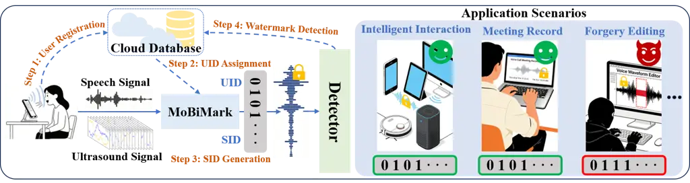

Figure 1. MoBiMark for speech security in different scenarios.

Voice conversion methods enable style transfer and timbre conversion
with limited training data (Qian et al., 2019; Kameoka et al., 2019),
and large-model-based one-shot inference methods can forge arbitrary
speech from a single target sample (Liu, 2024; Wang et al., 2026; Ding
et al., 2025). These advances drastically reduce the cost of producing
convincing spoofed speech, creating a strong incentive for online
real-time defenses that bind authenticity to the physical speaker.

Digital speech watermarking has emerged as a promising mitigation, with
decades of work on imperceptible and robust audio watermarking (Swanson
et al., 1998; Hua et al., 2016; Al-Haj, 2014; Cox et al., 2002). Recent
learning-based watermarking frameworks improve robustness under
compression and filtering (Pavlovic et al., 2022; Fu et al., 2024; Chen
et al., 2023; Roman et al., 2024; Yao et al., 2025a), but they still
lack broad applicability. In the face of advanced voice cloning, a
watermark can be removed, replayed, or replaced by attackers. Existing
methods predominantly operate offline, focusing on protecting
user-generated content after creation or verifying AI-generated output.
As AI-powered speech forgery capabilities grow increasingly
sophisticated, applying watermarks to protect speech at the moment of
utterance emerges as a more logical and urgent approach. There is
currently no work that focuses on using digital watermarking to protect
user speech online in real time. A watermarking system operating on a
device still cannot verify that the input speech originates from a real
user, which remains one of the key factors limiting wider adoption.

We observe two core limitations of existing speech watermarking systems.
First, content-only watermarks cannot verify the physical source:
attackers can remove or regenerate watermarks using private models, or
replay and re-edit captured speech to bypass detection. Second, most
designs use static watermarks and lack reliable biometric binding in
online settings, where registration requirements and device-specific
keys limit deployability. A practical system must bind a watermark to
the user’s biometric characteristics during capture, operate without
specialized hardware, and remain robust under common signal processing
attacks.

Therefore, this paper presents MoBiMark, an online real-time ultrasonic
speech biometric watermarking system that binds vocal-tract motion to
speech and embeds a dynamic watermark into every utterance at capture
time. As shown in Fig. 1, MoBiMark emits an inaudible multi-frequency
ultrasonic signal via the phone earpiece and captures its reflections
through the built-in microphone. The reflected echoes encode signatures
of articulator motion, which are fused with speech content to produce a
biometric-dependent dual-layer watermark. The watermark contains a
stable UID and a content-dependent dynamic SID to enable both source and
propagation attack detection. The system can be practically deployed on
users’ smartphones, enabling real-time watermark integration at the
moment of utterance.

Although our system shows great promise, several key challenges remain
to be addressed: First, how to effectively perform feature
transformation and watermark encoding to ensure user speech protection
throughout propagation. We propose a dual-layer dynamic watermark
encoding method combining a system-assigned static UID with a
speech-correlated dynamic SID. This ensures that tampered or forged
speech can be reliably detected. By integrating the source user’s
biometric information and security mechanisms, a closed-loop security
framework is formed from the source to the propagation process. Second,
how to effectively embed the generated watermark into the original
speech and achieve reliable detection, ensuring that the watermark
remains detectable and supports accurate discrimination after embedding.
In the embedding scenario, we enhance watermark robustness against
benign modifications by adjusting the speech frame ordering strategy.
Furthermore, through security-oriented analysis, we incorporate an
external stabilizer to perform denoising and enhancement on both the
encoded speech information and the input at the detection end, thereby
ensuring the stability of the generated speech features and the
watermark. Finally, how to build a universal and high-accuracy system on
real-world mobile smartphones, enabling online real-time use on
resource-constrained edge devices. Benefit to the widespread
availability of microphone hardware required for ultrasonic signals, our
system inherently possesses hardware universality. Combined with our
carefully designed lightweight model, which employs efficient modules
and incorporates quantization to maximally compress the original system
while preserving accuracy, we successfully deploy the system on mobile
devices, achieving a truly universal, secure and accurate solution.

In summary, our contributions are:

- •
  To the best of our knowledge, MoBiMark is the first real-time online
  speech watermarking system that combines ultrasonic biometric signals
  with speech for proactive speech interaction security. Due to the
  widespread availability of microphone sensors supporting ultrasonic
  signals across various edge devices, MoBiMark can seamlessly integrate
  with a wide range of existing smart mobile devices, enabling speech
  security protection in numerous application scenarios, serving as a
  superior alternative to voiceprint-based methods.
- •
  We have carefully addressed three key challenges to bridge the gap
  between fundamental insights and practical application. These
  challenges span from source-level fusion to cloud-based detection, and
  finally to real-world deployment scenarios, thereby forming a
  closed-loop security framework for speech from source to propagation,
  as well as a practical realization from theoretical design to actual
  implementation. This ensures the effectiveness of the system in
  real-world settings such as on smartphones and mobile devices.
- •
  We deploy MoBiMark on four smartphone models and validate it using a
  dataset from 50 volunteers (25 hours of positive samples, 290+ hours
  of negative attack samples). Through carefully designed spoofing and
  editing attacks, the effectiveness of our dual-layer dynamic encoding
  combined with biometric speech watermarking is thoroughly verified.
  Extensive experiments demonstrate average attack detection accuracy of
  99.79% and negligible perceptual impact, bridging the gap between
  research on online biometric speech watermarking and practical
  deployment on edge mobile devices, offering a new means for protecting
  users’ online speech.

## 2. Related Work

### 2.1. Audio Watermarking

Audio watermarking has a long history, with classic signal processing
approaches embedding imperceptible information in time or transform
domains (Swanson et al., 1998; Hua et al., 2016; Al-Haj, 2014; Bassia et
al., 2001; Lie and Chang, 2006). Robustness and imperceptibility are
typically achieved through psychoacoustic masking and transform-domain
embedding, but these methods are often offline. Recent advances include
hybrid transform algorithms and learning-based embedder-detector
architectures that improve robustness against common signal processing
attacks (Pavlovic et al., 2022; Roman et al., 2024; Yao et al., 2025a).
Speech-specific systems extend these ideas to linguistic content and
speaker identity (Mawalim and Unoki, 2021), and timbre watermarking has
been proposed to detect voice cloning attacks (Liu et al., 2024). Recent
AI-generated content watermarking emphasizes model-side identifiers
during synthesis, valuable for controlled pipelines but not for human
speech captured in the wild. MoBiMark differs by binding watermarks to
biometric signatures at capture time with dynamic content-dependent
encoding.

### 2.2. Audio Forgery Detection

The quality of spoofed speech is tightly linked to progress in speech
synthesis and voice conversion (van den Oord et al., 2016; Shen et al.,
2017; Ren et al., 2020; Kong et al., 2020; Kim et al., 2021; Qian et
al., 2019; Kameoka et al., 2019). Anti-spoofing detectors face
persistent generalization challenges (Wang et al., 2020; Yamagishi et
al., 2021), and models such as RawNet2 and AASIST, while strong on
benchmarks, remain vulnerable to domain shift and provide no content
integrity guarantees (Tak et al., 2020; Park et al., 2021). Defenses
typically focus on detecting artifacts in frequency or phase statistics,
but these signatures quickly become obsolete as synthesis models
improve. Furthermore, detection-only systems face an asymmetry problem:
false negatives may allow high-impact attacks, while false positives
disrupt legitimate interactions. MoBiMark complements anti-spoofing by
integrating biometric watermarking into the capture pipeline, creating
an auditable authenticity trail for downstream forensics.

### 2.3. Acoustic and Ultrasound Sensing

Ultrasound and active acoustic sensing have enabled contactless
interaction and authentication on commodity devices. EchoWhisper uses
ultrasonic echoes to infer silent speech on smartphones (Gao et al.,
2020). VocalLock leverages acoustic sensing of the vocal tract for
passphrase-independent authentication (Lu et al., 2020). Speaker-Sonar
employs inaudible sonar to verify voice command liveness against remote
attackers (Lee et al., 2020). TouchPrint demonstrates active acoustic
sensing for geometric biometric authentication (Chen et al., 2020).
Compared with camera-based biometrics, ultrasound sensing is insensitive
to lighting, operates unobtrusively with existing hardware, and captures
subtle articulatory dynamics difficult to spoof remotely. MoBiMark
builds on these insights by fusing ultrasonic biometric features with
speech to produce a propagation-protecting watermark, forming an
end-to-end security framework.

|                                                                                                                           |                     |                      |                           |                        |                             |                             |
| ------------------------------------------------------------------------------------------------------------------------- | ------------------- | -------------------- | ------------------------- | ---------------------- | --------------------------- | --------------------------- |
| Method                                                                                                                    | Protects Speaker ID | Source-side Liveness | Protects Propagated Audio | Dynamic Speech Binding | Resistant to Speech Editing | Resistant to Replay / Clone |
| Speaker Verification (Voiceprint)  (Shang and Stevenson, 2010; Wang et al., 2011; Wu et al., 2015; Kinnunen et al., 2017) | ✓                   | ✗                    | ✗                         | ✗                      | ✗                           | Limited                     |
| Voice Liveness Detection  (Schroff et al., 2015; Yan et al., 2026; Abdulkareem and Hassin, 2025; Shuwandy et al., 2025)   | ✓                   | ✓                    | ✗                         | ✗                      | ✗                           | Partial                     |
| Audio Watermarking  (Uddin et al., 2024; Roman et al., 2024; Yao et al., 2025a; Yao et al., 2025b; Chen et al., 2023)     | ✗                   | ✗                    | ✓                         | Partial                | Limited                     | ✗                           |
| MoBiMark                                                                                                                  | ✓                   | ✓                    | ✓                         | ✓                      | ✓                           | Strong                      |

Table 1. Comparison between MoBiMark and other methods.

### 2.4. MoBiMark Difference

Our watermarking system prevents source forgery through biometric
authentication at the point of capture and protects speech during
transmission using dynamic watermarking together with a corresponding
detection mechanism. As a result, only speech carrying the correct
watermark is accepted as authentic. As shown in Table 1, compared to
conventional speaker verification (voiceprint) schemes (Shang and
Stevenson, 2010; Wang et al., 2011; Wu et al., 2015; Kinnunen et al.,
2017), our method encompasses both the source and propagation stages,
actively embedding a biometric watermark at capture time. Compared to
voice liveness detection schemes (Schroff et al., 2015; Yan et al.,
2026; Abdulkareem and Hassin, 2025; Shuwandy et al., 2025), MoBiMark
overcomes the limitation of verifying identity only at acquisition time
by embedding dynamic speech-related watermarks that enable authenticity
traceability throughout transmission, storage, and redistribution, while
leveraging large-scale pre-trained speech model generalization to
achieve cross-user capability without capturing a range of users’ data
for retraining. Compared to traditional audio watermarking (Uddin et
al., 2024; Roman et al., 2024; Yao et al., 2025a; Yao et al., 2025b;
Chen et al., 2023), MoBiMark uniquely binds source-side liveness
information to propagated speech, addressing the fundamental gap that
existing watermarks cannot verify whether input speech originates from a
real user. In summary, unlike all previous methods, we propose an
integrated speech biometric watermarking system that protects all speech
from the target human, from source to subsequent dissemination.

## 3. Threat Model

### 3.1. Security Goals and Trust Assumptions

MoBiMark aims to preserve speech authenticity throughout acquisition,
transmission, and subsequent propagation by providing two security
guarantees: (1) source authenticity, ensuring that speech originates
from a legitimate enrolled speaker, and (2) propagation integrity,
ensuring that propagated speech remains consistent with the originally
generated content.

We assume that the user’s smartphone, including the microphone,
ultrasonic sensing module, operating system, and local watermark
generation pipeline, operates correctly and is not compromised. Sensor
measurements are acquired through the device’s normal sensing
interfaces. In particular, the adversary cannot directly tamper with
sensor hardware or drivers, bypass the sensing pipeline to inject
fabricated digital measurements, or otherwise manipulate the trusted
acquisition process. These assumptions define the trusted hardware and
sensing boundary of MoBiMark. Attacks that compromise this boundary are
outside the scope of our watermarking system.

The ultrasonic evidence used by MoBiMark is generated by the
smartphone’s own speaker and captured by its microphone through the
normal acoustic propagation path. The acquisition and binding of
speaker-related biometric characteristics and the corresponding
ultrasonic measurements are performed within the trusted sensing
pipeline. We assume that the raw ultrasonic measurements and the
internal correspondence between the target speaker’s biometric
characteristics and the captured ultrasonic responses are protected from
direct adversarial access. In particular, the adversary cannot obtain
target-specific paired speech-ultrasound observations sufficient to
reconstruct the correspondence exploited by MoBiMark. This assumption
concerns the protection of the trusted acquisition and binding process,
rather than the physical impossibility of external ultrasonic
interference.

The cloud verification service is trusted and follows the prescribed
protocol, while communication among trusted components is protected
using standard transport-layer security mechanisms. We further assume
that user enrollment is performed in a trusted environment, consistent
with existing biometric authentication systems such as Face ID and
fingerprint authentication. Since the security of MoBiMark fundamentally
depends on the correctness of the enrolled identity, impersonation
during enrollment compromises the root of trust rather than exploiting a
vulnerability in MoBiMark. Moreover, attacks against MoBiMark are
meaningful only after a user has enrolled and enabled watermarking. We
therefore consider enrollment attacks, as well as full compromise of
trusted hardware or software, outside our threat model.

### 3.2. Attack Model

We consider a strong adversary who knows the general working principle
the MoBiMark architecture. The adversary may obtain previously published
speech recordings, corresponding watermarked speech, and access to the
static detector implementation. Notably, the static detector differs
from our cloud-based dynamic detector in that it can only detect the
statically assigned watermark key, consistent with watermark detection
schemes in most prior studies. In contrast, detection of the dynamic
watermark is performed exclusively within our trusted cloud service, and
the dynamic detection mechanism remains undisclosed to the public.

The adversary can perform replay attacks, voice cloning, speech
conversion, speech editing, watermark reuse, and other digital
manipulations in an attempt to bypass the verification process. We
further consider adaptive adversaries who are aware of the
speech-ultrasound consistency constraints exploited by MoBiMark. Such
adversaries may attempt to jointly construct synchronized speech and
ultrasonic signals, replay forged speech while presenting artificial
ultrasonic signals, or reuse previously observed content to maximize
their acceptance probability. However, these attacks are constrained by
the trusted acquisition and binding assumptions described above.

The adversary cannot directly inject fabricated measurements into the
smartphone’s sensor data stream or access the internal correspondence
between the target speaker’s biometric characteristics and the captured
ultrasonic responses. Consequently, attacks that require eavesdropping
on the target speaker’s ultrasonic responses or collecting sufficient
target-specific paired speech-ultrasound observations to train a model
that reproduces this correspondence are outside our threat model.
Similarly, the adversary is assumed not to have access to synchronized
speech-ultrasound pairs collected during legitimate watermark generation
when such access would expose the protected correspondence. These
restrictions do not imply that external ultrasonic signals are
physically incapable of reaching the microphone; rather, they reflect
the protection of the trusted acquisition and binding process.

Accordingly, MoBiMark focuses on detecting forged or manipulated speech
and preserving the association between legitimately captured
speaker-related biometric signals and the resulting watermarked speech
throughout subsequent propagation. Direct physical attacks on trusted
sensors, malicious modification of sensor drivers or firmware,
privileged compromise of the operating system, and other attacks that
violate the trusted sensing boundary are outside the scope of this work.
In addition, strengthening hardware-level encryption and data-flow
integrity protection is a promising direction for further hardening the
system against unauthorized access to or injection of internal hardware
data.

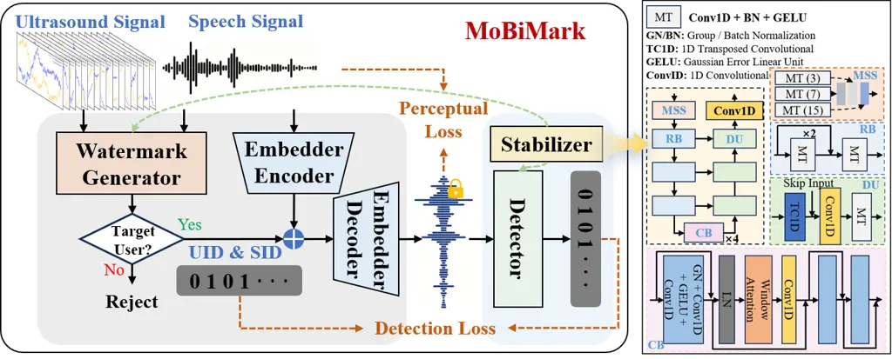

Figure 2. Overall architecture of MoBiMark.

## 4. System Design

MoBiMark is deployed on the client side of users’ mobile devices. The
overall workflow, as illustrated in Fig. 1, involves the following
components.

1. User Registration: Before using the system, a user registers their
   voice and ultrasonic data with a single arbitrary sample, sufficient due
   to the pre-trained encoder’s generalization capability. Specifically,
   the registered samples are converted into compressed feature vectors,
   stripped of the user’s biometric information, and then uploaded to a
   trusted cloud for subsequent watermarking and detection.

2. UID Assignment: After registration, the system automatically assigns
   a static 64-bit UID code, which will be combined with the subsequent
   dynamic SID.

3. SID Generation: During actual voice interaction, MoBiMark
   automatically and dynamically generates a content-dependent 192-bit SID
   for each utterance. The encoded information is strongly correlated with
   the speech features; if the speech is modified, the encoded value
   changes accordingly, enabling effective real-time dynamic protection.

4. Watermark Detection: For simple verification scenarios, the detector
   can use the UID locally, similar to mainstream static watermarking
   schemes. For forged speech that has been meticulously modified or edited
   by an attacker, the speech only needs to be uploaded to the cloud, where
   the system regenerates the corresponding watermark information based on
   the current speech and compares it with the embedded watermark,
   returning the comparison result.

As shown on the left of Fig. 2, the architecture consists of the
Watermark Generator, the Embedder Encoder/Decoder, the Detector and
Stabilizer modules. Specifically, the concurrently captured speech and
ultrasound signals are fed into MoBiMark. They are first examined and
compared by the Watermark Generator module; if a live user is verified,
a dual-layer dynamic watermark code (UID + SID) is generated based on
both signals and then combined with the intermediate speech features
produced by the Embedder Encoder. The result is decoded by the Embedder
Decoder into a watermarked speech signal that preserves the original
speech quality. The subsequently deployed Detector extracts the embedded
watermark information. The Stabilizer is applied within both the
Watermark Generator and the Detector to maintain the stability of the
watermark features. Benefiting from the ubiquity of microphone sensors
required for ultrasound on all mobile phones, MoBiMark exhibits a high
degree of universality.

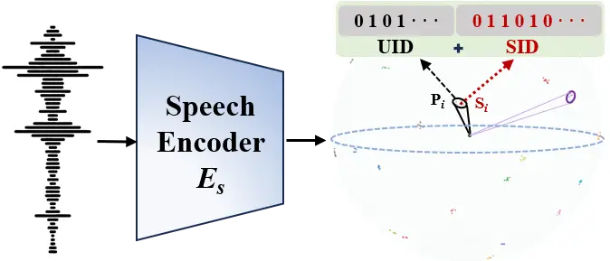

Figure 3. Speech feature clusters for different registered users.

### 4.1. Watermark Generation

#### 4.1.1. Speech Encoder

The design goal of MoBiMark is a novel watermarking system capable of
integrating with speech information while ensuring real-time security at
the source. We abstract the most fundamental requirements of the system:
it must be able to distinguish between a large number of newly
registered different users, ensuring feature independence among them.
Simultaneously, it should also differentiate between different speech
utterances from the same user, in order to meet the subsequent demands
of dynamic watermarks that are strongly correlated with speech content.
During training, the system utilizes speech data from known users to
construct an effective feature space. This feature space must ensure
that speech features from different users form distinct clusters, while
also allowing differentiation among different speech features from the
same user, as illustrated in the Fig. 3.

From the perspective of theory, the speech representation learning task
addressed by this system can be modeled as a joint optimization problem
of category discrimination and sample diversity. Let the
high-dimensional observed feature embedded by the model be
$`X\in\mathbb{R}^{D}`$, and the category label be $`Y`$. The learning
objective can be uniformly formulated as maximizing a weighted
combination of the category mutual information and the within-class
conditional entropy:

```math
\max_{\theta}\ I_{\theta}(X;Y)+\lambda\cdot\mathbb{E}_{Y}[H_{\theta}(X|Y)] \tag{1}
```

Here, $`I_{\theta}(X;Y)`$ represents the discriminative information
associated with the category. Its maximization ensures significant
distinguishability between different identity categories. Conversely,
the conditional entropy $`H_{\theta}(X|Y)`$ measures the uncertainty and
richness of the sample distribution within a given category. Its
non-degeneracy constraint guarantees sufficient diversity among
different samples belonging to the same class.

However, a feature space derived solely from this optimization objective
is limited by our finite collection of sample data and cannot form a
stable and effective representation. Consequently, it fails to
generalize well when encountering new users. We aim to train such an
ultra-large-scale and stable vocal timbre feature space on a large
number of different users, and ensure that newly registered users are
effectively assigned to fixed regions within this feature space.

Inspired by speaker recognition tasks (Hannun et al., 2014; Chan et al.,
2016; Wang et al., 2023), we observe that for such tasks, speech from
different users forms distinct clusters in the feature space, with each
cluster representing unique vocal timbre information. However, due to
the leakage of semantic information in speech, different utterances from
the same user do not completely converge to a single point; instead,
they distribute at different locations within the cluster. While this is
considered a drawback in speaker recognition tasks, it precisely aligns
with the requirements of our task. We leverage the encoder of the
well-established CAM++ model (Wang et al., 2023), which is trained on a
large-scale speaker dataset, as our Speech Encoder $`E_{s}`$. The CAM++
is trained on a dataset comprising over 200,000 user speech samples,
enabling it to learn a broad range of vocal timbre information and
achieve effective high-dimensional space embeddings for the vocal timbre
of all users. Nevertheless, it is extremely lightweight and highly
suitable for our system. The 512-dimensional high-dimensional space
output by CAM++ provides sufficient representational capacity for the
aforementioned objective. The high dimensionality supports the formation
of adequate inter-class informational separation, thereby increasing
$`I_{\theta}(X;Y)`$. Simultaneously, it allows each class to occupy a
non-degenerate support region on the high-dimensional manifold, thereby
maintaining a relatively large $`H_{\theta}(X|Y)`$ and preventing
excessive convergence of representations within the same class.
Therefore, under this theoretic framework, the model achieves robust and
highly discriminative speech representation learning by simultaneously
enhancing inter-class separability and intra-class diversity within the
high-dimensional space.

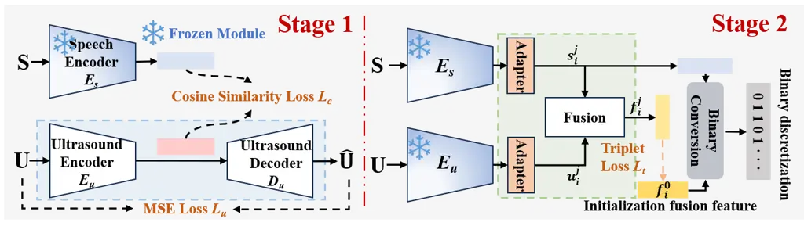

Figure 4. Overall architecture of the Watermark Generator.

#### 4.1.2. Ultrasound Encoder

We encode the speech modality using $`E_{s}`$, and simultaneously encode
ultrasound signals with $`E_{u}`$, as shown in Fig. 5. To ensure the
generalization ability of MoBiMark for newly registered users, it is
necessary for $`E_{u}`$ to also exhibit generalization beyond the
limited training samples. If training is performed only on a limited
number of data samples, the feature space learned by the model is
confined to the regions corresponding to these samples. When a new user
registers, the feature space allocated to them tends to overlap with
that of the training users, making effective differentiation impossible.
Therefore, we align ultrasound signal features and speech signal
features in the high-dimensional feature space. Since $`E_{s}`$ is
trained on a very large-scale speech dataset, it can form an extremely
large and stable feature space. After aligning the speech features with
the corresponding ultrasound signal features in this space, the
ultrasound features are also able to learn an effective feature
distribution within the corresponding feature space. Compared to
partitioning the feature space based on limited data, this approach
substantially expands the scope of the feature space, ensuring that when
a new user registers, the region assigned to their features is
sufficiently distinct from those of other users.

We train $`E_{u}`$ using cosine similarity loss
$`\mathcal{L}_{\text{c}}`$ with the output of $`E_{s}`$, combine with an
MSE reconstruction loss $`\mathcal{L}_{\text{u}}`$ with decoder
$`D_{u}`$ (the left in Fig. 4):

```math
\mathcal{L}_{\text{s1}}=\lambda_{c}\mathcal{L}_{\text{c}}+\lambda_{u}\mathcal{L}_{\text{u}} \tag{2}
```

with $`\lambda_{c}=1.0`$ and $`\lambda_{u}=0.2`$. We use
$`\mathcal{L}_{\text{c}}`$ to align the ultrasound and speech features,
which is designed to train $`E_{u}`$ to cluster samples from the same
user together while separating those from different users, thereby
achieving user discrimination. To ensure that samples within the same
cluster remain distinguishable, a prerequisite for constructing the SID,
the encoder output features are simultaneously passed through a weak
decoder $`D_{u}`$ to reconstruct the original ultrasound information.
This constitutes an adversarial training scheme: the weak decoder forces
the model to preserve intra-class variations while still learning
discriminative inter-user boundaries, so that distinct user clusters
form without causing feature collapse within each class.

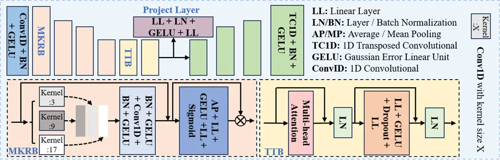

Figure 5. Architecture of ultrasound Encoder and Decoder.

As shown in Fig. 5, $`E_{u}`$ processes 32-channel raw waveform segments
(shape \[B, 32, 3000$`\times T`$\]) adapted for ultrasound signals,
where 3000 is the ultrasonic sampling rate and $`T`$ is the time length.
The encoder first performs local pre-encoding through a convolutional
stem ($`32\!\to\!96,k\!=\!9`$), followed by four stacked multi-kernel
residual blocks (MKRB) that employ strides of 5,5,4,3 to achieve a total
temporal downsampling factor of $`300\times`$, compressing the time
length from $`3000\times T`$ to $`10\times T`$. Each MKRB consists of
three parallel convolutional branches (kernel sizes of 3, 9, 17) to
explicitly capture short-range, medium-range, and long-range waveform
patterns. After branch fusion, the features undergo convolutional
post-processing, followed by the addition of a $`1\times 1`$ residual
projection, and are then adaptively re-calibrated via a channel
attention gating mechanism (compression ratio 8), achieving a balance
between multi-scale modeling and channel selection. On this basis, we
cascade two temporal Transformer modules (TTB, embedding dimension 512,
8 attention heads, dropout 0.1) to further model global dependencies
across segments. After temporal average pooling, a two-layer projection
head (Linear–LayerNorm–GELU–Linear) produces a 512-dimensional
discriminative vector. The decoder $`D_{u}`$ employs a four-stage
deconvolutional pathway (strides 3,4,5,5) to progressively restore
temporal resolution, using linear interpolation for length alignment
when lengths are not evenly divisible. This design concurrently
addresses identity discrimination capability and temporal structure
fidelity.

#### 4.1.3. User Verification and Dynamic Watermark Generation

Overall, our model training is divided into two stages, as shown in the
Fig. 4. The first stage mainly includes the design and training of the
aforementioned $`E_{s}`$ and $`E_{u}`$ modules, which are used to
effectively encode speech and ultrasound signals into a feature space
that allows for comparison and fusion. The features obtained from the
two modalities are then used for subsequent user verification and
dynamic watermark generation.

Verification: As shown on the right side of the Fig. 4, the output
vectors of the two encoders are first transformed by the Adapter module
to adapt to the encoding dimension required in later stages. The two
vectors are then processed by the Fusion module, which outputs the fused
feature vector $`f_{i}^{j}`$. To enable effective dimension conversion
for new registered users and to assign the fused feature vector to an
appropriate location in the fused feature space, we employ a triplet
loss function $`\mathcal{L}_{\text{t}}`$ for metric learning. This loss
function pulls features of the same user closer in the feature space,
while pushing features of different users farther apart. The formula for
this loss function is as follows:

```math
\mathcal{L}_{\text{t}}=\max\left(\|\mathbf{x}_{a}-\mathbf{x}_{p}\|_{2}^{2}-\|\mathbf{x}_{a}-\mathbf{x}_{n}\|_{2}^{2}+\alpha,0\right) \tag{3}
```

Where $`\mathbf{x}_{a}`$ is feature of the anchor point,
$`\mathbf{x}_{p}`$ is positive sample feature same as user of anchor
point, $`\mathbf{x}_{n}`$ is negative sample feature different from user
of anchor point, and $`\alpha`$ is the margin, which controls the
minimum distance between the positive and negative sample pairs.
Benefiting from the pre-trained modality encoders from the previous
stage, the modules trained in this stage can easily cluster effective
sample pairs of the two modalities from the same user, while effectively
separating clusters from different users. This results in features that
match the watermark encoding dimension, as well as corresponding fused
features.

Before fusion, we incorporate symmetric adapters for the ultrasound and
audio modalities, respectively, in order to mitigate the statistical
distribution gap between heterogeneous modalities and align the
subsequent encoding dimensions. As shown in Fig. 6, each Adapter module
employs a lightweight structure of Linear–LayerNorm–GELU–Linear, while
preserving the original temporal length unchanged Through this module,
we can adaptively adjust the number of watermark encoding bits without
affecting the training of other modules. We set the output dimension to
192, which is the same as the encoding dimension of the SID.

For the Fusion module, we adopt a bidirectional multi-head
cross-attention mechanism, with an attention embedding dimension of 192
and 8 heads, enabling the ultrasound branch to query audio context and
the audio branch to query ultrasound context in reverse, thereby
explicitly modeling a bidirectional complementary relationship. To
suppress cross-modal noise propagation, a gating unit is applied after
the attention outputs. The gating network takes the concatenated
representation of the original features and the cross-attention features
as input, with an input channel size of 384, and outputs gating
coefficients of 192 dimensions. Residual connections and LayerNorm are
further employed to enhance training stability. In the global
aggregation stage, the module pools the two sequences separately to
obtain two 192-dimensional global vectors ($`s`$ and $`u`$) and further
constructs three types of relational features (multiplicative
interaction $`s\odot u`$, difference response $`s-u`$, and dominant
response $`max\{s,u\}`$), each also 192-dimensional. The final
concatenated fusion vector has a channel dimension of 960 (including
$`s`$ and $`u`$). A metric head projects it as 960→384→192→192, and
incorporates LayerNorm, BatchNorm, and Dropout layers. This module
ultimately outputs a fused embedding vector for the two modalities, with
a dimension of 192, which is then used to match the final watermark
encoding.

Using the well-trained features described above, we can obtain speech
and ultrasound features of different users. It is only necessary to
construct the corresponding logic to determine whether the input speech
signal originates from the genuine target user. The specific algorithmic
logic is shown in the Algorithm 1.

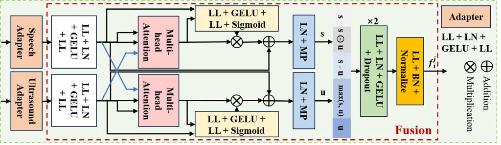

Figure 6. Architecture of Adapter and Fusion modules.

1: Speech $`\mathbf{s}^{j}`$, ultrasound $`\mathbf{u}^{j}`$, fused
$`\mathbf{f}^{j}`$; enrolled features
$`\{(\mathbf{s}_{i}^{0},\mathbf{u}_{i}^{0},\mathbf{f}_{i}^{0})\}_{i=1}^{N}`$

2: Thresholds
$`\gamma_{s},\gamma_{u},\gamma_{f},\gamma_{\text{enroll}}`$

3: Verification result

4: Find best-matching user:
$`\text{best\_sim}\leftarrow\max_{i}\text{Sim}(\mathbf{s}^{j},\mathbf{s}_{i}^{0})`$,
$`i\leftarrow\arg\max`$

5: if $`\text{best\_sim}<\gamma_{\text{enroll}}`$ then return (False, 0)
$`\triangleright`$ No match, enroll

6: end if

7: if $`\text{best\_sim}<\gamma_{s}`$ then return (False, -1)

8: end if

9: $`Sim_{u}\leftarrow\text{Sim}(\mathbf{u}^{j},\mathbf{u}_{i}^{0})`$,
$`Sim_{f}\leftarrow\text{Sim}(\mathbf{f}^{j},\mathbf{f}_{i}^{0})`$

10: if $`Sim_{u}\geq\gamma_{u}`$ and $`Sim_{f}\geq\gamma_{f}`$ then
return (True, $`i`$)

11: elsereturn (False, -1)

12: end if

Algorithm 1 Target User Verification

The system first compares the input speech feature $`\mathbf{s}^{j}`$
with the enrolled speech features $`\{\mathbf{s}_{i}^{0}\}_{i=1}^{N}`$
to identify the best-matching user index $`i`$ and the corresponding
similarity score best*sim. If
$`\text{best_sim}<\gamma*{\text{enroll}}`$, the system identifies the
input as belonging to an unregistered user and triggers the initial
enrollment process, returning $`(\texttt{False},0)`$. Otherwise, if
$`\text{best_sim}<\gamma*{s}`$, the system rejects the verification and
returns $`(\texttt{False},-1)`$. For a candidate that passes speech
verification, the system further computes the similarities $`Sim*{u}`$
and $`Sim*{f}`$ between the input ultrasound and fused features,
$`(\mathbf{u}^{j},\mathbf{f}^{j})`$, and the corresponding enrolled
features, $`(\mathbf{u}*{i}^{0},\mathbf{f}_{i}^{0})`$. The verification
succeeds only if both $`Sim_{u}\geq\gamma*{u}`$ and
$`Sim*{f}\geq\gamma*{f}`$, in which case the system returns
$`(\texttt{True},i)`$; otherwise, it rejects the input and returns
$`(\texttt{False},-1)`$. This hierarchical decision process uses speech
similarity for candidate identification and preliminary verification,
followed by joint ultrasound and fused-feature verification to
strengthen authentication reliability. In our experiments, we set
$`\gamma*{s}=\gamma*{u}=\gamma*{f}=0.5`$ and
$`\gamma\_{\text{enroll}}=0.1`$. If all conditions are satisfied, the
system authenticates the target user and embeds a dual-layer dynamic
watermark into the speech. Otherwise, watermark embedding is rejected.
Since downstream processing treats speech without a valid watermark,
including speech carrying an incorrect watermark, as invalid, only
authenticated speech with valid watermark information is accepted,
ensuring source-level speech security.

Watermark Generation: Beyond protecting speech at the source, it is
essential to preserve its authenticity and integrity during
transmission. Existing watermarking schemes often rely on static
watermarks or lack real-time dynamic verification, limiting their
effectiveness against replay and content-tampering attacks. To address
these limitations, MoBiMark introduces a biologically grounded,
dual-layer dynamic watermark comprising a static UID and a dynamic SID.
The UID is a system-assigned 64-bit code that supports lightweight
identity verification, while the 192-bit SID provides stronger
protection for security-critical applications.

For each speech sample $`\mathbf{S}_{i}^{j}`$ and its synchronized
ultrasound signal $`\mathbf{U}_{i}^{j}`$, pretrained encoders extract
speech and ultrasound features, which are aligned through a dimension
transformation module (DTM) and fused into a multimodal representation.
The SID is then generated by combining the normalized difference between
the current speech feature and the user’s registered speech feature with
the normalized registered fusion feature, followed by nonlinear
activation and binarization:

```math
SID_{i}^{j}=\text{sign}\big(\tanh\big(\text{norm}(\hat{\mathbf{s}}_{i}^{j}-\mathbf{s}_{i}^{0})\odot\text{norm}(\mathbf{f}_{i}^{0})\big)\big) \tag{4}
```

The final watermark is
$`\mathbf{B}_{i}^{j}=\operatorname{Concat}(UID_{i},SID_{i}^{j})`$. By
binding a persistent user identity to sample-specific speech and
biometric features, the dual-layer design supports efficient identity
verification while enabling dynamic content-integrity checks. Because
the SID depends on the utterance and registered biometric information,
semantic modifications (e.g., deleting “not”) can be detected by
checking the consistency between the received speech and its SID, while
unauthorized speech cannot obtain a valid watermark through the source
authentication process.

### 4.2. Watermark Embedding and Detection

After generating the dual-layer dynamic speech biometric watermark, it
is embedded into the speech signal while ensuring imperceptibility to
human listeners and ASR systems, tamper sensitivity, and robustness
against benign signal processing (e.g., resampling, filtering, and
compression).

#### 4.2.1. Speech Stabilizer

As shown on the right side of Fig. 2, the Speech Stabilizer is shared by
the watermark generation and detection stages to improve robustness
against benign speech modifications, such as mild noise and
down-sampling. During watermark generation, it denoises the input speech
to obtain more stable speech and fusion features, improving subsequent
cloud-based watermark detection. Importantly, denoising is applied only
to the speech fed into the watermark generation module; the original
speech remains unchanged to preserve its authenticity and contextual
information.

During cloud-based detection, the stabilizer processes the potentially
modified speech before regenerating the dynamic watermark for comparison
with the watermark embedded in the speech. This design compensates for
the sensitivity of the speech encoder $`E_{s}`$ to benign modifications,
which enables dynamic watermark generation and helps defend against
editing and forgery attacks. Meanwhile, joint anti-interference training
allows the detector to directly recover watermark information despite
such modifications. The stabilizer is optional: when tolerance to
subsequent modifications is not required, any modification after
watermark embedding can instead be treated as potential forgery, and the
stabilizer can be omitted.

The stabilizer adopts a U-Net-like encoder-decoder architecture. A
multi-scale convolutional stem (MSS; kernel sizes 3, 7, and 15) extracts
local acoustic features, followed by three stride-2 convolutional layers
with depthwise-separable residual blocks and increasing dilation rates.
Four lightweight Conformer blocks form the bottleneck, combining
feed-forward networks, windowed multi-head self-attention, and
depthwise-separable convolution to capture contextual information with
reduced sequence complexity from $`O(T^{2})`$ to $`O(Tw)`$, where $`T`$
is the sequence length and $`w`$ is the attention window size. The
decoder uses transposed convolutions and encoder skip connections to
reconstruct the enhanced waveform through residual learning. Training
minimizes a weighted combination of waveform MSE and Mel-spectrogram
MSE, where the Mel spectrogram uses a 25-ms Hann window, a 10-ms frame
shift, and 80 Mel filter banks:

```math
\mathcal{L}_{\text{stabilizer}}=\lambda_{mw}\mathcal{L}_{\text{mw}}+\lambda_{mm}\mathcal{L}_{\text{mm}}, \tag{5}
```

where $`\lambda_{mw}`$ and $`\lambda_{mm}`$ control the respective loss
weights, and we set 10 and 1, respectively, by experimental training
experience.

#### 4.2.2. Watermark Embedding

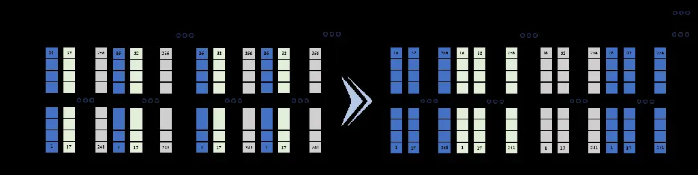

Figure 7. Chunk-based vs. group-based watermark framing.

We follow the design of AudioSeal (Roman et al., 2024) and extend its
original 16-bit watermark to a dynamic 256-bit watermark that can be
embedded within a single utterance, drawing inspiration from
SpeechVerifier (Yao et al., 2025a). Specifically, we adopt a temporal
framing strategy that divides the watermark into 16 frames, each
encoding 16 bits. A spoken word typically lasts approximately 250 ms
(Levelt, 1993), corresponding to around 4,000 audio samples at a
sampling rate of 16 kHz. This provides the temporal context for
embedding the complete watermark within an utterance.

As illustrated in the upper part of Fig. 7, a straightforward approach
is to arrange the 16 watermark frames consecutively within each chunk,
which we refer to as chunk-based framing. However, uniform downsampling
may consistently remove the same relative frame positions across chunks,
potentially causing systematic information loss and compromising
watermark recovery. To mitigate this vulnerability, we propose
group-based framing, illustrated in the lower part of Fig. 7.
Specifically, each of 16 consecutive chunks carries one of the 16-bit
watermark segments, repeated across 16 consecutive frames within that
chunk. These 16 chunks form a group of 256 frames, across which the
complete 256-bit watermark is distributed through temporal interleaving.
By spreading watermark information across multiple chunks, this design
is expected to improve tolerance to uniform downsampling and reduce the
risk of systematic information loss caused by the removal of fixed
relative frame positions. However, it does not guarantee the recovery of
every watermark bit under all downsampling conditions.

Beyond the encoding strategy, the Perceptual Loss and Detection Loss
play a critical role in balancing watermark imperceptibility, robustness
to benign speech modifications, and sensitivity to malicious
manipulation. We adapt the loss designs of AudioSeal and SpeechVerifier
(Roman et al., 2024; Yao et al., 2025a) to jointly support these
objectives.

#### 4.2.3. Watermark Detection

The watermark detection component is primarily divided into edge-side
and cloud-side detection, corresponding to the detection of static UIDs
and dynamic SIDs, respectively.

Edge Static Detection: Deployed on edge devices, this detection method
resembles most existing watermark detection endpoints and is applicable
only to simple or real-time, non-falsifiable security scenarios, such as
in smart Internet of Things (IoT) device security detection. By
verifying static UIDs, edge devices can determine whether the current
speech originates from the target user. In practice, certain benign
modifications may affect detection accuracy, leading to discrepancies
between the extracted watermark code and the true code. Therefore, the
Hamming distance (Hamming, 1950) is employed to measure similarity by
counting differing bit positions; a smaller value indicates higher
similarity. The specific discrimination threshold can be set by the
user.

Cloud Dynamic Detection: However, in more complex scenarios requiring
higher security, detection based solely on static UIDs is insufficient.
In high-security scenarios, compared to traditional watermarking
systems, MoBiMark offers distinct advantages. Since the system ensures
correctness from the source, it operates as a closed-loop system. For
dynamic watermarking, the speech to be verified can be uploaded to the
cloud for dynamic detection. The cloud system then returns a
determination to the user regarding whether the speech originates from a
genuine user. The principle of cloud detection involves generating
corresponding watermark information from the speech to be verified
through the Watermark Generator module. This generated watermark is then
compared with the dynamic watermark code (SID) embedded in the speech. A
match indicates authenticity; otherwise, the speech is considered
inauthentic. In the cloud detection stage, the Stabilizer is utilized to
recover speech that has undergone benign modifications, thereby
facilitating more accurate discrimination of watermark information.

|                       |                 |                |
| --------------------- | --------------- | -------------- |
| Module                | FP32 (MB)       | INT8 (MB)      |
| Watermark Generator   | 81.37           | 24.97          |
| Embedder              | 56.17           | 21.57          |
| Detector              | 33.12           | 12.29          |
| Stabilizer (Optional) | 84.00           | 23.88          |
| Total                 | 170.66 (+84.00) | 58.83 (+23.88) |

Table 2. Module sizes before and after quantization.

### 4.3. Lightweight Deployment

Model quantization is an effective approach to edge deployment, reducing
memory footprint and potentially accelerating inference by lowering the
numerical precision of model weights and activations (Jacob et al.,
2018). Compared with pruning and knowledge distillation, it can often be
applied with limited architectural changes and lower retraining
overhead. In this work, we quantize MoBiMark from FP32 to INT8 to
improve deployment efficiency on resource-constrained smartphones. For
affine quantization, a floating-point value $`x`$ is mapped to an
integer representation as
$`x_{q}=\operatorname{clip}(\operatorname{round}(x/s)+z,q_{\min},q_{\max})`$,
and reconstructed as $`\hat{x}=s(x_{q}-z)`$, where $`s`$ and $`z`$
denote the quantization scale and zero-point, respectively. We use
symmetric quantization for weights and asymmetric quantization for
activations to accommodate their different value distributions (Jacob et
al., 2018).

To mitigate quantization-induced accuracy degradation, we adopt
quantization-aware training (QAT), which simulates INT8 inference during
training while retaining FP32 parameter optimization. Specifically,
fake-quantization operators are applied to weights and activations, with
the forward pass defined as
$`\hat{x}=Q(x)=\operatorname{DeQuant}(\operatorname{Quant}(x))`$. Since
quantization is non-differentiable, the straight-through estimator (STE)
approximates the gradient during backpropagation (Bengio et al., 2013).
This allows the model to adapt to quantization errors before deployment.
Layers unsupported by INT8 retain FP16 representations. As shown in
Table 2, the total model size decreases from 170.66 MB to 58.83 MB, a
reduction of 65.53%. All subsequent experiments use the resulting
edge-deployed models, and we compare their performance with the original
FP32 models to evaluate the impact of quantization.

## 5. Experiments

### 5.1. Dataset and Experimental Setup

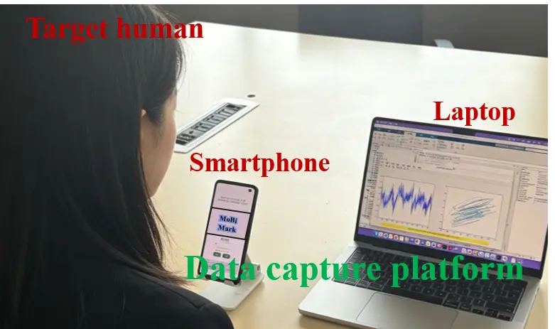

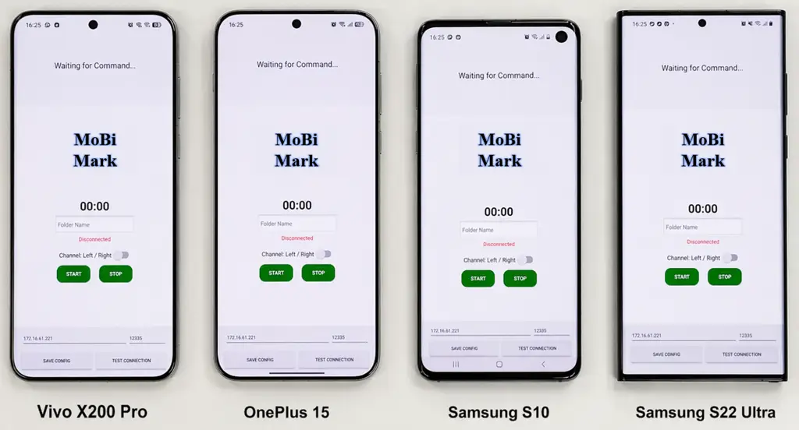

Figure 8. Data capture system and different smartphone devices.

#### 5.1.1. Speech-ultrasound Acquisition System

We constructed a synchronized speech-ultrasound acquisition system using
MATLAB and Android Studio, deployed on laptops and smartphones,
respectively, as shown in Fig. 8. We use the built-in top earpiece to
transmit ultrasound and the adjacent microphone to record audio at 48
kHz, enabling stable near-field acoustic sensing (Zhou et al., 2021). We
transmit a Continuous Wave (CW) signal $`S(t)`$ as a superposition of
$`N=16`$ orthogonal sub-carriers:
$`S(t)=\sum_{k=0}^{N-1}\cos(2\pi f_{k}t)`$, with $`f_{k}`$ ranging from
17.15 kHz to 22.4 kHz at 350 Hz intervals. Non-rigid articulatory
movements perturb the acoustic paths and encode kinematic information
into the received signal $`R(t)`$, which is the spatial integral of
scattering echoes over the facial surface (Wang et al., 2016). To
recover baseband motion information, we perform digital coherent
demodulation on $`R(t)`$ using the locally generated in-phase carrier
$`\cos(2\pi f_{k}t)`$ and quadrature carrier $`-\sin(2\pi f_{k}t)`$ for
each $`f_{k}`$. We then apply a 50 Hz low-pass filter to extract
baseband articulatory components (speech organ movement frequency is
typically around 40 Hz (Lu et al., 2018)) and downsample the signals by
$`D=16`$ to 3 kHz. This process yields complex baseband signals
$`B_{k}(t)=I_{k}(t)+jQ_{k}(t)`$, where $`I_{k}(t)`$ and $`Q_{k}(t)`$
capture the instantaneous motion-induced in-phase and quadrature
components. The 32 resulting channels (16 frequencies $`\times`$ I/Q)
form the ultrasonic sample. In parallel, we extract audible speech from
the recorded signal using a Butterworth low-pass filter of order six
with a cutoff frequency of 16 kHz. Because both modalities are derived
from the same recorded signal, they share the same acquisition timeline
and are naturally aligned in time, aligned with speech via hardware
timestamps (48 kHz sampling, every 512-sample block), as illustrated in
Fig. 9.

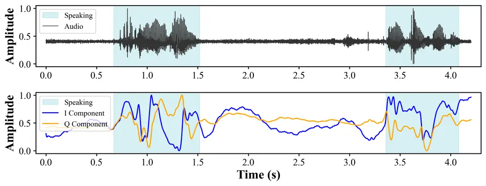

Figure 9. Speech and ultrasound signal synchronization.

#### 5.1.2. Dataset Setup

Data were collected from 50 users (25 male and 25 female), with 40
randomly selected users for training and the remaining 10 users for
testing. Each user contributed approximately 0.5 hours of paired speech
and ultrasonic data. During collection, subjects held the smartphone
20–25 cm from the face, approximating a real voice-call scenario. Speech
was sampled at 16 kHz and segmented into 5 s windows synchronized with
the ultrasonic signal. The dataset consists of positive and negative
samples:

\(1\) Positive samples (Pos., about 25 h): Genuine synchronized
speech-ultrasound pairs collected from legitimate users.

\(2\) Negative samples in source-level attacks: Forged Speech (S1, 25
h), AI-generated or replayed target speech without any corresponding
ultrasonic signal. Forged Speech + Fake Ultrasound (S2, about 250 h),
forged target speech accompanied by artificially generated ultrasonic
signals unrelated to the spoken content. Adaptive Speech-Ultrasound
Attack (S3, over 2 h), attacker imitates the target user’s articulation
while replaying forged speech to generate synchronized ultrasonic
echoes.

\(3\) Negative samples in propagation-level attacks: Speech Editing (P1,
over 2 h), randomly selected 0.5–1.0 s segment of an authenticated
speech recording is replaced using a voice editing model while
preserving the original watermark. Speech Cropping (P2, over 2 h),
randomly selected 0.5–1.0 s segment is removed from an authenticated
speech recording while retaining the original watermark. Speech Splicing
(P3, over 3.5 h), 2–5 speech segments from different recordings are
concatenated to create forged content, while watermark information
extracted from another authenticated recording is injected into the
forged speech. Watermark Reuse (P4, over 2 h), watermark information
extracted from an authenticated recording, including the correct UID and
SID, is directly injected into other speech samples without modifying
the speech content. Voice Forgery (P5, over 3.5 h), voice cloning or
editing model synthesizes arbitrary utterances from a few seconds of the
target user’s speech, after which watermark information extracted from
another authenticated recording is embedded into the forged speech.

For the Stabilizer module, a 20-hour clean dataset is constructed from
the collected speech, along with corresponding samples subjected to
different benign modifications, including adding different environment
noises, the noise level is within 5-20% of the original speech
intensity. The training dataset and the test dataset are divided in a
ratio of 8:2. All experiments received our institutional review board
(IRB) ethical approval before the start of the study.

#### 5.1.3. Training Details

All models are trained on a single NVIDIA RTX 5070 Ti GPU. For the
watermark generation module, Stage 1 trains the ultrasound encoder for
400 epochs with batch size 32, AdamW optimizer ($`lr=3\times 10^{-4}`$,
weight decay $`1\times 10^{-4}`$), and cosine annealing
($`\eta_{\min}=10^{-6}`$, $`T_{\max}=400`$). Stage 2 trains the fusion
module for 400 epochs with batch size 128, AdamW
($`lr=5\times 10^{-4}`$, weight decay $`1\times 10^{-4}`$),
$`\alpha=1.0`$, with Stage 1 weights frozen; learning rate ($`lr`$)
follows cosine annealing ($`\eta_{\min}=10^{-6}`$, $`T_{\max}=40`$)
adjusted every 10 epochs. The Embedder and Detector jointly fine-tune
the open-source AudioSeal model using a group-based watermark framing
strategy. The Stabilizer trains with AdamW ($`lr=2\times 10^{-4}`$,
weight decay $`1\times 10^{-4}`$, batch size 24, 400 epochs), with
Automatic Mixed Precision and gradient clipping (max norm 5.0). For QAT,
we fine-tune the pre-trained FP32 model using AdamW with an initial
learning rate of $`1\times 10^{-5}`$, weight decay of
$`1\times 10^{-5}`$, cosine annealing, a batch size of 64, and 200
epochs. We adopt the QNNPACK backend for mobile-oriented INT8
quantization, while keeping the same loss function as in pre-training.

#### 5.1.4. Evaluation Metrics

The performance of the proposed Watermark Generator and Detector modules
is rigorously evaluated on the aforementioned test dataset using
standard classification metrics. The evaluation employs True Positive
Rate (TPR), False Positive Rate (FPR), True Negative Rate (TNR), and
False Negative Rate (FNR) as primary measures. Additionally, the Equal
Error Rate (EER), which is the operating point at which FPR equals FNR,
is reported to quantify the inherent trade-off between security and
usability. The assessment is further complemented by the Area Under the
Receiver Operating Characteristic (ROC) Curve (AUC), computed from TPR
and FPR, and overall classification accuracy, defined as the proportion
of correctly classified instances in the corresponding test dataset. For
the embedding and detection module, we follow the evaluation methodology
of AudioSeal, employing Scale-Invariant Signal-to-Noise Ratio (SI-SNR)
(Luo and Mesgarani, 2018), Perceptual Evaluation of Speech Quality
(PESQ) (Rix et al., 2001), Virtual Speech Quality Objective Listener
(ViSQOL) (Hines et al., 2012), and Short-Time Objective Intelligibility
(STOI) (Taal et al., 2010) to assess the quality of the watermarked
speech. These are objective perceptual metrics for measuring speech
signal quality.

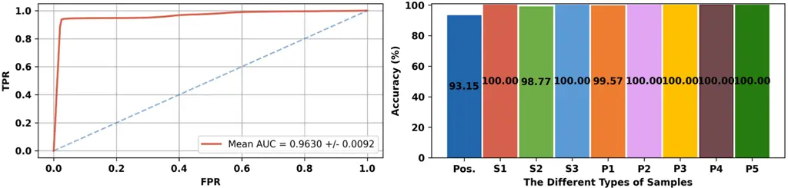

Figure 10. The ROC curve with AUC (left) and accuracy of different types
of samples (right).

### 5.2. Overall Performance

We randomly select enrollment samples 20 times to compute the average
ROC curve. As shown in Fig. 10, overall AUC = 0.9630 $`\pm`$ 0.0092, EER
= 0.0558, and positive input accuracy reach 93.15%. Although
quantization has been applied, the overall accuracy remains at a high
level. These results provide a solid foundation for practical
deployment.

#### 5.2.1. Evaluation of Source-level Attacks

The evaluation results for source-level attacks are shown in Fig. 10.
The proposed system achieves consistently high detection performance,
with an average defense accuracy of 99.59% across the three attack
scenarios. The first two attacks are effectively rejected because forged
speech cannot establish consistent cross-modal correspondence with the
accompanying ultrasonic signals. For the adaptive attack, although the
attacker attempts to synchronize speech with imitated articulatory
motions, the resulting ultrasonic echo patterns remain fundamentally
different from those of genuine users. Consequently, the proposed
multimodal consistency verification generalizes well to all source-level
attacks while maintaining a low false rejection rate for legitimate
users.

#### 5.2.2. Evaluation of Propagation-level Attacks

The defense results against propagation-level attacks are shown in
Fig. 10. Overall, the system achieves an average detection accuracy of
99.91% across all attack scenarios. Since authentication requires
consistency between the speech content and the embedded watermark,
semantic modifications inevitably introduce detectable watermark
mismatches. The most challenging attacks are P1 and P2, where only a bit
of segment is edited or removed while the attacker attempts to preserve
the original watermark. Even under this strong assumption, the average
similarity of the watermark decreases to 76.59% ± 9.84% and 81.02% ±
8.95%, respectively, compared to 99.73% ± 0.84% for genuine samples. For
P3–P5, splicing, watermark reuse, and speech forgery further introduce
substantial inconsistencies between the embedded watermark and speech
semantics, allowing the proposed method to reliably detect all
propagation-level attacks.

#### 5.2.3. Embedding and Detection Performance

We evaluate the embedding module using the speech-quality metrics
described above, and the results are summarized in Table 3. The results
show that the embedded watermark preserves both perceptual quality and
speech recognition performance. Moreover, INT8 quantization introduces
only negligible performance degradation compared with FP32. Following
the evaluation protocol of AudioSeal, we assess the robustness of the
Detector under both benign modifications (e.g., resampling, reencoding,
and compression) and malicious attacks (e.g., simple deletion, simple
splicing, silencing). As shown in Table 4, FP32 and INT8 models achieve
comparable performance, demonstrating the effectiveness of INT8
deployment on edge devices.

|       |                         |                  |                  |                    |
| ----- | ----------------------- | ---------------- | ---------------- | ------------------ |
| Level | SI-SNR$`\uparrow`$ (dB) | PESQ$`\uparrow`$ | STOI$`\uparrow`$ | ViSQOL$`\uparrow`$ |
| FP32  | 23.88                   | 4.43             | 0.997            | 4.81               |
| INT8  | 20.01                   | 4.26             | 0.981            | 4.67               |

Table 3. Speech quality metrics at different quantization levels.

|                   |           |           |           |           |
| ----------------- | --------- | --------- | --------- | --------- |
| Operation         | TPR       | FPR       | TNR       | FNR       |
| Compression       | 1.00/1.00 | 0.03/0.03 | –         | –         |
| Reencoding        | 1.00/1.00 | 0.02/0.03 | –         | –         |
| Resampling        | 0.98/0.98 | 0.01/0.01 | –         | –         |
| Noise suppression | 0.98/0.98 | 0.01/0.01 | –         | –         |
| Simple deletion   | –         | –         | 0.99/0.99 | 0.01/0.01 |
| Simple splicing   | –         | –         | 0.99/0.99 | 0.09/0.09 |
| Silencing         | –         | –         | 0.98/0.97 | 0.02/0.02 |
| Substitution      | –         | –         | 0.99/0.99 | 0.00/0.00 |
| Reordering        | –         | –         | 0.98/0.97 | 0.00/0.00 |
| Text-to-speech    | –         | –         | 1.00/1.00 | 0.00/0.00 |
| Voice conversion  | –         | –         | 0.98/0.98 | 0.01/0.01 |

Table 4. Detection results (FP32 / INT8) under benign (top) and
malicious (bottom) operations.

#### 5.2.4. Stabilizer Performance

For the Stabilizer, there are both quantized and non-quantized versions.
At the edge-side system, we can selectively use the quantized version
for source speech processing, while on the server side, quantization is
not required. We compare the results using the quantized stabilizer to
verify its capability; the performance of the non-quantized stabilizer
is no worse than the quantized one. Based on metrics from the detection
side, we use the test speech samples containing original clean
utterances and benign operation (noisy samples) for testing the
Stabilizer we train. These noisy samples are fed into the stabilizer,
and we compare the cosine similarity between the features of the
stabilizer-processed speech and the original clean speech, as well as
the similarity between the extracted watermark information (after
passing through our system) and the original watermark. The results are
shown in Fig. 11(a). It can be seen that, for both the speech itself and
the watermark information, the accuracy improves by 33.15% and 24.06%,
respectively, after the stabilizer is applied, the watermark code
similarity reaches 95.33%, which demonstrates the effectiveness of
adding the Stabilizer.

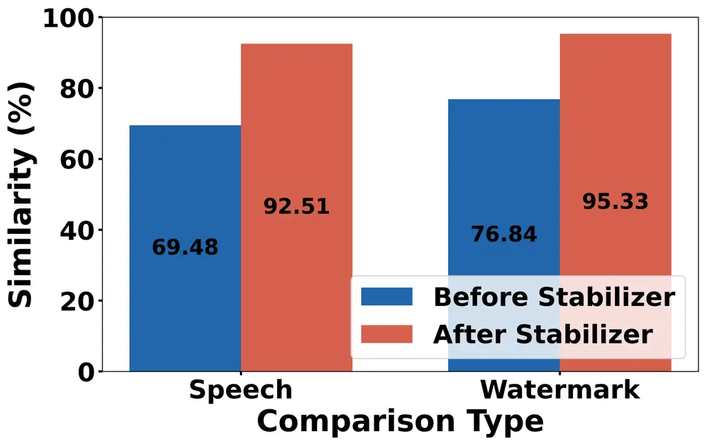

(a) Stabilizer effect.

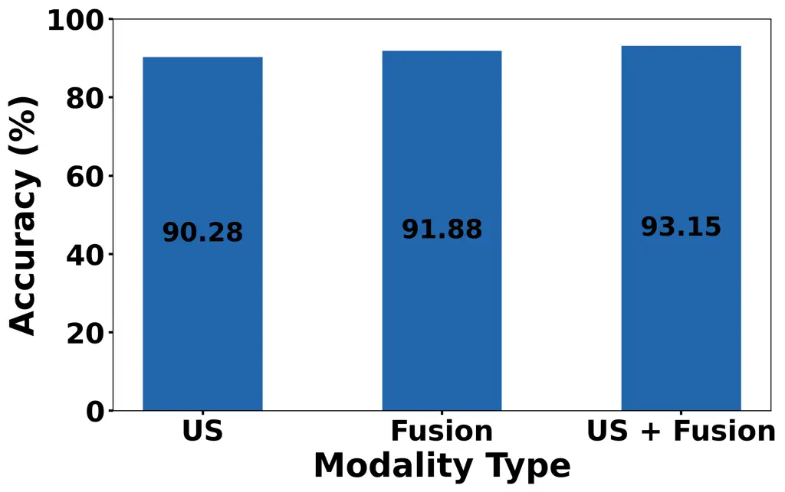

(b) Modality comparison.

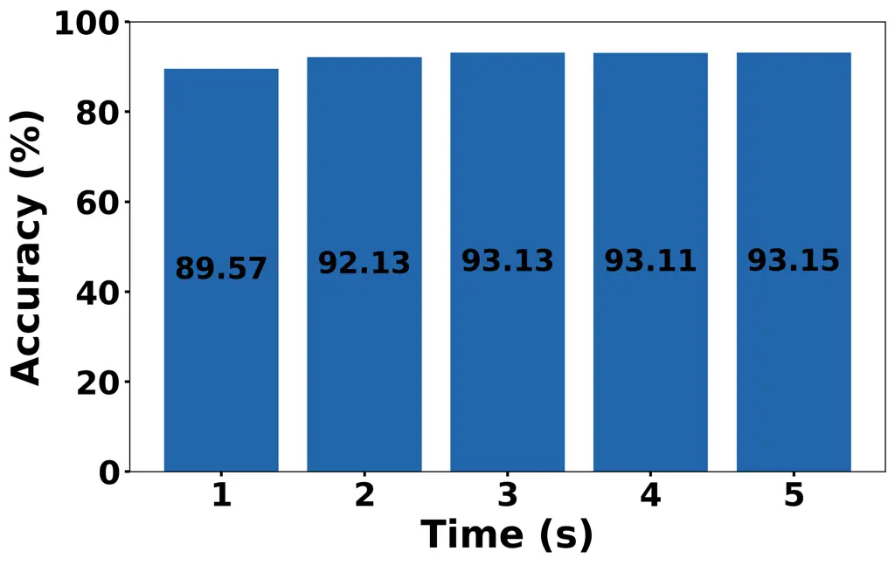

(c) Time window.

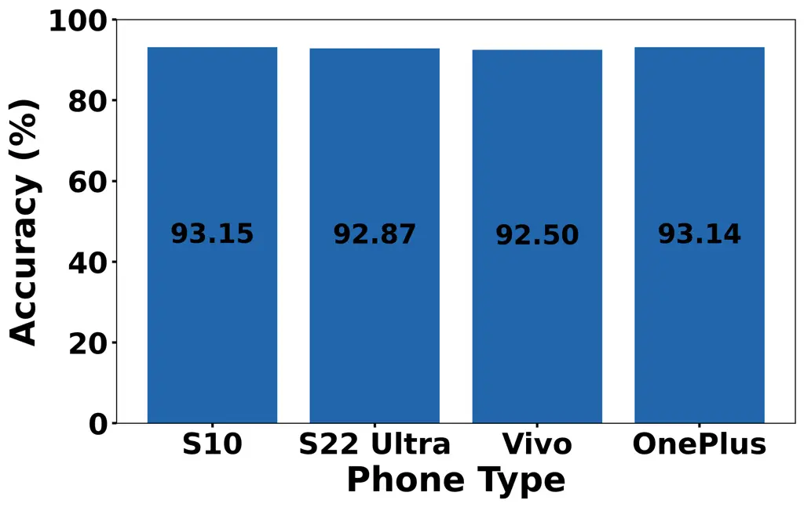

(d) Phone type.

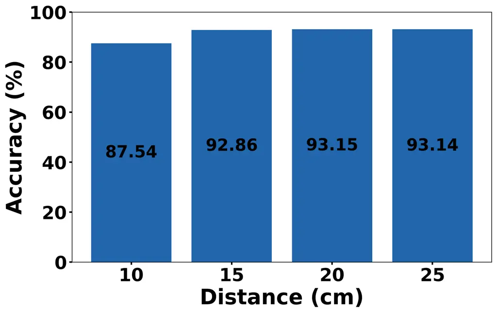

(e) Distance.

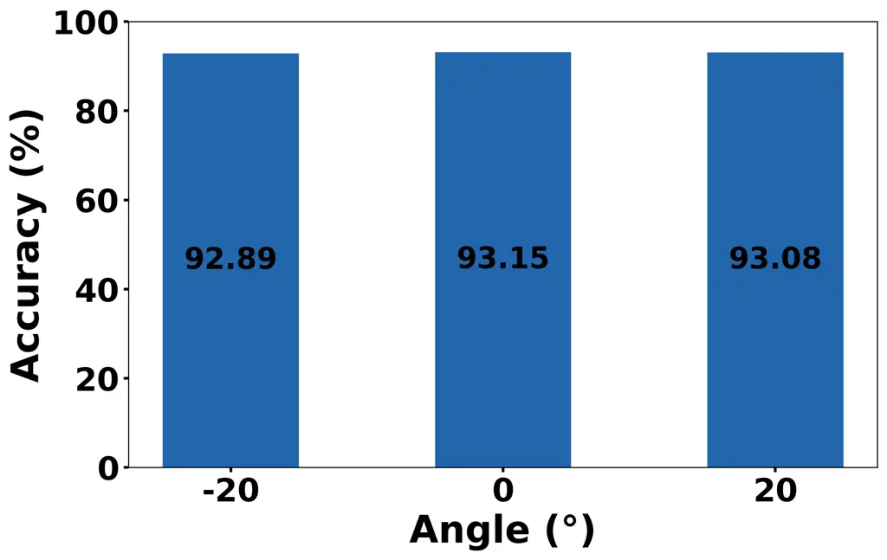

(f) Angle.

Figure 11. Impact of different factors: (a) stabilizer; (b) modality;
(c) time window; (d) phone type; (e) distance; (f) angle.

### 5.3. Evaluation of Impact Factors

For the various influencing factors considered in this experiment, which
pertain solely to the discrimination of source input. We evaluate all
factors using the positive samples accuracy metric of the Watermark
Generator. It is worth noting that, unlike software-based watermarking
schemes, ultrasonic watermark generation is intentionally constrained by
the physical characteristics of acoustic propagation. Successful
embedding therefore requires the user’s active participation and an
effective distance and orientation between the smartphone and the
speaker. Authentication systems generally favor stricter decision
boundaries, as the cost of false acceptance outweighs that of false
rejection.

#### 5.3.1. Impact of Different Features

In the decision logic for target recognition, we employ a method that
collaboratively discriminates using ultrasonic signals and fused feature
vectors. To investigate the contribution of both to the final
recognition performance, this section quantifies the influence of
ultrasonic and fused vectors, with the results shown in Fig. 11(b). The
experiments demonstrate that the system achieves the highest recognition
accuracy 93.15% when the two modalities are used jointly. This result
confirms that the trained fused feature vector effectively captures the
deep-level correspondence between the speech and ultrasonic modalities,
rather than performing simple feature concatenation, while ensuring that
speech information does not interfere with the discriminative ability of
the ultrasonic modality, thereby reflecting the effectiveness of the
multimodal fusion design in the proposed model.

#### 5.3.2. Impact of Different Time Windows

The time window length (T) is a critical parameter in dynamic speech
watermarking systems. Its value not only influences the discrimination
accuracy of ultrasonic signals but also directly determines the
computational complexity of the watermark generation model. A larger T
corresponds to a longer watermark update cycle, which is beneficial for
reducing computational overhead. Conversely, a smaller T, while capable
of reducing system latency, increases the computational load for
watermark generation and exerts a certain impact on the discrimination
accuracy of ultrasonic signals. This section verifies the system’s
tunability between latency and performance by evaluating the change in
user identification accuracy under different T settings, as shown in
Fig. 11(c). As T increases, the accuracy exhibits a gradual upward
trend. Even under a short window of T=1s, the system can maintain an
identification accuracy of approximately 89.57%, indicating that the
proposed mechanism can achieve an effective balance between latency and
recognition performance through flexible configuration of T. It is
notable that all of our models are constructed using
sequence-length-invariant architectures, allowing users to freely adjust
the temporal window size without the need for retraining, which
facilitates greater generalizability in practical deployment scenarios.

#### 5.3.3. Impact of Different Smartphone Types

To verify the generalization capability of the system across different
mobile devices, this study selects multiple phone models, including
Samsung S10 (S10), Samsung S22 Ultra (S22 Ultra), vivo X200 Pro (Vivo),
and OnePlus 15 (OnePlus), for universal applicability testing. The
experimental results, shown in Fig. 11(d), demonstrate that the system
maintains stable identity authentication performance on all devices,
with an accuracy of no less than 92.50%. This is primarily attributed to
the fact that the ultrasonic signals rely only on the microphone
hardware commonly integrated in smartphones, without the need for
specialized sensors, thereby ensuring good device compatibility and
deployment flexibility. The system is suitable for mobile terminals
across different tiers, providing a feasible solution for privacy
protection in practical voice interaction scenarios.

#### 5.3.4. Impact of Different Distances

The relative distance between the user and the device is one of the key
factors affecting the quality of ultrasonic signals. To evaluate the
impact of distance variation on system robustness, we conduct tests
within the range of 10 cm to 25 cm, with 5 cm intervals, simulating
typical voice interaction distances. The results, shown in Fig. 11(e),
demonstrate that the system exhibits stable recognition performance
across different distances, with an overall accuracy maintained above
87.54%, an average 91.67%, indicating that the proposed method possesses
strong adaptability to distance changes.

#### 5.3.5. Impact of Different Angles

Furthermore, considering that in actual usage scenarios, the phone
screen and the user’s face often exhibit a certain angle, we investigate
the impact of different relative angles on system performance. Taking
the parallel alignment of the screen and the facial plane as the 0°
baseline, data are collected for device rotation within ±20° in the
vertical direction, an angular range that ensures normal transmission
and reception of ultrasonic signals by the microphone. The experimental
results, shown in Fig. 11(f), indicate that the system maintains high
recognition robustness under various angular conditions, achieving an
accuracy of no less than 92.89%, which demonstrates that the proposed
method exhibits good fault tolerance for posture variations.

### 5.4. System Inference and Privacy

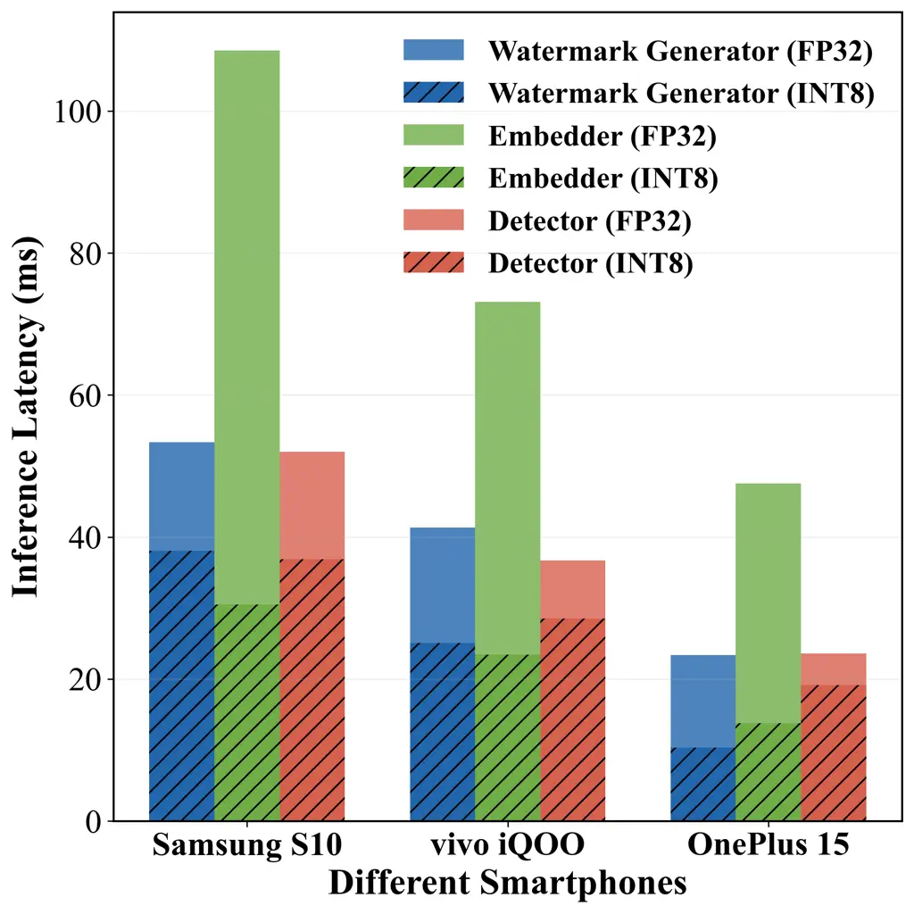

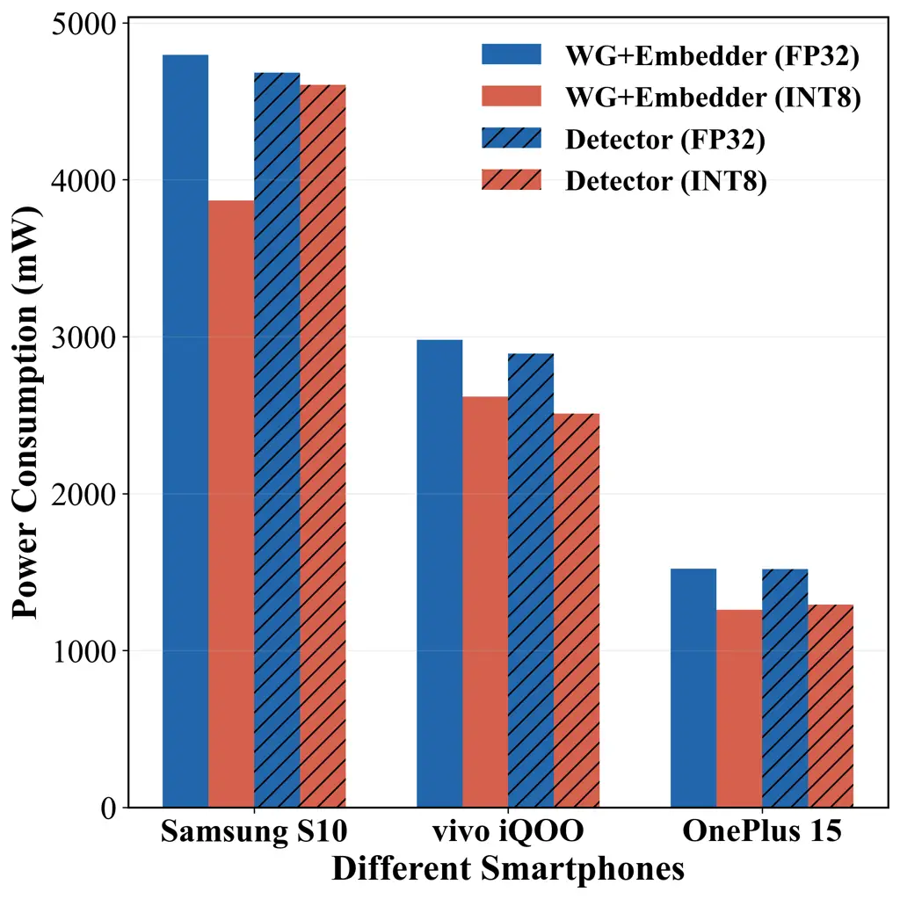

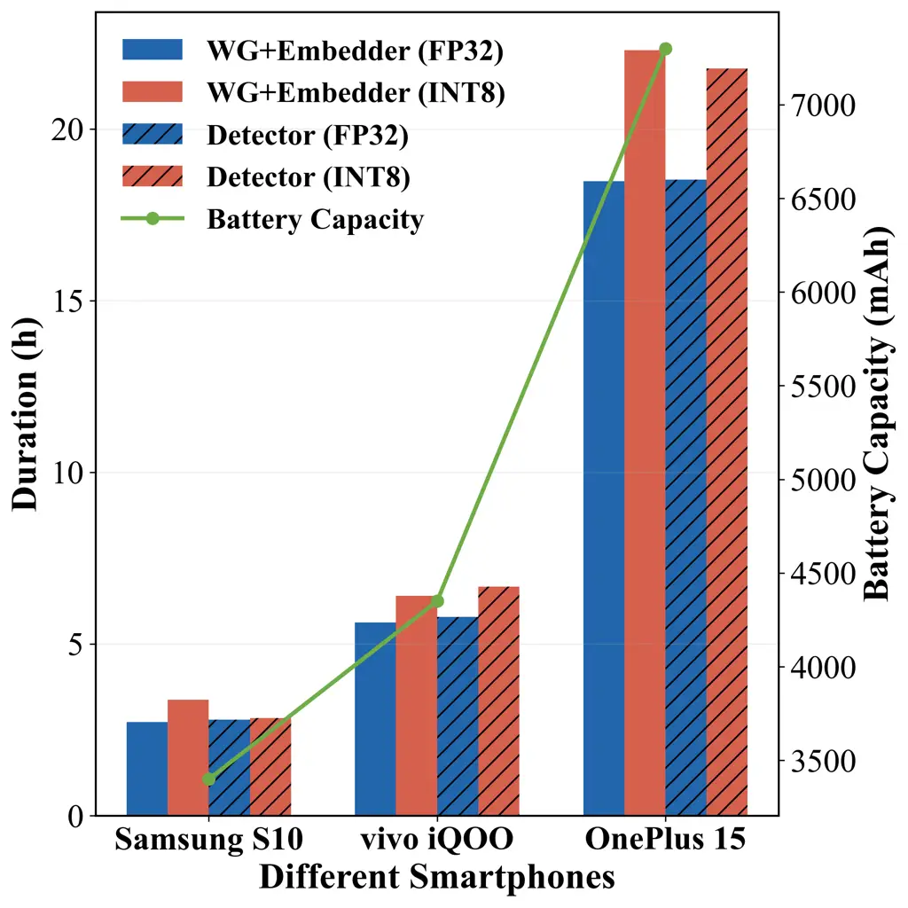

Figure 12. Inference latency (left), power consumption (center), and
battery duration (right) on different smartphones.

Our system is deployed on three types of smartphones: Samsung S10, vivo
iQOO8, and OnePlus 15, released in 2019, 2021, and 2025 respectively,
providing a diverse baseline for evaluating system robustness. The
testing scenario simulates a real-time voice interaction. For the
Watermark Generator, a sufficiently long temporal window is required to
generate the watermark; a window length of 1 s is used in the test. For
the Embedder and Detector, a sliding step of 20 ms is set to balance
latency and real-time requirements, meaning every 20 ms the system
generates a watermark based on the preceding 1 s of audio and embeds it
into the current window. A total of 100 samples verifies the real-time
capability.

The latency results are shown in Fig. 12. On our INT8-quantized
implementation, the Watermark Generator and Embedder modules achieve
minimum total latency of $`10.32+13.80=24.12`$ ms, meeting the demands
of real-time communication (ITU-T, 2003). INT8 quantization achieves
latency reduction of up to 71.9% and power-consumption reduction of up
to 19.35% compared to FP32. Newer smartphones, due to their better
support for on-device model deployment, exhibit lower power consumption
and longer sustained operation—up to 18.47 hours on the latest device.
These results fully validate the real-time online performance and the
effectiveness of model lightweighting for on-device deployment. Since
our model is independent of the temporal window, users can adjust the
watermark generation and embedding time window according to their
hardware capabilities, achieving a trade-off between speed and quality.

Regarding user privacy and security, the entire watermarking and
integration process runs entirely on the local side without involving
cloud processing, thus ensuring complete privacy protection. The
detection end, which may need cloud access, can be addressed using
classic hybrid encryption architecture (Rivest et al., 1978; National
Institute of Standards and Technology (NIST), 2001; Rescorla, 2018).
Given the general applicability of our system, it can be effectively
deployed on users’ mobile edge devices, providing real-time, online
protection for voice security.

## 6. Discussion

MoBiMark provides an end-to-end framework for speech security by
combining real-time biometric source authentication, on-device
processing, and dual-layer dynamic watermarking to protect speech
against unauthorized editing and forgery during transmission. By
leveraging ubiquitous microphones and resource-efficient inference, the
system is designed for deployment on commodity smart devices.

MoBiMark relies on ultrasonic sensing to capture user-specific biometric
features, which introduces practical constraints on sensing distance and
orientation. As the user moves farther from the smartphone, weaker
echoes may degrade biometric feature quality and authentication
reliability. Rather than being solely a limitation, the effective
sensing range also imposes a physical proximity requirement that can
strengthen the association between watermark generation and the user’s
physical presence. Since typical voice interactions occur within a
relatively close range of the smartphone, this requirement is compatible
with the intended use scenarios. In addition, preprocessing helps
suppress motion-induced low-frequency artifacts, improving the
reliability of ultrasonic feature extraction under practical conditions.

The security of the system also depends on the integrity of the
underlying hardware and sensing pipeline. As future work, we plan to
investigate hardware-assisted encryption and data-flow integrity
mechanisms to protect internal sensor streams against unauthorized
access and malicious data injection. Such mechanisms could further
strengthen the system against attacks targeting the trusted acquisition
path.

Beyond source authentication and watermark protection, extending
MoBiMark to real-time voice communication is a promising direction.
Although the current system provides real-time speech processing, speech
codecs may distort or invalidate embedded watermarks during
transmission. One potential solution is to integrate watermarking
directly into neural speech codecs, enabling watermark information to be
preserved in latent representations rather than relying solely on
compressed waveforms. This could improve watermark integrity across the
communication pipeline and facilitate practical deployment in real-time
voice calls.

## 7. Conclusion

The proliferation of generative speech models poses critical threats to
traditional voiceprint-based real-time voice authentication. In this
paper, we present MoBiMark, the first real-time online biologic speech
watermarking system using smartphones ultrasound signals. It binds
ultrasonic vocal-tract echoes to speech content, embedding a dual-layer
dynamic watermark at capture time for source authentication and
different attacks detection. Detailed training and quantization design
achieve high accuracy, strong robustness, and efficient on-device
operation. Evaluations on 50 users across four smartphones demonstrate
average 99.79% attack detection accuracy on source and propagation with
negligible perceptual impact, which enables practical real-time speech
security for voice interaction in the future.

## References

- Abdulkareem and Hassin (2025) A. Abdulkareem and A. Hassin Hardware
  and software approaches to fingerprint liveness detection: a
  comparative review. Applied Computing Journal, pp. 423–438. Cited by:
  §2.4, Table 1.
- Al-Haj (2014) A. Al-Haj An imperceptible and robust audio watermarking
  algorithm. EURASIP Journal on Audio, Speech, and Music Processing 2014
  (1), pp. 37. External Links:
  [Document](https://dx.doi.org/10.1186/s13636-014-0037-2) Cited by: §1,
  §2.1.
- Bassia et al. (2001) P. Bassia, I. Pitas, and N. Nikolaidis Robust
  audio watermarking in the time domain. IEEE Transactions on Multimedia
  3 (2), pp. 232–241. External Links:
  [Document](https://dx.doi.org/10.1109/6046.923822) Cited by: §2.1.
- Bengio et al. (2013) Y. Bengio, N. Léonard, and A. Courville
  Estimating or propagating gradients through stochastic neurons for
  conditional computation. arXiv preprint arXiv:1308.3432. Cited by:
  §4.3.
- Chan et al. (2016) W. Chan, N. Jaitly, Q. V. Le, and O. Vinyals
  Listen, attend and spell: a neural network for large vocabulary
  conversational speech recognition. In Proceedings of the IEEE
  International Conference on Acoustics, Speech and Signal Processing
  (ICASSP), pp. 4960–4964. External Links:
  [Document](https://dx.doi.org/10.1109/ICASSP.2016.7472629) Cited by:
  §4.1.1.
- Chen et al. (2023) G. Chen, Y. Wu, S. Liu, T. Liu, X. Du, and F. Wei
  WavMark: watermarking for audio generation. arXiv preprint
  arXiv:2308.12770. Cited by: §1, §2.4, Table 1.
- Chen et al. (2020) H. Chen, F. Li, W. Du, S. Yang, M. Conn, and Y.
  Wang Listen to your fingers: user authentication based on geometry
  biometrics of touch gesture. Proceedings of the ACM on Interactive,
  Mobile, Wearable and Ubiquitous Technologies 4 (3), pp. 75:1–75:24.
  External Links: [Document](https://dx.doi.org/10.1145/3411809) Cited
  by: §2.3.
- Cox et al. (2002) I. Cox, M. Miller, J. Bloom, and C. Honsinger
  Digital watermarking. Morgan Kaufmann. Cited by: §1.
- Ding et al. (2025) D. Ding, Z. Ju, Y. Leng, S. Liu, T. Liu, Z.
  Shang, K. Shen, W. Song, X. Tan, H. Tang, et al. Kimi-audio technical
  report. arXiv preprint arXiv:2504.18425. Cited by: §1.
- Fu et al. (2024) Y. Fu, D. Xiong, and Y. Dong Watermarking conditional
  text generation for AI detection: unveiling challenges and a
  semantic-aware watermark remedy. In Proceedings of the AAAI Conference
  on Artificial Intelligence, Vol. 38, pp. 18003–18011. Cited by: §1.
- Gao et al. (2020) Y. Gao, Y. Jin, J. Li, S. Choi, and Z. Jin
  EchoWhisper: exploring an acoustic-based silent speech interface for
  smartphone users. Proceedings of the ACM on Interactive, Mobile,
  Wearable and Ubiquitous Technologies 4 (3), pp. 80:1–80:27. External
  Links: [Document](https://dx.doi.org/10.1145/3411830) Cited by: §2.3.
- Hamming (1950) R. W. Hamming Error detecting and error correcting
  codes. The Bell system technical journal 29 (2), pp. 147–160. Cited
  by: §4.2.3.
- Hannun et al. (2014) A. Y. Hannun, C. Case, J. Casper, B.
  Catanzaro, G. Diamos, E. Elsen, R. Prenger, S. Satheesh, S.
  Sengupta, A. Coates, et al. Deep Speech: scaling up end-to-end speech
  recognition. In Proceedings of the IEEE International Conference on
  Acoustics, Speech and Signal Processing (ICASSP), pp. 8604–8608.
  External Links:
  [Document](https://dx.doi.org/10.1109/ICASSP.2014.6854773) Cited by:
  §4.1.1.
- Hines et al. (2012) A. Hines, J. Skoglund, A. Kokaram, and N. Harte
  ViSQOL: the virtual speech quality objective listener. In Proceedings
  of the International workshop on acoustic signal enhancement (IWAENC),
  pp. 1–4. Cited by: §5.1.4.
- Hua et al. (2016) G. Hua, J. Huang, Y. Q. Shi, J. Goh, and V. L. L.
  Thing Twenty years of digital audio watermarking: a comprehensive
  review. Signal Processing 128, pp. 222–242. External Links:
  [Document](https://dx.doi.org/10.1016/j.sigpro.2016.04.005) Cited by:
  §1, §2.1.
- ITU-T (2003) ITU-T Transmission systems and media, digital systems and
  networks. ITU-T Recommendation Technical Report G.993, International
  Telecommunication Union. Cited by: §5.4.
- Jacob et al. (2018) B. Jacob, S. Kligys, B. Chen, M. Zhu, M. Tang, A.
  Howard, H. Adam, and D. Kalenichenko Quantization and training of
  neural networks for efficient integer-arithmetic-only inference. In
  Proceedings of the IEEE conference on computer vision and pattern
  recognition (CVPR), pp. 2704–2713. Cited by: §4.3.
- Kameoka et al. (2019) H. Kameoka, T. Kaneko, K. Tanaka, and N. Hojo
  StarGAN-VC2: rethinking conditional methods for StarGAN-based voice
  conversion. In Proceedings of Interspeech, pp. 679–683. External
  Links: [Document](https://dx.doi.org/10.21437/Interspeech.2019-2250)
  Cited by: §1, §2.2.
- Kim et al. (2021) J. Kim, J. Kong, and J. Son Conditional variational
  autoencoder with adversarial learning for end-to-end text-to-speech.
  arXiv. External Links:
  [Document](https://dx.doi.org/10.48550/arXiv.2106.06103) Cited by: §1,
  §2.2.
- Kinnunen et al. (2017) T. Kinnunen, M. Sahidullah, H. Delgado, M.
  Todisco, N. Evans, J. Yamagishi, and K. A. Lee The asvspoof 2017
  challenge: assessing the limits of replay spoofing attack detection.
  Cited by: §2.4, Table 1.
- Kong et al. (2020) J. Kong, J. Kim, and J. Bae HiFi-GAN: generative
  adversarial networks for efficient and high fidelity speech synthesis.
  arXiv. External Links:
  [Document](https://dx.doi.org/10.48550/arXiv.2010.05646) Cited by: §1,
  §2.2.
- Lee et al. (2020) Y. Lee, Y. Zhao, J. Zeng, K. Lee, N. Zhang, F. H.
  Shezan, Y. Tian, K. Chen, and X. Wang Using sonar for liveness
  detection to protect smart speakers against remote attackers.
  Proceedings of the ACM on Interactive, Mobile, Wearable and Ubiquitous
  Technologies 4 (1), pp. 16:1–16:28. External Links:
  [Document](https://dx.doi.org/10.1145/3380991) Cited by: §2.3.
- Levelt (1993) W. J. Levelt Speaking: from intention to articulation.
  MIT press. Cited by: §4.2.2.
- Lie and Chang (2006) W. Lie and L. Chang Robust and high-quality
  time-domain audio watermarking based on low-frequency amplitude
  modification. IEEE Transactions on Multimedia 8 (1), pp. 46–59.
  External Links: [Document](https://dx.doi.org/10.1109/TMM.2005.861292)
  Cited by: §2.1.
- Liu et al. (2024) C. Liu, J. Zhang, T. Zhang, X. Yang, W. Zhang,
  and N. Yu Detecting voice cloning attacks via timbre watermarking. In
  Proceedings of the Network and Distributed System Security Symposium
  (NDSS), External Links:
  [Document](https://dx.doi.org/10.14722/ndss.2024.24200) Cited by:
  §2.1.
- Liu (2024) S. Liu Zero-shot voice conversion with diffusion
  transformers. arXiv preprint arXiv:2411.09943. Cited by: §1.
- Lu et al. (2018) L. Lu, J. Yu, Y. Chen, H. Liu, Y. Zhu, Y. Liu, and M.
  Li LipPass: lip reading-based user authentication on smartphones
  leveraging acoustic signals. In Proceedings of the IEEE International
  Conference on Computer Communications (INFOCOM), Cited by: §5.1.1.
- Lu et al. (2020) L. Lu, J. Yu, Y. Chen, and Y. Wang VocalLock: sensing
  vocal tract for passphrase-independent user authentication leveraging
  acoustic signals on smartphones. Proceedings of the ACM on
  Interactive, Mobile, Wearable and Ubiquitous Technologies 4 (2),
  pp. 51:1–51:24. External Links:
  [Document](https://dx.doi.org/10.1145/3397320) Cited by: §2.3.
- Luo and Mesgarani (2018) Y. Luo and N. Mesgarani Tasnet: time-domain
  audio separation network for real-time, single-channel speech
  separation. In Proceedings of the IEEE International Conference on
  Acoustics, Speech and Signal Processing (ICASSP), pp. 696–700. Cited
  by: §5.1.4.
- Mawalim and Unoki (2021) C. O. Mawalim and M. Unoki Speech
  watermarking method using McAdams coefficient based on random forest
  learning. Entropy 23 (10), pp. 1246. External Links:
  [Document](https://dx.doi.org/10.3390/e23101246) Cited by: §2.1.
- National Institute of Standards and Technology (NIST) (2001) National
  Institute of Standards and Technology (NIST) Advanced encryption
  standard (AES). Technical report Technical Report FIPS PUB 197, U.S.
  Department of Commerce, Gaithersburg, MD. External Links:
  [Link](https://nvlpubs.nist.gov/nistpubs/FIPS/NIST.FIPS.197.pdf) Cited
  by: §5.4.
- Park et al. (2021) J. Park, M. Kim, D. S. Williamson, L. Wang, H.
  Chae, H. Yu, and T. Kim AASIST: audio anti-spoofing using integrated
  spectro-temporal graph attention networks. arXiv. External Links:
  [Document](https://dx.doi.org/10.48550/arXiv.2110.01200) Cited by: §1,
  §2.2.
- Pavlovic et al. (2022) K. Pavlovic, S. Kovacevic, I. Djurovic, and A.
  Wojciechowski Robust speech watermarking by a jointly trained embedder
  and detector using a DNN. Digital Signal Processing 122, pp. 103381.
  External Links:
  [Document](https://dx.doi.org/10.1016/j.dsp.2021.103381) Cited by: §1,
  §2.1.
- Qian et al. (2019) K. Qian, Y. Zhang, S. Chang, X. Yang, and M.
  Hasegawa-Johnson AutoVC: zero-shot voice style transfer with only
  autoencoder loss. arXiv. External Links:
  [Document](https://dx.doi.org/10.48550/arXiv.1905.05879) Cited by: §1,
  §2.2.
- Ren et al. (2020) Y. Ren, C. Hu, X. Tan, T. Qin, S. Zhao, Z. Zhao,
  and T. Liu FastSpeech 2: fast and high-quality end-to-end
  text-to-speech. arXiv. External Links:
  [Document](https://dx.doi.org/10.48550/arXiv.2006.04558) Cited by: §1,
  §2.2.
- Rescorla (2018) E. Rescorla The transport layer security (tls)
  protocol version 1.3. Technical report Cited by: §5.4.
- Rivest et al. (1978) R. L. Rivest, A. Shamir, and L. Adleman A method
  for obtaining digital signatures and public-key cryptosystems.
  Communications of the ACM 21 (2), pp. 120–126. Cited by: §5.4.
- Rix et al. (2001) A. W. Rix, J. G. Beerends, M. P. Hollier, and A. P.
  Hekstra Perceptual evaluation of speech quality (PESQ)-a new method
  for speech quality assessment of telephone networks and codecs. In
  Proceedings of the IEEE international conference on acoustics, speech,
  and signal processing (ICASSP), Vol. 2, pp. 749–752. Cited by: §5.1.4.
- Roman et al. (2024) R. S. Roman, P. Fernandez, A. Défossez, T.
  Furon, T. Tran, and H. Elsahar Proactive detection of voice cloning
  with localized watermarking. arXiv preprint arXiv:2401.17264. Cited
  by: §1, §2.1, §2.4, Table 1, §4.2.2, §4.2.2.
- Schroff et al. (2015) F. Schroff, D. Kalenichenko, and J. Philbin
  Facenet: a unified embedding for face recognition and clustering. In
  Proceedings of the IEEE conference on computer vision and pattern
  recognition, pp. 815–823. Cited by: §2.4, Table 1.
- Shang and Stevenson (2010) W. Shang and M. Stevenson Score
  normalization in playback attack detection. In 2010 IEEE international
  conference on acoustics, speech and signal processing, pp. 1678–1681.
  Cited by: §2.4, Table 1.
- Shen et al. (2017) J. Shen, R. Pang, R. J. Weiss, M. Schuster, N.
  Jaitly, Z. Yang, Z. Chen, Y. Zhang, Y. Wang, R. J. Skerry-Ryan, R. A.
  Saurous, Y. Agiomyrgiannakis, and Y. Wu Natural TTS synthesis by
  conditioning WaveNet on mel spectrogram predictions. arXiv. External
  Links: [Document](https://dx.doi.org/10.48550/arXiv.1712.05884) Cited
  by: §1, §2.2.
- Shuwandy et al. (2025) M. L. Shuwandy, A. Jouda, M. Ahmed, M. M.
  Salih, Z. Al-qaysi, A. Alamoodi, S. Garfan, O. Albahri, B. Zaidan,
  and A. Albahri Sensor-based authentication in smartphone: a systematic
  review. Journal of Engineering Research 13 (2), pp. 741–750. Cited by:
  §2.4, Table 1.
- Swanson et al. (1998) M. D. Swanson, B. Zhu, A. H. Tewfik, and L.
  Boney Robust audio watermarking using perceptual masking. Signal
  Processing 66 (3), pp. 337–355. External Links:
  [Document](https://dx.doi.org/10.1016/S0165-1684%2898%2900014-0) Cited
  by: §1, §2.1.
- Taal et al. (2010) C. H. Taal, R. C. Hendriks, R. Heusdens, and J.
  Jensen A short-time objective intelligibility measure for
  time-frequency weighted noisy speech. In Proceedings of the IEEE
  international conference on acoustics, speech and signal processing
  (ICASSP), pp. 4214–4217. Cited by: §5.1.4.
- Tak et al. (2020) H. Tak, J. Patino, M. Todisco, A. Nautsch, and N.
  Evans End-to-end anti-spoofing with RawNet2. arXiv. External Links:
  [Document](https://dx.doi.org/10.48550/arXiv.2011.01108) Cited by: §1,
  §2.2.
- Uddin et al. (2024) M. S. Uddin, M. Hasan, and T. Shimamura Audio
  watermarking: a comprehensive review. International Journal of
  Advanced Computer Science & Applications 15 (5). Cited by: §2.4, Table
  1.
- van den Oord et al. (2016) A. van den Oord, S. Dieleman, H. Zen, K.
  Simonyan, O. Vinyals, A. Graves, N. Kalchbrenner, A. Senior, and K.
  Kavukcuoglu WaveNet: a generative model for raw audio. arXiv. External
  Links: [Document](https://dx.doi.org/10.48550/arXiv.1609.03499) Cited
  by: §1, §2.2.
- Wang et al. (2023) H. Wang, S. Zheng, Y. Chen, L. Cheng, and Q. Chen
  CAM++: a fast and efficient network for speaker verification using
  context-aware masking. arXiv preprint arXiv:2303.00332. Cited by:
  §4.1.1.
- Wang et al. (2016) W. Wang, A. X. Liu, and Ke. Sun Device-free gesture
  tracking using acoustic signals. In Proceedings of the Annual
  International Conference on Mobile Computing and Networking (MobiCom),
  Cited by: §5.1.1.
- Wang et al. (2020) X. Wang, J. Yamagishi, M. Todisco, H. Delgado, A.
  Nautsch, N. Evans, M. Sahidullah, V. Vestman, T. Kinnunen, K. A.
  Lee, L. Juvela, P. Alku, Y. Peng, H. Hwang, Y. Tsao, H. Wang, S. L.
  Maguer, M. Becker, F. Henderson, R. Clark, Y. Zhang, Q. Wang, Y.
  Jia, K. Onuma, K. Mushika, T. Kaneda, Y. Jiang, L. Liu, Y. Wu, W.
  Huang, T. Toda, K. Tanaka, H. Kameoka, I. Steiner, D. Matrouf, J.
  Bonastre, A. Govender, S. Ronanki, J. Zhang, and Z. Ling ASVspoof
  2019: a large-scale public database of synthesized, converted and
  replayed speech. Computer Speech & Language 64, pp. 101114. External
  Links: [Document](https://dx.doi.org/10.1016/j.csl.2020.101114) Cited
  by: §1, §2.2.
- Wang et al. (2011) Z. Wang, G. Wei, and Q. He Channel pattern noise
  based playback attack detection algorithm for speaker recognition. In
  2011 International conference on machine learning and cybernetics,
  Vol. 4, pp. 1708–1713. Cited by: §2.4, Table 1.
- Wang et al. (2026) Z. Wang, T. Li, W. Ge, Z. Cui, S. Zhang, and J.
  Feng OneVoice: one model, triple scenarios-towards unified zero-shot
  voice conversion. arXiv preprint arXiv:2601.18094. Cited by: §1.
- Wu et al. (2015) Z. Wu, N. Evans, T. Kinnunen, J. Yamagishi, F.
  Alegre, and H. Li Spoofing and countermeasures for speaker
  verification: a survey. speech communication 66, pp. 130–153. Cited
  by: §2.4, Table 1.
- Yamagishi et al. (2021) J. Yamagishi, M. Todisco, X. Wang, and the
  ASVspoof Consortium ASVspoof 2021: automatic speaker verification
  spoofing and countermeasures challenge evaluation plan. Note:
  Technical Report Cited by: §1, §2.2.
- Yan et al. (2026) N. Yan, K. Han, and S. Shin A comprehensive deepfake
  detection framework based on multimodal liveness detection and deep
  learning integration.. KSII Transactions on Internet & Information
  Systems 20 (1). Cited by: §2.4, Table 1.
- Yao et al. (2025a) L. Yao, C. Huang, S. Wang, J. Xue, H. Guo, J.
  Liu, X. Chen, and M. Pan SpeechVerifier: robust acoustic fingerprint
  against tampering attacks via watermarking. arXiv preprint
  arXiv:2505.23821. Cited by: §1, §2.1, §2.4, Table 1, §4.2.2, §4.2.2.
- Yao et al. (2025b) L. Yao, C. Huang, S. Wang, J. Xue, H. Guo, J.
  Liu, P. Lin, T. Ohtsuki, and M. Pan Yours or mine? overwriting attacks
  against neural audio watermarking. arXiv preprint arXiv:2509.05835.
  Cited by: §2.4, Table 1.
- Zhou et al. (2021) B. Zhou, Z. Xie, Y. Zhang, J. Lohokare, R. Gao,
  and F. Ye Robust human face authentication leveraging acoustic sensing
  on smartphones. IEEE Transactions on Mobile Computing 21 (8),
  pp. 3009–3023. Cited by: §5.1.1.
