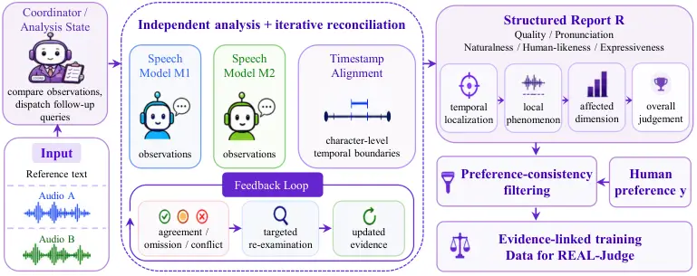
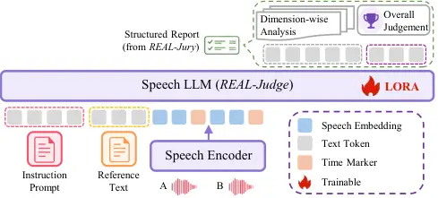

# REAL: Reward Modeling through Evidence-Linked Analysis of Lifelikeness in Generated Speech

Yaodong Song, Jie Lian, Xusheng Yang, Genliang Zhao, Hongjie Chen, Jian
Kang, Zhen-Hua Ling, Jie Li, Yongxiang Li ^(†)^(†)thanks: ^(\*)
Corresponding authors.

###### Abstract

As modern text-to-speech systems become increasingly intelligible and
natural, evaluation is shifting from detecting gross synthesis failures
to identifying subtle departures from lifelike human delivery. Because
large-scale listening tests are costly and slow, speech reward models
can serve as scalable automatic judges for comparing generated
utterances, curating data, and supporting iterative TTS development.
Existing speech reward models can predict scores or pairwise preferences
and may generate natural-language rationales, but their supervision is
typically defined at the utterance or pair level. The connection between
local acoustic phenomena and the final preference therefore remains
implicit. We introduce REAL, a framework for Reward modeling through
Evidence-linked Analysis of Lifelikeness in generated speech. Its
central idea is to supervise not only the final pairwise preference but
also a structured account of its supporting observations, linking local
audio spans to perceptual phenomena, affected dimensions, and the
overall judgment. Specifically, REAL-Jury constructs these
evidence-linked reports through timestamp alignment, multi-model
analysis, and dispute-oriented deliberation. REAL-Judge learns to
generate them from paired audio inputs. REAL-Eval assesses preference
prediction in two tiers, from salient perceptual differences to subtle
distinctions among strong TTS systems. Instantiated with MiMo-Audio,
REAL-Judge improves pairwise preference accuracy over its backbone by
16.01 and 11.41 percentage points on the two tiers, respectively, and
outperforms the open-source speech reward models SpeechJudge and UniSRM
on both tiers.

###### Index Terms: 

Speech Reward Model, Text-to-Speech Evaluation, Speech Language Model

^(†)^(†)address: ¹University of Science and Technology of China, Hefei  
²Xingchen AGI Lab, China Telecom Artificial Intelligence Technology Co.,
Ltd.

## 1 Introduction

Recent advances in generative modeling have steadily narrowed the
perceptual gap between text-to-speech (TTS) outputs and human
recordings \[3, 23, 1, 16\]. As synthesis quality continues to improve,
determining whether generated speech is merely intelligible or genuinely
resembles natural human delivery has become increasingly important for
system comparison, data curation, and iterative model development. The
prevailing mean opinion score (MOS) protocol \[14\], however, depends on
large-scale listening tests that are costly and time-consuming, and its
outcomes can vary with listener composition and experimental conditions.
More importantly, a single utterance-level score reveals neither where
an utterance departs from natural human speech nor which acoustic
phenomena drive the judgment. These limitations motivate scalable speech
reward models that approximate human preferences while providing
diagnostic signals beyond a scalar score.

Existing research on scalable speech assessment spans three main
paradigms: scalar quality estimation, preference-based comparison, and
generative evaluation. MOSNet \[11\], UTMOS \[13\], and SCOREQ \[12\]
predict absolute perceptual quality, whereas UPPSQA \[15\] converts
utterance-level scores into pairwise preferences. The emergence of audio
language models \[19, 27, 28\] has further enabled reward models that
produce judgments together with natural-language analyses.
WavReward \[8\] combines explicit reasoning with nonlinear reward
learning, while SpeechJudge-GRM \[30\] integrates chain-of-thought
supervised fine-tuning with reinforcement learning.
SpeechLLM-as-Judges \[21\], UniSRM \[24\], and TTS-PRISM \[22\] broaden
automatic evaluation to multitask, multidimensional, and fine-grained
diagnostic settings. Collectively, these advances have expanded the role
of automatic evaluation from predicting how good an utterance sounds to
comparing alternatives, diagnosing perceptual dimensions, and
articulating the reasons behind a judgment.

However, richer outputs alone do not establish that the generated
analyses are grounded in the audio evidence relevant to the preference
decision. In existing data-construction pipelines, explanatory targets
are often generated by a single speech-understanding model, while human
utterance- or pair-level labels are used to retain samples whose final
judgments agree with the annotated preferences. Such filtering
constrains the correctness of the overall decision but does not
independently verify the local acoustic claims contained in the
explanation. Consequently, an explanation may survive
preference-consistency filtering even when some of its supporting
observations are not faithfully grounded in the audio. Prior
studies \[9, 17\] have documented hallucinated audio events and
limitations in fine-grained temporal grounding in speech-understanding
models. More broadly, studies of chain-of-thought faithfulness \[20,
10\] show that generated reasoning can rationalize a conclusion post hoc
rather than faithfully reflect the evidence used to reach it. Together,
these findings indicate that agreement with an utterance-level
preference label does not by itself guarantee an acoustically grounded
explanation.

Motivated by these observations, we propose REAL, a framework for Reward
modeling through Evidence-linked Analysis of Lifelikeness in generated
speech. The central design choice is to make the structured relationship
between local observations and the overall preference an explicit
supervision target. Specifically, an evidence-linked report identifies
relevant audio spans, describes the associated perceptual phenomena,
attributes them to affected dimensions, and explains their relevance to
the pairwise judgment. These reports serve as training targets, so the
model learns to generate temporally referenced comparative analyses
together with its preference prediction. REAL implements this design
through three components. REAL-Jury constructs the reports by
coordinating independent speech-understanding models, aligning their
observations in time, and revisiting disputed claims. REAL-Judge
distills the resulting supervision into a single timestamp-aware reward
model. REAL-Eval assesses preference prediction across two tiers,
separating relatively salient perceptual differences from subtler
distinctions among strong TTS systems. We will release the code and
model weights to facilitate future research.

## 2 METHOD

REAL uses an evidence-linked preference report as its supervision
target, jointly representing the pairwise decision and temporally
referenced observations that explain the comparison. It follows an
evidence construction–distillation–evaluation pipeline. We detail the
three stages of REAL below.

### 2.1 REAL-Jury: Evidence Construction

Given a reference text $`t`$ and two candidate utterances $`x^{A}`$ and
$`x^{B}`$, REAL-Jury constructs an evidence-linked preference report
$`R`$ containing an overall prediction $`\hat{y}`$ and temporally
localized observations describing where perceptually relevant
differences occur, what speech phenomena they represent, and how they
affect the final judgment, as illustrated in Fig. 1.



Figure 1: Overview of REAL-Jury. Independent analyses and timestamp
alignment are iteratively reconciled into structured reports, which are
filtered by human preferences to construct evidence-linked training data
for REAL-Judge.

Jury composition. REAL-Jury adopts a modular and extensible
orchestration architecture built around a central coordination model and
a configurable pool of specialized models. In our implementation, the
pool comprises two speech-understanding models and a timestamp model,
while additional specialized audio-analysis models can be incorporated
without changing the overall deliberation protocol. The coordination
model maintains the analysis state, identifies unresolved questions, and
dispatches targeted requests to the appropriate models. Conditioned on
the reference text, each understanding model analyzes both candidates
and reports perceptually salient differences. The timestamp model aligns
each utterance with the reference text and returns character-level
temporal boundaries, thereby establishing a shared temporal coordinate
system.

Dispute-oriented deliberation. Rather than aggregating one-shot model
outputs, REAL-Jury operates as a closed-loop deliberation process. In
the initial round, the coordination model requests independent analyses
from both speech-understanding models without sharing their responses,
while the timestamp model aligns each utterance with the reference text
to establish shared temporal coordinates. The coordinator then compares
the collected observations to identify agreements, omissions, and
conflicts at the level of individual speech phenomena. When the models
disagree about pronunciation, pausing, emotion, expressiveness, or the
overall preference, it formulates targeted follow-up questions and asks
the relevant models to re-examine specific characters or time spans.
Newly collected evidence is incorporated into the analysis state before
the next round. The process terminates when the outstanding
discrepancies are reconciled or a predefined maximum number of rounds is
reached, after which the coordinator consolidates the accumulated
evidence into the preference report.

Report organization and filtering. The final report forms a bottom-up
chain from a time interval, through a local speech phenomenon and its
affected dimension, to the final pairwise decision. Given an initial
collection $`\mathcal{D}`$, samples whose independently predicted
preferences disagree with the corresponding human labels are discarded
after deliberation:

```math
\mathcal{D}_{\mathrm{filt}}=\left\{\left(t_{i},x_{i}^{A},x_{i}^{B},R_{i},y_{i}\right)\;\middle|\;\hat{y}_{i}=y_{i},\;i=1,\ldots,|\mathcal{D}|\right\}, \tag{1}
```

where $`R_{i}`$ denotes the complete evidence-linked report produced by
REAL-Jury.

### 2.2 REAL-Judge: Evidence-Linked Reward Modeling



Figure 2: Training pipeline of REAL-Judge. A LoRA-adapted speech
language model distills REAL-Jury’s evidence-linked reports from
instructions, reference text, and time-marker-augmented audio.

REAL-Judge distills the supervision constructed by REAL-Jury into a
single timestamp-aware reward model, as illustrated in Fig. 2. Given an
instruction $`p`$, reference text $`t`$, and candidates $`x^{A}`$ and
$`x^{B}`$, it generates a structured report containing dimension-wise
comparisons with temporally referenced observations, followed by an
overall preference.

Timestamp-aware representation. Fine-grained evidence localization
requires the model to associate acoustic observations with explicit
positions on the audio timeline. Relying only on the relative order of
audio representations provides no direct temporal scale and can make
event timing increasingly difficult to infer as the input becomes longer
or more densely structured. To enable fine-grained temporal grounding,
we follow recent audio and omni-modal language models that interleave
explicit timestamps with audio representations \[18, 29\]. Specifically,
each candidate is encoded as $`H^{k}=E_{\mathrm{aud}}(x^{k})`$, where
$`k\in\{A,B\}`$. Explicit time-marker embeddings, denoted collectively
by $`M^{k}_{\Delta}`$, are inserted at intervals of $`\Delta`$ seconds.
The complete model input is organized as follows:

```math
S=[p;t;\widetilde{H}^{A};\widetilde{H}^{B}],\quad\widetilde{H}^{k}=\operatorname{Interleave}(H^{k},M^{k}_{\Delta}). \tag{2}
```

Evidence-linked supervision. We perform supervised fine-tuning on
$`\mathcal{D}_{\mathrm{filt}}`$ using low-rank adaptation (LoRA) \[6\],
while freezing the backbone. For report tokens
$`R_{i}=(r_{i,1},\ldots,r_{i,L_{i}})`$, the objective is the standard
autoregressive negative log-likelihood

```math
\mathcal{L}_{\mathrm{SFT}}=-\sum_{i}\sum_{j=1}^{L_{i}}\log p_{\theta,\phi}(r_{i,j}\mid S_{i},r_{i,<j}), \tag{3}
```

where $`\theta`$ and $`\phi`$ denote frozen backbone and trainable LoRA
parameters, respectively. During inference, neither REAL-Jury nor human
labels are required.

### 2.3 REAL-Eval: Two-Tier Evaluation

Figure 3: Composition of REAL-Eval. (a) REAL-Eval-Standard includes
regular and expressive comparisons under cross-lingual and monolingual
reference-to-target settings. (b) REAL-Eval-Fine covers six text domains
and utterances generated by four strong TTS systems.

REAL-Eval evaluates two complementary regimes rather than partitioning
one distribution into easy and difficult samples. REAL-Eval-Standard
targets comparisons containing relatively salient differences in basic
quality or human-likeness, whereas REAL-Eval-Fine examines subtler
delivery differences among strong contemporary TTS systems. In both
tiers, evaluation is formulated as a binary comparison conditioned on a
shared reference text, and the samples are post-processed to balance
Audio A and Audio B preference labels. The data composition is
summarized in Figure 3.

REAL-Eval-Standard. We retain 400 Chinese preference pairs from the
regular and expressive subsets of SpeechJudge-Eval \[30\]. The candidate
utterances are produced by six zero-shot TTS systems spanning
autoregressive, flow-matching, and masked-generative architectures:
ARS \[23\], MaskGCT \[23\], CosyVoice2 \[3\], CosyVoice2-INTP,
Ints-INTP \[31\], and F5-TTS \[1\]. The tier covers monolingual and
cross-lingual reference conditions and tests whether a reward model
recognizes basic departures in pronunciation completeness, acoustic
stability, pausing, prosodic organization, and style-text consistency.

REAL-Eval-Fine. We collect real-world texts from six application domains
and apply text cleaning and normalization, including punctuation and
number normalization and the removal of content unsuitable for speech
synthesis. We then synthesize candidate utterances using
OmniVoice \[33\], Qwen3-TTS-1.7B-Base \[7\], VoxCPM2 \[32\], and
CosyVoice3 \[2\]. Ten annotators independently provide an overall
preference judgment for each pair after jointly considering
pronunciation accuracy, naturalness, human-likeness, and expressiveness.
We discard pairs with $`|A_{\mathrm{win}}-B_{\mathrm{win}}|\leq 2`$,
retaining only decisions with at least a $`7{:}3`$ majority. The
resulting 207 pairs capture delivery-related differences, such as
whether pauses follow semantic structure, emphasis falls on informative
words, rhythm and pacing remain natural, tone and emotion fit the text,
and the delivery sounds mechanical, overly flat, or excessively
dramatized.

## 3 Experimental Setup

### 3.1 Data and Configurations

This work focuses on Chinese reference texts. The training corpus is
constructed from selected preference pairs in the public SpeechJudge
dataset \[30\]. Applying the complete REAL-Jury pipeline yields 11,947
pairs with evidence-linked supervision. DeepSeek-V4-Pro \[26\] serves as
coordinator, orchestrating Qwen3.5-Omni \[18\] and
Step-Audio-R1.1 \[19\]. A multilingual Wav2Vec2 forced-alignment model¹¹
1
[https://dl.fbaipublicfiles.com/mms/torchaudio/ctc_alignment_mling_uroman/model.pt](https://dl.fbaipublicfiles.com/mms/torchaudio/ctc_alignment_mling_uroman/model.pt)
grounds their observations in time. The coordinator may issue up to 15
model calls per pair. REAL-Eval-Standard and REAL-Eval-Fine contain 400
and 207 pairs, respectively. The independently constructed
REAL-Eval-Fine has no overlap with the training data in reference texts,
reference speech, or source TTS systems.

### 3.2 Training and Baselines

We instantiate REAL-Judge with MiMo-Audio-Instruct \[25\]. The LoRA rank
and scaling factor are 64 and 128. Training uses a peak learning rate of
$`2\times 10^{-4}`$, cosine scheduling, a 0.03 warmup ratio, bfloat16
precision, and a global batch size of 32 on eight NVIDIA A800 80-GB
GPUs. Time markers are inserted at a default interval of 2 seconds and
aligned to valid boundaries in MiMo-Audio’s packed multi-codebook token
stream.

We compare against a lower-CER heuristic using the Mandarin Paraformer
ASR model provided by the FunASR toolkit \[4\]; the closed-source models
Gemini-3.1-Pro-Preview \[5\] and Qwen3.5-Omni \[18\]; the open-source
speech-understanding models Qwen3-Omni \[28\], Step-Audio-R1.1 \[19\],
and MiMo-Audio-Instruct \[25\]; and the specialized reward models
SpeechJudge \[30\] and UniSRM \[24\]. Each system receives the reference
text and two candidate utterances and predicts the human-preferred
candidate. Micro-averages pool all samples within a tier, whereas
macro-averages assign equal weight to its evaluation subsets.

## 4 Results

|                        |                    |            |       |                |       |       |                  |       |       |       |       |
| ---------------------- | ------------------ | ---------- | ----- | -------------- | ----- | ----- | ---------------- | ----- | ----- | ----- | ----- |
| Model                  | REAL-Eval-Standard |            |       | REAL-Eval-Fine |       |       |                  |       |       |       | AVG   |
|                        | Regular            | Expressive | Micro | Smart Speaker  | Chat  | News  | Customer Service | Story | Novel | Micro |       |
| Lower-CER              | 20.50              | 17.00      | 18.75 | 5.71           | 9.09  | 3.12  | 9.38             | 6.82  | 6.45  | 6.76  | 9.76  |
| Gemini-3.1-Pro-Preview | 82.33              | 77.33      | 79.83 | 53.34          | 67.68 | 72.92 | 61.46            | 75.00 | 72.04 | 67.31 | 70.26 |
| Qwen3.5-Omni           | 81.47              | 78.17      | 79.82 | 65.71          | 70.71 | 71.88 | 62.50            | 59.09 | 79.57 | 67.63 | 71.14 |
| Qwen3-Omni             | 81.00              | 79.83      | 80.42 | 53.33          | 55.56 | 67.71 | 62.50            | 53.79 | 59.14 | 58.29 | 64.11 |
| Step-Audio-R1.1        | 74.00              | 76.67      | 75.33 | 54.29          | 62.63 | 54.16 | 61.46            | 55.31 | 59.14 | 57.65 | 62.21 |
| MiMo-Audio-Instruct    | 70.83              | 66.00      | 68.42 | 49.52          | 57.58 | 50.00 | 56.25            | 51.52 | 60.22 | 53.95 | 57.74 |
| SpeechJudge            | 84.00              | 82.00      | 83.00 | 60.00          | 54.55 | 56.25 | 68.75            | 45.45 | 70.97 | 58.45 | 65.25 |
| UniSRM                 | 84.50              | 77.00      | 80.75 | 57.14          | 69.70 | 59.38 | 62.50            | 63.64 | 67.74 | 63.29 | 67.70 |
| Proposed Method        |                    |            |       |                |       |       |                  |       |       |       |       |
| REAL-Judge             | 85.50              | 83.36      | 84.43 | 62.86          | 69.70 | 67.86 | 64.73            | 55.52 | 75.58 | 65.36 | 70.64 |

Table 1: Preference accuracy (%) on REAL-Eval-Standard and
REAL-Eval-Fine. “AVG” is the macro-average over the corresponding
subsets.

### 4.1 Comparison with Baselines

Table 1 shows that the simple strategy of preferring the candidate with
the lower CER agrees with human judgments on only 18.75% of
REAL-Eval-Standard pairs and 6.76% of REAL-Eval-Fine pairs. To
distinguish this pairwise comparison from the underlying transcription
accuracy, we additionally compute the absolute CER over all candidate
utterances, obtaining 6.56% on REAL-Eval-Standard and 1.27% on
REAL-Eval-Fine. The low absolute CER on REAL-Eval-Fine indicates that
the transcription errors are already rare. This is consistent with
REAL-Eval-Fine’s focus on delivery-related differences beyond
transcription accuracy, that is, how speech is delivered rather than
merely what is said.

REAL-Judge improves its MiMo-Audio backbone from 68.42% to 84.43% on
REAL-Eval-Standard and from 53.95% to 65.36% on REAL-Eval-Fine, gains of
16.01 and 11.41 percentage points. It achieves the strongest Standard
result, surpasses all evaluated open-source speech-understanding and
reward models on both tiers, and ranks second overall with a 70.64%
macro-average. These results demonstrate that the complete REAL
post-training pipeline improves pairwise preference prediction over the
MiMo-Audio backbone. The 11.41 percentage point gain on REAL-Eval-Fine,
whose reference texts, reference speech, and source TTS systems are
disjoint from training, further supports generalization to the unseen
systems evaluated in this benchmark. However, REAL-Judge remains 1.95
and 2.27 percentage points behind Gemini-3.1-Pro-Preview and
Qwen3.5-Omni, respectively, on REAL-Eval-Fine. The remaining gap
underscores the difficulty of distinguishing nuanced expressive
differences across diverse high-quality speech scenarios and points to
further opportunities for improving fine-grained sensitivity and
cross-scenario generalization.

### 4.2 Ablation Studies

| Model               | Standard | Fine  |
| ------------------- | -------- | ----- |
| REAL-Judge          | 84.43    | 65.36 |
| w/o time marker     | 82.92    | 63.77 |
| w/ time marker (1s) | 83.00    | 64.07 |

Table 2: Time-marker ablation. Values are preference accuracy (%).

Table 2 shows that removing time markers decreases accuracy by 1.51 and
1.59 percentage points on the two tiers, demonstrating the benefit of
providing explicit temporal coordinates in the audio input for both
salient defect detection and fine-grained preference discrimination.
Notably, a 1-second setting yields only marginal improvements over the
marker-free variant and remains below the default 2-second setting.
Because markers are introduced only during post-training, overly dense
markers may fragment the audio representation; 2-second granularity
provides a better balance between temporal resolution and modeling
complexity.

Beyond the time-marker ablation, we examine whether collaborative
deliberation improves evidence construction. On REAL-Eval-Standard,
REAL-Jury achieves 80.92% accuracy, compared with 79.82% for
Qwen3.5-Omni and 75.33% for Step-Audio-R1.1. These results support the
benefit of coordinating complementary observations and revisiting
disputed claims over relying on an individual evidence constructor.

### 4.3 Model-Level Agreement with Human Evaluation

Figure 4: Predicted versus human-annotated model win rates. The dashed
line denotes perfect calibration.

Figure 4 examines whether the sample-level preference judgments of
REAL-Judge can be aggregated into system-level evaluation results. The
predicted and human-annotated win rates exhibit a strong positive
model-level correlation, with a Pearson coefficient of $`r=0.96`$, and
the ordering of all four systems is preserved. In particular, the
predicted win rates of CosyVoice3 and VoxCPM2 are 57.4% and 51.1%,
closely matching their human-annotated win rates of 56.7% and 51.0%,
respectively. REAL-Judge underestimates Qwen3-TTS by 14.6 percentage
points and overestimates OmniVoice by 13.4 percentage points, suggesting
that its predictions are compressed toward the middle of the win-rate
range. Despite these calibration errors at the extremes, the consistent
system ordering suggests that sample-level judgments can support
meaningful model-level comparisons. REAL-Judge may therefore serve as an
automatic pre-screening tool and potentially reduce evaluation costs.

## 5 Conclusion

In this work, we propose REAL, a unified framework that transforms
utterance-level human preferences into temporally referenced and
structured supervision for generated-speech evaluation. At its core,
REAL-Jury organizes independent model observations through timestamp
alignment and dispute-oriented reconciliation, producing structured
preference reports that REAL-Judge subsequently distills into a single
timestamp-aware reward model. REAL-Eval completes the framework with a
two-tier benchmark spanning salient synthesis defects and subtle
perceptual differences. Across both tiers, REAL-Judge delivers
substantial gains over its MiMo-Audio backbone and surpasses all
evaluated open-source speech reward models. Its agreement with human
judgments at the system level further suggests that evidence-linked
reward modeling offers a promising path toward scalable, interpretable,
and human-aligned TTS evaluation. Future work will extend the training
data to English speech and explore more effective post-training
strategies, including on-policy distillation (OPD) and reinforcement
learning (RL), to improve model generalization.

## References

- \[1\] Y. Chen, Z. Niu, Z. Ma, K. Deng, C. Wang, J. Zhao, K. Yu, and X.
  Chen (2025) F5-tts: a fairytaler that fakes fluent and faithful speech
  with flow matching. In Proceedings of the 63rd Annual Meeting of the
  Association for Computational Linguistics (Volume 1: Long Papers),
  pp. 6255–6271. Cited by: §1, §2.3.
- \[2\] Z. Du, C. Gao, Y. Wang, F. Yu, T. Zhao, H. Wang, X. Lv, H.
  Wang, C. Ni, X. Shi, et al. (2025) Cosyvoice 3: towards in-the-wild
  speech generation via scaling-up and post-training. arXiv preprint
  arXiv:2505.17589. Cited by: §2.3.
- \[3\] Z. Du, Y. Wang, Q. Chen, X. Shi, X. Lv, T. Zhao, Z. Gao, Y.
  Yang, C. Gao, H. Wang, et al. (2024) Cosyvoice 2: scalable streaming
  speech synthesis with large language models. arXiv preprint
  arXiv:2412.10117. Cited by: §1, §2.3.
- \[4\] Z. Gao, Z. Li, J. Wang, H. Luo, X. Shi, M. Chen, Y. Li, L.
  Zuo, Z. Du, Z. Xiao, et al. (2023) Funasr: a fundamental end-to-end
  speech recognition toolkit. arXiv preprint arXiv:2305.11013. Cited by:
  §3.2.
- \[5\] Google DeepMind (2026) Gemini 3.1 pro model card. Note:
  [https://deepmind.google/models/model-cards/gemini-3-1-pro/](https://deepmind.google/models/model-cards/gemini-3-1-pro/)
  Cited by: §3.2.
- \[6\] E. J. Hu, Y. Shen, P. Wallis, Z. Allen-Zhu, Y. Li, S. Wang, L.
  Wang, and W. Chen (2021) Lora: low-rank adaptation of large language
  models. arXiv preprint arXiv:2106.09685. Cited by: §2.2.
- \[7\] H. Hu, X. Zhu, T. He, D. Guo, B. Zhang, X. Wang, Z. Guo, Z.
  Jiang, H. Hao, Z. Guo, et al. (2026) Qwen3-tts technical report. arXiv
  preprint arXiv:2601.15621. Cited by: §2.3.
- \[8\] S. Ji, T. Liang, Y. Li, J. Zuo, M. Fang, J. He, Y. Chen, Z.
  Liu, Z. Jiang, X. Cheng, et al. (2025) Wavreward: spoken dialogue
  models with generalist reward evaluators. arXiv preprint
  arXiv:2505.09558. Cited by: §1.
- \[9\] C. Kuan, W. Huang, and H. Lee (2024) Understanding sounds,
  missing the questions: the challenge of object hallucination in large
  audio-language models. arXiv preprint arXiv:2406.08402. Cited by: §1.
- \[10\] T. Lanham, A. Chen, A. Radhakrishnan, B. Steiner, C.
  Denison, D. Hernandez, D. Li, E. Durmus, E. Hubinger, J. Kernion, et
  al. (2023) Measuring faithfulness in chain-of-thought reasoning. arXiv
  preprint arXiv:2307.13702. Cited by: §1.
- \[11\] C. Lo, S. Fu, W. Huang, X. Wang, J. Yamagishi, Y. Tsao, and H.
  Wang (2019) Mosnet: deep learning based objective assessment for voice
  conversion. arXiv preprint arXiv:1904.08352. Cited by: §1.
- \[12\] A. Ragano, J. Skoglund, and A. Hines (2024) SCOREQ: speech
  quality assessment with contrastive regression. Advances in Neural
  Information Processing Systems 37, pp. 105702–105729. Cited by: §1.
- \[13\] T. Saeki, D. Xin, W. Nakata, T. Koriyama, S. Takamichi, and H.
  Saruwatari (2022) Utmos: utokyo-sarulab system for voicemos challenge 2022. arXiv preprint arXiv:2204.02152. Cited by: §1.
- \[14\] I. T. Union. T. S. Sector (1996) Methods for subjective
  determination of transmission quality. International Telecommunication
  Union. Cited by: §1.
- \[15\] Y. Shi, Y. Ai, and Z. Ling (2025) Universal
  preference-score-based pairwise speech quality assessment. arXiv
  preprint arXiv:2506.01455. Cited by: §1.
- \[16\] Y. Song, H. Chen, J. Lian, Y. Zhang, G. Xia, Z. Li, G. Zhao, J.
  Kang, J. Li, Y. Li, et al. (2025) Goat-tts: expressive and realistic
  speech generation via a dual-branch llm. arXiv preprint
  arXiv:2504.12339. Cited by: §1.
- \[17\] L. Sun, X. Zhou, Z. Li, Y. Zhang, Y. Wang, and W. Xie (2026)
  SpotSound: enhancing large audio-language models with fine-grained
  temporal grounding. arXiv preprint arXiv:2604.13023. Cited by: §1.
- \[18\] Q. Team (2026) Qwen3.5-omni technical report. arXiv preprint
  arXiv:2604.15804. Cited by: §2.2, §3.1, §3.2.
- \[19\] F. Tian, X. T. Zhang, Y. Zhang, H. Zhang, Y. Li, D. Liu, Y.
  Deng, D. Wu, J. Chen, L. Zhao, et al. (2025) Step-audio-r1 technical
  report. arXiv preprint arXiv:2511.15848. Cited by: §1, §3.1, §3.2.
- \[20\] M. Turpin, J. Michael, E. Perez, and S. Bowman (2023) Language
  models don’t always say what they think: unfaithful explanations in
  chain-of-thought prompting. Advances in Neural Information Processing
  Systems 36, pp. 74952–74965. Cited by: §1.
- \[21\] H. Wang, J. Zhao, Y. Yang, S. Liu, J. Chen, Y. Zhang, S.
  Zhao, J. Li, J. Zhou, H. Sun, et al. (2026) Speechllm-as-judges:
  towards general and interpretable speech quality evaluation. In
  Proceedings of the 64th Annual Meeting of the Association for
  Computational Linguistics (Volume 1: Long Papers), pp. 7675–7700.
  Cited by: §1.
- \[22\] X. Wang, J. Wang, X. Song, B. Song, J. Xie, J. Shao, Z. Lin, D.
  Wu, M. Meng, J. Luan, et al. (2026) TTS-prism: a perceptual reasoning
  and interpretable speech model for fine-grained diagnosis. arXiv
  preprint arXiv:2604.22225. Cited by: §1.
- \[23\] Y. Wang, H. Zhan, L. Liu, R. Zeng, H. Guo, J. Zheng, Q.
  Zhang, X. Zhang, S. Zhang, and Z. Wu (2025) Maskgct: zero-shot
  text-to-speech with masked generative codec transformer. In
  International Conference on Learning Representations, Vol. 2025,
  pp. 47127–47150. Cited by: §1, §2.3.
- \[24\] Y. Wang, D. Yang, Y. Deng, Z. Wu, S. Y. Guo, H. Meng, and X.
  Wu (2026) UniSRM: a unified speech reward model for reasoning-based
  fine-grained assessment. In Proceedings of the 64th Annual Meeting of
  the Association for Computational Linguistics (Volume 1: Long Papers),
  pp. 46346–46366. Cited by: §1, §3.2.
- \[25\] L. Xiaomi (2025) Mimo-audio: audio language models are few-shot
  learners. CoRR, abs/2512.23808. Cited by: §3.2, §3.2.
- \[26\] A. Xu, B. Lin, B. Xue, B. Wang, B. Xu, B. Wu, B. Zhang, C.
  Lin, C. Dong, C. Ling, et al. (2026) Deepseek-v4: towards highly
  efficient million-token context intelligence. arXiv preprint
  arXiv:2606.19348. Cited by: §3.1.
- \[27\] J. Xu, Z. Guo, J. He, H. Hu, et al. (2025) Qwen2.5-omni
  technical report. arXiv preprint arXiv:2503.20215. Cited by: §1.
- \[28\] J. Xu, Z. Guo, H. Hu, Y. Chu, X. Wang, J. He, Y. Wang, X.
  Shi, T. He, X. Zhu, et al. (2025) Qwen3-omni technical report. arXiv
  preprint arXiv:2509.17765. Cited by: §1, §3.2.
- \[29\] C. Yang, C. Yu, H. Chen, J. Zhu, J. Chen, K. Chen, W. Wang, Y.
  Wang, Y. Jiang, Y. Jiang, et al. (2026) Moss-audio technical report.
  arXiv preprint arXiv:2606.01802. Cited by: §2.2.
- \[30\] X. Zhang, C. Wang, H. Liao, Z. Li, Y. Wang, L. Wang, D. Jia, Y.
  Chen, X. Li, Z. Chen, et al. (2026) Speechjudge: towards human-level
  judgment for speech naturalness. In International Conference on
  Learning Representations, Vol. 2026, pp. 86261–86292. Cited by: §1,
  §2.3, §3.1, §3.2.
- \[31\] X. Zhang, Y. Wang, C. Wang, Z. Li, Z. Chen, and Z. Wu (2025)
  Advancing zero-shot text-to-speech intelligibility across diverse
  domains via preference alignment. In Proceedings of the 63rd Annual
  Meeting of the Association for Computational Linguistics (Volume 1:
  Long Papers), pp. 12251–12270. Cited by: §2.3.
- \[32\] Y. Zhou, G. Zeng, X. Liu, X. Li, R. Yu, J. Gui, J. Wu, Z.
  Wang, X. Shen, R. Ye, et al. (2026) Voxcpm2 technical report. arXiv
  preprint arXiv:2606.06928. Cited by: §2.3.
- \[33\] H. Zhu, L. Ye, W. Kang, Z. Yao, L. Guo, F. Kuang, Z. Han, W.
  Zhuang, L. Lin, and D. Povey (2026) Omnivoice: towards omnilingual
  zero-shot text-to-speech with diffusion language models. arXiv
  preprint arXiv:2604.00688. Cited by: §2.3.
