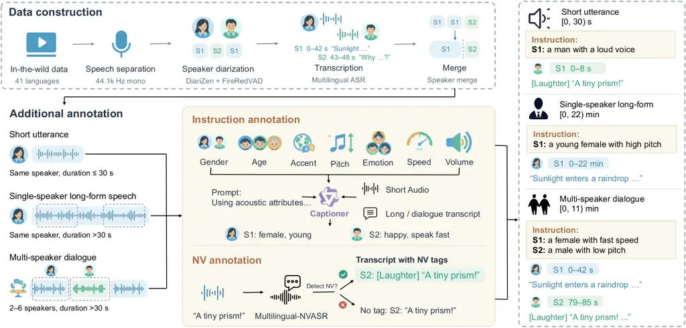

# Emilia2: A Large-Scale Dataset for Controllable Long-Form Speech Generation

Qinke Ni Dekun Chen Junwen Qiu Huan Liao Xu Li Xingwen Han Wan Lin Kunyu
Feng Yuxiang Wang Yusheng Mu Chaoren Wang Yingda Shen Mingjie
Chen Haolong Zheng Xulin Fan Mark A. Hasegawa-Johnson Zhizheng Wu The
Chinese University of Hong Kong, Shenzhen  University of Illinois at
Urbana-Champaign

###### Abstract

Generating long-form speech requires models to keep content, speaker
identity, turn-taking, and expressive style consistent over time. Yet
most open training corpora contain examples lasting only tens of seconds
and open long-form benchmarks cover at most two speakers per recording.
We introduce Emilia2, a 229K-hour multilingual dataset for controllable
long-form speech generation. From in-the-wild data, Emilia2 constructs
short utterances, single-speaker long-form speech, and multi-speaker
dialogues, preserving transcripts, speaker identities, pauses, and
acoustic transitions. Examples longer than five minutes account for
50.0% of single-speaker long-form hours and 66.8% of dialogue hours. To
support expressive control, Emilia2 provides natural language
instructions for 4.77M examples and nonverbal-vocalization tags for 933K
examples. We also introduce Emilia2-testset, 23 hours of bilingual
recordings of up to 30 minutes and four speakers, each speaker paired
with reference audio. We train autoregressive (AR) and
non-autoregressive (NAR) models on Emilia2. Our 0.6B-backbone NAR model
achieves the lowest Chinese CER and English WER on TTSD-Eval
(5.27%/9.93%) among compared systems, while our AR model is on par with
Qwen3-TTS-12Hz-VD on InstructTTSEval (zh/en: 76.2/78.3 vs. 77.1/77.9).
These results validate Emilia2 as a comprehensive data foundation for
long-form speech generation and minute-scale expressive control. Demo:
[https://charlesnii.github.io/Emilia2-demo/](https://charlesnii.github.io/Emilia2-demo/).

   

A Preprint

|     |
| --- |
|     |

## 1 Introduction

Speech synthesis is moving beyond short utterances towards long-form,
human-like spoken generation (Nishimura et al., 2025; Wang et al.,
2026a; Song et al., 2026; Zhang et al., 2026a). Applications such as
audiobooks, podcasts, audio dramas, and conversational agents require
speech that lasts coherently over minutes (Cheng et al., 2025; Peng
et al., 2026; Ju et al., 2026). In these settings, controllable
long-form generation requires more than producing intelligible speech in
a target voice: it must maintain accurate content alignment and
consistent speaker identities throughout an extended recording, preserve
natural pauses and smooth transitions across utterances and speaker
turns, and support expressive control (Zhang et al., 2026b; Li et al.,
2026; Pan et al., 2026).

Zero-shot text-to-speech (TTS) systems can clone a target voice from
seconds of reference audio (Chen et al., 2025; Anastassiou et al.,
2024), but most are designed for utterances of tens of seconds. Simply
concatenating these short segments into longer recordings often leads to
timbre drift, unnatural pauses, and prosodic discontinuities, degrading
the naturalness of long-form speech. To address these challenges, recent
studies explore long-form speech generation, with systems such as HALL-E
and MOSS-TTSD (Nishimura et al., 2025; Zhang et al., 2026b).
Nevertheless, zero-shot long-form speech synthesis still offers limited
expressive control: it remains difficult to preserve a target speaker’s
identity while explicitly controlling speaking style and nonverbal
vocalizations (NV) such as laughter and sighs, which are essential for
vivid and engaging speech. Despite rapid progress in long-form
generation, large-scale long-form training corpora providing expressive
annotations remain scarce. Existing corpora are often unavailable, and
open benchmarks with per-speaker reference audio remain limited in
duration or speaker coverage.

To close these gaps, we introduce Emilia2, a 229K-hour dataset across 41
languages for controllable long-form speech generation, as shown in
Table 1. Its construction pipeline, Emilia2-Pipe, organizes source
recordings into three complementary views: short utterances,
single-speaker long-form speech, and multi-speaker dialogues, while
preserving transcripts, speaker assignments, and the original temporal
continuity, as shown in Figure 1. These views extend text–speech
alignment to long contexts and speaker transitions: examples longer than
five minutes contribute 50.0% of single-speaker long-form hours and
66.8% of multi-speaker dialogue hours. To support expressive control,
annotated subsets provide natural language instructions describing
acoustic attributes, with NV tags interleaved with spoken words. Longer
examples further capture how these attributes evolve over time, while
dialogue instructions explicitly specify speaker attribution. For
evaluation, we introduce Emilia2-testset, 23 h of bilingual recordings
of up to 30 min with up to four speakers. We validate Emilia2 under two
generation paradigms: a non-autoregressive (NAR) masked generative
model, Emilia2-NAR (Wang et al., 2026a; Zhu et al., 2026b), and an
autoregressive (AR) flow-matching model, Emilia2-AR. With only a 0.6B
backbone, Emilia2-NAR achieves the lowest Chinese/English error rates on
TTSD-Eval (5.27%/9.93%) among compared systems, including the 8B
MOSS-TTSD, while Emilia2-AR obtains InstructTTSEval averages of
76.2/78.3, on par with Qwen3-TTS-12Hz-VD (77.1/77.9). These evaluations
demonstrate that Emilia2 effectively supports long-form speech
generation and expressive control.

Our contributions are threefold. (1) We establish Emilia2 and
Emilia2-Pipe, a data foundation for controllable long-form speech
generation that unifies short utterances, single-speaker long-form
speech, and multi-speaker dialogue, enriched with 4.77M
instruction-annotated and 933K NV-annotated examples. (2) We introduce
Emilia2-testset, an open benchmark of 23 h of human-verified bilingual
recordings of up to 30 min with up to four speakers, each speaker paired
with reference audio. (3) We validate Emilia2 using two different
architectures, AR and NAR, across multiple testsets, showing that
Emilia2 supports long-form and controllable expressive generation across
different modeling paradigms.

[TABLE]

Table 1: Emilia2 versus existing TTS training datasets. Long denotes
duration longer than 30 s. Dialogue denotes multi-speaker dialogue
speech. Instruction denotes natural language instructions. NV denotes
nonverbal vocalizations. ^(†)Dialogue context prompts for utterance
synthesis.

## 2 Related Work

#### Datasets for speech generation.

Existing datasets have broadened speech supervision, but remain limited
in sequence duration or in the temporal granularity of their
annotations. Emilia retains utterances of at most 30 s (He et al.,
2025), and MinutesSpeech extends single-speaker examples only to 180 s
(Nishimura et al., 2025). For multi-speaker speech, OpenDialog caps
dialogue segments at 30 s (Zhu et al., 2026a). ParaSpeechCaps and
CapSpeech annotate speaker characteristics and style (Diwan et al.,
2025; Wang et al., 2026b), DNASpeech adds dialogue context and actions
(Cheng et al., 2025), and Emilia-NV aligns NV events with text (Liao
et al., 2026a). However, these annotations are likewise attached to
short segments. Recent efforts have begun to construct monologue and
dialogue corpora from in-the-wild audio, but no existing open corpus
provides unified speaker, style, and NV annotations over long-form
recordings.

#### Benchmarks for long-form and controllable speech generation.

TTS benchmarks have likewise expanded beyond short-form content
alignment. Long-TTS-Eval focuses on single-speaker long-form speech
synthesis (Wang et al., 2026a), TTSD-Eval targets dialogue generation
(Zhang et al., 2026b). InstructTTSEval evaluates natural language
instruction following (Huang et al., 2025), and NV-Bench evaluates NV
synthesis (Ni et al., 2026), both on short utterances. Moreover,
existing open long-form benchmarks cover at most two speakers per
recording, and only ZipVoice-Dialog and TTSD-Eval provide per-speaker
reference audio (Table 17).

#### Controllable and long-form speech models.

Speech generation increasingly supports structured instructions and
longer outputs. Instruction-based TTS maps natural language descriptions
to speaking style (Guo et al., 2023; Yang et al., 2024; Zhou et al.,
2024; Chen et al., 2026; Hu et al., 2026), but is typically trained and
evaluated on short utterances. Borderless Long Speech Synthesis and
SwanTale extend instruction-based control to extended generation (Song
et al., 2026; Zhang et al., 2026a). Long-form speech generation has been
explored with diverse paradigms, including hierarchical codec language
modeling in HALL-E (Nishimura et al., 2025), autoregressive token
prediction in MOSS-TTSD (Zhang et al., 2026b), autoregressive language
models coupled with diffusion in MoonCast and VibeVoice (Ju et al.,
2026; Peng et al., 2026), and masked acoustic-token prediction in
OmniVoice (Zhu et al., 2026b). These diverse modeling paradigms
substantially broaden the design space for long-form speech generation.



Figure 1: Pipeline overview of Emilia2-Pipe. In-the-wild recordings are
enhanced, diarized, transcribed, and merged into single-speaker or
multi-speaker audio. Segments are annotated with natural language style
instructions and NV tags, then reassembled with speaker and timing
information into single-speaker long-form speech and multi-speaker
dialogue examples.

Figure 2: Language distribution of Emilia2-Short. The 34 remaining
languages are grouped as Other.

Figure 3: Duration distributions of Emilia2-Long and Emilia2-Dialogue.
Each subset is normalized separately by audio hours.

## 3 Emilia2-Pipe

Emilia2-Pipe is a processing and annotation pipeline that constructs
multilingual TTS data from in-the-wild recordings. It produces
transcribed short utterances, single-speaker long-form speech, and
multi-speaker dialogues, enriched with style instructions and NV tags.

### 3.1 Speech processing and example construction

#### Audio standardization and separation.

We inspect source media with FFmpeg, discard recordings sampled below
24 kHz, and decode the remainder into 44.1 kHz mono float32 audio.
Mel-Band RoFormer (Wang et al., 2023) then extracts the vocal stem,
which serves as the audio for all subsequent processing and for model
training.

#### Speaker diarization and segmentation.

DiariZen (Han et al., 2025) identifies speaker-active regions and builds
a speaker timeline for each source recording. Within these regions,
FireRedVAD (Xu et al., 2026) refines speech boundaries and splits long
regions into segments for downstream processing. Each segment keeps its
source timestamps and speaker assignment, preserving its correspondence
to the original recording throughout the pipeline.

#### Acoustic quality and synthetic-speech filtering.

We compute DNSMOS (Reddy et al., 2022) OVR scores to filter low-quality
segments. Given the prevalence of synthetic speech online, an in-house
synthetic-speech classifier flags synthetic Chinese and English speech.
Long-form candidates are assessed as complete examples using aggregated
segment-level scores and flags, rather than requiring every constituent
segment to pass the short-form criteria independently (Appendix A.1).

#### Language identification and transcription.

FireRedLID (Xu et al., 2026) identifies the language of each segment and
routes it to an appropriate ASR model: Qwen3-ASR-1.7B (Shi et al.,
2026), which supports 30 languages, transcribes those languages, and
IndicConformer-600M (AI4Bharat, 2025), which covers 22 Indic languages,
transcribes the remaining Indic-language segments.

#### Example construction.

Combining segment-level transcripts with the recording-level speaker
timeline, we construct three views of each recording. For short
utterances, we retain utterances of 0.5–30 s that pass the quality
filters above. For single-speaker long-form speech, we extend across
adjacent same-speaker regions to construct long-form speech of at least
30 s, terminating at speaker changes. For multi-speaker dialogue, we
select windows of at least 30 s containing 2–6 speakers while preserving
the original ordering and timing of speaker turns.

For both long-form views, we retain the continuous vocal-stem audio over
each selected interval, including native pauses and cross-utterance
acoustic transitions, rather than concatenating independently trimmed
utterances. Details can be found in Appendix A.1.

### 3.2 Instruction and NV annotation

To support controllable long-form speech generation, we annotate speech
with natural language style instructions and NV tags. To keep
annotations accurate, annotation is limited to segments shorter than
five minutes.

#### Instruction annotation.

We first estimate perceived age and gender, accent, pitch, emotion,
speaking rate, and loudness with task-specific attribute models and
signal measurements, as shown in Appendix A.2. For segments longer than
30 s, we additionally retain timestamped intervals that capture changes
in emotion, speaking rate, and loudness. Qwen3-Omni-30B-A3B-Captioner
(Xu et al., 2025) then converts these attributes into style
instructions. Segments longer than 30 s use a text-only prompt,
following the model card’s recommendation to limit audio inputs to 30 s
for fine-grained captioning. Following InstructTTSEval (Huang et al.,
2025), we design three format-specific prompts that produce
acoustic-parameter specifications (APS), descriptive-style directives
(DSD), and role-play directions (RP), plus a free-form prompt for a
voice description and a plausible speaker role and scene, as shown in
Appendix A.3. All prompts require the instructions to agree with the
extracted attributes, and each dialogue description is tied to its
speaker label.

#### Nonverbal annotation.

We apply Multilingual-NVASR (Ni et al., 2026) to Chinese and English
speech, jointly transcribing spoken words and NV events, such as
\[Laughter\], \[Cough\], and \[Sigh\], into a single interleaved
sequence. For examples containing NV tags, this interleaved sequence
serves as the training transcript, and all other examples retain their
ASR transcripts. More details are provided in Appendix A.4.

| View             | Speech data |           | Instruction |           | NV       |           |
| ---------------- | ----------- | --------- | ----------- | --------- | -------- | --------- |
|                  | Examples    | Audio (h) | Examples    | Audio (h) | Examples | Audio (h) |
| Emilia2-Short    | 99,841,007  | 146,325   | 3,994,566   | 5,102     | 474,078  | 854       |
| Emilia2-Long     | 4,263,913   | 155,688   | 651,060     | 15,317    | 353,929  | 9,572     |
| Emilia2-Dialogue | 1,538,239   | 96,452    | 120,815     | 4,633     | 104,999  | 4,200     |
|  Total           | 105,643,159 | 398,467   | 4,766,441   | 25,053    | 933,006  | 14,626    |

Table 2: Scale and annotation coverage of Emilia2. The three views share
source recordings and the Total row sums view entries. NV counts
examples containing NV tags.

## 4 Emilia2 Dataset

Built with Emilia2-Pipe, Emilia2 comprises short utterances,
single-speaker long-form speech, and multi-speaker dialogues, with
subsets enriched by instruction and NV annotations. Table 2 summarizes
the scale and annotation coverage of each view.

### 4.1 Emilia2 Profile

#### Diverse sources.

Emilia2 draws from a broad range of Internet sources, including podcasts
and RSS feeds, livestreams, interviews, public talks, film/TV
commentary, sports content, and games, spanning diverse formats,
domains, and speakers. The resulting collection covers 41 languages and
approximately 20.5M audio records, 229K hours in total. The source data
are compositionally broad: film/TV commentary accounts for 19.8% of its
hours, followed by humanities (11.5%), sports (6.8%), technology (6.1%).
These shares illustrate the diversity of source formats, domains, and
speakers represented in the corpus. Appendix C.1 details the source
composition.

#### Scale and composition.

Because the Emilia2-Short, Emilia2-Long, and Emilia2-Dialogue views are
derived from the same source recordings, they partially overlap. The
Total row in Table 2 sums the three views (105,643,159 entries and
398,467 hours). After deduplication at the source-audio level, Emilia2
contains 20,497,038 unique audio records totaling 229,388 hours across
41 languages, including English, Chinese, German, Japanese, Arabic,
Korean, and Spanish, as shown in Figure 3. Ten languages each contribute
more than 1,000 h to Emilia2-Short. More details are provided in
Appendix C.

#### Long-form and expressive coverage.

Examples longer than five minutes account for 50.0% of single-speaker
long-form hours and 66.8% of dialogue hours, as shown in Figure 3,
providing substantial coverage of extended narration and multi-turn
dialogue. Instruction annotations cover 4,766,441 examples, 25,053 hours
in total, of which single-speaker long-form speech and dialogue
contribute 19,950 hours (79.6%), extending instruction supervision well
beyond short utterances. NV tags, annotated for Chinese and English,
occur in 933,006 examples spanning 14,626 hours. Both annotation types
are attached to existing examples and add no audio to the corpus.

| Language | Cases | Single-speaker | Dialogue | Audio (h) | Avg. (min) | Range (min) |
| -------- | ----- | -------------- | -------- | --------- | ---------- | ----------- |
| Chinese  | 59    | 18             | 41       | 11.6      | 11.84      | 0.9–29.3    |
| English  | 59    | 24             | 35       | 11.7      | 11.86      | 1.0–30.0    |
|  Total   | 118   | 42             | 76       | 23.3      | 11.85      | 0.9–30.0    |

Table 3: Composition of Emilia2-testset. Hours cover target recordings
only. Avg. and Range are the average and range of target recording
durations.

### 4.2 Emilia2-testset

#### Task and design.

Existing long-form benchmarks with up to four speakers are either not
openly released or do not provide per-speaker reference audio. Among
open benchmarks with per-speaker prompts, recordings contain at most two
speakers. We therefore introduce Emilia2-testset, which, to our
knowledge, is the first open long-form benchmark to combine recordings
of up to four speakers with reference audio for every speaker. A TTS
system must synthesize the entire script as a single recording. As
summarized in Table 3, Emilia2-testset contains 118 cases totaling
23 hours: 42 single-speaker long-form cases and 76 dialogues with two to
four speakers. Target recordings range from 51.1 s to 30.0 min,
averaging 11.85 min.

#### Annotation and split protocol.

Ten annotators verify the target transcripts, speaker assignments, turn
boundaries, audio integrity, and the transcript and speaker identity of
each prompt. A second annotator independently reviews 10% of the
annotations. Clear errors are corrected directly, and cases with
substantial errors are re-annotated. To prevent train–test leakage,
isolation is enforced at the level of complete source recordings and
duplicate groups: all test sources and their detected duplicates are
excluded from the training manifests, so every segment, prompt, and
annotation derived from a source belongs to a single split. More details
can be found in Appendix D.

## 5 Experiments

We evaluate whether Emilia2 can support long-form generation,
multi-speaker synthesis, and expressive control across two different
modeling paradigms.

### 5.1 Model Architectures

We study two generative architectures: Emilia2-AR, which combines
autoregressive token prediction with flow-matching acoustic
reconstruction, and Emilia2-NAR, which is trained with masked
acoustic-token prediction (Figure 9 in Appendix E.1).

#### Emilia2-AR.

Emilia2-AR autoregressively predicts a target sequence
$`Z=(z_{1},\ldots,z_{L})`$ of speech tokens and speaker-ID markers given
conditions $`\mathcal{C}`$:

```math
p_{\phi}(Z\mid\mathcal{C})=\prod_{\ell=1}^{L}p_{\phi}(z_{\ell}\mid z_{<\ell},\mathcal{C}), \tag{1}
```

where $`\mathcal{C}`$ comprises the script, instructions, and reference
speech. A flow-matching decoder then generates a mel spectrogram from
the predicted tokens and the selected reference voice, and a vocoder
synthesizes the waveform.

#### Emilia2-NAR.

Let $`X=(x_{k,t})`$ denote the target acoustic-token grid over codebooks
$`k\in\{0,\ldots,K-1\}`$ and frames $`t`$, and let a binary mask $`M`$
produce the input $`\widetilde{X}`$, with prompt tokens always visible.
Given $`\widetilde{X}`$ and the conditions $`\mathcal{C}`$, Emilia2-NAR
minimizes, for each masked entry,

```math
\ell_{k,t}(\theta)=-\log p_{\theta}(x_{k,t}\mid\widetilde{X},\mathcal{C}),\qquad M_{k,t}=1. \tag{2}
```

Training samples full, coarse-to-fine, and independent per-cell masks
with probabilities 30%, 50%, and 20%. For coarse-to-fine masking, a
boundary $`d\sim\mathcal{U}\{0,\ldots,K-1\}`$ and
$`B_{t}\sim\mathrm{Bernoulli}(r)`$ define

```math
M_{k,t}=\begin{cases}0,&k<d,\\
B_{t},&k=d,\\
1,&k>d,\end{cases}\qquad r\sim\mathcal{U}(0,1). \tag{3}
```

At inference, the model starts from a fully masked grid and iteratively
decodes tokens in parallel, prioritizing lower-index codebooks, and an
acoustic decoder then reconstructs the waveform.

### 5.2 Implementation and Training Details

#### Model implementations.

Both Emilia2 models initialize their sequence-model backbones from
Qwen3-0.6B. Emilia2-AR uses the single-codebook speech tokenizer of
CosyVoice 3 (Du et al., 2025). Its causal backbone is trained with
next-token prediction over speech tokens and speaker-ID markers. A
DiT-based conditional flow-matching decoder converts the predicted
tokens into a mel spectrogram, then a Pupu-Vocoder (Gu et al., 2026)
synthesizes the waveform. Emilia2-NAR adopts the MGM architecture (Wang
et al., 2026a) with the Fish Audio S2 Pro tokenizer (Liao et al., 2026b)
for multi-codebook masked-token prediction, generating outputs in
parallel.

#### Curriculum learning.

Both models follow the same four-stage curriculum, progressively
increasing context duration and task complexity. Training starts on
Emilia2-Short with inputs capped at 30 s, then extends the maximum
context to 30 min on Emilia2-Long. The third stage trains jointly on
Emilia2-Long and Emilia2-Dialogue for multi-speaker dialogue synthesis.
Finally, supervised fine-tuning (SFT) on instruction- and NV-annotated
subsets enables expressive control and NV generation. More details can
be found in Appendix E.

### 5.3 Evaluation Setup

#### Testsets.

We evaluate long-form speech generation on Emilia2-testset, TTSD-Eval
(Zhang et al., 2026b), and Long-TTS-Eval (Wang et al., 2026a), and
short-form instruction following and NV generation on InstructTTSEval
(Huang et al., 2025) and NV-Bench (Ni et al., 2026), respectively. For
long-form expressive control, we construct two separate sets from
Emilia2-testset cases shorter than 5 min: instruction cases use manually
corrected Emilia2-Pipe-generated instructions, while NV cases use
DeepSeek-rewritten scripts with NV tags, details in Appendix D.3.

#### Baselines.

For long-form generation, we compare with Higgs Audio v2 (Boson AI,
2025), VibeVoice-1.5B (Peng et al., 2026), and MOSS-TTSD (Zhang et al.,
2026b). For short-form instruction following, we compare with
VoxInstruct (Zhou et al., 2024), FlexiVoice-Base (Chen et al., 2026),
and Qwen3-TTS-12Hz-VD (Hu et al., 2026). For short-form NV generation,
we compare with Orpheus-TTS (Canopy Labs, 2025) (using a fixed preset
voice), SMIIP-NV-CV2 (Wu et al., 2025), and CosyVoice 3 (Du et al.,
2025). Since open long-form baselines are not designed for explicit
expressive control, long-form control evaluations compare Emilia2-AR and
Emilia2-NAR.

#### Objective metrics.

On Emilia2-testset, we report word/character error rates (WER/CER),
speaker similarity (SIM), and speaker-attribution accuracy (ACC),
adapting the TTSD-Eval protocol to recordings of up to 30 min and one to
four speakers. We follow the official protocols of TTSD-Eval and
Long-TTS-Eval, additionally reporting SIM on Long-TTS-Eval, using the
WavLM-based speaker-verification model (Anastassiou et al., 2024). For
short-form control, InstructTTSEval scores instruction accuracy with
Gemini-2.5-Pro, and NV-Bench uses Multilingual-NVASR to compute
PCER/PWER over NV events and text-only CER/WER. Higher ACC, SIM, and
instruction scores and lower error rates are better. Complete protocols
are given in Appendix F.

#### Subjective metrics.

We conduct separate listening tests for the two long-form control tasks.
Both measure speech naturalness (N-MOS), assessed through pronunciation,
prosody, and continuity, independently of control correctness.
Instruction cases measure instruction following capability (Instr-MOS),
and NV cases measure NV Quality, which jointly assesses event type,
placement, and contextual appropriateness. All metrics use a 1–5 scale
and are averaged within each language. More details can be found in
Appendix F.3.

|                |         |                 |                 |                   |                 |                 |                   |
| -------------- | ------- | --------------- | --------------- | ----------------- | --------------- | --------------- | ----------------- |
| Model          | Params. | Chinese         |                 |                   | English         |                 |                   |
|                |         | ACC$`\uparrow`$ | SIM$`\uparrow`$ | CER$`\downarrow`$ | ACC$`\uparrow`$ | SIM$`\uparrow`$ | WER$`\downarrow`$ |
|  GT            | –       | 99.33           | 0.88            | 3.00              | 98.38           | 0.85            | 3.00              |
| Higgs Audio v2 | 3B      | 75.00           | 0.74            | 75.46             | 72.84           | 0.67            | 81.38             |
| VibeVoice-1.5B | 1.5B    | 93.78           | 0.81            | 4.61              | 95.98           | 0.75            | 5.66              |
| MOSS-TTSD      | 8B      | 99.28           | 0.87            | 2.18              | 99.22           | 0.81            | 5.83              |
|  Emilia2-AR    | 0.6B    | 98.57           | 0.84            | 3.67              | 95.05           | 0.74            | 6.82              |
|  Emilia2-NAR   | 0.6B    | 97.38           | 0.84            | 8.62              | 96.46           | 0.79            | 6.62              |

Table 4: Objective results on Emilia2-testset. ACC is accuracy over
multi-speaker cases. Single-speaker cases remain in SIM and CER/WER.
Bold and underlining mark the best and second-best per column.

### 5.4 Main Results

Tables 4 and 5 compare Emilia2 with existing mainstream long-form speech
generation systems. Despite using only a 0.6B backbone, both Emilia2
variants outperform the 3B Higgs Audio v2 across all reported evaluation
measures, while Emilia2-NAR surpasses VibeVoice-1.5B on all reported
results in TTSD-Eval and Long-TTS-Eval. Both variants are also
competitive with the substantially larger 8B MOSS-TTSD. On TTSD-Eval,
Emilia2-NAR achieves the lowest Chinese CER and English WER, while
nearly matching MOSS-TTSD in speaker attribution accuracy: its ACC
reaches 95.30% in Chinese and 94.89% in English, compared with 95.36%
and 95.00% for MOSS-TTSD, respectively. On Long-TTS-Eval, Emilia2-AR
achieves the highest SIM in both languages. On Emilia2-testset, an
Emilia2 variant ranks second only to MOSS-TTSD on five of the six
reported results. Overall, the two generation paradigms exhibit
complementary strengths: Emilia2-NAR leads Emilia2-AR on every TTSD-Eval
metric and on Long-TTS-Eval error rates, whereas Emilia2-AR attains the
highest SIM on single-speaker Long-TTS-Eval. On Emilia2-testset,
Emilia2-AR performs better in Chinese and Emilia2-NAR in English.

Both models further demonstrate strong instruction controllability. On
InstructTTSEval, as shown in Table 6, Emilia2-AR is competitive with the
state-of-the-art Qwen3-TTS-12Hz-VD and outperforms it on four of the six
criteria. On NV-Bench, as shown in Table 7, Emilia2-NAR achieves the
lowest PCER/PWER and text-only CER/WER, together with the highest SIM,
across all subsets and both languages. The minute-scale long-form
subjective evaluations reveal a similar complementarity: Emilia2-AR
scores slightly higher in N-MOS and Instr-MOS, whereas Emilia2-NAR
delivers higher NV Quality and lower content error under NV
conditioning.

| Model          | TTSD-Eval       |                 |                   |                 |                 |                   | Long-TTS-Eval     |                 |                   |                 |
| -------------- | --------------- | --------------- | ----------------- | --------------- | --------------- | ----------------- | ----------------- | --------------- | ----------------- | --------------- |
|                | Chinese         |                 |                   | English         |                 |                   | Chinese           |                 | English           |                 |
|                | ACC$`\uparrow`$ | SIM$`\uparrow`$ | CER$`\downarrow`$ | ACC$`\uparrow`$ | SIM$`\uparrow`$ | WER$`\downarrow`$ | CER$`\downarrow`$ | SIM$`\uparrow`$ | WER$`\downarrow`$ | SIM$`\uparrow`$ |
| Higgs Audio v2 | 60.97           | 0.63            | 79.32             | 70.60           | 0.62            | 47.54             | 73.65             | 0.60            | 73.30             | 0.47            |
| VibeVoice-1.5B | 88.25           | 0.73            | 9.21              | 93.58           | 0.68            | 10.18             | 16.98             | 0.67            | 11.20             | 0.59            |
| MOSS-TTSD      | 95.36           | 0.80            | 6.08              | 95.00           | 0.74            | 11.09             | 8.22              | 0.74            | 8.54              | 0.63            |
|  Emilia2-AR    | 92.89           | 0.75            | 6.92              | 92.66           | 0.65            | 12.25             | 14.42             | 0.75            | 17.76             | 0.67            |
|  Emilia2-NAR   | 95.30           | 0.78            | 5.27              | 94.89           | 0.73            | 9.93              | 13.05             | 0.74            | 9.79              | 0.62            |

Table 5: Long-form synthesis on TTSD-Eval and Long-TTS-Eval. ACC denotes
speaker-attribution accuracy, SIM speaker similarity, and CER/WER
character/word error rate. Bold and underlining mark the best and
second-best scores per column.

|                   |         |      |      |      |         |      |      |      |
| ----------------- | ------- | ---- | ---- | ---- | ------- | ---- | ---- | ---- |
| _Short-form_      | Chinese |      |      |      | English |      |      |      |
| Model             | APS     | DSD  | RP   | Avg. | APS     | DSD  | RP   | Avg. |
| VoxInstruct       | 47.5    | 52.3 | 42.6 | 47.5 | 54.9    | 57.0 | 39.3 | 50.4 |
| FlexiVoice-Base   | 56.7    | 59.1 | 59.5 | 58.4 | 63.6    | 75.0 | 60.6 | 66.4 |
| Qwen3-TTS-12Hz-VD | 85.2    | 81.1 | 65.1 | 77.1 | 82.9    | 82.4 | 68.4 | 77.9 |
|  Emilia2-AR       | 82.0    | 72.5 | 74.0 | 76.2 | 83.0    | 83.5 | 68.5 | 78.3 |
|  Emilia2-NAR      | 69.2    | 59.8 | 55.6 | 61.6 | 67.4    | 66.5 | 49.8 | 61.2 |

| _Long-form_  | Chinese           |                   |                       | English           |                   |                       |
| ------------ | ----------------- | ----------------- | --------------------- | ----------------- | ----------------- | --------------------- |
| Model        | CER$`\downarrow`$ | N-MOS$`\uparrow`$ | Instr-MOS$`\uparrow`$ | WER$`\downarrow`$ | N-MOS$`\uparrow`$ | Instr-MOS$`\uparrow`$ |
|  Emilia2-AR  | 4.87              | 4.40 $`\pm`$ 0.30 | 3.56 $`\pm`$ 0.40     | 2.60              | 4.32 $`\pm`$ 0.20 | 3.68 $`\pm`$ 0.38     |
|  Emilia2-NAR | 3.21              | 4.20 $`\pm`$ 0.20 | 3.40 $`\pm`$ 0.38     | 4.38              | 4.28 $`\pm`$ 0.24 | 3.52 $`\pm`$ 0.38     |

Table 6: Instruction following at two timescales. Short-form results are
on InstructTTSEval, and long-form results on instruction-conditioned
Emilia2-testset cases. In the short-form block, bold and underlining
mark the best and second-best scores per column.

| _Short-form_ | Single-label subset |                   |                 |                    |                   |                 | Multi-label subset |                   |                 |                    |                   |                 |
| ------------ | ------------------- | ----------------- | --------------- | ------------------ | ----------------- | --------------- | ------------------ | ----------------- | --------------- | ------------------ | ----------------- | --------------- |
| Model        | Chinese             |                   |                 | English            |                   |                 | Chinese            |                   |                 | English            |                   |                 |
|              | PCER$`\downarrow`$  | CER$`\downarrow`$ | SIM$`\uparrow`$ | PWER$`\downarrow`$ | WER$`\downarrow`$ | SIM$`\uparrow`$ | PCER$`\downarrow`$ | CER$`\downarrow`$ | SIM$`\uparrow`$ | PWER$`\downarrow`$ | WER$`\downarrow`$ | SIM$`\uparrow`$ |
| Orpheus-TTS  | 88.77               | 11.36             | –               | 71.92              | 9.03              | –               | 84.85              | 19.83             | –               | 71.46              | 8.68              | –               |
| SMIIP-NV-CV2 | 75.64               | 8.80              | 0.72            | 56.80              | 17.92             | 0.58            | 77.20              | 10.66             | 0.72            | 54.49              | 20.93             | 0.58            |
| CosyVoice 3  | 57.69               | 3.85              | 0.76            | 62.75              | 7.87              | 0.70            | 61.94              | 4.75              | 0.72            | 57.84              | 6.39              | 0.72            |
|  Emilia2-AR  | 39.23               | 5.39              | 0.67            | 55.59              | 10.96             | 0.62            | 49.48              | 6.25              | 0.67            | 57.19              | 9.10              | 0.62            |
|  Emilia2-NAR | 28.15               | 2.36              | 0.78            | 40.12              | 6.21              | 0.73            | 38.07              | 3.87              | 0.78            | 41.77              | 4.85              | 0.76            |

| _Long-form_  | Chinese           |                   |                        | English           |                   |                        |
| ------------ | ----------------- | ----------------- | ---------------------- | ----------------- | ----------------- | ---------------------- |
| Model        | CER$`\downarrow`$ | N-MOS$`\uparrow`$ | NV Quality$`\uparrow`$ | WER$`\downarrow`$ | N-MOS$`\uparrow`$ | NV Quality$`\uparrow`$ |
|  Emilia2-AR  | 5.44              | 4.44 $`\pm`$ 0.24 | 3.40 $`\pm`$ 0.40      | 3.82              | 4.48 $`\pm`$ 0.24 | 3.40 $`\pm`$ 0.36      |
|  Emilia2-NAR | 2.58              | 4.28 $`\pm`$ 0.20 | 3.76 $`\pm`$ 0.32      | 3.26              | 4.40 $`\pm`$ 0.26 | 3.88 $`\pm`$ 0.46      |

Table 7: NV generation at two timescales. Short-form results are on
NV-Bench, and long-form results on NV-conditioned Emilia2-testset cases.
In the short-form block, bold and underlining mark the best and
second-best scores per column.

### 5.5 Analysis

#### Emilia2 supports both long-form generation and expressive control.

Trained on Emilia2, the 0.6B-backbone Emilia2-AR and Emilia2-NAR models
demonstrate both capabilities across AR and NAR architectures. In
long-form generation, both remain competitive with the 8B MOSS-TTSD
despite having roughly one-thirteenth as many backbone parameters. For
expressive control, Emilia2-AR matches Qwen3-TTS-12Hz-VD on
InstructTTSEval, while Emilia2-NAR achieves the lowest PCER/PWER on
every NV-Bench subset. On minute-scale instruction- and NV-conditioned
speech, both models achieve N-MOS $`\geq`$ 4.20, Instr-MOS $`\geq`$
3.40, and NV Quality $`\geq`$ 3.40 in both languages. Together, these
results show that Emilia2 supports both extended generation and explicit
expressive control with high naturalness.

#### Emilia2-testset exposes failure modes hidden by aggregate scores.

By stratifying performance by speaker count and recording duration,
Emilia2-testset probes conditions that existing benchmarks cover only
sparsely (Figure 5.5). GT CER stays low across strata, so the trends
reflect generation errors rather than ASR artifacts. Emilia2-AR and the
much larger MOSS-TTSD show no systematic deterioration along either
axis. VibeVoice, however, becomes less accurate as speaker count grows,
a weakness masked by its competitive aggregate CER. Emilia2-NAR degrades
as recording duration increases, consistent with its fixed decoding-step
budget. Although chunking reduces Emilia2-NAR’s Chinese CER from 8.62%
to 1.73%, it lowers N-MOS in all four model–language pairs, by up to
0.75 (Appendix G.1). This contrast shows that long-form synthesis cannot
be reduced to independently generated short chunks: CER/WER captures
local content accuracy but misses cross-chunk prosodic continuity.

Figure 4: Stratified Chinese CER on Emilia2-testset. Top: by speaker
count, bottom: by target duration.

## 6 Conclusion

We introduced Emilia2, a 229K-hour, 41-language dataset for controllable
long-form speech generation. Built with Emilia2-Pipe, it unifies short
utterances, single-speaker long-form speech, and multi-speaker dialogue
with instruction and NV annotations. Emilia2-testset adds 23 hours of
human-verified bilingual recordings of up to 30 min with up to four
speakers. Experiments with 0.6B Emilia2-AR and Emilia2-NAR models show
that Emilia2 supports both long-form generation and expressive control,
with complementary strengths: Emilia2-NAR excels in dialogue content
alignment and NV Quality, and Emilia2-AR in single-speaker speaker
similarity and naturalness. These results demonstrate that Emilia2 can
serve as an open data foundation for long-form speech generation and
minute-scale expressive control.

### AI use statement

We used generative AI tools for dataset annotation, evaluation-set
construction, and manuscript editing. As described in Section 3.2 and
Appendix A.3, Qwen3-Omni-30B-A3B-Captioner is a component of the dataset
construction pipeline that generates natural language instructions from
extracted acoustic attributes and, where applicable, audio or transcript
context. As described in Appendix D.3, DeepSeek was used to rewrite
scripts and insert case-specific nonverbal-vocalization tags for the
NV-conditioned evaluation set. Gemini-2.5-Pro serves as the automatic
judge in the official InstructTTSEval protocol. Generative AI tools were
also used to improve the language and clarity of the manuscript. The
authors reviewed all AI-assisted outputs and take full responsibility
for the content of this paper.

### Ethics statement

Speech can reveal identity and sensitive personal information, and voice
generation can enable impersonation. Our source review therefore
separately considers permission to process source audio, to use it for
model training, and to publish or redistribute derived artifacts. Public
accessibility alone is not treated as consent or a redistribution right.
The planned public release consists of source-linked URL manifests and
distributable derived artifacts, including annotations, metadata, and
processing configurations, together with the preprocessing and
evaluation code needed for reproducibility. Stable identifiers will
propagate corrections and removal requests across hosted views and later
manifests, and data will document annotation licenses and residual
risks. Age and gender annotations are perceived, model-derived
attributes rather than speaker metadata.

### Reproducibility statement

We document the full construction pipeline and filtering thresholds
(Section 3 and Appendix A), component validation (Appendix B), the
testset protocol (Appendix D), and the model, training, and evaluation
settings (Section 5 and Appendices E and F). The release includes
versioned manifests, processing configurations, annotation provenance,
and model training and inference configurations. Dataset statistics are
tied to frozen manifest checksums and recorded source-access dates
(Appendix H).

## References

- AI4Bharat (2025) AI4Bharat. IndicConformer-600M-Multi.
  [https://huggingface.co/ai4bharat/indic-conformer-600m-multilingual](https://huggingface.co/ai4bharat/indic-conformer-600m-multilingual), 2025.
- Anastassiou et al. (2024) Philip Anastassiou, Jiawei Chen, Jitong
  Chen, Yuanzhe Chen, Zhuo Chen, Ziyi Chen, Jian Cong, Lelai Deng,
  Chuang Ding, Lu Gao, et al. Seed-tts: A family of high-quality
  versatile speech generation models. _arXiv preprint
  arXiv:2406.02430_, 2024.
- Boson AI (2025) Boson AI. Higgs Audio V2: Redefining Expressiveness in
  Audio Generation.
  [https://github.com/boson-ai/higgs-audio](https://github.com/boson-ai/higgs-audio), 2025.
- Canopy Labs (2025) Canopy Labs. Orpheus TTS: Towards human-sounding
  speech.
  [https://github.com/canopyai/Orpheus-TTS](https://github.com/canopyai/Orpheus-TTS), 2025.
- Chen et al. (2026) Dekun Chen, Xueyao Zhang, Yuancheng Wang, Kenan
  Dai, Li Ma, and Zhizheng Wu. Flexivoice: Enabling flexible style
  control in zero-shot tts with natural language instructions. _arXiv
  preprint arXiv:2601.04656_, 2026.
- Chen et al. (2025) Sanyuan Chen, Chengyi Wang, Yu Wu, Ziqiang Zhang,
  Long Zhou, Shujie Liu, Zhuo Chen, Yanqing Liu, Huaming Wang, Jinyu Li,
  et al. Neural codec language models are zero-shot text to speech
  synthesizers. _IEEE Transactions on Audio, Speech and Language
  Processing_, 33:705–718, 2025.
- Cheng et al. (2025) Chuanqi Cheng, Hongda Sun, Bo Du, Shuo Shang,
  Xinrong Hu, and Rui Yan. Dnaspeech: A contextualized and situated
  text-to-speech dataset with dialogues, narratives and actions. In
  _Proceedings of the 63rd Annual Meeting of the Association for
  Computational Linguistics (Volume 1: Long Papers)_, pages
  18599–18616, 2025.
- Diwan et al. (2025) Anuj Diwan, Zhisheng Zheng, David Harwath, and
  Eunsol Choi. Scaling rich style-prompted text-to-speech datasets. In
  _Proceedings of the 2025 Conference on Empirical Methods in Natural
  Language Processing_, pages 3639–3659, 2025.
- Du et al. (2025) Zhihao Du, Changfeng Gao, Yuxuan Wang, Fan Yu, Tianyu
  Zhao, Hao Wang, Xiang Lv, Hui Wang, Chongjia Ni, Xian Shi, et al.
  Cosyvoice 3: Towards in-the-wild speech generation via scaling-up and
  post-training. _arXiv preprint arXiv:2505.17589_, 2025.
- Feng et al. (2026) Tiantian Feng, Kevin Huang, Anfeng Xu, Xuan Shi,
  Thanathai Lertpetchpun, Jihwan Lee, Yoonjeong Lee, Dani Byrd, and
  Shrikanth Narayanan. Voxlect: A speech foundation model benchmark for
  modeling dialects and regional languages around the globe. In
  _Proceedings of the 32nd ACM SIGKDD Conference on Knowledge Discovery
  and Data Mining V. 1_, pages 2640–2651, 2026.
- Gu et al. (2026) Yicheng Gu, Junan Zhang, Chaoren Wang, Jerry Li,
  Zhizheng Wu, and Lauri Juvela. Aliasing-free neural audio synthesis.
  _IEEE Transactions on Audio, Speech and Language Processing_, 2026.
- Guo et al. (2023) Zhifang Guo, Yichong Leng, Yihan Wu, Sheng Zhao, and
  Xu Tan. Prompttts: Controllable text-to-speech with text descriptions.
  In _ICASSP 2023-2023 IEEE International Conference on Acoustics,
  Speech and Signal Processing (ICASSP)_, pages 1–5. IEEE, 2023.
- Han et al. (2025) Jiangyu Han, Federico Landini, Johan Rohdin, Anna
  Silnova, Mireia Diez, and Lukáš Burget. Leveraging self-supervised
  learning for speaker diarization. In _ICASSP 2025-2025 IEEE
  International Conference on Acoustics, Speech and Signal Processing
  (ICASSP)_, pages 1–5. IEEE, 2025.
- He et al. (2025) Haorui He, Zengqiang Shang, Chaoren Wang, Xuyuan Li,
  Yicheng Gu, Hua Hua, Liwei Liu, Chen Yang, Jiaqi Li, Peiyang Shi,
  et al. Emilia: A large-scale, extensive, multilingual, and diverse
  dataset for speech generation. _IEEE Transactions on Audio, Speech and
  Language Processing_, 2025.
- Hu et al. (2026) Hangrui Hu, Xinfa Zhu, Ting He, Dake Guo, Bin Zhang,
  Xiong Wang, Zhifang Guo, Ziyue Jiang, Hongkun Hao, Zishan Guo, et al.
  Qwen3-tts technical report. _arXiv preprint arXiv:2601.15621_, 2026.
- Huang et al. (2025) Kexin Huang, Qian Tu, Liwei Fan, Chenchen Yang,
  Dong Zhang, Shimin Li, Zhaoye Fei, Qinyuan Cheng, and Xipeng Qiu.
  Instructttseval: Benchmarking complex natural-language instruction
  following in text-to-speech systems. _arXiv preprint
  arXiv:2506.16381_, 2025.
- Ju et al. (2026) Zeqian Ju, Dongchao Yang, Shen Kai, Yichong Leng,
  Zhengtao Wang, Songxiang Liu, Xinyu Zhou, Tao Qin, Xiangyang Li,
  Jianwei Yu, et al. Mooncast: High-quality zero-shot podcast
  generation. _Advances in Neural Information Processing Systems_,
  38:6283–6317, 2026.
- Li et al. (2026) Ruiqi Li, Yu Zhang, Changhao Pan, Ke Lei, Xiang Yin,
  and Cheng Yang. Swanvoice: Expressive long-form zero-shot speech
  synthesis for both monologue and dialogue. _arXiv preprint
  arXiv:2605.30993_, 2026.
- Liao et al. (2026a) Huan Liao, Qinke Ni, Yuancheng Wang, Yiheng Lu,
  Haoyue Zhan, Pengyuan Xie, Qiang Zhang, and Zhizheng Wu. Emilia-nv: A
  non-verbal speech dataset with word-level annotation for human-like
  speech modeling. In _ICASSP 2026-2026 IEEE International Conference on
  Acoustics, Speech and Signal Processing (ICASSP)_, pages 17587–17591.
  IEEE, 2026a.
- Liao et al. (2026b) Shijia Liao, Yuxuan Wang, Songting Liu, Yifan
  Cheng, Ruoyi Zhang, Tianyu Li, Shidong Li, Yisheng Zheng, Xingwei Liu,
  Qingzheng Wang, et al. Fish audio s2 technical report. _arXiv preprint
  arXiv:2603.08823_, 2026b.
- Ni et al. (2026) Qinke Ni, Huan Liao, Dekun Chen, Yuxiang Wang, and
  Zhizheng Wu. Nv-bench: Benchmark of nonverbal vocalization synthesis
  for expressive text-to-speech generation. _arXiv preprint
  arXiv:2603.15352_, 2026.
- Nishimura et al. (2025) Yuto Nishimura, Takumi Hirose, Masanari Ohi,
  Hideki Nakayama, and Nakamasa Inoue. Hall-e: Hierarchical neural codec
  language model for minute-long zero-shot text-to-speech synthesis. In
  _International Conference on Learning Representations_, volume 2025,
  pages 91141–91164, 2025.
- Pan et al. (2026) Changhao Pan, Rui Yang, Han Wang, Zhuan Zhou, Xuming
  He, Wenxiang Guo, Ziyue Jiang, Ruiqi Li, Yu Zhang, Chenyuhao Wen,
  et al. Comprehensive benchmarking of long-form speech generation in
  diverse scenarios. In _Findings of the Association for Computational
  Linguistics: ACL 2026_, pages 2365–2400, 2026.
- Park et al. (2024a) Se Park, Chae Kim, Hyeongseop Rha, Minsu Kim,
  Joanna Hong, Jeonghun Yeo, and Yong Ro. Let’s go real talk: Spoken
  dialogue model for face-to-face conversation. In _Proceedings of the
  62nd Annual Meeting of the Association for Computational Linguistics
  (Volume 1: Long Papers)_, pages 16334–16348, 2024a.
- Park et al. (2024b) Se Jin Park, Julian Salazar, Aren Jansen, Keisuke
  Kinoshita, Yong Man Ro, and RJ Skerry-Ryan. Long-form speech
  generation with spoken language models. _arXiv preprint
  arXiv:2412.18603_, 2024b.
- Peng et al. (2026) Zhiliang Peng, Jianwei Yu, Wenhui Wang, Yaoyao
  Chang, Yutao Sun, Li Dong, Yi Zhu, Weijiang Xu, Hangbo Bao, Zehua
  Wang, et al. Vibevoice: Expressive podcast generation with next-token
  diffusion. In _The Fourteenth International Conference on Learning
  Representations_, 2026.
- Pulikodan et al. (2026) Sujith Pulikodan, Abhayjeet Singh, Agneedh
  Basu, Nihar Desai, Pranav D Bhat, Raghu Dharmaraju, Ritika Gupta,
  Sathvik Udupa, Saurabh Kumar, Sumit Sharma, et al. Vaani: Capturing
  the language landscape for an inclusive digital india. _arXiv preprint
  arXiv:2603.28714_, 2026.
- Reddy et al. (2022) Chandan KA Reddy, Vishak Gopal, and Ross Cutler.
  Dnsmos p. 835: A non-intrusive perceptual objective speech quality
  metric to evaluate noise suppressors. In _ICASSP 2022-2022 IEEE
  international conference on acoustics, speech and signal processing
  (ICASSP)_, pages 886–890. IEEE, 2022.
- Shi et al. (2026) Xian Shi, Xiong Wang, Zhifang Guo, Yongqi Wang, Pei
  Zhang, Xinyu Zhang, Zishan Guo, Hongkun Hao, Yu Xi, Baosong Yang,
  et al. Qwen3-asr technical report. _arXiv preprint
  arXiv:2601.21337_, 2026.
- Song et al. (2026) Xingchen Song, Di Wu, Dinghao Zhou, Pengyu Cheng,
  Hongwu Ding, Yunchao He, Jie Wang, Shengfan Shen, Sixiang Lv, Lichun
  Fan, et al. Borderless long speech synthesis. _arXiv preprint
  arXiv:2603.19798_, 2026.
- Wang et al. (2026a) Chengyao Wang, Zhisheng Zhong, Bohao Peng, Senqiao
  Yang, Yuqi Liu, Haokun Gui, Bin Xia, Jingyao Li, Bei Yu, and Jiaya
  Jia. Mgm-omni: Scaling omni llms to personalized long-horizon speech.
  In _European Conference on Computer Vision_, pages 570–588. Springer,
  2026a.
- Wang et al. (2026b) Helin Wang, Jiarui Hai, Dading Chong, Karan
  Thakkar, Tiantian Feng, Dongchao Yang, Junhyeok Lee, Thomas Thebaud,
  Laureano Moro-Velázquez, Jesús Villalba, et al. Capspeech: Enabling
  downstream applications in style-captioned text-to-speech. _IEEE
  Transactions on Audio, Speech and Language Processing_, 2026b.
- Wang et al. (2023) Ju-Chiang Wang, Wei-Tsung Lu, and Minz Won.
  Mel-band roformer for music source separation. _arXiv preprint
  arXiv:2310.01809_, 2023.
- Wu et al. (2025) Zhuojun Wu, Dong Liu, Juan Liu, Yechen Wang, Linxi
  Li, Liwei Jin, Hui Bu, Pengyuan Zhang, and Ming Li. Smiip-nv: A
  multi-annotation non-verbal expressive speech corpus in mandarin for
  llm-based speech synthesis. In _Proceedings of the 33rd ACM
  International Conference on Multimedia_, pages 12564–12570, 2025.
- Xu et al. (2025) Jin Xu, Zhifang Guo, Hangrui Hu, Yunfei Chu, Xiong
  Wang, Jinzheng He, Yuxuan Wang, Xian Shi, Ting He, Xinfa Zhu, et al.
  Qwen3-omni technical report. _arXiv preprint arXiv:2509.17765_, 2025.
- Xu et al. (2026) Kaituo Xu, Yan Jia, Kai Huang, Junjie Chen, Wenpeng
  Li, Kun Liu, Feng-Long Xie, Xu Tang, and Yao Hu. Fireredasr2s: A
  state-of-the-art industrial-grade all-in-one automatic speech
  recognition system. _arXiv preprint arXiv:2603.10420_, 2026.
- Yang et al. (2024) Dongchao Yang, Songxiang Liu, Rongjie Huang, Chao
  Weng, and Helen Meng. Instructtts: Modelling expressive tts in
  discrete latent space with natural language style prompt. _IEEE/ACM
  Transactions on Audio, Speech, and Language Processing_,
  32:2913–2925, 2024.
- Zhang et al. (2025) Bowen Zhang, Congchao Guo, Geng Yang, Hang Yu,
  Haozhe Zhang, Heidi Lei, Jialong Mai, Junjie Yan, Kaiyue Yang, Mingqi
  Yang, et al. Minimax-speech: Intrinsic zero-shot text-to-speech with a
  learnable speaker encoder. _arXiv preprint arXiv:2505.07916_, 2025.
- Zhang et al. (2026a) Yu Zhang, Ruiqi Li, Changhao Pan, Ke Lei, Xiang
  Yin, and Cheng Yang. Swantale: Unified multi-speaker speech and audio
  generation for instruct and zero-shot tasks. _arXiv preprint
  arXiv:2608.02023_, 2026a.
- Zhang et al. (2026b) Yuqian Zhang, Donghua Yu, Zhengyuan Lin, Botian
  Jiang, Mingshu Chen, Yaozhou Jiang, Yiwei Zhao, Yiyang Zhang, Yucheng
  Yuan, Hanfu Chen, et al. Moss-ttsd: Text to spoken dialogue
  generation. _arXiv preprint arXiv:2603.19739_, 2026b.
- Zhou et al. (2024) Yixuan Zhou, Xiaoyu Qin, Zeyu Jin, Shuoyi Zhou,
  Shun Lei, Songtao Zhou, Zhiyong Wu, and Jia Jia. Voxinstruct:
  Expressive human instruction-to-speech generation with unified
  multilingual codec language modelling. In _Proceedings of the 32nd ACM
  International Conference on Multimedia_, pages 554–563, 2024.
- Zhu et al. (2026a) Han Zhu, Wei Kang, Liyong Guo, Zengwei Yao, Fangjun
  Kuang, Weiji Zhuang, Zhaoqing Li, Zhifeng Han, Dong Zhang, Xin Zhang,
  et al. Zipvoice-dialog: Non-autoregressive spoken dialogue generation
  with flow matching. In _Findings of the Association for Computational
  Linguistics: ACL 2026_, pages 38717–38729, 2026a.
- Zhu et al. (2026b) Han Zhu, Lingxuan Ye, Wei Kang, Zengwei Yao, Liyong
  Guo, Fangjun Kuang, Zhifeng Han, Weiji Zhuang, Long Lin, and Daniel
  Povey. Omnivoice: Towards omnilingual zero-shot text-to-speech with
  diffusion language models. _arXiv preprint arXiv:2604.00688_, 2026b.

## Appendix A Dataset Construction and Expressive Annotation

This appendix details the procedures summarized in Section 3: the
filtering and construction rules for the three speech views
(Appendix A.1), acoustic attribute extraction (Appendix A.2),
instruction generation (Appendix A.3), and NV annotation (Appendix A.4).
Validation of the main automatic components is reported separately in
Appendix B.

### A.1 Filtering and Example Construction

#### Acoustic quality and synthetic-speech filtering.

Short-form selection requires a DNSMOS overall quality (OVR) score of at
least 3.0 for Chinese and English and 2.4 for other languages \[He
et al., 2025\], plus a check by the in-house synthetic-speech classifier
for Chinese and English. Long-form passages and dialogues are assessed
as complete examples: their duration-weighted mean OVR must reach 2.4,
and a Chinese or English example fails the synthetic-speech check only
when more than 50% of its duration is flagged.

#### Short utterances.

Adjacent same-speaker segments separated by less than 3 s are merged
before filtering. We retain the resulting segments when they are
0.5–30 s long and pass the acoustic-quality and applicable
synthetic-speech checks above. Each accepted segment must have a
supported language, a language-identification confidence of at least
0.8, and a valid transcript containing at least two characters. We
further require the ratio of voiced duration to transcript length to lie
within $`[0.015,1.0]`$ s per character for alphabetic scripts and
$`[0.04,2.0]`$ s per character for Chinese, Japanese, Korean, and Thai.
These examples provide the local text–audio pairs used for short-form
synthesis.

#### Single-speaker long-form speech.

Adjacent segments assigned to the same speaker are merged within the
original recording, bridging pauses of up to 6 s and stopping at a
speaker change. We retain passages of at least 30 s, with no upper
length bound, that satisfy the long-form filtering criteria above. Each
accepted passage preserves the original pauses and acoustic transitions
across sentences, providing a complete long-form training target.

#### Multi-speaker dialogue.

We divide each recording at silences longer than 6 s and select windows
of at least 30 s containing two to six speakers. Each window must
contain at least $`\max(2,N_{\text{spk}})`$ turns, with at least 15% of
the turns assigned to the second-most-active speaker. Windows must
satisfy the same long-form filtering criteria and are discarded if
overlapping speech from two or more speakers covers more than 5% of
their duration. Beforehand, diarized regions whose overlap with another
speaker exceeds 2 s or 40% of their duration are removed. Retained
dialogues preserve the original order and timing of exchanges, with each
turn linked to its speaker and transcript.

#### Export and shared source audio.

The exporter writes the separated vocal stem of each source recording to
one M4A file. Short utterances, single-speaker long-form speech, and
multi-speaker dialogue windows are stored as start–end intervals in
their manifests, each pointing to that file. This avoids storing the
same audio repeatedly and allows a short utterance to be located within
its longer context. Overlapping intervals count toward multiple views
but only once when measuring their combined audio coverage.

### A.2 Acoustic Attribute Extraction

#### Voice attributes.

We use wav2vec2-large-robust-24-ft-age-gender¹¹ 1
[https://huggingface.co/audeering/](https://huggingface.co/audeering/wav2vec2-large-robust-24-ft-age-gender)  
[wav2vec2-large-robust-24-ft-age-gender](https://huggingface.co/audeering/wav2vec2-large-robust-24-ft-age-gender)
for a three-class female/male/child prediction and one continuous age
estimate. Wavlm-large-age-sex²² 2
[https://huggingface.co/tiantiaf/wavlm-large-age-sex](https://huggingface.co/tiantiaf/wavlm-large-age-sex)
provides a second age estimate. The age tag is child when the first
model predicts child. Otherwise, we bin the median of the two age
estimates. Both continuous estimates are retained in the annotations.
Chinese accent labels use a FireRedLID$`\rightarrow`$Voxlect \[Feng
et al., 2026\] cascade. FireRedLID supplies Wu, Min, and Xiang, which
the Voxlect Mandarin head does not cover, but collapses northern
Mandarin subgroups into one north class, so Voxlect then refines north
and other routes into the supported Mandarin subgroups and also labels
Cantonese. Separate Voxlect heads cover English and Arabic accents, and
PENN³³ 3
[https://github.com/interactiveaudiolab/penn](https://github.com/interactiveaudiolab/penn)
estimates pitch. These attributes describe the perceived voice and serve
as acoustic evidence for instruction generation. Age and gender are
treated as perceived attributes rather than speaker metadata.

#### Style attributes and temporal changes.

An in-house speech emotion recognizer predicts seven classes: neutral,
happy, angry, sad, surprised, fearful, and disgusted. We retain a
prediction only when its confidence reaches 0.7. Lower-confidence cases
remain unlabeled rather than being treated as neutral. Speaking rate is
measured in characters per second (CPS), and integrated loudness is
measured in LUFS. Rate values are interpreted according to the language
and transcript representation. For segments longer than 30 s, we retain
intervals describing changes in emotion, speaking rate, and loudness,
together with their measurements and available confidence scores. Each
interval specifies both the style attribute and the part of the
recording to which it applies. These intervals capture within-recording
changes that a single global style label would miss. Component selection
for all attribute extractors is reported in Appendix B.4.

### A.3 Instruction Generation

#### Captioner inputs.

We use Qwen3-Omni-30B-A3B-Captioner to generate natural language style
instructions from the available acoustic evidence. For segments of at
most 30 s, the captioner receives the waveform and a text prompt
containing the extracted voice and style attributes. Longer segments use
a text-only prompt, following the model card’s recommendation to limit
audio inputs to 30 s for fine-grained captioning. All four forms receive
the extracted attributes. Only the free-form prompt also receives the
transcript, which is used for broad register and scene context rather
than acoustic inference. Missing attributes are omitted. For segments
longer than 30 s, a tag line describes measured changes in loudness,
speaking rate, and emotion chronologically with their positions in the
recording.

#### Instruction forms and content constraints.

Following the prompt design of InstructTTSEval \[Huang et al., 2025\],
we use three format-specific prompts. _Acoustic-parameter
specifications_ (APS) express voice attributes as compact,
semicolon-separated lists. _Descriptive-style directives_ (DSD) describe
pitch, pace, loudness, and emotional character in natural prose.
_Role-play directions_ (RP) evoke an abstract role, mood, or atmosphere
while remaining consistent with the supplied attributes. A fourth,
free-form prompt imposes no output-format constraint and asks for a
voice description and a plausible, general speaker role and scene. APS,
DSD, RP, and free-form instructions must agree with the supplied
attributes, and must not quote, paraphrase, or retell the spoken
content. RP imagery is synthetic performance guidance rather than a
factual account of the recording context.

#### Language and dialogue organization.

Instruction form and output language are selected deterministically for
each example so that annotation choices remain reproducible. English and
Chinese instruction versions are supported independently of the audio
language. Dialogue prompts repeat the tag block per speaker and request
one independently grounded S1:, S2:, etc. line in speaker order. Only
free form receives the speaker-marked transcript.

#### Captioner prompt templates.

The following gives the task clauses of the English prompt templates,
with \[TAGS\] and \[TRANSCRIPT\] standing for per-record substitutions.
The tag block contains available gender, perceived age band, accent,
pitch, volume, speaking rate, and gated emotion labels. Prompts for
segments longer than 30 s can add a timestamped line for
within-recording changes. The age field is a phrase such as “a young
adult,” not a regressed number of years. In text-only mode,
\[TRANSCRIPT\] is inserted only for free-form instructions and is
truncated to 3,000 characters when needed. APS and DSD include fixed
format examples. RP rotates among six examples by record ID. The
free-form example is disabled in the corpus run.


### A.4 Nonverbal Vocalization Annotation

We annotate NV content with Multilingual-NVASR, released with NV-Bench
\[Ni et al., 2026\]. Built on SenseVoice-Small, the recognizer supports
Chinese and English and transcribes spoken words together with
structured tags such as \[Laughter\], \[Cough\], and \[Sigh\], marking
each NV event and its order relative to the surrounding words. For
examples containing at least one NV tag, the NVASR output, with its
interleaved tags, replaces the Qwen3-ASR transcript as the training
text. Examples without NV tags retain their original ASR transcripts.
The two annotation types play complementary roles: instructions describe
how to perform a passage, while NV tags specify discrete acoustic events
within it.

## Appendix B Quality Control and Component Validation

Quality control in Emilia2-Pipe operates at complementary levels.
Automatic acoustic, duration, overlap, transcript-density, and
synthetic-speech rules are applied at corpus scale to decide which
examples enter the three training views (Appendix A.1). Each automatic
component is selected on public benchmarks and in-house diagnostics:
language identification (Appendix B.1), transcription (Appendix B.2),
speech segmentation (Appendix B.3), and expressive-attribute extraction
(Appendix B.4). The extracted measurements are retained as provenance
for every generated instruction, and the evaluation benchmark is fully
verified by human annotators (Appendix D).

### B.1 Language Identification

#### Published benchmarks.

Table 8 collects representative published results for FireRedLID, the
language identification (LID) component of Emilia2-Pipe. FireRedLID is
compared with the strongest baseline reported for each benchmark and
performs well across multilingual and dialect benchmarks.

| Benchmark        | Coverage     | FireRedLID | Baseline    | Baseline Acc. |
| ---------------- | ------------ | ---------- | ----------- | ------------- |
| FLEURS test      | 82 langs.    | 97.18      | SpeechBrain | 92.91         |
| CommonVoice test | 74 langs.    | 92.07      | Whisper     | 80.81         |
| Chinese dialects | 10+ dialects | 88.47      | Dolphin     | 69.01         |

Table 8: Published FireRedLID accuracy (%). Results reported by Xu
et al. \[2026\].

#### In-house language-routing audit.

We further compared FireRedLID and SpeechBrain on a nine-language subset
of the internal routing pool. Both systems abstain below a confidence
threshold, so Table 9 reports accuracy on retained predictions together
with the number of retained items. At the $`\tau=0.8`$ operating point
used by the data filter, FireRedLID raises aggregate accuracy from 86.9%
to 93.5% while retaining more items (649 vs. 616), and it is more
accurate.

| Language      | SpeechBrain Acc. (kept) | FireRedLID Acc. (kept) | $`\Delta`$ Acc. |
| ------------- | ----------------------- | ---------------------- | --------------- |
| Bengali (bn)  | 83.3 (54)               | 92.1 (63)              | $`+8.8`$        |
| German (de)   | 89.5 (76)               | 87.3 (63)              | $`-2.2`$        |
| English (en)  | 98.9 (93)               | 100.0 (95)             | $`+1.1`$        |
| Spanish (es)  | 71.7 (53)               | 91.4 (70)              | $`+19.7`$       |
| French (fr)   | 88.9 (81)               | 90.3 (72)              | $`+1.4`$        |
| Japanese (ja) | 87.7 (73)               | 95.3 (86)              | $`+7.6`$        |
| Korean (ko)   | 94.0 (83)               | 95.7 (69)              | $`+1.7`$        |
| Russian (ru)  | 69.2 (52)               | 90.2 (51)              | $`+21.0`$       |
| Chinese (zh)  | 82.4 (51)               | 95.0 (80)              | $`+12.6`$       |
| Overall       | 86.9 (616)              | 93.5 (649)             | $`+6.6`$        |

Table 9: In-house nine-language LID audit at confidence
$`\tau\geq 0.8`$. Accuracy is computed on retained predictions.
Parentheses give retained item counts from the same evaluation pool.
Bold marks the higher per-language accuracy, not greater coverage.

### B.2 Transcription

#### Published benchmarks.

Table 10 compares Qwen3-ASR-1.7B with Whisper-large-v3 (Whisper-L3).
FLEURS-en uses WER, FLEURS-zh uses CER, and the remaining rows use Macro
Err., the unweighted mean of language-appropriate WER or CER.

| Benchmark       | Coverage  | Qwen3-ASR-1.7B | Whisper-L3 |
| --------------- | --------- | -------------- | ---------- |
| FLEURS-en       | English   | 3.35           | 4.08       |
| FLEURS-zh       | Chinese   | 2.41           | 4.09       |
| MLS             | 8 langs.  | 8.55           | 8.62       |
| CommonVoice     | 13 langs. | 9.18           | 10.77      |
| FLEURS          | 12 langs. | 4.90           | 5.27       |
| FLEURS extended | 30 langs. | 12.60          | 8.16       |

Table 10: Published Qwen3-ASR-1.7B error rates (%). Results reported by
Shi et al. \[2026\].

Qwen3-ASR-1.7B improves on English, Chinese, and multilingual suites. On
the Vaani-V1.0 Hindi leaderboard, IndicConformer-600M achieves 13.2% WER
versus 26.8% for Whisper-L3 and is within 0.2 points of the best listed
result (13.0%) \[AI4Bharat, 2025, Pulikodan et al., 2026\]. Vaani-V1.0
contains 5,050 Hindi segments, including code-switched speech, from
1,103 speakers (11 h).

#### Deployment check.

To confirm that our deployment configuration preserves the published
accuracy, we ran the deployed Qwen3-ASR-1.7B streaming implementation
(vLLM, 2-s chunks) on the full LibriSpeech test-clean split (2,620
utterances, 5 h). It obtains 2.35% WER with an RTF of 0.038 and a mean
latency of 283 ms.

### B.3 Speech Segmentation

A streaming-VAD check against offline reference boundaries yields a
frame F1 of 0.965, a segment IoU of 0.929, start/end boundary errors of
23.6/24.7 ms, and an RTF of 0.0077. Speaker assignments and turn
boundaries are further verified manually for all 118 benchmark cases,
which span up to 30 min and four speakers (Appendix D).

### B.4 Expressive Attribute Extractors

#### Gender.

Table 11 compares classifiers on clean FLEURS read speech in English,
Chinese, French, German, Spanish, Russian, Arabic, Hindi, and Japanese.
We use wav2vec2 (wav2vec2-large-robust-24-ft-age-gender), which achieved
0.936 accuracy at an RTF of 0.0015 and also provides the child class
used by the age cascade. WavLM (wavlm-large-age-sex) was a competitive
gender candidate (0.938 accuracy), but its gender output is not used in
the annotation pipeline.

| Method      | Acc.  | RTF    |
| ----------- | ----- | ------ |
| WavLM       | 0.938 | 0.0028 |
| wav2vec2    | 0.936 | 0.0015 |
| Qwen2-Audio | 0.919 | 0.0077 |

Table 11: Gender classification on FLEURS (9 languages). Bold marks the
deployed classifier. Higher Acc. and lower RTF are better. RTF is
processing time divided by audio duration.

#### Mandarin accent.

Table 12 compares the deployed FireRedLID$`\rightarrow`$Voxlect cascade
with its components on the seven-class KeSpeech split. The cascade
achieved 0.757 accuracy and 0.743 UAR, compared with 0.743/0.733 for
Voxlect (Whisper-L3) and 0.331/0.243 for FireRedLID alone. It improved
both overall accuracy and class-balanced recall over either component.

| Method                             | Acc.  | UAR   |
| ---------------------------------- | ----- | ----- |
| FireRedLID $`\rightarrow`$ Voxlect | 0.757 | 0.743 |
| Voxlect (Whisper-L3)               | 0.743 | 0.733 |
| FireRedLID                         | 0.331 | 0.243 |

Table 12: Mandarin-accent classification on KeSpeech (7 classes). Bold
marks the deployed method. Higher Acc. and UAR are better.

#### Speaking rate.

Table 13 compares transcript character, phone, and word counts divided
by each clip’s total duration. Five-fold cross-validation on 246
ParaSpeechCaps (PSC) \[Diwan et al., 2025\] clips used three labels:
slow (60), measured (168), and fast (18). Characters/s achieved 0.894
accuracy and 0.937 UAR, compared with 0.732/0.830 for phones/s and
0.732/0.819 for words/s. The higher UAR matters on this unevenly
distributed testset, where most clips are labeled measured. We therefore
use characters per second for the deployed speaking-rate annotation,
interpreting the value according to language and transcript format.

| Measure      | Acc.  | UAR   |
| ------------ | ----- | ----- |
| Characters/s | 0.894 | 0.937 |
| Phones/s     | 0.732 | 0.830 |
| Words/s      | 0.732 | 0.819 |

Table 13: Speaking-rate measures on PSC ($`n=246`$). Bold marks the
deployed measure. Higher Acc. and UAR are better.

#### Age.

Age was examined on an internal testset of 185 English TTS clips and 200
Chinese clips, all with human-verified age labels. We compare wav2vec2
(wav2vec2-large-robust-24-ft-age-gender), WavLM (wavlm-large-age-sex),
their median, and Qwen3-Omni-Thinking over five age bands ($`<13`$,
13–17, 18–42, 43–59, and $`\geq 60`$). The standalone regressors and
their median are diagnostics. The deployed age tag additionally uses the
wav2vec2 gender head’s child class. If that head predicts child, the tag
is child regardless of the regressed ages. Otherwise, we bin the median
of the two continuous estimates using boundaries at 13, 18, 43, and 60
years. For long recordings, each estimate is first averaged across
segments with duration weights, then the same rule assigns one age band.
The captioner receives this perceived age band, while both estimates
remain in the annotation record.

#### Emotion.

We calibrate the confidence gate of the in-house seven-class emotion
recognizer on four natural-speech sets (Table 14). Across these four
sets, the 0.7 gate raises WF1 from 0.45–0.56 to 0.66–0.77 while
retaining 20–29% of examples. A 0.9 gate retains only 3–7%, so we use
0.7 and leave lower-confidence emotion intervals unlabeled rather than
forcing a class.

| Set          | Lang. | $`n`$  | No gate |      |      | $`\tau=0.7`$ |      |      |      |
| ------------ | ----- | ------ | ------- | ---- | ---- | ------------ | ---- | ---- | ---- |
|              |       |        | WA      | UA   | WF1  | Cov.         | WA   | UA   | WF1  |
| MSP-Podcast  | en    | 3,256  | 0.49    | 0.45 | 0.45 | 28%          | 0.72 | 0.54 | 0.66 |
| MELD         | en    | 2,608  | 0.53    | 0.39 | 0.53 | 20%          | 0.71 | 0.52 | 0.71 |
| M3ED         | zh    | 4,194  | 0.53    | 0.42 | 0.54 | 25%          | 0.73 | 0.59 | 0.73 |
| BIIC-Podcast | zh    | 10,149 | 0.57    | 0.37 | 0.56 | 29%          | 0.79 | 0.55 | 0.77 |

Table 14: Seven-class emotion recognition with and without confidence
gating. Coverage is the fraction retained at $`\tau=0.7`$. Gated scores
are computed on retained clips.

#### Summary.

These diagnostics support three design decisions. The wav2vec2 gender
head approaches the strongest tested accuracy at substantially lower RTF
and provides the child class used for age annotation. The
FireRedLID$`\rightarrow`$Voxlect cascade improves Mandarin accent
recognition over either component alone. The 0.7 emotion threshold
trades coverage for substantially higher retained-set WF1. For age, the
annotation pipeline combines the wav2vec2 child class with the median of
the two age regressions and passes the resulting perceived age band to
the captioner.

## Appendix C Dataset Statistics

### C.1 Source Composition

Figure 5 shows its topical composition by audio duration: film/TV
commentary accounts for 19.8%, followed by humanities (11.5%), sports
(6.8%), technology (6.1%), and public figures (4.9%). Other accounts for
38.5%, combining 25 lower-frequency topics.

Figure 5: Topical composition of the source data. Slice labels report
the share of data hours. Other (38.5%) combines 25 lower-frequency
topics.

### C.2 Duration Distribution

Table 15 reports the example-duration distributions of the
single-speaker long-form and dialogue views. Examples longer than five
minutes contribute 50.0% of Emilia2-Long hours and 66.8% of
Emilia2-Dialogue hours, and examples longer than 30 min alone contribute
11.9% and 23.7%, respectively.

| Duration    | Emilia2-Long |        |         |        | Emilia2-Dialogue |        |        |        |
| ----------- | ------------ | ------ | ------- | ------ | ---------------- | ------ | ------ | ------ |
|             | Examples     | (%)    | Hours   | (%)    | Examples         | (%)    | Hours  | (%)    |
| 30–60 s     | 2,337,079    | 54.81  | 27,015  | 17.35  | 557,474          | 36.24  | 6,696  | 6.94   |
| 1–5 min     | 1,571,270    | 36.85  | 50,868  | 32.67  | 737,290          | 47.93  | 25,321 | 26.25  |
| 5–10 min    | 196,474      | 4.61   | 22,972  | 14.76  | 114,598          | 7.45   | 13,441 | 13.94  |
| 10–15 min   | 73,138       | 1.72   | 14,827  | 9.52   | 47,164           | 3.07   | 9,589  | 9.94   |
| 15–20 min   | 33,896       | 0.79   | 9,722   | 6.24   | 25,552           | 1.66   | 7,363  | 7.63   |
| 20–25 min   | 18,373       | 0.43   | 6,825   | 4.38   | 16,794           | 1.09   | 6,243  | 6.47   |
| 25–30 min   | 10,977       | 0.26   | 4,998   | 3.21   | 10,908           | 0.71   | 4,975  | 5.16   |
| $`>`$30 min | 22,706       | 0.53   | 18,461  | 11.86  | 28,459           | 1.85   | 22,824 | 23.66  |
|  Total      | 4,263,913    | 100.00 | 155,688 | 100.00 | 1,538,239        | 100.00 | 96,452 | 100.00 |

Table 15: Example-duration distributions of Emilia2-Long and
Emilia2-Dialogue. Each view is counted separately. Hours and percentages
are rounded, so their sums may differ slightly from the totals.

### C.3 Language Distribution

Table 16 shows the seven largest Emilia2-Short languages across all
three views. Other groups the remaining languages. Each example is
assigned to one language. When its ordered label contains multiple
languages, we use the first, dominant language by within-example
coverage.

| Language | Emilia2-Short |           | Emilia2-Long |           | Emilia2-Dialogue |           |
| -------- | ------------- | --------- | ------------ | --------- | ---------------- | --------- |
|          | Hours         | Share (%) | Hours        | Share (%) | Hours            | Share (%) |
| English  | 36,808        | 25.16     | 45,311       | 29.10     | 36,238           | 37.57     |
| Chinese  | 36,739        | 25.11     | 54,257       | 34.85     | 17,383           | 18.02     |
| German   | 24,646        | 16.84     | 19,703       | 12.66     | 21,701           | 22.50     |
| Japanese | 14,940        | 10.21     | 8,491        | 5.45      | 7,710            | 7.99      |
| Arabic   | 8,400         | 5.74      | 7,928        | 5.09      | 3,253            | 3.37      |
| Korean   | 7,796         | 5.33      | 5,200        | 3.34      | 2,649            | 2.75      |
| Spanish  | 4,523         | 3.09      | 4,194        | 2.69      | 2,341            | 2.43      |
| Other    | 12,473        | 8.53      | 10,604       | 6.81      | 5,177            | 5.37      |
|  Total   | 146,325       | 100.00    | 155,688      | 100.00    | 96,452           | 100.00    |

Table 16: Language distribution of the three training views. Each
example is assigned to its dominant language; Other aggregates the
remaining languages. Long and Dialogue hours are uniformly normalized to
the corresponding totals in Table 2. Hours and shares are rounded.

### C.4 Expressive Annotation Distribution

Figure 6 summarizes the distributions of predicted voice attributes and
NV tags. Table 2 reports the corresponding per-view dataset: audio hours
count complete examples, including intervening pauses, and NV hours
count the full duration of each tagged example. Totals sum view entries.
Because each instruction is grounded in task-specific attribute
predictions and their temporal changes, and NV tags come from a
dedicated recognizer, expressive supervision in Emilia2 is tied to
measurable acoustic evidence rather than relying solely on end-to-end
speech-language-model captioning.

Figure 6: Expressive annotation distributions of Emilia2. (a–c)
Predicted attributes over 5,096,107 voice records from 4,766,441
instruction-annotated examples, with one record per speaker in Dialogue.
Attribute distributions exclude missing labels. In (b), age forms the
inner ring and voice-group labels the outer ring. (d) NV tag occurrences
in 933,006 NV-positive records, grouping Surprise and Question variants.
Records and occurrences may overlap across views.

## Appendix D Emilia2-testset Details

This appendix complements Section 4.2 with the construction and
verification procedure, coverage statistics, stratified generation
analysis, a comparison with existing testsets, and the construction of
the long-form control evaluation sets. Evaluation metrics and listening
protocols are specified in Appendix F.

### D.1 Construction and Verification

#### Construction and speaker references.

Candidates are drawn from continuous source recordings and pass the
acoustic, language, and diarization stages of Emilia2-Pipe. Ten
annotators annotate and verify transcripts, speaker assignments, turn
boundaries, audio integrity, and the voice identity in each prompt. A
second annotator independently reviews 10% of the annotations and
directly corrects clear errors. Annotations with substantial errors are
reassigned to another annotator. The target script preserves turn order
and explicit speaker identifiers, linking each turn to its reference
voice. Generation is conditioned on this script and the per-speaker
prompt audio and transcripts, and the natural target recording serves as
the evaluation reference. Each of the 118 cases uses a distinct source
recording.

#### Train–test isolation.

For Emilia2-testset, complete test sources and detected duplicate
groups, including derived views and prompts, are excluded from training.
Across all evaluations, we remove Internet-scale training sources whose
URLs match available target- or prompt-audio source URLs. TTSD-Eval
\[Zhang et al., 2026b\] uses scripts and speaker prompts; Long-TTS-Eval
\[Wang et al., 2026a\] uses target text and Seed-TTS-Eval prompts.
Neither uses target ground-truth audio as an inference reference.
Seed-TTS-Eval \[Anastassiou et al., 2024\] uses Common Voice (English)
and DiDiSpeech-2 (Chinese); MiniMax-Multilingual-24 \[Zhang et al.,
2025\] uses Common Voice speaker prompts. URL screening establishes
source-URL nonoverlap, while duplicate-group exclusion also covers
detected copies of our test sources.

#### Audio records and consistency checks.

Case selection is stratified by language, duration, and speaker count.
The dataset includes 118 target recordings and 241 speaker prompts, all
stored as mono 44.1 kHz FLAC. Scripts contain 3–225 turns, and speaker
prompts span 3.55–29.98 s (16.44 s on average).

### D.2 Coverage and Comparison with Existing testsets

#### Duration and speaker coverage.

As summarized in Table 3 and Table 18, the testset contains 42
single-speaker long-form cases and 76 dialogue cases, evenly split
between Chinese and English (59 each) and totaling 23 h. Target
durations range from 51.1 s to 30.0 min and average 11.85 min. For the
stratified analysis, 32, 22, 21, 18, 15, and 10 cases are assigned to
the $`<`$ 5, 5–10, 10–15, 15–20, 20–25, and 25–30 min groups,
respectively. The numbers of cases with one, two, three, and four
speakers are 42, 40, 25, and 11.

#### Comparison.

Table 17 compares Emilia2-testset with existing single-speaker long-form
and dialogue evaluation resources. It is the only open resource that
provides per-speaker prompt audio for recordings averaging over 10 min
with up to four speakers.

[TABLE]

Table 17: Comparison of long-form TTS testsets. Average duration is per
target recording, using published or ground-truth audio durations when
available. ^(†) denotes an estimate from target text at 3 characters per
second. “Prompt audio” denotes a reference recording for each speaker.

|                 |                  |     |     |     |                  |     |     |     |       |
| --------------- | ---------------- | --- | --- | --- | ---------------- | --- | --- | --- | ----- |
|                 | English speakers |     |     |     | Chinese speakers |     |     |     |       |
| Target duration | 1                | 2   | 3   | 4   | 1                | 2   | 3   | 4   | Total |
| $`<`$5 min      | 8                | 4   | 2   | 1   | 5                | 6   | 4   | 2   | 32    |
| 5–10 min        | 4                | 2   | 4   | 2   | 3                | 4   | 3   | 0   | 22    |
| 10–15 min       | 3                | 4   | 4   | 1   | 2                | 4   | 2   | 1   | 21    |
| 15–20 min       | 3                | 4   | 1   | 0   | 3                | 2   | 2   | 3   | 18    |
| 20–25 min       | 3                | 2   | 1   | 0   | 3                | 4   | 2   | 0   | 15    |
| 25–30 min       | 3                | 3   | 0   | 0   | 2                | 1   | 0   | 1   | 10    |
| Total           | 24               | 19  | 12  | 4   | 18               | 21  | 13  | 7   | 118   |

Table 18: Emilia2-testset cases by duration and speaker count. Each
language contains 59 recordings.

Figure 7: English WER, prompt SIM, and speaker ACC versus target
duration. Columns show one through four speakers. Curves compare matched
GT, Emilia2-AR, and Emilia2-NAR recordings. Single-speaker ACC is
undefined. Cell counts are in Table 18.

Figure 8: Chinese CER, prompt SIM, and speaker ACC versus target
duration. Systems and speaker-count groups follow Figure 7. In the
four-speaker column, markers occur only at scored bins. Cell counts are
in Table 18.

Figures 7 and 8 compare matched English and Chinese cases by duration
and speaker count, with cell sizes in Table 18. Emilia2-NAR has larger
content errors in longer recordings, while Emilia2-AR stays closer to GT
in the long two-speaker bins. In paired single-speaker one-minute
windows, prompt SIM at 9–10 min changes by $`+0.004`$ for GT, and
$`-0.017`$ for NAR relative to the first minute.

### D.3 Long-Form Control Evaluation Sets

The instruction and NV studies each use a separate evaluation set drawn
from Emilia2-testset cases whose target recordings are shorter than
5 min. For the instruction study, control prompts are taken from the
Emilia2-Pipe instruction annotations before evaluation. For the NV
study, DeepSeek rewrites each case script and inserts a number of NV
tags scaled to the target duration.

## Appendix E Model and Training Details

### E.1 Model Objectives

Figure 9: Emilia2 model architectures. (a) Emilia2-AR combines
autoregressive token prediction with flow-matching reconstruction.
Generated speaker IDs select the associated reference voice. (b)
Emilia2-NAR learns masked acoustic-token prediction and generates speech
through iterative parallel unmasking.

#### Emilia2-AR.

Equation 1 is optimized by minimizing the negative log-likelihood of the
observed sequence. Reference speech and its transcript provide an
in-context voice example. Ordered dialogue turns supervise speaker-ID
transitions, while instructions and NV annotations specify style
conditions and nonverbal content. A conditional flow-matching decoder
generates a mel spectrogram from speech tokens. A Pupu-Vocoder \[Gu
et al., 2026\] renders it as a waveform. During dialogue generation,
each emitted speaker-ID marker selects the corresponding reference voice
for subsequent reconstruction.

#### Emilia2-NAR.

The token-level objective in Equation 2 is aggregated over masked
entries with codebook-specific weights. Visible target tokens provide
bidirectional acoustic context, while the script and reference voices
supply content and speaker conditioning.

We sample one masking strategy per example: full masking with
probability 30%, coarse-to-fine masking with probability 50%, and
independent per-cell masking with probability 20%. The partially masked
strategies draw an example-level ratio $`r\sim\mathcal{U}(0,1)`$. Full
masking sets $`M_{k,t}=1`$ for all target entries, whereas per-cell
masking independently draws $`M_{k,t}\sim\mathrm{Bernoulli}(r)`$. For
coarse-to-fine masking, we draw $`d\sim\mathcal{U}\{0,\ldots,K-1\}`$ and
$`B_{t}\sim\mathrm{Bernoulli}(r)`$ and apply Equation 3. Thus
lower-index codebooks remain visible, the boundary codebook is partially
masked, and higher-index codebooks are hidden, training completion at
different depths.

Inference begins with a fully masked target conditioned on the script
and reference speech. At each iteration, the model predicts candidate
tokens in parallel and reveals a confidence-selected subset using a
codebook-depth penalty. Lower-index codebooks receive higher priority,
while reference and previously filled entries remain fixed. An acoustic
decoder reconstructs the waveform after iterative unmasking completes.

### E.2 Training Configuration

Both models are trained on eight GPUs with BF16 mixed precision.
Emilia2-AR uses AdamW with weight decay 0.01 and gradient-norm clipping
at 1.0. Its first three stages use 3% warmup followed by cosine decay.
Expressive SFT uses a constant learning rate. AR gradient accumulation
is one in the first three stages and four in expressive SFT. Table 19
gives its stage-wise learning rates and dynamic per-GPU batch limits.
Emilia2-NAR uses learning rates of $`10^{-4}`$ in the first three stages
and $`10^{-5}`$ in expressive SFT.

| Stage          | Max. duration | Learning rate       | Max. token length |
| -------------- | ------------- | ------------------- | ----------------- |
| Short-form     | 30 s          | $`2\times 10^{-4}`$ | 32,768            |
| Long-form      | 30 min        | $`2\times 10^{-4}`$ | 32,768            |
| Dialogue       | 30 min        | $`2\times 10^{-4}`$ | 50,480            |
| Expressive SFT | 5 min         | $`1\times 10^{-5}`$ | 50,480            |

Table 19: Representative Emilia2-AR training settings.

## Appendix F Evaluation Protocols

### F.1 Inference Settings

#### Emilia2-AR.

The causal token predictor receives the target script, any style
instruction, and reference speech with its transcript for each speaker
in the script. It generates speech tokens and speaker-ID markers
autoregressively over the complete script. Each emitted speaker-ID
marker selects the corresponding reference voice for conditional DiT
flow-matching reconstruction of the mel spectrogram; Pupu-Vocoder then
renders the waveform. Standard long-form evaluations use whole-script
generation. The separately evaluated chunked variant is described in
Appendix G.1.

#### Emilia2-NAR.

Generation uses 256 iterations, classifier-free guidance scale 2.0, time
shift 0.1, layer penalty 5, position temperature 5, class temperature 0,
and zero coarse-stage steps. Model weights are stored in FP32 and
evaluated with BF16 autocast. Only speakers present in the target script
provide reference prompts. Target duration is estimated from target and
reference text together with reference codec frames. Ground-truth
duration and target tokens are not used for standard inference.
Generated audio is stored as mono 44.1 kHz PCM16. Each case uses a
deterministic seed derived from a base seed of 42 and its case
identifier.

### F.2 Objective Metrics

#### TTSD-Eval.

We follow the official two-speaker dialogue protocol \[Zhang et al.,
2026b\]. Turn boundaries come from the speaker-tagged script rather than
diarization: the spoken text is aligned to the complete waveform with
the MMS-FA CTC forced aligner, and each fragment, delimited by a speaker
tag or sentence punctuation, inherits the most recent speaker tag.
Fragments are embedded with the frozen WeSpeaker SimAM-ResNet100 model
and compared with both speaker prompts. SIM is the cosine similarity to
the scripted speaker, and ACC is the fraction of fragments whose most
similar prompt matches the script. Content accuracy is measured by
Whisper-large-v3 on the complete recording after removing bracketed
fields and punctuation. All metrics are macro-averaged over cases within
each language.

#### Long-TTS-Eval.

We use the standard long-form splits with the official content-error
protocol \[Wang et al., 2026a\]. For each case, we randomly sample
prompt audio from the Seed-TTS-Eval prompt-audio pool \[Anastassiou
et al., 2024\], following the official protocol. Generated audio is
split into contiguous 28-s chunks, transcribed by Whisper-large-v3
(English) or Paraformer-zh (Chinese), and the concatenated hypothesis is
normalized by lowercasing, punctuation removal, and numeral expansion.
Each case keeps the lower error against the released written and
spoken-form references, and edit counts are pooled within each language.
As the official protocol defines only content error, we additionally
report SIM between the complete output and its prompt using the
Seed-TTS-Eval WavLM-large speaker-verification model, macro-averaged
over cases. ACC is undefined for these single-speaker cases.

#### Emilia2-testset automatic evaluation.

We adapt the TTSD-Eval protocol to recordings of up to 30 min with one
to four speakers. Each recording is converted to 16-kHz mono and split
at silence boundaries detected by FireRedVAD \[Xu et al., 2026\] into
contiguous chunks targeting 25 s and capped at 30 s, without discarding
samples. Chunks are transcribed independently by Qwen3-ASR-1.7B \[Shi
et al., 2026\], and the concatenated hypothesis gives complete-recording
WER or CER after lowercasing and removing punctuation and bracketed
event labels.

Speaker turns are recovered without reference timestamps. A monotonic
edit-distance alignment maps each chunk hypothesis to a contiguous slice
of the speaker-attributed script; slices with at least 50% exact ASR
anchors are forced-aligned to the chunk, and aligned tokens inherit
sentence, turn, and speaker labels from the script. A segment ends at a
speaker or sentence change, token discontinuity, gap longer than 1 s, or
the 30-s limit. Segments shorter than 0.5 s are excluded from speaker
scoring.

For every system and the ground-truth reference, a single frozen
speaker-verification model embeds each segment and the case-specific
prompts from mean-normalized 80-bin filterbanks, with inputs capped at
30 s and segments shorter than 2 s repeated. For segment embedding
$`e_{ij}`$ of case $`i`$, prompt embedding $`p_{ik}`$ of speaker $`k`$,
and scripted speaker $`y_{ij}`$, let
$`s_{ijk}=(\cos(e_{ij},p_{ik})+1)/2`$. Then

```math
\mathrm{SIM}_{i}=\frac{1}{|J_{i}|}\sum_{j\in J_{i}}s_{ijy_{ij}},\qquad\mathrm{ACC}_{i}=\frac{1}{|J_{i}|}\sum_{j\in J_{i}}\mathbf{1}\bigl[\operatorname*{arg\,max}_{k}s_{ijk}=y_{ij}\bigr]. \tag{4}
```

SIM is macro-averaged over cases, and ACC (reported in %) only over
multi-speaker cases, since the single-prompt decision is trivial. All
cases are evaluated, with metrics macro-averaged within each language.

### F.3 Subjective Listening Tests

The listening tests use the long-form control evaluation sets described
in Appendix D.3. For the instruction study (Table 6), CER/WER measures
content accuracy, while listeners rate naturalness (N-MOS) and
instruction adherence (Instr-MOS) on a 1–5 scale. For the NV study
(Table 7), listeners rate N-MOS and NV Quality, which covers event type,
placement, and contextual style. Scores are reported separately for
Chinese and English, using the same recordings for all measures within
each task–language stratum.

#### Evaluators and assignment.

Ten raters participate. Those assigned to English cases have an IELTS
score of at least 6.5. For each target, two raters independently score
both anonymized system outputs with absolute ratings, so systems are
paired by target and rater. Raters hear the complete recording together
with its instruction (instruction cases) or its script and requested
events (NV cases).

#### Scoring criteria.

All judgments are case-level. N-MOS (1–5) evaluates pronunciation,
prosody, continuity, and the absence of audible artifacts, independently
of control correctness: 5 is fully natural; 4 is mostly natural with
only minor defects; 3 is fair with clearly noticeable but non-disruptive
defects; 2 is mostly unnatural with frequent or severe defects; and 1 is
completely unnatural or largely unintelligible.

Instr-MOS (1–5) grades instruction adherence: 5 fully and consistently
realizes every requirement; 4 meets the main requirements with minor or
localized deviations; 3 is partial or inconsistent; 2 is weak and mostly
incorrect; and 1 is absent or contradicts the instruction.

NV Quality (1–5) jointly evaluates the requested event type, its
placement relative to the words, and its contextual style: 5 is correct
and convincing with no salient unintended events; 4 has minor timing,
intensity, or realization deviations; 3 is recognizable but contains
noticeable errors; 2 has major omissions, spurious events, or
inappropriate placements; and 1 is absent, unrecognizable, or
predominantly incorrect.

## Appendix G Additional Results

We complement Section 5 with an analysis of chunked versus
whole-sequence long-form inference, followed by short-form and
multilingual synthesis on Seed-TTS-Eval \[Anastassiou et al., 2024\],
which covers English and Chinese, and MiniMax-Multilingual-24 \[Zhang
et al., 2025\], which covers 24 languages. Seed-TTS-Eval reports WER for
English, CER for Chinese, and speaker similarity (SIM-o).
MiniMax-Multilingual-24 reports WER and SIM-o (protocols in Appendix F).
On both benchmarks, we compare against Higgs Audio v2, VibeVoice-1.5B,
and MOSS-TTSD.

### G.1 Chunked versus Whole-Sequence Long-Form Inference

We test whether generating a long recording in short chunks affects its
naturalness relative to generating the complete script in one pass. For
Emilia2-AR, chunked inference splits the tagged script at punctuation
and speaker-turn boundaries into chunks of at most 120 Chinese or 350
English characters (about 25 s), samples each chunk independently, and
concatenates the codec tokens before waveform decoding. Emilia2-NAR uses
256 sampling steps in both modes. Ten annotators each rate five Chinese
and five English randomly selected Emilia2-testset cases. For each case,
the four generated versions and ground truth are anonymized, randomized,
and scored with case-level N-MOS (1–5 in 0.5-point steps; Appendix F.3).

|               |                |                   |                   |                   |                   |                           |
| ------------- | -------------- | ----------------- | ----------------- | ----------------- | ----------------- | ------------------------- |
| Model         | Inference      | Chinese           |                   | English           |                   | Overall N-MOS$`\uparrow`$ |
|               |                | CER$`\downarrow`$ | N-MOS$`\uparrow`$ | WER$`\downarrow`$ | N-MOS$`\uparrow`$ |                           |
|  Ground truth | Recorded       | –                 | 4.55 $`\pm`$ 0.31 | –                 | 4.55 $`\pm`$ 0.27 | 4.55 $`\pm`$ 0.20         |
| Emilia2-AR    | Chunked        | 4.36              | 3.30 $`\pm`$ 0.16 | 2.44              | 4.08 $`\pm`$ 0.28 | 3.69 $`\pm`$ 0.24         |
|               | Whole sequence | 3.67              | 4.05 $`\pm`$ 0.23 | 6.82              | 4.10 $`\pm`$ 0.24 | 4.08 $`\pm`$ 0.16         |
| Emilia2-NAR   | Chunked        | 1.73              | 3.90 $`\pm`$ 0.28 | 1.52              | 4.00 $`\pm`$ 0.21 | 3.95 $`\pm`$ 0.17         |
|               | Whole sequence | 8.62              | 4.05 $`\pm`$ 0.31 | 6.62              | 4.10 $`\pm`$ 0.38 | 4.08 $`\pm`$ 0.24         |

Table 20: Chunked versus whole-sequence inference on Emilia2-testset.
N-MOS is reported as the case mean $`\pm`$ 95% confidence interval. Bold
marks the better result within each model and language.

Whole-sequence generation yields higher full-recording naturalness than
stitching independently generated chunks. Chunking lowers CER/WER in
three of the four model–language pairs, most markedly for Emilia2-NAR in
Chinese (8.62% to 1.73%), but lowers N-MOS in all four, with the largest
drop observed for Emilia2-AR in Chinese (4.05 to 3.30). These opposite
trends show that chunking improves local content accuracy at the expense
of long-range continuity: generating each chunk independently resets
prosody and turn-taking rhythm at its boundaries. Consequently, CER/WER,
SIM, and ACC alone cannot distinguish coherent whole-sequence synthesis
from locally accurate but perceptually discontinuous stitching;
long-form evaluation must also assess naturalness over the complete
recording. Emilia2-testset provides paired ground-truth recordings
averaging 11.85 min and extending to 30 min, enabling the development
and calibration of metrics for continuity over substantially longer
horizons.

### G.2 Short-Form Synthesis

Table 21 summarizes the results on Seed-TTS-Eval. Emilia2-NAR achieves
the lowest error rates of all systems, with an English WER of 1.60% and
a Chinese CER of 1.00%, both below those of the ground-truth recordings
(2.14% and 1.25%). Emilia2-AR ranks second in English WER (1.85%).
Emilia2-NAR also outperforms Emilia2-AR in speaker similarity
(English/Chinese SIM-o of 0.66/0.75 vs. 0.61/0.69), with Chinese SIM-o
within 0.01 of the best system.

|                |                    |                    |                    |                    |
| -------------- | ------------------ | ------------------ | ------------------ | ------------------ |
| Model          | English            |                    | Chinese            |                    |
|                | SIM-o $`\uparrow`$ | WER $`\downarrow`$ | SIM-o $`\uparrow`$ | CER $`\downarrow`$ |
|  Ground-truth  | 0.73               | 2.14               | 0.76               | 1.25               |
| Higgs Audio v2 | 0.65               | 2.60               | 0.72               | 2.62               |
| VibeVoice-1.5B | 0.69               | 3.04               | 0.74               | 1.16               |
| MOSS-TTSD      | 0.68               | 9.83               | 0.76               | 5.84               |
|  Emilia2-AR    | 0.61               | 1.85               | 0.69               | 1.46               |
|  Emilia2-NAR   | 0.66               | 1.60               | 0.75               | 1.00               |

Table 21: Short-form results on Seed-TTS-Eval. Bold marks the best
available generated-speech score in each column.

### G.3 Multilingual Synthesis

Table 22 summarizes the comparison on MiniMax-Multilingual-24, with
per-language Emilia2 results in Table 23. Both Emilia2 models reduce the
macro-average WER by more than 29 points relative to every baseline
(7.67% and 10.34% vs. 40.25–85.41%), reflecting the broad language
coverage of Emilia2. Emilia2-NAR’s macro-average SIM-o (0.79) is within
0.01 of the best baseline and exceeds that of Emilia2-AR (0.71) in all
24 languages, whereas Emilia2-AR attains lower WER in 17 languages.

| Model          | WER $`\downarrow`$ | SIM-o $`\uparrow`$ |
| -------------- | ------------------ | ------------------ |
| Higgs Audio v2 | 49.51              | 0.70               |
| VibeVoice-1.5B | 85.41              | 0.75               |
| MOSS-TTSD      | 40.25              | 0.80               |
|  Emilia2-AR    | 7.67               | 0.71               |
|  Emilia2-NAR   | 10.34              | 0.79               |

Table 22: Macro-averaged results on MiniMax-Multilingual-24. Languages
are weighted equally. WER is in percent. Bold marks the best score per
metric.

| Language       | Emilia2-AR         |                    | Emilia2-NAR        |                    |
| -------------- | ------------------ | ------------------ | ------------------ | ------------------ |
|                | WER $`\downarrow`$ | SIM-o $`\uparrow`$ | WER $`\downarrow`$ | SIM-o $`\uparrow`$ |
| Arabic         | 7.34               | 0.71               | 13.79              | 0.76               |
| Cantonese      | 37.15              | 0.75               | 28.21              | 0.78               |
| Chinese        | 3.72               | 0.73               | 1.25               | 0.79               |
| Czech          | 11.97              | 0.70               | 18.90              | 0.76               |
| Dutch          | 4.47               | 0.69               | 6.91               | 0.72               |
| English        | 1.26               | 0.73               | 3.23               | 0.83               |
| Finnish        | 15.27              | 0.78               | 30.59              | 0.79               |
| French         | 3.52               | 0.62               | 4.69               | 0.73               |
| German         | 0.55               | 0.71               | 2.96               | 0.77               |
| Greek          | 8.52               | 0.75               | 7.00               | 0.83               |
| Hindi          | 20.96              | 0.72               | 6.17               | 0.84               |
| Indonesian     | 12.30              | 0.68               | 24.66              | 0.74               |
| Italian        | 1.61               | 0.65               | 8.13               | 0.80               |
| Japanese       | 4.98               | 0.76               | 5.18               | 0.82               |
| Korean         | 3.74               | 0.73               | 3.23               | 0.81               |
| Polish         | 2.36               | 0.79               | 11.47              | 0.83               |
| Portuguese     | 1.49               | 0.73               | 5.31               | 0.83               |
| Romanian       | 8.77               | 0.72               | 19.26              | 0.80               |
| Russian        | 2.73               | 0.71               | 2.98               | 0.79               |
| Spanish        | 1.35               | 0.69               | 1.60               | 0.78               |
| Thai           | 3.45               | 0.68               | 11.10              | 0.81               |
| Turkish        | 2.75               | 0.68               | 13.00              | 0.81               |
| Ukrainian      | 18.77              | 0.65               | 14.68              | 0.76               |
| Vietnamese     | 5.12               | 0.71               | 3.88               | 0.76               |
|  Macro-average | 7.67               | 0.71               | 10.34              | 0.79               |

Table 23: Per-language Emilia2 results on MiniMax-Multilingual-24. WER
is in percent recomputed from the 24 displayed language rows. Bold marks
the best value for each metric in each row.

## Appendix H Release and Reproducibility

#### Release status.

We have released Emilia2-testset with its manifests and annotations,
together with the complete preprocessing and evaluation pipeline,
enabling inspection of the benchmark construction in the demo page. We
also maintain a frozen snapshot of the 229K-hour dataset used in this
paper, including its manifests, annotations, preprocessing metadata, and
processing configurations.

#### Full-dataset release.

Upon acceptance, we will release the full 229K-hour Emilia2
representation used in this work, including versioned source-linked
manifests, distributable annotations, metadata, and processing
configurations. The released snapshot will be tied to stable manifest
checksums and recorded source-access dates to support reproduction of
the reported experiments.
