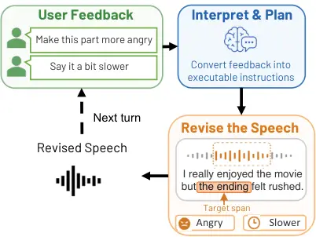
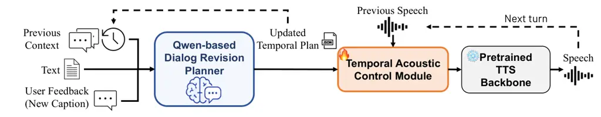
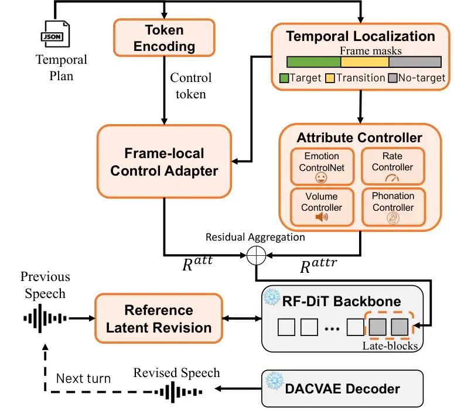
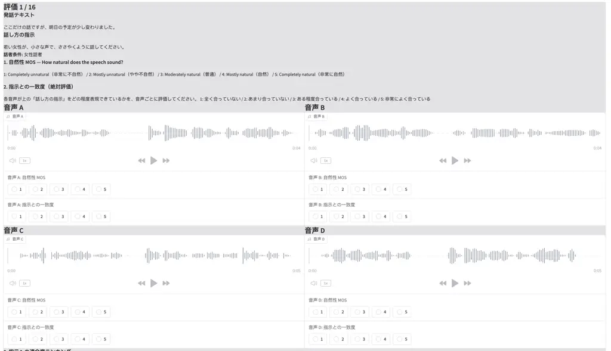
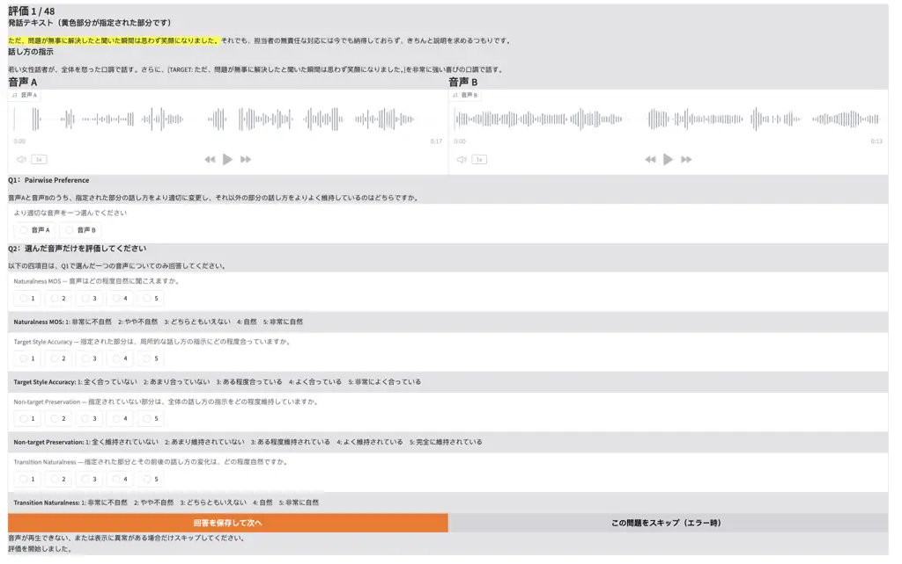
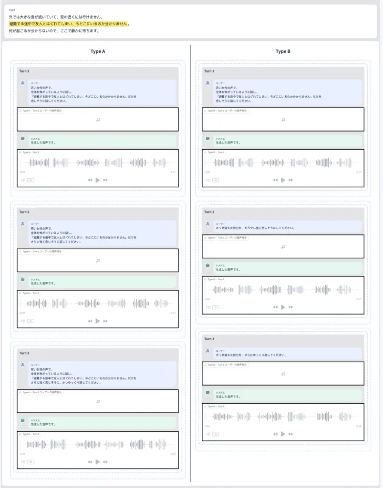

# DialInstruct-TTS: Interactive Expressive Speech Generation via Multi-Turn Dialogue with Fine-Grained Temporal Control

Wangzixi Zhou Affiliation: Nara Institute of Science and Technology,
Japan Email: <zhou.wangzixi.az3@naist.ac.jp>    Bagus Tris Atmaja
Sakriani Sakti Affiliation: Nara Institute of Science and Technology,
Japan Email: <ssakti@is.naist.jp> Email: <bagus.tris@naist.ac.jp>

###### Abstract

Existing instruction-based TTS systems primarily support one-shot,
utterance-level control, where a single instruction determines the
speaking style of an entire utterance. As a result, even minor
refinements require rewriting the instruction and regenerating the full
utterance, limiting fine-grained interactive control. We propose
DialInstruct-TTS, an interactive multi-turn expressive TTS framework
that enables users to iteratively refine generated speech through
natural-language dialogue until the desired style is achieved. At each
dialogue turn, a Qwen-based planner integrates the dialogue history and
latest user instruction into a complete TemporalPlan, while a temporal
acoustic control module provides fine-grained control over emotion,
speaking rate, volume, and phonation. Reference-latent revision
preserves non-target regions across turns, allowing users to modify only
the requested attributes or temporal spans while retaining previously
satisfactory speech. Subjective evaluations demonstrate improved global
instruction following, accurate local style realization, and effective
non-target preservation. Compared with conventional one-shot interaction
requiring full instruction restatement and utterance regeneration,
DialInstruct-TTS substantially improves perceived convenience and
interaction comfort. Audio samples are available at
[https://anonymous.4open.science/w/eacl-demo-17C5/](https://anonymous.4open.science/w/eacl-demo-17C5/).

## 1 Introduction

Recent text-to-speech (TTS) research has moved beyond predefined emotion
or style labels Cho et al. (2025); Zhou et al. (2025); Liu et al.
(2025); Tang et al. (2023); Zhou et al. (2026) toward natural-language
control of expressive speech. Natural-language instructions can describe
emotion, speaking rate, volume, phonation, and other speaking attributes
more flexibly. However, most existing instruction-based TTS systems Yang
et al. (2024); Du et al. (2025); Hu et al. (2026) remain limited to
one-shot, utterance-level control: when the result is unsatisfactory,
users must restate the instruction and regenerate the entire utterance.

This interaction is poorly suited to fine-grained refinement. Even when
only a short span or a single attribute requires modification,
full-utterance regeneration may alter regions that were already
satisfactory. Real-world voice production is instead iterative: after
listening to a previous take, a director may ask that “this part” sound
angrier, that “the same part” be weakened, or that one region be changed
while the rest is retained (Brade et al., 2025). An interactive TTS
should also interpret such feedback in context, revise only the
requested region, and preserve previously accepted content.



Figure 1: Overview of DialInstruct-TTS



Figure 2: Architecture of DialInstruct-TTS

We propose DialInstruct-TTS, an interactive multi-turn expressive TTS
framework that allows users to progressively refine generated speech
through natural-language dialogue. At each turn, a Qwen-based Dialogue
Revision Planner Team (2025) integrates the dialogue history, previous
control state, and latest instruction into a resolved global caption, a
delta plan, and an updated complete TemporalPlan. This enables
context-dependent and relative instructions without requiring users to
restate the complete control specification. A Temporal Acoustic Control
Module realizes the TemporalPlan over a largely frozen flow-matching TTS
backbone, providing span-level control over emotion, speaking rate,
volume, and phonation. Frame-local cross-attention and
attribute-specific controllers apply each change to its designated
temporal region while maintaining the global speaking style.

To preserve satisfactory regions across dialogue turns, we further
introduce reference-latent revision. The target and transition regions
are updated according to the current instruction, whereas non-target
regions retain their previous acoustic realization. Subjective
evaluations demonstrate improved global instruction following, accurate
local style control, and effective preservation of non-target regions.
Compared with one-shot interaction, DialInstruct-TTS also substantially
improves perceived convenience and interaction comfort.

Our contributions are threefold:

- •
  We propose DialInstruct-TTS, an interactive multi-turn expressive TTS
  framework for progressive refinement through context-dependent
  feedback without full instruction restatement.
- •
  We develop a Qwen-based Dialogue Revision Planner and a Temporal
  Acoustic Control Module for state tracking, fine-grained span-level
  revision, and non-target preservation.
- •
  Experiments and user studies show that DialInstruct-TTS effectively
  controls expressive speech and is strongly preferred over one-shot
  instruction for iterative refinement.

## 2 Related Work

### 2.1 Instruction-Based Expressive TTS

Instruction-based expressive TTS uses natural-language descriptions to
control emotion, speaking rate, volume, and other vocal attributes,
providing a more flexible interface than predefined style labels Leng et
al. (2024); Shimizu et al. (2024); Zhou et al. (2024); Liu et al.
(2023); Ji et al. (2025). Most existing studies have primarily focused
on English, while Japanese-specific instruction-controllable TTS systems
remain limited. Irodori-TTS is a representative Japanese-oriented
expressive TTS system Arata (2026a). Multilingual systems such as
Qwen3-TTS and CosyVoice3 also support Japanese synthesis together with
natural-language style control Hu et al. (2026); Du et al. (2025).

However, these systems generally apply style instructions to the entire
utterance and interpret each request as an independent generation. To
the best of our knowledge, existing instruction-based TTS systems do not
explicitly support span-level temporal control that modifies only a
specified region while preserving previously accepted non-target
regions.

### 2.2 Speech Editing and Iterative Revision

Recent speech-editing methods can modify selected regions of an existing
utterance while preserving the surrounding speech. For example,
VoiceCraft performs local editing through speech-token infilling, but
primarily focuses on changing what is spoken Peng et al. (2024).
Text-guided voice editing instead modifies acoustic attributes while
keeping the linguistic content unchanged. VoxEditor, for instance,
performs relative voice-attribute editing from textual prompts, but is
mainly formulated as a one-shot, utterance-level editing task Sheng et
al. (2025). Iterative speech refinement has only recently been explored.
Multi-interaction TTS accepts successive textual directions to
progressively refine the speaking style, but primarily manipulates an
utterance-level style representation and identifies position-specific
control within a sentence as a remaining challenge Kanagawa et al.
(2025).

## 3 DialInstruct-TTS

The proposed DialInstruct-TTS is a multi-turn temporal
reference-revision framework that modifies only the requested text spans
and acoustic attributes while preserving non-target regions. It consists
of a Dialogue Revision Planner for instruction interpretation and state
management, and a Temporal Acoustic Control Module for localized
acoustic revision.

### 3.1 Qwen3-Based Dialogue Revision Planner

We locally deploy Qwen3-8B Team (2025) as the Dialogue Revision Planner
without updating its parameters. A structured system prompt, provided in
Appendix A, instructs the model to resolve context-dependent feedback,
identify revision operations, and generate executable control plans. The
prompt defines the supported controls, revision rules, and output
schema, and is combined with few-shot examples, JSON-constrained
generation, and output validation. At interaction turn $`k`$, the
planner receives the source text, the current user feedback $`u^{(k)}`$,
and the complete planner output from the previous turn. The previous
output is set to null in the first turn.

The previous output contains the resolved global caption, the most
recent delta plan, and all currently active local controls. Using this
state, Qwen3-8B resolves contextual expressions such as “the same part”
and “the previously modified region,” and identifies revision operations
including adding, strengthening, weakening, retaining, replacing, and
removing a control. It then jointly generates the updated caption
$`c^{(k)}`$, the current delta plan $`\Delta\mathcal{P}^{(k)}`$, and the
complete plan $`\mathcal{P}^{(k)}`$. The previous planner output
therefore serves as explicit revision memory, allowing users to modify
earlier results without restating the target span or previously accepted
controls. The structured output format is detailed in Appendix B.

### 3.2 Temporal Acoustic Control Module

We adopt Irodori-TTS Arata (2026a) as the backbone and augment it with
the proposed Temporal Acoustic Control Module. As shown in Figure 3, the
module comprises TemporalPlan encoding and localization, frame-local
attribute control, and reference-latent revision.

The RF-DiT backbone Peebles and Xie (2023) and DACVAE decoder Polyak et
al. (2025); Arata (2026b) remain frozen, and only the newly introduced
modules are optimized following a parameter-efficient adaptation
strategy Houlsby et al. (2019). Flow matching has been widely applied to
speech synthesis Mehta et al. (2024); Le et al. (2023); Chen et al.
(2025). The detailed training objectives and loss configuration are
provided in Appendix D.



Figure 3: Architecture of the Temporal Acoustic Control Module

#### 3.2.1 Token Encoding and Temporal Localization

The Token Encoding module converts each TemporalPlan item
$`\bar{p}_{i}=(c_{i},v_{i},s_{i},\tau_{i},[a_{i},b_{i}),\boldsymbol{\xi}_{i})`$
into a control token:
$`k_{i}=E_{c}(c_{i})+E_{v}(v_{i})+E_{\tau}(\tau_{i})+W_{s}s_{i}`$, where
$`c_{i}`$, $`v_{i}`$, $`s_{i}`$, and $`\tau_{i}`$ denote the control
type, value, strength, and application type, respectively;
$`[a_{i},b_{i})`$ is the target text range, and $`\boldsymbol{\xi}_{i}`$
contains optional continuous parameters. Here, $`E_{c}`$, $`E_{v}`$, and
$`E_{\tau}`$ are learned embeddings for the control type, value, and
application type, and $`W_{s}`$ projects the control strength into the
token space. The resulting sequence $`Z_{P}=[k_{1},\ldots,k_{N}]`$
represents what should be controlled.

The Temporal Localization module maps each target span to the acoustic
latent timeline using MFA alignment during training. The evaluated
revision implementation also uses MFA-derived locations at inference;
its window diagnostics are described in Appendix F.3. It constructs
target, transition, and non-target masks,
$`M^{\mathrm{loc}}=M^{\mathrm{tar}}\lor M^{\mathrm{tr}}`$ where
$`M^{\mathrm{tar}}`$ marks the controlled frames, $`M^{\mathrm{tr}}`$
covers the boundary context, and $`M^{\mathrm{non}}`$ marks the regions
to be preserved.

For each acoustic frame $`t`$, we further construct a frame-wise
condition:

```math
\displaystyle b_{t}={} \displaystyle W_{x}H_{\pi(t)}^{\mathrm{text}}+\phi_{\mathrm{tok}}(r_{t}^{\mathrm{tok}})+\phi_{\mathrm{span}}(r_{t}^{\mathrm{span}}) \tag{1}
```

```math
\displaystyle+E_{\mathrm{rate}}(q_{t})+\phi_{s}(\log\rho_{t}),
```

where $`b_{t}`$ is the conditioning vector for acoustic frame $`t`$. The
function $`\pi(t)`$ identifies its aligned text token,
$`H_{\pi(t)}^{\mathrm{text}}`$ is the corresponding text representation,
and $`W_{x}`$ projects it into the acoustic hidden space. The learned
encoders $`\phi_{\mathrm{tok}}`$ and $`\phi_{\mathrm{span}}`$ represent
the relative position of frame $`t`$ within its aligned token and target
span, respectively. The remaining terms encode the speaking-rate
category $`q_{t}`$ and the logarithmic duration ratio $`\rho_{t}`$.

#### 3.2.2 Frame-Local Control and Attribute-Specific Realization

Localized control is applied to the later RF-DiT blocks through two
complementary paths. The Control Cross-Attention Adapter interprets the
TemporalPlan semantics and binds them to the target frames, while the
Attribute Controller performs the corresponding emotion, speaking-rate,
volume, and phonation modifications. The residuals from the two paths
are subsequently aggregated and injected into the frozen RF-DiT
backbone.

##### Control Cross-Attention Adapter

For each acoustic frame $`t`$, its hidden state $`h_{t}`$ serves as the
query, while the TemporalPlan control tokens serve as keys and values. A
frame–control mask $`M_{t,i}`$ restricts each frame to the control items
active at its position.

The masked cross-attention output is combined with control-specific
low-rank residuals Hu et al. (2022) to produce the control-semantic
residual

```math
R_{t}^{\mathrm{att}}=g_{\mathrm{CA}}\alpha_{t}\left(W_{o}a_{t}+\sum_{i}M_{t,i}r_{t,i}\right), \tag{2}
```

where $`a_{t}`$ is the masked cross-attention output, $`r_{t,i}`$ is the
low-rank residual associated with control item $`i`$, $`\alpha_{t}`$
denotes the control strength, and $`g_{\mathrm{CA}}`$ is the adapter
gate.

##### Attribute Controller

The Attribute Controller consists of independent branches with separate
acoustic realization parameters, reducing interference among emotion,
duration, energy, and phonation controls.

- •
  Emotion The Temporal Emotion ControlNet generates a smooth
  global-to-local-to-global frame-wise trajectory conditioned on emotion
  classes, intensity, and span geometry. Following ControlNet Zhang et
  al. (2023), a trainable branch initialized from the final four frozen
  RF-DiT blocks injects emotion residuals into the corresponding
  backbone blocks.
- •
  Speaking rate The Rate Controller conditions both local duration
  allocation in the duration predictor and acoustic generation in
  RF-DiT. At inference, it expands or compresses the target span and
  remaps the frame masks, positional features, and reference latent
  according to the revised latent length.
- •
  Volume The Volume Controller converts the requested gain in decibels
  into a normalized continuous condition and scales a masked acoustic
  residual over the target region. This preserves the direction and
  magnitude of amplification or attenuation while limiting energy
  changes outside the specified span.
- •
  Phonation The Phonation Controller uses a dedicated whisper branch
  conditioned on the target mask, current and noisy hidden states, and
  the flow timestep. It produces flow-step-dependent phonation
  residuals, modeling whisper-specific voice-quality changes separately
  from volume instead of approximating whispering as simple energy
  attenuation.

The attribute-specific residuals and the final hidden-state update are

```math
\displaystyle R_{t}^{\mathrm{attr}} \displaystyle=\sum_{j\in\mathcal{A}}g_{j}R_{t}^{(j)}, \tag{3}
```

```math
\displaystyle H_{t}^{\prime} \displaystyle=H_{t}+R_{t}^{\mathrm{att}}+R_{t}^{\mathrm{attr}},
```

where $`\mathcal{A}`$ contains the emotion, rate, volume, and phonation
branches, and $`g_{j}`$ is the corresponding controller gate. All
residuals are restricted by their frame-level masks and injected only
into the last third of the RF-DiT backbone.

#### 3.2.3 Reference-Latent Revision

Using the previous speech only as a global speaker reference is
insufficient to preserve non-target regions across multiple turns. We
therefore formulate revision as masked flow inpainting and explicitly
clamp the non-target latent trajectory at every sampling step.

Let $`r`$ denote the previous-turn reference latent aligned to the
current timeline, and let $`M^{\mathrm{loc}}`$ denote the union of the
target and transition regions. The RF-DiT backbone first produces a
freely updated latent $`z_{\tau^{\prime}}^{\mathrm{free}}`$, after which
masked recomposition is performed as

```math
\displaystyle z_{\tau^{\prime}}={} \displaystyle M^{\mathrm{loc}}\odot z_{\tau^{\prime}}^{\mathrm{free}} \tag{4}
```

```math
\displaystyle+\left(1-M^{\mathrm{loc}}\right)\odot\left[(1-\tau^{\prime})r+\tau^{\prime}\epsilon\right].
```

The target and transition regions follow the new instruction, while the
non-target regions are projected onto the previous-turn same-noise
trajectory after every flow step. This explicitly preserves the accepted
speech. The resulting latent is passed directly to the next interaction
turn, thereby avoiding repeated conversions between latent
representations and waveforms.

## 4 Experiments

### 4.1 Experimental Settings

##### Data construction

To construct Japanese training data for temporal local control, we use
neutral Japanese speech as the base and create
neutral-to-local-style-to-neutral utterances. This is necessary because
recordings that differ only within a local acoustic region are scarce.
We consider eight target styles: anger, fear, happy, sad, fast, slow,
loud, and whisper. For fast, slow, and loud, MFA McAuliffe et al. (2017)
locates the target span, and SoX¹¹ 1
[https://sourceforge.net/projects/sox/](https://sourceforge.net/projects/sox/)
applies time-scale or gain modification only to the corresponding PCM
segment. For whisper, aligned whisper segments from JVS Takamichi et al.
(2019) are inserted into neutral utterances. For the four emotion
categories, JVNV recordings Xin et al. (2024) provide emotional
references, while Irodori-TTS generates the corresponding neutral
utterances. The aligned emotional spans are then inserted into the
neutral speech. Waveform replacement constructs the training targets.
The historical rate outputs in the additional objective comparison use a
separate MFA-guided PCM editing path, rather than the neural rate
controller (Appendix F.2). We construct 1k utterances per category, 8k
utterances in total, each approximately 8–10 seconds long. Captions are
automatically generated from speaker attributes and target styles. For
example, a female anger sample is represented as

女性の声で、怒った口調で話してください(josei no koe de, okotta kuchō de
hanashite kudasai; “Please speak in an angry tone using a female
voice.”). All audio is resampled to 48 kHz.

##### Baselines

For global instruction-following comparisons, we use the official
implementations and released checkpoints of two state-of-the-art
large-scale multilingual TTS systems: Qwen3-TTS Hu et al. (2026)²² 2
[https://huggingface.co/Qwen/Qwen3-TTS-12Hz-1.7B-CustomVoice](https://huggingface.co/Qwen/Qwen3-TTS-12Hz-1.7B-CustomVoice)
and CosyVoice3 Du et al. (2025)³³ 3
[https://github.com/FunAudioLLM/CosyVoice](https://github.com/FunAudioLLM/CosyVoice).
We additionally include Irodori-TTS Arata (2026a)⁴⁴ 4
[https://github.com/Aratako/Irodori-TTS](https://github.com/Aratako/Irodori-TTS),
which serves as the backbone of our DialInstruct-TTS. All baseline
systems are fine-tuned on the same training data for the same number of
optimization steps.

Qwen3-TTS and CosyVoice3 support natural-language instruction control
and are pretrained on large-scale multilingual speech corpora that
include Japanese data. Irodori-TTS is an instruction-controllable
Japanese TTS system. This setup therefore compares our method with
general-purpose instruction-following systems. Since these systems lack
matched local-editing mechanisms, we additionally compare with an
Irodori-based cut-and-stitch editor (Appendix F.2).

##### Training Setup

We train 174M temporal-control parameters for around 20k steps on one
NVIDIA RTX PRO 6000, yielding a 791M acoustic model. With the frozen 8B
Qwen3 planner, the full system contains 9B parameters. Further details
are provided in Appendix D.

### 4.2 Evaluation

All listening tests involved 30 native Japanese listeners. Participant
and interface details are provided in Appendix G. We used pairwise
preference and five-point rating tests following established practices
Wells et al. (2024); Naderi and Cutler (2020).

#### 4.2.1 Global Style Evaluation

We evaluate global instruction following under eight conditions: four
emotions (happy, fear, sad, and anger), two speaking rates (fast and
slow), and two phonation or volume styles (loud and whisper). Each
condition is tested with one female and one male voice, yielding 16
cases per model and 64 samples across four systems. All systems use the
same text, speaker condition, and Japanese instruction.

Listeners rate each sample on two 5-point scales:

- •
  MOS: Naturalness of the generated speech.
- •
  Match: Agreement between the generated speaking style and the given
  instruction.

We additionally compute Japanese character error rate (CER) using
whisper Radford et al. (2023) for all systems.

|          |                  |                    |                  |                    |                  |                    |                  |                    |
| -------- | ---------------- | ------------------ | ---------------- | ------------------ | ---------------- | ------------------ | ---------------- | ------------------ |
|          | CosyVoice3       |                    | Irodori-TTS      |                    | Qwen3-TTS        |                    | DialInstruct-TTS |                    |
| Category | MOS $`\uparrow`$ | Match $`\uparrow`$ | MOS $`\uparrow`$ | Match $`\uparrow`$ | MOS $`\uparrow`$ | Match $`\uparrow`$ | MOS $`\uparrow`$ | Match $`\uparrow`$ |
| Anger    | 1.604            | 2.958              | 4.042            | 3.708              | 2.896            | 3.292              | 3.875            | 4.417              |
| Fear     | 3.709            | 2.509              | 3.891            | 1.382              | 3.564            | 3.345              | 3.836            | 4.527              |
| Happy    | 2.755            | 3.094              | 4.038            | 3.453              | 3.321            | 2.623              | 3.906            | 4.604              |
| Sad      | 2.038            | 2.981              | 3.755            | 2.377              | 3.472            | 3.981              | 3.830            | 3.925              |
| Fast     | 3.755            | 4.509              | 3.642            | 2.283              | 3.132            | 3.415              | 4.208            | 4.302              |
| Slow     | 2.234            | 2.277              | 3.915            | 3.745              | 3.809            | 3.213              | 3.511            | 4.192              |
| Loud     | 2.148            | 2.389              | 4.185            | 4.074              | 2.074            | 2.278              | 4.019            | 3.759              |
| Whisper  | 3.098            | 2.510              | 4.020            | 1.490              | 3.275            | 2.490              | 4.216            | 4.549              |
| Overall  | 2.688            | 2.911              | 3.935            | 2.792              | 3.186            | 3.077              | 3.930            | 4.283              |

Table 1: Results for global style control. MOS measures naturalness, and
Match measures agreement with the instruction. The best result in each
row for each metric is shown in bold.

#### 4.2.2 Temporal Local Control Evaluation

We evaluate 16 directed global-to-local style contrasts: all 12 ordered
transitions among happy, sad, anger, and fear; fast $`\leftrightarrow`$
slow; and loud $`\leftrightarrow`$ whisper. Each contrast is applied to
a target span at the beginning, middle, or end of the utterance,
yielding 48 test conditions.

Because Qwen3-TTS achieves the second-highest overall Match score in the
global style evaluation and performs best among the baseline systems, we
select it as the comparison system. We conduct a blind pairwise
comparison between our DialInstruct-TTS and Qwen3-TTS. Listeners are
shown the instruction, the input text with the target span highlighted,
and two anonymized audio samples. They first select the sample that
better realizes the requested local style while preserving the global
style in the non-target regions. They then rate the selected sample on
four 5-point scales:

- •
  N-MOS: Overall naturalness.
- •
  TN-MOS: Naturalness of the transition between the target span and its
  surrounding regions.
- •
  TS-MOS: Accuracy of the requested style within the target span.
- •
  NSP-MOS: Preservation of the global style in non-target regions.

Pairwise preference is the primary system-level metric. The four ratings
are conditional on preference selection and support diagnostic analysis,
not unbiased absolute-quality comparisons between systems.

#### 4.2.3 Multi-Turn Evaluation

We compare full restatement and multi-turn revision using the same TTS
model and target states. Full restatement regenerates the utterance from
scratch without the previous speech or latent, whereas multi-turn
revision reuses the previous control state and reference latent. Full
restatement repeats the global style, target span, and all active local
controls at every turn. Multi-turn revision uses a complete instruction
only at the first turn; later turns specify only newly added or
intensified modifications.

We construct four three-turn dialogues using happy, sad, anger, and fear
as global emotions. For each participant, two dialogues use audio
instructions and two use text instructions. The modality assignment is
randomized while maintaining a two-to-two balance.

Participants view both revision sequences side by side and rate them on
three 5-point scales:

- •
  Perceived Convenience: Ease of expressing revisions without repetitive
  information.
- •
  Interaction Comfort: Naturalness and perceived effort of the revision
  process.
- •
  Modification Retention: Preservation of previous controls while
  applying new revisions.

After all four dialogues, participants select the system they would
prefer for repeated speech revision: System A, System B, or either
system.

#### 4.2.4 Additional Objective Evaluation

We supplement the existing listening tests with objective experiments;
no additional human evaluation is conducted. A backbone-matched Irodori
cut-and-stitch editor is compared on 48 historical local-control
outputs, using an independently dev-selected fixed 5 ms crossfade.
Separately, 20 five-turn acoustic revision tasks compare Proposed with a
variant without non-target locking (reference-latent clamping), yielding
200 attempts and 100 task–turn pairs. These tasks bypass the planner and
reuse the previous generated latent. We measure target/content success
and preservation of current non-target, never-edited, and previously
accepted regions. Settings, component ablations, full objective results,
and MFA window diagnostics appear in Appendix F.

## 5 Result and Analysis

|                                 |                       |      |         |                        |      |         |                        |      |         |                      |      |      |
| ------------------------------- | --------------------- | ---- | ------- | ---------------------- | ---- | ------- | ---------------------- | ---- | ------- | -------------------- | ---- | ---- |
| Global $`\rightarrow`$ Local    | N-MOS $`\uparrow`$    |      |         | TN-MOS $`\uparrow`$    |      |         | TS-MOS $`\uparrow`$    |      |         | NSP-MOS $`\uparrow`$ |      |      |
|                                 | Beg.                  | Mid. | End     | Beg.                   | Mid. | End     | Beg.                   | Mid. | End     | Beg.                 | Mid. | End  |
| happy $`\rightarrow`$ sad       | 3.75                  | 3.83 | 4.14    | 3.75                   | 3.67 | 3.71    | 3.50                   | 3.83 | 4.14    | 4.12                 | 4.50 | 4.29 |
| happy $`\rightarrow`$ fear      | 4.17                  | 3.83 | 3.88    | 4.00                   | 3.17 | 3.38    | 4.17                   | 4.00 | 4.12    | 3.67                 | 4.00 | 4.75 |
| happy $`\rightarrow`$ anger     | 3.80                  | 3.50 | 3.14    | 3.60                   | 3.17 | 3.14    | 4.40                   | 4.50 | 3.00    | 4.00                 | 4.17 | 3.86 |
| sad $`\rightarrow`$ happy       | 3.50                  | 3.17 | 3.38    | 2.50                   | 2.50 | 2.75    | 4.00                   | 3.83 | 4.38    | 3.25                 | 4.00 | 4.25 |
| sad $`\rightarrow`$ fear        | 3.50                  | 3.00 | 3.50    | 3.17                   | 3.17 | 3.17    | 3.83                   | 4.50 | 4.17    | 4.17                 | 3.83 | 3.67 |
| sad $`\rightarrow`$ anger       | 3.50                  | 3.40 | 3.86    | 3.33                   | 3.20 | 2.71    | 4.00                   | 4.20 | 4.14    | 3.33                 | 4.40 | 4.00 |
| anger $`\rightarrow`$ happy     | 3.57                  | 4.40 | 4.33    | 3.57                   | 3.80 | 4.33    | 4.14                   | 4.60 | 4.50    | 4.14                 | 4.20 | 4.33 |
| anger $`\rightarrow`$ sad       | 3.57                  | 4.00 | 4.00    | 3.57                   | 4.00 | 4.43    | 3.86                   | 3.86 | 4.14    | 3.14                 | 4.29 | 4.29 |
| anger $`\rightarrow`$ fear      | 2.83                  | 3.00 | 3.43    | 3.17                   | 2.71 | 3.00    | 3.67                   | 4.00 | 4.14    | 3.83                 | 4.00 | 4.14 |
| fear $`\rightarrow`$ happy      | 3.62                  | 4.00 | 3.43    | 2.75                   | 4.00 | 3.43    | 3.75                   | 4.00 | 3.71    | 4.12                 | 4.17 | 3.71 |
| fear $`\rightarrow`$ sad        | 4.17                  | 4.33 | 3.50    | 4.00                   | 4.33 | 4.17    | 4.00                   | 3.33 | 4.33    | 4.33                 | 4.33 | 3.50 |
| fear $`\rightarrow`$ anger      | 2.83                  | 4.17 | 4.50    | 3.00                   | 3.67 | 3.50    | 3.83                   | 4.33 | 4.50    | 3.50                 | 4.67 | 4.50 |
| fast $`\rightarrow`$ slow       | 4.25                  | 4.60 | 4.29    | 5.00                   | 4.40 | 4.29    | 5.00                   | 3.80 | 4.43    | 4.75                 | 4.40 | 4.71 |
| slow $`\rightarrow`$ fast       | 4.00                  | 3.50 | 3.00    | 3.33                   | 2.67 | 3.40    | 4.22                   | 4.17 | 5.00    | 3.67                 | 4.17 | 4.60 |
| loud $`\rightarrow`$ whisper    | 3.67                  | 2.86 | 3.22    | 3.50                   | 2.43 | 3.11    | 4.83                   | 4.00 | 3.89    | 4.67                 | 4.14 | 4.11 |
| whisper $`\rightarrow`$ loud    | 2.71                  | 2.33 | 3.00    | 3.14                   | 2.33 | 3.12    | 3.43                   | 3.33 | 3.50    | 4.29                 | 4.50 | 4.25 |
| Overall                         | 3.58                  | 3.57 | 3.62    | 3.40                   | 3.27 | 3.45    | 4.00                   | 4.03 | 4.08    | 3.90                 | 4.23 | 4.18 |

Table 2: Preference-selected diagnostic ratings for temporal local style
control. Beg., Mid., and End indicate whether the locally controlled
span is located at the beginning, middle, or end of the utterance. N-MOS
evaluates the overall naturalness of the generated speech. TN-MOS
evaluates the naturalness of the acoustic transitions into and out of
the target span. TS-MOS measures how accurately the requested local
style is realized within the target span. NSP-MOS measures how well the
original global style is preserved in the non-target regions. Best
scores are shown in bold.

### 5.1 Global Style Control Performance

Table 1 shows that DialInstruct-TTS achieves the highest overall Match
score (4.283), with MOS 3.930, close to Irodori-TTS (3.935). It has the
highest Match for anger, fear, happy, slow, and whisper, while
CosyVoice3 performs best for fast (4.509 versus 4.302). Thus, the gains
concern instruction adherence rather than uniform naturalness
superiority. Detailed category results and variances are in Appendix
E.1.

DialInstruct-TTS and Irodori-TTS both obtain zero CER on this small
global-style test; Qwen3-TTS and CosyVoice3 obtain 0.0089 and 0.0125,
respectively, mainly from fillers or lexical insertions. We hypothesize
that temporal-control training improves style representations that also
benefit global control, and examine component effects separately below.

### 5.2 Temporal Local Control Quality

In the blind A/B test, DialInstruct-TTS achieves a macro-average
preference of 92.1%, versus 7.9% for Qwen3-TTS. This comparison tests
instruction-following TTS, not superiority over specialized editors.
Table 2 provides conditional ratings of preferred samples; detailed
results are in Appendices E.2 and E.3.

TS-MOS is 4.00/4.03/4.08 for beginning/middle/end spans, while TN-MOS is
3.40/3.27/3.45. These ratings indicate perceived local-style realization
and transition weaknesses, but do not directly establish frame-boundary
accuracy or unchanged acoustic realization. Speaking-rate control has
the strongest diagnostic ratings; local acceleration introduces more
transition difficulty. Strong emotion contrasts and whisper-to-loud
changes are also challenging, particularly in middle spans with two
boundaries. Synthetic training boundaries are a possible contributor,
rather than an established sole cause.

The matched objective comparison shows a trade-off (Appendix F.2): on
emotion tasks, proposed outputs have lower CER (1.07% versus 2.21%),
while stitching has smaller non-target acoustic distances. On six
phonation tasks, whisper accuracy is 6/6 versus 2/6 and all three
non-target distances are lower for the proposed outputs. The rate
comparison uses PCM editing and is not a neural-controller comparison;
no waveform AV evaluator is available for this comparison.

### 5.3 Perceived Usability of Multi-Turn Revision

Figure 4 summarizes the existing user study. Multi-turn revision
improves convenience, comfort, and perceived modification retention. The
corrected convenience score is 4.183; final preferences are 29/30 for
multi-turn revision and 1/30 for full restatement, with no ties (96.7%
versus 3.3%). These controlled three-turn sequences support perceived
usability, while acoustic preservation is evaluated separately below.

Figure 4: Mean subjective ratings and final preference for
full-restatement and multi-turn revision. Final preference is 1/30
versus 29/30, with no ties. Means are shown without error bars;
numerical results are in Appendix E.4.

Text instructions have slightly higher convenience and comfort ratings
than audio instructions (Appendix E.4); approximately 88% of
participants prefer text feedback. Dialogue here means context-dependent
multi-turn revision and does not require spoken input. The system relies
on user feedback, not autonomous acoustic self-correction.

### 5.4 Component Effects and Cross-Turn Revision

On the same Irodori backbone (Table 10), removing the rate and emotion
controllers increases duration error from 0.06 to 0.91 s and AV distance
from 0.11 to 0.64, respectively. Removing the volume controller
increases gain error from 2.7 to 3.1 dB. Without non-target locking
(reference-latent clamping), non-target log-F0 and log-energy RMSE rise
from 0.092 to 0.270 and from 0.54 to 0.93. Removing frame-local
attention worsens all five reported metrics: duration error 0.68 s, AV
distance 0.44, non-target log-F0/log-energy RMSE 0.150/0.66, and gain
error 3.1 dB. These component results are separate from the
historical-WAV comparison.

In the five-turn non-target locking ablation, Proposed has higher joint
target/content success than the variant without non-target locking for
rate, volume, and rate removal (Table 3). This joint endpoint combines
control and intelligibility and is not itself a preservation score.
Acoustic preservation is measured against the previous turn, the initial
audio in never-edited regions, and the most recently accepted version of
older edits (Appendix F.4). At turn five, current non-target mel
distance is 4.19 dB for Proposed versus 23.48 dB without non-target
locking ($`n=18`$ paired sources; difference 19.28 dB, 95% CI \[17.65,
20.89\]). Never-edited regions still drift from the initial audio (14.75
versus 28.72 dB), and volume success is low. Emotion stages do not use
non-target locking in either variant; the comparison therefore does not
establish emotion-only locking benefits or independently verified
emotional success.

|             |             |                            |
| ----------- | ----------- | -------------------------- |
| Operation   | Proposed    | Without non-target locking |
| Rate        | 15/20 (75%) | 6/20 (30%)                 |
| Volume      | 4/20 (20%)  | 1/20 (5%)                  |
| Remove rate | 12/20 (60%) | 5/20 (25%)                 |

Table 3: Non-target locking ablation: joint target/content success over
five revision turns. Unavailable assessments remain in the attempt
denominator and do not count as successes.

## 6 Conclusion

We proposed DialInstruct-TTS, an interactive multi-turn expressive TTS
framework that supports global style control, temporal local
modification, and multi-turn speech revision. DialInstruct-TTS achieved
more consistent global instruction following than the baselines while
maintaining competitive naturalness and linguistic accuracy. For
temporal control, it accurately realized the requested local style and
preserved the surrounding global style, although transition smoothness
remained challenging under strong local contrasts. Additional
matched-editor and recursive experiments reveal attribute-dependent
trade-offs and support reference reuse in the tested rate/volume stages,
while cumulative drift remains. The multi-turn evaluation further showed
that incremental instructions substantially improved perceived
convenience and interaction comfort over full restatement. Participants
also generally preferred text-based instructions to audio-based
instructions.

## Limitations

The current framework has been trained and evaluated only on Japanese
speech, and its cross-lingual generalization remains unexplored. Emotion
control is also limited to four basic categories: anger, fear, happy,
and sad. Future work should extend the framework to additional
languages, compound emotions, and more fine-grained or continuous
affective states. Temporal local control may still reduce overall speech
naturalness. Emotion revision can occasionally introduce speaker drift
or abrupt local boundaries, while speaking-rate control, particularly
local acceleration, may cause rhythmic discontinuities and crowded
articulation. The supported attributes also differ in maturity: emotion
and speaking-rate revision are more stable, whereas volume and
whisper-like phonation remain less reliable. Volume control may cause
clipping or non-target drift, while whispering may sometimes be
perceived as breathiness or reduced energy rather than a distinct
phonation change. Finally, the current framework assumes fixed
linguistic content and does not support simultaneous lexical editing,
arbitrary waveform editing, or the stable composition of multiple
controls within the same short span. These remain important directions
for future work. The local MOS ratings are selection-conditioned, and
the small scripted user study does not establish open-ended dialogue
robustness. The added acoustic tests bypass the planner, use MFA-derived
windows without independent boundary annotations, and do not validate
natural unscripted recordings. Preservation and boundary-loss ablations
remain untested separately. Automatic acoustic distances do not replace
perceptual naturalness judgments.

## Ethical Considerations

Qwen3, Qwen3-TTS, and CosyVoice are used under the Apache 2.0 License;
Irodori-TTS, Semantic-DACVAE, and MFA under the MIT License; JVNV under
CC BY-SA 4.0; JVS under its stated academic and non-commercial research
terms; and SoX under the applicable GPL/LGPL terms. All datasets,
pretrained models, and software were used in accordance with their
respective licenses. The experiments involve general Japanese speech
generation and expressive-style control and contain no sensitive,
discriminatory, or harmful content.

This research study was reviewed and approved by the Institutional
Review Board of \[Institution Name Withheld for Double-Blind Review\]
(approval number and date withheld for anonymous review). Participants
were recruited and compensated in accordance with the approved protocol.
Participants provided informed consent prior to participation, and no
personal information unrelated to the study was collected. Further
participant details are provided in Appendix G.

Expressive TTS technology may be misused for voice impersonation or
misleading synthetic content. Our experiments were conducted in a
controlled research setting, and the released demo is intended solely
for academic evaluation. We do not release tools specifically designed
for impersonating arbitrary individuals. Although lexical content is
fixed, expressive manipulation of harmful source text and accumulated
control states remains a potential misuse risk.

AI-assisted tools were used for language support, demo-page design, and
assistance organizing experimental reporting and manuscript revisions.
The authors are responsible for the research design, experiments,
analysis, and verification of manuscript content.

## References

- Arata (2026a) C. Arata Irodori-tts: a flow matching-based
  text-to-speech model with emoji-driven style control. GitHub. Note:
  [https://github.com/Aratako/Irodori-TTS](https://github.com/Aratako/Irodori-TTS)
  Cited by: §2.1, §3.2, §4.1.
- Arata (2026b) C. Arata Semantic-dacvae-japanese-32dim: lightweight
  audio vae for japanese speech. Hugging Face. Note:
  [https://huggingface.co/Aratako/Semantic-DACVAE-Japanese-32dim](https://huggingface.co/Aratako/Semantic-DACVAE-Japanese-32dim)
  Cited by: §3.2.
- Brade et al. (2025) S. Brade, S. Anderson, R. Kumar, Z. Jin, and A.
  Truong SpeakEasy: enhancing text-to-speech interactions for expressive
  content creation. In Proceedings of the 2025 CHI Conference on Human
  Factors in Computing Systems, CHI ’25, New York, NY, USA. External
  Links: ISBN 9798400713941,
  [Link](https://doi.org/10.1145/3706598.3714263),
  [Document](https://dx.doi.org/10.1145/3706598.3714263) Cited by: §1.
- Chen et al. (2025) Y. Chen, Z. Niu, Z. Ma, K. Deng, C. Wang, J.
  JianZhao, K. Yu, and X. Chen F5-TTS: a fairytaler that fakes fluent
  and faithful speech with flow matching. In Proceedings of the 63rd
  Annual Meeting of the Association for Computational Linguistics
  (Volume 1: Long Papers), W. Che, J. Nabende, E. Shutova, and M. T.
  Pilehvar (Eds.), Vienna, Austria, pp. 6255–6271. External Links:
  [Link](https://aclanthology.org/2025.acl-long.313/),
  [Document](https://dx.doi.org/10.18653/v1/2025.acl-long.313), ISBN
  979-8-89176-251-0 Cited by: §3.2.
- Cho et al. (2025) D. Cho, H. Oh, S. Kim, and S. Lee EmoSphere++:
  emotion-controllable zero-shot text-to-speech via emotion-adaptive
  spherical vector. IEEE Transactions on Affective Computing 16 (3),
  pp. 2365–2380. External Links: ISSN 2371-9850,
  [Link](http://dx.doi.org/10.1109/TAFFC.2025.3561267),
  [Document](https://dx.doi.org/10.1109/taffc.2025.3561267) Cited by:
  §1.
- Du et al. (2025) Z. Du, C. Gao, Y. Wang, F. Yu, T. Zhao, H. Wang, X.
  Lv, H. Wang, C. Ni, X. Shi, K. An, G. Yang, Y. Li, Y. Chen, Z. Gao, Q.
  Chen, Y. Gu, M. Chen, Y. Chen, S. Zhang, W. Wang, and J. Ye CosyVoice
  3: towards in-the-wild speech generation via scaling-up and
  post-training. External Links: 2505.17589,
  [Link](https://arxiv.org/abs/2505.17589) Cited by: §1, §2.1, §4.1.
- Houlsby et al. (2019) N. Houlsby, A. Giurgiu, S. Jastrzebski, B.
  Morrone, Q. De Laroussilhe, A. Gesmundo, M. Attariyan, and S. Gelly
  Parameter-efficient transfer learning for NLP. In Proceedings of the
  36th International Conference on Machine Learning, K. Chaudhuri and R.
  Salakhutdinov (Eds.), Proceedings of Machine Learning Research, Vol.
  97, pp. 2790–2799. External Links:
  [Link](https://proceedings.mlr.press/v97/houlsby19a.html) Cited by:
  §3.2.
- Hu et al. (2022) E. J. Hu, yelong shen, P. Wallis, Z. Allen-Zhu, Y.
  Li, S. Wang, L. Wang, and W. Chen LoRA: low-rank adaptation of large
  language models. In International Conference on Learning
  Representations, External Links:
  [Link](https://openreview.net/forum?id=nZeVKeeFYf9) Cited by: §3.2.2.
- Hu et al. (2026) H. Hu, X. Zhu, T. He, D. Guo, B. Zhang, X. Wang, Z.
  Guo, Z. Jiang, H. Hao, Z. Guo, X. Zhang, P. Zhang, B. Yang, J. Xu, J.
  Zhou, and J. Lin Qwen3-tts technical report. External Links:
  2601.15621, [Link](https://arxiv.org/abs/2601.15621) Cited by: §1,
  §2.1, §4.1.
- Ji et al. (2025) S. Ji, Q. Chen, W. Wang, J. Zuo, M. Fang, Z.
  Jiang, H. Huang, Z. Wang, X. Cheng, S. Zheng, and Z. Zhao
  ControlSpeech: towards simultaneous and independent zero-shot speaker
  cloning and zero-shot language style control. In Proceedings of the
  63rd Annual Meeting of the Association for Computational Linguistics
  (Volume 1: Long Papers), W. Che, J. Nabende, E. Shutova, and M. T.
  Pilehvar (Eds.), Vienna, Austria, pp. 6966–6981. External Links:
  [Link](https://aclanthology.org/2025.acl-long.346/),
  [Document](https://dx.doi.org/10.18653/v1/2025.acl-long.346), ISBN
  979-8-89176-251-0 Cited by: §2.1.
- Kanagawa et al. (2025) H. Kanagawa, K. Fujita, A. Watanabe, and Y.
  Ijima Multi-interaction TTS toward professional recording
  reproduction. In 13th edition of the Speech Synthesis Workshop,
  pp. 110–116. External Links:
  [Document](https://dx.doi.org/10.21437/SSW.2025-17) Cited by: §2.2.
- Le et al. (2023) M. Le, A. Vyas, B. Shi, B. Karrer, L. Sari, R.
  Moritz, M. Williamson, V. Manohar, Y. Adi, J. Mahadeokar, and W. Hsu
  Voicebox: text-guided multilingual universal speech generation at
  scale. In Advances in Neural Information Processing Systems, A. Oh, T.
  Naumann, A. Globerson, K. Saenko, M. Hardt, and S. Levine (Eds.), Vol.
  36, pp. 14005–14034. External Links:
  [Document](https://dx.doi.org/10.52202/075280-0618),
  [Link](https://proceedings.neurips.cc/paper_files/paper/2023/file/2d8911db9ecedf866015091b28946e15-Paper-Conference.pdf)
  Cited by: §3.2.
- Leng et al. (2024) Y. Leng, Z. Guo, K. Shen, Z. Ju, X. Tan, E. Liu, Y.
  Liu, D. Yang, leying zhang, K. Song, L. He, X. Li, sheng zhao, T. Qin,
  and J. Bian PromptTTS 2: describing and generating voices with text
  prompt. In The Twelfth International Conference on Learning
  Representations, External Links:
  [Link](https://openreview.net/forum?id=NsCXDyv2Bn) Cited by: §2.1.
- Liu et al. (2023) G. Liu, Y. Zhang, Y. Lei, Y. Chen, R. Wang, L. Xie,
  and Z. Li PromptStyle: Controllable Style Transfer for Text-to-Speech
  with Natural Language Descriptions. In Interspeech 2023,
  pp. 4888–4892. External Links:
  [Document](https://dx.doi.org/10.21437/Interspeech.2023-1779), ISSN
  2958-1796 Cited by: §2.1.
- Liu et al. (2025) J. Liu, Y. Xiang, H. Zhao, X. Li, Y. Gao, S. Zhang,
  and Z. Ling UDDETTS: unifying discrete and dimensional emotions for
  controllable emotional text-to-speech. External Links: 2505.10599,
  [Link](https://arxiv.org/abs/2505.10599) Cited by: §1.
- McAuliffe et al. (2017) M. McAuliffe, M. Socolof, S. Mihuc, M. Wagner,
  and M. Sonderegger Montreal Forced Aligner: Trainable Text-Speech
  Alignment Using Kaldi. In Interspeech 2017, pp. 498–502. External
  Links: [Document](https://dx.doi.org/10.21437/Interspeech.2017-1386),
  ISSN 2958-1796 Cited by: §4.1.
- Mehta et al. (2024) S. Mehta, R. Tu, J. Beskow, É. Székely, and G. E.
  Henter Matcha-tts: a fast tts architecture with conditional flow
  matching. In ICASSP 2024 - 2024 IEEE International Conference on
  Acoustics, Speech and Signal Processing (ICASSP), Vol. ,
  pp. 11341–11345. External Links:
  [Document](https://dx.doi.org/10.1109/ICASSP48485.2024.10448291) Cited
  by: §3.2.
- Naderi and Cutler (2020) B. Naderi and R. Cutler An Open Source
  Implementation of ITU-T Recommendation P.808 with Validation. In
  Interspeech 2020, pp. 2862–2866. External Links:
  [Document](https://dx.doi.org/10.21437/Interspeech.2020-2665), ISSN
  2958-1796 Cited by: §4.2.
- Peebles and Xie (2023) W. Peebles and S. Xie Scalable diffusion models
  with transformers. In 2023 IEEE/CVF International Conference on
  Computer Vision (ICCV), Vol. , pp. 4172–4182. External Links:
  [Document](https://dx.doi.org/10.1109/ICCV51070.2023.00387) Cited by:
  §3.2.
- Peng et al. (2024) P. Peng, P. Huang, S. Li, A. Mohamed, and D.
  Harwath VoiceCraft: zero-shot speech editing and text-to-speech in the
  wild. In Proceedings of the 62nd Annual Meeting of the Association for
  Computational Linguistics (Volume 1: Long Papers), L. Ku, A. Martins,
  and V. Srikumar (Eds.), Bangkok, Thailand, pp. 12442–12462. External
  Links: [Link](https://aclanthology.org/2024.acl-long.673/),
  [Document](https://dx.doi.org/10.18653/v1/2024.acl-long.673) Cited by:
  §2.2.
- Polyak et al. (2025) A. Polyak, A. Zohar, A. Brown, A. Tjandra, A.
  Sinha, A. Lee, A. Vyas, B. Shi, C. Ma, C. Chuang, D. Yan, D.
  Choudhary, D. Wang, G. Sethi, G. Pang, H. Ma, I. Misra, J. Hou, J.
  Wang, K. Jagadeesh, K. Li, L. Zhang, M. Singh, M. Williamson, M.
  Le, M. Yu, M. K. Singh, P. Zhang, P. Vajda, Q. Duval, R. Girdhar, R.
  Sumbaly, S. S. Rambhatla, S. Tsai, S. Azadi, S. Datta, S. Chen, S.
  Bell, S. Ramaswamy, S. Sheynin, S. Bhattacharya, S. Motwani, T. Xu, T.
  Li, T. Hou, W. Hsu, X. Yin, X. Dai, Y. Taigman, Y. Luo, Y. Liu, Y.
  Wu, Y. Zhao, Y. Kirstain, Z. He, Z. He, A. Pumarola, A. Thabet, A.
  Sanakoyeu, A. Mallya, B. Guo, B. Araya, B. Kerr, C. Wood, C. Liu, C.
  Peng, D. Vengertsev, E. Schonfeld, E. Blanchard, F. Juefei-Xu, F.
  Nord, J. Liang, J. Hoffman, J. Kohler, K. Fire, K. Sivakumar, L.
  Chen, L. Yu, L. Gao, M. Georgopoulos, R. Moritz, S. K. Sampson, S.
  Li, S. Parmeggiani, S. Fine, T. Fowler, V. Petrovic, and Y. Du Movie
  gen: a cast of media foundation models. External Links: 2410.13720,
  [Link](https://arxiv.org/abs/2410.13720) Cited by: §3.2.
- Radford et al. (2023) A. Radford, J. W. Kim, T. Xu, G. Brockman, C.
  Mcleavey, and I. Sutskever Robust speech recognition via large-scale
  weak supervision. In Proceedings of the 40th International Conference
  on Machine Learning, A. Krause, E. Brunskill, K. Cho, B.
  Engelhardt, S. Sabato, and J. Scarlett (Eds.), Proceedings of Machine
  Learning Research, Vol. 202, pp. 28492–28518. External Links:
  [Link](https://proceedings.mlr.press/v202/radford23a.html) Cited by:
  §4.2.1.
- Sheng et al. (2025) Z. Sheng, L. Liu, Y. Ai, J. Pan, and Z. Ling Voice
  attribute editing with text prompt. IEEE Transactions on Audio, Speech
  and Language Processing 33 (), pp. 1641–1652. External Links:
  [Document](https://dx.doi.org/10.1109/TASLPRO.2025.3557193) Cited by:
  §2.2.
- Shimizu et al. (2024) R. Shimizu, R. Yamamoto, M. Kawamura, Y.
  Shirahata, H. Doi, T. Komatsu, and K. Tachibana PromptTTS++:
  controlling speaker identity in prompt-based text-to-speech using
  natural language descriptions. In ICASSP 2024 - 2024 IEEE
  International Conference on Acoustics, Speech and Signal Processing
  (ICASSP), Vol. , pp. 12672–12676. External Links:
  [Document](https://dx.doi.org/10.1109/ICASSP48485.2024.10448173) Cited
  by: §2.1.
- Takamichi et al. (2019) S. Takamichi, K. Mitsui, Y. Saito, T.
  Koriyama, N. Tanji, and H. Saruwatari JVS corpus: free japanese
  multi-speaker voice corpus. External Links: 1908.06248,
  [Link](https://arxiv.org/abs/1908.06248) Cited by: §4.1.
- Tang et al. (2023) H. Tang, X. Zhang, J. Wang, N. Cheng, and J. Xiao
  EmoMix: Emotion Mixing via Diffusion Models for Emotional Speech
  Synthesis. In Interspeech 2023, pp. 12–16. External Links:
  [Document](https://dx.doi.org/10.21437/Interspeech.2023-1317), ISSN
  2958-1796 Cited by: §1.
- Team (2025) Q. Team Qwen3 technical report. External Links:
  2505.09388, [Link](https://arxiv.org/abs/2505.09388) Cited by: §1,
  §3.1.
- Wells et al. (2024) D. Wells, A. L. Aldana Blanco, C. Valentini, E.
  Cooper, A. Pine, J. Yamagishi, and K. Richmond Experimental evaluation
  of MOS, AB and BWS listening test designs. In Interspeech 2024,
  pp. 2695–2699. External Links:
  [Document](https://dx.doi.org/10.21437/Interspeech.2024-1778), ISSN
  2958-1796 Cited by: §4.2.
- Xin et al. (2024) D. Xin, J. Jiang, S. Takamichi, Y. Saito, A. Aizawa,
  and H. Saruwatari JVNV: a corpus of japanese emotional speech with
  verbal content and nonverbal expressions. IEEE Access 12 (),
  pp. 19752–19764. External Links:
  [Document](https://dx.doi.org/10.1109/ACCESS.2024.3360885) Cited by:
  §4.1.
- Yang et al. (2024) D. Yang, S. Liu, R. Huang, C. Weng, and H. Meng
  InstructTTS: modelling expressive tts in discrete latent space with
  natural language style prompt. IEEE/ACM Transactions on Audio, Speech,
  and Language Processing 32 (), pp. 2913–2925. External Links:
  [Document](https://dx.doi.org/10.1109/TASLP.2024.3402088) Cited by:
  §1.
- Zhang et al. (2023) L. Zhang, A. Rao, and M. Agrawala Adding
  conditional control to text-to-image diffusion models. In 2023
  IEEE/CVF International Conference on Computer Vision (ICCV), Vol. ,
  pp. 3813–3824. External Links:
  [Document](https://dx.doi.org/10.1109/ICCV51070.2023.00355) Cited by:
  1st item.
- Zhou et al. (2025) W. Zhou, B. T. Atmaja, and S. Sakti Toward natural
  emotional text-to-speech system with fine-grained non-verbal
  expression control. In 2025 28th Conference of the Oriental COCOSDA
  International Committee for the Co-ordination and Standardisation of
  Speech Databases and Assessment Techniques (O-COCOSDA), Vol. ,
  pp. 1–6. External Links:
  [Document](https://dx.doi.org/10.1109/O-COCOSDA68185.2025.11385230)
  Cited by: §1.
- Zhou et al. (2026) W. Zhou, B. T. Atmaja, and S. Sakti Beyond
  one-size-fits-all: personalized and culturally adaptive emotional tts
  via interactive optimization of individual emotion perception spaces.
  External Links: 2608.00998, [Link](https://arxiv.org/abs/2608.00998)
  Cited by: §1.
- Zhou et al. (2024) Y. Zhou, X. Qin, Z. Jin, S. Zhou, S. Lei, S.
  Zhou, Z. Wu, and J. Jia VoxInstruct: expressive human
  instruction-to-speech generation with unified multilingual codec
  language modelling. In Proceedings of the 32nd ACM International
  Conference on Multimedia, MM ’24, New York, NY, USA, pp. 554–563.
  External Links: ISBN 9798400706868,
  [Link](https://doi.org/10.1145/3664647.3681680),
  [Document](https://dx.doi.org/10.1145/3664647.3681680) Cited by: §2.1.

## Appendix A Qwen Prompt

The system prompt is divided into four blocks for readability. During
inference, these blocks are concatenated and provided to Qwen3-8B as a
single system prompt.

You are a Dialogue Revision Planner for Japanese expressive

text-to-speech synthesis.

Your task is to convert the current user feedback and the previous

TemporalPlan state into an updated executable TemporalPlan.

You receive the following input fields:

1. text

The complete Japanese source text. Treat it as immutable.

Every output span must be an exact substring of text.

2. user_feedback

The user’s current revision request. It may introduce a new speaking

style or refer to a previous modification using expressions such as

"the same part", "that part", or "make it stronger".

3. previous_temporal_plan

The complete JSON output from the previous turn. It contains the

previously resolved global caption, the most recent delta plan, and

all currently active local controls. In the first turn, this field is

null.

The input follows this JSON format:

{

"text": "complete Japanese source text",

"user_feedback": "current revision request",

"previous_temporal_plan": null

}

For later turns, previous_temporal_plan contains the complete JSON
output

from the immediately preceding turn.

Processing rules:

1. If previous_temporal_plan is null, treat the request as the first
   turn

and construct a new global caption and complete plan from

user_feedback.

2. Otherwise, recover the previous global caption and all active local

controls from previous_temporal_plan.

3. Resolve contextual expressions in user_feedback using the most recent

delta_plan and complete_plan. Expressions such as "the same part" or

"the previous part" should normally refer to the most recently

modified span.

4. Determine whether user_feedback modifies the global style, one or

more local controls, or both.

5. Identify the requested operation for each affected control:

add, strengthen, weaken, retain, replace, or remove.

6. Apply only the changes explicitly requested in user_feedback.

Preserve all unrelated global and local controls from the previous

turn.

7. delta_plan must contain only the changes made in the current turn.

8. complete_plan must contain all active local controls after applying

delta_plan.

9. resolved_caption must describe the complete global speaking style

after the current revision.

10. Do not infer a new control solely from the semantic content of text.

All revisions must be derived from user_feedback and its context.

11. Every span must appear exactly in text. Do not paraphrase or invent

a target span.

12. If a contextual reference cannot be resolved reliably, do not guess.

Set clarification_required to true and preserve the previous state.

13. Every intensity must be between 0.0 and 1.0. Strengthening increases

the previous intensity, while weakening decreases it. Do not modify

the intensity of unrelated controls.

Supported controls:

- emotion: happy, sad, anger, fear

- rate: slow, fast

- volume: up, down

- pause_after: short, medium

- phonation: whisper

Output valid JSON only. Do not output explanations, Markdown, or any

additional text.

{

"clarification_required": false,

"clarification_question": "",

"resolved_caption": "complete Japanese global-style instruction",

"delta_plan": \[

{

"operation": "add\|strengthen\|weaken\|retain\|replace\|remove",

"span": "exact substring of text",

"control": "emotion\|rate\|volume\|pause_after\|phonation",

"value": "supported value",

"intensity": 0.0

}

\],

"complete_plan": \[

{

"span": "exact substring of text",

"control": "emotion\|rate\|volume\|pause_after\|phonation",

"value": "supported value",

"intensity": 0.0

}

\]

}

## Appendix B Structured Planner Output

We serialize the planner output as a JSON object with three top-level
fields: resolved_caption, delta_plan, and complete_plan. A
representative output is shown below.

{ "resolved_caption": "全体を悲しそうに話してください。", "delta_plan":
\[ { "operation": "add", "span": "大切なお知らせ", "control": "rate",
"value": "slow", "intensity": 0.7 } \], "complete_plan": \[ { "span":
"大切なお知らせ", "control": "emotion", "value": "happy", "intensity":
0.6 }, { "span": "大切なお知らせ", "control": "rate", "value": "slow",
"intensity": 0.7 } \]}

Romanization and translation. The source text is Kyō wa taisetsu na
oshirase ga arimasu (“We have an important announcement today”). The
feedback is Sakki no bubun o, mō sukoshi yukkuri hanashite kudasai
(“Please speak the previous part a little more slowly”). The resolved
caption is Zentai o kanashisō ni hanashite kudasai (“Please speak the
entire utterance in a sad manner”), and the target span taisetsu na
oshirase means “important announcement.”

The delta_plan records only the newly added slow-rate control, whereas
the complete_plan retains the previous happy-emotion control together
with the new rate control. Each plan item specifies an operation, an
exact source-text span, a control type and value, and a continuous
intensity.

## Appendix C Software and Preprocessing Configuration

We use Montreal Forced Aligner (MFA) version 3.3.9 with the japanese_mfa
v3.0 acoustic model for phoneme-level alignment. SoX version 14.4.2 is
used for local time-scale and gain modification. Japanese CER is
computed using kotoba-tech/kotoba-whisper-v2.0. The same preprocessing
and evaluation configurations are applied to all compared systems. MFA
uses the Japanese MFA dictionary. SoX applies the control-specific
time-scale factors and gain values used in data construction.
Kotoba-Whisper is run in Japanese transcription mode with the default
decoding configuration.

## Appendix D Training Setting

We adopt a modular stage-wise training strategy. Starting from the
frozen Irodori-TTS backbone, we independently optimize the emotion,
shared control-attention, speaking-rate, volume, and phonation modules
and integrate their checkpoints into the final system. Qwen3-8B remains
frozen and is used only for instruction-to-plan conversion.

The 8,000 constructed utterances are split into 7,200 training and 800
validation samples. Evaluation uses separately prepared test conditions.
All acoustic stages use AdamW with $`\beta_{1}=0.9`$,
$`\beta_{2}=0.999`$, weight decay $`0.01`$, gradient clipping at
$`1.0`$, and a warmup–stable–decay learning-rate schedule. Training uses
BF16 computation on a single NVIDIA RTX PRO 6000 GPU, with effective
batch sizes obtained through gradient accumulation. The complete
stage-wise training requires approximately 20k optimization steps and 20
GPU-hours.

|               |                     |
| ------------- | ------------------- |
| Stage         | Learning Rate       |
| Emotion       | $`2\times 10^{-6}`$ |
| Control-CA    | $`2\times 10^{-6}`$ |
| Speaking rate | $`2\times 10^{-5}`$ |
| Volume        | $`5\times 10^{-6}`$ |
| Phonation     | $`2\times 10^{-5}`$ |

Table 4: Learning rates for stage-wise training.

Each stage combines a target-weighted flow-matching objective with
duration and non-target preservation losses. Attribute-specific
objectives are additionally applied for emotion, speaking rate, volume,
and phonation. The resulting checkpoints are combined during inference
to form the complete temporal-control model.

The frozen backbone retains its original rectified-flow objective. We
introduce additional region-aware objectives to train the
temporal-control and reference-revision modules. No automated
hyperparameter search was conducted; learning rates were selected
through preliminary runs, and checkpoints were chosen based on
validation loss.

##### Non-target preservation.

Let $`\hat{z}_{0}`$ denote the predicted clean latent and $`r`$ the
previous-turn reference latent. We constrain the non-target region to
remain close to the accepted reference realization:

```math
\mathcal{L}_{\mathrm{pres}}=\frac{\sum_{t}M_{t}^{\mathrm{non}}\left\|\hat{z}_{0,t}-r_{t}\right\|_{1}}{\sum_{t}M_{t}^{\mathrm{non}}}. \tag{5}
```

This objective discourages unintended changes outside the target and
transition regions.

##### Boundary smoothness.

To avoid abrupt acoustic changes at the boundaries of a revised span, we
match the first-order latent differences of the prediction and the local
teacher target:

```math
\mathcal{L}_{\mathrm{bnd}}=\frac{\sum_{t}B_{t}\,\operatorname{Huber}\left(\Delta\hat{z}_{0,t},\Delta z_{0,t}^{*}\right)}{\sum_{t}B_{t}}, \tag{6}
```

where $`B_{t}`$ selects frames around the target–transition and
transition–non-target boundaries.

##### Emotion control.

Emotion supervision is computed over the target span. It combines
emotion-class cross-entropy with Smooth-L1 regression for emotion
intensity. Let $`\hat{\mathbf{e}}_{\mathrm{AV}}=[\hat{a},\hat{v}]`$ and
$`\mathbf{e}_{\mathrm{AV}}^{*}=[a^{*},v^{*}]`$. The emotion-control
objective is

```math
\displaystyle\mathcal{L}_{\mathrm{emo}}={} \displaystyle\operatorname{CE}\left(\hat{y}_{\mathrm{emo}},y_{\mathrm{emo}}^{*}\right) \tag{7}
```

```math
\displaystyle+\lambda_{\mathrm{AV}}\operatorname{SmoothL1}\left(\hat{\mathbf{e}}_{\mathrm{AV}},\mathbf{e}_{\mathrm{AV}}^{*}\right)
```

```math
\displaystyle+\lambda_{\mathrm{int}}\operatorname{SmoothL1}\left(\hat{I},I^{*}\right).
```

We additionally use intensity-ordering and pairwise-ranking objectives
to preserve the relative relation among weak, medium, and strong emotion
conditions. Target-span latent and moment matching are used as auxiliary
regularization.

##### Speaking-rate control.

For tokens inside the controlled span, the predicted durations are
matched to the aligned teacher durations in the logarithmic domain:

```math
\mathcal{L}_{\mathrm{rate}}=\frac{\sum_{n}m_{n}\left|\log\hat{d}_{n}-\log d_{n}^{*}\right|}{\sum_{n}m_{n}}, \tag{8}
```

where $`m_{n}`$ selects the target-span tokens.

##### Volume control.

Volume supervision matches the target-region energy change relative to
the reference speech:

```math
\mathcal{L}_{\mathrm{vol}}=\left|\Delta\log\hat{E}_{\mathrm{tar}}-\Delta\log E_{\mathrm{tar}}^{*}\right|. \tag{9}
```

This objective encourages the requested local gain change while avoiding
unnecessary energy drift in the surrounding regions.

##### Phonation control.

For whisper-like phonation, a target-span classifier distinguishes
normal and whisper realizations:

```math
\mathcal{L}_{\mathrm{phon}}=\operatorname{CE}\left(\hat{y}_{\mathrm{phon}},y_{\mathrm{phon}}^{*}\right). \tag{10}
```

Only the attribute-specific objective corresponding to the active
control is enabled for each training sample.

## Appendix E Detailed Results

### E.1 Specific Global Style Control Performance

|          |                    |                             |                             |                             |                    |                             |                             |                             |
| -------- | ------------------ | --------------------------- | --------------------------- | --------------------------- | ------------------ | --------------------------- | --------------------------- | --------------------------- |
| Category | CosyVoice3         |                             | Irodori-TTS                 |                             | Qwen3-TTS          |                             | DialInstruct-TTS            |                             |
|          | MOS $`\uparrow`$   | Match $`\uparrow`$          | MOS $`\uparrow`$            | Match $`\uparrow`$          | MOS $`\uparrow`$   | Match $`\uparrow`$          | MOS $`\uparrow`$            | Match $`\uparrow`$          |
| Anger    | $`1.604\pm 0.712`$ | $`2.958\pm 1.020`$          | $`\mathbf{4.042}\pm 1.062`$ | $`3.708\pm 1.020`$          | $`2.896\pm 1.627`$ | $`3.292\pm 1.020`$          | $`3.875\pm 1.431`$          | $`\mathbf{4.417}\pm 0.546`$ |
| Fear     | $`3.709\pm 0.877`$ | $`2.509\pm 0.662`$          | $`\mathbf{3.891}\pm 1.173`$ | $`1.382\pm 0.426`$          | $`3.564\pm 1.102`$ | $`3.345\pm 0.823`$          | $`3.836\pm 1.214`$          | $`\mathbf{4.527}\pm 1.032`$ |
| Happy    | $`2.755\pm 1.304`$ | $`3.094\pm 0.895`$          | $`\mathbf{4.038}\pm 0.652`$ | $`3.453\pm 0.752`$          | $`3.321\pm 1.222`$ | $`2.623\pm 1.470`$          | $`3.906\pm 0.818`$          | $`\mathbf{4.604}\pm 0.321`$ |
| Sad      | $`2.038\pm 0.999`$ | $`2.981\pm 1.403`$          | $`3.755\pm 0.804`$          | $`2.377\pm 1.240`$          | $`3.472\pm 1.792`$ | $`\mathbf{3.981}\pm 0.942`$ | $`\mathbf{3.830}\pm 1.105`$ | $`3.925\pm 1.571`$          |
| Fast     | $`3.755\pm 1.150`$ | $`\mathbf{4.509}\pm 0.562`$ | $`3.642\pm 1.427`$          | $`2.283\pm 1.130`$          | $`3.132\pm 1.463`$ | $`3.415\pm 1.363`$          | $`\mathbf{4.208}\pm 0.783`$ | $`4.302\pm 0.522`$          |
| Slow     | $`2.234\pm 0.792`$ | $`2.277\pm 0.596`$          | $`\mathbf{3.915}\pm 0.862`$ | $`3.745\pm 0.803`$          | $`3.808\pm 0.984`$ | $`3.213\pm 1.476`$          | $`3.511\pm 1.212`$          | $`\mathbf{4.192}\pm 0.680`$ |
| Loud     | $`2.148\pm 1.223`$ | $`2.389\pm 0.770`$          | $`\mathbf{4.185}\pm 0.531`$ | $`\mathbf{4.074}\pm 0.749`$ | $`2.074\pm 1.051`$ | $`2.278\pm 1.299`$          | $`4.019\pm 0.736`$          | $`3.759\pm 1.016`$          |
| Whisper  | $`3.098\pm 1.250`$ | $`2.510\pm 1.135`$          | $`4.020\pm 0.780`$          | $`1.490\pm 0.415`$          | $`3.275\pm 1.043`$ | $`2.490\pm 0.815`$          | $`\mathbf{4.216}\pm 1.093`$ | $`\mathbf{4.549}\pm 0.892`$ |
| Overall  | $`2.688\pm 1.585`$ | $`2.911\pm 1.321`$          | $`\mathbf{3.935}\pm 0.923`$ | $`2.792\pm 1.802`$          | $`3.186\pm 1.512`$ | $`3.077\pm 1.418`$          | $`3.930\pm 1.068`$          | $`\mathbf{4.283}\pm 0.901`$ |

Table 5: Category-wise global-style ratings, reported as mean $`\pm`$
sample variance. Overall pools all responses, and the best mean in each
row for each metric is shown in bold.

As shown in Table 5, the variance statistics further indicate that our
DialInstruct-TTS achieves not only high instruction-matching accuracy
but also comparatively consistent ratings. Its overall Match variance is
0.901, lower than those of CosyVoice3 (1.321), Irodori-TTS (1.802), and
Qwen3-TTS (1.418), indicating less disagreement among listeners. At the
category level, our DialInstruct-TTS yields particularly low Match
variances for happy (0.321), fast (0.522), and anger (0.546), whereas
sad shows the largest variance (1.571), suggesting greater
listener-dependent variation for this style. Its overall MOS variance is
1.068, slightly higher than that of Irodori-TTS (0.923) but lower than
those of CosyVoice3 (1.585) and Qwen3-TTS (1.512), demonstrating
relatively stable naturalness despite stronger style realization.
Notably, Irodori-TTS has the lowest overall MOS variance but the highest
Match variance, indicating consistent perceived naturalness but more
variable instruction matching.

### E.2 Specific Temporal Localization Quality

|                                 |                          |                          |                             |                          |                          |                             |                          |                          |                             |                          |                          |                          |
| ------------------------------- | ------------------------ | ------------------------ | --------------------------- | ------------------------ | ------------------------ | --------------------------- | ------------------------ | ------------------------ | --------------------------- | ------------------------ | ------------------------ | ------------------------ |
| Global $`\rightarrow`$ Local    | N-MOS                    |                          |                             | TN-MOS                   |                          |                             | TS-MOS                   |                          |                             | NSP-MOS                  |                          |                          |
|                                 | Beg.                     | Mid.                     | End                         | Beg.                     | Mid.                     | End                         | Beg.                     | Mid.                     | End                         | Beg.                     | Mid.                     | End                      |
| happy $`\rightarrow`$ sad       | $`3.75\pm 1.1`$          | $`3.83\pm 2.6`$          | $`\mathbf{4.14\pm 0.5}`$    | $`\mathbf{3.75\pm 0.2}`$ | $`3.67\pm 1.5`$          | $`3.71\pm 1.2`$             | $`3.50\pm 1.4`$          | $`3.83\pm 1.8`$          | $`\mathbf{4.14\pm 1.1}`$    | $`4.12\pm 1.0`$          | $`\mathbf{4.50\pm 0.7}`$ | $`4.29\pm 0.9`$          |
| happy $`\rightarrow`$ fear      | $`\mathbf{4.17\pm 1.4}`$ | $`3.83\pm 0.6`$          | $`3.88\pm 1.0`$             | $`\mathbf{4.00\pm 0.4}`$ | $`3.17\pm 1.8`$          | $`3.38\pm 1.4`$             | $`\mathbf{4.17\pm 1.4}`$ | $`4.00\pm 1.2`$          | $`4.12\pm 0.7`$             | $`3.67\pm 1.9`$          | $`4.00\pm 1.2`$          | $`\mathbf{4.75\pm 0.2}`$ |
| happy $`\rightarrow`$ anger     | $`\mathbf{3.80\pm 0.7}`$ | $`3.50\pm 1.1`$          | $`3.14\pm 0.8`$             | $`\mathbf{3.60\pm 1.3}`$ | $`3.17\pm 1.4`$          | $`3.14\pm 0.5`$             | $`4.40\pm 0.3`$          | $`\mathbf{4.50\pm 0.3}`$ | $`3.00\pm 1.3`$             | $`4.00\pm 0.5`$          | $`\mathbf{4.17\pm 1.0}`$ | $`3.86\pm 1.1`$          |
| sad $`\rightarrow`$ happy       | $`\mathbf{3.50\pm 1.1}`$ | $`3.17\pm 1.4`$          | $`3.38\pm 1.4`$             | $`2.50\pm 1.7`$          | $`2.50\pm 1.9`$          | $`\mathbf{2.75\pm 1.1}`$    | $`4.00\pm 1.1`$          | $`3.83\pm 2.2`$          | $`\mathbf{4.38\pm 1.1}`$    | $`3.25\pm 1.4`$          | $`4.00\pm 1.2`$          | $`\mathbf{4.25\pm 0.5}`$ |
| sad $`\rightarrow`$ fear        | $`\mathbf{3.50\pm 1.1}`$ | $`3.00\pm 1.6`$          | $`\mathbf{3.50\pm 1.1}`$    | $`\mathbf{3.17\pm 1.4}`$ | $`\mathbf{3.17\pm 0.6}`$ | $`\mathbf{3.17\pm 1.4}`$    | $`3.83\pm 0.6`$          | $`\mathbf{4.50\pm 0.3}`$ | $`4.17\pm 0.6`$             | $`\mathbf{4.17\pm 1.0}`$ | $`3.83\pm 0.6`$          | $`3.67\pm 1.1`$          |
| sad $`\rightarrow`$ anger       | $`3.50\pm 1.1`$          | $`3.40\pm 1.3`$          | $`\mathbf{3.86\pm 0.8}`$    | $`\mathbf{3.33\pm 1.5}`$ | $`3.20\pm 1.7`$          | $`2.71\pm 1.2`$             | $`4.00\pm 1.2`$          | $`\mathbf{4.20\pm 0.7}`$ | $`4.14\pm 1.1`$             | $`3.33\pm 0.7`$          | $`\mathbf{4.40\pm 0.3}`$ | $`4.00\pm 1.0`$          |
| anger $`\rightarrow`$ happy     | $`3.57\pm 1.0`$          | $`\mathbf{4.40\pm 0.3}`$ | $`4.33\pm 1.5`$             | $`3.57\pm 1.3`$          | $`3.80\pm 1.7`$          | $`\mathbf{4.33\pm 0.7}`$    | $`4.14\pm 1.1`$          | $`\mathbf{4.60\pm 0.3}`$ | $`4.50\pm 0.7`$             | $`4.14\pm 1.1`$          | $`4.20\pm 0.7`$          | $`\mathbf{4.33\pm 0.7}`$ |
| anger $`\rightarrow`$ sad       | $`3.57\pm 1.3`$          | $`\mathbf{4.00\pm 0.3}`$ | $`\mathbf{4.00\pm 0.3}`$    | $`3.57\pm 1.0`$          | $`4.00\pm 1.0`$          | $`\mathbf{4.43\pm 0.6}`$    | $`3.86\pm 0.5`$          | $`3.86\pm 1.1`$          | $`\mathbf{4.14\pm 1.1}`$    | $`3.14\pm 0.8`$          | $`\mathbf{4.29\pm 0.2}`$ | $`\mathbf{4.29\pm 0.6}`$ |
| anger $`\rightarrow`$ fear      | $`2.83\pm 1.4`$          | $`3.00\pm 1.7`$          | $`\mathbf{3.43\pm 0.6}`$    | $`\mathbf{3.17\pm 1.4}`$ | $`2.71\pm 0.9`$          | $`3.00\pm 1.3`$             | $`3.67\pm 1.1`$          | $`4.00\pm 0.0`$          | $`\mathbf{4.14\pm 1.5}`$    | $`3.83\pm 1.4`$          | $`4.00\pm 0.7`$          | $`\mathbf{4.14\pm 0.5}`$ |
| fear $`\rightarrow`$ happy      | $`3.62\pm 0.8`$          | $`\mathbf{4.00\pm 1.6}`$ | $`3.43\pm 1.3`$             | $`2.75\pm 1.4`$          | $`\mathbf{4.00\pm 0.4}`$ | $`3.43\pm 1.6`$             | $`3.75\pm 1.6`$          | $`\mathbf{4.00\pm 1.6}`$ | $`3.71\pm 1.6`$             | $`4.12\pm 0.7`$          | $`\mathbf{4.17\pm 1.8}`$ | $`3.71\pm 0.9`$          |
| fear $`\rightarrow`$ sad        | $`4.17\pm 0.6`$          | $`\mathbf{4.33\pm 0.3}`$ | $`3.50\pm 0.7`$             | $`4.00\pm 0.4`$          | $`\mathbf{4.33\pm 0.3}`$ | $`4.17\pm 1.0`$             | $`4.00\pm 0.4`$          | $`3.33\pm 1.3`$          | $`\mathbf{4.33\pm 0.7}`$    | $`\mathbf{4.33\pm 0.3}`$ | $`\mathbf{4.33\pm 0.3}`$ | $`3.50\pm 0.3`$          |
| fear $`\rightarrow`$ anger      | $`2.83\pm 1.4`$          | $`4.17\pm 0.6`$          | $`\mathbf{4.50\pm 0.5}`$    | $`3.00\pm 2.0`$          | $`\mathbf{3.67\pm 1.5}`$ | $`3.50\pm 4.5`$             | $`3.83\pm 2.2`$          | $`4.33\pm 0.7`$          | $`\mathbf{4.50\pm 0.5}`$    | $`3.50\pm 1.5`$          | $`\mathbf{4.67\pm 0.3}`$ | $`4.50\pm 0.5`$          |
| fast $`\rightarrow`$ slow       | $`4.25\pm 0.9`$          | $`\mathbf{4.60\pm 0.3}`$ | $`4.29\pm 1.2`$             | $`\mathbf{5.00\pm 0.0}`$ | $`4.40\pm 0.8`$          | $`4.29\pm 1.2`$             | $`\mathbf{5.00\pm 0.0}`$ | $`3.80\pm 1.2`$          | $`4.43\pm 0.6`$             | $`\mathbf{4.75\pm 0.2}`$ | $`4.40\pm 0.8`$          | $`4.71\pm 0.2`$          |
| slow $`\rightarrow`$ fast       | $`\mathbf{4.00\pm 1.0}`$ | $`3.50\pm 2.7`$          | $`3.00\pm 2.5`$             | $`3.33\pm 1.5`$          | $`2.67\pm 1.5`$          | $`\mathbf{3.40\pm 3.3}`$    | $`4.22\pm 0.4`$          | $`4.17\pm 2.6`$          | $`\mathbf{5.00\pm 0.0}`$    | $`3.67\pm 1.5`$          | $`4.17\pm 2.6`$          | $`\mathbf{4.60\pm 0.3}`$ |
| loud $`\rightarrow`$ whisper    | $`\mathbf{3.67\pm 2.3}`$ | $`2.86\pm 2.5`$          | $`3.22\pm 1.7`$             | $`\mathbf{3.50\pm 2.7}`$ | $`2.43\pm 1.3`$          | $`3.11\pm 2.1`$             | $`\mathbf{4.83\pm 0.2}`$ | $`4.00\pm 2.0`$          | $`3.89\pm 1.6`$             | $`\mathbf{4.67\pm 0.3}`$ | $`4.14\pm 2.1`$          | $`4.11\pm 0.9`$          |
| whisper $`\rightarrow`$ loud    | $`2.71\pm 1.9`$          | $`2.33\pm 1.1`$          | $`\mathbf{3.00\pm 2.0}`$    | $`\mathbf{3.14\pm 1.5}`$ | $`2.33\pm 1.1`$          | $`3.12\pm 1.3`$             | $`3.43\pm 1.3`$          | $`3.33\pm 3.5`$          | $`\mathbf{3.50\pm 1.4}`$    | $`4.29\pm 0.6`$          | $`\mathbf{4.50\pm 0.7}`$ | $`4.25\pm 1.1`$          |
| Overall                         | $`3.58\pm 1.2`$          | $`3.57\pm 1.5`$          | $`\mathbf{3.62\pm 1.2}`$    | $`3.40\pm 1.3`$          | $`3.27\pm 1.4`$          | $`\mathbf{3.45\pm 1.5}`$    | $`4.00\pm 1.0`$          | $`4.03\pm 1.2`$          | $`\mathbf{4.08\pm 1.1}`$    | $`3.90\pm 1.0`$          | $`\mathbf{4.23\pm 0.9}`$ | $`4.18\pm 0.7`$          |

Table 6: Five-point temporal-control ratings by target-span position
(mean $`\pm`$ variance). Best means are shown in bold.

As shown in Table 6, the variance statistics provide a complementary
view of temporal-control stability. Overall, TS-MOS and NSP-MOS show
relatively low variances across positions (1.0–1.2 and 0.7–1.0,
respectively), indicating comparatively consistent listener judgments of
target-style realization and non-target preservation. In contrast, N-MOS
and TN-MOS exhibit higher variances, particularly for middle-position
N-MOS (1.5) and end-position TN-MOS (1.5), suggesting greater
disagreement regarding overall naturalness and transition smoothness.
Several difficult conditions, such as fear $`\rightarrow`$ anger at the
end (TN-MOS variance 4.5), slow $`\rightarrow`$ fast at the end (3.3),
and whisper $`\rightarrow`$ loud in the middle (TS-MOS variance 3.5),
produce particularly variable ratings. By contrast, fast $`\rightarrow`$
slow shows consistently low variances, confirming that this control
direction is realized more robustly. These results further indicate that
target-style realization and non-target preservation are relatively
stable, whereas transition naturalness remains the main source of
listener disagreement.

### E.3 Specific Temporal Localization Quality of Qwen3-TTS

As shown in Table 7, the variance results should be interpreted together
with the low preference rate of Qwen3-TTS. Its overall N-MOS, TN-MOS,
TS-MOS, and NSP-MOS variances are 0.686, 0.885, 0.953, and 0.900,
respectively, indicating moderate variability among the Qwen3-TTS
samples selected by listeners. Relatively stable ratings are observed
for several conditions, such as sad $`\rightarrow`$ happy (N-MOS and
TS-MOS variances of 0.200), fear $`\rightarrow`$ anger (N-MOS variance
of 0.218), and slow $`\rightarrow`$ fast (NSP-MOS variance of 0.250). In
contrast, whisper $`\rightarrow`$ loud shows particularly high TS-MOS
and NSP-MOS variances of 2.250 and 2.917, while fear $`\rightarrow`$
happy yields variances of 2.333 for both TN-MOS and NSP-MOS. These
results suggest that Qwen3-TTS occasionally produces acceptable
localized control, but its performance is inconsistent across style
transitions. Moreover, because Qwen3-TTS was selected in only 7.9% of
the pairwise trials, these conditional ratings are based on a small
subset of its outputs and should therefore be regarded as diagnostic
rather than representative of its overall temporal-control performance.

|                              |                     |                             |                             |                             |                             |
| ---------------------------- | ------------------- | --------------------------- | --------------------------- | --------------------------- | --------------------------- |
| Global $`\rightarrow`$ Local | Preference Rate (%) | N-MOS $`\uparrow`$          | TN-MOS $`\uparrow`$         | TS-MOS $`\uparrow`$         | NSP-MOS $`\uparrow`$        |
| happy $`\rightarrow`$ sad    | 4.8                 | $`\mathbf{4.250}\pm 0.250`$ | $`4.000\pm 1.333`$          | $`\mathbf{4.250}\pm 0.917`$ | $`3.750\pm 1.583`$          |
| happy $`\rightarrow`$ fear   | 6.3                 | $`4.000\pm 1.600`$          | $`\mathbf{4.333}\pm 0.267`$ | $`3.833\pm 0.567`$          | $`3.833\pm 0.567`$          |
| happy $`\rightarrow`$ anger  | 7.7                 | $`4.000\pm 0.667`$          | $`3.857\pm 1.143`$          | $`3.429\pm 2.286`$          | $`3.714\pm 0.905`$          |
| sad $`\rightarrow`$ happy    | 6.1                 | $`2.800\pm 0.200`$          | $`3.600\pm 0.300`$          | $`2.800\pm 0.200`$          | $`3.600\pm 1.300`$          |
| sad $`\rightarrow`$ fear     | 8.1                 | $`3.818\pm 0.764`$          | $`4.091\pm 0.691`$          | $`3.455\pm 1.073`$          | $`3.727\pm 0.618`$          |
| sad $`\rightarrow`$ anger    | 15.0                | $`4.188\pm 0.562`$          | $`3.938\pm 0.996`$          | $`3.625\pm 1.317`$          | $`4.125\pm 0.783`$          |
| anger $`\rightarrow`$ happy  | 6.3                 | $`3.833\pm 0.567`$          | $`4.000\pm 0.800`$          | $`4.167\pm 0.567`$          | $`4.167\pm 0.567`$          |
| anger $`\rightarrow`$ sad    | 9.4                 | $`3.556\pm 1.028`$          | $`3.889\pm 0.861`$          | $`3.778\pm 0.944`$          | $`3.222\pm 0.694`$          |
| anger $`\rightarrow`$ fear   | 7.9                 | $`3.429\pm 0.619`$          | $`3.714\pm 0.905`$          | $`3.714\pm 0.571`$          | $`3.857\pm 0.476`$          |
| fear $`\rightarrow`$ happy   | 3.7                 | $`3.667\pm 1.333`$          | $`3.333\pm 2.333`$          | $`4.000\pm 0.000`$          | $`3.333\pm 2.333`$          |
| fear $`\rightarrow`$ sad     | 16.7                | $`3.789\pm 0.509`$          | $`3.842\pm 0.696`$          | $`3.526\pm 0.596`$          | $`3.368\pm 1.468`$          |
| fear $`\rightarrow`$ anger   | 11.5                | $`3.727\pm 0.218`$          | $`3.818\pm 0.764`$          | $`3.364\pm 0.655`$          | $`3.727\pm 0.618`$          |
| fast $`\rightarrow`$ slow    | 6.1                 | $`4.000\pm 0.800`$          | $`4.167\pm 0.567`$          | $`3.333\pm 1.467`$          | $`3.500\pm 0.700`$          |
| slow $`\rightarrow`$ fast    | 4.1                 | $`4.000\pm 0.667`$          | $`3.500\pm 0.333`$          | $`3.250\pm 0.917`$          | $`\mathbf{4.250}\pm 0.250`$ |
| loud $`\rightarrow`$ whisper | 7.6                 | $`3.125\pm 0.696`$          | $`3.000\pm 1.429`$          | $`3.625\pm 1.125`$          | $`3.750\pm 0.500`$          |
| whisper $`\rightarrow`$ loud | 4.9                 | $`4.000\pm 0.667`$          | $`2.500\pm 1.000`$          | $`2.750\pm 2.250`$          | $`3.250\pm 2.917`$          |
| Overall                      | 7.9                 | $`3.778\pm 0.686`$          | $`3.794\pm 0.885`$          | $`3.556\pm 0.953`$          | $`3.698\pm 0.900`$          |

Table 7: Qwen3-TTS results for temporal local style control. Preference
rate is the proportion of comparisons in which Qwen3-TTS was selected.
Ratings are reported as mean $`\pm`$ sample variance. The highest result
in each column is shown in bold.

### E.4 Multi-Turn Usability Details

Table 8 gives the numerical values shown in Figure 4. Final preferences
are 29/30 for multi-turn revision and 1/30 for full restatement, without
ties. Table 9 separately reports ratings by instruction modality; these
modality means are not additional systems.

|                        |             |            |
| ---------------------- | ----------- | ---------- |
|                        | Restatement | Multi-turn |
| Convenience            | 2.978       | 4.183      |
| Comfort                | 2.848       | 4.283      |
| Modification retention | 3.538       | 3.983      |
| Final preference       | 1/30        | 29/30      |

Table 8: Existing multi-turn user-study results with corrected
convenience and final preference reporting. No ties occurred.

|             |                                    |                                  |
| ----------- | ---------------------------------- | -------------------------------- |
| Instruction | Perceived $`\uparrow`$ Convenience | Interaction $`\uparrow`$ Comfort |
| Audio       | 4.176                              | 4.147                            |
| Text        | 4.194                              | 4.333                            |

Table 9: Multi-turn ratings by instruction modality.

## Appendix F Additional Objective Evidence

### F.1 Component Ablations

Table 10 reports the component ablations on the same Irodori backbone.
Duration error is reported in seconds and target gain error in dB; AV
distance, non-target log-F0 RMSE, and non-target log-energy RMSE retain
their original evaluation scales. A dash denotes an unreported
measurement, not zero error. These results are distinct from the new
matched historical-output and recursive experiments. Removing
frame-local attention worsens all reported control and preservation
measurements. No separate preservation-loss or boundary-loss ablation is
reported.

|                             |                                       |                           |                         |                             |                               |
| --------------------------- | ------------------------------------- | ------------------------- | ----------------------- | --------------------------- | ----------------------------- |
| Variant                     | Abs. duration error (s)$`\downarrow`$ | AV distance$`\downarrow`$ | NT log-F0$`\downarrow`$ | NT log-energy$`\downarrow`$ | Gain error (dB)$`\downarrow`$ |
| Proposed                    | 0.06                                  | 0.11                      | 0.092                   | 0.54                        | 2.7                           |
| $`-`$ Rate controller       | 0.91                                  | —                         | —                       | —                           | —                             |
| $`-`$ Emotion controller    | —                                     | 0.64                      | —                       | —                           | —                             |
| $`-`$ Volume controller     | —                                     | —                         | —                       | —                           | 3.1                           |
| $`-`$ Non-target locking    | —                                     | —                         | 0.270                   | 0.93                        | —                             |
| $`-`$ Frame-local attention | 0.68                                  | 0.44                      | 0.150                   | 0.66                        | 3.1                           |

Table 10: Component ablations. NT denotes non-target acoustic error.
Unreported entries are shown as dashes.

### F.2 Backbone-Matched Local Regeneration and Stitching

We compare 48 historical proposed WAVs with 48 Irodori-based stitched
outputs; all 96 outputs have valid acoustic measurements. The editor
regenerates the target style, extracts the corresponding span, and
inserts it into the shared source audio. Crossfade is fixed at 5 ms,
selected on independent development data. Table 11 reports task-level
means; CER and accuracy are fractions, and lower values are better only
for error/distance metrics.

The 36 emotion, six rate, and six phonation tasks partition the 48
tasks. The three volume tasks overlap the phonation set and are shown
only as a diagnostic subset. Proposed rate outputs in this comparison
already use MFA-guided direct PCM editing, so their duration comparison
does not establish neural rate-controller superiority. Historical
selected proposed outputs are compared with one preregistered donor seed
per stitch task; there is no equivalent best-of-$`N`$ sampling claim.

|               |                                         |              |          |        |
| ------------- | --------------------------------------- | ------------ | -------- | ------ |
| Family        | Metric                                  | Paired $`n`$ | Proposed | Stitch |
| Emotion       | Full CER$`\downarrow`$                  | 36           | 0.0107   | 0.0221 |
|               | NT log-energy RMSE$`\downarrow`$        | 36           | 0.7102   | 0.1642 |
|               | NT log-F0 RMSE$`\downarrow`$            | 36           | 0.0870   | 0.0144 |
|               | NT mel distance (dB)$`\downarrow`$      | 36           | 9.8119   | 1.8958 |
|               | Target AV distance$`\downarrow`$        | 0            | —        | —      |
| Rate          | Full CER$`\downarrow`$                  | 6            | 0.0284   | 0.0284 |
|               | NT log-energy RMSE$`\downarrow`$        | 6            | 0.1389   | 0.2715 |
|               | NT log-F0 RMSE$`\downarrow`$            | 6            | 0.0140   | 0.0163 |
|               | NT mel distance (dB)$`\downarrow`$      | 6            | 1.5157   | 2.3903 |
|               | Target duration error (s)$`\downarrow`$ | 6            | 0.4983   | 0.2024 |
| Phonation     | Full CER$`\downarrow`$                  | 6            | 0.0838   | 0.0838 |
|               | NT log-energy RMSE$`\downarrow`$        | 6            | 0.2309   | 0.3278 |
|               | NT log-F0 RMSE$`\downarrow`$            | 6            | 0.0315   | 0.0763 |
|               | NT mel distance (dB)$`\downarrow`$      | 6            | 2.8541   | 3.8570 |
|               | Target whisper accuracy$`\uparrow`$     | 6            | 1.0000   | 0.3333 |
| Volume subset | Full CER$`\downarrow`$                  | 3            | 0.1187   | 0.1187 |
|               | NT log-energy RMSE$`\downarrow`$        | 3            | 0.1980   | 0.0472 |
|               | NT log-F0 RMSE$`\downarrow`$            | 3            | 0.0403   | 0.0945 |
|               | NT mel distance (dB)$`\downarrow`$      | 3            | 2.5878   | 0.6753 |
|               | Target gain error (dB)$`\downarrow`$    | 3            | 5.9677   | 5.6535 |
|               | Target whisper accuracy$`\uparrow`$     | 3            | 1.0000   | 0.6667 |

Table 11: Backbone-matched historical-output comparison. Non-target F0
and energy use natural-log scales. Volume is an overlapping subset, not
an independent task family. The gain result also belongs to the
phonation family with the same three paired tasks. No mixed-unit overall
score is computed.

No output AV evaluator is available for these 48 WAVs, and no emotion
distances are imputed. A lower CER does not establish successful target
emotion. Non-target waveform copying gives stitching a legitimate
preservation advantage; the comparison therefore reports control and
preservation separately. Shared MFA alignment is independent of the
synthesis masks but can align incorrect pronunciations, so CER remains a
separate measurement. Word-phase mapping, frame grids, and pitch
estimation can produce nonzero distances even for unchanged PCM; exact
prefix/suffix checks are retained in the evaluation audit. Small three-
and six-task groups support descriptive findings only.

### F.3 MFA-Derived Window Diagnostics

All 48 historical edit windows are exported, including 16 at each
position. The historical locator is Japanese MFA, not a learned span
alignment predictor. The available source/output references use the same
MFA acoustic model, leaving zero independent reference boundaries.
Independent localization MAE, IoU, and failure rate are consequently
unavailable. The 0% operational export failure rate is not a
localization-accuracy result.

Table 12 instead compares selected edit windows with output-MFA timing.
This diagnoses their temporal coverage, not independent boundary
accuracy or target emotion. Neural paths use native DACVAE frames of 40
ms; the rate path uses PCM sample intervals. IoU is calculated on a
common 25 Hz frame-center grid, clipped to the declared audio duration.
Rate donor-duration replacement and suffix shifts are recorded on the
corresponding output timeline.

|           |       |            |          |        |
| --------- | ----- | ---------- | -------- | ------ |
| Group     | $`n`$ | Start (ms) | End (ms) | IoU    |
| All       | 48    | 89.79      | 147.71   | 0.9486 |
| Beginning | 16    | 26.87      | 113.75   | 0.9616 |
| Middle    | 16    | 185.63     | 244.37   | 0.9170 |
| End       | 16    | 56.88      | 85.00    | 0.9673 |
| Emotion   | 36    | 105.00     | 179.72   | 0.9432 |
| Rate      | 6     | 6.67       | 40.00    | 0.9833 |
| Phonation | 6     | 81.67      | 63.33    | 0.9466 |

Table 12: Output-MFA window diagnostics: mean absolute start/end
differences and temporal-coverage IoU. These are not independent
localization accuracy measurements.

Emotion masks are saved, whereas historical phonation editable masks are
deterministically reconstructed from recorded inputs/code and logged
editable counts where available. They are not described as captured
runtime tensors. Deterministic replay and current-runtime checks are
distinguished from evidence of the historical execution.

### F.4 Non-Target Locking Ablation over Five Turns

This reference-latent clamping ablation compares Proposed with a variant
without non-target locking. Twenty source tasks are revised for five
turns with both systems, producing 200 attempts and 100 task–turn pairs.
Each sequence includes rate modification, volume modification, and rate
removal in addition to emotion stages. Planner interpretation is
bypassed; each turn reuses the previous actually generated latent. The
revised protocol adds three distinct spans, per-turn MFA correspondence,
absolute-duration restoration, and a separate volume runtime. These
extensions are not attributed to the earlier local-control evaluation. A
precheck reproduces 12 legacy generation latents element-for-element.

Joint success requires rate relative duration error at most 5% or volume
gain error at most 1 dB, together with full-utterance and target CER at
most 0.20. Rate removal is assessed against the specified restored
duration. Table 13 includes all attempts, without selecting successful
outputs. Unavailable joint assessments remain in the denominator and do
not count as successes.

|                            |             |                  |                   |                   |                        |
| -------------------------- | ----------- | ---------------- | ----------------- | ----------------- | ---------------------- |
| System                     | Operation   | Success/attempts | Confirmed failure | Joint unavailable | Target CER unavailable |
| Proposed                   | Rate        | 15/20            | 4                 | 1                 | 1                      |
|                            | Volume      | 4/20             | 14                | 2                 | 2                      |
|                            | Remove rate | 12/20            | 7                 | 1                 | 1                      |
| Without non-target locking | Rate        | 6/20             | 13                | 1                 | 1                      |
|                            | Volume      | 1/20             | 17                | 2                 | 2                      |
|                            | Remove rate | 5/20             | 14                | 1                 | 3                      |

Table 13: Proposed-cohort recursive outcomes. Confirmed failures include
execution failures; without-locking rate removal contains two generation
failures. Target-CER unavailability can overlap failure categories and
must not be added to them. Emotion stages have no independent success
assessment and are not included in these control-success rows.

Preservation has three references: current non-target regions versus the
previous turn, never-edited regions versus the initial audio, and older
accepted edits versus their most recently modified version. Measurements
are non-target mel distance, natural-log F0 RMSE, and natural-log
RMS-energy RMSE. MFA maps corresponding text regions across turns, so
rate-induced suffix shifts are not directly scored as acoustic drift.
Missing regions or common voiced frames are unavailable, not zero error.
Acoustic summaries use available matched task–turn pairs; each system is
not independently filtered to its successful outputs. For the paired
acoustic curves, 95% intervals use 2,000 cluster bootstrap resamples of
the 20 sources rather than independent turns.

Proposed improves joint success by 45 percentage points for rate, 15 for
volume, and 35 for rate removal. These are descriptive differences;
joint success combines target control and content and does not by itself
establish the size of acoustic preservation gains. Both systems remain
weak on volume, and Proposed still has cumulative drift. Historical
emotion inference has non-target locking disabled in both variants.
Removing non-target locking affects the rate/volume stages and
rate-preserving re-execution; these results do not establish
emotion-only locking effects.

|                    |                      |          |                            |            |                      |
| ------------------ | -------------------- | -------- | -------------------------- | ---------- | -------------------- |
| Region             | Metric$`\downarrow`$ | Proposed | Without non-target locking | Difference | 95% CI of difference |
| Current non-target | Mel (dB)             | 4.19     | 23.48                      | 19.28      | \[17.65, 20.89\]     |
|                    | Log-F0 (ln Hz)       | 0.0257   | 0.3731                     | 0.3474     | \[0.3013, 0.3912\]   |
|                    | Log-energy (ln RMS)  | 0.3491   | 2.0779                     | 1.7288     | \[1.5345, 1.9201\]   |
| Never edited       | Mel (dB)             | 14.75    | 28.72                      | 13.97      | \[12.15, 15.80\]     |
|                    | Log-F0 (ln Hz)       | 0.1511   | 0.3903                     | 0.2392     | \[0.1852, 0.3018\]   |
|                    | Log-energy (ln RMS)  | 0.9888   | 1.8279                     | 0.8390     | \[0.7192, 0.9611\]   |
| Earlier edits      | Mel (dB)             | 3.55     | 25.19                      | 21.64      | \[19.95, 23.11\]     |
|                    | Log-F0 (ln Hz)       | 0.0170   | 0.3539                     | 0.3370     | \[0.2884, 0.3921\]   |
|                    | Log-energy (ln RMS)  | 0.2701   | 2.1198                     | 1.8497     | \[1.6113, 2.0897\]   |

Table 14: Turn-five preservation on 18 jointly metric-valid source
pairs, without filtering by control success. Difference is the variant
without non-target locking minus Proposed; positive values favor
Proposed. Intervals use source-cluster bootstrap. Earlier-edits values
average identical valid regions within each pair. Different units are
not combined into an overall score.

Figure 5: Acoustic preservation over five actual revision turns. Curves
use the same metric-valid pairs in both systems; labels show pair
counts, and shading shows 95% source-cluster bootstrap intervals.
Earlier-edits measurements average corresponding valid regions within a
task; turn one has no earlier edit. Distances are acoustic proxies, not
emotion-accuracy or perceptual-naturalness scores. Emotion generation
disables non-target locking in both variants; differences can reflect
accumulated rate/volume edits.

Table 14 and Figure 5 use all common metric-valid pairs, not the
successful subset. At turn five, all three region types have smaller
mel, log-F0, and log-energy distances for Proposed, with positive
paired-difference intervals. Two without-locking generation failures
leave 18 rather than 20 valid pairs; failures remain in the success-rate
denominator. Earlier edits use an equal-region mean within each task,
restricted to identical valid region labels and anchor turns in both
systems. MFA correspondence uses linear phase within aligned words and
excludes pauses. The historical Proposed rate path applies
warped-reference clamping with zero refinement; removing clamping also
removes this reconstruction constraint, while retaining
speaker-reference context. Thus, the contrast evaluates this runtime
constraint rather than an isolated learned neural rate controller.

##### Successful-subset diagnostic.

Separately, 31 Proposed records from 16 sources satisfy the joint
checks: 15 rate, four volume, and 12 rate-removal records. This
outcome-selected subset has mean full CER 3.14% and target CER 2.78%,
with current non-target log-F0 RMSE 0.02436, log-energy RMSE 0.37551,
and mel distance 4.30 dB ($`n=31`$). Never-edited-region mel distance
relative to the initial audio is 12.45 dB ($`n=31`$); older
emotion-region distance relative to its last edit is 3.59 dB ($`n=23`$).
These conditional measurements illustrate residual drift after
successful edits, not full-cohort averages or verified emotion
retention. Four five-turn sequences have all tested rate/volume/removal
operations passing the joint checks and all five full-utterance CERs at
most 0.20; emotion class/intensity success remains unassessed.

## Appendix G Human Evaluation

Participants were native Japanese speakers of typical university-student
age. Each evaluation session took approximately 90 minutes, and
participants were compensated in accordance with the approved ethics
policy. Figure 6, Figure 7, and Figure 8 show the interfaces used for
the global-style, temporal-control, and multi-turn evaluations. English
translations of the interface instructions are on our demo page:
[https://anonymous.4open.science/w/eacl-demo-17C5/](https://anonymous.4open.science/w/eacl-demo-17C5/).

##### Global-style evaluation

Each trial presented one source text, one speaking-style instruction,
and four anonymized speech samples. For example, the source text was

「ここだけの話ですが、明日の予定が少し変わりました。」(Koko dake no
hanashi desu ga, ashita no yotei ga sukoshi kawarimashita; “This is just
between us, but tomorrow’s schedule has changed slightly.”). The
instruction was

「若い女性が、小さな声で、ささやくように話してください。」(Wakai josei
ga, chiisana koe de, sasayaku yō ni hanashite kudasai; “Please speak
quietly and whisper using a young female voice.”). Listeners
independently rated each sample for naturalness (MOS) and agreement with
the instruction (Match) on five-point scales.

##### Temporal-control evaluation

Each trial highlighted the target span within the source text and
presented two anonymized samples. One example source text was

「ただ、問題が無事に解決したと聞いた瞬間は思わず笑顔に
なりました。それでも、担当者の無責任な対応には今でも納得して
おらず、きちんと説明を求めるつもりです。」(Tada, mondai ga buji ni
kaiketsu shita to kiita shunkan wa omowazu egao ni narimashita.
Soredemo, tantōsha no musekinin na taiō ni wa ima demo nattoku shite
orazu, kichinto setsumei o motomeru tsumori desu; “I could not help
smiling when I heard that the problem had been resolved. Even so, I
remain dissatisfied with the staff member’s irresponsible response and
intend to request a proper explanation.”).

The instruction was

「若い女性話者が、全体を怒った口調で話す。さらに、 \[TARGET:
ただ、問題が無事に解決したと聞いた瞬間は思わず
笑顔になりました。\]を非常に強い喜びの口調で話す。」(Wakai josei washa
ga, zentai o okotta kuchō de hanasu. Sarani, \[TARGET: Tada, mondai ga
buji ni kaiketsu shita to kiita shunkan wa omowazu egao ni
narimashita.\] o hijō ni tsuyoi yorokobi no kuchō de hanasu; “Use a
young female voice and speak the entire utterance angrily. Speak the
target span with a very strong joyful tone.”).

Listeners first selected the sample that better realized the target
style while preserving the non-target regions. They then rated only the
selected sample for overall naturalness, target-style accuracy,
non-target preservation, and transition naturalness on five-point
scales.

##### Multi-turn evaluation.

Participants compared two three-turn revision sequences using the same
source text:

「外では大きな音が続いていて、窓の近くには行けません。
避難する途中で友人とはぐれてしまい、今どこにいるのか
わかりません。何が起こるかわからないので、ここで静かに 待ちます。」(Soto
de wa ōkina oto ga tsuzuite ite, mado no chikaku ni wa ikemasen. Hinan
suru tochū de yūjin to hagurete shimai, ima doko ni iru no ka
wakarimasen. Nani ga okoru ka wakaranai node, koko de shizuka ni
machimasu; “Loud noises continue outside, so I cannot go near the
window. I became separated from my friend while evacuating and do not
know where they are. I do not know what will happen, so I will wait
quietly here.”).

The target span was

「避難する途中で友人とはぐれてしまい、今どこにいるのか
わかりません。」(Hinan suru tochū de yūjin to hagurete shimai, ima doko
ni iru no ka wakarimasen; “I became separated from my friend while
evacuating and do not know where they are.”).

Table 15 contrasts the complete restatement and multi-turn instructions
used at each turn.

[TABLE]

Table 15: Instructions used in the full-restatement and multi-turn
conditions.

The full-restatement condition explicitly repeated all accumulated
controls at every turn, whereas the incremental condition relied on
dialogue context and specified only the newly requested change.
Participants rated both sequences for perceived convenience, interaction
comfort, and modification retention on five-point scales. After
completing all dialogues, they selected full restatement, incremental
revision, or either condition as their overall preference.



Figure 6: Interface used for the global evaluation.



Figure 7: Interface used for the temporal evaluation.



Figure 8: Interface used for the multi-turn evaluation.
