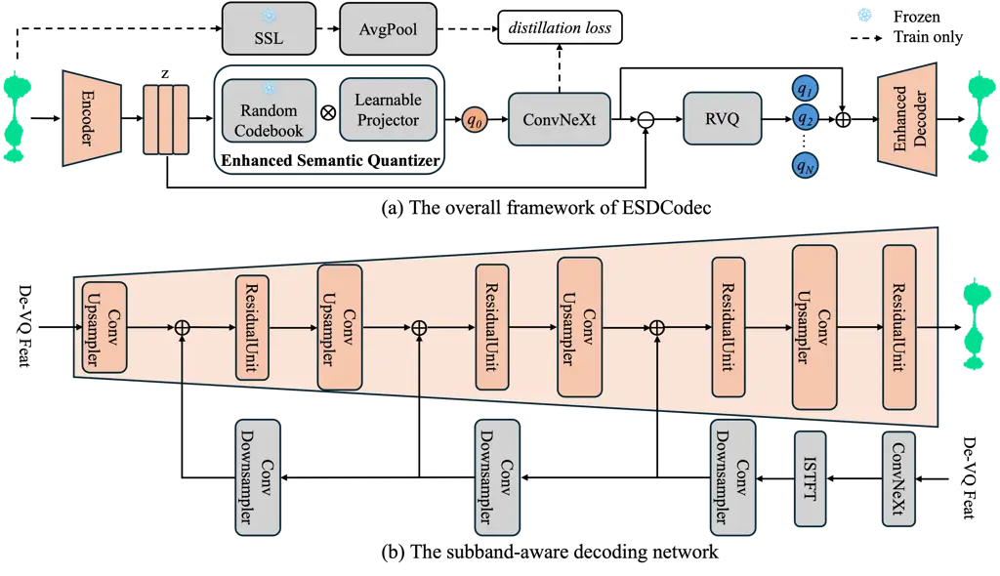
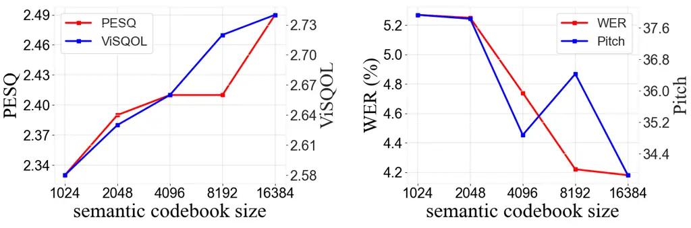

# ESDCodec: Ultra-Low Bitrate Speech Codec with Enhanced Semantic Disentanglement and Subband Decoding

Nan
Xu [](https://orcid.org/0009-0006-1010-0381)
   Kecan
Mao [](https://orcid.org/0009-0007-7936-3603)
   Xin
Gu [](https://orcid.org/0000-0003-4375-1456)
   Yi
Zhao [](https://orcid.org/0000-0002-3555-9408)^(\*)
^(†)^(†)thanks: ^(\*)Corresponding author. Email:athenazhao@tencent.com
   Zhi
Gong [](https://orcid.org/0009-0002-1850-3848)

###### Abstract

Despite recent advances in neural speech codecs, achieving high-fidelity
speech reconstruction at low bitrates remains a formidable challenge. To
address this limitation, we propose ESDCodec, a speech codec that
integrates a thoroughly enhanced semantic quantizer and a conditioned
decoder network. Specifically, we employ a randomly initialized and
frozen codebook, followed by a lightweight projector, to encode semantic
details entirely within a linear space while enhancing codebook
utilization. To further improve perceptual quality, we design a
condition network that explicitly injects prior subband knowledge into
the upsampling decoder. Taking the de-quantized feature as input, this
network predicts subband signals, thereby providing fine-grained
guidance for waveform reconstruction. Extensive experimental results
show that ESDCodec achieves superior reconstruction performance at an
ultra-low bitrate of 0.85kbps. For LLM-based speech generation tasks,
ESDCodec also consistently outperforms existing codec models.

###### Index Terms: 

ultra-low bitrate, enhanced semantic quantizer, condition network,
neural speech codec

^(†)^(†)address: WeChat, Tencent Inc, Beijing, China

## 1 Introduction

Neural speech codecs serve as a foundational technology for speech
signal compression and have garnered increasing research interest in
recent years. The primary objective of a speech codec is to compress
speech signals into compact discrete representations while preserving
perceptual fidelity. With the rapid progress of large language models
(LLMs), the integration of speech modalities into text-based LLMs has
become more prevalent. In such scenarios, neural speech codecs play a
pivotal role in bridging continuous speech waveforms with discrete
tokens. Leveraging these discrete representations, speech language
models (SLMs) have been successfully applied to various downstream
tasks, including speech understanding, text-to-speech (TTS) synthesis,
and spoken dialogue systems.

In practice, there exists an inherent trade-off between bitrate and
reconstruction quality. Recent advances in quantization techniques, such
as residual vector quantization (RVQ) \[10\], have enabled flexible
bitrate configurations. However, when the bitrate drops to approximately
1 kbps, reconstruction performance often deteriorates significantly
\[5\]. To mitigate this issue, single-codebook codecs such as
Single-Codec \[12\] and WavTokenizer \[9\] have been proposed,
compressing all information into a single vector quantization (VQ)
sequence. Additionally, SimVQ \[26\] introduces a frozen codebook
paradigm with global updates through a linear layer, achieving full use
of the codebook. Despite these innovations, such methods often lack
explicit semantic modeling, limiting their effectiveness in
semantics-aware applications.

Semantic tokens are typically derived from self-supervised learning
(SSL) models or supervised models \[2\]. For example, SpeechTokenizer
\[25\] distills semantic information into the first RVQ layer using an
SSL model, while the X-Codec series \[23\] explicitly injects SSL
semantic features into the acoustic stream. Acoustic tokens, on the
other hand, are commonly obtained from codecs optimized for acoustic
detail, such as SoundStream \[24\], EnCodec \[5\], and
Descript-Audio-Codec (DAC) \[11\]. Although these models achieve high
fidelity across various bitrates, they often suffer from misaligned
semantic content, resulting in suboptimal compatibility with SLMs.
Recent advancements in dual-stream codec architectures have explored the
disentanglement of semantic and acoustic tokens. The Mimi codec \[6\]
distills semantic features into a single VQ module. SemantiCodec \[14\]
employs AudioMAE \[8\] to achieve the disentanglement of semantic and
acoustic streams. DualCodec \[13\] thoroughly decouples semantic and
acoustic quantizers into the unified dual-stream architecture. Although
these codecs achieve exceptional reconstruction quality, low bitrates
still hinder further improvements. Integrating semantic-acoustic
modeling with low-bitrate objectives into a cohesive framework remains
an open challenge.



Figure 1: The overall architecture of the proposed ESDCodec. In the
subfigure (a), the enhanced semantic quantizer is shown and generates
the single semantic code $`q_{0}`$. The remaining acoustic codes are
encoded by RVQ layers. The dashed line refers to the SSL distillation
loss and corresponding modules only involve during the training process.
In the subfigure (b), the detailed framework of the subband-aware
decoding network is shown. The de-quantized features are used as inputs
for upsampling and condition networks, respectively.

To overcome these limitations, we propose ESDCodec, a dual-stream neural
speech codec featuring an enhanced semantic quantizer and a conditioned
decoder. The semantic quantizer adopts a frozen codebook with a
learnable linear projector, inspired by SimVQ, to promote full codebook
activation and mitigate representation collapse. This module is trained
with SSL distillation and operates with architectural simplicity during
inference. Furthermore, we enhance the decoder with a subband condition
network that injects prior spectral knowledge into each upsampling
stage. By explicitly modeling subband structures, the enhanced decoder
achieves more accurate waveform reconstruction. The main contributions
of this work are summarized as follows:

- •
  We propose ESDCodec, a dual-stream framework that effectively
  disentangles semantic and acoustic tokens for low-bitrate neural
  speech codecs. The enhanced semantic quantizer, combining a frozen
  codebook and learnable projector, ensures efficient semantic encoding
  with minimal bitrate overhead.
- •
  We introduce a subband-aware decoder network that leverages prior
  subband information to guide waveform reconstruction. This design
  significantly improves perceptual quality and reconstruction accuracy.
- •
  Extensive experiments demonstrate that ESDCodec achieves
  state-of-the-art performance at 0.85kbps, outperforming existing
  baselines in both objective and subjective evaluations. We also
  release our code and pre-trained model to support reproducibility and
  future research¹¹ 1
  [https://github.com/vspeech/ESDCodec](https://github.com/vspeech/ESDCodec).

## 2 Method

### 2.1 Overall framework

The overall architecture of ESDCodec is illustrated in Figure 1(a),
which adopts a dual-stream quantization paradigm with distinct semantic
and acoustic pathways. In the encoding stage, the raw waveform is mapped
to a latent space $`Z\in\mathbb{R}^{T\times D}`$ via a convolutional
encoder. This encoder performs a 960-fold temporal compression, reducing
the original 24 kHz sampling rate to a 25 Hz frame-level representation.
Built upon stacked downsampling convolutional layers with snake
activations \[27\], the encoder outputs features that are then routed to
an enhanced semantic quantizer. This quantizer yields merely a single
token $`q_{0}`$, thereby substantially reducing the overall bitrate. To
enhance the discriminative power of the semantic branch, we introduce an
SSL distillation objective, drawing on the feature representations from
both w2v-BERT-2.0 \[1\] and ConvNeXt \[15\]. Concurrently, the
supplementary acoustic information is progressively encoded via residual
vector quantization layers, consistent with the design principles of DAC
\[11\].

### 2.2 Enhanced semantic quantizer

The codebook collapse is a typical issue and plagues the traditional
vector quantization \[26\]. To efficiently quantize the semantic
information, we introduce the SimVQ \[26\] technique to enhance the
single-layer semantic quantizer. By leveraging full codebook utilization
and global space updates, the enhanced semantic quantizer generates
compact and informative semantic codes. Specifically, the codebook is
reparameterized as a combination of a randomly initialized and frozen
basis matrix $`S\in\mathbb{R}^{N\times F}`$ and a learnable linear
projection matrix $`W\in\mathbb{R}^{F\times D}`$, which can be written
as follows,

```math
C=S\times W. \tag{1}
```

Instead of learning individual code vectors, the entire codebook
$`C\in\mathbb{R}^{N\times D}`$ is jointly optimized during training and
only $`W`$ is updated. This design prevents representation collapse and
encourages full codebook utilization. We can obtain the quantized
embedding through nearest-neighbor lookup in the codebook $`C`$.
Specifically for each frame $`z_{t}`$, we have

```math
i_{t}=arg\min_{n}\left||z_{t}-c_{n}\right||_{2}^{2}, \tag{2}
```

where $`c_{n}\in C`$. To capture richer semantic structures, we place
ConvNeXt \[15\] modules immediately after the quantization operation,
drawing on the design of \[13\]. Simultaneously, we introduce an extra
L2 self-supervised distillation loss to preserve the informational
integrity of the semantic embeddings throughout training.

|                      |         |           |       |               |     |                  |                  |                     |                     |                    |                   |                    |
| -------------------- | ------- | --------- | ----- | ------------- | --- | ---------------- | ---------------- | ------------------- | ------------------- | ------------------ | ----------------- | ------------------ |
| Codec Model          | Params  | Bit(kbps) | Tok/s | Codebook size | Nq  | PESQ$`\uparrow`$ | STOI$`\uparrow`$ | V/UV F1$`\uparrow`$ | Pitch$`\downarrow`$ | ViSQOL$`\uparrow`$ | WER$`\downarrow`$ | MUSHRA$`\uparrow`$ |
| Ground-Truth         | \-      | \-        | \-    | \-            | \-  | 4.64             | 1.000            | \-                  | \-                  | \-                 | 3.70              | 91.6               |
| DAC 75Hz             | 74.71M  | 0.75      | 75    | 1024          | 1   | 1.17             | 0.737            | 0.744               | 271.6               | 1.50               | 35.3              | 28.7               |
| Encodec 75Hz         | 14.85M  | 1.50      | 150   | 1024          | 2   | 1.56             | 0.845            | 0.836               | 134.7               | 1.94               | 6.68              | 37.4               |
| SpeechTokenizer 50Hz | 103.68M | 1.00      | 100   | 1024          | 2   | 1.25             | 0.777            | 0.802               | 179.1               | 1.34               | 5.35              | 35.1               |
| X-Codec 50Hz         | 79.50M  | 1.00      | 100   | 1024          | 2   | 2.11             | 0.863            | 0.913               | 52.39               | 2.36               | 3.75              | 83.4               |
| DualCodec 25Hz       | 100.0M  | 0.85      | 75    | 16384/1024    | 3   | 2.32             | 0.912            | 0.929               | 38.76               | 2.61               | 4.70              | 85.8               |
| ESDCodec 25Hz        | 89.78M  | 0.85      | 75    | 16384/1024    | 3   | 2.49             | 0.921            | 0.936               | 33.86               | 2.74               | 4.18              | 88.2               |

Table 1: Reconstruction results around 0.9kbps bitrate on LibriSpeech
test-clean subset. The codebook size with $`x/y`$ denotes semantic and
acoustic streams in the dual-stream codec, respectively. Nq refers to
the number of used quantizers. Bold indicates the best scores.

### 2.3 Subband-aware decoding

The decoder constitutes a critical module in neural audio codecs,
responsible for the conversion of compressed embeddings into audible
signals of high perceptual quality. In standard implementations, this
conversion is realized through a stack of upsampling convolutional
layers. However, the direct mapping from low-dimensional quantized
features to time-domain waveforms is inherently ill-posed, as previously
underscored in the vocoder literature \[20, 19, 21\].

To overcome this limitation, we propose the enhanced codec decoder
equipped with a subband-aware condition network. As illustrated in
Figure 1(b), the de-quantized continuous features are passed through
four convolutional upsampling blocks and ResidualUnit \[24\] modules to
reconstruct the waveform. Simultaneously, the condition network employs
ConvNeXt blocks to predict the magnitude and phase of subband signals.
The inverse STFT is then applied to generate subband waveforms.
Furthermore, this subband prior information is integrated into the codec
decoder via subsequent downsampling layers, where outputs from each
upsampling block are combined with corresponding downsampling features.
The subband-aware condition network is lightweight, adding only 9.6M
parameters.

### 2.4 Training objective

The training objective comprises adversarial, reconstruction, SSL
distillation, and quantization losses.

Adversarial loss. We adopt the adversarial loss $`\mathcal{L}_{adv}`$
from DAC and employ the L1 feature matching loss $`\mathcal{L}_{feat}`$
for intermediate features between ground truth and generated samples.
For discriminators, we use the multi-scale STFT and multi-period
discriminators that are consistent with DAC.

Reconstruction loss. The reconstruction loss $`\mathcal{L}_{recon}`$
contains three losses. We use the multi-scale Mel spectrogram losses
$`\mathcal{L}_{full}`$ and $`\mathcal{L}_{sub}`$ for reconstructed
fullband and subband audios, respectively. Additionally for the
condition network, we use a single STFT loss \[22\]
$`\mathcal{L}_{stft}`$ to constrain magnitudes between the predicted and
ground truth samples.

SSL distillation loss. Semantic distillation is performed via an L2 loss
$`\mathcal{L}_{distill}`$ between features from a pre-trained SSL model
and those reconstructed by ConvNeXt.

Quantization loss. The quantization loss $`\mathcal{L}_{vq}`$ contains
two losses, i.e., codebook loss and commitment loss. The codebook loss
$`\mathcal{L}_{code}`$ is employed between quantized embeddings and
encoder outputs. The commitment loss $`\mathcal{L}_{commit}`$ is also
used to remain encoder outputs close to assigned codebook entries. These
losses are used for both semantic and acoustic streams.

The overall training objective can be written as follows,

```math
\mathcal{L}=\lambda_{adv}\mathcal{L}_{adv}+\lambda_{feat}\mathcal{L}_{feat}\\
+\lambda_{recon}\mathcal{L}_{recon}+\lambda_{distill}\mathcal{L}_{distill}+\lambda_{vq}\mathcal{L}_{vq}, \tag{3}
```

where hyperparameters balance each loss component.

## 3 Experiments

### 3.1 Datasets and training setups

Datasets. To ensure diversity in the training data, we adopt
approximately 97,000 hours of bilingual (English and Chinese) speech
from the Emilia dataset \[7\], all resampled to 24 kHz. To evaluate the
generalization capability of the proposed codec, we employ the
out-of-domain LibriSpeech `test-clean` set \[16\], consisting of 2,620
utterances, as our test corpus.

Implementation. In ESDCodec, we use the encoder module in DAC \[11\],
containing 4 convolution blocks with strides (4, 5, 6, 8). Therefore for
24kHz waveform input, we can generate 25Hz frame-rate tokens. The
decoder without the condition network mirrors the encoder and is
composed of stacked temporal upsampling convolution layers. For acoustic
RVQ module, we use 11 codebook layers. The codebook size is 1024 and
codebook dim is 8. For semantic quantization module, the frozen codebook
size is set as 16384 and codebook dim is set as 1024. The input and
output channels of the lightweight projector layer are both set as 1024.
Additionally, the ConvNeXt network following the semantic quantization
module contains 4 blocks with the input dim 512 and the intermediate dim 1536. In the enhanced codec decoder, the condition network utilizes 6
ConvNeXt blocks to predict the waveform of a quarter subband. The FFT
size, window size and hop size are 960, 960 and 240, respectively. The
input dim and intermediate dim in each ConvNeXt block are set as 256 and
1024, respectively. Additionally, the strides of three downsampling
convolution layers are set as 1, 5 and 4.

Training. During training, we randomly intercept 4 seconds for each
speech sample and employ the batch size as 12. Notably, we utilize the
weight normalization for convolution modules. The initial learning rates
for both the generator and discriminator are set as 1e-4 and the
exponential decay is employed throughout training. AdamW optimizer with
betas (0.8, 0.9) is employed for model optimization. Finally for all
experiments, we train all codec models for 350K steps and TTS models for
600K steps. Notably, we use 8 codebooks for TTS training and all models
are trained on 8 NVIDIA H20 GPUs.

### 3.2 Baselines and evaluations

Baselines. Our baselines are composed of a series of advanced codec
models, including RVQ-based codecs (DAC \[11\] and Encodec \[5\]),
semantic enhanced codecs (SpeechTokenizer \[25\] and X-Codec \[23\]),
and dual-stream codec DualCodec \[13\]. Notably, in our experiments, we
utilize public official implementations and checkpoints.

Evaluations. In our experiments, both objective and subjective
evaluations are used as metrics for our proposed codec and baselines. We
employ six different evaluations as objective metrics, including the
Perceptual Evaluation of Speech Quality (PESQ) \[17\] with wide band²² 2
[https://github.com/ludlows/python-pesq](https://github.com/ludlows/python-pesq),
Short-Time Objective Intelligibility (STOI)³³ 3
[https://github.com/mpariente/pystoi](https://github.com/mpariente/pystoi),
Word Error Rate (WER), two pitch-related metrics and ViSQOL⁴⁴ 4
[https://github.com/google/visqol](https://github.com/google/visqol)
\[4\]. Notably, for the WER metric, transcriptions are obtained with
`Paraformer-zh` for Chinese and `Whisper-large-v3` for English. F1 score
of voiced/unvoiced classification (V/UV F1) and pitch error using F0
Root Mean Square Error⁵⁵ 5
[https://github.com/gemelo-ai/vocos](https://github.com/gemelo-ai/vocos)
are used as pitch-related metrics. Additionally, we use MUSHRA \[18\]
listening tests for the subjective evaluation. Specifically, we recruit
10 participants to complete the test using randomly selected 15
utterances from LibriSpeech dataset.

|                   |                     |      |                   |      |
| ----------------- | ------------------- | ---- | ----------------- | ---- |
| Codec Model       | WER$`\downarrow`$   |      | SIM$`\uparrow`$   |      |
|                   | EN                  | ZH   | EN                | ZH   |
| Ground-Truth      | 2.13                | 1.25 | 0.73              | 0.75 |
| SpeechTokenizer\* | 15.4                | 21.5 | 0.47              | 0.55 |
| DualCodec\*       | 3.40                | 2.49 | 0.57              | 0.67 |
| ESDCodec          | 3.31                | 2.39 | 0.63              | 0.70 |

Table 2: The TTS experiment results of different codec models on
Seed-TTS-Eval benchmark. Evaluation metrics of models\* are reported by
DualCodec. Bold denotes the best scores.

### 3.3 Results

#### 3.3.1 Codec performance

As illustrated in Table 1, we compare all codecs under a similar
ultra-low bitrate (around 0.85kbps) on LibriSpeech `test-clean` set.
Overall, the proposed ESDCodec delivers the best reconstruction quality
while maintaining a comparable bitrate and token rate compared to other
low-bitrate systems. Specifically, ESDCodec achieves the highest
objective metrics among all baseline codecs, obtaining a PESQ of 2.49
and ViSQOL of 2.74. It also yields superior pitch-related performance
with the best F1 score and the lowest pitch error, indicating more
accurate voicing decisions and pitch tracking at ultra-low bitrates.
Compared to the closely matched dual-stream baseline DualCodec that has
the same bitrate/token rate and codebook partition, ESDCodec improves
PESQ by 0.17, STOI by 0.01, and ViSQOL by 0.13, while reducing pitch
error by 4.9, demonstrating that the proposed method better preserves
both intelligibility and quality given the same token budget. In terms
of semantic content reconstruction, although X-Codec achieves the lowest
WER, it does so at a higher bitrate. Under the stricter low-bitrate
setting (0.85kbps), ESDCodec achieves a competitive WER of 4.18%.
Furthermore, ESDCodec achieves the best subjective listening results
among all baseline codecs, which aligns well with the improvements
observed in objective measures and suggests that the proposed design
yields perceptually meaningful gains at ultra-low bitrates.

#### 3.3.2 TTS performance

We train the VALL-E model \[3\] on discrete codec tokens generated by
various codecs, and evaluate its TTS performance on the Seed-TTS-Eval
benchmark⁶⁶ 6
[https://github.com/BytedanceSpeech/seed-tts-eval](https://github.com/BytedanceSpeech/seed-tts-eval).
The word error rate (WER) and speaker similarity (measured by SIM-O,
abbreviated as SIM) are reported in Table 2. Overall, ESDCodec achieves
superior TTS quality over all competing codec-based tokenizers,
consistently improving both content accuracy and speaker similarity for
English and Chinese.

#### 3.3.3 Ablation study

Table 3 presents an ablation study to assess the contribution of key
design choices in ESDCodec. The full model achieves the best overall
performance across all metrics, indicating that the complete
architecture yields the most favorable trade-off between perceptual
quality, intelligibility, and prosody fidelity. Furthermore, replacing
the enhanced semantic pathway with the VQ-based semantic stream (i.e.,
w/ VQ semantic) consistently degrades reconstruction and linguistic
accuracy, while also slightly harming voicing and pitch accuracy. This
suggests that the semantic full-utilization representation in ESDCodec
provides more informative and better-aligned conditioning for the
decoder than a vector quantized semantic alternative under the same
operating setting. Additionally, removing the conditioning mechanism
(i.e., w/o condition) causes the largest performance deterioration,
particularly for semantic content and prosody. These results indicate
that the conditioning is crucial for preserving content-related cues and
stabilizing prosodic reconstruction at the ultra-low bitrate, thereby
improving both perceptual quality and alignment with the semantic
content.

|                |                  |                  |                     |                     |                   |
| -------------- | ---------------- | ---------------- | ------------------- | ------------------- | ----------------- |
| Method         | PESQ$`\uparrow`$ | STOI$`\uparrow`$ | V/UV F1$`\uparrow`$ | Pitch$`\downarrow`$ | WER$`\downarrow`$ |
| ESDCodec       | 2.49             | 0.921            | 0.936               | 33.86               | 4.18              |
| w/ VQ semantic | 2.43             | 0.919            | 0.932               | 34.02               | 4.43              |
| w/o condition  | 2.42             | 0.916            | 0.930               | 36.21               | 6.38              |

Table 3: The ablation experiment results on LibriSpeech test-clean
subset. The best results are listed in bold.



Figure 2: The ablation experiment results of different semantic codebook
sizes on LibriSpeech test-clean subset.

As illustrated in Figure 2, we present an ablation study on the impact
of the size of the semantic codebook on ESDCodec. As the codebook size
increases from 1024 to 16384, we observe consistent improvements in both
perceptual quality and content preservation. In particular, ViSQOL
increases from 2.58 to 2.74, indicating better reconstruction fidelity
with larger semantic codebooks. Meanwhile, the word error rate (WER)
decreases from 5.27% to 4.18%, demonstrating enhanced semantic
retention. These gains can be attributed to the expanded representation
capacity of a larger codebook, which allows finer-grained modeling of
semantic information and reduces quantization errors.

## 4 Conclusion

In this paper, we introduce ESDCodec, a dual-stream neural speech codec
designed for high-fidelity waveform reconstruction at ultra-low
bitrates. The proposed enhanced semantic quantizer, which combines a
frozen codebook with a learnable linear projector, mitigates the
codebook collapse and ensures efficient semantic encoding with minimal
bitrate overhead. Additionally, the subband-aware decoder, equipped with
a lightweight condition network, injects prior spectral knowledge into
the reconstruction process, significantly improving the perceptual
quality. Extensive experiments on LibriSpeech demonstrate that ESDCodec
achieves state-of-the-art performance at 0.85kbps, outperforming
existing codecs across both objective and subjective metrics.
Furthermore, ablation studies validate the contributions of each
proposed component.

## References

- \[1\] L. Barrault, Y. Chung, M. C. Meglioli, D. Dale, N. Dong, M.
  Duppenthaler, P. Duquenne, B. Ellis, H. Elsahar, J. Haaheim, et
  al. (2023) Seamless: multilingual expressive and streaming speech
  translation. arXiv preprint arXiv:2312.05187. Cited by: §2.1.
- \[2\] S. Chen, C. Wang, Z. Chen, Y. Wu, S. Liu, Z. Chen, J. Li, N.
  Kanda, et al. (2022) Wavlm: large-scale self-supervised pre-training
  for full stack speech processing. IEEE Journal of Selected Topics in
  Signal Processing (JSTSP) 16 (6), pp. 1505–1518. Cited by: §1.
- \[3\] S. Chen, C. Wang, Y. Wu, Z. Zhang, et al. (2025) Neural codec
  language models are zero-shot text to speech synthesizers. IEEE
  Transactions on Audio, Speech and Language Processing (TASLP) 33,
  pp. 705–718. Cited by: §3.3.2.
- \[4\] M. Chinen, F. S. Lim, J. Skoglund, N. Gureev, F. O’Gorman,
  and A. Hines (2020) ViSQOL v3: an open source production ready
  objective speech and audio metric. In 2020 twelfth international
  conference on quality of multimedia experience (QoMEX), pp. 1–6. Cited
  by: §3.2.
- \[5\] A. Défossez, J. Copet, G. Synnaeve, and Y. Adi (2023) High
  fidelity neural audio compression. Transactions on Machine Learning
  Research (TMLR). Cited by: §1, §1, §3.2.
- \[6\] A. Défossez, L. Mazaré, M. Orsini, A. Royer, P. Pérez, H.
  Jégou, E. Grave, and N. Zeghidour (2024) Moshi: a speech-text
  foundation model for real-time dialogue. arXiv preprint
  arXiv:2410.00037. Cited by: §1.
- \[7\] H. He, Z. Shang, C. Wang, X. Li, Y. Gu, H. Hua, L. Liu, C.
  Yang, J. Li, P. Shi, et al. (2024) Emilia: an extensive, multilingual,
  and diverse speech dataset for large-scale speech generation. In IEEE
  Spoken Language Technology Workshop (SLT), pp. 885–890. Cited by:
  §3.1.
- \[8\] P. Huang, H. Xu, J. Li, A. Baevski, M. Auli, W. Galuba, et
  al. (2022) Masked autoencoders that listen. In Advances in Neural
  Information Processing Systems (NeurIPS), Vol. 35, pp. 28708–28720.
  Cited by: §1.
- \[9\] S. Ji, Z. Jiang, W. Wang, Y. Chen, M. Fang, et al. (2025)
  Wavtokenizer: an efficient acoustic discrete codec tokenizer for audio
  language modeling. In International Conference on Learning
  Representations (ICLR), Cited by: §1.
- \[10\] B. Juang and A. Gray (1982) Multiple stage vector quantization
  for speech coding. In IEEE International Conference on Acoustics,
  Speech, and Signal Processing (ICASSP), pp. 597–600. Cited by: §1.
- \[11\] R. Kumar, P. Seetharaman, A. Luebs, I. Kumar, and K.
  Kumar (2023) High-fidelity audio compression with improved rvqgan. In
  Advances in Neural Information Processing Systems (NeurIPS), Vol. 36,
  pp. 27980–27993. Cited by: §1, §2.1, §3.1, §3.2.
- \[12\] H. Li, L. Xue, H. Guo, X. Zhu, Y. Lv, L. Xie, Y. Chen, et
  al. (2024) Single-codec: single-codebook speech codec towards
  high-performance speech generation. In Interspeech, pp. 3390–3394.
  Cited by: §1.
- \[13\] J. Li, X. Lin, Z. Li, S. Huang, Y. Wang, C. Wang, Z. Zhan, et
  al. (2025) Dualcodec: a low-frame-rate, semantically-enhanced neural
  audio codec for speech generation. In Interspeech, pp. 4883–4887.
  Cited by: §1, §2.2, §3.2.
- \[14\] H. Liu, X. Xu, Y. Yuan, M. Wu, W. Wang, and M. D.
  Plumbley (2024) Semanticodec: an ultra low bitrate semantic audio
  codec for general sound. IEEE Journal of Selected Topics in Signal
  Processing (JSTSP) 18 (8), pp. 1448–1461. Cited by: §1.
- \[15\] Z. Liu, H. Mao, C. Wu, C. Feichtenhofer, T. Darrell, and S.
  Xie (2022) A convnet for the 2020s. In Proceedings of the IEEE
  Conference on Computer Vision and Pattern Recognition (CVPR),
  pp. 11976–11986. Cited by: §2.1, §2.2.
- \[16\] V. Panayotov, G. Chen, D. Povey, and S. Khudanpur (2015)
  Librispeech: an asr corpus based on public domain audio books. In IEEE
  international conference on acoustics, speech and signal processing
  (ICASSP), pp. 5206–5210. Cited by: §3.1.
- \[17\] A. W. Rix, J. G. Beerends, M. P. Hollier, et al. (2001)
  Perceptual evaluation of speech quality (pesq)-a new method for speech
  quality assessment of telephone networks and codecs. In IEEE
  International Conference on Acoustics, Speech, and Signal Processing
  (ICASSP), pp. 749–752. Cited by: §3.2.
- \[18\] M. Schoeffler, S. Bartoschek, F. Stöter, M. Roess, S. Westphal,
  et al. (2018) WebMUSHRA—a comprehensive framework for web-based
  listening tests. Journal of open research software 6 (1). Cited by:
  §3.2.
- \[19\] H. Siuzdak (2024) Vocos: closing the gap between time-domain
  and fourier-based neural vocoders for high-quality audio synthesis. In
  International Conference on Learning Representations (ICLR), Cited by:
  §2.3.
- \[20\] N. Xu, Z. Huang, and X. Zeng (2025) A universal harmonic
  discriminator for high-quality gan-based vocoder. In IEEE Automatic
  Speech Recognition and Understanding Workshop (ASRU), pp. 1–7. Cited
  by: §2.3.
- \[21\] N. Xu and M. Yang (2026) SCNet: enhancing gan-based speech
  generation with subband condition network and magnitude-aware phase
  loss. In Interspeech, Cited by: §2.3.
- \[22\] G. Yang, S. Yang, K. Liu, P. Fang, W. Chen, and L. Xie (2021)
  Multi-band melgan: faster waveform generation for high-quality
  text-to-speech. In IEEE Spoken Language Technology Workshop (SLT),
  pp. 492–498. Cited by: §2.4.
- \[23\] Z. Ye, P. Sun, J. Lei, H. Lin, X. Tan, Z. Dai, Q. Kong, J.
  Chen, et al. (2025) Codec does matter: exploring the semantic
  shortcoming of codec for audio language model. In Proceedings of the
  AAAI Conference on Artificial Intelligence (AAAI), Vol. 39,
  pp. 25697–25705. Cited by: §1, §3.2.
- \[24\] N. Zeghidour, A. Luebs, A. Omran, J. Skoglund, and M.
  Tagliasacchi (2021) Soundstream: an end-to-end neural audio codec.
  IEEE Transactions on Audio, Speech, and Language Processing (TASLP)
  30, pp. 495–507. Cited by: §1, §2.3.
- \[25\] X. Zhang, D. Zhang, S. Li, Y. Zhou, and X. Qiu (2024)
  Speechtokenizer: unified speech tokenizer for speech large language
  models. In International Conference on Learning Representations
  (ICLR), Cited by: §1, §3.2.
- \[26\] Y. Zhu, B. Li, Y. Xin, Z. Xia, and L. Xu (2025) Addressing
  representation collapse in vector quantized models with one linear
  layer. In IEEE International Conference on Computer Vision (ICCV),
  pp. 22968–22977. Cited by: §1, §2.2.
- \[27\] L. Ziyin, T. Hartwig, and M. Ueda (2020) Neural networks fail
  to learn periodic functions and how to fix it. In Advances in Neural
  Information Processing Systems (NeurIPS), Vol. 33, pp. 1583–1594.
  Cited by: §2.1.
