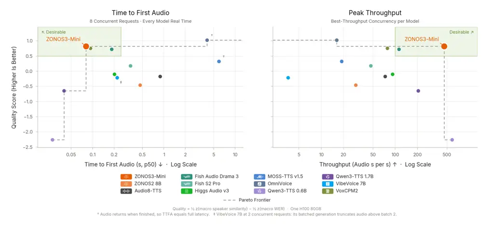
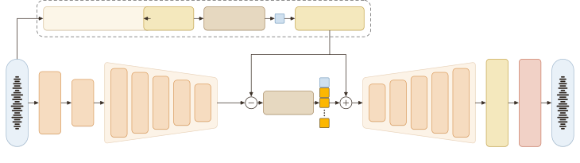

ZONOS3-Mini Technical Report \reporttypeTechnical report
\authornote\corrCorresponding authors \pdfauthorsGabriel Clark, Sofian
Mejjoute, George Close, Beren Millidge
\metadataModel\zyhfZyphra/ZONOS3-Mini
\metadataCode\zyghZyphra/ZONOS3-Mini
\metadataEvaluation\zyghZyphra/ZTTS2-Eval
\metadataContact[gabriel@zyphra.com](mailto:gabriel@zyphra.com) [beren@zyphra.com](mailto:beren@zyphra.com)

# ZONOS3-Mini Technical Report

Gabriel Clark\corr  Sofian Mejjoute  George Close  Beren Millidge\corr
Affiliation: Zyphra · San Francisco, CA

###### Abstract

ZONOS3-Mini is an ultra-compact, ultra-fast, zero-shot voice-cloning TTS
model. The model can run in real time on a laptop or smartphone. For its
latency and size, it achieves state-of-the-art accuracy and cloning
fidelity. To achieve this we propose a latent MoE backbone with only
886M parameters (100M active per token) and a new audio codec, ZAC-1
(ZAC-1), which represents 44.1 kHz audio at a 15 Hz frame rate. On the
new ZTTS2-Eval benchmark, ZONOS3-Mini reaches a 6.71 % macro-average WER
over 55 language sets (35 clean and 20 in the wild), which is
competitive with larger and slower state-of-the-art models. We release
the model weights, inference, and training code.

###### keywords

text-to-speech, voice cloning, audio codec, mixture of experts,
on-device inference

\zycontents



Figure 1: Quality versus speed on one H100 80GB. Left: time to first
audio (p50) at 8 concurrent requests; right: peak throughput at each
model’s best-throughput concurrency. Quality is $`\tfrac{1}{2}`$ z(macro
speaker similarity) $`-`$ $`\tfrac{1}{2}`$ z(macro WER) over the 55
ZTTS2-Eval language sets; the dashed line is the Pareto frontier.

## 1 Introduction

Current state-of-the-art on-device TTS models sacrifice cloning quality,
controllability, and multilingual performance for the ability to operate
in real time on weaker hardware. We introduce ZONOS3-Mini as a new point
on the Pareto frontier of quality and inference performance for
on-device TTS models. In this report we detail the architecture and
training framework that allow ZONOS3-Mini to operate everywhere from
smartphones to laptops, without compromising on quality. The main areas
of advancement over ZONOS2 are in sequence compression, text and audio
representations, model architecture, voice cloning conditioning,
controllability, and evaluation methodology. Across many of these areas
of improvement there were two main drivers. The first and most effective
change was switching to our new audio tokenizer ZAC-1 and the second was
validating all model changes with our new evaluation, ZTTS2-Eval.

ZAC-1 operates at 15 Hz, which shortens audio sequences by $`5.7\times`$
relative to ZONOS2 \[6\], and it delivers high-quality reconstructions
at only 1.80 kbit/s. It adopts a dual-encoding \[23\] quantizer design
with semantic distillation from frozen self-supervised speech
representations. This enables more efficient training and a backbone
with roughly a ninth of the parameters of ZONOS2, with higher speaker
similarity and a macro WER (WER) within 0.5 points of ZONOS2 (Table 4).
The use of causal iSTFT (iSTFT) heads and a novel transformer
autoencoder design enables low-latency streaming and efficient
inference.

We also report results on and release ZTTS2-Eval, a new TTS (TTS)
evaluation framework covering 35 languages in the clean subset and 20 in
the in-the-wild set, totaling 74,041 utterances. This is significantly
wider in language coverage than existing TTS evaluation sets.

## 2 Backbone Overview

### 2.1 Text Tokenization

In a departure from ZONOS2, which used raw byte text representations,
ZONOS3-Mini uses an 8,192-entry SuperBPE tokenizer \[26\] trained on a
spoken-language-focused data mix. The text span is bracketed by a
beginning-of-text token (BOS) and an end-of-text token (EOS); the audio
stream ends with an end-of-audio token (EOA), and a pad row fills unused
positions. The vocabulary size follows the tokenizer sweep of
Section 8.3.

### 2.2 Backbone Architecture

The backbone combines recurrent GDN (GDN) layers with two global
attention layers for efficient long-context inference. It has 11 layers
in total. Layers 4 and 8 use global causal attention with GQA (GQA),
QK-normalization \[14\], RoPE (RoPE) \[46\] and a learned output gate
per head \[39, \zypin§2.22505.06708v13\]. These layers have 16 query
heads, four key-value heads and head dimension 32. The other nine layers
use GDN mixers \[54\] with four heads and key/value dimension 128. The
model uses a latent MoE (MoE), reducing the 1,024-dimensional model
width to 256 inside the experts. We use full attention residuals \[19,
\zypin§3.12603.15031v14\] as their memory I/O remains small in our
11-layer model.

### 2.3 Speaker Conditioning

ZONOS3-Mini supports cloning from both ‘raw-audio’ codec references and
from speaker embeddings. Raw references carry prosody and recording
conditions as well as speaker identity. Embeddings occupy a single
sequence position and score higher on speaker similarity in our
evaluation (Section 7).

We train our own speaker embedding encoder with the MECT-B2
architecture \[1\]: a convolutional encoder followed by a MoE
transformer with an attentive statistics pooling stage. It is trained
independently of the backbone with the SphereFace2 loss \[51\]. It
produces a 192-dimensional vector, which a projection maps to the
model’s hidden dimension.

Pre-training uses the codec codes of a 1–60 s reference clip as a
loss-masked prefix before the text. The reference comes from another
clip of the same speaker in the same recording selected through
diarization consensus (Section 4). We omit it in 10 % of training
examples to enable unconditioned generation and speaker CFG (CFG).
Fine-tuning introduces the embedding path together with quality and
speaking-rate controls, while retaining examples with raw references.

## 3 Audio Codec: ZAC-1



Figure 2: ZAC-1. One semantic and nine residual codes per 15 Hz frame
are passed to the backbone.

|              |          |                    |      |                  |      |
| ------------ | -------- | ------------------ | ---- | ---------------- | ---- |
|              |          | WER $`\downarrow`$ |      | Sim $`\uparrow`$ |      |
| Codec        | Frames/s | clean              | wild | clean            | wild |
| Fish S1–DAC  | 21.5     | 4.30               | 5.28 | 84.8             | 79.0 |
| ZAC-1        | 15.0     | 4.06               | 5.54 | 83.8             | 76.1 |
| MOSS, 14 RVQ | 12.5     | 5.06               | 5.67 | 84.6             | 80.3 |
| DAC          | 86.1     | 42.2               | 51.7 | 78.8             | 63.7 |

Table 1: Downstream codec comparison: 50k-step TTS models on the
four-language ZTTS2-Eval sets. Best in bold.

Our goal in designing ZAC-1 was to produce a codec that is fast to
decode and easy for the TTS backbone to model in a delay pattern,
without compromising on acoustic quality. ZAC-1 has a 1.99B-parameter
encoder-decoder structure and operates at 15 Hz and 1.80 kbit/s, as
shown in Figure 2. It uses DualCodec-style dual encoding \[23,
\zypin§32505.13000v22\] with frozen layer-16 w2v-BERT 2.0 features \[5,
42\] as the semantic representation to improve multilingual modelability
in the downstream TTS backbone. Each frame carries ten codes from
4,096-entry codebooks, one semantic code and nine RVQ (RVQ) residual
codes, a configuration that balances speaker similarity and WER in
delay-pattern TTS modeling. The encoder and decoder comprise a symmetric
cascade of causal local-attention transformer stages at 15, 30, 60, 120
and 240 Hz. The encoder converts audio into patches with DAC-like
residual units, and the decoder uses eight ConvNeXt blocks and an iSTFT
head to generate 44.1 kHz audio; both are designed to avoid running
attention at the 44.1 kHz sample rate. ZAC-1 was trained for 600k steps
with 10 s crops and mel, adversarial, feature-matching and quantizer
losses.

To compare codecs, we encoded a 2 % stratified subset of the
pre-training corpus (Section 4) and trained a copy of our TTS model for
50k steps on this data. Table 1 compares the final checkpoint of ZAC-1
with the public Fish S1–DAC \[24\], MOSS audio tokenizer v2 \[35\], and
DAC (DAC) checkpoints. We find that ZAC-1 provides competitive
performance at a desirable compression rate.

The decoder ends in a Vocos-style iSTFT head \[45,
\zypin§3.22306.00814v34\] for inference performance. Originally we tried
a symmetrical design for the encoder and decoder, which achieved
superior reconstruction metrics; however, during inference at large
batch sizes, moving waveform-rate activations through memory was
prohibitively expensive. Because batch-size-1 local inference and
large-batch cloud inference have different optima, two decoders are
released. The full decoder removes the large-batch memory bottleneck of
the last layer by replacing it with ConvNeXt blocks and an iSTFT head,
and the pruned 144M-parameter keep-2 decoder avoids the batch-size-1
FLOP bottleneck of on-device inference by removing the transformer
blocks that hold the most FLOPs. In both decoders, eight causal ConvNeXt
blocks at the 240 Hz stage produce log-magnitude and phase spectra for
two iSTFT heads at different resolutions. In decode-only throughput on
one H100 the full decoder runs at 1,180$`\times`$ real time at batch 256
while the keep-2 decoder runs at 3,950$`\times`$, compared with
989$`\times`$ for the MOSS audio tokenizer \[35\] and 474$`\times`$ for
S1–DAC.

|                                                                            |          |        |                   |                   |                    |                    |                     |                  |                    |
| -------------------------------------------------------------------------- | -------- | ------ | ----------------- | ----------------- | ------------------ | ------------------ | ------------------- | ---------------- | ------------------ |
| Codec                                                                      | Frames/s | kbit/s | PESQ $`\uparrow`$ | STOI $`\uparrow`$ | Mel $`\downarrow`$ | LSD $`\downarrow`$ | SI-SDR $`\uparrow`$ | Sim $`\uparrow`$ | UTMOS $`\uparrow`$ |
| _ZTTS2-Eval ground truth, 1,600 clips, 16 kHz (original audio UTMOS 2.80)_ |          |        |                   |                   |                    |                    |                     |                  |                    |
| ZAC-1, full decoder                                                        | 15       | 1.80   | 2.88              | 0.928             | 0.179              | 0.955              | 7.83                | 88.7             | 2.63               |
| ZAC-1, keep-2 decoder                                                      | 15       | 1.80   | 2.51              | 0.911             | 0.202              | 1.005              | 5.72                | 84.9             | 2.52               |
| Fish S1–DAC                                                                | 21.5     | 2.20   | 3.10              | 0.941             | 0.149              | 0.900              | 7.25                | 90.7             | 2.66               |
| DAC                                                                        | 86.1     | 7.75   | 3.89              | 0.964             | 0.132              | 0.926              | 12.94               | 93.8             | 2.71               |
| MOSS tokenizer, 14 RVQ                                                     | 12.5     | 1.75   | 3.13              | 0.940             | 0.152              | 0.911              | 8.81                | 92.3             | 2.70               |
| MOSS tokenizer, 32 RVQ                                                     | 12.5     | 4.00   | 3.55              | 0.962             | 0.133              | 0.887              | 11.22               | 95.5             | 2.68               |
| _DAPS clean, 200 utterances, 44.1 kHz (original audio UTMOS 3.69)_         |          |        |                   |                   |                    |                    |                     |                  |                    |
| ZAC-1, full decoder                                                        | 15       | 1.80   | –                 | –                 | 0.209              | 1.212              | 8.56                | 84.0             | 3.70               |
| ZAC-1, keep-2 decoder                                                      | 15       | 1.80   | –                 | –                 | 0.227              | 1.229              | 6.55                | 78.2             | 3.61               |
| Fish S1–DAC                                                                | 21.5     | 2.20   | –                 | –                 | 0.145              | 0.822              | 8.62                | 88.6             | 3.72               |
| DAC                                                                        | 86.1     | 7.75   | –                 | –                 | 0.137              | 0.832              | 12.71               | 92.4             | 3.68               |
| MOSS tokenizer, 14 RVQ                                                     | 12.5     | 1.75   | –                 | –                 | 0.331              | 2.684              | 9.52                | 89.9             | 3.67               |
| MOSS tokenizer, 32 RVQ                                                     | 12.5     | 4.00   | –                 | –                 | 0.315              | 2.674              | 11.78               | 94.2             | 3.66               |

Table 2: Codec reconstruction quality on ZTTS2-Eval clips and DAPS
clean. Mel is the log-mel L1 distance. Best in bold, second best
underlined.

For completeness, we report reconstruction quality in Table 2 against
public Fish S1–DAC \[24\], DAC \[20\], and the MOSS audio
tokenizer \[35\]. The audio used is a subset of ZTTS2-Eval and the clean
partition of DAPS \[31\], neither of which is included in our training
corpus. Reconstructions are scored with PESQ (PESQ) \[41\], STOI
(STOI) \[47\], log-mel distance, LSD (LSD) \[12\], SI-SDR
(SI-SDR) \[21\], ReDimNet speaker similarity \[53\] and
MSR-UTMOS \[34\]. The MOSS tokenizer has a variable bit rate and is
shown in two modes here. The keep-2 decoder trades 0.4 PESQ and 4
similarity points against the full decoder.

## 4 Data Pipeline

Our pre-training corpus consists of 6.1M hours of naturalistic speech
audio sourced from a mixture of public and private corpora. We reuse all
of the labels and data from the ZONOS2 data pipeline. To obtain
utterance pairs of a speaker from different sections of a recording, we
diarize each recording with both HDBSCAN \[4\] and spectral clustering
over speaker-embedding windows and only use intervals where both methods
agree upon the same speaker.

## 5 Training

### 5.1 Pre-training

ZONOS3-Mini was pre-trained for 375k steps on H100 GPUs for a total of
4.5T tokens or ten epochs over the full corpus. We trained using the
hyper-parameters in Table 9. Training sample lengths were up to 600 s
and the audio reference clips for voice cloning were up to 60 s. We used
the Muon optimizer \[18, 27\] for 2-D weights and AdamW for the rest.
After adopting QB (QB), router entropy stayed within 5 % of uniform in
every MoE layer for all of training (Figure 3).

Figure 3: Learning rate, training loss and normalized router entropy
over pre-training, fine-tuning, the speaking-rate stage and
post-training (DPO and GRPO). The fine-tune loss starts higher due to
the addition of speaker-projection and control-row tables and a change
to the data mix. Router entropy is the mean and range over the ten MoE
layers.

### 5.2 Fine-tuning

During fine-tuning we keep cloning from codec-encoded reference clips
while additionally learning to clone from a MECT-B2-based speaker
embedding. We fine-tune the 375k checkpoint for 60k steps with fresh
optimizer states and the schedule in Table 9. On 45 % of training
samples we provide the embedding to the model, on 45 % we use codec
encoded reference clips, and on the remainder we provide no voice
cloning reference. A further filtered subset of the data mix was used
for this stage by increasing transcript agreement to 3 sources and
lowering the CER-agreement threshold to 2 %. After initial evaluation we
found that ten speaking-rate buckets were too coarse, so we performed a
second fine-tuning stage of 20k steps to refine the speaking-rate
control further. In this stage we split each of the ten speaking-rate
buckets into three finer-grained buckets and add them as tokens which
start initialized from their parents’ representations. This stage
restarts the optimizer states and the schedule but keeps the previous
stage’s data mix.

### 5.3 Post-training

We then perform two stages of post-training. Both stages use 5,089
training utterances in English, Chinese, Spanish and Japanese. In both
stages, each generated candidate is scored with the same ASR (ASR) and
speaker-similarity models as our evaluation (Section 6): Qwen3-ASR
against the prompt text and ReDimNet against the prompt audio.

Our first post-training stage targets early stopping and runaway
generation failures with direct preference optimization (DPO) \[40,
\zypinEq. 72305.18290v34\]. Eleven candidates per prompt are generated,
eight at speaker CFG 1 and three at 1.5. A candidate is considered a
failure when it contains no speech, reaches the default inference token
cap, is significantly longer or shorter than the source audio clip, or
has a high WER. Each failure forms a pair with the most similar complete
candidate of the same prompt. The loss is the DPO objective on the mean
log-probability of the audio tokens with $`\beta=0.1`$, plus 0.05 times
the negative log-likelihood of the chosen sequence. Training uses AdamW
at a learning rate of $`10^{-6}`$ with 8 pairs per step for 4 epochs.

The second post-training stage applies group relative policy
optimization (GRPO) \[43, \zypin§4.12402.03300v311\], following the
recipe of Audio8-TTS \[3, \zypin§4.32610.14776v15\] to directly optimize
speaker similarity (SIM) and WER. The first-stage model generates eight
candidates per prompt at CFG 1. The reward of a candidate is

```math
0.9\max(0,\,1-\frac{\mathrm{WER}}{2})+0.1\,\frac{\mathrm{SIM}}{100}. \tag{1}
```

The advantage is the reward standardized within the prompt’s group,
minus $`0.5`$ times a duration cost. The cost is

```math
\max(0,\,\log(\frac{r}{1.35})) \tag{2}
```

standardized within the group, where $`r`$ is the duration ratio of the
generation to the original recording. Groups whose reward standard
deviation is below $`0.005`$ are dropped, which leaves 2,348 groups. The
loss is the clipped token-level surrogate with $`\epsilon=0.2`$ plus a
KLD (KLD) penalty of weight 0.04 to the first-stage model, with
log-ratios clamped to $`\pm 5`$. Training uses AdamW at a learning rate
of $`10^{-6}`$ with 4 groups per step and frozen expert routers, for one
epoch.

## 6 Evaluation

ZTTS2-Eval succeeds the ZTTS1-Eval benchmark introduced with
ZONOS2 \[6\]. It includes over 74,000 utterances across a clean set and
an in-the-wild set. The clean set uses FLEURS-R read speech \[29\] and
covers 35 languages. The in-the-wild set uses a VoxBlink2
subsample \[25\] and covers 20 languages. Prompt and target come from
different audio clips of the same speaker, such that similarity is
measured across recordings.

We score generations with Qwen3-ASR \[44\], except for English, which
uses Whisper-large-v3. Speaker similarity is measured with
ReDimNet \[53\] and quality with MSR-UTMOS \[34\]. We additionally
evaluate rhythm and pitch distribution matching, together with a
modified MPM (MPM) \[48\] embedding distance that uses a scrambled-input
floor. We report WER for most languages, with CER (CER) for Chinese and
Japanese. Per-utterance error rates are capped at 100 % before
averaging. Similarity is the ReDimNet cosine similarity on a 0 to 100
scale. The results use all 55 parts, 35 clean and 20 in the wild.
“Macro” is the unweighted mean of the parts.

## 7 Results

Table 3 shows the results of the fine-tuned model and of the
post-trained model on both prompt types.

|                  |              |                      |                  |                            |                  |                    |                  |
| ---------------- | ------------ | -------------------- | ---------------- | -------------------------- | ---------------- | ------------------ | ---------------- |
|                  |              | Clean (35 languages) |                  | In the wild (20 languages) |                  | Macro              |                  |
| Model            | Conditioning | WER $`\downarrow`$   | Sim $`\uparrow`$ | WER $`\downarrow`$         | Sim $`\uparrow`$ | WER $`\downarrow`$ | Sim $`\uparrow`$ |
| ZONOS3-Mini      | embedding    | 8.28                 | 83.1             | 7.52                       | 74.0             | 8.00               | 79.8             |
| ZONOS3-Mini      | raw audio    | 7.95                 | 77.7             | 12.57                      | 55.1             | 9.63               | 69.5             |
| ZONOS3-Mini + PT | embedding    | 7.79                 | 83.4             | 4.81                       | 77.3             | 6.71               | 81.2             |
| ZONOS3-Mini + PT | raw audio    | 7.39                 | 76.5             | 5.48                       | 58.1             | 6.70               | 69.8             |

Table 3: ZTTS2-Eval results at CFG 1 over all 55 parts. Best in bold,
second best underlined.

The fine-tuned model scores 79.8 similarity and 8.00 WER with
embeddings, compared with 69.5 and 9.63 with raw references. On the
clean sets the two prompt types have similar WER. The gap comes from the
in-the-wild sets, where the raw-audio path has a WER of 12.57 against
7.52 for embeddings. The embedding path has higher speaker similarity,
in particular in the wild (74.0 against 55.1). Post-training lowers the
macro WER of the embedding path from 8.00 to 6.71 and raises similarity
from 79.8 to 81.2. The WER reduction comes from the in-the-wild sets,
where it falls from 7.52 to 4.81 and similarity rises from 74.0 to 77.3.
On the clean sets WER falls from 8.28 to 7.79. The raw-audio path
improves from 9.63 to 6.70 WER with similarity unchanged (69.5 to 69.8).
Its in-the-wild WER falls from 12.57 to 5.48.

|                                              |                |                    |                  |                    |                  |                    |                  |
| -------------------------------------------- | -------------- | ------------------ | ---------------- | ------------------ | ---------------- | ------------------ | ---------------- |
|                                              | Params         | Clean              |                  | In the wild        |                  | Macro              |                  |
| System                                       | total / active | WER $`\downarrow`$ | Sim $`\uparrow`$ | WER $`\downarrow`$ | Sim $`\uparrow`$ | WER $`\downarrow`$ | Sim $`\uparrow`$ |
| Ground truth                                 | –              | 9.66               | 70.7             | 9.19               | 79.3             | 9.49               | 73.8             |
| _With reference transcript_                  |                |                    |                  |                    |                  |                    |                  |
| Qwen3-TTS 1.7B \[16\]                        | 1.7B           | 22.80              | 80.6             | 14.61              | 74.5             | 19.82              | 78.4             |
| Fish S2 Pro \[24\]                           | 4.4B           | 11.03              | 81.2             | 5.98               | 70.3             | 9.20               | 77.2             |
| VoxCPM2 \[58\]                               | 2B             | 12.47              | 86.2             | 5.12               | 77.8             | 9.80               | 83.1             |
| CosyVoice 3 \[8\]                            | 0.5B           | 54.85              | 76.7             | 42.91              | 73.0             | 50.51              | 75.3             |
| Higgs Audio v3 \[2\]                         | 4B             | 9.42               | 79.5             | 12.66              | 69.2             | 10.60              | 75.8             |
| OmniVoice \[59\]                             | 0.6B           | 7.52               | 87.6             | 5.03               | 75.0             | 6.62               | 83.1             |
| Audio8-TTS \[3\]                             | 0.6B           | 13.45              | 80.3             | 7.33               | 67.5             | 11.22              | 75.6             |
| Fish Audio Drama 3 \[13\]                    | 35B / 3B       | 5.62               | 82.1             | 3.20               | 72.5             | 4.74               | 78.6             |
| _Without reference transcript_               |                |                    |                  |                    |                  |                    |                  |
| ZONOS2 8B \[6\]                              | 8B / 0.9B      | 7.10               | 75.0             | 4.68               | 57.8             | 6.22               | 68.8             |
| Qwen3-TTS 1.7B \[16\]                        | 1.7B           | 24.46              | 69.6             | 11.71              | 67.1             | 19.83              | 68.7             |
| Qwen3-TTS 0.6B \[16\]                        | 0.6B           | 30.39              | 69.2             | 15.07              | 64.3             | 24.82              | 67.4             |
| VoxCPM2 \[58\]                               | 2B             | 13.72              | 78.9             | 5.25               | 73.9             | 10.64              | 77.1             |
| MOSS-TTS v1.5 \[11\]                         | 8B             | 10.95              | 82.9             | 7.22               | 72.0             | 9.60               | 78.9             |
| VibeVoice 7B \[37\]                          | 7B             | 11.50              | 82.2             | 13.51              | 65.2             | 12.24              | 76.1             |
| \zyoursrowZONOS3-Mini + PT, embedding (ours) | 886M / 100M    | 7.79               | 83.4             | 4.81               | 77.3             | 6.71               | 81.2             |
| \zyoursrowZONOS3-Mini + PT, raw audio (ours) | 886M / 100M    | 7.39               | 76.5             | 5.48               | 58.1             | 6.70               | 69.8             |

Table 4: Comparison with external systems on all ZTTS2-Eval languages
(35 clean and 20 in-the-wild parts). Systems are grouped by whether they
are conditioned on the transcript of the reference clip. Best in bold,
second best underlined, within each group. Per-language results for
every system are given in Appendix 14.

Table 4 compares ZONOS3-Mini with other TTS systems. Listening samples
for all systems are available online.¹¹ 1
[https://zyphra.github.io/ZTTS2-Eval/](https://zyphra.github.io/ZTTS2-Eval/)
Among systems that do not use the reference transcript, ZONOS3-Mini has
the highest similarity (81.2 with embeddings) and the second-lowest
macro WER after ZONOS2 (6.70 with raw audio, 6.71 with embeddings).
Across all systems, the lowest WER is achieved by Fish Audio Drama 3
(4.74), a 35B model with 3B active parameters, followed by ZONOS2 (6.22)
and OmniVoice (6.62). The in-the-wild similarity of the embedding path
(77.3) is second only to VoxCPM2. In macro similarity, only VoxCPM2 and
OmniVoice score higher than ZONOS3-Mini. We evaluate every system on
every language. Qwen3-TTS and CosyVoice 3 officially support a smaller
set of languages, which significantly affects their scores here. The
raw-audio path of ZONOS3-Mini has a higher similarity than ZONOS2 (69.8
against 68.8) and a higher macro WER (6.70 against 6.22) with roughly
nine times fewer parameters.

|                                              |        |                    |                  |                    |                  |
| -------------------------------------------- | ------ | ------------------ | ---------------- | ------------------ | ---------------- |
|                                              |        | Clean, 4 languages |                  | In the wild        |                  |
| System                                       | Voice  | WER $`\downarrow`$ | Sim $`\uparrow`$ | WER $`\downarrow`$ | Sim $`\uparrow`$ |
| Cartesia Sonic 3.6                           | clone  | 2.49               | 85.0             | 3.30               | 76.4             |
| Inworld TTS 2                                | clone  | 2.42               | 71.5             | 3.89               | 61.4             |
| ElevenLabs v4                                | clone  | 2.07               | 82.9             | 2.97               | –                |
| Gemini 3.8 Flash                             | preset | 2.55               | –                | 4.67               | –                |
| \zyoursrowZONOS3-Mini + PT, embedding (ours) | clone  | 2.55               | 83.1             | 5.00               | 77.5             |
| \zyoursrowZONOS3-Mini + PT, raw audio (ours) | clone  | 2.56               | 75.5             | 5.86               | 58.1             |

Table 5: Comparison with closed-source systems on ZTTS2-Eval Mini, a
subset of ZTTS2-Eval that reduces evaluation cost, restricted to the
items every system generated. Best in bold, second best underlined.

Table 5 compares ZONOS3-Mini with closed-source systems on a subset
(German, English, Spanish and Chinese) of ZTTS2-Eval. ZONOS3-Mini
performs competitively, achieving the second-highest similarity on the
clean set and the highest similarity on the in-the-wild set, while
remaining close to the closed-source systems in terms of WER.

## 8 Ablations

### 8.1 Backbone

We selected the architecture from downstream performance on decoded
audio, using the evaluation sets in Section 6.

Table 6 reports a cumulative ablation of the backbone components on the
ZONOS2-style 800M/80M-active backbone at 150k steps. Latent experts
alone increased in-the-wild WER. A linear router in place of the MLP
(MLP) router with EDA (EDA) \[50\] reduced it below the baseline.
Quantile balancing gave the highest in-the-wild similarity. Attention
residuals gave the lowest WER on both sets. ZONOS3-Mini uses all four
changes.

|                             |                    |                  |                    |                    |                  |                    |
| --------------------------- | ------------------ | ---------------- | ------------------ | ------------------ | ---------------- | ------------------ |
|                             | In the wild        |                  |                    | Clean              |                  |                    |
| Arm (cumulative)            | WER $`\downarrow`$ | Sim $`\uparrow`$ | UTMOS $`\uparrow`$ | WER $`\downarrow`$ | Sim $`\uparrow`$ | UTMOS $`\uparrow`$ |
| Original (ZONOS2 block)     | 64.6               | 45.1             | 2.10               | 39.1               | 59.2             | 2.86               |
| Latent MoE                  | 83.2               | 44.2             | 1.95               | 33.7               | 69.3             | 2.87               |
| $`+`$ linear router, no EDA | 43.5               | 54.5             | 2.19               | 26.9               | 65.8             | 2.99               |
| $`+`$ quantile balancing    | 39.0               | 56.3             | 2.20               | 33.7               | 60.0             | 2.93               |
| $`+`$ XSA                   | 49.1               | 53.1             | 2.19               | 31.2               | 67.0             | 2.95               |
| $`+`$ AttnRes-4 (no XSA)    | 36.3               | 55.5             | 2.18               | 22.9               | 68.0             | 2.95               |

Table 6: 150k backbone ablation on the four-language ZTTS2-Eval sets.
Best in bold.

XSA (XSA) \[56\] removes each token’s own value direction from the
attention output, which improves text language model performance. In our
setting it matched the baseline training loss and increased in-the-wild
WER by 10 points (Table 6). We attribute this to the delay pattern, in
which the current position contains information about previous timesteps
which is needed for the prediction of the current timestep.

We selected the 4.5:1 GDN/attention layout from quality and
inference-cost comparisons. On an 800M latent-MoE backbone at 50k steps
with all other settings fixed, the 4.5:1 GDN layout matched softmax
attention in every layer to within 0.1 WER and 0.1 similarity on the
in-the-wild set, while GLA (GLA) \[55\] and SWA (SWA) scored 0.5 to 0.9
WER points worse. On one H100 with CUDA graphs at 16k context, the 4.5:1
layout is 1.22$`\times`$ faster than global attention at batch 1 and
3.2$`\times`$ faster at batch 256, with 4.6 GiB of persistent state at
batch 256 instead of 22 GiB.

### 8.2 Codec Ablations

|                        |              |          |           |                                 |        |                    |                  |
| ---------------------- | ------------ | -------- | --------- | ------------------------------- | ------ | ------------------ | ---------------- |
| Configuration          | Family       | Frames/s | Codebooks | Codebook sizes                  | kbit/s | WER $`\downarrow`$ | Sim $`\uparrow`$ |
| Fish S1 codec \[24\]   | S1–DAC       | 21.53    | 10        | $`1{\times}4096+9{\times}1024`$ | 2.20   | 4.79               | 81.87            |
| ZAC-1                  | dual hybrid  | 15.00    | 10        | $`10{\times}4096`$              | 1.80   | 4.80               | 79.94            |
| Dual hybrid, 10 s      | dual hybrid  | 15.00    | 10        | $`10{\times}4096`$              | 1.80   | 5.81               | 74.54            |
| Dual hybrid R1024      | dual hybrid  | 15.00    | 10        | $`1{\times}4096+9{\times}1024`$ | 1.53   | 6.53               | 67.83            |
| Hybrid, 15 Hz, 10 CB   | hybrid       | 15.00    | 10        | $`10{\times}4096`$              | 1.80   | 7.25               | 68.37            |
| Hybrid, 12.5 Hz, 10 CB | hybrid       | 12.50    | 10        | $`10{\times}4096`$              | 1.50   | 7.22               | 65.11            |
| S1 retrain             | S1–DAC arch. | 21.53    | 10        | $`10{\times}4096`$              | 2.58   | 11.07              | 78.64            |
| S1 MoE retrain         | S1–DAC + MoE | 21.53    | 10        | $`10{\times}4096`$              | 2.58   | 12.77              | 77.67            |
| MOSS-style, 10 CB      | MOSS-v2      | 15.00    | 10        | $`10{\times}4096`$              | 1.80   | 10.46              | 66.11            |
| Hybrid, 15 Hz, 16 CB   | hybrid       | 15.00    | 16        | $`16{\times}4096`$              | 2.88   | 12.47              | 71.67            |
| MOSS-style, 16 CB      | MOSS-v2      | 15.00    | 16        | $`16{\times}4096`$              | 2.88   | 14.10              | 65.10            |
| Hybrid, 12.5 Hz, 16 CB | hybrid       | 12.50    | 16        | $`16{\times}4096`$              | 2.40   | 16.87              | 51.82            |

Table 7: Downstream codec ablation.

Table 7 lists the codec variants trained on the way to ZAC-1, each
scored after 50k steps of downstream TTS training. Our final ZAC-1
matches the WER of the Fish S1 codec \[24\] at a lower frame rate and
bitrate, with lower speaker similarity.

### 8.3 Text tokenizer

We trained six 50k-step runs on the S1–DAC codec while sweeping SuperBPE
vocabularies from 1,024 to 16,384 entries (Figure 4). The 8,192-entry
vocabulary compresses text to 3.49 bytes per token, beats the byte
baseline on clean WER, and is best in the wild on both WER and speaker
similarity; 16,384 is worst in the wild, driven by Japanese. We
therefore kept 8,192.

Figure 4: SuperBPE vocabulary sweep: matched 50k-step runs on the S1–DAC
codec scored on the ZTTS2-Eval clean and in-the-wild sets (four-language
macro over en, zh, es and ja; bars are 95 % confidence intervals of the
clipped WER).

## 9 Inference

The Mini-SGLang-based ZONOS2 runtime \[57, 60\] is modified for use with
ZONOS3-Mini. The decode step is captured in a CUDA graph and the decoder
is prefix-streamed, so the first audio bytes arrive 0.25 to 0.36 s after
the request. Speaker CFG runs a twin sequence without the reference
prefix or speaker row and guides the logits as
$`\ell_{\mathrm{u}}+S(\ell_{\mathrm{c}}-\ell_{\mathrm{u}})`$ before
sampling, with a default scale of 1.5 for embedding prompts. On one H100
with 128 concurrent requests and whole-clip decoding, the released
checkpoint generates 67 seconds of audio per second.

We experiment with low-bit weights on the 375k checkpoint, as shown in
Table 8. Each quantized variant starts from BF16. The QAT (QAT) variants
use a short distillation run with KLD against the BF16 model. Four-bit
experts with 8-bit mixers and QAT are the smallest tested format without
a measurable loss of intelligibility. The same format with PTQ (PTQ)
instead of QAT, learned-clip 2-bit experts \[28,
\zypin§3.2.22502.02631v26\] and ternary experts trained with
BitDistill \[52, \zypin§32510.13998v13\] all reduce intelligibility. FP8
W8A8 weights \[30\] increase throughput by at most 3 %.

\zycirange

\[2.2cm\]-0.53.5 Arm en zh ja ko all $`\Delta`$ vs BF16 \[95 % CI\]
\zyciaxis0,1,2,3 Sim prompt / other BF16 3.16 4.57 4.81 5.86 4.14 –
57.99 / 52.16 Q8_0 mixers, PTQ 3.20 4.64 5.24 5.97 4.27 $`+0.14`$
\[$`-0.23`$, $`+0.49`$\] \zyci+0.14-0.23+0.49 57.91 / 52.03 Q8_0 mixers,
QAT 3.24 4.93 4.74 6.28 4.29 $`+0.15`$ \[$`-0.23`$, $`+0.51`$\]
\zyci+0.15-0.23+0.51 57.97 / 52.01 Q4_0 exp. + Q8_0 mix., PTQ 3.71 4.89
4.95 7.45 4.68 $`+0.54`$ \[$`+0.14`$, $`+0.93`$\] \zyci+0.54+0.14+0.93
57.47 / 51.70 Q4_0 exp. + Q8_0 mix., QAT 3.07 3.94 5.29 7.02 4.21
$`+0.07`$ \[$`-0.34`$, $`+0.48`$\] \zyci+0.07-0.34+0.48 57.75 / 51.88
2-bit experts (learned clip), QAT 3.61 5.24 5.38 8.85 4.97 $`+0.83`$
\[$`+0.43`$, $`+1.24`$\] \zyci+0.83+0.43+1.24 56.24 / 50.71 Ternary
exp. + Q8_0 mix., BitDistill 4.42 6.50 8.76 14.78 7.05 $`+2.91`$
\[$`+2.38`$, $`+3.43`$\] \zyci+2.91+2.38+3.43 54.73 / 49.23 FP8 W8A8,
PTQ 3.72 5.40 6.10 8.02 5.11 $`+0.97`$ \[$`+0.58`$, $`+1.36`$\]
\zyci+0.97+0.58+1.36 57.05 / 51.28 FP8 W8A8, QAT 3.19 4.87 5.73 6.94
4.54 $`+0.40`$ \[$`0.00`$, $`+0.81`$\] \zyci+0.40-0.00+0.81 57.54 /
51.62

Table 8: Quantization of the 375k pre-train on the four-language
in-the-wild set at CFG 1: clipped WER, paired bootstrap difference to
BF16, and similarity to the prompt and to another recording of the
speaker. QAT arms are distilled from the BF16 model. The all column
scores every language of the set together rather than averaging the four
columns shown. Lowest WER per column in bold.

A native C++/ggml runtime \[10\] is released which runs the entire
inference pipeline, including both iSTFT heads and the speaker encoder.
All tested formats meet internal quality thresholds for WER, similarity,
MSR-UTMOS and failure rate. These range from Q8_0 (1.03 GB) to the 4-bit
QAT experts above (0.66 GB). On an H100 the quantized profiles decode
about 20 s of audio per second for one stream, and on CPU 129 to 160
frames per second. We also release a WebGPU \[33\] runtime for
in-browser inference. On a Pixel 9 and an M3 MacBook Air, the runtime
generates speech in real time, with time to first audio below 800 ms and
450 ms, respectively.

## 10 Adapting ZONOS3-Mini

The adaptations below retain the backbone architecture. Voice design
starts from the final post-trained checkpoint, and the other adaptations
start from the 375k pre-train. Each uses a separate evaluation set,
specified below.

Voice design applies control directions to the speaker embedding to
modify perceived age, gender presentation and vocal texture. Multiple
directions can be combined to compose a target voice. Emotion and
delivery control uses training-free activation steering \[49\]. We
compute mean differences between Expresso \[32\] read and conversational
styles at the output of the layer-9 GDN mixer. These are combined into
six axes: valence, arousal, dominance, loudness, tempo and clarity. For
utterance-level steering, the chosen vector is scaled and added to every
generated frame at that layer. For word-level steering, alignment
attention heads track the target word during streaming generation, and
the steering intervention is restricted to its aligned span. For each
voice, we calibrate both ends of each axis with a threshold on the
ParaSpeechCLAP similarity gain \[7\] and an Expresso emotion classifier.
On a held-out set of generated audio, the three default voices passed
these checks for most of the 12 poles. The positive delivery poles were
disabled most often.

Accent control uses a separate LoRA (LoRA) adapter \[15\] for each of 14
accents. Each adapter trains on native-language speech from the
fine-tuning subset, presented as English \[22, \zypin§32603.07534v13\].
Its weight $`\alpha`$ sets the strength of the adaptation at inference.
Evaluation uses 200 English in-the-wild prompts per accent, with
Vox-Profile \[9\] for target-accent top-1 rate and Whisper for WER.
Rank-64 LoRA (8.9M parameters) increases the mean target-accent rate
from 0.126 to 0.393 at $`\alpha{=}1`$, and WER from 3.71 to 14.26. At
$`\alpha{=}0.7`$, every adapter has a WER near 6 %.

For speech editing, we train the 375k checkpoint for 10k steps on the
pre-training mix with VoiceCraft-style masked-span infilling \[36,
\zypin§3.12403.16973v33\]. We remove one to three random spans
identified by MMS forced alignments \[38\] from the target. We append
their codes after the context as an infill block with a dedicated
span-end ID. On Common Voice English (500 texts, 460 edit-eligible)
scored with MMS greedy CTC (CTC), edited utterances reach 13.60 WER,
compared with 10.17 for a resynthesis of the original codes, and plain
TTS WER increases by 0.8 points.

Multi-turn conversation uses CSM-style windows \[17\], where the audio
and text of prior turns provide context for the target turn. The 375k
pre-train receives 25k further training steps. Evaluation uses 252
held-out windows from 45 English episodes and capped Whisper WER. The
serving variant reaches 10.7 %, compared with 16.8 % for real recordings
under the same protocol.

## 11 Discussion

### 11.1 Loss and quality

Training loss alone did not reliably distinguish the better speech
models. Across 75 matched 400M-total/40M-active runs, the correlation
between training NLL (NLL) and decoded quality was 0.52. The XSA
experiment gives a concrete example: loss stayed unchanged while WER
rose by ten points (Section 8). We therefore used loss to monitor
training progress and selected models from decoded audio scored with the
eight-part ZTTS2-Eval protocol.

### 11.2 MoE for audio

ZONOS2 found expert balancing less stable on audio than on text and used
dense boundary layers and a manually tuned bias to stabilize it. ZONOS2
also found expert balancing to be well correlated with model stability,
and in ZONOS3-Mini we observe the same. After adopting a linear router
and QB, we saw a significant drop in WER. The 375k-step pre-train
required no auxiliary loss, balancing adjustments, or dense boundary
layers beyond the first.

### 11.3 Reference clips versus embeddings

When deciding between embedding cloning and reference-clip cloning, we
weighed trade-offs in inference efficiency, clone quality, and clone
controllability. MECT-B2 embeddings provide a controllable latent space
for manipulating speaker characteristics such as age, gender and voice
pitch, while providing a compressed representation of the clone audio.
Frozen speaker embeddings also let us briefly train with the target
audio as the reference, which improves similarity scores in evaluation.
We chose to adopt encoded audio references to experiment with a
higher-bandwidth channel to the reference and a solution that scales
with training FLOPs and model size. Based on early evidence in
ZONOS3-Mini we expect strong results when using audio references in
larger models and foresee potential problems with frozen speaker
embeddings on target audio.

## 12 Conclusion

For its inference speed and size, ZONOS3-Mini is a state-of-the-art TTS
system, and it can run anywhere. It combines a 15 Hz ZAC-1 codec with a
hybrid GDN/attention backbone, latent experts, attention residuals and
SuperBPE text. Pre-training uses same-recording raw-audio references;
fine-tuning adds speaker embeddings and control rows; post-training
increases reliability and consistency, especially on difficult zero-shot
prompt audio. On all ZTTS2-Eval languages, ZONOS3-Mini performs
favorably versus larger and slower state-of-the-art systems. Experiments
also support 4-bit expert weights, emotion and accent controls, speech
editing and conversational generation. All components of the system are
released open source, including inference and training code.²² 2
[https://github.com/Zyphra/ZONOS3-Mini](https://github.com/Zyphra/ZONOS3-Mini)

###### Acknowledgements.

We thank Rishi Iyer for discussions on MoE training dynamics and Nathan
Kolbas for assistance in setting up and maintaining the ZONOS2 model
endpoint on Zyphra Cloud.

## References

- \[1\] AntSpeaker team. [MECT: Mixture-of-Experts Speaker Encoders for
  Robust Speaker Verification](https://arxiv.org/abs/2609.24061),
  [arXiv:2609.24061](https://arxiv.org/abs/2609.24061), 2026.
- \[2\] Boson AI. Higgs Audio v3 TTS.
  [https://huggingface.co/bosonai/higgs-audio-v3-tts-4b](https://huggingface.co/bosonai/higgs-audio-v3-tts-4b), 2026.
  Technical blog:
  [https://www.boson.ai/blog/higgs-audio-v3-tts](https://www.boson.ai/blog/higgs-audio-v3-tts).
- \[3\] Runyuan Cai, Yu Lin, Yiming Wang, and Xiaodong Zeng. [Training a
  Compact, Strong, and Realistic Text-to-Speech
  Model](https://arxiv.org/abs/2610.14776). _arXiv preprint
  arXiv:2610.14776_, 2026.
- \[4\] Ricardo J. G. B. Campello, Davoud Moulavi, and Jörg Sander.
  Density-Based Clustering Based on Hierarchical Density Estimates. In
  _Advances in Knowledge Discovery and Data Mining (PAKDD)_, pp.
  160–172, 2013.
- \[5\] Yu-An Chung, Yu Zhang, Wei Han, Chung-Cheng Chiu, James Qin,
  Ruoming Pang, and Yonghui Wu. [w2v-BERT: Combining Contrastive
  Learning and Masked Language Modeling for Self-Supervised Speech
  Pre-Training](https://arxiv.org/abs/2108.06209),
  [arXiv:2108.06209](https://arxiv.org/abs/2108.06209), 2021.
- \[6\] Gabriel Clark, Sofian Mejjoute, Mohamed Osman, George Close, and
  Beren Millidge. [ZONOS2 Technical
  Report](https://arxiv.org/abs/2606.24320),
  [arXiv:2606.24320](https://arxiv.org/abs/2606.24320), 2026.
- \[7\] Anuj Diwan, Eunsol Choi, and David Harwath. [ParaSpeechCLAP: A
  Dual-Encoder Speech-Text Model for Rich Stylistic Language-Audio
  Pretraining](https://arxiv.org/abs/2603.28737). In _Interspeech 2026_,
  pp. 4128–4132, 2026.
  [10.21437/Interspeech.2026-1437](https://doi.org/10.21437/Interspeech.2026-1437).
- \[8\] Zhihao Du, Changfeng Gao, Yuxuan Wang, Fan Yu, Tianyu Zhao, Hao
  Wang, Xiang Lv, Hui Wang et al. [CosyVoice 3: Towards In-the-wild
  Speech Generation via Scaling-up and
  Post-training](https://arxiv.org/abs/2505.17589). _arXiv preprint
  arXiv:2505.17589_, 2025.
- \[9\] Tiantian Feng, Jihwan Lee, Anfeng Xu, Yoonjeong Lee, Thanathai
  Lertpetchpun, Xuan Shi, Helin Wang, Thomas Thebaud et al.
  [Vox-Profile: A Speech Foundation Model Benchmark for Characterizing
  Diverse Speaker Traits and Speech
  Properties](https://arxiv.org/abs/2505.14648),
  [arXiv:2505.14648](https://arxiv.org/abs/2505.14648), 2025.
- \[10\] Georgi Gerganov and ggml-org contributors. ggml: Tensor library
  for machine learning, and llama.cpp (incl. the GGUF file format).
  [https://github.com/ggml-org/ggml](https://github.com/ggml-org/ggml), 2023.
  See also
  [https://github.com/ggml-org/llama.cpp](https://github.com/ggml-org/llama.cpp);
  GGUF specification:
  [https://github.com/ggml-org/ggml/blob/master/docs/gguf.md](https://github.com/ggml-org/ggml/blob/master/docs/gguf.md).
- \[11\] Yitian Gong, Botian Jiang, Yiwei Zhao, Yucheng Yuan, Kuangwei
  Chen, Yaozhou Jiang, Cheng Chang, Dong Hong et al. [MOSS-TTS Technical
  Report](https://arxiv.org/abs/2603.18090),
  [arXiv:2603.18090](https://arxiv.org/abs/2603.18090), 2026.
- \[12\] Augustine H. Gray and John D. Markel. [Distance measures for
  speech processing](https://doi.org/10.1109/TASSP.1976.1162849). _IEEE
  Transactions on Acoustics, Speech, and Signal Processing_,
  24(5):380–391, 1976.
  [10.1109/TASSP.1976.1162849](https://doi.org/10.1109/TASSP.1976.1162849).
- \[13\] Dawei Han, Shidong Li, Shijia Liao, Jiahua Liu, Songting Liu,
  Qingzheng Wang, Yuxuan Wang, Xin Chen et al. [Fish Audio Drama 3
  Technical Report](https://arxiv.org/abs/2610.18010). _arXiv preprint
  arXiv:2610.18010_, 2026.
- \[14\] Alex Henry, Prudhvi Raj Dachapally, Shubham Shantaram Pawar,
  and Yuxuan Chen. [Query-Key Normalization for
  Transformers](https://aclanthology.org/2020.findings-emnlp.379/). In
  Trevor Cohn, Yulan He, and Yang Liu (eds.), _Findings of the
  Association for Computational Linguistics: EMNLP 2020_, pp. 4246–4253,
  Online, November 2020. Association for Computational Linguistics.
  [10.18653/v1/2020.findings-emnlp.379](https://doi.org/10.18653/v1/2020.findings-emnlp.379).
- \[15\] Edward J Hu, Yelong Shen, Phillip Wallis, Zeyuan Allen-Zhu,
  Yuanzhi Li, Shean Wang, Lu Wang, and Weizhu Chen. [LoRA: Low-rank
  adaptation of large language
  models](https://arxiv.org/abs/2106.09685). _arXiv preprint
  arXiv:2106.09685_, 2021.
- \[16\] Hangrui Hu, Xinfa Zhu, Ting He, Dake Guo, Bin Zhang, Xiong
  Wang, Zhifang Guo, Ziyue Jiang et al. [Qwen3-TTS Technical
  Report](https://arxiv.org/abs/2601.15621),
  [arXiv:2601.15621](https://arxiv.org/abs/2601.15621), 2026.
- \[17\] Brendan Iribe, Ankit Kumar, and the Sesame team. Crossing the
  uncanny valley of conversational voice.
  [https://www.sesame.com/research/crossing_the_uncanny_valley_of_voice](https://www.sesame.com/research/crossing_the_uncanny_valley_of_voice), 2025.
  Sesame blog post, February 27, 2025. CSM-1B model:
  [https://huggingface.co/sesame/csm-1b](https://huggingface.co/sesame/csm-1b);
  code:
  [https://github.com/SesameAILabs/csm](https://github.com/SesameAILabs/csm).
- \[18\] Keller Jordan, Yuchen Jin, Vlado Boza, You Jiacheng, Franz
  Cecista, Laker Newhouse, and Jeremy Bernstein. Muon: An optimizer for
  hidden layers in neural networks.
  [https://kellerjordan.github.io/posts/muon/](https://kellerjordan.github.io/posts/muon/), 2024.
- \[19\] Kimi Team. [Attention
  Residuals](https://arxiv.org/abs/2603.15031). Technical report,
  Moonshot AI, 2026.
- \[20\] Rithesh Kumar, Prem Seetharaman, Alejandro Luebs, Ishaan Kumar,
  and Kundan Kumar. [High-Fidelity Audio Compression with Improved
  RVQGAN](https://arxiv.org/abs/2306.06546),
  [arXiv:2306.06546](https://arxiv.org/abs/2306.06546), 2023.
- \[21\] Jonathan Le Roux, Scott Wisdom, Hakan Erdogan, and John R.
  Hershey. [SDR – half-baked or well
  done?](https://arxiv.org/abs/1811.02508) In _Proc. ICASSP_, pp.
  626–630, 2019.
  [10.1109/ICASSP.2019.8683855](https://doi.org/10.1109/ICASSP.2019.8683855).
- \[22\] Thanathai Lertpetchpun, Thanapat Trachu, Jihwan Lee, Tiantian
  Feng, Dani Byrd, and Shrikanth Narayanan. [Accent Vector: Controllable
  Accent Manipulation for Multilingual TTS Without Accented
  Data](https://arxiv.org/abs/2603.07534),
  [arXiv:2603.07534](https://arxiv.org/abs/2603.07534), 2026.
- \[23\] Jiaqi Li, Xiaolong Lin, Zhekai Li, Shixi Huang, Yuancheng Wang,
  Chaoren Wang, Zhenpeng Zhan, and Zhizheng Wu. [DualCodec: A
  Low-Frame-Rate, Semantically-Enhanced Neural Audio Codec for Speech
  Generation](https://arxiv.org/abs/2505.13000),
  [arXiv:2505.13000](https://arxiv.org/abs/2505.13000), 2025.
- \[24\] Shijia Liao, Yuxuan Wang, Songting Liu, Yifan Cheng, Ruoyi
  Zhang, Tianyu Li, Shidong Li, Yisheng Zheng et al. [Fish Audio S2
  Technical Report](https://arxiv.org/abs/2603.08823),
  [arXiv:2603.08823](https://arxiv.org/abs/2603.08823), 2026.
- \[25\] Yuke Lin, Ming Cheng, Fulin Zhang, Yingying Gao, Shilei Zhang,
  and Ming Li. [VoxBlink2: A 100K+ Speaker Recognition Corpus and the
  Open-Set Speaker-Identification
  Benchmark](https://arxiv.org/abs/2407.11510),
  [arXiv:2407.11510](https://arxiv.org/abs/2407.11510), 2024.
- \[26\] Alisa Liu, Jonathan Hayase, Valentin Hofmann, Sewoong Oh,
  Noah A. Smith, and Yejin Choi. [SuperBPE: Space Travel for Language
  Models](https://arxiv.org/abs/2503.13423),
  [arXiv:2503.13423](https://arxiv.org/abs/2503.13423), 2025a.
- \[27\] Jingyuan Liu, Jianlin Su, Xingcheng Yao, Zhejun Jiang, Guokun
  Lai, Yulun Du, Yidao Qin, Weixin Xu et al. [Muon is scalable for LLM
  training](https://arxiv.org/abs/2502.16982). _arXiv preprint
  arXiv:2502.16982_, 2025b.
- \[28\] Zechun Liu, Changsheng Zhao, Hanxian Huang, Sijia Chen, Jing
  Zhang, Jiawei Zhao, Scott Roy, Lisa Jin et al. [ParetoQ: Improving
  Scaling Laws in Extremely Low-bit LLM
  Quantization](https://arxiv.org/abs/2502.02631). In _Advances in
  Neural Information Processing Systems_, 2025c.
- \[29\] Min Ma, Yuma Koizumi, Shigeki Karita, Heiga Zen, Jason Riesa,
  Haruko Ishikawa, and Michiel Bacchiani. [FLEURS-R: A Restored
  Multilingual Speech Corpus for Generation
  Tasks](https://arxiv.org/abs/2408.06227),
  [arXiv:2408.06227](https://arxiv.org/abs/2408.06227), 2024.
- \[30\] Paulius Micikevicius, Dusan Stosic, Neil Burgess, Marius
  Cornea, Pradeep Dubey, Richard Grisenthwaite, Sangwon Ha, Alexander
  Heinecke et al. [FP8 Formats for Deep
  Learning](https://arxiv.org/abs/2209.05433),
  [arXiv:2209.05433](https://arxiv.org/abs/2209.05433), 2022.
- \[31\] Gautham J. Mysore. Can we automatically transform speech
  recorded on common consumer devices in real-world environments into
  professional production quality speech? A dataset, insights, and
  challenges. _IEEE Signal Processing Letters_, 22(8):1006–1010, 2015.
- \[32\] Tu Anh Nguyen, Wei-Ning Hsu, Antony D’Avirro, Bowen Shi, Itai
  Gat, Maryam Fazel-Zarani, Tal Remez, Jade Copet et al. [Expresso: A
  Benchmark and Analysis of Discrete Expressive Speech
  Resynthesis](https://arxiv.org/abs/2308.05725). In _Interspeech 2023_,
  pp. 4823–4827, 2023.
  [10.21437/Interspeech.2023-1905](https://doi.org/10.21437/Interspeech.2023-1905).
- \[33\] Kai Ninomiya, Brandon Jones, and Jim Blandy.
  [WebGPU](https://www.w3.org/TR/webgpu/). W3C candidate recommendation
  draft, W3C, September 2026.
- \[34\] Go Nishikawa, Wataru Nakata, Yuki Saito, Kanami Imamura,
  Hiroshi Saruwatari, and Tomohiko Nakamura. [Multi-Sampling-Frequency
  Naturalness MOS Prediction Using Self-Supervised Learning Model with
  Sampling-Frequency-Independent
  Layer](https://arxiv.org/abs/2507.14647),
  [arXiv:2507.14647](https://arxiv.org/abs/2507.14647), 2025.
- \[35\] OpenMOSS. MOSS-Audio-Tokenizer.
  [https://github.com/OpenMOSS/MOSS-Audio-Tokenizer](https://github.com/OpenMOSS/MOSS-Audio-Tokenizer), 2026.
- \[36\] Puyuan Peng, Po-Yao Huang, Shang-Wen Li, Abdelrahman Mohamed,
  and David Harwath. [VoiceCraft: Zero-Shot Speech Editing and
  Text-to-Speech in the
  Wild](https://aclanthology.org/2024.acl-long.673/). In _Proceedings of
  the 62nd Annual Meeting of the Association for Computational
  Linguistics (Volume 1: Long Papers)_, pp. 12442–12462, Bangkok,
  Thailand, 2024. Association for Computational Linguistics.
  [10.18653/v1/2024.acl-long.673](https://doi.org/10.18653/v1/2024.acl-long.673).
- \[37\] Zhiliang Peng, Jianwei Yu, Wenhui Wang, Yaoyao Chang, Yutao
  Sun, Li Dong, Yi Zhu, Weijiang Xu et al. [VibeVoice Technical
  Report](https://arxiv.org/abs/2508.19205),
  [arXiv:2508.19205](https://arxiv.org/abs/2508.19205), 2025.
- \[38\] Vineel Pratap, Andros Tjandra, Bowen Shi, Paden Tomasello, Arun
  Babu, Sayani Kundu, Ali Elkahky, Zhaoheng Ni et al. [Scaling Speech
  Technology to 1,000+
  Languages](http://jmlr.org/papers/v25/23-1318.html). _Journal of
  Machine Learning Research_, 25(97):1–52, 2024.
- \[39\] Zihan Qiu, Zekun Wang, Bo Zheng, Zeyu Huang, Kaiyue Wen,
  Songlin Yang, Rui Men, Le Yu et al. [Gated Attention for Large
  Language Models: Non-linearity, Sparsity, and
  Attention-Sink-Free](https://arxiv.org/abs/2505.06708),
  [arXiv:2505.06708](https://arxiv.org/abs/2505.06708), 2025.
- \[40\] Rafael Rafailov, Archit Sharma, Eric Mitchell, Christopher D
  Manning, Stefano Ermon, and Chelsea Finn. Direct preference
  optimization: Your language model is secretly a reward model.
  _Advances in Neural Information Processing Systems_, 36, 2023.
- \[41\] Antony W. Rix, John G. Beerends, Michael P. Hollier, and
  Andries P. Hekstra. [Perceptual evaluation of speech quality (PESQ): a
  new method for speech quality assessment of telephone networks and
  codecs](https://doi.org/10.1109/ICASSP.2001.941023). In _Proc.
  ICASSP_, pp. 749–752, 2001.
  [10.1109/ICASSP.2001.941023](https://doi.org/10.1109/ICASSP.2001.941023).
- \[42\] Seamless Communication, Loïc Barrault, Yu-An Chung et al.
  [SeamlessM4T: Massively Multilingual & Multimodal Machine
  Translation](https://arxiv.org/abs/2308.11596),
  [arXiv:2308.11596](https://arxiv.org/abs/2308.11596), 2023.
- \[43\] Zhihong Shao, Peiyi Wang, Qihao Zhu, Runxin Xu, Junxiao Song,
  Xiao Bi, Haowei Zhang, Mingchuan Zhang et al. [DeepSeekMath: Pushing
  the Limits of Mathematical Reasoning in Open Language
  Models](https://arxiv.org/abs/2402.03300). _arXiv preprint
  arXiv:2402.03300_, 2024.
- \[44\] Xian Shi, Xiong Wang, Zhifang Guo, Yongqi Wang, Pei Zhang,
  Xinyu Zhang, Zishan Guo, Hongkun Hao et al. [Qwen3-ASR Technical
  Report](https://arxiv.org/abs/2601.21337). _arXiv preprint
  arXiv:2601.21337_, 2026.
- \[45\] Hubert Siuzdak. [Vocos: Closing the gap between time-domain and
  Fourier-based neural vocoders for high-quality audio
  synthesis](https://arxiv.org/abs/2306.00814),
  [arXiv:2306.00814](https://arxiv.org/abs/2306.00814), 2023.
- \[46\] Jianlin Su, Murtadha Ahmed, Yu Lu, Shengfeng Pan, Wen Bo, and
  Yunfeng Liu. [RoFormer: Enhanced transformer with Rotary Position
  Embedding](https://www.sciencedirect.com/science/article/pii/S0925231223011864).
  _Neurocomputing_, 568:127063, 2024. ISSN 0925-2312.
  [10.1016/j.neucom.2023.127063](https://doi.org/10.1016/j.neucom.2023.127063).
- \[47\] Cees H. Taal, Richard C. Hendriks, Richard Heusdens, and Jesper
  Jensen. [An algorithm for intelligibility prediction of time-frequency
  weighted noisy speech](https://doi.org/10.1109/TASL.2011.2114881).
  _IEEE Transactions on Audio, Speech, and Language Processing_,
  19(7):2125–2136, 2011.
  [10.1109/TASL.2011.2114881](https://doi.org/10.1109/TASL.2011.2114881).
- \[48\] Sarenne Wallbridge, Christoph Minixhofer, Catherine Lai, and
  Peter Bell. [Prosodic Structure Beyond Lexical Content: A Study of
  Self-Supervised
  Learning](https://www.isca-archive.org/interspeech_2025/wallbridge25_interspeech.html).
  In _Interspeech 2025_, pp. 4723–4727, 2025.
  [10.21437/Interspeech.2025-2068](https://doi.org/10.21437/Interspeech.2025-2068).
- \[49\] Siyi Wang, Shihong Tan, Siyi Liu, Hong Jia, Gongping Huang,
  James Bailey, and Ting Dang. [CoCoEmo: Composable and Controllable
  Human-Like Emotional TTS via Activation
  Steering](https://proceedings.mlr.press/v306/wang26he.html). In
  _Proceedings of the 43rd International Conference on Machine
  Learning_, volume 306 of _Proceedings of Machine Learning Research_,
  pp. 130047–130068. PMLR, 2026.
- \[50\] Robert Washbourne, Rishi Iyer, Tomas Figliolia, Henry Zheng,
  Ryan Lorig-Roach, Sungyeon Yang, Pritish Yuvraj, Quentin Anthony
  et al. [ZAYA1-8B Technical Report](https://arxiv.org/abs/2605.05365),
  [arXiv:2605.05365](https://arxiv.org/abs/2605.05365), 2026.
- \[51\] Yandong Wen, Weiyang Liu, Adrian Weller, Bhiksha Raj, and Rita
  Singh. [SphereFace2: Binary Classification is All You Need for Deep
  Face Recognition](https://arxiv.org/abs/2108.01513). In _Proc.
  ICLR_, 2022.
- \[52\] Xun Wu, Shaohan Huang, Wenhui Wang, Ting Song, Li Dong, Yan
  Xia, and Furu Wei. [BitNet
  Distillation](https://arxiv.org/abs/2510.13998),
  [arXiv:2510.13998](https://arxiv.org/abs/2510.13998), 2025.
- \[53\] Ivan Yakovlev, Rostislav Makarov, Andrei Balykin, Pavel Malov,
  Anton Okhotnikov, and Nikita Torgashov. Reshape Dimensions Network for
  Speaker Recognition. In _Interspeech 2024_, pp. 3235–3239. ISCA,
  September 2024.
- \[54\] Songlin Yang, Jan Kautz, and Ali Hatamizadeh. [Gated Delta
  Networks: Improving Mamba2 with Delta
  Rule](https://arxiv.org/abs/2412.06464),
  [arXiv:2412.06464](https://arxiv.org/abs/2412.06464), 2024a.
- \[55\] Songlin Yang, Bailin Wang, Yikang Shen, Rameswar Panda, and
  Yoon Kim. [Gated Linear Attention Transformers with Hardware-Efficient
  Training](https://arxiv.org/abs/2312.06635),
  [arXiv:2312.06635](https://arxiv.org/abs/2312.06635), 2024b.
- \[56\] Shuangfei Zhai. [Exclusive Self
  Attention](https://arxiv.org/abs/2603.09078),
  [arXiv:2603.09078](https://arxiv.org/abs/2603.09078), 2026.
- \[57\] Lianmin Zheng, Liangsheng Yin, Zhiqiang Xie, Chuyue Sun, Jeff
  Huang, Cody Hao Yu, Shiyi Cao, Christos Kozyrakis et al. [SGLang:
  Efficient Execution of Structured Language Model
  Programs](https://arxiv.org/abs/2312.07104),
  [arXiv:2312.07104](https://arxiv.org/abs/2312.07104), 2024.
- \[58\] Yixuan Zhou, Guoyang Zeng, Xin Liu, Xiang Li, Renjie Yu,
  Jiancheng Gui, Jiaheng Wu, Ziyang Wang et al. [VoxCPM2 Technical
  Report](https://arxiv.org/abs/2606.06928),
  [arXiv:2606.06928](https://arxiv.org/abs/2606.06928), 2026.
- \[59\] Han Zhu, Lingxuan Ye, Wei Kang, Zengwei Yao, Liyong Guo,
  Fangjun Kuang, Zhifeng Han, Weiji Zhuang, Long Lin, and Daniel Povey.
  [OmniVoice: Towards Omnilingual Zero-Shot Text-to-Speech with
  Diffusion Language Models](https://arxiv.org/abs/2604.00688),
  [arXiv:2604.00688](https://arxiv.org/abs/2604.00688), 2026.
- \[60\] Zyphra. minisgl-zonos3: inference runtime for ZONOS3-Mini.
  [https://github.com/Zyphra/minisgl-zonos3](https://github.com/Zyphra/minisgl-zonos3), 2026.

\zyappendix

## 13 Training hyper-parameters

|                         |                                              |                                                                                                                   |                                                   |
| ----------------------- | -------------------------------------------- | ----------------------------------------------------------------------------------------------------------------- | ------------------------------------------------- |
|                         | Pre-train 375k                               | Fine-tune 60k                                                                                                     | Rate stage 20k                                    |
| Nodes $`\times`$ GPUs   | 14 $`\times`$ 8 H100                         | 14 $`\times`$ 8 H100                                                                                              | 14 $`\times`$ 8 H100                              |
| Positions / GPU / step  | 106,496                                      | 106,496                                                                                                           | 106,496                                           |
| Positions / step        | 11.93M                                       | 11.93M                                                                                                            | 11.93M                                            |
| Steps                   | 375,000                                      | 60,000                                                                                                            | 20,000                                            |
| Muon / AdamW / bias LR  | 0.02 / 0.002 / 0.002                         | 0.0035 / 0.00035 / 0.00035                                                                                        | 0.0035 / 0.00035 / 0.00035                        |
| Warm-up / schedule      | 250 / cosine to $`10^{-6}`$                  | 100 / cosine to 0                                                                                                 | 100 / cosine to 0                                 |
| Weight decay / clip     | 0.1 / 1.0                                    | 0.1 / 1.0                                                                                                         | 0.1 / 1.0                                         |
| Precision / parallelism | BF16, FSDP full shard                        | same                                                                                                              | same                                              |
| Data                    | pre-training corpus evenly weighted by hours | reference branch 45 %, embedding branch 45 %, no conditioning 10 % with CER agreement of 2 % across 3 transcripts | same                                              |
| Reference dropout       | 0.1                                          | 0.1                                                                                                               | 0.1                                               |
| Control-row dropout     | –                                            | 0.2 each                                                                                                          | 0.2 each                                          |
| Speaking-rate buckets   | –                                            | 10                                                                                                                | 30                                                |
| Speaker encoder         | –                                            | MECT-B2 (trained in-house), 192-d                                                                                 | same                                              |
| Init                    | random                                       | 375k checkpoint; fresh speaker projection and control tables                                                      | 60k checkpoint; rate table expanded to 30 buckets |

Table 9: Training hyper-parameters of the released checkpoints.

## 14 Per-language results

Tables 10, 11 and 12 give the per-language results behind Table 4 for
every system: the 35 languages of the clean set and the 20 languages of
the in-the-wild set, with clipped WER and speaker similarity for each.

|                                    |                        |      |       |      |      |      |      |       |      |      |       |       |       |       |       |       |      |       |       |
| ---------------------------------- | ---------------------- | ---- | ----- | ---- | ---- | ---- | ---- | ----- | ---- | ---- | ----- | ----- | ----- | ----- | ----- | ----- | ---- | ----- | ----- |
| Model                              | Metric                 | en   | zh    | de   | es   | fr   | it   | ja    | ko   | ru   | pt    | ar    | hi    | tr    | pl    | id    | th   | fil   | nl    |
| _Reference_                        |                        |      |       |      |      |      |      |       |      |      |       |       |       |       |       |       |      |       |       |
| Ground truth                       | WER $`\downarrow`$     | 4.30 | 3.02  | 4.64 | 2.89 | 4.08 | 4.05 | 4.16  | 3.20 | 5.67 | 4.18  | 13.69 | 14.61 | 9.60  | 4.48  | 7.31  | 5.44 | 13.43 | 6.83  |
|                                    | Spk. sim. $`\uparrow`$ | –    | –     | –    | –    | –    | –    | –     | –    | –    | –     | –     | –     | –     | –     | –     | –    | –     | –     |
| _With reference transcript_        |                        |      |       |      |      |      |      |       |      |      |       |       |       |       |       |       |      |       |       |
| Qwen3-TTS 1.7B \[16\]              | WER $`\downarrow`$     | 2.37 | 4.64  | 3.17 | 2.26 | 3.07 | 2.36 | 3.71  | 4.32 | 5.21 | 3.18  | 31.66 | 29.32 | 37.49 | 51.17 | 8.18  | 5.64 | 16.18 | 7.39  |
|                                    | Spk. sim. $`\uparrow`$ | 80.0 | 85.3  | 80.4 | 84.6 | 81.6 | 82.3 | 86.8  | 85.3 | 82.3 | 83.8  | 82.4  | 75.5  | 80.1  | 76.5  | 84.1  | 86.9 | 87.6  | 80.9  |
| Fish S2 Pro \[24\]                 | WER $`\downarrow`$     | 2.14 | 4.02  | 3.10 | 1.99 | 3.03 | 2.48 | 3.16  | 3.64 | 4.77 | 2.59  | 6.86  | 13.04 | 7.04  | 5.42  | 9.41  | 9.73 | 16.24 | 5.46  |
|                                    | Spk. sim. $`\uparrow`$ | 77.2 | 83.3  | 79.2 | 82.5 | 77.5 | 79.3 | 85.1  | 84.1 | 80.5 | 81.9  | 84.0  | 82.3  | 82.1  | 80.8  | 81.7  | 85.2 | 85.4  | 78.6  |
| VoxCPM2 \[58\]                     | WER $`\downarrow`$     | 3.93 | 4.63  | 4.06 | 3.21 | 4.33 | 3.52 | 4.44  | 4.20 | 5.43 | 3.38  | 8.00  | 10.27 | 4.67  | 4.03  | 5.76  | 4.40 | 9.25  | 5.28  |
|                                    | Spk. sim. $`\uparrow`$ | 84.0 | 88.2  | 86.0 | 87.0 | 84.7 | 86.3 | 88.8  | 88.2 | 86.7 | 86.9  | 87.7  | 86.7  | 86.4  | 86.7  | 88.6  | 88.7 | 89.4  | 84.9  |
| CosyVoice 3 \[8\]                  | WER $`\downarrow`$     | 3.14 | 3.35  | 8.75 | 4.15 | 6.62 | 6.66 | 10.74 | 6.26 | 6.59 | 35.09 | –     | –     | 85.80 | 88.76 | 46.56 | –    | 44.50 | 53.84 |
|                                    | Spk. sim. $`\uparrow`$ | 85.2 | 90.5  | 86.5 | 88.6 | 86.5 | 85.9 | 89.1  | 88.7 | 87.4 | 78.5  | –     | –     | 78.5  | 80.7  | 85.1  | –    | 87.2  | 78.2  |
| Higgs Audio v3 \[2\]               | WER $`\downarrow`$     | 3.56 | 6.29  | 5.20 | 3.18 | 4.74 | 4.27 | 5.08  | 5.69 | 6.48 | 4.75  | 11.65 | 13.78 | 8.30  | 5.81  | 5.91  | 6.65 | 10.78 | 8.05  |
|                                    | Spk. sim. $`\uparrow`$ | 72.4 | 81.0  | 77.1 | 79.6 | 75.0 | 77.1 | 81.9  | 81.8 | 79.5 | 80.8  | 79.7  | 79.3  | 79.4  | 78.3  | 82.1  | 83.7 | 84.2  | 75.4  |
| OmniVoice \[59\]                   | WER $`\downarrow`$     | 2.60 | 3.34  | 3.40 | 2.13 | 2.81 | 2.57 | 3.10  | 3.44 | 4.48 | 4.08  | 9.19  | 12.36 | 7.10  | 3.49  | 8.32  | 5.90 | 10.96 | 4.08  |
|                                    | Spk. sim. $`\uparrow`$ | 84.6 | 88.9  | 87.3 | 85.8 | 84.1 | 87.3 | 89.5  | 89.4 | 87.2 | 88.2  | 87.4  | 88.8  | 87.7  | 87.8  | 89.1  | 90.0 | 90.3  | 86.2  |
| Audio8-TTS \[3\]                   | WER $`\downarrow`$     | 2.10 | 4.32  | 3.45 | 3.00 | 3.45 | 3.36 | 4.86  | 3.96 | 7.07 | 4.12  | 11.65 | 12.69 | 7.47  | 5.52  | 8.59  | 9.83 | 23.20 | 5.84  |
|                                    | Spk. sim. $`\uparrow`$ | 77.3 | 83.3  | 79.2 | 80.7 | 77.9 | 78.8 | 84.2  | 83.8 | 80.2 | 80.9  | 81.9  | 82.4  | 82.2  | 81.3  | 82.0  | 84.4 | 83.8  | 78.1  |
| Fish Audio Drama 3 \[13\]          | WER $`\downarrow`$     | 1.92 | 3.52  | 2.54 | 1.75 | 2.56 | 1.50 | 2.61  | 3.23 | 4.07 | 1.95  | 4.27  | 9.21  | 4.10  | 2.20  | 6.90  | 3.27 | 7.35  | 3.25  |
|                                    | Spk. sim. $`\uparrow`$ | 74.8 | 84.1  | 79.6 | 83.1 | 78.6 | 80.8 | 85.9  | 84.9 | 80.8 | 82.0  | 84.3  | 83.7  | 82.7  | 82.3  | 83.3  | 83.3 | 86.7  | 79.2  |
| _Without reference transcript_     |                        |      |       |      |      |      |      |       |      |      |       |       |       |       |       |       |      |       |       |
| ZONOS2 8B \[6\]                    | WER $`\downarrow`$     | 2.45 | 11.82 | 3.75 | 2.09 | 3.37 | 1.94 | 7.20  | 5.90 | 4.80 | 2.87  | 5.68  | 9.97  | 5.32  | 3.77  | 3.89  | 4.93 | 7.72  | 8.71  |
|                                    | Spk. sim. $`\uparrow`$ | 67.0 | 69.8  | 72.8 | 74.7 | 70.6 | 73.6 | 74.9  | 78.3 | 75.6 | 73.4  | 74.3  | 75.0  | 78.0  | 76.3  | 78.2  | 78.5 | 78.6  | 73.2  |
| Qwen3-TTS 1.7B \[16\]              | WER $`\downarrow`$     | 1.89 | 3.07  | 2.66 | 1.77 | 2.84 | 2.08 | 3.56  | 3.22 | 4.75 | 3.31  | 33.76 | 22.21 | 43.24 | 53.63 | 6.93  | 7.62 | 19.55 | 12.79 |
|                                    | Spk. sim. $`\uparrow`$ | 68.5 | 79.8  | 71.5 | 68.2 | 71.2 | 75.2 | 80.6  | 79.1 | 73.9 | 68.7  | 70.6  | 74.5  | 66.0  | 67.1  | 68.9  | 79.4 | 71.1  | 61.6  |
| Qwen3-TTS 0.6B \[16\]              | WER $`\downarrow`$     | 2.20 | 3.48  | 3.18 | 2.17 | 3.07 | 2.71 | 5.46  | 3.58 | 5.92 | 4.23  | 21.34 | 22.54 | 60.13 | 67.00 | 19.13 | 6.54 | 31.90 | 17.09 |
|                                    | Spk. sim. $`\uparrow`$ | 70.1 | 81.2  | 73.8 | 71.8 | 73.1 | 76.0 | 81.8  | 80.2 | 76.8 | 68.5  | 77.2  | 77.1  | 61.9  | 63.7  | 62.8  | 81.4 | 65.5  | 63.4  |
| VoxCPM2 \[58\]                     | WER $`\downarrow`$     | 3.59 | 5.06  | 4.50 | 3.70 | 5.10 | 3.94 | 5.06  | 4.00 | 5.84 | 4.44  | 9.28  | 10.17 | 5.89  | 4.86  | 5.82  | 5.35 | 8.92  | 6.53  |
|                                    | Spk. sim. $`\uparrow`$ | 66.1 | 77.0  | 80.6 | 74.8 | 76.4 | 80.6 | 82.9  | 83.2 | 80.5 | 80.1  | 80.5  | 81.8  | 81.5  | 80.6  | 84.0  | 83.8 | 85.2  | 78.5  |
| MOSS-TTS v1.5 \[11\]               | WER $`\downarrow`$     | 2.83 | 3.89  | 4.17 | 2.52 | 4.21 | 3.14 | 6.74  | 5.39 | 6.60 | 4.59  | 14.81 | 14.34 | 9.87  | 6.38  | 9.66  | 6.29 | 13.59 | 6.67  |
|                                    | Spk. sim. $`\uparrow`$ | 80.7 | 85.9  | 80.8 | 83.4 | 80.5 | 81.2 | 85.0  | 84.6 | 81.9 | 82.0  | 83.2  | 82.7  | 82.5  | 82.3  | 83.9  | 85.2 | 86.8  | 80.7  |
| VibeVoice 7B \[37\]                | WER $`\downarrow`$     | 2.81 | 3.68  | 5.81 | 3.02 | 6.73 | 4.45 | 10.59 | 5.58 | 6.84 | 4.96  | 15.78 | 13.26 | 10.16 | 8.64  | 7.26  | 7.52 | 12.45 | 9.63  |
|                                    | Spk. sim. $`\uparrow`$ | 79.9 | 84.5  | 78.8 | 82.3 | 77.4 | 80.2 | 84.8  | 85.4 | 82.7 | 85.0  | 80.5  | 83.8  | 83.3  | 80.6  | 83.8  | 85.5 | 87.4  | 78.7  |
| _Ours_                             |                        |      |       |      |      |      |      |       |      |      |       |       |       |       |       |       |      |       |       |
| ZONOS3-Mini + PT, embedding (ours) | WER $`\downarrow`$     | 2.34 | 4.13  | 3.56 | 2.13 | 3.49 | 2.43 | 3.71  | 4.99 | 5.61 | 2.59  | 12.76 | 12.48 | 6.51  | 3.74  | 4.62  | 7.66 | 11.11 | 5.05  |
|                                    | Spk. sim. $`\uparrow`$ | 80.9 | 85.3  | 81.3 | 83.8 | 81.2 | 81.2 | 86.5  | 86.3 | 82.7 | 83.4  | 83.9  | 83.9  | 84.5  | 82.5  | 85.0  | 85.5 | 86.5  | 82.2  |
| ZONOS3-Mini + PT, raw audio (ours) | WER $`\downarrow`$     | 2.16 | 4.10  | 3.80 | 1.99 | 4.01 | 2.10 | 3.99  | 5.28 | 5.39 | 2.43  | 9.99  | 12.12 | 7.30  | 3.90  | 4.67  | 7.13 | 9.63  | 4.88  |
|                                    | Spk. sim. $`\uparrow`$ | 70.7 | 77.4  | 74.3 | 77.8 | 72.1 | 74.2 | 79.9  | 79.2 | 75.5 | 78.4  | 76.2  | 77.3  | 77.4  | 75.5  | 79.4  | 79.7 | 82.2  | 73.2  |

Table 10: ZTTS2-Eval clean set (FLEURS-R) zero-shot results per
language, part one of two: clipped WER (%, CER for zh and ja) and
ReDimNet speaker similarity (×100). Systems are grouped by whether the
harness gives them the reference transcript, as in Table 4. Best cloning
system per language and metric in bold, second best underlined; the
ground truth is shown for context and excluded from the ranking. A dash
marks a language the system does not support.

|                                    |                        |       |       |       |       |       |       |       |       |       |       |       |       |       |       |       |       |       |
| ---------------------------------- | ---------------------- | ----- | ----- | ----- | ----- | ----- | ----- | ----- | ----- | ----- | ----- | ----- | ----- | ----- | ----- | ----- | ----- | ----- |
| Model                              | Metric                 | vi    | cs    | sv    | da    | fi    | el    | hu    | ro    | uk    | nb    | he    | bg    | hr    | sk    | ca    | ms    | fa    |
| _Reference_                        |                        |       |       |       |       |       |       |       |       |       |       |       |       |       |       |       |       |       |
| Ground truth                       | WER $`\downarrow`$     | 4.35  | 12.31 | 7.99  | 11.71 | 12.87 | 16.69 | 18.73 | 6.85  | 6.31  | 11.70 | 28.97 | 14.70 | 13.35 | 12.20 | 7.26  | 8.15  | 28.50 |
|                                    | Spk. sim. $`\uparrow`$ | –     | –     | –     | –     | –     | –     | –     | –     | –     | –     | –     | –     | –     | –     | –     | –     | –     |
| _With reference transcript_        |                        |       |       |       |       |       |       |       |       |       |       |       |       |       |       |       |       |       |
| Qwen3-TTS 1.7B \[16\]              | WER $`\downarrow`$     | 26.48 | 40.73 | 16.15 | 29.93 | 37.75 | 76.66 | 49.35 | 24.83 | 13.83 | 20.80 | 91.64 | 29.28 | 24.10 | 34.40 | 8.91  | 8.05  | 43.65 |
|                                    | Spk. sim. $`\uparrow`$ | 83.5  | 74.9  | 79.4  | 74.4  | 81.3  | 68.2  | 76.9  | 82.9  | 83.0  | 77.7  | 71.1  | 77.0  | 81.9  | 77.7  | 80.3  | 85.7  | 80.2  |
| Fish S2 Pro \[24\]                 | WER $`\downarrow`$     | 26.96 | 12.53 | 6.34  | 13.12 | 12.13 | 19.09 | 11.71 | 19.97 | 11.75 | 10.02 | 55.66 | 12.67 | 12.08 | 11.42 | 6.61  | 9.06  | 30.97 |
|                                    | Spk. sim. $`\uparrow`$ | 84.1  | 79.5  | 82.1  | 80.0  | 82.5  | 76.7  | 80.6  | 80.6  | 81.3  | 80.6  | 78.5  | 78.7  | 81.2  | 79.0  | 78.5  | 83.6  | 84.8  |
| VoxCPM2 \[58\]                     | WER $`\downarrow`$     | 5.09  | 32.04 | 6.34  | 8.39  | 8.63  | 8.90  | 64.19 | 29.92 | 12.98 | 8.26  | 14.55 | 32.26 | 24.18 | 30.90 | 14.64 | 6.82  | 35.75 |
|                                    | Spk. sim. $`\uparrow`$ | 89.3  | 80.2  | 88.2  | 87.3  | 88.0  | 86.5  | 80.2  | 86.2  | 86.7  | 87.0  | 85.4  | 80.1  | 83.7  | 81.8  | 83.1  | 89.1  | 88.2  |
| CosyVoice 3 \[8\]                  | WER $`\downarrow`$     | –     | 83.31 | 55.14 | 64.59 | 66.03 | 99.84 | 81.70 | 61.41 | 91.11 | 54.44 | –     | 40.74 | 69.30 | 78.90 | 19.81 | 45.35 | –     |
|                                    | Spk. sim. $`\uparrow`$ | –     | 78.7  | 82.6  | 79.8  | 85.2  | 71.2  | 80.8  | 86.0  | 83.0  | 78.9  | –     | 81.0  | 84.1  | 82.2  | 83.7  | 87.4  | –     |
| Higgs Audio v3 \[2\]               | WER $`\downarrow`$     | 5.58  | 12.12 | 7.86  | 12.54 | 13.24 | 14.07 | 14.27 | 7.36  | 7.26  | 11.95 | 21.46 | 12.12 | 12.68 | 13.21 | 7.22  | 7.93  | 28.57 |
|                                    | Spk. sim. $`\uparrow`$ | 83.7  | 79.4  | 80.8  | 79.9  | 80.7  | 80.0  | 78.9  | 81.5  | 79.9  | 78.9  | 75.7  | 76.6  | 79.5  | 77.5  | 75.8  | 81.7  | 82.9  |
| OmniVoice \[59\]                   | WER $`\downarrow`$     | 3.43  | 10.75 | 10.42 | 8.50  | 7.95  | 8.11  | 8.93  | 5.23  | 5.57  | 7.18  | 33.41 | 7.88  | 7.98  | 8.94  | 3.90  | 9.88  | 21.91 |
|                                    | Spk. sim. $`\uparrow`$ | 90.1  | 87.1  | 87.0  | 87.2  | 89.2  | 88.3  | 86.9  | 89.4  | 84.8  | 86.2  | 85.9  | 86.4  | 87.2  | 86.9  | 84.7  | 89.2  | 91.3  |
| Audio8-TTS \[3\]                   | WER $`\downarrow`$     | 24.77 | 14.92 | 6.99  | 13.89 | 11.55 | 19.82 | 23.04 | 21.49 | 22.59 | 10.68 | 53.75 | 32.70 | 13.40 | 14.69 | 10.61 | 8.80  | 42.58 |
|                                    | Spk. sim. $`\uparrow`$ | 83.7  | 78.5  | 82.0  | 80.0  | 82.8  | 76.3  | 79.5  | 80.3  | 79.5  | 80.2  | 77.9  | 70.7  | 81.3  | 79.1  | 74.8  | 83.5  | 76.5  |
| Fish Audio Drama 3 \[13\]          | WER $`\downarrow`$     | 2.30  | 6.30  | 3.79  | 5.82  | 6.50  | 13.33 | 7.24  | 6.54  | 4.91  | 5.27  | 17.27 | 7.49  | 6.99  | 7.08  | 3.71  | 6.14  | 19.75 |
|                                    | Spk. sim. $`\uparrow`$ | 85.3  | 80.8  | 82.8  | 81.2  | 84.0  | 80.8  | 82.0  | 83.3  | 81.8  | 80.9  | 79.6  | 80.3  | 81.2  | 82.0  | 79.9  | 83.2  | 83.7  |
| _Without reference transcript_     |                        |       |       |       |       |       |       |       |       |       |       |       |       |       |       |       |       |       |
| ZONOS2 8B \[6\]                    | WER $`\downarrow`$     | 4.75  | 6.85  | 5.66  | 10.83 | 6.63  | 11.10 | 11.87 | 5.56  | 6.14  | 8.81  | 11.75 | 8.59  | 8.20  | 8.56  | 7.20  | 4.87  | 24.96 |
|                                    | Spk. sim. $`\uparrow`$ | 77.6  | 75.0  | 76.8  | 75.8  | 78.1  | 76.2  | 74.8  | 78.3  | 75.3  | 75.4  | 69.7  | 74.1  | 72.7  | 74.0  | 72.1  | 76.4  | 79.2  |
| Qwen3-TTS 1.7B \[16\]              | WER $`\downarrow`$     | 68.55 | 45.03 | 19.07 | 27.16 | 50.62 | 60.71 | 51.70 | 27.63 | 14.29 | 22.89 | 88.29 | 28.31 | 25.55 | 37.07 | 10.83 | 7.67  | 41.97 |
|                                    | Spk. sim. $`\uparrow`$ | 68.4  | 63.5  | 64.8  | 63.0  | 62.5  | 65.5  | 65.8  | 69.8  | 75.8  | 57.6  | 70.6  | 66.0  | 71.6  | 69.7  | 65.5  | 71.9  | 66.5  |
| Qwen3-TTS 0.6B \[16\]              | WER $`\downarrow`$     | 63.44 | 59.94 | 28.68 | 32.71 | 66.15 | 77.97 | 66.49 | 36.91 | 22.98 | 32.69 | 87.34 | 31.46 | 47.36 | 56.42 | 9.86  | 18.93 | 42.60 |
|                                    | Spk. sim. $`\uparrow`$ | 70.6  | 60.8  | 63.1  | 63.1  | 60.2  | 67.2  | 62.4  | 65.5  | 75.7  | 57.4  | 70.4  | 64.9  | 66.1  | 63.6  | 69.7  | 65.5  | 68.7  |
| VoxCPM2 \[58\]                     | WER $`\downarrow`$     | 4.39  | 37.26 | 7.66  | 9.93  | 10.48 | 9.25  | 65.38 | 31.74 | 15.23 | 10.82 | 13.98 | 35.44 | 28.00 | 36.48 | 16.26 | 7.63  | 38.30 |
|                                    | Spk. sim. $`\uparrow`$ | 83.5  | 69.7  | 82.4  | 81.8  | 83.4  | 81.8  | 70.6  | 78.2  | 77.8  | 81.3  | 79.2  | 71.3  | 72.2  | 72.5  | 73.7  | 84.2  | 80.8  |
| MOSS-TTS v1.5 \[11\]               | WER $`\downarrow`$     | 10.91 | 13.47 | 8.97  | 12.61 | 15.28 | 12.51 | 16.65 | 8.31  | 12.33 | 12.34 | 31.99 | 17.54 | 20.59 | 16.41 | 10.20 | 8.98  | 28.54 |
|                                    | Spk. sim. $`\uparrow`$ | 83.4  | 82.0  | 84.3  | 82.8  | 84.4  | 82.5  | 81.0  | 84.0  | 82.5  | 82.8  | 80.1  | 81.5  | 82.5  | 81.3  | 80.5  | 85.8  | 86.6  |
| VibeVoice 7B \[37\]                | WER $`\downarrow`$     | 16.76 | 14.84 | 11.48 | 21.09 | 20.27 | 11.83 | 19.29 | 11.02 | 10.63 | 17.84 | 15.44 | 13.94 | 16.22 | 16.42 | 9.94  | 8.99  | 27.50 |
|                                    | Spk. sim. $`\uparrow`$ | 84.6  | 80.0  | 83.0  | 81.0  | 83.4  | 81.0  | 81.3  | 83.7  | 82.2  | 80.7  | 79.0  | 80.5  | 81.4  | 80.9  | 79.4  | 84.9  | 86.8  |
| _Ours_                             |                        |       |       |       |       |       |       |       |       |       |       |       |       |       |       |       |       |       |
| ZONOS3-Mini + PT, embedding (ours) | WER $`\downarrow`$     | 4.54  | 9.23  | 7.54  | 10.05 | 10.31 | 10.98 | 11.13 | 7.25  | 6.96  | 9.66  | 15.09 | 9.73  | 10.31 | 11.17 | 5.69  | 6.63  | 27.50 |
|                                    | Spk. sim. $`\uparrow`$ | 86.8  | 82.6  | 83.6  | 83.3  | 85.1  | 83.1  | 82.5  | 84.3  | 82.7  | 81.7  | 80.6  | 81.0  | 81.6  | 81.3  | 81.6  | 86.1  | 86.2  |
| ZONOS3-Mini + PT, raw audio (ours) | WER $`\downarrow`$     | 4.81  | 8.57  | 6.87  | 11.28 | 10.63 | 9.69  | 11.22 | 6.36  | 6.31  | 9.58  | 13.25 | 9.04  | 9.40  | 10.00 | 4.68  | 6.04  | 26.09 |
|                                    | Spk. sim. $`\uparrow`$ | 79.8  | 75.5  | 78.0  | 76.4  | 77.8  | 75.5  | 75.3  | 77.7  | 76.0  | 74.3  | 72.8  | 72.7  | 74.5  | 75.3  | 73.1  | 79.6  | 81.4  |

Table 11: ZTTS2-Eval clean set (FLEURS-R) zero-shot results per
language, part two of two: clipped WER (%, CER for zh and ja) and
ReDimNet speaker similarity (×100). Systems are grouped by whether the
harness gives them the reference transcript, as in Table 4. Best cloning
system per language and metric in bold, second best underlined; the
ground truth is shown for context and excluded from the ranking. A dash
marks a language the system does not support.

|                                    |                        |      |      |      |      |      |      |       |       |      |       |       |       |       |       |       |       |       |       |       |       |
| ---------------------------------- | ---------------------- | ---- | ---- | ---- | ---- | ---- | ---- | ----- | ----- | ---- | ----- | ----- | ----- | ----- | ----- | ----- | ----- | ----- | ----- | ----- | ----- |
| Model                              | Metric                 | en   | zh   | de   | es   | fr   | it   | ja    | ko    | ru   | pt    | ar    | hi    | id    | tr    | tl    | pl    | th    | nl    | uk    | vi    |
| _Reference_                        |                        |      |      |      |      |      |      |       |       |      |       |       |       |       |       |       |       |       |       |       |       |
| Ground truth                       | WER $`\downarrow`$     | 3.82 | 8.78 | 6.25 | 5.08 | 5.57 | 6.25 | 6.46  | 9.02  | 9.53 | 5.58  | 11.62 | 13.34 | 15.18 | 17.24 | 12.54 | 9.90  | 8.74  | 6.51  | 12.20 | 10.28 |
|                                    | Spk. sim. $`\uparrow`$ | 76.3 | 80.6 | 77.9 | 78.9 | 77.7 | 79.1 | 80.4  | 79.0  | 79.2 | 80.1  | 79.8  | 78.0  | 78.8  | 80.2  | 78.3  | 80.2  | 81.5  | 76.1  | 80.8  | 82.2  |
| _With reference transcript_        |                        |      |      |      |      |      |      |       |       |      |       |       |       |       |       |       |       |       |       |       |       |
| Qwen3-TTS 1.7B \[16\]              | WER $`\downarrow`$     | 2.63 | 5.79 | 2.92 | 2.25 | 2.69 | 2.99 | 4.46  | 4.78  | 5.05 | 4.23  | 24.76 | 67.34 | 11.17 | 35.52 | 10.69 | 49.40 | 7.19  | 7.38  | 13.26 | 27.78 |
|                                    | Spk. sim. $`\uparrow`$ | 74.7 | 79.4 | 76.2 | 76.4 | 75.5 | 76.5 | 78.7  | 78.8  | 78.7 | 76.3  | 75.3  | 45.5  | 76.3  | 73.5  | 73.5  | 70.4  | 79.3  | 73.5  | 77.7  | 73.6  |
| Fish S2 Pro \[24\]                 | WER $`\downarrow`$     | 1.66 | 2.36 | 2.24 | 1.76 | 2.39 | 2.45 | 1.85  | 2.58  | 3.53 | 2.42  | 7.14  | 10.28 | 11.04 | 7.19  | 10.73 | 3.74  | 5.70  | 4.74  | 8.92  | 26.95 |
|                                    | Spk. sim. $`\uparrow`$ | 65.3 | 73.8 | 68.9 | 68.8 | 67.6 | 69.8 | 72.4  | 72.6  | 72.0 | 70.7  | 71.9  | 69.1  | 67.5  | 72.9  | 63.0  | 72.9  | 75.1  | 67.2  | 71.6  | 72.7  |
| VoxCPM2 \[58\]                     | WER $`\downarrow`$     | 2.68 | 3.40 | 3.26 | 2.66 | 3.55 | 2.83 | 3.30  | 3.88  | 4.68 | 3.12  | 7.85  | 9.24  | 9.32  | 6.75  | 7.39  | 3.80  | 4.46  | 4.53  | 11.14 | 4.55  |
|                                    | Spk. sim. $`\uparrow`$ | 73.7 | 79.1 | 77.0 | 76.8 | 76.0 | 78.0 | 78.0  | 77.8  | 78.8 | 77.8  | 79.0  | 76.6  | 77.2  | 79.3  | 75.1  | 80.3  | 80.0  | 75.0  | 79.6  | 80.9  |
| CosyVoice 3 \[8\]                  | WER $`\downarrow`$     | 2.68 | 3.64 | 4.12 | 2.81 | 4.41 | 3.93 | 7.49  | –     | 5.52 | 44.05 | –     | 99.10 | 51.16 | 85.72 | 22.43 | 88.59 | –     | 55.44 | 77.16 | 99.36 |
|                                    | Spk. sim. $`\uparrow`$ | 78.0 | 85.3 | 81.3 | 80.6 | 80.6 | 81.3 | 83.3  | –     | 82.8 | 70.1  | –     | 43.5  | 74.2  | 72.4  | 73.3  | 74.5  | –     | 69.9  | 79.7  | 67.9  |
| Higgs Audio v3 \[2\]               | WER $`\downarrow`$     | 6.57 | 8.68 | 9.18 | 8.73 | 8.69 | 7.85 | 11.79 | 12.87 | 9.96 | 8.47  | 22.36 | 20.57 | 16.74 | 18.66 | 16.04 | 11.29 | 14.68 | 11.30 | 13.21 | 15.50 |
|                                    | Spk. sim. $`\uparrow`$ | 64.8 | 70.9 | 68.0 | 68.8 | 66.6 | 69.4 | 69.8  | 68.9  | 70.5 | 71.0  | 69.0  | 66.1  | 69.0  | 71.2  | 66.1  | 72.6  | 72.2  | 66.8  | 70.9  | 72.1  |
| OmniVoice \[59\]                   | WER $`\downarrow`$     | 2.01 | 3.18 | 3.22 | 2.39 | 2.98 | 3.61 | 2.66  | 2.92  | 3.93 | 3.44  | 7.95  | 8.84  | 9.47  | 10.63 | 10.64 | 4.01  | 4.03  | 4.01  | 7.95  | 2.72  |
|                                    | Spk. sim. $`\uparrow`$ | 69.9 | 76.7 | 74.8 | 72.4 | 71.3 | 75.2 | 75.3  | 77.1  | 76.2 | 74.4  | 76.7  | 74.9  | 73.5  | 77.2  | 70.0  | 79.0  | 78.3  | 73.1  | 75.6  | 78.8  |
| Audio8-TTS \[3\]                   | WER $`\downarrow`$     | 1.49 | 2.38 | 2.48 | 2.47 | 2.38 | 3.05 | 2.26  | 3.03  | 4.74 | 3.83  | 14.93 | 10.97 | 12.87 | 8.29  | 12.63 | 4.38  | 6.00  | 4.59  | 20.36 | 23.48 |
|                                    | Spk. sim. $`\uparrow`$ | 63.3 | 72.3 | 67.0 | 64.5 | 66.2 | 65.8 | 70.6  | 71.4  | 68.6 | 66.5  | 67.7  | 65.4  | 63.8  | 70.4  | 59.3  | 70.6  | 73.3  | 64.5  | 67.1  | 71.2  |
| Fish Audio Drama 3 \[13\]          | WER $`\downarrow`$     | 1.46 | 2.44 | 2.03 | 1.40 | 1.85 | 1.55 | 1.59  | 2.28  | 3.38 | 2.00  | 5.19  | 7.48  | 7.55  | 4.74  | 5.21  | 2.28  | 1.78  | 2.28  | 5.14  | 2.40  |
|                                    | Spk. sim. $`\uparrow`$ | 65.1 | 75.0 | 71.0 | 72.1 | 70.0 | 71.6 | 74.5  | 73.9  | 73.8 | 72.9  | 74.2  | 71.1  | 71.3  | 74.0  | 69.1  | 74.9  | 76.3  | 68.5  | 73.7  | 77.0  |
| _Without reference transcript_     |                        |      |      |      |      |      |      |       |       |      |       |       |       |       |       |       |       |       |       |       |       |
| ZONOS2 8B \[6\]                    | WER $`\downarrow`$     | 2.09 | 6.53 | 2.34 | 1.28 | 2.53 | 1.86 | 4.17  | 5.05  | 3.64 | 2.34  | 7.12  | 8.87  | 8.52  | 6.12  | 6.84  | 3.68  | 5.13  | 4.30  | 6.29  | 4.93  |
|                                    | Spk. sim. $`\uparrow`$ | 48.7 | 61.8 | 54.8 | 55.4 | 53.3 | 55.7 | 58.6  | 59.6  | 58.6 | 57.3  | 58.4  | 54.2  | 59.2  | 61.3  | 56.1  | 62.4  | 63.2  | 54.6  | 59.9  | 63.4  |
| Qwen3-TTS 1.7B \[16\]              | WER $`\downarrow`$     | 2.52 | 2.19 | 2.05 | 1.35 | 1.70 | 1.66 | 1.75  | 2.39  | 3.15 | 2.12  | 13.91 | 9.89  | 10.12 | 35.95 | 11.96 | 51.42 | 8.18  | 10.23 | 12.85 | 48.82 |
|                                    | Spk. sim. $`\uparrow`$ | 74.7 | 73.2 | 68.0 | 65.9 | 66.7 | 68.6 | 73.4  | 73.1  | 70.8 | 67.7  | 67.2  | 67.5  | 62.6  | 61.0  | 57.8  | 61.8  | 72.1  | 58.2  | 68.6  | 64.0  |
| Qwen3-TTS 0.6B \[16\]              | WER $`\downarrow`$     | 2.94 | 2.47 | 2.18 | 1.62 | 2.17 | 2.11 | 2.32  | 2.55  | 3.66 | 2.90  | 20.28 | 15.28 | 15.57 | 52.09 | 17.89 | 61.61 | 5.71  | 16.03 | 22.40 | 49.68 |
|                                    | Spk. sim. $`\uparrow`$ | 73.5 | 71.3 | 65.7 | 63.2 | 64.2 | 65.3 | 70.4  | 70.6  | 67.3 | 64.9  | 65.8  | 64.4  | 54.0  | 55.5  | 52.6  | 57.4  | 73.0  | 56.7  | 66.9  | 62.4  |
| VoxCPM2 \[58\]                     | WER $`\downarrow`$     | 2.17 | 2.94 | 3.73 | 2.41 | 3.39 | 2.65 | 4.65  | 3.74  | 4.66 | 3.98  | 9.89  | 8.83  | 9.33  | 6.55  | 7.29  | 4.37  | 4.54  | 4.45  | 12.36 | 3.08  |
|                                    | Spk. sim. $`\uparrow`$ | 69.2 | 77.4 | 73.1 | 70.4 | 71.2 | 73.3 | 74.5  | 74.7  | 75.0 | 72.8  | 74.7  | 72.7  | 73.7  | 75.9  | 70.6  | 76.7  | 78.1  | 71.3  | 75.9  | 76.4  |
| MOSS-TTS v1.5 \[11\]               | WER $`\downarrow`$     | 3.06 | 3.50 | 4.08 | 3.00 | 4.88 | 4.23 | 4.86  | 4.69  | 6.22 | 4.82  | 19.15 | 11.59 | 14.30 | 10.18 | 10.43 | 6.18  | 3.60  | 5.26  | 13.91 | 6.54  |
|                                    | Spk. sim. $`\uparrow`$ | 69.7 | 76.2 | 71.4 | 71.2 | 70.3 | 72.5 | 72.3  | 72.7  | 73.4 | 71.6  | 71.3  | 69.3  | 70.2  | 73.5  | 68.1  | 74.7  | 74.9  | 68.6  | 73.7  | 74.1  |
| VibeVoice 7B \[37\]                | WER $`\downarrow`$     | 5.55 | 5.70 | 8.63 | 7.18 | 9.94 | 7.23 | 18.87 | 14.58 | 8.66 | 8.16  | 23.34 | 15.04 | 21.23 | 15.57 | 18.46 | 11.63 | 14.76 | 11.99 | 14.62 | 29.14 |
|                                    | Spk. sim. $`\uparrow`$ | 64.7 | 68.7 | 64.6 | 66.0 | 62.3 | 66.7 | 62.5  | 62.6  | 68.9 | 68.3  | 61.5  | 64.1  | 62.2  | 68.1  | 60.8  | 67.8  | 68.5  | 63.6  | 67.1  | 65.9  |
| _Ours_                             |                        |      |      |      |      |      |      |       |       |      |       |       |       |       |       |       |       |       |       |       |       |
| ZONOS3-Mini + PT, embedding (ours) | WER $`\downarrow`$     | 1.94 | 2.96 | 2.80 | 1.86 | 2.68 | 2.08 | 2.68  | 4.59  | 4.39 | 2.84  | 10.88 | 10.55 | 9.34  | 7.94  | 7.40  | 3.40  | 3.45  | 3.86  | 7.03  | 3.53  |
|                                    | Spk. sim. $`\uparrow`$ | 75.0 | 79.0 | 76.2 | 77.0 | 75.7 | 77.6 | 79.2  | 78.7  | 77.8 | 78.0  | 76.3  | 73.9  | 77.2  | 78.1  | 74.5  | 79.1  | 79.2  | 75.4  | 78.1  | 79.4  |
| ZONOS3-Mini + PT, raw audio (ours) | WER $`\downarrow`$     | 1.99 | 4.29 | 2.76 | 2.40 | 2.85 | 2.55 | 4.13  | 10.76 | 4.65 | 2.78  | 10.23 | 9.75  | 9.29  | 7.71  | 7.84  | 4.28  | 6.11  | 3.88  | 6.00  | 5.27  |
|                                    | Spk. sim. $`\uparrow`$ | 52.7 | 58.7 | 55.6 | 57.5 | 54.6 | 57.5 | 59.6  | 55.9  | 59.1 | 59.8  | 58.0  | 55.0  | 59.5  | 61.0  | 54.7  | 61.6  | 62.8  | 54.0  | 61.2  | 63.6  |

Table 12: ZTTS2-Eval in-the-wild set (VoxBlink2) zero-shot results per
language: clipped WER (%, CER for zh and ja) and ReDimNet similarity to
the prompt (×100). Grouping and marking as in Table 10.
