# Beyond Controllability: Speaker Diversity in Instruction-Guided Text-to-Speech

Yi-Cheng Lin Affiliation: National Taiwan University
Email: [f12942075@ntu.edu.tw](mailto:)    Jia-Kai Dong
Affiliation: National Taiwan University
Email: [hungyilee@ntu.edu.tw](mailto:)    Kuan-Yu Chen
Affiliation: National Taiwan University    Szu-Chi Chen
Affiliation: National Taiwan University    Jian-Jiun Ding
Affiliation: National Taiwan University    Sung-Feng Huang
Affiliation: NVIDIA    Yusuke Hirota Affiliation: NVIDIA    Hung-yi Lee
Affiliation: National Taiwan University Affiliation: Artificial
Intelligence Center of Research Excellence, National Taiwan University

###### Abstract

Instruction-guided text-to-speech (ITTS) lets users specify voice
properties in natural language. Applications from conversational AI
character voices to synthetic training data for downstream speech models
depend on the system producing many distinct voices when the same broad
category is requested repeatedly. No prior work audits whether ITTS
outputs are in fact diverse, either compared to real speech or across
attribute values. We evaluate seven open-source ITTS systems using
speaker embeddings whose representational capacity we independently
validate. Every system produces speaker distributions markedly narrower
than real speech. Furthermore, female prompts produce less diverse voice
pools than male prompts across most systems. In contrast, accent and
emotion prompts barely alter speaker diversity in most systems, but
reveal a strong controllability bias toward North American English and
neutral speech. These results show that diversity and controllability
capture complementary weaknesses, neither of which alone is sufficient
to evaluate ITTS. Our code and data are available at
[https://github.com/dlion168/ITTS-Speaker-Diversity](https://github.com/dlion168/ITTS-Speaker-Diversity).

## 1 Introduction

Instruction-guided text-to-speech (ITTS) has attracted growing attention
in recent years (Xie et al., 2025; Chen et al., 2026a; Lin et al.,
2026a). In contrast to the traditional paradigms of selecting a fixed
speaker embedding (Wang et al., 2018) or cloning a voice from reference
audio (Chen et al., 2025a; Chen et al., 2025b), ITTS allows users to
specify voice properties such as gender, age, accent, and speaking style
directly in natural language. Downstream applications critically depend
on output speaker diversity, as conversational AI requires synthesizing
distinct personas without manual voice engineering, while training
downstream speech models requires generating synthetic corpora with
broad speaker coverage (Wagner et al., 2025; Schuhmann et al., 2026).
Because writing a unique description for every voice is impractical at
scale, corpus synthesis relies on the system to produce different voices
when the same broad description, such as “a female voice”, is requested
repeatedly (Figure 1a).

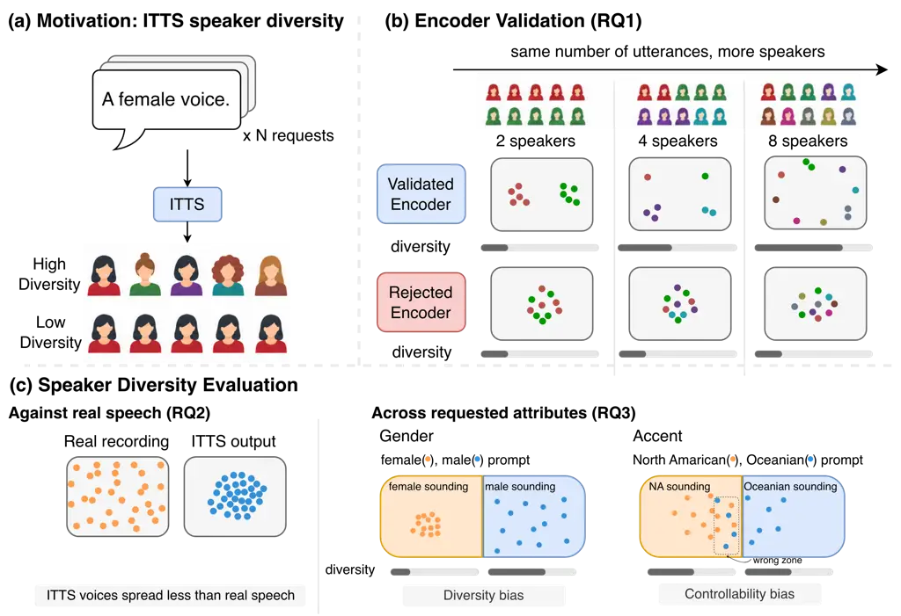

Figure 1: Overview. (a) A broad description should produce many distinct
voices. (b) We keep only encoders whose diversity scores track speaker
count (RQ1). (c) ITTS voices are less diverse than real speech (RQ2),
and diversity and controllability vary across voice attributes (RQ3).

However, existing evaluations of ITTS diversity leave two gaps. First,
prior studies do not compare speaker diversity to a real-speech
baseline. Second, prior studies overlook how diversity varies across
values of voice attributes such as gender, age, or accent. If a model
generates only a few repetitive voices for certain groups like children
or minority accents, synthetic datasets created from it will carry that
same bias and degrade the performance of downstream speech models (Lin
et al., 2026b).

We ask three questions, summarized in Figure 1b,c. RQ1: Which speaker
encoders are suitable for measuring ITTS speaker diversity? RQ2: Do ITTS
systems generate voices as diverse as those in real speech? RQ3: Is ITTS
speaker diversity similar across attribute values, such as female and
male? For RQ1, we test whether each encoder’s diversity scores clearly
increase with the number of distinct speakers in a set. For RQ2, we use
the validated encoders to compare ITTS outputs with real recordings of
the same texts. For RQ3, we compare speaker diversity and
controllability across prompts that request different genders, ages,
accents, and emotions.

Our work yields three primary contributions:

- •
  Methodological validation (RQ1): We show that several widely used
  speaker encoders are unsuitable for measuring speaker diversity,
  because their diversity scores barely differ between sets with few and
  many speakers.
- •
  Quantification of the reality gap (RQ2): We find that every evaluated
  open-source ITTS system produces voices less diverse than real human
  voices.
- •
  Detection of biases (RQ3): We show that speaker diversity and
  controllability capture complementary biases across voice attribute
  prompts. Most systems yield lower speaker diversity for female prompts
  despite accurate gender control, whereas accent and emotion prompts
  preserve diversity but exhibit controllability biases toward North
  American English and neutral speech.

## 2 Related Work

#### Instruction-guided TTS.

ITTS systems control speech through natural-language instructions but
differ in how they determine speaker identity. One line of work relies
on reference audio or preset voices to fix the speaker, using text
instructions to control speaking style, prosody, or emotion (Ji et al.,
2025; Du et al., 2024a; Du et al., 2024b; Du et al., 2025; Zhou et al.,
2026a). In contrast, description-only generation synthesizes the speaker
entirely from natural language prompts without external acoustic
references, an approach supported by an expanding set of models (Guo et
al., 2023; Zhang et al., 2023; Vyas et al., 2023; Lyth and King, 2024;
Zhou et al., 2024; Wang et al., 2026; Li et al., 2025; Zhang et al.,
2025; Huang et al., 2026; Hu et al., 2026; Zhou et al., 2026b). Several
of these models also accept a reference recording (Vyas et al., 2023; Li
et al., 2025; Zhang et al., 2025; Zhou et al., 2024; Zhou et al.,
2026b), but we evaluate every system in description-only mode. Because a
text description leaves acoustic details underspecified (Leng et al.,
2024), the model must determine the remaining vocal traits.

#### Diversity evaluation for generative speech.

Prior evaluations of speech diversity focus either on training corpora,
distributional realism, or global demographic spread in zero-shot
systems, leaving fine-grained, attribute-conditional speaker diversity
in ITTS largely unexamined. GLOBE (Wang et al., 2024) applies the Vendi
Score to TitaNet speaker embeddings, but on TTS _training corpora_
rather than TTS model _outputs_. TTSDS (Minixhofer et al., 2024;
Minixhofer et al., 2026) measures realism via distributional distance to
a real reference. It doesn’t report within-set diversity or analyze how
this diversity varies across requested voice attribute values.
MAD-Speech (Futeral et al., 2025) evaluates the global diversity of
conventional TTS systems whose voices are fixed, reference-based, or
randomly sampled. In contrast, we target intra-prompt diversity in ITTS,
whose voice can be steered by natural language instructions. MINT-Bench
(Chen et al., 2026a), a benchmark for instruction-following TTS,
includes a Timbre Diversity Score. For a given instruction and text, it
generates several outputs and measures how dissimilar the WavLM-Large
speaker embeddings of those that follow the instruction are. The
benchmark summarizes this as a single score per system and language, so
it does not show how diversity differs across attribute values or how it
compares with real speech.

#### Bias evaluation in TTS.

Prior work on TTS bias has focused on three main dimensions. The first
is unwanted correlation between unrelated prompt attributes and voice,
such as occupation-to-gender stereotype leakage (Kuan and Lee, 2025;
Chen et al., 2026b). The second is unequal output quality across
demographic groups, such as perceptual quality gaps across accents
(Michel et al., 2025). The third is demographic controllability, where
E-VOC (Lin et al., 2026a) shows that systems often fail to follow child
and elderly prompts. Our work investigates controllability alongside a
fourth dimension, disparities in speaker diversity across requested
voice attribute values. We show that evaluating both controllability and
diversity is essential, as they capture complementary biases that
neither metric reveals alone.

## 3 Method

We define speaker diversity as the variation in speaker identity among
the outputs a system generates under one instruction condition. Under a
generic instruction that specifies no speaker attribute (“Speak like a
person—natural, neutral tone, moderate pace, conversational and clear
delivery.”), this gives the overall speaker diversity of a system (§4).
Under instructions that request an attribute value, such as a female
voice, it gives the _attribute-conditional speaker diversity_ for that
value (§5). We quantify this variation within speaker-verification
embedding spaces, which are explicitly optimized to capture
speaker-discriminative characteristics.

### 3.1 Speaker Diversity Metrics

Given $`N`$ L2-normalized speaker embeddings $`\{x_{1},\dots,x_{N}\}`$,
let $`K`$ be the $`N\times N`$ cosine-similarity matrix with
$`K_{ij}=x_{i}^{\top}x_{j}`$. We summarize this matrix with two
diversity metrics. The first is the mean pairwise cosine distance
(MPCD),

```math
\mathrm{MPCD}(X)=\tfrac{1}{N(N-1)}\sum_{i\neq j}(1-K_{ij}). \tag{1}
```

The second is the Vendi Score (Friedman and Dieng, 2023),

```math
\mathrm{VS}(X)=\exp\!\left(-\sum_{\lambda_{l}>0}\lambda_{l}\log\lambda_{l}\right), \tag{2}
```

where $`\lambda_{1},\dots,\lambda_{N}`$ are the eigenvalues of $`K/N`$
(satisfying $`\sum_{l}\lambda_{l}=1`$). Vendi is the exponential of the
entropy of these eigenvalues, reflecting the effective number of
orthogonal modes in the speaker-embedding space.

Both pairwise averages and the Vendi Score are widely used to measure
the diversity of generated images (Sadat et al., 2024; Askari Hemmat et
al., 2025) and text (Tevet and Berant, 2021; Jalali et al., 2026). MPCD
averages over all pairs, so a set concentrated on a few well-separated
voices still scores high. Vendi depends on the full eigenvalue spectrum
and drops toward the number of such voices, so we treat it as the
primary measure and report MPCD as a complementary check.

Prior work also evaluates generated audio by its distributional distance
to real recordings. Because a large distance can reflect either limited
voice diversity or poor acoustic realism, these metrics do not measure
diversity alone, so we defer them to Appendix A.

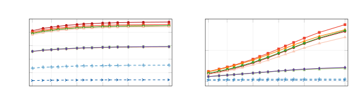

2

Figure 2: Encoder calibration with MPCD and Vendi. Mean MPCD and Vendi
over 100 random subsets at each ground-truth speaker count $`k`$, for
all 11 candidate encoders. Solid lines denote the eight encoders meeting
calibration criteria and retained for evaluation. Dashed lines indicate
the three excluded candidates.

### 3.2 Speaker Encoders and Validation

Because diversity is measured in an embedding space, encoder selection
is critical. We evaluate 11 speaker encoders across three architectural
families, each given a short abbreviation used in subsequent tables.
Nine encoders are trained from scratch for speaker verification on
labeled speaker data. These are NeMo-TitaNet (TIT) (Koluguri et al.,
2022), SpeechBrain-ECAPA (SBEC) and SpeechBrain-ResNet (SBRN)
(Desplanques et al., 2020), WeSpeaker-ResNet221 (WS221) and
WeSpeaker-SimAM-ResNet34 (WSVB) (Wang et al., 2023a),
ModelScope-ERes2Net (ER2), ERes2NetV2 (ER2v2) Chen et al. (2024), CAM++
(CAM) Wang et al. (2023b), and x-vector (XV) (Snyder et al., 2018). The
remaining two start from SSL foundation models pretrained on large-scale
unlabeled speech and add a speaker-verification head fine-tuned on top.
These are WavLM-base+SV (WLM) and UniSpeech-SAT-base+SV (USAT) Chen et
al. (2022).

To identify faithful encoders for speaker diversity, we adapt the
calibration approach from MAD-Speech (Futeral et al., 2025). We
construct controlled subsets from LibriSpeech Panayotov et al. (2015)
train-clean-100 with varying numbers of unique speakers
$`k\in\{6,8,10,12,15,20,24,30,40,48,60,\allowbreak 80,\allowbreak 120,\allowbreak 240\}`$.
For each $`k`$, we build 100 subsets of $`N=240`$ utterances by sampling
$`240/k`$ utterances from each of the $`k`$ speakers. We compute MPCD
and VS on each subset, and plot the resulting calibration curves against
ground-truth $`k`$ in Figure 2.

Across the evaluated range, all eleven encoders produce mean VS curves
that increase monotonically with $`k`$, yielding strong rank correlation
(detailed in Appendix A). However, monotonic scaling alone is
insufficient. A reliable encoder must also yield differences large
enough to distinguish neighboring speaker counts beyond subset-level
sampling noise. In Figure 2, the encoders clearly divide into two
groups. Eight of the models exhibit substantial dynamic range, expanding
their mean VS by a factor of 2.7 to 6.7 as speaker count increases from
$`k=6`$ to $`k=240`$. Furthermore, across the 100 subsets per $`k`$, the
difference in mean VS between consecutive speaker counts exceeds the
subset standard deviation in at least 12 of the 13 adjacent steps
($`k_{i}`$ to $`k_{i+1}`$). In contrast, XV, WLM, and USAT (dashed
lines), remain severely compressed. Across the same range from $`k=6`$
to $`k=240`$, their mean VS rises by at most a factor of 1.35 and stays
below 4 even at 240 speakers, with the gap between consecutive steps
exceeding one standard deviation in at most 1 of the 13 transitions.
Because their scaling under cosine similarity is overshadowed by
subset-level sampling noise, we exclude these three checkpoints and
conduct all subsequent experiments using the eight retained encoders.

### 3.3 ITTS Panel

Our evaluation panel comprises seven open-source models spanning four
architectural approaches. Four models are codec-based autoregressive
(AR) language models that generate discrete audio tokens sequentially:
MOSS-VoiceGenerator (Huang et al., 2026), Parler-TTS Mini v1 and
Parler-TTS Large v1 (Lyth and King, 2024), and Qwen3-TTS Voice Design
(Hu et al., 2026). VoxInstruct (Zhou et al., 2024) combines AR and
non-autoregressive (NAR) generation over discrete semantic and acoustic
tokens. CapSpeech-NAR (Wang et al., 2026) generates speech
non-autoregressively through flow matching over a Diffusion Transformer
(DiT) backbone. Finally, VoxCPM2 (Zhou et al., 2026b) generates
continuous latent patches sequentially, with each patch produced by a
Diffusion Transformer conditioned on previously generated patches.

### 3.4 Prompt Design and Sampling

We evaluate speaker diversity across five attribute axes, spanning
gender, age, accent, emotion, and an intersectional gender-by-age axis.
Gender covers female and male voices, while emotion includes angry,
happy, neutral, and sad states. Age is partitioned into four groups
covering children aged 19 and under, young adults aged 20 to 39,
middle-aged adults aged 40 to 59, and elderly aged 60 and above Hales et
al. (2017). The accent axis groups regional varieties rather than
national borders, including North American, British, Oceanian, South
Asian, South African, and Germanic varieties to probe coverage across
historically underrepresented groups. Because gender and age exhibit the
most pronounced diversity disparities in our study, we combine them into
an intersectional axis covering all eight female and male pairings
across the four age bins to analyze compound biases.

We design five prompt templates for each single-attribute value, and ten
for each intersectional gender and age combination. All prompt
templates, sample realizations, and our construction rationale are
detailed in Appendix F. Instructions are passed through each system’s
official prompt interface, and sampling parameters follow each system’s
default settings unless otherwise specified.

We draw text and audio pairs from the English subset of the Emilia
corpus (He et al., 2024), using the text prompts for synthesis and the
original recordings as our real-speech reference. Because Emilia
collects real-world audio across podcasts, debates, and talk shows, it
spans a far wider variety of speakers than traditional studio datasets.
This broad coverage establishes a challenging baseline to test whether
modern ITTS systems produce less diverse voices than real speech. For
the overall diversity evaluation, we sample 30,000 sentences and
partition them into three disjoint sets of 10,000. We compute Vendi
separately on each set and report the mean and standard deviation over
the three sets, applying the same protocol to the paired real
recordings. For attribute conditioning (§5), we sample a set of 3,000
texts. These texts are shared across all attribute values to hold
linguistic content constant.

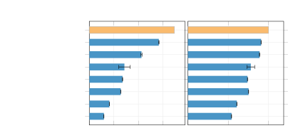

Figure 3: Overall speaker diversity under the neutral prompt. ITTS
systems (blue) are compared against the Real reference (orange). Error
bars are batch-to-batch standard deviations across the three generation
batches.

### 3.5 Controllability Measurement

Following prior work (Wang et al., 2026; Zhang et al., 2023; Ren et al.,
2024), we measure controllability by applying acoustic attribute
classifiers to the generated speech. For each requested value,
controllability is quantified as per-class recall, defined as the
proportion of generated utterances correctly identified by the
classifier. The chance baseline is $`1/K`$ for an attribute with $`K`$
classes, yielding $`1/2`$ for gender, $`1/4`$ for age and emotion, and
$`1/6`$ for accent. Appendix B details the classifier architectures and
validation setups for each evaluated attribute.

## 4 Overall Speaker Diversity

### 4.1 Comparison with Real Speech

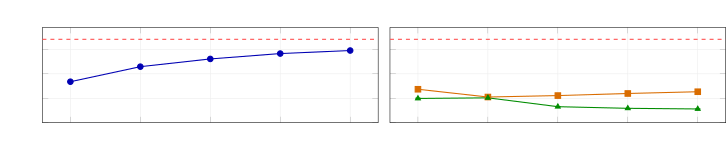

4

Figure 4: Speaker diversity under different sampling parameters. Vendi
for the three systems that expose decoding controls, under (a) sampling
temperature $`T`$ for MOSS-VoiceGenerator and (b) classifier-free
guidance scale $`\gamma`$ for VoxInstruct and VoxCPM2. Both panels share
the same y-axis. Each point is the mean over the eight validated
encoders and three seeds. The dashed horizontal line marks the
real-speech baseline.

As shown in Figure 3, every system exhibits lower diversity than the
real-speech reference across both metrics, a trend that holds
consistently across each of the eight individual encoders rather than
merely on average. Furthermore, the two metrics largely align on the
relative model rankings. Among the evaluated systems,
MOSS-VoiceGenerator comes closest to real speech, whereas VoxCPM2
suffers a severe collapse in speaker diversity, trailing far behind the
other models.

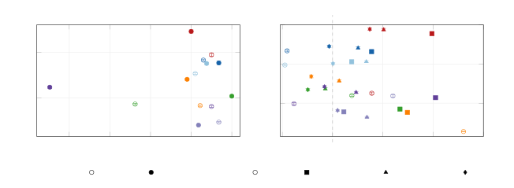

5

Figure 5: Controllability versus diversity across gender and age
conditions. Each color denotes an ITTS model, while marker shapes
identify specific gender and age values. The dashed vertical line marks
chance-level recall of 0.25 for age classification. Error bars show 95%
confidence intervals, which are smaller than the markers.

### 4.2 Effect of Sampling Parameters

To rule out the concern that observed diversity gaps stem from
conservative default decoding settings, we sweep sampling parameters
across the three systems providing direct decoding controls. A higher
sampling temperature $`T`$ makes token choices more random and is
expected to increase diversity. For the classifier-free guidance scale
$`\gamma`$, $`\gamma=1`$ corresponds to purely conditional sampling and
$`\gamma<1`$ moves sampling toward the unconditional prediction, while a
larger $`\gamma`$ pulls outputs closer to the condition and typically
trades diversity for fidelity. Specifically, we vary $`T`$ for
MOSS-VoiceGenerator alongside $`\gamma`$ for VoxInstruct and VoxCPM2
over $`\{0.5,1.0,1.5,2.0,2.5\}`$ across three random seeds.

Figure 4 demonstrates that sampling parameters influence speaker
diversity. For MOSS-VoiceGenerator and VoxCPM2, these changes follow
expected trends, with Vendi scores rising as temperature $`T`$ increases
and declining as $`\gamma`$ exceeds 1, whereas VoxInstruct exhibits no
consistent pattern. Even under their most diverse configurations, no
system matches the real-speech reference across any of the eight
encoders. Comparing each system at its most diverse setting also
preserves the ordering in Figure 3. For these three systems, the gap to
real speech and their relative ranking are therefore not artifacts of
the default decoding settings.

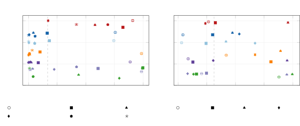

6

Figure 6: Controllability versus diversity across accent and emotion
conditions. Dashed vertical lines mark chance-level recall baselines for
each attribute. Error bars show 95% confidence intervals, which are
smaller than the markers.

## 5 Attribute-Conditional Diversity

### 5.1 Setup

For each combination of system and attribute value, we generate 3,000
utterances. Because the Vendi Score scales with the number of
utterances, we compute it on $`10,000`$ random subsets of $`N=1{,}500`$
utterances, exactly half of each pool, and report the mean with a 95%
confidence interval. Since each subset contains half of the pool, scores
vary across subsets by approximately as much as the reported mean would
vary if the entire pool were regenerated (Shao and Wu, 1989). We
evaluate the same subsets across all eight encoders, averaging their
scores within each subset before computing the interval. We interpret
diversity differences across attribute values through the principle of
demographic parity. Under this principle, repeatedly requesting a female
voice should produce just as diverse a pool of voices as requesting a
male voice, and we treat any systematic gap between them as a form of
bias.

### 5.2 Gender

Figure 5 (a) illustrates a clear divergence between controllability and
diversity. First, gender controllability is largely successful across
the board. Six of the seven evaluated systems achieve per-class recall
scores above $`0.88`$ for both genders, with VoxInstruct being the only
exception due to a lower male recall of $`0.776`$. However, strong
controllability does not ensure comparable diversity. Across five of the
seven systems, female speech yields substantially lower Vendi scores
than male speech, reaching an extreme in Qwen3-TTS where female
diversity drops to $`59\%`$ of male diversity, scoring $`16.6`$ compared
to $`28.1`$. While models can accurately follow female prompts, they
often produce much less diverse voices for female prompts than for male
prompts. Measuring controllability alone therefore provides an
incomplete picture of model behavior.

### 5.3 Age

In Figure 5(b), speaker diversity depends on the requested age in five
of the seven systems, but barely changes in the two Parler models. The
age group with the lowest diversity differs across these five systems,
though child prompts are the most frequent minimum in
MOSS-VoiceGenerator, Qwen3-TTS, and VoxInstruct. For controllability,
every system records its lowest recall on either child or elderly
prompts, with elderly prompts falling below chance in four systems.
Consequently, age conditioning presents two distinct representational
challenges. Elderly prompts often exhibit low controllability while
maintaining high diversity. In contrast, child prompts can achieve
higher controllability while yielding the lowest diversity, as in
Qwen3-TTS, where child prompts reach the highest recall of any age group
but the lowest Vendi score.

### 5.4 Accent

In Figure 6 (a), speaker diversity remains relatively uniform across
requested accents, but controllability exhibits a bias favoring North
American English. North American is the only accent that every evaluated
ITTS system generates reliably, with per-class recall reaching at least
0.744 across all models. British English follows as the next strongest
accent in most systems, though its recall still lags behind North
American in five of the seven models. By contrast, the remaining four
regional varieties suffer severe controllability drops. Oceanian, South
African, and South Asian prompts each fall below the chance baseline in
at least four of the seven systems, while Germanic speech fails in six.
Because speaker diversity barely changes with the requested accent, an
evaluation based on diversity alone would miss this bias.

### 5.5 Emotion

Figure 6 (b) shows a pattern similar to accent (§5.4). Speaker diversity
remains relatively uniform across prompted emotions in most systems,
while controllability favors neutral over expressive emotions. Recall on
neutral prompts exceeds chance in every system and ranks highest among
the four emotions in five of the seven systems. By contrast, angry,
happy, and sad prompts each fall below chance recall in at least four
systems, with only Qwen3-TTS exceeding chance across all three. The
confusion matrices in Appendix D show this breakdown, as speech
generated for expressive prompts is frequently classified as neutral,
making neutral the most frequent label across all outputs in five
systems, while the two Parler models produce sad most often. High recall
on neutral prompts therefore reflects a baseline tendency toward flat,
unexpressive acoustics, rather than genuine control over neutral
prosody.

| Age         | Gender | MOSS-VG | Parler-large | Parler-mini | CapSpeech | Qwen3-TTS | VoxInstruct | VoxCPM2 |
| ----------- | ------ | ------- | ------------ | ----------- | --------- | --------- | ----------- | ------- |
| Child       | Female | 27.8    | 36.0         | 32.0        | 14.2      | 6.5       | 13.3        | 31.5    |
|             | Male   | 43.3    | 35.8         | 36.1        | 17.1      | 25.2      | 21.2        | 38.4    |
| Young adult | Female | 36.3    | 36.3         | 32.1        | 12.4      | 9.5       | 12.6        | 28.0    |
|             | Male   | 46.5    | 36.6         | 35.9        | 13.3      | 19.9      | 17.8        | 19.9    |
| Middle-aged | Female | 40.7    | 35.8         | 32.4        | 19.2      | 24.6      | 12.9        | 23.5    |
|             | Male   | 47.3    | 35.0         | 35.1        | 21.8      | 27.3      | 18.5        | 21.1    |
| Elderly     | Female | 40.4    | 36.2         | 32.3        | 17.5      | 27.7      | 13.9        | 36.5    |
|             | Male   | 48.0    | 36.7         | 35.7        | 19.4      | 25.6      | 20.1        | 30.2    |

Table 1: Speaker diversity under joint gender and age conditions. Vendi
scores for joint gender and age prompts, averaged across eight encoders.
Rows are organized by age group to facilitate female and male
comparisons within each bracket. Bold numbers highlight the lowest
diversity score in each column.

|              |                  |                 |                |                 |
| ------------ | ---------------- | --------------- | -------------- | --------------- |
|              | Single attribute |                 | Intersectional |                 |
| System       | Gender           | Age             | Gender         | Age             |
| MOSS-VG      | female           | child           | female         | child           |
| CapSpeech    | female           | young adult     | female         | young adult     |
| Qwen3-TTS    | female           | child           | female         | child           |
| VoxInstruct  | female           | child           | female         | young adult^(†) |
| VoxCPM2      | male             | middle-aged     | male           | young adult     |
| Parler-large | male             | young adult^(†) | male           | middle-aged^(†) |
| Parler-mini  | female           | child^(†)       | female         | child^(†)       |

Table 2: Gender and age group with the lowest Vendi in each system. The
three row groups are systems where the single-attribute and
gender$`\times`$age results agree, systems where they differ, and
systems without a clear lowest age group. Bold marks where the
gender$`\times`$age result differs from the single-attribute result.
^(†)Overlaps with the second lowest in confidence interval.

### 5.6 Intersectional Fairness: Gender$`\times`$Age

Because gender or age exhibit the largest diversity disparity among
evaluated attributes, Table 1 examines their intersection by reporting
Vendi scores for every combination of gender and age. Each
intersectional condition, such as female child, has 6,000 utterances.
This breakdown reveals whether the lower diversity observed for female
prompts in §5.2 holds across all ages or is confined to specific age
groups. We find that the gender disparity consistently persists across
age groups. Among the five systems where female prompts yield lower
diversity overall, four maintain lower female diversity across every age
group, namely MOSS-VoiceGenerator, Parler-mini, CapSpeech-NAR, and
VoxInstruct. The remaining model, Qwen3-TTS, follows this pattern across
all categories except elderly speakers.

We next examine whether combining a system’s least diverse gender and
age attributes in a single prompt compounds their individual
disadvantages. Table 2 compares the lowest-diversity attributes
identified independently against the lowest intersectional combination.
For MOSS-VoiceGenerator, CapSpeech-NAR, and Qwen3-TTS, the lowest
intersectional combination directly pairs their two independently worst
attributes. For VoxInstruct and VoxCPM2, the age group shifts to young
adults instead, while for both Parler-TTS models, overlapping confidence
intervals leave the minimum statistically ambiguous. However, scoring
lowest can arise simply because the separate penalties of gender and age
add together. We therefore identify compounding only when the gender gap
is wider in that age group than in any other. Under this criterion, only
MOSS-VoiceGenerator and Qwen3-TTS exhibit compounding, with female
prompts falling furthest behind male prompts specifically among
children. In Qwen3-TTS, this interaction drives female child prompts to
the lowest Vendi score in Table 1. Across our benchmark, intersectional
compounding is therefore model-dependent rather than systematic,
emerging in only two of the seven evaluated systems.

## 6 Conclusion

To our knowledge, we provide the first systematic evaluation of ITTS
speaker diversity against real speech and across voice attribute
prompts. Across all evaluated systems, generated speech exhibits
substantially lower speaker diversity than real recordings. Furthermore,
voice attribute prompts uncover distinct failure modes: while female
prompts trigger severe diversity collapses despite accurate gender
control, accent and emotion prompts preserve diversity but default
heavily to North American English and neutral speech. These results show
that evaluating prompt adherence alone is insufficient, as high
controllability does not ensure that a system produces diverse voices.
ITTS should therefore be evaluated on both diversity and
controllability, so that synthetic voice does not reinforce biases
across voice attributes.

## Limitations

#### Non-English scope.

Generations, prompts, and content are English only.

#### Binary voice gender.

Our evaluation of gender is restricted to prompts for female and male
voices, with controllability measured using a binary acoustic
classifier. Both our prompts and classifiers focus on perceived vocal
characteristics rather than a speaker’s personal gender identity.
Although modern ITTS models can be prompted to generate non-binary or
androgynous voices, these fall outside our quantitative analysis because
no validated acoustic classifiers or annotated speech corpora currently
exist to evaluate them. This omission reflects a practical measurement
constraint rather than a value judgment, and extending diversity audits
beyond binary gender remains an important direction for future human
perceptual studies.

#### Closed commercial systems.

Our evaluation panel focuses exclusively on open-weight and open-source
models. While commercial ITTS platforms such as ElevenLabs Voice Design,
Hume Octave, and related proprietary services share instruction-driven
interfaces, evaluating them under our full multi-seed sweep is
constrained by proprietary access barriers, API usage costs, and limited
experimental reproducibility due to opaque server-side model updates.
Benchmarking commercial platforms under standardized protocols
represents a valuable direction for future work.

## Ethical Considerations

#### No human subjects.

All evaluations are on generated audio and the public Emilia speech
corpus. No human subjects were recruited; no IRB approval was required.

#### Personally identifiable content and data governance.

All models and evaluators in this study rely on established public
speech corpora distributed under academic or open-source licenses, each
governed by upstream consent and participant anonymization protocols.
Because synthetic speech is generated purely from descriptive text
instructions rather than acoustic reference prompts, the generation
process avoids intentional voice cloning or mimicry of specific
individuals. After acceptance, we will release our evaluation code under
the MIT License, and our prompt manifests, generated audio, and accent
classifier for non-commercial research use.

#### Environmental impact.

The overall-diversity experiment (§4) generates 30,000 utterances per
system, and the attribute-conditional experiment (§5) generates 96,000
utterances per system, with 3,000 for each single-attribute value and
6,000 for each gender and age combination. Based on generation speeds
measured on NVIDIA B200 GPUs, one complete run of these two experiments
takes approximately 842 GPU-hours for generation and 59 GPU-hours for
embedding extraction with the eight encoders, or about 901 GPU-hours in
total.

## References

- Ardila et al. (2020) R. Ardila, M. Branson, K. Davis, M. Kohler, J.
  Meyer, M. Henretty, R. Morais, L. Saunders, F. Tyers, and G. Weber
  Common voice: a massively-multilingual speech corpus. In Proceedings
  of the Twelfth Language Resources and Evaluation Conference,
  Marseille, France, pp. 4218–4222 (eng). External Links:
  [Link](https://aclanthology.org/2020.lrec-1.520/), ISBN
  979-10-95546-34-4 Cited by: Appendix C.
- Askari Hemmat et al. (2025) R. Askari Hemmat, M. Hall, A. Sun, C.
  Ross, M. Drozdzal, and A. Romero-Soriano Improving geo-diversity of
  generated images with contextualized vendi score guidance. In Computer
  Vision – ECCV 2024, Cham, pp. 213–229. External Links: ISBN
  978-3-031-73021-4 Cited by: §3.1.
- Chen et al. (2026a) H. Chen, J. Hu, L. Xue, Q. Zhan, W. Li, G. Ma, H.
  Xie, D. Guo, L. Ma, Y. Jiang, B. Wu, P. Xie, C. Xie, Q. Zhang, and L.
  Xie MINT-bench: a comprehensive multilingual benchmark for
  instruction-following text-to-speech. External Links: 2604.17958,
  [Link](https://arxiv.org/abs/2604.17958) Cited by: §1, §2.
- Chen et al. (2026b) K. Chen, Y. Lin, P. Hsieh, H. Chou, C. Hsu, J.
  Li, H. Lee, and J. Ding The binding effect: analyzing how
  multi-dimensional cues form gender bias in instruction tts. External
  Links: 2603.20743, [Link](https://arxiv.org/abs/2603.20743) Cited by:
  §2.
- Chen et al. (2025a) S. Chen, C. Wang, Y. Wu, Z. Zhang, L. Zhou, S.
  Liu, Z. Chen, Y. Liu, H. Wang, J. Li, L. He, S. Zhao, and F. Wei
  Neural codec language models are zero-shot text to speech
  synthesizers. IEEE Transactions on Audio, Speech and Language
  Processing 33 (), pp. 705–718. External Links:
  [Document](https://dx.doi.org/10.1109/TASLPRO.2025.3530270) Cited by:
  §1.
- Chen et al. (2022) S. Chen, Y. Wu, C. Wang, Z. Chen, Z. Chen, S.
  Liu, J. Wu, Y. Qian, F. Wei, J. Li, and X. Yu Unispeech-sat: universal
  speech representation learning with speaker aware pre-training. In
  ICASSP 2022 - 2022 IEEE International Conference on Acoustics, Speech
  and Signal Processing (ICASSP), Vol. , pp. 6152–6156. External Links:
  [Document](https://dx.doi.org/10.1109/ICASSP43922.2022.9747077) Cited
  by: §3.2.
- Chen et al. (2024) Y. Chen, S. Zheng, H. Wang, L. Cheng, Q. Chen, S.
  Zhang, and J. Li ERes2NetV2: Boosting Short-Duration Speaker
  Verification Performance with Computational Efficiency. In Interspeech
  2024, pp. 3245–3249. External Links:
  [Document](https://dx.doi.org/10.21437/Interspeech.2024-742), ISSN
  2958-1796 Cited by: §3.2.
- Chen et al. (2025b) Y. Chen, Z. Niu, Z. Ma, K. Deng, C. Wang, J.
  Zhao, K. Yu, and X. Chen F5-TTS: a fairytaler that fakes fluent and
  faithful speech with flow matching. In Proceedings of the 63rd Annual
  Meeting of the Association for Computational Linguistics (Volume 1:
  Long Papers), W. Che, J. Nabende, E. Shutova, and M. T. Pilehvar
  (Eds.), Vienna, Austria, pp. 6255–6271. External Links:
  [Link](https://aclanthology.org/2025.acl-long.313/),
  [Document](https://dx.doi.org/10.18653/v1/2025.acl-long.313), ISBN
  979-8-89176-251-0 Cited by: §1.
- Desplanques et al. (2020) B. Desplanques, J. Thienpondt, and K.
  Demuynck ECAPA-TDNN: Emphasized Channel Attention, Propagation and
  Aggregation in TDNN Based Speaker Verification. In Interspeech 2020,
  pp. 3830–3834. External Links:
  [Document](https://dx.doi.org/10.21437/Interspeech.2020-2650), ISSN
  2958-1796 Cited by: §3.2.
- Du et al. (2024a) Z. Du, Q. Chen, S. Zhang, K. Hu, H. Lu, Y. Yang, H.
  Hu, S. Zheng, Y. Gu, Z. Ma, Z. Gao, and Z. Yan CosyVoice: a scalable
  multilingual zero-shot text-to-speech synthesizer based on supervised
  semantic tokens. External Links: 2407.05407,
  [Link](https://arxiv.org/abs/2407.05407) Cited by: §2.
- Du et al. (2025) Z. Du, C. Gao, Y. Wang, F. Yu, T. Zhao, H. Wang, X.
  Lv, H. Wang, C. Ni, X. Shi, K. An, G. Yang, Y. Li, Y. Chen, Z. Gao, Q.
  Chen, Y. Gu, M. Chen, Y. Chen, S. Zhang, W. Wang, and J. Ye CosyVoice
  3: towards in-the-wild speech generation via scaling-up and
  post-training. External Links: 2505.17589,
  [Link](https://arxiv.org/abs/2505.17589) Cited by: §2.
- Du et al. (2024b) Z. Du, Y. Wang, Q. Chen, X. Shi, X. Lv, T. Zhao, Z.
  Gao, Y. Yang, C. Gao, H. Wang, F. Yu, H. Liu, Z. Sheng, Y. Gu, C.
  Deng, W. Wang, S. Zhang, Z. Yan, and J. Zhou CosyVoice 2: scalable
  streaming speech synthesis with large language models. External Links:
  2412.10117, [Link](https://arxiv.org/abs/2412.10117) Cited by: §2.
- Friedman and Dieng (2023) D. Friedman and A. B. Dieng The vendi score:
  a diversity evaluation metric for machine learning. External Links:
  2210.02410, [Link](https://arxiv.org/abs/2210.02410) Cited by: §3.1.
- Futeral et al. (2025) M. Futeral, A. Agostinelli, M. Tagliasacchi, N.
  Zeghidour, and E. Kharitonov MAD speech: measures of acoustic
  diversity of speech. In Proceedings of the 2025 Conference of the
  Nations of the Americas Chapter of the Association for Computational
  Linguistics: Human Language Technologies (Volume 1: Long Papers), L.
  Chiruzzo, A. Ritter, and L. Wang (Eds.), Albuquerque, New Mexico,
  pp. 222–235. External Links:
  [Link](https://aclanthology.org/2025.naacl-long.11/),
  [Document](https://dx.doi.org/10.18653/v1/2025.naacl-long.11), ISBN
  979-8-89176-189-6 Cited by: §2, §3.2.
- Guo et al. (2023) Z. Guo, Y. Leng, Y. Wu, S. Zhao, and X. Tan
  Prompttts: controllable text-to-speech with text descriptions. In
  ICASSP 2023 - 2023 IEEE International Conference on Acoustics, Speech
  and Signal Processing (ICASSP), Vol. , pp. 1–5. External Links:
  [Document](https://dx.doi.org/10.1109/ICASSP49357.2023.10096285) Cited
  by: §2.
- Hales et al. (2017) C. M. Hales, M. D. Carroll, C. D. Fryar, C. L.
  Ogden, et al. Prevalence of obesity among adults and youth: united
  states, 2015-2016. Cited by: §3.4.
- He et al. (2024) H. He, Z. Shang, C. Wang, X. Li, Y. Gu, H. Hua, L.
  Liu, C. Yang, J. Li, P. Shi, Y. Wang, K. Chen, P. Zhang, and Z. Wu
  Emilia: an extensive, multilingual, and diverse speech dataset for
  large-scale speech generation. In 2024 IEEE Spoken Language Technology
  Workshop (SLT), Vol. , pp. 885–890. External Links:
  [Document](https://dx.doi.org/10.1109/SLT61566.2024.10832365) Cited
  by: §3.4.
- Hu et al. (2022) E. J. Hu, yelong shen, P. Wallis, Z. Allen-Zhu, Y.
  Li, S. Wang, L. Wang, and W. Chen LoRA: low-rank adaptation of large
  language models. In International Conference on Learning
  Representations, External Links:
  [Link](https://openreview.net/forum?id=nZeVKeeFYf9) Cited by: Appendix
  B.
- Hu et al. (2026) H. Hu, X. Zhu, T. He, D. Guo, B. Zhang, X. Wang, Z.
  Guo, Z. Jiang, H. Hao, Z. Guo, X. Zhang, P. Zhang, B. Yang, J. Xu, J.
  Zhou, and J. Lin Qwen3-tts technical report. External Links:
  2601.15621, [Link](https://arxiv.org/abs/2601.15621) Cited by: §2,
  §3.3.
- Huang et al. (2026) K. Huang, L. Fan, B. Jiang, Y. Jiang, Q. Tu, J.
  Zhu, Y. Zhang, Y. Zhao, C. Yang, Z. Fei, S. Li, X. Yang, Q. Cheng,
  and X. Qiu MOSS-voicegenerator: create realistic voices with natural
  language descriptions. External Links: 2603.28086,
  [Link](https://arxiv.org/abs/2603.28086) Cited by: §2, §3.3.
- Jalali et al. (2026) M. Jalali, A. Ospanov, A. Gohari, and F. Farnia
  Conditional vendi score: prompt-aware diversity evaluation for
  generative ai models and llms. External Links: 2411.02817,
  [Link](https://arxiv.org/abs/2411.02817) Cited by: §3.1.
- Ji et al. (2025) S. Ji, Q. Chen, W. Wang, J. Zuo, M. Fang, Z.
  Jiang, H. Huang, Z. Wang, X. Cheng, S. Zheng, and Z. Zhao
  ControlSpeech: towards simultaneous and independent zero-shot speaker
  cloning and zero-shot language style control. In Proceedings of the
  63rd Annual Meeting of the Association for Computational Linguistics
  (Volume 1: Long Papers), W. Che, J. Nabende, E. Shutova, and M. T.
  Pilehvar (Eds.), Vienna, Austria, pp. 6966–6981. External Links:
  [Link](https://aclanthology.org/2025.acl-long.346/),
  [Document](https://dx.doi.org/10.18653/v1/2025.acl-long.346), ISBN
  979-8-89176-251-0 Cited by: §2.
- Koluguri et al. (2022) N. R. Koluguri, T. Park, and B. Ginsburg
  TitaNet: neural model for speaker representation with 1d depth-wise
  separable convolutions and global context. In ICASSP 2022 - 2022 IEEE
  International Conference on Acoustics, Speech and Signal Processing
  (ICASSP), Vol. , pp. 8102–8106. External Links:
  [Document](https://dx.doi.org/10.1109/ICASSP43922.2022.9746806) Cited
  by: §3.2.
- Kuan and Lee (2025) C. Kuan and H. Lee Gender bias in
  instruction-guided speech synthesis models. In Findings of the
  Association for Computational Linguistics: NAACL 2025, L. Chiruzzo, A.
  Ritter, and L. Wang (Eds.), Albuquerque, New Mexico, pp. 5402–5428.
  External Links:
  [Link](https://aclanthology.org/2025.findings-naacl.298/),
  [Document](https://dx.doi.org/10.18653/v1/2025.findings-naacl.298),
  ISBN 979-8-89176-195-7 Cited by: §2.
- Kynkäänniemi et al. (2019) T. Kynkäänniemi, T. Karras, S. Laine, J.
  Lehtinen, and T. Aila Improved precision and recall metric for
  assessing generative models. In Advances in Neural Information
  Processing Systems, H. Wallach, H. Larochelle, A. Beygelzimer, F.
  d'Alché-Buc, E. Fox, and R. Garnett (Eds.), Vol. 32, pp. . External
  Links:
  [Link](https://proceedings.neurips.cc/paper_files/paper/2019/file/0234c510bc6d908b28c70ff313743079-Paper.pdf)
  Cited by: Appendix A.
- Leng et al. (2024) Y. Leng, Z. Guo, K. Shen, Z. Ju, X. Tan, E. Liu, Y.
  Liu, D. Yang, l. zhang, K. Song, L. He, X. Li, s. zhao, T. Qin, and J.
  Bian PromptTTS 2: describing and generating voices with text prompt.
  In International Conference on Learning Representations, B. Kim, Y.
  Yue, S. Chaudhuri, K. Fragkiadaki, M. Khan, and Y. Sun (Eds.), Vol.
  2024, pp. 57672–57688. External Links:
  [Link](https://proceedings.iclr.cc/paper_files/paper/2024/file/fed1ea8dcc2a13f3835cc854e8c8294c-Paper-Conference.pdf)
  Cited by: §2.
- Li et al. (2025) H. Li, Y. Li, X. Wang, J. Hu, Q. Xie, S. Yang, and L.
  Xie FleSpeech: flexibly controllable speech generation with various
  prompts. External Links: 2501.04644,
  [Link](https://arxiv.org/abs/2501.04644) Cited by: §2.
- Lin et al. (2026a) Y. Lin, H. Chou, T. Wei, K. Chen, and H. Lee Do you
  hear what i mean? quantifying the instruction-perception gap in
  instruction-guided expressive text-to-speech systems. In ICASSP 2026 -
  2026 IEEE International Conference on Acoustics, Speech and Signal
  Processing (ICASSP), Vol. , pp. 16472–16476. External Links:
  [Document](https://dx.doi.org/10.1109/ICASSP55912.2026.11462935) Cited
  by: §1, §2.
- Lin et al. (2026b) Y. Lin, Y. Tsai, K. Chen, H. Huang, H. Chou, S.
  Narayanan, Y. Tsao, J. Ding, and H. Lee Toward fair speech
  technologies: a comprehensive survey of bias and fairness in speech
  ai. External Links: 2605.01597,
  [Link](https://arxiv.org/abs/2605.01597) Cited by: §1.
- Lyth and King (2024) D. Lyth and S. King Natural language guidance of
  high-fidelity text-to-speech with synthetic annotations. External
  Links: 2402.01912, [Link](https://arxiv.org/abs/2402.01912) Cited by:
  §2, §3.3.
- Michel et al. (2025) S. Michel, S. Kaur, S. E. Gillespie, J.
  Gleason, C. Wilson, and A. Ghosh “It’s not a representation of me”:
  examining accent bias and digital exclusion in synthetic ai voice
  services. In Proceedings of the 2025 ACM Conference on Fairness,
  Accountability, and Transparency, FAccT ’25, New York, NY, USA,
  pp. 228–245. External Links: ISBN 9798400714825,
  [Link](https://doi.org/10.1145/3715275.3732018),
  [Document](https://dx.doi.org/10.1145/3715275.3732018) Cited by: §2.
- Minixhofer et al. (2024) C. Minixhofer, O. Klejch, and P. Bell TTSDS -
  text-to-speech distribution score. In 2024 IEEE Spoken Language
  Technology Workshop (SLT), Vol. , pp. 766–773. External Links:
  [Document](https://dx.doi.org/10.1109/SLT61566.2024.10832178) Cited
  by: §2.
- Minixhofer et al. (2026) C. Minixhofer, O. Klejch, and P. Bell TTSDS2:
  resources and benchmark for evaluating human-quality text to speech
  systems. In International Conference on Learning Representations, C.
  Vondrick, B. Hariharan, C. Raffel, L. Pinto, D. Yang, and A. Faust
  (Eds.), Vol. 2026, pp. 29228–29247. External Links:
  [Link](https://proceedings.iclr.cc/paper_files/paper/2026/file/31888563b194f9bb33ce1aebc7e1551c-Paper-Conference.pdf)
  Cited by: §2.
- Naeem et al. (2020) M. F. Naeem, S. J. Oh, Y. Uh, Y. Choi, and J. Yoo
  Reliable fidelity and diversity metrics for generative models. In
  Proceedings of the 37th International Conference on Machine Learning,
  H. D. III and A. Singh (Eds.), Proceedings of Machine Learning
  Research, Vol. 119, pp. 7176–7185. External Links:
  [Link](https://proceedings.mlr.press/v119/naeem20a.html) Cited by:
  Appendix A.
- Olatunji et al. (2023) T. Olatunji, T. Afonja, A. Yadavalli, C. C.
  Emezue, S. Singh, B. F. P. Dossou, J. Osuchukwu, S. Osei, A. L.
  Tonja, N. Etori, and C. Mbataku AfriSpeech-200: pan-African accented
  speech dataset for clinical and general domain ASR. Transactions of
  the Association for Computational Linguistics 11, pp. 1669–1685.
  External Links: [Link](https://aclanthology.org/2023.tacl-1.93/),
  [Document](https://dx.doi.org/10.1162/tacl%5Fa%5F00627) Cited by:
  Appendix C.
- Panayotov et al. (2015) V. Panayotov, G. Chen, D. Povey, and S.
  Khudanpur Librispeech: an asr corpus based on public domain audio
  books. In 2015 IEEE International Conference on Acoustics, Speech and
  Signal Processing (ICASSP), Vol. , pp. 5206–5210. External Links:
  [Document](https://dx.doi.org/10.1109/ICASSP.2015.7178964) Cited by:
  §3.2.
- Radford et al. (2023) A. Radford, J. W. Kim, T. Xu, G. Brockman, C.
  Mcleavey, and I. Sutskever Robust speech recognition via large-scale
  weak supervision. In Proceedings of the 40th International Conference
  on Machine Learning, A. Krause, E. Brunskill, K. Cho, B.
  Engelhardt, S. Sabato, and J. Scarlett (Eds.), Proceedings of Machine
  Learning Research, Vol. 202, pp. 28492–28518. External Links:
  [Link](https://proceedings.mlr.press/v202/radford23a.html) Cited by:
  Appendix B.
- Ren et al. (2024) W. Ren, Y. Lin, H. Chou, H. Wu, Y. Wu, C. Lee, H.
  Lee, H. Wang, and Y. Tsao EMO-codec: an in-depth look at emotion
  preservation capacity of legacy and neural codec models with
  subjective and objective evaluations. In 2024 Asia Pacific Signal and
  Information Processing Association Annual Summit and Conference
  (APSIPA ASC), Vol. , pp. 1–6. External Links:
  [Document](https://dx.doi.org/10.1109/APSIPAASC63619.2025.10849259)
  Cited by: §3.5.
- Sadat et al. (2024) S. Sadat, J. Buhmann, D. Bradley, O. Hilliges,
  and R. Weber CADS: unleashing the diversity of diffusion models
  through condition-annealed sampling. In International Conference on
  Learning Representations, B. Kim, Y. Yue, S. Chaudhuri, K.
  Fragkiadaki, M. Khan, and Y. Sun (Eds.), Vol. 2024, pp. 23723–23755.
  External Links:
  [Link](https://proceedings.iclr.cc/paper_files/paper/2024/file/6769bfdeb7313ded45714aabf759adfe-Paper-Conference.pdf)
  Cited by: §3.1.
- Schuhmann et al. (2026) C. Schuhmann, R. Kaczmarczyk, G. Rabby, F.
  Friedrich, M. Kraus, K. Nadi, H. Nguyen, K. Kersting, and S. Auer
  EmoNet-voice: a fine-grained, expert-verified benchmark for speech
  emotion detection. External Links: 2506.09827,
  [Link](https://arxiv.org/abs/2506.09827) Cited by: §1.
- Shao and Wu (1989) J. Shao and C. J. Wu A general theory for jackknife
  variance estimation. The annals of Statistics, pp. 1176–1197. Cited
  by: §5.1.
- Snyder et al. (2018) D. Snyder, D. Garcia-Romero, G. Sell, D. Povey,
  and S. Khudanpur X-vectors: robust dnn embeddings for speaker
  recognition. In 2018 IEEE International Conference on Acoustics,
  Speech and Signal Processing (ICASSP), Vol. , pp. 5329–5333. External
  Links: [Document](https://dx.doi.org/10.1109/ICASSP.2018.8461375)
  Cited by: §3.2.
- Tevet and Berant (2021) G. Tevet and J. Berant Evaluating the
  evaluation of diversity in natural language generation. In Proceedings
  of the 16th Conference of the European Chapter of the Association for
  Computational Linguistics: Main Volume, Online, pp. 326–346. External
  Links: [Link](https://aclanthology.org/2021.eacl-main.25/),
  [Document](https://dx.doi.org/10.18653/v1/2021.eacl-main.25) Cited by:
  §3.1.
- Vyas et al. (2023) A. Vyas, B. Shi, M. Le, A. Tjandra, Y. Wu, B.
  Guo, J. Zhang, X. Zhang, R. Adkins, W. Ngan, J. Wang, I. Cruz, B.
  Akula, A. Akinyemi, B. Ellis, R. Moritz, Y. Yungster, A.
  Rakotoarison, L. Tan, C. Summers, C. Wood, J. Lane, M. Williamson,
  and W. Hsu Audiobox: unified audio generation with natural language
  prompts. External Links: 2312.15821,
  [Link](https://arxiv.org/abs/2312.15821) Cited by: §2.
- Wagner et al. (2025) D. Wagner, I. Baumann, N. Engert, S. Lee, E.
  Nöth, K. Riedhammer, and T. Bocklet Personalized Fine-Tuning with
  Controllable Synthetic Speech from LLM-Generated Transcripts for
  Dysarthric Speech Recognition. In Interspeech 2025, pp. 3294–3298.
  External Links:
  [Document](https://dx.doi.org/10.21437/Interspeech.2025-2155), ISSN
  2958-1796 Cited by: §1.
- Wang et al. (2021) C. Wang, M. Riviere, A. Lee, A. Wu, C. Talnikar, D.
  Haziza, M. Williamson, J. Pino, and E. Dupoux VoxPopuli: a large-scale
  multilingual speech corpus for representation learning,
  semi-supervised learning and interpretation. In Proceedings of the
  59th Annual Meeting of the Association for Computational Linguistics
  and the 11th International Joint Conference on Natural Language
  Processing (Volume 1: Long Papers), Online, pp. 993–1003. External
  Links: [Link](https://aclanthology.org/2021.acl-long.80/),
  [Document](https://dx.doi.org/10.18653/v1/2021.acl-long.80) Cited by:
  Appendix C.
- Wang et al. (2026) H. Wang, J. Hai, D. Chong, K. Thakkar, T. Feng, D.
  Yang, J. Lee, T. Thebaud, L. Moro-Velázquez, J. Villalba, Z. Qin, S.
  Narayanan, M. Elhiali, and N. Dehak CapSpeech: enabling downstream
  applications in style-captioned text-to-speech. IEEE Transactions on
  Audio, Speech and Language Processing 34 (), pp. 3519–3531. External
  Links: [Document](https://dx.doi.org/10.1109/TASLPRO.2026.3703247)
  Cited by: §2, §3.3, §3.5.
- Wang et al. (2023a) H. Wang, C. Liang, S. Wang, Z. Chen, B. Zhang, X.
  Xiang, Y. Deng, and Y. Qian Wespeaker: a research and production
  oriented speaker embedding learning toolkit. In ICASSP 2023 - 2023
  IEEE International Conference on Acoustics, Speech and Signal
  Processing (ICASSP), Vol. , pp. 1–5. External Links:
  [Document](https://dx.doi.org/10.1109/ICASSP49357.2023.10096626) Cited
  by: §3.2.
- Wang et al. (2023b) H. Wang, S. Zheng, Y. Chen, L. Cheng, and Q. Chen
  CAM++: A Fast and Efficient Network for Speaker Verification Using
  Context-Aware Masking. In Interspeech 2023, pp. 5301–5305. External
  Links: [Document](https://dx.doi.org/10.21437/Interspeech.2023-1513),
  ISSN 2958-1796 Cited by: §3.2.
- Wang et al. (2024) W. Wang, Y. Song, and S. Jha GLOBE: A High-quality
  English Corpus with Global Accents for Zero-shot Speaker Adaptive
  Text-to-Speech. In Interspeech 2024, pp. 1365–1369. External Links:
  [Document](https://dx.doi.org/10.21437/Interspeech.2024-70), ISSN
  2958-1796 Cited by: §2.
- Wang et al. (2018) Y. Wang, D. Stanton, Y. Zhang, R. Ryan, E.
  Battenberg, J. Shor, Y. Xiao, Y. Jia, F. Ren, and R. A. Saurous Style
  tokens: unsupervised style modeling, control and transfer in
  end-to-end speech synthesis. In Proceedings of the 35th International
  Conference on Machine Learning, J. Dy and A. Krause (Eds.),
  Proceedings of Machine Learning Research, Vol. 80, pp. 5180–5189.
  External Links: [Link](https://proceedings.mlr.press/v80/wang18h.html)
  Cited by: §1.
- Xie et al. (2025) T. Xie, Y. Rong, P. Zhang, W. Wang, and L. Liu
  Towards controllable speech synthesis in the era of large language
  models: a systematic survey. In Proceedings of the 2025 Conference on
  Empirical Methods in Natural Language Processing, C.
  Christodoulopoulos, T. Chakraborty, C. Rose, and V. Peng (Eds.),
  Suzhou, China, pp. 764–791. External Links:
  [Link](https://aclanthology.org/2025.emnlp-main.40/),
  [Document](https://dx.doi.org/10.18653/v1/2025.emnlp-main.40), ISBN
  979-8-89176-332-6 Cited by: §1.
- Zhang et al. (2025) B. Zhang, C. Guo, G. Yang, H. Yu, H. Zhang, H.
  Lei, J. Mai, J. Yan, K. Yang, M. Yang, P. Huang, R. Jin, S. Jiang, W.
  Cheng, Y. Li, Y. Xiao, Y. Zhou, Y. Zhang, Y. Lu, and Y. He
  MiniMax-speech: intrinsic zero-shot text-to-speech with a learnable
  speaker encoder. External Links: 2505.07916,
  [Link](https://arxiv.org/abs/2505.07916) Cited by: §2.
- Zhang et al. (2023) Y. Zhang, G. Liu, Y. Lei, Y. Chen, H. Yin, L. Xie,
  and Z. Li Promptspeaker: speaker generation based on text
  descriptions. In 2023 IEEE Automatic Speech Recognition and
  Understanding Workshop (ASRU), Vol. , pp. 1–7. External Links:
  [Document](https://dx.doi.org/10.1109/ASRU57964.2023.10389772) Cited
  by: §2, §3.5.
- Zhao et al. (2018) G. Zhao, S. Sonsaat, A. Silpachai, I. Lucic, E.
  Chukharev-Hudilainen, J. Levis, and R. Gutierrez-Osuna L2-ARCTIC: A
  Non-native English Speech Corpus. In Interspeech 2018, pp. 2783–2787.
  External Links:
  [Document](https://dx.doi.org/10.21437/Interspeech.2018-1110), ISSN
  2958-1796 Cited by: Appendix C.
- Zhou et al. (2026a) S. Zhou, Y. Zhou, Y. He, X. Zhou, J. Wang, W.
  Deng, and J. Shu Indextts2: a breakthrough in emotionally expressive
  and duration-controlled auto-regressive zero-shot text-to-speech. In
  Proceedings of the AAAI Conference on Artificial Intelligence, Vol.
  40, pp. 35139–35148. Cited by: §2.
- Zhou et al. (2024) Y. Zhou, X. Qin, Z. Jin, S. Zhou, S. Lei, S.
  Zhou, Z. Wu, and J. Jia VoxInstruct: expressive human
  instruction-to-speech generation with unified multilingual codec
  language modelling. In Proceedings of the 32nd ACM International
  Conference on Multimedia, MM ’24, New York, NY, USA, pp. 554–563.
  External Links: ISBN 9798400706868,
  [Link](https://doi.org/10.1145/3664647.3681680),
  [Document](https://dx.doi.org/10.1145/3664647.3681680) Cited by: §2,
  §3.3.
- Zhou et al. (2026b) Y. Zhou, G. Zeng, X. Liu, X. Li, R. Yu, J. Gui, J.
  Wu, Z. Wang, X. Shen, R. Ye, Z. Zhang, J. Zhou, B. Bai, W. Sun, M.
  Deng, Q. Shi, Z. Wu, and Z. Liu VoxCPM2 technical report. External
  Links: 2606.06928, [Link](https://arxiv.org/abs/2606.06928) Cited by:
  §2, §3.3.

## Appendix A Encoder Validation: Cross-Set Metrics and Full Calibration Table

The diversity metrics in §3.2, MPCD and Vendi, evaluate the dispersion
of a single set of embeddings in isolation. Neither metric relies on an
external reference population. A complementary paradigm measures
diversity by comparing an evaluated set against a reference population
to determine how much of that distribution is covered. In generative
modeling, the recall metric of Kynkäänniemi et al. (2019) and the
coverage metric of Naeem et al. (2020) formalize this intuition using
nearest-neighbor neighborhoods. When generated outputs collapse onto a
few modes, they leave large portions of the reference distribution
uncovered, reflecting a loss of diversity.

We apply this cross-set principle to encoder validation. Let $`R`$
denote a reference pool of size $`M`$ containing utterances from all
speakers in the LibriSpeech set from §3.2, and let $`S`$ denote a
calibration subset of $`N=240`$ utterances drawn from $`k`$ unique
speakers. Subsets with few speakers cover only a small portion of the
reference space, whereas subsets with many speakers span a broader
region. The distance between $`S`$ and $`R`$ should therefore decrease
as $`k`$ increases, provided that the encoder maps distinct speakers to
separated regions of the embedding space. We test two cross-set metrics,
Chamfer distance and Maximum Mean Discrepancy (MMD), to examine whether
population coverage can further inform encoder selection.

The Chamfer distance measures the average nearest-neighbor Euclidean
distance between the two sets, summed over both directions,

```math
\begin{split}\mathrm{CD}(S,R)&=\frac{1}{|S|}\sum_{x\in S}\min_{y\in R}\lVert x-y\rVert_{2}\\
&\quad+\frac{1}{|R|}\sum_{y\in R}\min_{x\in S}\lVert x-y\rVert_{2}.\end{split} \tag{3}
```

We further evaluate the Maximum Mean Discrepancy (MMD) with a Gaussian
radial basis function kernel
$`\kappa(x,y)=\exp\!\big(-\lVert x-y\rVert_{2}^{2}/(2\sigma^{2})\big)`$,
where the bandwidth $`\sigma`$ is set by the median heuristic
($`\sigma^{2}`$ is the median of all pairwise squared Euclidean
distances over $`S\cup R`$). We use the biased estimator

```math
\begin{split}\mathrm{MMD}^{2}(S,R)&=\frac{1}{|S|^{2}}\sum_{x,x^{\prime}\in S}\kappa(x,x^{\prime})\\
&\quad-\frac{2}{|S||R|}\sum_{x\in S,\,y\in R}\kappa(x,y)\\
&\quad+\frac{1}{|R|^{2}}\sum_{y,y^{\prime}\in R}\kappa(y,y^{\prime}).\end{split} \tag{4}
```

While both cross-set distances reliably track the expansion of subsets
toward the reference population, they provide limited discriminatory
power for screening candidate encoders. As illustrated in Figure 7, MMD
curves converge to nearly identical trajectories across all
architectures, reflecting sample size convergence rather than embedding
quality. Chamfer distance recovers the expected monotonicity but largely
mirrors the within-set ranking of MPCD without revealing new failure
modes. Consequently, we use within-set metrics for encoder selection and
report these cross-set distances only in this appendix.

Table 3 summarizes the Spearman rank correlation $`\rho`$ between metric
estimates and ground-truth $`k`$ across all four measures. For each
encoder, we compute $`\rho`$ across all 1,400 individual subsets (14
values of $`k`$ with 100 subsets each). Unlike correlating the 14 mean
values, this subset-level evaluation directly penalizes rank inversions
when sampling variance causes adjacent speaker counts.

|         |      |      |         |      |
| ------- | ---- | ---- | ------- | ---- |
| Encoder | MPCD | VS   | chamfer | MMD  |
| TIT     | 0.97 | 1.00 | 0.96    | 0.99 |
| SBRN    | 0.96 | 1.00 | 0.93    | 0.99 |
| SBEC    | 0.94 | 1.00 | 0.95    | 0.99 |
| ER2     | 0.79 | 0.99 | 0.95    | 0.99 |
| WS221   | 0.96 | 1.00 | 0.95    | 0.99 |
| CAM     | 0.74 | 0.99 | 0.95    | 0.98 |
| WSVB    | 0.95 | 1.00 | 0.96    | 0.99 |
| ER2v2   | 0.78 | 0.99 | 0.95    | 0.99 |
| XV      | 0.58 | 0.94 | 0.94    | 0.96 |
| WLM     | 0.44 | 0.88 | 0.96    | 0.93 |
| USAT    | 0.38 | 0.83 | 0.96    | 0.91 |

Table 3: Spearman rank calibration $`\rho`$ across all four metrics for
each evaluated encoder. Higher values indicate stronger monotonic
agreement between metric scores and ground-truth speaker counts $`k`$.
The top partition contains the eight validated encoders adopted for our
main analysis. The lower partition contains XV, WLM, and USAT. Chamfer
and MMD achieve high correlations of at least 0.91 across all
architectures, offering limited sensitivity for encoder selection.

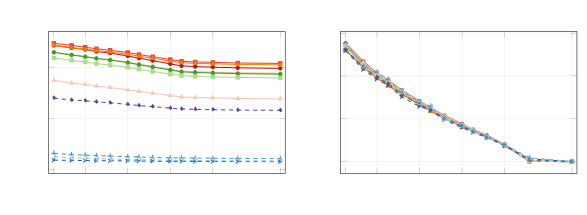

7

Figure 7: Encoder validation with Chamfer distance and MMD. Mean Chamfer
distance and MMD between 100 random subsets and the full reference pool
at each ground-truth speaker count $`k`$, for all 11 candidate encoders.
Solid lines mark the eight encoders retained for evaluation, and dashed
lines mark the three excluded encoders.

## Appendix B Controllability Classifiers

This appendix expands on the four classifiers introduced in §3.5. Three
(gender, age, emotion) are pretrained heads used without modification;
the fourth (accent) is trained in-house because no publicly released
accent classifier covers our six target regions with usable performance.
The accent classifier’s training setup and validation are reported in
Appendix C.

| Attribute | Classifier                                              | Classes |
| --------- | ------------------------------------------------------- | ------- |
| Gender    | Vox-Profile WavLM sex head                              | 2       |
| Age       | Vox-Profile WavLM age regressor, binned at $`20/40/60`$ | 4       |
| Emotion   | emotion2vec_plus_large, restricted 4-way argmax         | 4       |
| Accent    | In-house WavLM-Large + Whisper-Large-V3 LoRA ensemble   | 6       |

Table 4: Classifiers for measuring controllability. The classifier and
number of classes used for each attribute.

#### Gender.

We use the binary sex head from the Vox-Profile
tiantiaf/wavlm-large-age-sex model.¹¹ 1
[https://huggingface.co/tiantiaf/wavlm-large-age-sex](https://huggingface.co/tiantiaf/wavlm-large-age-sex)

#### Age.

We use the age regression head from the same
tiantiaf/wavlm-large-age-sex model. The head outputs a sigmoid in
$`[0,1]`$ interpreted as age/100, and we bin the output at 20/40/60
years to recover our four age labels (child, young adult, middle-aged,
elderly).

#### Emotion.

We use the pretrained emotion2vec_plus_large model.²² 2
[https://github.com/ddlBoJack/emotion2vec](https://github.com/ddlBoJack/emotion2vec)
It predicts nine classes (angry, disgusted, fearful, happy, neutral,
other, sad, surprised, and an unknown class). Because our prompts
request only four, we take the argmax restricted to the four requested
classes.

#### Accent.

We train a 6-class accent classifier because no released accent head
covers our six target regions with usable performance. The classifier is
a softmax-averaged ensemble of a WavLM-Large and a Whisper-Large-V3
encoder Radford et al. (2023), both frozen except for LoRA Hu et al.
(2022) rank 16 on the upper-half feed-forward layers. See Appendix C for
training data, recipe, and validation.

## Appendix C Accent Classifier Training and Validation

#### Training data.

Table 5 summarizes the regional speech corpora and corresponding volume
used to train the accent classifier. CommonVoice-17 (CV17) Ardila et al.
(2020) serves as the primary data source across all six target regions.
To address regional data sparsity and enhance acoustic diversity, we
supplement three regions with specialized corpora, incorporating
L2-ARCTIC Zhao et al. (2018) Hindi for South Asia, AfriSpeech-200
Olatunji et al. (2023) ZA for South Africa, and VoxPopuli Wang et al.
(2021) for Germanic English. To ensure speaker isolation, we partition
each corpus into train, validation, and test splits (60/20/20) by unique
speaker identity, ensuring that no speaker appears across multiple
subsets. Furthermore, we restrict each speaker to at most 150 clips so
that no individual dominates the training data for any accent.

| Region          | Source(s)                    | Train clips (speakers) | Hours |
| --------------- | ---------------------------- | ---------------------- | ----- |
| North America   | CV17                         | 40,000 (4,350)         | 58.6  |
| British English | CV17                         | 20,000 (1,410)         | 29.0  |
| South Asia      | CV17 + L2-ARCTIC Hindi       | 16,000 (1,221)         | 24.8  |
| Oceania         | CV17                         | 14,000 (548)           | 20.6  |
| South African   | AfriSpeech-200 ZA + CV17     | 8,495 (313)            | 15.4  |
| Germanic        | CV17 + VoxPopuli en_de/en_nl | 1,799 (109)            | 3.5   |

Table 5: Accent classifier training data. CV17 denotes CommonVoice-17.
VoxPopuli en_de/en_nl adds 75 Germanic speakers (999 clips) from the
European Parliament channel. AfriSpeech-200 ZA adds 119 South-African
speakers (2,793 clips). L2-ARCTIC Hindi adds 76 clips (2 speakers) to
South Asia.

#### Architecture and training recipe.

The classification model operates as an ensemble combining two distinct
acoustic foundation backbones, WavLM-Large and Whisper-Large-V3. Each
backbone remains frozen, with parameter-efficient finetuning applied
through LoRA (rank 16) inserted into the upper-half feed-forward
projections, yielding approximately 2.26M trainable parameters for the
WavLM model (0.71% of its parameters). The WavLM model aggregates the
hidden representations of all transformer layers via a learnable
softmax-weighted average, while the Whisper model uses the output of its
last encoder layer, following the Vox-Profile implementation. Each is
followed by three pointwise 1D convolutional layers, temporal average
pooling, and a two-layer linear classification head producing six-way
logits. Hidden representations across all transformer layers are
aggregated via a learnable softmax-weighted average, followed by three
pointwise 1D convolutional layers, temporal average pooling, and a
two-layer linear classification head producing six-way logits. Final
predictions are obtained by averaging the softmax posteriors of both
backbones.

We train the model using the Adam optimizer with a constant learning
rate of $`5\times 10^{-4}`$ for 15 epochs, setting the effective batch
size to 16 with mixed-precision training. To counteract the class
imbalance shown in Table 5, we optimize an inverse-frequency weighted
cross-entropy loss. Data augmentation during training includes additive
Gaussian noise at SNR between 3 dB and 30 dB, random time masking
covering 10% to 15% of total duration, time stretching by factors
between 0.9 and 1.1, and polarity inversion. The final model checkpoint
is selected based on maximum validation macro-F1.

#### Validation.

The validation results presented in Table 6 confirm that the classifier
provides a sound evaluator for the controllability analysis in §3.5.
First, the overall macro-F1 of $`0.876`$ substantially exceeds the
random chance level of $`0.167`$, demonstrating reliable regional
discrimination across all target categories. Second, per-class F1 scores
remain tightly clustered between $`0.825`$ and $`0.918`$, ensuring that
cross-region controllability differences cannot be attributed to uneven
classifier sensitivity. Even the lower-resource Germanic category
attains an F1 of $`0.887`$, performing on par with well-represented
regions such as North America and South Africa.

| Region          | WavLM | Whisper | Ensemble |
| --------------- | ----- | ------- | -------- |
| North America   | 0.868 | 0.880   | 0.881    |
| British English | 0.802 | 0.771   | 0.825    |
| South Asia      | 0.905 | 0.920   | 0.918    |
| Germanic        | 0.842 | 0.906   | 0.887    |
| Oceania         | 0.840 | 0.793   | 0.873    |
| South African   | 0.832 | 0.869   | 0.871    |
| Macro-F1        | 0.848 | 0.856   | 0.876    |

Table 6: Per-class F1 on the speaker-independent held-out test split.
The ensemble (production model used for controllability measurement in
§3.5) achieves the best macro-F1; on per-class F1 Whisper edges the
ensemble on South Asia and Germanic by small margins.

## Appendix D Emotion Confusion Matrices

Figure 8 presents the emotion confusion matrices for all seven systems.
Misclassified outputs are most often labeled neutral in five systems and
sad in the two Parler models. In MOSS-VoiceGenerator, VoxInstruct, and
VoxCPM2, neutral receives the largest share of predictions in every row,
ranging from 0.56 to 0.77 regardless of the prompted emotion.
CapSpeech-NAR renders angry prompts with a recall of 0.70, but its happy
prompts are most often classified as angry at 0.46 and its sad prompts
as neutral at 0.76. In Parler-mini, sad receives the largest share in
every row, ranging from 0.47 to 0.54, while Parler-large shows a weaker
version of this pattern, with sad and neutral nearly tied in its neutral
row. Qwen3-TTS is the only system in which the prompted emotion receives
the largest share in three of the four rows, namely happy, neutral, and
sad, while angry prompts are classified as neutral at 0.39 slightly more
often than as angry at 0.34. In every system, the emotion that receives
the most misclassified outputs is also the emotion with the highest
recall. Recall on that emotion therefore mixes prompt following with the
system tendency to produce that emotion under any prompt.

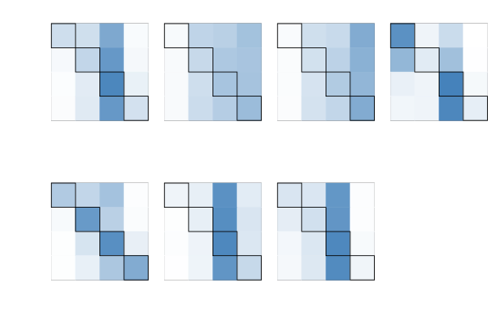

Figure 8: Emotion confusion matrices for the seven ITTS systems. Rows
give the prompted emotion and columns the emotion predicted by the
classifier, with each row normalized over its 3,000 clips. Outlined
diagonal cells equal the per-class recall plotted in Figure 6(b).

## Appendix E Per-System Speaker Diversity with Confidence Intervals

Figures 5 and 6 plot all systems on a shared axis, where the 95%
confidence intervals are smaller than the markers. Figure 9 shows the
same values separately for each system. Each panel uses its own y-axis
so that the intervals are visible.

(a) Gender  
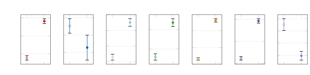

(b) Age  
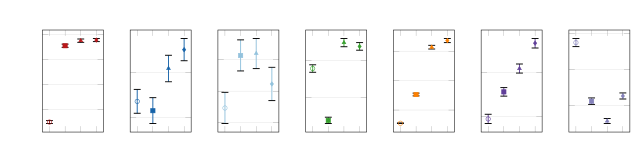

(c) Accent  
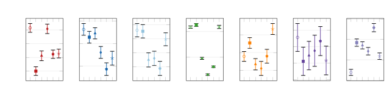

(d) Emotion  
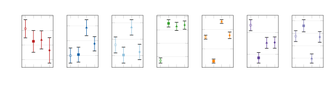

Figure 9: Speaker diversity with 95% confidence intervals for each
system. Vendi of each prompted attribute for (a) gender, (b) age, (c)
accent, and (d) emotion, with black bars showing 95% confidence
intervals. Each panel has its own y-axis. Abbreviations are F female, M
male, C child, Y young adult, Mi middle-aged, E elderly, NA North
American, Br British, Oc Oceanian, SA South Asian, SAf South African, Ge
Germanic, Ang angry, Hap happy, Neu neutral, and Sad sad.

## Appendix F Prompt Templates

Each single-attribute value is realized through five templates that hold
semantic content constant while varying syntactic form: canonical,
possessive, participial, role attribution, and attribute-quality
descriptor. Table 7 illustrates with two values (the male gender
category and the child age category); every other single-attribute value
follows the same frames with the attribute keyword swapped.
Intersectional (gender$`\times`$age) cells use a separate 5-frame set
with two word orders per frame, giving 10 templates per cell; Table 8
shows the male$`\times`$child cell. Templates strictly avoid prosodic
modifiers (e.g., “loudly”) to prevent confounding the intended attribute
with orthogonal acoustic variations.

| \#  | Male (gender)                                    | Child (age)                                      |
| --- | ------------------------------------------------ | ------------------------------------------------ |
| 1   | Speak in a male voice.                           | Speak in a child’s voice.                        |
| 2   | Speak with the voice of a man.                   | Speak with the voice of a young child.           |
| 3   | Speak so you sound masculine.                    | Speak so you sound like a young child.           |
| 4   | Speak as a male speaker.                         | Speak as a child around eight years old.         |
| 5   | Speak with a voice that has masculine qualities. | Speak with a voice that has childlike qualities. |

Table 7: Single-attribute prompt templates, illustrated for the
male-gender and child-age values. Gender, age, accent, and emotion each
use the same five frames with the attribute keyword swapped.

| \#  | Word order   | Template (male$`\times`$child)              |
| --- | ------------ | ------------------------------------------- |
| 1   | age-first    | Speak as a young boy.                       |
|     | gender-first | Speak as a boy who is young.                |
| 2   | age-first    | Use the voice of a child who is male.       |
|     | gender-first | Use the voice of a male who is a child.     |
| 3   | age-first    | Sound like a child who is male.             |
|     | gender-first | Sound like a male who is a child.           |
| 4   | age-first    | Read this as a young boy.                   |
|     | gender-first | Read this as a boy who is young.            |
| 5   | age-first    | Take on the voice of a child who is male.   |
|     | gender-first | Take on the voice of a male who is a child. |

Table 8: Prompt templates combining gender and age attributes,
illustrated for the male child category. All gender and age combinations
use ten templates derived from five sentence frames tested under both
age-first and gender-first word orders.

## Appendix G Artifacts: Licenses and Intended Use

Table 9 lists the seven ITTS systems in our panel, Table 10 the eleven
speaker encoders, Table 11 the four controllability classifiers, and
Table 12 the datasets referenced anywhere in the paper. All releases
were verified from the respective Hugging Face or GitHub pages at the
time of writing.

| System                 | Release                              | Params | License      |
| ---------------------- | ------------------------------------ | ------ | ------------ |
| MOSS-VoiceGenerator    | OpenMOSS-Team/MOSS-VoiceGenerator    | 1.7B   | Apache-2.0   |
| Parler-TTS Mini v1     | parler-tts/parler-tts-mini-v1        | 0.9B   | Apache-2.0   |
| Parler-TTS Large v1    | parler-tts/parler-tts-large-v1       | 2.3B   | Apache-2.0   |
| Qwen3-TTS Voice Design | Qwen/Qwen3-TTS-12Hz-1.7B-VoiceDesign | 1.7B   | Apache-2.0   |
| VoxInstruct            | thuhcsi/VoxInstruct                  | 1.37B  | MIT          |
| CapSpeech-NAR          | OpenSound/CapSpeech-models           | 0.9B   | CC BY-NC 4.0 |
| VoxCPM2                | openbmb/VoxCPM2                      | 2B     | Apache-2.0   |

Table 9: ITTS systems in the panel. Parameter counts exclude
separately-loaded vocoder and codec modules. CapSpeech-NAR is the only
non-commercial release; all generations and derived statistics for
CapSpeech-NAR inherit the CC BY-NC 4.0 restriction.

| Encoder (code)                  | Toolkit / Release                           | License         |
| ------------------------------- | ------------------------------------------- | --------------- |
| TitaNet (TIT)                   | nvidia/speakerverification_en_titanet_large | CC-BY-4.0       |
| SpeechBrain-ECAPA (SBEC)        | speechbrain/spkrec-ecapa-voxceleb           | Apache-2.0      |
| SpeechBrain-ResNet (SBRN)       | speechbrain/spkrec-resnet-voxceleb          | Apache-2.0      |
| WeSpeaker-ResNet221 (WS221)     | WeSpeaker voxceleb_resnet221_LM             | CC-BY-4.0       |
| WeSpeaker-SimAM-ResNet34 (WSVB) | WeSpeaker voxblink2_samresnet34             | CC-BY-NC-SA-4.0 |
| ERes2Net (ER2)                  | iic/speech_eres2net_sv_zh-cn_16k-common     | Apache-2.0      |
| ERes2NetV2 (ER2v2)              | iic/speech_eres2netv2_sv_zh-cn_16k-common   | Apache-2.0      |
| CAM++ (CAM)                     | iic/speech_campplus_sv_zh-cn_16k-common     | Apache-2.0      |
| x-vector (XV)                   | speechbrain/spkrec-xvect-voxceleb           | Apache-2.0      |
| WavLM-base+SV (WLM)             | microsoft/wavlm-base-plus-sv                | CC-BY-SA-3.0    |
| UniSpeech-SAT-base+SV (USAT)    | microsoft/unispeech-sat-base-plus-sv        | CC-BY-SA-3.0    |

Table 10: Speaker encoders used in the validation study (§3.2).

|                                                           |                                    |                                 |
| --------------------------------------------------------- | ---------------------------------- | ------------------------------- |
| Classifier                                                | Release                            | License                         |
| Gender (binary sex head)                                  | tiantiaf/wavlm-large-age-sex       | Apache-2.0                      |
| Age (regressor)                                           | tiantiaf/wavlm-large-age-sex       | Apache-2.0                      |
| Emotion                                                   | emotion2vec/emotion2vec_plus_large | Apache-2.0^($`\dagger`$)        |
| Accent (in-house)                                         | Trained for this paper             | Research-only (ours; see below) |
| _Frozen backbones used in the in-house accent classifier_ |                                    |                                 |
| WavLM-Large                                               | microsoft/wavlm-large              | MIT                             |
| Whisper-Large-V3                                          | openai/whisper-large-v3            | Apache-2.0                      |

Table 11: Controllability classifiers. $`\dagger`$: the
emotion2vec_plus_large model card lists Apache-2.0; the companion \_seed
and \_base releases use a FunASR-linked “model license” instead, so
re-users should re-verify from the Hugging Face page.

| Dataset               | Use in this paper                                    | License         |
| --------------------- | ---------------------------------------------------- | --------------- |
| Emilia                | Real-speech reference sampling (§4, §5)              | CC BY-NC 4.0    |
| LibriSpeech           | Encoder validation                                   | CC BY 4.0       |
| CommonVoice-17        | Accent classifier training (all 6 regions)           | CC0 1.0         |
| VoxPopuli en_de/en_nl | Accent classifier training (Germanic class)          | CC0             |
| AfriSpeech-200 ZA     | Accent classifier training (South African class)     | CC BY-NC-SA 4.0 |
| L2-ARCTIC Hindi       | Accent classifier training (South Asia augmentation) | CC BY-NC 4.0    |

Table 12: Datasets referenced in the paper and their licenses. Emilia,
AfriSpeech-200, and L2-ARCTIC are non-commercial; derived artifacts that
embed these corpora inherit their restrictions.

#### Intended use of existing artifacts.

Our use of each existing artifact is consistent with its stated research
or non-commercial terms: pretrained models and corpora are consumed in a
controlled evaluation pipeline that generates and analyzes speech only
for the measurement goals in §4–§5. CapSpeech-NAR, Emilia,
AfriSpeech-200, and L2-ARCTIC are non-commercial, so any downstream
reuse of our generated audio or derived embeddings for CapSpeech-NAR,
and of our Emilia-sourced reference statistics, is restricted to
non-commercial research under the same terms.

#### Intended use of released artifacts.

We release the evaluation code, the prompt manifests (prompts, input
texts, random seeds, and sampling parameters per condition), the
generated audio, and the trained accent classifier checkpoint. The
evaluation code is released under the MIT License. The prompt manifests,
the generated audio, and the accent classifier checkpoint are released
for non-commercial research use only (CC BY-NC 4.0), in line with the
most restrictive upstream licenses they draw on (CC BY-NC 4.0, from
CapSpeech-NAR). The audio is intended for evaluating the diversity and
controllability of ITTS systems; it must not be used to impersonate real
speakers or to train systems that infer a person’s demographic
attributes from their voice.

## Appendix H Use of AI Assistants

We used AI assistants (Claude and Gemini) for drafting and revising
text, for literature search and citation checking, for writing and
debugging code, and for formatting tables and figures in LaTEX. We also
used ChatGPT 5.6 Luna to generate some of the schematic icons in
Figure 1. The authors checked all generated text and code, verified
every reported number against the experimental outputs and every
citation against its original source, and take full responsibility for
the content of this paper.

## Acknowledgments

This work was supported by the Ministry of Education (MOE) of Taiwan
under the project Taiwan Centers of Excellence in Artificial
Intelligence, through the NTU Artificial Intelligence Center of Research
Excellence (NTU AI-CoRE).
