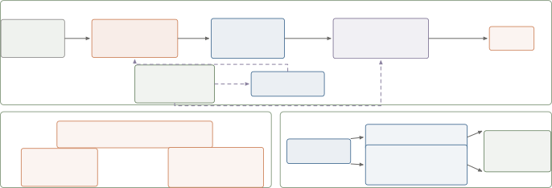
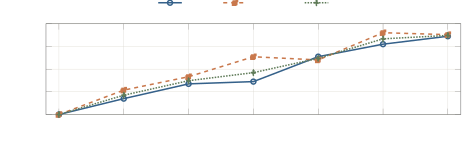
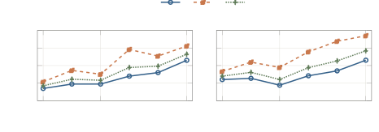
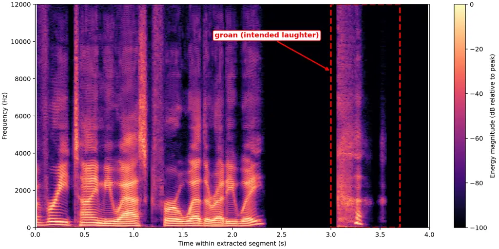
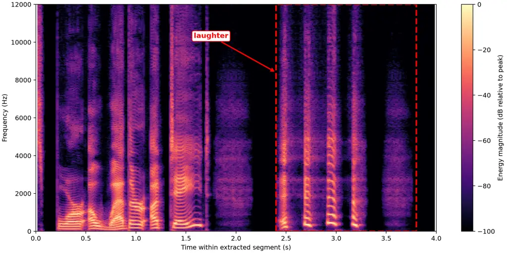

# A Systematic Study of Cross-Token Transfer for Data-Efficient Non-Verbal Text-to-Speech

Jing Pan    Haibin Wu    Minxue Niu    Florian Metze    Yuzong Liu

###### Abstract

Non-verbal vocalizations (NVs), such as laughter and breath, carry
affective cues that words alone do not convey. Yet NV data remains
scarce because speech annotation pipelines often omit or normalize these
events. Existing work has improved NV text-to-speech through model
design and data curation, but whether one NV token can help a model
learn another has received little systematic study. We investigate this
_cross-token transferability_ in a controlled CosyVoice 2 setup. We
first trace a laughter-only scaling curve, then hold laughter at 200 or
1,600 examples while adding breath, sigh, cough, lip-smack, or neutral
speech. With only 200 laughter examples, adding 3,200 cough examples
raises end-to-end laughter F1 from 0.170 to 0.529, surpassing the 0.495
obtained from 1,600 laughter examples alone. At the 1,600-example
anchor, cough reaches 0.695, nearly matching 6,400 laughter examples
(0.697). Waveform-level Whisper-D scoring and a semantic-token
transcriber show consistent trends. Cross-token transfer therefore
offers a complementary route to low-resource NV generation.

###### Index Terms: 

text-to-speech, non-verbal vocalization, cross-token transfer, data
scaling

^(†)^(†)address: Meta, USA

## 1 Introduction

Spoken communication conveys more than words. Non-verbal vocalizations
(NVs) such as laughter, breaths, sighs, cries, and coughs reveal speaker
state, affect, and conversational intent \[11, 12\]. Laughter can signal
warmth or empathy; filled pauses and breaths expose hesitation or
control, while other bursts add rhythm and emphasis. Words establish
content, but NVs shape how an utterance is understood, making explicit
control important for expressive and socially natural TTS \[15\].
Unfortunately, the cues captured by a microphone often disappear during
data preparation: conventional transcripts preserve lexical content
while omitting NVs or collapsing them into inconsistent labels. Rare
events such as crying receive even fewer reliable annotations, leaving
far less usable supervision than ordinary speech.

Recent work has expanded NV datasets and improved controllable
generation, as reviewed in Section 2. One complementary question remains
open: can a well-resourced NV token improve a different, low-resource
token during TTS training? If cross-token transfer exists, abundant
donor events could provide reusable acoustic structure, reduce the
amount of target-specific annotation needed, and make rare NV
capabilities cheaper to add. Knowing which donors transfer would also
help data curation prioritize useful examples rather than simply
collecting more speech.

We study this question through controlled scaling and transfer
experiments with laughter as the target event. We first vary the amount
of laughter data to establish its learning curve. We then fix the
laughter budget and add breath, sigh, cough, or lip-smack examples, with
neutral speech as a control. All conditions use the same CosyVoice 2
architecture and fine-tuning recipe, so observed differences can be
attributed to training-data composition.

Our contributions are:

- •
  a controlled study of laughter scaling and cross-token transfer under
  a fixed TTS architecture;
- •
  evidence that 3,200 cough examples raise laughter F1 from 0.170 to
  0.529 when only 200 laughter examples are available, outperforming an
  eightfold increase in target-only data; and
- •
  complementary evaluation with Whisper-D on generated waveforms and a
  learned transcriber that reads semantic tokens before waveform
  rendering.

## 2 Related Work

Data creation and NV-aware annotation. NV resources differ in how labels
are obtained and how precisely events are aligned. Early event-aware ASR
decoded words and acoustic social signals jointly, establishing a
unified transcript representation \[5, 13\]. Recent pipelines turn
recognition into a data-construction tool: NVSpeech bootstraps NV-aware
annotation at scale, while WESR evaluates whether an event is both
recognized and placed correctly within a transcript \[8, 19\]. Curated
corpora offer finer supervision: NonverbalTTS aligns English NV and
emotion labels, whereas SMIIP-NV and MNV-17 provide multi-level Mandarin
annotations \[2, 16, 9\]. NonVerbalSpeech-38K and SynParaSpeech trade
some manual curation for scale through automatic annotation or
generation \[21, 1\]. Beyond Words compares curriculum learning, data
balancing, voice conversion, and auxiliary-token transfer for rare-event
ASR \[20\]; NV-Bench and NVV-SuperBench expand synthesis evaluation
across event types and quality dimensions \[10, 17\].

Modeling. EmoCtrl-TTS introduces detector-derived conditioning and
time-varying emotion embeddings to control laughter and crying within a
flow-matching TTS model \[15\]. Recent preference optimization instead
uses an NV-aware recognition score to improve generation over 18 NV
types \[7\]. Both directions improve how a system represents or
optimizes NV behavior; expanding and cleaning training corpora improves
the evidence available to it. Neither, however, isolates whether
examples of one NV token help a scarce second token. Our study is
therefore complementary: we hold the architecture and optimization
recipe fixed, vary only target–donor data composition, and measure the
effect both before and after waveform rendering.



Figure 1: Study overview: (a) CosyVoice generation, (b) controlled
target scaling and cross-token transfer, and (c) complementary waveform
and semantic-token evaluation.

## 3 Methodology

### 3.1 Framework

We build on the CosyVoice 2 generation pipeline \[4\], shown in Fig. 1.
The input text contains lexical tokens and explicit NV markers such as
\[laughter\]. A prompt utterance supplies speaker and acoustic context.
CosyVoice 2 converts the prompt into discrete semantic tokens and
conditions an autoregressive semantic language model (LM) on both the
prompt tokens and input text. The LM predicts the target semantic-token
sequence¹¹ 1
[github.com/xingchensong/S3Tokenizer](https://github.com/xingchensong/S3Tokenizer)
$`\boldsymbol{\mu}=(\mu_{1},\ldots,\mu_{L})`$ with

```math
\mathcal{L}_{\mathrm{sem}}=-\sum_{l=1}^{L}\log p(\mu_{l}\mid\mu_{<l},\mathbf{t}_{\mathrm{NV}},\mathbf{p}), \tag{1}
```

where $`\mathbf{t}_{\mathrm{NV}}`$ is the text sequence with NV markers
and $`\mathbf{p}`$ denotes the prompt representation. A conditional flow
decoder and vocoder render the predicted semantic tokens as a waveform.
In every experiment, we fine-tune only the semantic LM and reuse the
same tokenizer, flow decoder, and vocoder.

### 3.2 Case Studies

Collecting a large corpus for every affective burst is costly. Phonetic
and physiological studies suggest that laughter, crying, and coughs draw
on related respiratory and laryngeal mechanisms \[11, 12\]. Laughter,
for example, consists of rhythmic glottal pulses superimposed on forced
exhalation \[14\]. Although these events remain perceptually distinct,
their shared airflow, voicing, and temporal structure creates a
plausible basis for transfer.

Recent TTS evidence supports this possibility. EmoCtrl-TTS showed that
embeddings from a laughter detector can support fine-grained,
controllable crying synthesis \[15\]. This cross-event reuse motivates
our data-level question: can examples labeled with an abundant donor
token help the same semantic LM learn a scarce target token?

We test two controlled cases. The _target scaling_ study trains on
nested subsets containing 0, 200, 400, 800, 1,600, 3,200, or 6,400
laughter examples, establishing low-resource and near-saturation
operating points. The _cross-token transfer_ study fixes laughter at 200
or 1,600 examples and adds approximately 3,200 examples of breath, sigh,
cough, or lip-smack. A neutral-speech mixture tests whether arbitrary
additional audio is sufficient. At the 200-example anchor, cough ranges
from 0 to 3,200 examples. All else remains fixed.

### 3.3 Evaluation

We measure whether the model generates laughter at the requested
location using two complementary paths.

Semantic-token transcriber. We train a separate autoregressive
transcriber that maps the semantic-token sequence $`\boldsymbol{\mu}`$
to an NV-aware transcript $`\mathbf{y}=(y_{1},\ldots,y_{M})`$ containing
words and inline NV markers. Its training objective mirrors Eq. (1):

```math
\mathcal{L}_{\mathrm{tr}}=-\sum_{m=1}^{M}\log p(y_{m}\mid y_{<m},\boldsymbol{\mu}). \tag{2}
```

This model is used only for evaluation, not in the TTS generation path.

The _waveform path_ renders the semantic tokens with the frozen flow
decoder and vocoder, then applies Whisper-D²² 2
[huggingface.co/jordand/whisper-d-v1a](https://huggingface.co/jordand/whisper-d-v1a) \[3\]
to the waveform. It therefore scores the complete synthesis pipeline.
The _token path_ applies our transcriber directly to the LM output,
bypassing waveform rendering and its potential errors. Both paths
produce an NV-aware transcript. We align each output with the reference
prompt in text space and compute event-level precision, recall, and F1.
Agreement between the two paths indicates that an effect originates in
semantic-token generation and persists after waveform rendering; a gap
helps localize errors to the acoustic back end. Crucially, this study
measures laughter event retrieval in TTS rather than perceptual audio
quality. Evaluating laughter retrieval under this setup serves as a
controlled proxy to validate whether cross-event knowledge transfer
successfully translates into predictable NV generation.

## 4 Experiments

### 4.1 Experimental Setup

Data and backbone. We use Libri-Light \[6\] as NV-neutral pre-training
data and an internal emotional TTS corpus as the source of NV subsets.
The backbone is CosyVoice 2-0.5B \[4\], and each run uses eight H100
GPUs. To reduce native NV priors, we reinitialize the autoregressive TTS
LM and pre-train it on approximately 27k hours of neutral Libri-Light
speech. Following CosyVoice 2, we initialize the backbone from
Qwen2-0.5B \[18\], randomly initialize the speech-token layers and NV
embeddings, and freeze the FSQ tokenizer, flow decoder, and vocoder.
Pre-training uses AdamW with weight decay $`0.01`$, attention dropout
$`0.1`$, gradient clipping at $`1.0`$, and a cosine learning-rate
schedule from $`5\times 10^{-5}`$ to $`10^{-6}`$ with 20k warm-up steps.
The epoch-20 checkpoint obtains 4.7% WER on 50 speaker-disjoint LibriTTS
test-clean utterances and produces no NVs on the evaluation prompts.

Fine-tuning sets. We normalize transcripts to eight canonical NV tags;
examples include laughter, breath, sigh, cough, and lip-smack. Data
budgets count tagged NV occurrences; the figures refer to each
occurrence as one example. Unambiguous variants map to a canonical tag;
unsupported or ambiguous annotations are removed. Pure-laughter
utterances contain laughter and no other NV token. Donor utterances
contain the selected donor event and no other NV token. The neutral
control adds 3,000 Libri-Light utterances. All pools exclude a
deterministic 1% speaker-disjoint development split. We fine-tune for 10
epochs with AdamW, learning rate $`10^{-5}`$, weight decay $`0.01`$,
$`(\beta_{1},\beta_{2})=(0.9,0.95)`$, $`\epsilon=10^{-8}`$, attention
dropout $`0.1`$, and gradient clipping at $`1.0`$. The learning rate
decays to $`10^{-6}`$ after a 5% warm-up, and the step budget scales
with set size so that every example is seen for 10 epochs.

Transcriber training. Our evaluator uses the released CosyVoice 2 LM
with a Qwen2-0.5B backbone. We train it on the internal emotional corpus
and English Libri-Light for 100k steps using AdamW, weight decay
$`0.01`$, attention dropout $`0.1`$, and a learning rate that warms up
for 5k steps to $`10^{-4}`$ and decays to $`10^{-5}`$. The checkpoint
reaches 4.88% WER on LibriTTS test-clean.

Evaluation set. Each checkpoint is evaluated on the same 400 prompts,
including 100 laughter-positive prompts. We score generated waveforms
with Whisper-D and LM outputs with the semantic-token transcriber. On
oracle audio and oracle semantic tokens from this set, the two
evaluators obtain laughter-retrieval F1 scores of 0.712 and 0.813,
respectively. Inference uses deterministic FP32 computation.

### 4.2 Results

#### 4.2.1 Target-Only Scaling



Figure 2: Waveform-level laughter scaling. Performance rises quickly
through 3,200 target examples and changes little from 3,200 to 6,400.

Figure 2 establishes the laughter-only baseline. F1 rises from 0.170 at
200 examples to 0.495 at 1,600 and 0.667 at 3,200. Doubling the data
once more yields only 0.030 absolute improvement, reaching 0.697 at
6,400. The curve places 200 examples in a data-starved regime and 1,600
near saturation.

#### 4.2.2 Cross-Token Transfer

|           | Waveform |      |      | Semantic token |      |      |
| --------- | -------- | ---- | ---- | -------------- | ---- | ---- |
| Donor     | P        | R    | F1   | P              | R    | F1   |
| None      | .215     | .140 | .170 | .333           | .241 | .280 |
| Breath    | .721     | .310 | .434 | .746           | .312 | .440 |
| Sigh      | .628     | .270 | .378 | .831           | .348 | .490 |
| Cough     | .622     | .460 | .529 | .731           | .482 | .581 |
| Lip-smack | .630     | .290 | .397 | .857           | .340 | .487 |
| Neutral   | .083     | .020 | .032 | .250           | .050 | .083 |

Table 1: Cross-token transfer at the 200-laughter anchor. Each donor
contributes 3,200 NV examples.

|           | Waveform |      |      | Semantic token |      |      |
| --------- | -------- | ---- | ---- | -------------- | ---- | ---- |
| Donor     | P        | R    | F1   | P              | R    | F1   |
| None      | .481     | .510 | .495 | .678           | .582 | .626 |
| Breath    | .759     | .630 | .689 | .859           | .560 | .678 |
| Sigh      | .707     | .580 | .637 | .865           | .589 | .700 |
| Cough     | .733     | .660 | .695 | .894           | .596 | .715 |
| Lip-smack | .747     | .650 | .695 | .914           | .603 | .726 |
| Neutral   | .538     | .500 | .518 | .741           | .567 | .643 |

Table 2: Cross-token transfer at the 1,600-laughter anchor. Each donor
contributes 3,200 NV examples.

Tables 1 and 2 compare donor tokens at the two laughter anchors. With
200 laughter examples, every NV donor improves on the 0.170 waveform F1
baseline, while neutral speech reduces F1 to 0.032. Cough performs best
at 0.529, a $`3.1\times`$ relative improvement that also exceeds the
0.495 achieved with 1,600 laughter examples alone. At the 1,600-example
anchor, cough and lip-smack each reach 0.695, nearly matching the 0.697
result from 6,400 target examples. The neutral control confirms that
arbitrary speech is insufficient.

The largest change appears in precision. At the 200-example anchor,
cough raises waveform precision from 0.215 to 0.622 and recall from
0.140 to 0.460. The token evaluator shows the same pattern: precision
rises from 0.333 to 0.731, while recall rises from 0.241 to 0.482. Donor
NVs therefore help the semantic LM suppress spurious laughter while
recovering more requested events.



Figure 3: Cough-donor scaling with 200 laughter examples. Small
multiples separate the waveform and semantic-token evaluators so
precision, recall, and F1 remain legible.

Figure 3 varies the cough donor budget. The overall trend is positive
but not strictly monotonic: waveform F1 changes from 0.245 at 200 cough
examples to 0.233 at 400, then reaches 0.529 at 3,200. The token path
follows the same broad pattern and reaches 0.568, although it generally
gives a higher absolute score. The agreement localizes the effect to
semantic-token generation and leaves a decoder gap.



(a) 1,600 laughter examples



(b) 1,600 laughter + 3,200 cough examples

Figure 4: Spectrograms for the same prompt. The red boxes mark the
requested laughter interval. The target-only model produces diffuse
aspiration, whereas the cough-augmented model produces structured bursts
between 2.4 and 3.8 s.

The spectrograms in Fig. 4 illustrate the same difference. For the
prompt “…ask for a weather update? \[laughter\] …”, the target-only
model produces diffuse, groan-like aspiration in the labeled interval.
Adding cough data yields a sequence of clearer bursts. This pattern
suggests shared respiratory and glottal dynamics, pending listening
tests.

## 5 Conclusion

We studied cross-token transfer while holding the TTS architecture
fixed. Laughter-only performance showed diminishing returns beyond 3,200
examples. With 200 laughter examples, adding 3,200 cough examples
increased waveform F1 from 0.170 to 0.529, exceeding 1,600 laughter
examples alone. Waveform and semantic-token evaluation agreed on the
main trends, placing the gain before waveform rendering and showing that
it largely survives the acoustic decoder. We study one target and one
backbone and measure event retrieval rather than perceptual quality;
broader NV pairs and listening tests remain important.

## References

- \[1\] B. Bai, Q. Lu, W. Yang, Z. Sun, Y. Hou, P. Jia, S. Pu, R. Fu, Y.
  Gao, Y. Li, and J. Gao (2025) SynParaSpeech: automated synthesis of
  paralinguistic datasets for speech generation and understanding. arXiv
  preprint arXiv:2509.14946. Cited by: §2.
- \[2\] M. Borisov, E. Spirin, and D. Diatlova (2025) NonverbalTTS: a
  public english corpus of text-aligned nonverbal vocalizations with
  emotion annotations for text-to-speech. arXiv preprint
  arXiv:2507.13155. Cited by: §2.
- \[3\] J. Darefsky, G. Zhu, and Z. Duan (2024) Parakeet. External
  Links: [Link](https://jordandarefsky.com/blog/2024/parakeet/) Cited
  by: §3.3.
- \[4\] Z. Du, Y. Wang, Q. Chen, et al. (2024) CosyVoice 2: scalable
  streaming speech synthesis with large language models. arXiv preprint
  arXiv:2412.10117. Cited by: §3.1, §4.1.
- \[5\] H. Inaguma, M. Mimura, K. Inoue, K. Yoshii, and T.
  Kawahara (2018) An end-to-end approach to joint social signal
  detection and automatic speech recognition. In Proc. IEEE ICASSP,
  pp. 5199–5203. Cited by: §2.
- \[6\] J. Kahn, M. Riviere, W. Zheng, et al. (2020) Libri-light: a
  benchmark for asr with limited or no supervision. In ICASSP 2020-2020
  IEEE international conference on acoustics, speech and signal
  processing (ICASSP), pp. 7669–7673. Cited by: §4.1.
- \[7\] H. Li, C. Xu, J. Zhao, Y. Cao, L. Xue, Y. Guo, and E. S.
  Chng (2026) Preference optimization for non-verbal vocalization
  synthesis. arXiv preprint arXiv:2608.24163. Cited by: §2.
- \[8\] H. Liao, Q. Ni, Y. Wang, Y. Lu, H. Zhan, P. Xie, Q. Zhang,
  and Z. Wu (2025) NVSpeech: an integrated and scalable pipeline for
  human-like speech modeling with paralinguistic vocalizations. arXiv
  preprint arXiv:2508.04195. Cited by: §2.
- \[9\] J. Mai, J. Ji, X. Xing, et al. (2026) MNV-17: a high-quality
  performative Mandarin dataset for nonverbal vocalization recognition
  in speech. In IEEE International Conference on Acoustics, Speech and
  Signal Processing (ICASSP), pp. 18312–18316. Cited by: §2.
- \[10\] Q. Ni, H. Liao, D. Chen, Y. Wang, and Z. Wu (2026) NV-Bench:
  benchmark of nonverbal vocalization synthesis for expressive
  text-to-speech generation. arXiv preprint arXiv:2603.15352. Cited by:
  §2.
- \[11\] R. R. Provine (2000) Laughter: a scientific investigation.
  Penguin. Cited by: §1, §3.2.
- \[12\] K. R. Scherer (2003) Vocal communication of emotion: a review
  of research paradigms. Speech communication 40 (1-2), pp. 227–256.
  Cited by: §1, §3.2.
- \[13\] N. Shione and T. Kawahara (2023) Automatic speech recognition
  using linguistic and verbal/nonverbal information. IEEE Access 11,
  pp. 138985–138995. Cited by: §2.
- \[14\] J. Trouvain (2014) Laughing, breathing, clicking-the prosody of
  nonverbal vocalizations. In Proceedings of the 7th international
  conference on Speech Prosody, pp. 598–602. Cited by: §3.2.
- \[15\] H. Wu, X. Wang, S. E. Eskimez, et al. (2024) Laugh now cry
  later: controlling time-varying emotional states of
  flow-matching-based zero-shot text-to-speech. In 2024 IEEE Spoken
  Language Technology Workshop (SLT), pp. 690–697. Cited by: §1, §2,
  §3.2.
- \[16\] Z. Wu, D. Liu, J. Liu, et al. (2025) SMIIP-NV: a
  multi-annotation non-verbal expressive speech corpus in Mandarin for
  llm-based speech synthesis. In Proceedings of the 33rd ACM
  International Conference on Multimedia, pp. 12564–12570. Cited by: §2.
- \[17\] L. Xue, W. Bian, J. Pan, W. Wu, Y. Ren, B. Kang, J. Hu, Z.
  Ma, S. Wang, X. Qian, H. Lee, and Y. Guo (2026) NVV-SuperBench: beyond
  words, beyond quality—benchmarking nonverbal vocalizations in speech
  generation. arXiv preprint arXiv:2604.16211. Cited by: §2.
- \[18\] A. Yang, B. Yang, B. Hui, et al. (2024) Qwen2 technical report.
  arXiv preprint arXiv:2407.10671. Cited by: §4.1.
- \[19\] C. Yang, K. Huang, L. Fan, Q. Tu, B. Jiang, D. Zhang, L.
  Yin, S. Li, Z. Fei, Q. Cheng, and X. Qiu (2026) WESR: scaling and
  evaluating word-level event-speech recognition. arXiv preprint
  arXiv:2601.04508. Cited by: §2.
- \[20\] G. Yang, H. Wu, P. Su, R. Huang, S. Shon, B. Do, M. Niu, Z.
  Ni, S. Li, F. Metze, Y. Adi, M. Sun, and Y. Liu (2026) Beyond words:
  towards effective modeling of non-verbal vocalizations in asr. arXiv
  preprint arXiv:2607.01563. Cited by: §2.
- \[21\] R. Ye, Y. Zhou, R. Yu, Z. Lin, K. Li, X. Li, X. Liu, G. Zeng,
  and Z. Wu (2025) A scalable pipeline for enabling non-verbal speech
  generation and understanding. arXiv preprint arXiv:2508.05385. Cited
  by: §2.
