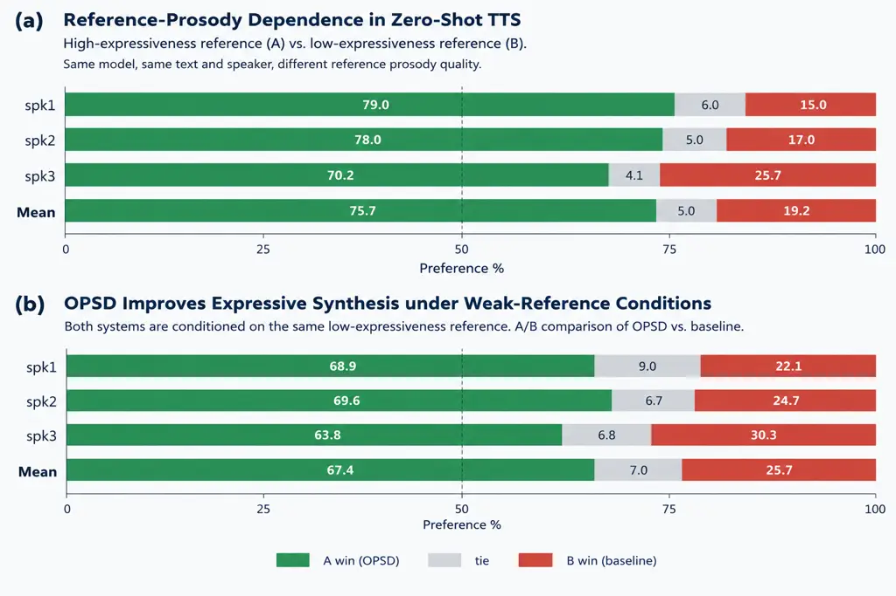

# Rethinking Post-Training for Expressive Zero-Shot Text-to-Speech

Jingbin Hu, Xinfa Zhu, Hao Wang, Wenjie Tian, Kangxiang Xia, Hangrui Hu,
Kexin Huang, Jin Xu, Liumeng Xue, Lei Xie ^(†)^(†)thanks: \$ˆ†\$
Corresponding author.

###### Abstract

Zero-shot voice cloning typically emphasizes preserving the timbre and
prosodic characteristics of a reference speaker. However, in real-world
use, speech should adapt its delivery to the target text rather than
remain tied to a fixed speaking style. In this work, we formulate this
problem as text-adaptive prosody synthesis for zero-shot voice cloning
and study how post-training can endow a cloning model with this
capability. We develop a three-stage framework. First, Direct Preference
Optimization (DPO) provides a cold start by aligning the model with
text-appropriate expressive speech. Second, Group Sequence Policy
Optimization (GSPO) jointly optimizes prosodic expressiveness, acoustic
quality, intelligibility, and speaker similarity. Finally,
context-conditioned On-Policy Self-Distillation (OPSD) enables
self-improvement by transferring expressive behavior from
strong-reference to weak-reference conditions. On Qwen3-TTS, our
framework improves Emotion from 18.5 to 81.2 and Paralinguistics from
38.4 to 73.9. Extensive ablations validate the role of each stage.
Speech samples are available ¹¹ 1
Demo:[https://hujingbin1.github.io/TTS-Post-Train/](https://hujingbin1.github.io/TTS-Post-Train/).

###### Index Terms: 

zero-shot text-to-speech, expressiveness, post-training, preference
optimization, self-distillation

^(†)^(†)address: ¹ Alibaba Token Hub, Alibaba Group  
² State Key Laboratory of Novel Software Technology, Nanjing University,
Nanjing, China  
³ School of Intelligence Science and Technology, Nanjing University,
Suzhou, China

## 1 INTRODUCTION

Recent advances in zero-shot text-to-speech (TTS) enable speech
generation from a target text and a short reference utterance, making
voice cloning increasingly practical \[1, 2, 3, 4, 5, 6\]. A central
goal of zero-shot voice cloning is to preserve the characteristics of
the reference speaker, including speaker timbre and speaking style.
However, faithfully inheriting the prosodic characteristics of a
reference is not always desirable. In real-world scenarios, the
reference utterance primarily serves as evidence of who is speaking,
while the target text determines how the speech should be delivered. A
reference with limited intonational variation, for example, may lead to
flat speech even when the target text calls for strong emotion,
emphasis, or paralinguistic expression. This raises a fundamental
question: can a voice cloning model preserve the speaker identity while
adapting its prosody to the target text, rather than simply imitating
the reference speaking style?

We study this problem as text-adaptive prosody synthesis for zero-shot
voice cloning. The key challenge is to endow a pretrained cloning model
with this capability without rebuilding its architecture or relying on
explicit style controls. While existing works provide various mechanisms
for controlling emotion, style, and voice characteristics \[3, 7, 8, 9,
10, 11\], our focus is complementary: we investigate whether
post-training can transform reference-conditioned imitation into
text-conditioned expressive generation. More importantly, we study how
different post-training paradigms contribute to this transformation and
whether they can be combined progressively.

Our study follows three questions. First, how should the model be
cold-started for this new objective? We investigate preference alignment
with Direct Preference Optimization \[12, 13\] (DPO), together with
supervised fine-tuning and speaker-diversity ablations, to understand
how expressive behavior can be introduced without sacrificing linguistic
capability. Second, how can the capability ceiling be further improved?
We apply multi-objective Group Sequence Policy Optimization \[14\]
(GSPO) to jointly optimize text-conditioned prosody, acoustic quality,
intelligibility, and speaker consistency. Third, how can the model
become less dependent on the expressiveness of the reference itself? We
use context-conditioned On-Policy Self-Distillation \[15\] (OPSD), where
the model learns under weak-reference conditions from predictive
distributions obtained under stronger references, enabling further
improvement without requiring stronger references at inference time.

Our post-training stages systematically address SFT degradation, enhance
acoustic quality, and enable weak-reference synthesis. Consequently, the
final model boosts Emotion from 18.5 to 81.2 and Paralinguistics from
38.4 to 73.9 on Emergent TTS-Eval \[16\]. Human ABX tests confirm
reduced reliance on reference expressiveness, validating post-training
as a practical pathway for text-adaptive, expressive zero-shot TTS.

Our contributions are:

1.  1.  We formulate text-adaptive prosody synthesis for zero-shot voice
        cloning as a distinct research problem, highlighting the gap between
        faithfully cloning reference speech and generating prosody
        appropriate to the target text.
2.  2.  We develop a three-stage post-training framework that progressively
        improves text-adaptive speech generation: Direct Preference
        Optimization (DPO) provides a cold start for expressive alignment,
        multi-objective Group Sequence Policy Optimization (GSPO) further
        expands the capability ceiling, and context-conditioned On-Policy
        Self-Distillation (OPSD) reduces dependence on reference
        expressiveness.
3.  3.  We provide a systematic empirical study of post-training for
        text-adaptive voice cloning, revealing the effects of speaker
        diversity, reward composition, and distillation strategy, and
        demonstrating consistent gains in expressive generation and
        robustness to weak references on Qwen3-TTS.

Figure 1: Automated construction of preference data for text-adaptive
prosody synthesis.

## 2 METHODS

|                        |                                 |      |      |                                   |      |      |                   |                 |                   |                   |                 |                   |                               |                |                |                |
| ---------------------- | ------------------------------- | ---- | ---- | --------------------------------- | ---- | ---- | ----------------- | --------------- | ----------------- | ----------------- | --------------- | ----------------- | ----------------------------- | -------------- | -------------- | -------------- |
|                        | Emergent Emotion ($`\uparrow`$) |      |      | Emergent Paraling. ($`\uparrow`$) |      |      | Objective Metrics |                 |                   |                   |                 |                   | Subjective MOS ($`\uparrow`$) |                |                |                |
| Model / Stage          | In                              | Out  | All  | In                                | Out  | All  | EN                |                 |                   | ZH                |                 |                   | NMOS                          | PMOS           | EMOS           | SMOS           |
|                        |                                 |      |      |                                   |      |      | WER$`\downarrow`$ | SIM$`\uparrow`$ | UTMOS$`\uparrow`$ | WER$`\downarrow`$ | SIM$`\uparrow`$ | UTMOS$`\uparrow`$ |                               |                |                |                |
| Base Model (Qwen3-TTS) | 32.1                            | 4.9  | 18.5 | 46.0                              | 30.7 | 38.4 | 1.23              | 0.72            | 3.35              | 0.97              | 0.77            | 3.17              | 4.15$`\pm`$.06                | 3.45$`\pm`$.09 | 3.40$`\pm`$.05 | 4.00$`\pm`$.07 |
| + Stage 1 Exp 0: SFT   | 82.7                            | 36.3 | 59.5 | 67.1                              | 40.7 | 53.9 | 1.66              | 0.60            | 3.47              | 0.88              | 0.71            | 3.31              | 4.05$`\pm`$.11                | 3.70$`\pm`$.04 | 3.60$`\pm`$.08 | 3.90$`\pm`$.10 |
| + Stage 1 Exp 1: DPO   | 51.0                            | 10.1 | 30.6 | 54.6                              | 32.0 | 43.3 | 2.17              | 0.66            | 3.27              | 0.92              | 0.73            | 3.09              | 3.95$`\pm`$.09                | 3.55$`\pm`$.06 | 3.60$`\pm`$.09 | 3.95$`\pm`$.09 |
| + Stage 1 Exp 2: DPO   | 83.3                            | 50.3 | 66.8 | 71.0                              | 44.1 | 57.6 | 1.65              | 0.55            | 3.09              | 0.98              | 0.70            | 3.09              | 3.85$`\pm`$.13                | 3.80$`\pm`$.11 | 3.70$`\pm`$.14 | 3.80$`\pm`$.13 |
| + Stage 2: GSPO        | 84.5                            | 54.6 | 69.6 | 72.4                              | 60.2 | 66.3 | 1.51              | 0.62            | 3.32              | 0.97              | 0.69            | 3.22              | 4.15$`\pm`$.10                | 3.90$`\pm`$.05 | 3.75$`\pm`$.06 | 3.95$`\pm`$.08 |
| + Stage 3: OPSD        | 90.0                            | 72.4 | 81.2 | 80.3                              | 67.4 | 73.9 | 1.55              | 0.59            | 3.36              | 0.88              | 0.67            | 3.26              | 4.00$`\pm`$.07                | 3.95$`\pm`$.08 | 3.75$`\pm`$.10 | 3.80$`\pm`$.06 |

Table 1: Main results. Emergent TTS benchmark dimensions are evaluated
across In-Set (In, 5 seen speakers), Out-Set (Out, 5 unseen speakers),
and Overall (All) average. Objective metrics (WER, SIM, UTMOS) are
evaluated on the Seed-TTS-Eval benchmark. Subjective MOS metrics
(Naturalness, Prosody, Expressiveness, Speaker Similarity) are reported
with 95% confidence intervals. Stage setup: SFT/DPO-Exp1 (150k audio, 30
spks); DPO-Exp2/GSPO (20k, 500 spks); OPSD (2k, 500 spks). Green
highlights denote final results for each stage.

We first define the synthesis task, then describe the automated
preference data pipeline (Fig. 1) and the three-stage post-training
framework.

### 2.1 Task Formulation

Given a target text $`x`$ and reference speech $`a_{\text{ref}}`$, a
zero-shot TTS model generates speech according to
$`y\sim\pi_{\theta}(y\mid x,a_{\text{ref}})`$. The reference conveys
both speaker identity $`s`$ and prosodic characteristics
$`p_{\text{ref}}`$. Although the reference provides cues for reproducing
the target voice, its prosody may be unsuitable for the target text. For
example, a reference with limited intonational variation may lead to
similarly flat speech even when the text calls for an expressive
delivery.

We study _timbre-preserving text-adaptive prosody synthesis_: the goal
is to retain the speaker identity $`s`$ while generating prosody
$`p_{y}`$ appropriate to the semantic and emotional context of $`x`$. In
particular, the model should produce suitable prosody even when
expressive cues in $`a_{\text{ref}}`$ are limited. For brevity, we
denote the full conditioning context by $`c=(x,a_{\text{ref}})`$.

### 2.2 Automated Preference Data Construction

We construct preference pairs using teacher-generated speech, student
rollouts, voice conversion, and automated quality assessment. Figure 1
summarizes the construction process and the resulting dataset.

Step 1: Text generation. Starting from a curated library of scenario
seeds, we prompt Gemini 3.1 Pro Preview²² 2
[https://ai.google.dev/gemini-api/docs/models/gemini-3.1-pro-preview?hl=zh-cn](https://ai.google.dev/gemini-api/docs/models/gemini-3.1-pro-preview?hl=zh-cn)
to generate texts covering six dimensions: emotions, paralinguistics,
foreign words, syntactic complexity, complex pronunciation, and
questions. These texts provide varied linguistic contexts and expressive
requirements for synthesis.

Step 2: Teacher and student synthesis. For each text--speaker pair drawn
from a pool of 30 seed speakers, we obtain one teacher-generated
candidate from Gemini 3.1 Flash TTS³³ 3
[https://ai.google.dev/gemini-api/docs/generate-content/speech-generation?hl=zh-cn](https://ai.google.dev/gemini-api/docs/generate-content/speech-generation?hl=zh-cn)
and ten student rollouts from Qwen3-TTS-12Hz-1.7B-Base \[3\]. The
student is conditioned on the reference speech associated with the
target speaker. Both sets of candidates undergo ASR-based filtering for
transcription accuracy.

Step 3: Preference verification. We form candidate pairs by assigning
teacher and student outputs as the preferred sample $`y_{w}`$ and
dispreferred sample $`y_{l}`$, respectively. Gemini 2.5 Pro⁴⁴ 4
[https://ai.google.dev/gemini-api/docs/models/gemini-2.5-pro?hl=zh-cn](https://ai.google.dev/gemini-api/docs/models/gemini-2.5-pro?hl=zh-cn)
then checks whether each proposed preference is supported by the
prosodic appropriateness and expressiveness of the two samples for the
target text. This verification determines whether the proposed
preference is valid before the pair is included in the dataset.

Step 4: Speaker augmentation. To broaden speaker coverage, we use
SeedVC \[17\] to convert preferred samples to target voices from a pool
of 500 speakers sampled from Emilia \[18\]. Voice conversion provides
additional realizations of the teacher-generated utterances in different
voices, with the aim of retaining their content and prosody. We also
generate student rollouts using the same target texts and the
corresponding target-speaker references to form candidate preference
pairs for the expanded speaker pool.

Step 5: Quality filtering. We filter candidate pairs using UTMOS \[19\]
for acoustic quality, word error rate (WER) for transcription accuracy,
and speaker similarity (SIM) for consistency with the target reference.
A final assessment by Gemini 2.5 Pro verifies the preference relations
after augmentation. The retained pairs form the final dataset,
$`\mathcal{D}=\{(c,y_{w},y_{l})\}`$, corresponding to Step 6 in Fig. 1.

### 2.3 Three-Stage Post-Training Framework

Starting from the pretrained Qwen3-TTS model, we apply three stages: DPO
on the constructed preference pairs, GSPO with multiple reward
objectives, and OPSD across reference conditions with different levels
of expressiveness.

Stage 1: Preference alignment with DPO. We first optimize the model on
$`\mathcal{D}`$ using DPO. Let $`\pi_{\text{ref}}`$ denote the frozen
pretrained model and define the log-probability ratio as
$`\ell_{\theta}(y\mid c)=\log[\pi_{\theta}(y\mid c)/\pi_{\text{ref}}(y\mid c)]`$.
The objective is

```math
\displaystyle\mathcal{L}_{\text{DPO}}(\theta) \displaystyle=-\mathbb{E}_{(c,y_{w},y_{l})\sim\mathcal{D}}\Bigl[ \tag{1}
```

```math
\displaystyle\log\sigma\!\left(\beta\left[\ell_{\theta}(y_{w}\mid c)-\ell_{\theta}(y_{l}\mid c)\right]\right)\Bigr],
```

where $`\sigma`$ is the sigmoid function and $`\beta>0`$ controls the
strength of regularization relative to $`\pi_{\text{ref}}`$ in the
underlying preference optimization formulation. This objective increases
the relative likelihood of preferred speech under the same text and
reference conditions. We compare DPO with SFT and their combination, and
examine the effect of speaker diversity, in the experiments.

Stage 2: Multi-objective alignment with GSPO. We next apply GSPO \[14\]
to jointly optimize prosodic expressiveness, acoustic quality,
intelligibility, and speaker similarity. For each context $`c`$, the
current policy generates a group of $`N`$ candidate sequences. Each
candidate receives a composite reward:

```math
\displaystyle R_{\text{total}}(y;c) \displaystyle=w_{\text{prosody}}R_{\text{prosody}}+w_{\text{UTMOS}}R_{\text{UTMOS}} \tag{2}
```

```math
\displaystyle+w_{\text{WER}}R_{\text{WER}}+w_{\text{SIM}}R_{\text{SIM}},
```

where $`R_{\text{prosody}}`$ is the Gemini 2.5 Pro assessment of
text-conditioned prosodic expressiveness, $`R_{\text{UTMOS}}`$ measures
acoustic quality, $`R_{\text{WER}}`$ is a WER-based intelligibility
reward, and $`R_{\text{SIM}}`$ measures speaker similarity to
$`a_{\text{ref}}`$. The weights control the contributions of the four
objectives. GSPO uses group-normalized rewards to estimate relative
advantages and performs sequence-level policy updates. Joint
optimization is intended to balance prosodic gains with acoustic
quality, content accuracy, and speaker consistency.

Stage 3: Context-conditioned On-Policy Self-Distillation. To reduce
sensitivity to reference expressiveness, we apply OPSD  \[15\] with a
weak-reference context $`c_{w}=(x,a_{\mathrm{ref}}^{\mathrm{weak}})`$
and a strong-reference context
$`c_{s}=(x,a_{\mathrm{ref}}^{\mathrm{strong}})`$. At decoding step
$`t`$, let $`p_{t}=\pi_{\theta}(\cdot\mid y_{<t},c_{w})`$ and
$`q_{t}=\pi_{\mathrm{teacher}}(\cdot\mid y_{<t},c_{s})`$. The student is
trained to match the teacher using full-vocabulary JSD:

```math
\displaystyle\mathcal{L}_{\mathrm{OPSD}} \displaystyle=\frac{1}{2T}\sum_{t=1}^{T}\Bigl[D_{\mathrm{KL}}(p_{t}\|m_{t})+D_{\mathrm{KL}}(q_{t}\|m_{t})\Bigr], \tag{3}
```

```math
\displaystyle m_{t} \displaystyle=\frac{p_{t}+q_{t}}{2},
```

where the teacher distribution is detached. We also compare a
sampled-token objective, where $`y_{t}\sim p_{t}`$ and

```math
\mathcal{L}_{\mathrm{ST}}=-\frac{1}{T}\sum_{t=1}^{T}\operatorname{sg}\!\left[\log q_{t}(y_{t})-\log p_{t}(y_{t})\right]\log p_{t}(y_{t}). \tag{4}
```

The sampled-token variant avoids full-vocabulary computation.

|                                                         |                               |                                       |      |      |      |      |      |
| ------------------------------------------------------- | ----------------------------- | ------------------------------------- | ---- | ---- | ---- | ---- | ---- |
| ID                                                      | Setting / Strategy            | Emergent TTS Benchmark ($`\uparrow`$) |      |      |      |      |      |
|                                                         |                               | Emo.                                  | For. | Par. | Pro. | Que. | Syn. |
| Top                                                     | Gemini 3.1 Flash TTS          | 88.2                                  | 50.9 | 90.4 | 71.2 | 73.4 | 64.6 |
| Part A: Gemini Distilled Data (150k, 30 Speakers)       |                               |                                       |      |      |      |      |      |
| Exp 0                                                   | Base Model                    | 65.2                                  | 33.0 | 70.0 | 65.3 | 72.7 | 56.8 |
| Exp 1                                                   | SFT Only                      | 82.3                                  | 43.7 | 70.3 | 53.3 | 73.3 | 61.1 |
| Exp 2                                                   | DPO Only                      | 81.4                                  | 52.7 | 78.4 | 69.1 | 71.4 | 55.6 |
| Exp 3                                                   | DPO + SFT ($`\lambda{=}0.1`$) | 82.6                                  | 50.0 | 74.1 | 67.4 | 75.7 | 58.5 |
| Exp 4                                                   | DPO + SFT ($`\lambda{=}0.5`$) | 81.9                                  | 39.6 | 74.6 | 66.9 | 70.4 | 61.9 |
| Part B: SeedVC Preference Data (20k, Diversity Scaling) |                               |                                       |      |      |      |      |      |
| Exp 5                                                   | DPO (100 Spk)                 | 86.9                                  | 49.6 | 80.2 | 62.0 | 76.8 | 57.1 |
| Exp 6                                                   | DPO (500 Spk)                 | 89.8                                  | 59.3 | 82.0 | 64.3 | 73.9 | 60.2 |

Table 2: Ablation on Stage 1 data strategy and speaker diversity scaling
evaluated across 6 Emergent TTS dimensions on an In-Domain speaker.
Dimensions: Emo. (Emotions), For. (Foreign Words), Par.
(Paralinguistics), Pro. (Complex Pronunciation), Que. (Questions), Syn.
(Syntactic Complexity).

|                                        |                         |       |                    |                  |                    |
| -------------------------------------- | ----------------------- | ----- | ------------------ | ---------------- | ------------------ |
| Ablation Setting                       | Emergent ($`\uparrow`$) |       | Objective Metrics  |                  |                    |
|                                        | Emo.                    | Para. | WER $`\downarrow`$ | SIM $`\uparrow`$ | UTMOS $`\uparrow`$ |
| Part A: Stage 2 GSPO Ablation          |                         |       |                    |                  |                    |
| Full GSPO (Default: $`N{=}4,B{=}64`$)  | 92.3                    | 82.1  | 1.51               | 0.62             | 3.32               |
|    1) Rollout/Batch Sensitivity:       |                         |       |                    |                  |                    |
|    $`N{=}64,B{=}4`$                    | 90.5                    | 80.5  | 1.74               | 0.62             | 3.19               |
|    2) Reward Component Analysis:       |                         |       |                    |                  |                    |
|    w/o Gemini Prosody ($`\omega{=}0`$) | 62.9                    | 65.4  | 1.52               | 0.66             | 3.42               |
|    w/o UTMOS ($`\omega{=}0`$)          | 80.0                    | 71.1  | 1.56               | 0.62             | 2.74               |
| Part B: Stage 3 OPSD Ablation          |                         |       |                    |                  |                    |
|    Sampled-Token                       | 90.0                    | 81.8  | 1.53               | 0.57             | 3.38               |
|    Full-Vocab, JSD ($`\beta{=}0.5`$)   | 91.3                    | 82.3  | 1.55               | 0.59             | 3.36               |

Table 3: Ablation studies on Stage 2 GSPO reward design and Stage 3 OPSD
distillation strategies on an In-Domain speaker. Part A investigates
GSPO hyper-parameters (Number of rollouts $`N`$, Batch size $`B`$,
Default: $`N{=}4,B{=}64`$) and reward components
($`\omega_{\text{Gemini}}{=}1.0`$, $`\omega_{\text{SIM}}{=}1.0`$, others
$`0.1`$). Part B evaluates OPSD, comparing Full-Vocabulary Logit
Distillation against Sampled-Token Distillation. Objective metrics are
evaluated on the standard Seed-TTS-Eval EN benchmark.

## 3 EXPERIMENTS

### 3.1 Implementation Details

We adopt the following training schedule for the three post-training
stages.

Stage 1: SFT and DPO. All Stage 1 variants, including SFT, DPO, and
their combination, are trained for three epochs.

Stage 2: Multi-objective GSPO. Starting from the best-performing Stage 1
checkpoint, we perform one epoch of GSPO to jointly optimize prosodic
expressiveness, acoustic quality, intelligibility, and speaker
similarity.

Stage 3: Context-conditioned OPSD. We initialize the model from the
Stage 2 checkpoint and train it for one additional epoch using OPSD,
with the aim of improving prosodic expressiveness under weak-reference
conditions.

### 3.2 Main Results

Table 1 summarizes results on Emergent TTS-Eval, Seed-TTS-Eval \[20\],
and subjective listening tests. For Emergent TTS-Eval, we report
performance on seen speakers (In-Set), unseen speakers (Out-Set), and
their overall average.

Stage 1: Cold-start alignment. Under the 150k, 30-speaker configuration,
SFT outperforms DPO in overall Emotion (59.5 vs. 30.6) and
Paralinguistics (53.9 vs. 43.3), although both exhibit substantial gaps
between seen and unseen speakers. With 20k preference pairs covering 500
speakers, DPO achieves higher overall scores of 66.8 and 57.6,
respectively, and improves Out-Set Emotion to 50.3. These results
highlight the effectiveness of the speaker-diverse data configuration.
However, because dataset size and construction also differ, this
comparison alone does not isolate the effect of speaker diversity.

Stage 2: Multi-objective GSPO. Starting from the 500-speaker DPO
checkpoint, GSPO improves overall Emotion from 66.8 to 69.6 and
Paralinguistics from 57.6 to 66.3. These gains are accompanied by
improvements in English UTMOS from 3.09 to 3.32. Thus, GSPO improves
both measured prosodic performance and acoustic quality relative to the
DPO checkpoint.

Stage 3: Context-conditioned OPSD. OPSD further improves overall Emotion
and Paralinguistics to 81.2 and 73.9, respectively, the highest scores
among the evaluated configurations. Out-Set Emotion increases from 54.6
to 72.4, indicating improved performance on unseen speakers. Subjective
PMOS show smaller numerical gains, increasing from 3.90 to 3.95
respectively. These improvements are accompanied by a decrease in NMOS
from 4.15 to 4.00 and lower speaker similarity. To directly assess
reference-prosody dependence, we conduct a human ABX preference study
(Fig. 2). Under matched model, text, and speaker conditions,
high-expressiveness references are preferred over low-expressiveness
references by 75.7% vs. 19.2%, confirming the baseline’s sensitivity to
reference prosodic quality. When both systems are conditioned on the
same low-expressiveness reference, OPSD is preferred over the baseline
by 67.4% vs. 25.7% on average, with consistent gains across all three
speakers. These results directly support the robustness of OPSD under
weak-reference conditions.



Figure 2: Human ABX preference results for reference-prosody dependence
and OPSD robustness, evaluated on 3360 ABX pairs by 20 listeners. (a)
High- vs. low-expressiveness references. (b) OPSD vs. baseline under
low-expressiveness references.

Speaker similarity. Relative to the base model, the final model’s SIM
decreases from 0.72 to 0.59 in English and from 0.77 to 0.67 in Chinese.
Subjective SMOS also decreases from 4.00 to 3.80. Although changes in
prosody may influence automatic similarity measurements, the
accompanying decline in SMOS suggests that the reduction cannot be
attributed solely to metric sensitivity. These results reveal a
remaining trade-off between expressive prosody and speaker similarity,
making stronger identity preservation an important direction for further
improvement.

Agreement with human preferences. In the A/B evaluation, preferences
predicted by Gemini 2.5 Pro agree with human judgments on 80.1% of the
evaluated pairs. This agreement provides supporting evidence that the
automated evaluator captures aspects of human-perceived prosodic quality
within the evaluated setting.

### 3.3 Ablation Studies

Stage 1: Data strategy and speaker diversity. Table 2 (Part A) compares
training objectives on Gemini-distilled data. While SFT boosts Emotion
($`65.2\rightarrow 82.3`$) at the cost of Complex Pronunciation
($`65.3\rightarrow 53.3`$), DPO avoids this degradation (81.4 Emotion,
69.1 Pronunciation). Combining DPO with SFT ($`\lambda=0.1`$) balances
both (82.6 Emotion, 67.4 Pronunciation). In Part B (20k SeedVC pairs),
expanding speakers from 100 to 500 improves 5 of 6 dimensions, e.g.,
Emotion ($`86.9\rightarrow 89.8`$), despite Questions dropping
($`76.8\rightarrow 73.9`$), confirming that broader speaker diversity
enhances preference optimization under a fixed pair budget.

Stage 2: GSPO configurations and rewards. Table 3, Part A, examines two
rollout and batch configurations. Compared with $`N=64,B=4`$, the
default configuration ($`N=4,B=64`$) achieves higher Emotion (92.3 vs.
90.5) and Paralinguistics (82.1 vs. 80.5), together with lower WER (1.51
vs. 1.74). Reward ablations further show that removing the Gemini
prosody reward reduces Emotion from 92.3 to 62.9 and Paralinguistics
from 82.1 to 65.4. Removing the UTMOS reward reduces UTMOS from 3.32 to
2.74. These results support the contributions of the prosody and
acoustic-quality rewards to the combined objective.

Stage 3: OPSD distillation strategy. Table 3, Part B, compares
sampled-token distillation with full-vocabulary JSD at $`\lambda=0.5`$.
Full-vocabulary JSD achieves higher Emotion (91.3 vs. 90.0),
Paralinguistics (82.3 vs. 81.8), and SIM (0.57 vs. 0.59). These gains
are accompanied by a slightly higher WER (1.55 vs. 1.53) and lower UTMOS
(3.36 vs. 3.38). The comparison therefore favors full-vocabulary JSD for
measured expressiveness and speaker similarity, while highlighting a
trade-off with intelligibility and acoustic quality.

## 4 CONCLUSION

We presented a three-stage post-training framework for text-adaptive
prosody synthesis, with the goal of preserving speaker identity while
reducing dependence on reference prosody. The framework combines DPO,
multi-objective GSPO, and context-conditioned OPSD. Our ablations show
that DPO avoids the complex-pronunciation degradation observed with SFT
in the evaluated setting, while broader speaker coverage benefits
preference alignment. GSPO improves both prosodic performance and
acoustic quality relative to the DPO checkpoint, and OPSD further
increases prosodic scores. These improvements are accompanied by reduced
speaker similarity, revealing a remaining trade-off between
expressiveness and identity preservation. Future work should strengthen
speaker consistency and systematically evaluate robustness across
reference conditions.

## References

- \[1\] Zhihao Du, Changfeng Gao, Yuxuan Wang, Fan Yu, Tianyu Zhao, Hao
  Wang, Xiang Lv, Hui Wang, Chongjia Ni, Xian Shi, Keyu An, Guanrou
  Yang, Yabin Li, Yanni Chen, Zhifu Gao, Qian Chen, Yue Gu, Mengzhe
  Chen, Yafeng Chen, Shiliang Zhang, Wen Wang, and Jieping Ye,
  “Cosyvoice 3: Towards in-the-wild speech generation via scaling-up and
  post-training,” CoRR, vol. abs/2505.17589, 2025.
- \[2\] Yuqian Zhang, Donghua Yu, Zhengyuan Lin, Botian Jiang, Mingshu
  Chen, Yaozhou Jiang, Yiwei Zhao, Yiyang Zhang, Yucheng Yuan, Hanfu
  Chen, Kexin Huang, Jun Zhan, Cheng Chang, Zhaoye Fei, Shimin Li,
  Xiaogui Yang, Qinyuan Cheng, and Xipeng Qiu, “MOSS-TTSD: text to
  spoken dialogue generation,” CoRR, vol. abs/2603.19739, 2026.
- \[3\] Qwen Team, “Qwen3-tts technical report,” CoRR, vol.
  abs/2601.15621, 2026.
- \[4\] Yixuan Zhou, Guoyang Zeng, Xin Liu, Xiang Li, Renjie Yu, Ziyang
  Wang, Runchuan Ye, Weiyue Sun, Jiancheng Gui, Kehan Li, Zhiyong Wu,
  and Zhiyuan Liu, “Voxcpm: Tokenizer-free TTS for context-aware speech
  generation and true-to-life voice cloning,” CoRR, vol.
  abs/2509.24650, 2025.
- \[5\] Yushen Chen, Zhikang Niu, Ziyang Ma, Keqi Deng, Chunhui Wang,
  Jian Zhao, Kai Yu, and Xie Chen, “F5-TTS: A fairytaler that fakes
  fluent and faithful speech with flow matching,” in Proceedings of the
  63rd Annual Meeting of the Association for Computational Linguistics
  (Volume 1: Long Papers), ACL 2025, Vienna, Austria, July 27 - August
  1, 2025, Wanxiang Che, Joyce Nabende, Ekaterina Shutova, and
  Mohammad Taher Pilehvar, Eds. 2025, pp. 6255–6271, Association for
  Computational Linguistics.
- \[6\] Wei Deng, Siyi Zhou, Jingchen Shu, Jinchao Wang, and Lu Wang,
  “Indextts: An industrial-level controllable and efficient zero-shot
  text-to-speech system,” CoRR, vol. abs/2502.05512, 2025.
- \[7\] Siyi Zhou, Yiquan Zhou, Yi He, Xun Zhou, Jinchao Wang, Wei Deng,
  and Jingchen Shu, “Indextts2: A breakthrough in emotionally expressive
  and duration-controlled auto-regressive zero-shot text-to-speech,” in
  Fortieth AAAI Conference on Artificial Intelligence, Thirty-Eighth
  Conference on Innovative Applications of Artificial Intelligence,
  Sixteenth Symposium on Educational Advances in Artificial
  Intelligence, AAAI 2026, Singapore, January 20-27, 2026, Sven Koenig,
  Chad Jenkins, and Matthew E. Taylor, Eds. 2026, pp. 35139–35148, AAAI
  Press.
- \[8\] Kexin Huang, Liwei Fan, Botian Jiang, Yaozhou Jiang, Qian Tu,
  Jie Zhu, Yuqian Zhang, Yiwei Zhao, Chenchen Yang, Zhaoye Fei, Shimin
  Li, Xiaogui Yang, Qinyuan Cheng, and Xipeng Qiu, “Moss-voicegenerator:
  Create realistic voices with natural language descriptions,” CoRR,
  vol. abs/2603.28086, 2026.
- \[9\] Jingbin Hu, Huakang Chen, Linhan Ma, Dake Guo, Qirui Zhan,
  Wenhao Li, Haoyu Zhang, Kangxiang Xia, Ziyu Zhang, Wenjie Tian,
  et al., “Voicesculptor: Your voice, designed by you,” arXiv preprint
  arXiv:2601.10629, 2026.
- \[10\] Yixuan Zhou, Guoyang Zeng, Xin Liu, Xiang Li, Renjie Yu,
  Jiancheng Gui, Jiaheng Wu, Ziyang Wang, Xudong Shen, Runchuan Ye,
  Zhisheng Zhang, Jiuyang Zhou, Bingsong Bai, Weiyue Sun, Mengyuan Deng,
  Qundong Shi, Zhiyong Wu, and Zhiyuan Liu, “Voxcpm2 technical report,”
  CoRR, vol. abs/2606.06928, 2026.
- \[11\] Feiyu Shen, Kun Xie, Yichen Wu, Ziqi Dai, Yichen Han, Junjie
  Li, Xuelong Geng, Fenglong Xie, Lei Xie, Xu Tang, and Yao Hu,
  “Fireredtts3: Unified speech generation and editing with semantically
  enriched speech representations,” CoRR, vol. abs/2608.17492, 2026.
- \[12\] Kangxiang Xia, Xinfa Zhu, Jixun Yao, and Lei Xie, “MPO:
  multidimensional preference optimization for language model-based
  text-to-speech,” CoRR, vol. abs/2509.00685, 2025.
- \[13\] Jixun Yao, Yuguang Yang, Yu Pan, Yuan Feng, Ziqian Ning,
  Jianhao Ye, Hongbin Zhou, and Lei Xie, “Fine-grained preference
  optimization improves zero-shot text-to-speech,” CoRR, vol.
  abs/2502.02950, 2025.
- \[14\] Chujie Zheng, Shixuan Liu, Mingze Li, Xiong-Hui Chen, Bowen Yu,
  Chang Gao, Kai Dang, Yuqiong Liu, Rui Men, An Yang, Jingren Zhou, and
  Junyang Lin, “Group sequence policy optimization,” CoRR, vol.
  abs/2507.18071, 2025.
- \[15\] Siyan Zhao, Zhihui Xie, Mengchen Liu, Jing Huang, Guan Pang,
  Feiyu Chen, and Aditya Grover, “Self-distilled reasoner: On-policy
  self-distillation for large language models,” CoRR, vol.
  abs/2601.18734, 2026.
- \[16\] Ruskin Raj Manku, Yuzhi Tang, Xingjian Shi, Mu Li, and
  Alexander J. Smola, “Emergenttts-eval: Evaluating TTS models on
  complex prosodic, expressiveness, and linguistic challenges using
  model-as-a-judge,” in Advances in Neural Information Processing
  Systems 38: Annual Conference on Neural Information Processing Systems
  2025, NeurIPS 2025, San Diego, CA, USA, December 2-7, 2025 / Mexico
  City, Mexico, November 30 - December 5, 2025, Danielle Belgrave, Cheng
  Zhang, Laura N. Montoya, Hsuan-Tien Lin, Razvan Pascanu, Piotr
  Koniusz, Marzyeh Ghassemi, Nancy Chen, Iván Vladimir Meza Ruíz, and
  Arturo Loaiza-Bonilla, Eds., 2025.
- \[17\] Songting Liu, “Zero-shot voice conversion with diffusion
  transformers,” CoRR, vol. abs/2411.09943, 2024.
- \[18\] Haorui He, Zengqiang Shang, Chaoren Wang, Xuyuan Li, Yicheng
  Gu, Hua Hua, Liwei Liu, Chen Yang, Jiaqi Li, Peiyang Shi, Yuancheng
  Wang, Kai Chen, Pengyuan Zhang, and Zhizheng Wu, “Emilia: An
  extensive, multilingual, and diverse speech dataset for large-scale
  speech generation,” in IEEE Spoken Language Technology Workshop, SLT
  2024, Macao, December 2-5, 2024. 2024, pp. 885–890, IEEE.
- \[19\] Kaito Baba, Wataru Nakata, Yuki Saito, and Hiroshi Saruwatari,
  “The T05 system for the voicemos challenge 2024: Transfer learning
  from deep image classifier to naturalness MOS prediction of
  high-quality synthetic speech,” in IEEE Spoken Language Technology
  Workshop, SLT 2024, Macao, December 2-5, 2024. 2024, pp. 818–824,
  IEEE.
- \[20\] Philip Anastassiou, Jiawei Chen, Jitong Chen, Yuanzhe Chen,
  Zhuo Chen, Ziyi Chen, Jian Cong, Lelai Deng, Chuang Ding, Lu Gao,
  Mingqing Gong, Peisong Huang, Qingqing Huang, Zhiying Huang, Yuanyuan
  Huo, Dongya Jia, Chumin Li, Feiya Li, Hui Li, Jiaxin Li, Xiaoyang Li,
  Xingxing Li, Lin Liu, Shouda Liu, Sichao Liu, Xudong Liu, Yuchen Liu,
  Zhengxi Liu, Lu Lu, Junjie Pan, Xin Wang, Yuping Wang, Yuxuan Wang,
  Zhen Wei, Jian Wu, Chao Yao, Yifeng Yang, Yuanhao Yi, Junteng Zhang,
  Qidi Zhang, Shuo Zhang, Wenjie Zhang, Yang Zhang, Zilin Zhao, Dejian
  Zhong, and Xiaobin Zhuang, “Seed-tts: A family of high-quality
  versatile speech generation models,” CoRR, vol. abs/2406.02430, 2024.
