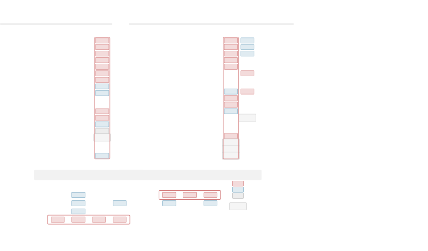

# Where Is Rank-1 DiM Refusal Intervenable in Multimodal LM Derivatives?

Chansu Han Affiliation: NICT Email: [han@nict.go.jp](mailto:)   
Seok-Hwan Choi Affiliation: Yonsei University    Takeshi Takahashi
Affiliation: NICT

###### Abstract

Open-weight model hubs now ship not only chat checkpoints but a long
tail of derivatives—fine-tunes, safety guards, vision–language models
(VLMs), audio wrappers, and generative heads—yet residual-stream safety
audits still often intervene at a single site, usually the text
decoder $`T`$. We ask a localization question under one shared mean /
rank-1 difference-in-means (DiM) extract$`=`$intervene protocol, with
matched-norm random and empty-rate controls: does causal chat attack
lift concentrate at $`T`$, or do perceptual encoders, projectors, and
fusion paths ($`E`$/$`P`$/$`F`$) supply a comparable bypass? On the
mixed-input settings we stress-test—HADES adversarial images paired with
harmful text prompts, and spoken AdvBench via text-to-speech (TTS) or
silence—text DiM at $`T`$ raises attack success rate (ASR) while the
same mean DiM at $`E`$/$`P`$/$`F`$ does not; attacks track harmful text
rather than image or audio content. Margin-rank and leverage probes on a
Vision leaf show that this recipe is extremal at $`T`$ and near chance
at $`P`$/$`E`$, which pressures a weak-extractor reading of those flat
cells for the DiM family we study. Catalog breadth and mapper-free
base$`\to`$derivative transfer when residual widths match provide
supporting coverage under the same gates; generative U-Nets are a
separate band under generation judges. The primary claim is this
recipe-scoped $`T`$ vs. non-text intervenability asymmetry—intervention
accessibility under mean / rank-1 DiM, not a claim that refusal is
absent or fully represented outside $`T`$ (text vs. perceptual contrasts
and pooling differ by site). On VLGuard Unsafe prompts ($`n{=}200`$;
Llama-Guard), the same $`T`$ vs. $`P`$/$`E`$ directionality holds at
modest absolute ASR ($`0.030{\to}0.150`$ at $`T`$). An
intervention-oriented Class$`\times`$site ledger records where this
protocol still hooks as supporting coverage, not as a universal
multimodal bypass.

|     |
| --- |
|     |

## 1 Introduction

Open-weight hubs ship not only official instruct checkpoints $`B`$, but
a long tail of derivatives $`M`$: continued fine-tunes, safety guards,
thinking models, vision–language models (VLMs), audio wrappers, mixer
hybrids, and speculative or draft heads. Hub cards rarely document which
residual stream an auditor can still hook, or whether a
difference-in-means (DiM) refusal direction (Arditi et al., 2024;
Marshall et al., 2024) remains causally effective after that change.
Product-level ontologies and fine-tuning risk surveys (Qi et al., 2024;
Huang et al., 2026) describe _what_ was trained; they do not tell an
intervention auditor _where_ to extract and ablate. Single-model refusal
DiM and same-architecture vector reuse (Arditi et al., 2024; Zhu et al.,
2024; Wu et al., 2026) stress one checkpoint or transfer a defence,
while learned cross-model maps (Oozeer et al., 2025) ask whether an
intervention can be _moved_. To our knowledge, prior work has not
jointly (i) asked, under one shared mean / rank-1 DiM
extract$`=`$intervene protocol with matched-norm random controls,
whether causal chat attack success rate (ASR) lift concentrates at $`T`$
or also arises at perceptual encoders, projectors, and fusion
($`E`$/$`P`$/$`F`$), (ii) catalogued open-weight derivative Classes that
span continued fine-tunes, guards, thinking and speculative heads, VLMs,
audio wrappers, and mixer hybrids and audited each under that same
protocol, and (iii) reported mapper-free base$`\to`$derivative cross for
base / self / cross donors on the same gates when residual widths
match—with (ii)–(iii) as supporting coverage of where the protocol still
hooks, not as the primary localization claim.

We therefore adopt a compact, intervention-oriented taxonomy (Root /
Inheritance / Axis / Class; Figure 1a) and map each Class to residual
hook sites (Table D; extraction IDs in Table 1). The operative question
is not a full language-model ontology, but which architectural change
breaks the _same_ rank-1 residual protocol (Oozeer et al., 2025).

Main question. Under one shared mean / rank-1 DiM protocol, does causal
chat attack lift concentrate at the text decoder $`T`$, or do perceptual
encoders ($`E`$), projectors ($`P`$), and fusion paths ($`F`$) supply
comparable intervenability? We answer this as a question about
_intervention accessibility under this recipe family_: text DiM and
non-text DiM change the contrast variable and pooling with the site, so
the comparison is not a fully isolated location effect.

Findings. (i) *Chat attack lift is $`T`$-local on the cells we test.*
Text DiM at $`T`$ raises chat ASR on plain text and on tested
mixed-input wrappers (HADES adversarial image$`+`$harmful text;
Qwen2-Audio TTS or silence), while mean non-text DiM
$`\mathrm{R}_{\mathrm{u}}`$ at $`E`$/$`P`$/$`F`$ yields no attack lift
under matched-norm random. A cross-condition with a benign image and
harmful text shows that attacks track harmful text, not image content
(typography-style FigStep remains a ceiling; Sec. 6). HADES-style cells
are therefore stress tests of $`T`$-side intervenability under
multimodal _inputs_, not maximally diagnostic modality-native refusal;
VLGuard Unsafe ($`n{=}200`$; Llama-Guard) preserves $`T{>}P`$/$`E`$
directionality at modest absolute ASR (Sec. 6). On the Vision-Instruct
leaf that carries the HADES win, the extracted direction at $`T`$ is
worst-case among 50 matched-norm margin probes, whereas at $`P`$/$`E`$
it is near chance (Figure 2)—evidence that the tested mean / rank-1
recipe is strong at $`T`$ and weak at perception sites, without claiming
that no other feature family could succeed there. (ii) *Supporting
coverage under the same gates.* Llama-lineage $`T`$ is broadly
effective, with mapper-free $`B\!\to\!M`$ cross when widths match;
Thinking models are Class-effective only with suite qualification.
Hard-Class probes are deferred to Appendix G. (iii) *Generative U-Nets
are a separate band.* Concept DiM erases harm at down-blocks and fails
at mid-blocks under generation judges we never pool with chat ASR.

Contributions. (1) A shared extract$`=`$intervene audit that applies
Arditi-style mean DiM at both $`T`$ and non-text sites under
matched-norm random, and reports the resulting $`T`$ vs.
$`E`$/$`P`$/$`F`$ asymmetry—including the negative non-text result for
this recipe family—with margin-rank and leverage instruments on a Vision
leaf (§6). (2) An intervention-oriented Class taxonomy of open-weight
derivatives with audited per-Class coverage under one protocol.
(3) Mapper-free supply-chain cross when residual widths match, together
with within-protocol recipe comparisons (Fig. 4), as supporting
coordinates rather than as the primary localization claim.

## 2 Related work

Refusal geometry. Arditi et al. extract a single DiM direction whose
ablation or orthogonalization suppresses refusal in-model (Arditi
et al., 2024). Yu et al. keep the same DiM axis but replace zeroing with
refusal-feature ablation (RFA)—patching the refusal (or negative-side)
coordinate to $`(\mu^{(-)\top}\hat{v})\,\hat{v}`$—as a proxy worst-case
safety offset used inside adversarial training (Yu et al., 2025); we
record that intervention (not ReFAT training) as an optional recipe on
any $`(\mathrm{R}_{\ast},\mathrm{site})`$ pair in Sec. 4. Follow-ups
refine the extractor (Siu et al., 2025), argue for multi-direction or
affine structure (Joad et al., 2026; Marshall et al., 2024), and
separate harmfulness from refusal features (Zhao et al., 2025). We keep
Arditi-style rank-1 DiM as the shared substrate so taxonomy Class is
about _whether the same protocol still hooks_, not about a new
extractor; RFA is tested as a within-Class recipe, not a taxonomy
change.

Transfer of interventions. SafetyLock and EnchTable reuse safety vectors
across same-architecture fine-tunes (Zhu et al., 2024; Wu et al., 2026);
Oozeer et al. transfer activation interventions via _learned_ maps
(Oozeer et al., 2025); Agarwal studies sparse autoencoder
(SAE)$`+`$bridge cross-architecture steering (Agarwal, 2026). Those
lines ask whether a defence or steer can be _moved_. We instead ask, for
each derivative Class, whether self DiM at a documented site is an
attack effective—and, when widths match, whether a family /
instruct-base donor $`\hat{v}_{B}`$ cross-loads without a mapper
($`\mathrm{ASR}_{\mathrm{base}}`$/$`\mathrm{ASR}_{\mathrm{self}}`$/$`\mathrm{ASR}_{\mathrm{cross}}`$).

Multimodal residual audits. Yin et al. audit image-conditioning /
ABL*POS directions at the VLM decoder as inference-time defence (Yin
et al., 2026). MARS harnesses textual refusal directions for multimodal
safety inside one VLM (D’Incà et al., 2026). ASTRA attributes over
visual tokens but still steers at $`T`$ (Wang et al., 2025). CMRM /
ShiftDC calibrate modality-induced decoder shifts as defence (Liu
et al., 2025; Zou et al., 2025). HADES supplies adversarial images as
generation inputs (Li et al., 2024). Across these lines, extract or
intervene typically remains at the text decoder; non-text activations
are used mainly for attribution or conditioning, not as same-site attack
DiM sites. We use HADES and spoken AdvBench as mixed-input *eval* cells
with intervene@$`T`$, and additionally audit same-site mean
$`\mathrm{R}*{\mathrm{u}}`$@$`E`$/$`P`$/$`F`$ under matched-norm random
(Sec. 6), treating a flat non-text outcome as evidence about this recipe
family rather than as a failed experiment. Beyond protocol axes (App. B;
Table 6), the Vision same-pack residual bake-off is Fig. 4a (Sec. 5);
LLaVA footnotes are Table 11. We do not paste published unsafe rates
next to attack ASR, and we do not reimplement full ASTRA
token-attribution as an alternate attack recipe.

Benchmarks and supply-chain risk. AdvBench (Zou et al., 2023), HarmBench
(Mazeika et al., 2024), and StrongREJECT (Souly et al., 2024)
standardize harmful requests; Llama Guard scores labels rather than chat
completions (Inan et al., 2023). Fine-tuning can erase alignment (Qi
et al., 2024; Huang et al., 2026). Dedicated taxonomies of
architecture-variant open-weight derivatives, as an _intervention_ axis
under a shared extract$`=`$intervene protocol with mapper-free
$`B\!\to\!M`$ cross, remain thin relative to FT-risk surveys and to
single-model DiM / mapper-transfer studies (above)—the coverage gap our
supporting Class ledger fills around the $`T`$ vs. non-text localization
claim.

## 3 Derivative taxonomy

Role. Intervention-oriented labeling for residual-stream audits (not a
complete LM ontology). Quantization, context length, and
SFT/DPO/abliteration are model attributes, not new Axes. In figures, red
marks Classes that are effective under our gates (including Guard label
miss$`\uparrow`$; suite- or $`\lambda`$-limited lifts that still clear
matched-norm random count as red); blue marks Classes that remain
ineffective, infeasible, or N/A.

#### Outcome labels.

- •
  effective—steered ASR (or task-native erase/miss) above base with
  matched-norm random near floor and non-collapsed generations; suite-
  or narrow-$`\lambda`$ lifts that clear those gates stay
  Class-effective (red).
- •
  ineffective—documented site runs, but no gated attack lift (ASR flat,
  anti-lift, or random$`\approx`$self).
- •
  infeasible—same-band checkpoint exists, yet loader, hook, tokenizer,
  or eval saturation blocks a fair run.
- •
  N/A—no causal residual hook on the scored path (non-AR forward,
  action/VLA readout, MTP/draft-only, bit kernels, pure SSM without
  exposed $`h^{(\ell)}`$)—applicability limit, not a failed search.

Where no Llama-lineage checkpoint covers an Axis, we evaluate an
out-of-lineage Hub model (marked ^(ol); self DiM; within-family cross
when widths match). Chat effective/ineffective follow Sec. 5 gates
(Table D); Fig. 2 shows the tested mean / rank-1 recipe strong at
Vision $`T`$ and near chance at $`P`$/$`E`$. Hook layout: App. C.

Levels & band. Root $`\to`$ Inheritance $`\to`$ Axis (A1–A7) $`\to`$
Class. Intervention band (Same-shape / Resized / Multimodal / Mixer)
marks how easily the same rank-1 residual protocol runs as on $`B`$;
A3/A7 may be Band —. Eval Root is Llama-3.1-8B-Instruct (primary lineage
for Same-band and Llama-backed wrappers). Cross uses a within-family
donor (Llama $`B\!\to\!M`$; width-matched Qwen $`B^{\prime}\!\to\!M`$).

#### What each Axis changes.

Axes mark architectural change relative to $`B`$: weight-only tuning
(A1), decode / scoring-path change (A2), training-objective change (A3),
attached perception or generation stacks (A4), mixer replacement (A5),
action / tool readouts (A6), and numeric-format change (A7). Whether
each leaves a rank-1 residual site to intervene on is what Figure 1
answers; detailed Axis prose is App. D. Out-of-lineage^(ol) models
without a matched donor report self DiM only.



Figure 1: Class$`\times`$site map under one extract$`=`$intervene
protocol (taxonomy overview; not an ASR plot). (a) Per-Class
intervenable residual site (non-$`T`$ drawn only when present). Band
$`=`$ width/template relation to the instruct root $`B`$.
Llama-lineage $`T`$ is broadly effective; existing non-$`T`$ sites stay
ineffective except UNet-down and the Mamba2 mixer. (b) $`T`$ holds under
all four chat input conditions; $`E`$/$`P`$/$`F`$ stay ineffective;
UNet-dn holds on every generative condition, mid does not (judges never
pooled across bands). Numbers: Table 2; per-Class why/lim: Table D.

## 4 Text vs. non-text refusal directions (shared recipes)

We write the text-tower recipe used throughout Sec. 6 (DiM $`+`$ rank-1
residual ablation at $`T`$). Non-text / conditioning DiM and optional
RFA are introduced briefly below and fully specified in App. C; Emp
finds them ineffective (or recipe-only) for headline chat attack credit.

#### Notation.

Let $`T`$ denote the text-decoder residual stream and
$`s\in\{E,P,F,C,Q,\mathrm{VT},\ldots\}`$ index _non-text_ hook sites
($`E`$ $`=`$ perceptual encoder, $`P`$ $`=`$ modality projector,
$`F`$ $`=`$ fusion / cross-attention, $`C`$ $`=`$ compressor or
connector, $`Q`$ $`=`$ Q-Former, $`\mathrm{VT}`$ $`=`$
visual-/audio-token span *inside* $`T`$). Write $`u`$ for a perceptual
input (image $`x`$, audio clip $`a`$, …), $`q`$ for a fixed text probe,
and $`a_{s}(u;q)`$ for the hooked activation at site $`s`$. Let
$`\phi_{s}(\cdot)`$ be a site-specific pool (e.g. mean over patch tokens
at $`E`$, over projected image tokens at $`P`$, or last text position
at $`T`$). Let $`y`$ be the scored model output: generated text for chat
ASR (Sec. 6), or image/audio for generative output-modality probes. We
write $`\mathrm{R}_{\ast}`$ for the _extraction contrast_ (Table 1):
what is averaged on each DiM side. Hook site and Class may still differ
under the same $`\mathrm{R}_{\ast}`$.

#### Text DiM $`\mathrm{R}_{\mathrm{txt}}`$ (condition (a); primary attack).

Following Arditi et al. (Arditi et al., 2024), contrasts are harmful vs.
benign _text_ prompts $`\mathcal{D}_{\mathrm{harm}}^{\mathrm{txt}}`$ /
$`\mathcal{D}_{\mathrm{ben}}^{\mathrm{txt}}`$ (no image, or image held
fixed in a separate ablation):

```math
\displaystyle\mu_{\mathrm{txt}}^{(h)} \displaystyle=\mathbb{E}_{p\sim\mathcal{D}_{\mathrm{harm}}^{\mathrm{txt}}}\big[\phi_{T}\big(h^{(L)}(p)\big)\big],\quad\mu_{\mathrm{txt}}^{(b)}=\mathbb{E}_{p\sim\mathcal{D}_{\mathrm{ben}}^{\mathrm{txt}}}\big[\phi_{T}\big(h^{(L)}(p)\big)\big], \tag{1}
```

```math
\displaystyle\hat{v}_{\mathrm{txt}} \displaystyle=\frac{\mu_{\mathrm{txt}}^{(h)}-\mu_{\mathrm{txt}}^{(b)}}{\bigl\|\mu_{\mathrm{txt}}^{(h)}-\mu_{\mathrm{txt}}^{(b)}\bigr\|},\quad h\leftarrow h-\lambda\,(h^{\top}\hat{v}_{\mathrm{txt}})\,\hat{v}_{\mathrm{txt}}. \tag{2}
```

Guard label miss and hybrid Xm/Xa leaves use this _same_
$`\mathrm{R}_{\mathrm{txt}}`$ family (different readout or block, not a
new contrast). Pure ablation in equation 2 is the default intervention;
optional RFA is defined in App. C.

#### Non-text / conditioning DiM and RFA (brief).

Two further DiM families appear in site audits but not in the headline
ASR grid: $`\mathrm{R}_{\mathrm{u}}`$ (harm vs. benign
*perceptual* $`u`$ at non-text sites $`s`$) and Yin-style
$`\mathrm{R}_{\mathrm{cond}}`$ (image$`+`$text vs. text-only
conditioning at $`T`$) (Yin et al., 2026). Empirically both fail as chat
attack extracts beyond text@$`T`$ (App. C). Optional refusal-feature
ablation (RFA) patches along the same $`\hat{v}`$ instead of zeroing (Yu
et al., 2025); we treat it as a within-site recipe, not a Class
(equation 6–equation 7; App. C).

#### Intervention: pure ablation (default).

Write $`a`$ for the hooked activation at the extract$`=`$intervene site
($`h`$ at $`T`$, or $`a_{s}`$ at a non-text site) and $`\hat{v}`$ for
any unit DiM direction. Pure rank-1 ablation (Arditi et al., 2024)
removes the component along $`\hat{v}`$:

```math
a\leftarrow a-\lambda\,(a^{\top}\hat{v})\,\hat{v}. \tag{3}
```

At $`\lambda{=}1`$ this zeroes the $`\hat{v}`$-coordinate; operating
points here use $`\lambda{>}1`$ (e.g. $`4`$ or $`8`$), which
over-ablates / steers along the same axis. RFA instead patches to the
negative-side mean projection $`\bar{r}`$ (equation 6–equation 7 in
App. C). Headline chat ASR uses equation 3.

#### Structural contrast (families and sites).

Table 1 catalogs _extraction_ families ($`\mathrm{R}_{\mathrm{txt}}`$
vs. $`\mathrm{R}_{\mathrm{u}}`$ hook/pool/path, plus all extraction
IDs); default intervene is rank-1 ablation in equation 2/ equation 3
(optional RFA in App. C). Table D maps Classes to those IDs (so
$`\hat{v}_{\mathrm{txt}}`$, Guard $`\hat{v}`$@$`T`$, and hybrid Xm/Xa
share $`\mathrm{R}_{\mathrm{txt}}`$).

|                                   |                                                                            |                                                                                                                       |
| --------------------------------- | -------------------------------------------------------------------------- | --------------------------------------------------------------------------------------------------------------------- |
| _(A) Recipe axes_                 |                                                                            |                                                                                                                       |
| Axis                              | $`\mathrm{R}_{\mathrm{txt}}`$: $`\hat{v}_{\mathrm{txt}}`$@$`T`$            | $`\mathrm{R}_{\mathrm{u}}`$: $`\hat{v}_{\mathrm{nt}}^{(s)}`$@$`s`$                                                    |
| Contrast variable                 | text prompt $`p`$                                                          | perceptual input $`u`$ (image $`x`$, audio $`a`$, …)                                                                  |
| Contrast pools                    | $`\mathcal{D}_{\mathrm{harm/ben}}^{\mathrm{txt}}`$                         | $`\mathcal{D}_{\mathrm{harm/ben}}^{(u)}`$ (matched-format benign)                                                     |
| Hooked tensor                     | decoder residual $`h^{(L)}`$                                               | $`a_{s}(u;q)`$: e.g. $`a_{E}`$/$`a_{P}`$/$`a_{F}`$/$`a_{C}`$/$`a_{Q}`$                                                |
| Pool $`\phi_{s}`$                 | $`\phi_{T}`$: often _last text position_                                   | $`\phi_{s}`$: mean over _non-text_ tokens (patches, VT, Q-Former); at fusion use image/audio positions, not last text |
| Path to $`y`$                     | $`T\!\to\!y`$                                                              | $`E\!\to\!P\!\to\!\cdots\!\to\!T\!\to\!y`$                                                                            |
| Typical $`y`$                     | generated chat text                                                        | same text $`y`$ (VLM/A+T); separate judges for generative erase                                                       |
| _(B) Extraction ID catalog_       |                                                                            |                                                                                                                       |
| ID                                | Contrast pools (DiM sides)                                                 | Typical $`\hat{v}`$ / use                                                                                             |
| $`\mathrm{R}_{\mathrm{txt}}`$     | harmful vs. benign _text_ prompts                                          | $`\hat{v}_{\mathrm{txt}}`$@$`T`$ (primary attack)                                                                     |
| $`\mathrm{R}_{\mathrm{u}}`$       | harmful vs. benign *percept* $`u`$ (fixed probe $`q`$)                     | $`\hat{v}_{\mathrm{nt}}^{(s)}`$@$`E`$/$`P`$/$`F`$/$`\ldots`$ (shared residual protocol)                               |
| $`\mathrm{R}_{\mathrm{cond}}`$    | _image$`+`$text_ vs. _text-only_ (same prompt; Yin ABL_POS / $`\Delta h`$) | $`\hat{v}_{\mathrm{cond}}`$@$`T`$ (defence / extract audit)                                                           |
| $`\mathrm{R}_{\mathrm{concept}}`$ | concept vs. neutral generation prompts                                     | $`\hat{v}_{\mathrm{concept}}`$@UNet (T$`\to`$I / T$`\to`$A erase)                                                     |
| ctrl                              | matched-norm random; $`\mu_{\mathrm{harm}}`$ alone; PC1; blank canvas      | specificity / recipe ablations                                                                                        |
| map                               | $`\mathrm{R}_{\mathrm{txt}}`$ then linear $`W`$ (width change)             | $`W\hat{v}_{B}`$ on Size variant                                                                                      |

Table 1: DiM _extraction_ families and recipes (not an intervene
operator table). Top block: $`\mathrm{R}_{\mathrm{txt}}`$ vs.
$`\mathrm{R}_{\mathrm{u}}`$ (hook/pool/path to scored $`y`$). Bottom:
extraction IDs (same ID $`=`$ same pooling contrast; hook site and Class
may still differ). Intervene $`=`$ rank-1 ablation of the extracted
$`\hat{v}`$ at the same site (equation 2, equation 3); optional RFA in
App. C. Yin-style $`\mathrm{R}_{\mathrm{cond}}`$ (Yin et al., 2026)
contrasts _modality / conditioning_ (image$`+`$text vs. text-only),
_not_ harm vs. benign labels. $`\phi_{s}`$ $`=`$ pool at site $`s`$
before forming $`\hat{v}`$.

#### Controls to verify.

(i) Matched-format benign images (avoid canvas / OCR confounds).
(ii) Random unit vector of matched norm at the same site (ctrl in
Table 1). (iii) Pool over _image_ positions at fusion layers—not last
text tokens. (iv) Empty / collapsed generation rate near zero before
reading ASR.

## 5 Experimental setup

We evaluate where a shared rank-1 extract$`=`$intervene protocol still
hooks across derivative Classes (Fig. 1a): a localization audit under
fixed fairness gates, not an architecture-universal transfer claim.
Three evaluation bands stay separate: (chat) AdvBench / HarmBench /
StrongREJECT with chat judges; (conditional) mixed-input cells (HADES,
spoken AdvBench); (non-text site) $`E`$/$`P`$/$`F`$ / dual audits under
the same protocol (Sec. 4; evidence in Sec. 6).

Benchmark split. AdvBench (Zou et al., 2023) uses disjoint prefix/suffix
splits for DiM extract ($`n{=}128`$) vs. ASR eval ($`n{=}392`$);
Alpaca (Taori et al., 2023) supplies benign contrast only. HarmBench
($`n{=}320`$) and StrongREJECT ($`n{=}313`$) are eval-only and never
enter DiM extraction (Table 3). HADES (Li et al., 2024) and AdvBench TTS
appear in conditional cells only.

Per-Class task and DiM. Each red Class maps to one scored I/O task
(App. E): text chat ($`T_{H}\!\to\!T`$), Guard labels, or conditional
$`I_{H}{+}T_{H}\!\to\!T`$ / $`A_{H}{+}T\!\to\!T`$ (subscripts H/B $`=`$
harmful / benign-or-neutral inputs at eval time; e.g. $`I_{H}{+}T_{H}`$
$`=`$ harmful image paired with harmful text). Chat-band wrappers report
$`\mathrm{R}_{\mathrm{txt}}`$@$`T`$ on the same three text suites so ASR
is comparable; multimodal-only eval is not mixed into that matrix.
Shared controls: harm–benign DiM, extract$`=`$intervene, rank-1 ablation
(equation 3, equation 2), optional RFA (equation 7), greedy decoding,
and matched-norm random at the same site (Sec. 4). DiM’s negative-side
mean $`\mu^{(-)}`$ and the RFA patch $`\bar{r}`$ are related but not
cancelling (Sec. 4). Frozen layer/$`\lambda`$ are fixed before final
generation (Table 4); pre-specified exceptions are listed in App. A.1.

Judging and Class credit. Class attack effective needs
Nemotron$`\wedge`$HarmBench-cls (HBC) above base, matched-norm random
near floor, and a quality gate (non-empty / non-collapsed); keyword (KW)
ASR alone never qualifies. A red Class claim uses the same gates that
make negatives meaningful: disjoint AdvBench extract/eval, HB/SR never
in DiM extract, matched-norm random near base (not near self), and a
frozen layer/$`\lambda`$. Steer-N/A marks an undefined residual path;
ineffective stays open to other extractors until pure matched-norm
controls fail. Bench saturation (e.g. Hermes Adv/SR effective but tiny
HB headroom) is a model caveat, not Class blue. Plotted chat markers are
seven-judge median with IQR bars (Fig. 3; calibration Table 5); the
panel is thickness, not a Class recolor. Production chat targets
AdvBench $`n{=}392`$, HarmBench $`n{=}320`$, StrongREJECT $`n{=}313`$;
mechanism / dual / generative / ceiling cells often use smaller $`n`$.
Glyphs on Fig. 3 ($`\bullet`$ self; $`\oslash`$ family donor;
$`\blacksquare`$ label task; $`\triangle`$ mixer site) tag protocol, not
Class color (App. A.2).

Residual comparison panels. Supporting Class coverage and residual
bake-offs appear after the primary mechanism result in Sec. 6
(Figs. 3, 4; AdvBench $`n{=}392`$; seven-judge median$`+`$IQR; HADES
dropped for suite parity in the bake-off): (a) Vision residual-recipe
bake-off (text DiM@$`T`$ vs. ABL_POS / CMRM-style / ShiftDC-style);
ABL_POS is a Yin-style defence / conditioning extract scored as an
attack—near-floor ASR means it is not a useful attack recipe, not that
“images make ASR low”; (b) $`K{=}6`$ Class-leaf lift (base / self /
cross / random); (c) pure vs. RFA. Related protocol coordinates are
App. B.

## 6 Empirical localization

We map where mean / rank-1 DiM refusal remains _intervenable_ under one
shared extract$`=`$intervene protocol, leading with the $`T`$ vs.
non-text asymmetry (Fig. 2) under fixed gates; Class coverage and
residual bake-offs follow as supporting panels. Three claims line up
with Fig. 1 and Table 2: (1) tested mixed-input cells (HADES; TTS) are
effective at $`T`$, while mean $`\mathrm{R}_{\mathrm{u}}`$ at
$`E`$/$`P`$/$`F`$ is ineffective; (2) Llama-lineage $`T`$ is broadly
effective, with Thinking Class-effective only under suite qualification;
hard-Class probes in App. G; (3) UNet-down concept erase is effective
while mid stays ineffective (judges not pooled with chat). Supporting
patterns—audio projector ineffective, Thinking strong on JailbreakBench
(JBB) / HarmBench (HB) / StrongREJECT (SR) with AdvBench under pure
ablation still weak, RFA as a within-site variant—appear in the Class
maps; closed blue searches are in App. G. Chat credit uses AdvBench
extract$`[0{:}128]`$ / eval$`[128{:}520]`$ ($`n{=}392`$) with HB/SR
eval-only; judges stay separated by output type (Nemotron$`\wedge`$HBC;
NudeNet$`+`$CLIP; CLAP).

#### Visual-harm control (VLGuard).

Because HADES pairs adversarial images with explicitly harmful text, we
also evaluate VLGuard Unsafe prompts ($`n{=}200`$) under a single
Llama-Guard-3 success definition (empty rate $`0`$). At the paper Vision
operating point (L10, $`\lambda_{t}{=}4`$,
$`\lambda_{\mathrm{mm}}{=}2`$), ASR moves $`0.030{\to}0.150`$ at $`T`$
($`\Delta{+}0.120`$) versus $`+0.020`$ at $`P`$ and $`+0.035`$ at $`E`$
(random stays near base). We treat this as a localization-_direction_
control against a pure text-payload artifact, not as a HADES-scale
absolute attack win; keyword ASR is not used for the VLGuard claim. As a
pooling fairness check at the same $`\lambda_{\mathrm{mm}}{=}2`$ OP,
replacing mean patch pooling by max pooling for @$`E`$ DiM extract does
_not_ increase LG lift (mean $`\Delta{+}0.030`$; max $`\Delta{-}0.010`$;
$`n{=}200`$), while extract-time $`|a^{\top}\hat{v}|`$ is larger under
max than mean and both dwarf matched-norm random—so flat @$`E`$ is not
explained by mean dilution alone. Scale sensitivity is quality-gated:
$`\lambda_{\mathrm{mm}}{=}8`$ yields mostly collapsed generations and is
discarded; at $`\lambda_{\mathrm{mm}}{=}4`$ mean-pool $`n{=}200`$,
coherent LG rises $`0.035{\to}0.232`$ ($`\Delta{+}0.197`$, gibber
$`11.5\%`$) while max stays flat ($`\Delta{-}0.005`$), so we do _not_
claim @$`E`$ is inert at every multiplier—only that under the paper OP
(and max-pool at that OP) lift remains small relative to @$`T`$.
Judge-threshold sensitivity on the primary pack keeps
$`T\Delta{>}E\Delta`$ under LG / Nemo / HBC / Nemo$`\wedge`$HBC /
majority-2. Within-$`E`$ matched edit budgets (same
$`\lambda|a^{\top}\hat{v}|`$ for DiM@$`\lambda{=}2`$ and scaled random)
leave DiM LG near the paper OP ($`0.035{\to}0.075`$) while
matched-budget random rises to $`0.32`$—equalizing edit size does not
turn mean DiM@$`E`$ into a strong attack.

Site asymmetry under the tested mean / rank-1 recipe. A flat non-text
cell admits three readings that matched-norm random alone cannot
separate: the refusal-related axis may be absent, present while our mean
/ rank-1 recipe misses it, or found while $`T`$ re-imposes refusal
downstream. If the weak-recipe reading is true for our extractor, every
non-text ineffective cell is an artefact of that extractor rather than a
property of the site. Fig. 2 does not exclude every alternative
extractor (multi-direction or SAE features remain open), but on the
Vision-Instruct leaf that carries the HADES win, the same mean / rank-1
protocol that is extremal at $`T`$ is near chance at $`P`$/$`E`$.

|                                                             |                                            |             |                                           |                                              |
| ----------------------------------------------------------- | ------------------------------------------ | ----------- | ----------------------------------------- | -------------------------------------------- |
| Claim                                                       | Evidence cell                              | Site        | $`0\!\to`$steer (Nemo)                    | Control / note                               |
| _(1) Coordinates: mixed-input at $`T`$; non-text flat_      |                                            |             |                                           |                                              |
| Mixed@$`T`$                                                 | Vision HADES test500                       | $`T`$       | $`0.034\!\to\!0.616`$                     | rand $`0.024`$                               |
| Mixed@$`T`$                                                 | Qwen2-Audio TTS Adv                        | $`T`$       | $`0.03\!\to\!0.84`$                       | held-out Adv text                            |
| $`\mathrm{R}_{\mathrm{u}}`$ flat                            | Vision @$`P`$/$`F`$                        | $`P`$/$`F`$ | $`0.021\!\to\!0.021`$                     | $`=`$ matched-norm rand                      |
| $`\mathrm{R}_{\mathrm{u}}`$ flat                            | Qwen2-Audio @$`P`$                         | $`P`$       | $`0.02\!\to\!0.03`$                       | benign-TTS contrast                          |
| ABL_POS                                                     | LLaVA $`\mathrm{R}_{\mathrm{cond}}`$@$`T`$ | $`T`$       | $`0.38\!\to\!0.24`$                       | defence role; Tab. 11                        |
| _(supporting) Dual ablations (pack $`\neq`$ HADES test500)_ |                                            |             |                                           |                                              |
| Dual$`\approx T`$                                           | Vision $`T{+}P`$                           | $`T{+}P`$   | $`\Delta`$ $`0.19`$ / $`0.21`$            | lift: $`T`$ alone / dual                     |
| Dual$`\approx T`$                                           | LLaVA-Mini $`T{+}C`$                       | $`T{+}C`$   | $`\Delta`$ $`0.35`$ / $`0.40`$            | lift: $`T`$ alone / dual; $`C`$ alone flat   |
| _(2) Catalog breadth under audited controls_                |                                            |             |                                           |                                              |
| Llama $`T`$                                                 | Hermes Adv392                              | $`T`$       | $`0.23\!\to\!0.69`$                       | HB headroom tiny ($`0.38\!\to\!0.43`$)       |
| Llama $`T`$                                                 | ToolACE Adv392                             | $`T`$       | $`0\!\to\!0.82`$                          | HBC $`0\!\to\!0.73`$; rand$`\approx`$base    |
| ^(ol) MoE                                                   | Mixtral Adv392                             | $`T`$       | $`0.03\!\to\!0.86`$                       | HBC $`0.04\!\to\!0.82`$; rand$`\approx`$base |
| Native MM                                                   | Omni Adv392                                | $`T`$       | $`0.04\!\to\!0.66`$                       | EB-family cross $`0.81`$                     |
| Native MM                                                   | Omni HB / SR                               | $`T`$       | $`0.09\!\to\!0.40`$ / $`0.01\!\to\!0.58`$ | same OP; rand$`\approx`$base                 |
| Hard Classes                                                | App. G                                     | $`T`$       | Audio@$`T`$ unlock                        | mixed measured / N/A / not-run               |
| _(3) Second band (generative; judges not pooled with chat)_ |                                            |             |                                           |                                              |
| Erase                                                       | SD-Turbo T$`\to`$I                         | UNet-dn     | $`0.79\!\to\!0`$                          | mid-block ineffective                        |
| Erase                                                       | SD-Turbo I$`\to`$I                         | UNet-dn1    | $`1.0\!\to\!0`$ @$`\lambda{=}25`$         | down2 / mid flat                             |
| Erase                                                       | AudioLDM T$`\to`$A                         | UNet-dn     | erase (CLAP)                              | mid-block ineffective                        |

Table 2: Emp claim ledger under one extract$`=`$intervene protocol.
Complements Fig. 1: one row $`=`$ one localization claim (mixed@$`T`$ /
$`\mathrm{R}_{\mathrm{u}}`$ flat / catalog / UNet; dual supporting).
Primary $`=`$ Nemotron ASR $`0\!\to\!`$steer (erase $`=`$ NudeNet /
CLAP; never pooled with chat). Control $`=`$ matched-norm random, suite
headroom, or generative mid-block null. Dual rows: $`\Delta`$ $`=`$ ASR
lift (steer$`-`$base); slash $`=`$ $`T`$-alone / dual on the same pack
($`\neq`$ HADES test500). Class ASR: Fig. 3; I/O$`\times`$judge: App. E.

Figure 2: Mechanism: intervenable lift concentrates at $`T`$ under mean
/ rank-1 DiM (Vision-Instruct, HADES; $`n{=}128`$). The recipe is
extremal at $`T`$ and near chance at $`P`$/$`E`$ among $`50`$
matched-norm probes—a site asymmetry for this extractor, not a claim
that no other feature family could succeed. (a) Image$`+`$harmful
inputs: $`\mathrm{R}_{\mathrm{txt}}`$@$`T`$ moves prompts to the bypass
side; $`\mathrm{R}_{\mathrm{u}}`$@$`P`$ stays on the refusal side
($`x{=}{+}0.5`$ refusal / $`{-}0.5`$ bypass; $`y`$ $`=`$ orthogonal PC).
(b) Attack displacement $`|\rho|`$ ($`99\%`$ bootstrap):
$`{\approx}0.64`$ at $`T`$ vs. $`{\lesssim}0.12`$ at $`P`$/$`E`$.
(c) Rank of $`-\hat{v}`$ vs. $`50`$ matched-norm randoms on the safety
margin (rank $`50`$ $`=`$ strongest; $`{\approx}25.5`$ $`=`$ chance).
Mid-depth $`T`$ is worst-case; $`P`$/$`E`$ near chance.

Figure 3: Class-leaf bypass ASR under Text DiM @$`T`$ (equation 3). Top:
AdvBench $`n{=}392`$ / HarmBench $`n{=}320`$ / StrongREJECT $`n{=}313`$;
bottom: HADES and AdvBench TTS (suite-split). Per leaf: base / random /
self / cross; diamond $`=`$ seven-judge median; thin bars $`=`$ IQR
(Class gates Nemotron$`\wedge`$HarmBench-CLS). Y-axis glyphs: App. A.2;
OPs: Table 4.

Figure 4: Three residual-attack claims on AdvBench $`n{=}392`$ (not
Class coverage—Fig. 3). Median ASR$`+`$IQR as in Fig. 3. (a) Vision
recipe bake-off (text DiM@$`T`$ vs. CMRM-style / ShiftDC-style /
ABL_POS). (b) $`K{=}6`$ leaf attack lift (base / random / self / cross).
(c) Pure vs. RFA@$`T`$.

We cache per-layer text-stream residuals once ($`n{=}128`$ HADES dev for
extraction, disjoint test for evaluation) and score three quantities on
the same cache, relative to the harm$`\to`$benign contrast (Yu et al.,
2025).

Where an intervention moves a prompt. Writing $`\hat{v}_{\mathrm{txt}}`$
for the unit text DiM and $`g`$ for the harm$`\to`$benign gap norm,
prompt position $`x=\langle h-c,\ \hat{v}_{\mathrm{txt}}\rangle/g`$
places harmful text at $`x{=}{+}0.5`$ and benign at $`x{=}{-}0.5`$ by
construction ($`c`$ midpoint). At $`\lambda{=}4`$,
$`\mathrm{R}_{\mathrm{u}}`$@$`P`$/$`E`$ carry only $`13`$–$`15\%`$ of
image$`+`$harmful prompts past the midpoint (vs. $`5\%`$ unattacked),
while text ablation at the same $`\lambda`$ carries $`100\%`$ (Fig. 2a).

How far along the axis it moves. The projection ratio
$`\rho=\langle\Delta h,\ \hat{v}_{\mathrm{txt}}\rangle/g`$ measures
shift in gap units (avoiding raw-cosine inflation). Downstream of its
intervention layer, text ablation gives $`|\rho|{=}0.64`$; image
conditioning and $`\mathrm{R}_{\mathrm{u}}`$@$`P`$/$`E`$ stay at
$`0.07`$–$`0.11`$ with $`99\%`$ bootstrap bands that never approach the
text curve (Fig. 2b).

Whether the direction is the strongest matched-norm attack. On a
teacher-forced safety margin (refusal vs. complying continuation), we
apply equation 3 along the attack-signed direction $`-\hat{v}`$ (the
sign cancels in equation 3; kept for ranking polarity) and compare
against $`50`$ matched-norm randoms $`u_{i}`$. Rank $`50/50`$ means our
direction is the strongest probe attack; $`{\approx}25.5`$ is chance.
_Leverage_ is
$`|\Delta\mathrm{margin}(-\hat{v})|/\mathrm{mean}_{i}|\Delta\mathrm{margin}(u_{i})|`$
($`{\approx}1`$ $`=`$ no stronger than chance). At $`T`$, $`-\hat{v}`$
ranks $`50/50`$ at mid depth ($`\lambda{=}4`$; leverage $`6.0`$), while
$`P`$/$`E`$ return rank $`28`$–$`32`$ and leverage $`\leq 0.26`$
(Fig. 2c). These results pressure a weak-recipe reading for this
extractor at perception sites without separating absence from downstream
reimposition, and without exhausting multi-direction search. The
worst-case property at $`T`$ holds in a mid-depth, moderate-$`\lambda`$
window (at $`\lambda{=}8`$ early layers, randoms can match the margin
drop).

The same instrument screens donors. Mapper-free cross asks whether a
donor $`\hat{v}_{B}`$ approximates the recipient’s refusal direction.
Template-matched subspace overlap $`R`$ against a matched-norm random
band is a necessary screen on the pairs we tested: donors inside the
band transfer nothing, and every donor above the band transfers
(Table 10); Mixtral is the clean within-recipient swap (Llama donor
flat; Mistral-family donor $`R{=}0.63`$, ASR$`\!\to\!0.98`$). Overlap is
not sufficient (e.g. Tulu recovers only a fraction of self lift), so
usable-donor screening remains separate from Class / site effectiveness.

#### Non-text / conditioning DiM.

Mean non-text DiM at $`E`$/$`P`$/$`F`$/VT and Yin-style
$`\mathrm{R}_{\mathrm{cond}}`$ do not yield stable chat attack effective
beyond text@$`T`$; dual ablations are pack-noted supporting controls
(App. C).

#### Text tower $`T`$.

Text DiM with rank-1 ablation at $`T`$ raises ASR on held-out AdvBench
and on mixed-input cells (HADES $`I_{H}{+}T_{H}`$; spoken AdvBench)
while matched-norm random stays near base; within-family cross holds
when widths match (Fig. 3). Cross-condition $`I_{B}{+}T_{H}`$ tracks
harmful text, not image content. Thinking is Class-effective on
JBB/HB/SR (and Distill Adv392) while AdvBench under pure ablation
remains weak. On a shared HADES leaf, Vision-Instruct@$`T`$ is the clean
attack win above random; Yin ABL_POS lowers with-image ASR as a defence
(Table 11; Fig. 4a). FigStep does not reproduce the HADES win and caps
“mixed-input” generalization.

#### Guard and audio wrappers.

Llama-Guard-3 raises harmful$`\to`$safe miss $`0.03\!\to\!0.88`$ under
the same $`\hat{v}_{\mathrm{txt}}`$@$`T`$ protocol (label miss, not chat
ASR). Qwen2-Audio is Class effective at $`T`$ (including TTS/silence),
while projector $`\mathrm{R}_{\mathrm{u}}`$ stays ineffective. RFA is a
within-site recipe, not a new Class: it can lift weak-pure leaves
(DeSTA; ToolACE; Qwen2-Audio) and hurt already-strong ones (Hermes pure
$`{\approx}0.69`$ vs. RFA median $`{\approx}0.10`$; Fig. 4c).

#### Yin $`\mathrm{R}_{\mathrm{cond}}`$ and generative erase.

Ablating Yin-style $`\hat{v}_{\mathrm{cond}}`$ acts as a defence /
extract audit at $`T`$, not as an inverse of
$`\mathrm{R}_{\mathrm{txt}}`$ (App. C). Concept DiM in SD-Turbo /
AudioLDM UNets erases harm at down sites (T$`\to`$I NudeNet
$`0.79\!\to\!0`$; T$`\to`$A CLAP erase) and fails at mid under the same
judges; Dream / LLaDA remain Steer-N/A or empty-gated ineffective.

#### Reading Fig. 1a.

Red marks gated effective (including suite-qualified Thinking); blue
marks ineffective, infeasible, or N/A. Catalog-lineage,
out-of-lineage^(ol), and hard-Class probes are separate credit sources
(App. G).

Scope, limits, and outlook. $`B\!\to\!M`$ cross is primarily
Llama-3.1-8B-Instruct derivatives; ^(ol) leaves fill Axis gaps with
width-matched family donors when needed (App. G / H; Related App. B).
Production chat claims use AdvBench / HarmBench / StrongREJECT at
the $`n`$ in Fig. 3; mechanism / dual / generative / ceiling cells often
use smaller $`n`$. Thinking is suite-qualified red, not an unqualified
Class win; KW ceilings (FigStep) do not relabel Classes; Guard is label
miss; generative erase uses separate judges. RFA and defence-style
extracts are within-site recipes (Fig. 4). For ineffective, infeasible,
and N/A cells, searching other refusal-steering families
(multi-direction / SAE / non-residual protocols) is left as future
work—this paper maps where the shared mean / rank-1 DiM still hooks.

## 7 Conclusion

Safety-relevant behavior in open-weight multimodal derivatives is often
audited as if a single residual hook were enough. Under one shared mean
/ rank-1 difference-in-means (DiM) protocol with matched-norm random
controls, the chat attack lift we measure is _intervenable_ primarily at
the text decoder $`T`$: HADES image$`+`$text and spoken AdvBench raise
attack success rate at $`T`$, while the same mean recipe at encoders,
projectors, and fusion ($`E`$/$`P`$/$`F`$) does not. This is a claim
about intervention accessibility under this DiM family—not that refusal
features are absent outside $`T`$, and not a fully site-isolated effect
when contrasts and pooling change with the hook. Margin-rank and
leverage instruments pressure a weak-extractor reading of those flat
perceptual cells for this DiM family; alternatives on ineffective,
infeasible, and N/A leaves are future work. VLGuard Unsafe ($`n{=}200`$;
Llama-Guard) preserves $`T{>}P`$/$`E`$ directionality at modest absolute
ASR under the paper OP, with pooling / scale / threshold / matched-edit
diagnostics reported in Sec. 6. Catalog breadth, mapper-free
$`B\!\to\!M`$ cross when widths match, and generative U-Net erase under
separate judges remain supporting coverage. The primary result is the
recipe-scoped $`T`$ vs. non-text asymmetry; the Class$`\times`$site
ledger records where this protocol still hooks under the same gates.

## Ethics Statement

This work evaluates gray-box refusal bypass on open-weight models for
scientific auditing. We do not release ready-to-weaponize tooling beyond
methods already public in the refusal-direction literature. Dual-use
concerns around residual refusal attacks motivate mitigations studied
elsewhere Yu et al. (2025).

## Reproducibility Statement

We report extract/eval splits, frozen layer/$`\lambda`$ operating points
(Table 4), matched-norm random / empty-rate gates, and the seven-judge
panel protocol used for production ASR ranges. An anonymized archive
with the core extract / intervene / matched-norm-random scripts, frozen
operating-point configs, and a minimal end-to-end example is included in
the supplementary material; the archive is a keyword-ASR smoke path,
while production Class credit uses Nemotron$`\wedge`$HBC as in the main
text. Full experiment scripts, panel JSON, and extended Class grids will
be released upon acceptance.

## AI use statement

Large language models assisted with grammar and copy-editing, and with
drafting and tightening of LaTeX prose. Models did not run experiments,
choose operating points, or invent numerical results. All technical
claims, experimental design, and final wording are the authors’
responsibility.

## References

- Agarwal (2026) Ayushi Agarwal. Cross-architecture steering transfer in
  language models: A systematic empirical study. _arXiv preprint
  arXiv:2608.05164_, 2026. URL
  [https://arxiv.org/abs/2608.05164](https://arxiv.org/abs/2608.05164).
- Arditi et al. (2024) Andy Arditi, Oscar Obeso, Aaquib Syed, Daniel
  Paleka, Nina Panickssery, Wes Gurnee, and Neel Nanda. Refusal in
  language models is mediated by a single direction. In _Advances in
  Neural Information Processing Systems (NeurIPS)_, 2024. doi:
  10.52202/079017-4322. URL
  [https://arxiv.org/abs/2406.11717](https://arxiv.org/abs/2406.11717).
- D’Incà et al. (2026) Moreno D’Incà, Nicu Sebe, and Massimiliano
  Mancini. Harnessing textual refusal directions for multimodal safety.
  _arXiv preprint arXiv:2606.31876_, 2026. URL
  [https://arxiv.org/abs/2606.31876](https://arxiv.org/abs/2606.31876).
- Gou et al. (2024) Yunhao Gou, Kai Chen, Zhili Liu, Lanqing Hong, Hang
  Xu, Zhenguo Li, Dit-Yan Yeung, James T. Kwok, and Yu Zhang. Eyes
  closed, safety on: Protecting multimodal LLMs via image-to-text
  transformation. In _European Conference on Computer Vision (ECCV)_,
  Lecture Notes in Computer Science, 2024. doi:
  10.1007/978-3-031-72643-9_23. URL
  [https://arxiv.org/abs/2403.09572](https://arxiv.org/abs/2403.09572).
- Huang et al. (2026) Tiansheng Huang, Sihao Hu, Fatih Ilhan,
  Selim Furkan Tekin, and Ling Liu. Harmful fine-tuning attacks and
  defenses for large language models: A survey. _ACM Computing Surveys_,
  58(13):1–39, 2026. doi: 10.1145/3817114. URL
  [https://doi.org/10.1145/3817114](https://doi.org/10.1145/3817114).
- Inan et al. (2023) Hakan Inan, Kartikeya Upasani, Jianfeng Chi, Rashi
  Rungta, Krithika Iyer, Yuning Mao, Michael Tontchev, Qing Hu, Brian
  Fuller, Davide Testuggine, and Madian Khabsa. Llama guard: LLM-based
  input-output safeguard for human-AI conversations. _arXiv preprint
  arXiv:2312.06674_, 2023. URL
  [https://arxiv.org/abs/2312.06674](https://arxiv.org/abs/2312.06674).
- Joad et al. (2026) Faaiz Joad, Majd Hawasly, Sabri Boughorbel, Nadir
  Durrani, and Husrev Taha Sencar. There is more to refusal in large
  language models than a single direction. _arXiv preprint
  arXiv:2602.02132_, 2026. URL
  [https://arxiv.org/abs/2602.02132](https://arxiv.org/abs/2602.02132).
- Li et al. (2024) Yifan Li, Hangyu Guo, Kun Zhou, Wayne Xin Zhao, and
  Ji-Rong Wen. Images are Achilles’ heel of alignment: Exploiting visual
  vulnerabilities for jailbreaking multimodal large language models. In
  _European Conference on Computer Vision (ECCV)_, Lecture Notes in
  Computer Science, 2024. doi: 10.1007/978-3-031-73464-9_11. URL
  [https://arxiv.org/abs/2403.09792](https://arxiv.org/abs/2403.09792).
- Liu et al. (2025) Qin Liu, Chao Shang, Ling Liu, Nikolaos Pappas, Jie
  Ma, Neha Anna John, Srikanth Doss, Lluis Marquez, Miguel Ballesteros,
  and Yassine Benajiba. Unraveling and mitigating safety alignment
  degradation of vision-language models. In _Findings of the Association
  for Computational Linguistics: ACL 2025_, pp. 3631–3643, 2025. doi:
  10.18653/v1/2025.findings-acl.186. URL
  [https://doi.org/10.18653/v1/2025.findings-acl.186](https://doi.org/10.18653/v1/2025.findings-acl.186).
- Marshall et al. (2024) Thomas Marshall, Adam Scherlis, and Nora
  Belrose. Refusal in LLMs is an affine function. _arXiv preprint
  arXiv:2411.09003_, 2024. URL
  [https://arxiv.org/abs/2411.09003](https://arxiv.org/abs/2411.09003).
- Mazeika et al. (2024) Mantas Mazeika, Long Phan, Xuwang Yin, Andy Zou,
  Zifan Wang, Norman Mu, Elham Sakhaee, Nathaniel Li, Steven Basart,
  Bo Li, David Forsyth, and Dan Hendrycks. Harmbench: A standardized
  evaluation framework for automated red teaming and robust refusal. In
  _Proceedings of the 41st International Conference on Machine
  Learning_, volume 235 of _Proceedings of Machine Learning Research_,
  pp. 35181–35224. PMLR, 2024. URL
  [https://proceedings.mlr.press/v235/mazeika24a.html](https://proceedings.mlr.press/v235/mazeika24a.html).
- Oozeer et al. (2025) Narmeen Fatimah Oozeer, Dhruv Nathawani,
  Nirmalendu Prakash, Michael Lan, Abir Harrasse, and Amir Abdullah.
  Activation space interventions can be transferred between large
  language models. In _Proceedings of the 42nd International Conference
  on Machine Learning_, volume 267 of _Proceedings of Machine Learning
  Research_, pp. 47212–47286. PMLR, 2025. URL
  [https://proceedings.mlr.press/v267/oozeer25a.html](https://proceedings.mlr.press/v267/oozeer25a.html).
- Qi et al. (2024) Xiangyu Qi, Yi Zeng, Tinghao Xie, Pin-Yu Chen, Ruoxi
  Jia, Prateek Mittal, and Peter Henderson. Fine-tuning aligned language
  models compromises safety, even when users do not intend to! In
  _International Conference on Learning Representations (ICLR)_, 2024.
  URL
  [https://arxiv.org/abs/2310.03693](https://arxiv.org/abs/2310.03693).
- Siu et al. (2025) Vincent Siu, Nicholas Crispino, Zihao Yu, Sam Pan,
  Zhun Wang, Yang Liu, Dawn Song, and Chenguang Wang. COSMIC:
  Generalized refusal direction identification in LLM activations. In
  _Findings of the Association for Computational Linguistics: ACL 2025_,
  pp. 25534–25553, 2025. doi: 10.18653/v1/2025.findings-acl.1310. URL
  [https://doi.org/10.18653/v1/2025.findings-acl.1310](https://doi.org/10.18653/v1/2025.findings-acl.1310).
- Souly et al. (2024) Alexandra Souly, Qingyuan Lu, Dillon Bowen,
  Tu Trinh, Elvis Hsieh, Sana Pandey, Pieter Abbeel, Justin Svegliato,
  Scott Emmons, Olivia Watkins, and Sam Toyer. A StrongREJECT for empty
  jailbreaks. In _Advances in Neural Information Processing Systems
  (NeurIPS)_, 2024. doi: 10.52202/079017-3984. URL
  [https://arxiv.org/abs/2402.10260](https://arxiv.org/abs/2402.10260).
- Taori et al. (2023) Rohan Taori, Ishaan Gulrajani, Tianyi Zhang, Yann
  Dubois, Xuechen Li, Carlos Guestrin, Percy Liang, and Tatsunori B.
  Hashimoto. Stanford Alpaca: An instruction-following LLaMA model.
  [https://github.com/tatsu-lab/stanford_alpaca](https://github.com/tatsu-lab/stanford_alpaca), 2023.
- Wang et al. (2025) Han Wang, Gang Wang, and Huan Zhang. Steering away
  from harm: An adaptive approach to defending vision language model
  against jailbreaks. In _IEEE/CVF Conference on Computer Vision and
  Pattern Recognition (CVPR)_, 2025. doi: 10.1109/CVPR52734.2025.02787.
  URL
  [https://arxiv.org/abs/2411.16721](https://arxiv.org/abs/2411.16721).
- Wu et al. (2026) Jialin Wu, Kecen Li, Zhicong Huang, Xinfeng Li,
  Xiaofeng Wang, and Cheng Hong. EnchTable: Unified safety alignment
  transfer in fine-tuned large language models. In _IEEE Symposium on
  Security and Privacy (S&P)_, pp. 3358–3376, 2026. doi:
  10.1109/SP63933.2026.00072. URL
  [https://doi.org/10.1109/SP63933.2026.00072](https://doi.org/10.1109/SP63933.2026.00072).
- Yin et al. (2026) Xiangyu Yin, Tora Bodin, Rohan Menon, and Chih-Hong
  Cheng. A cross-architecture audit of direction-based inference-time
  defences in vision-language models. _arXiv preprint
  arXiv:2607.27910_, 2026. URL
  [https://arxiv.org/abs/2607.27910](https://arxiv.org/abs/2607.27910).
- Yu et al. (2025) Lei Yu, Virginie Do, Karen Hambardzumyan, and Nicola
  Cancedda. Robust LLM safeguarding via refusal feature adversarial
  training. In _International Conference on Learning Representations
  (ICLR)_, 2025. URL
  [https://openreview.net/forum?id=s5orchdb33](https://openreview.net/forum?id=s5orchdb33).
- Zhao et al. (2025) Jiachen Zhao, Jing Huang, Zhengxuan Wu, David Bau,
  and Weiyan Shi. LLMs encode harmfulness and refusal separately. In
  _Advances in Neural Information Processing Systems (NeurIPS)_, 2025.
  doi: 10.52202/085713-4688. URL
  [https://arxiv.org/abs/2507.11878](https://arxiv.org/abs/2507.11878).
- Zhu et al. (2024) Minjun Zhu, Linyi Yang, Yifan Wei, Ningyu Zhang, and
  Yue Zhang. Locking down the finetuned LLMs safety. _arXiv preprint
  arXiv:2410.10343_, 2024. URL
  [https://arxiv.org/abs/2410.10343](https://arxiv.org/abs/2410.10343).
- Zou et al. (2023) Andy Zou, Zifan Wang, Nicholas Carlini, Milad Nasr,
  J. Zico Kolter, and Matt Fredrikson. Universal and transferable
  adversarial attacks on aligned language models. _arXiv preprint
  arXiv:2307.15043_, 2023. URL
  [https://arxiv.org/abs/2307.15043](https://arxiv.org/abs/2307.15043).
- Zou et al. (2025) Xiaohan Zou, Jian Kang, George Kesidis, and Lu Lin.
  Understanding and rectifying safety perception distortion in VLMs. In
  _Advances in Neural Information Processing Systems (NeurIPS)_, 2025.
  doi: 10.52202/085713-3810. URL
  [https://arxiv.org/abs/2502.13095](https://arxiv.org/abs/2502.13095).

## Appendix A Benchmark splits and frozen operating points

### A.1 Setup protocol notes (OP exceptions and fairness reminders)

Frozen layer/$`\lambda`$ per model are fixed before final generation
(Table 4). Pre-specified exceptions (not suite-tuned) include
Hermes/Tulu $`\lambda{=}6`$, 3B ridge $`W`$, Vision L10/L20
@$`\lambda{=}4`$, Omni mid-depth L14, LLaVA last-$`k`$ cross, Guard
early cross, and R1 post-think scoring. Existence / mechanism /
generative-erase / ceiling cells may use fair Adv $`n{=}128`$ on the
disjoint suffix ($`[392{:}520]`$) or smaller $`n`$ with task-native
judges—not pooled with production chat ASR. Blue exploration grids and
extended pure-vs-RFA ledgers are App. G.

### A.2 Headline $`y`$-axis glyphs

Fig. 3 appends one glyph to each leaf name so the $`y`$-axis states
_which_ extract$`=`$intervene protocol the plotted ASR uses. The markers
are orthogonal to red/blue Class credit (Fig. 1a):

- •
  $`\bullet`$ self DiM. Harm–benign Text DiM on the recipient; intervene
  with the same $`\hat{v}`$ (most chat leaves; Root Instruct, ToolACE,
  Audio@$`T`$, Omni, …).
- •
  $`\oslash`$ family donor. Width-matched within-family $`\hat{v}`$ when
  Llama $`B\!\to\!M`$ fails the random-band / transfer gates (e.g.
  Mixtral$`\leftarrow`$Mistral; selected Qwen-family leaves).
- •
  $`\blacksquare`$ label task. Scored as Guard label-miss (keyword /
  task-native), not as chat seven-judge ASR—do not pool with Adv/HB/SR
  diamonds.
- •
  $`\triangle`$ mixer site. Intervention at hybrid / native mixer
  residuals (Mamba2 Xm/Xa multi-site) rather than a single text-tower
  depth.

A hollow $`\circ`$ marker is reserved for pure Llama $`B\!\to\!M`$ donor
runs; the current headline grid does not plot it as a separate $`y`$-tag
(cross is already the fourth diamond per leaf). Glyphs never override
the Nemotron$`\wedge`$HBC Class gate.

|                |       |      |         |      |                                                            |
| -------------- | ----- | ---- | ------- | ---- | ---------------------------------------------------------- |
| Corpus         | Mod.  | Pool | Extract | Eval | Role                                                       |
| AdvBench       | text  | 520  | 128     | 392  | Harmful requests; disjoint $`[0{:}128]`$ / $`[128{:}520]`$ |
| Alpaca         | text  | 31k  | 128     | —    | Benign contrast for $`\mathrm{R}_{\mathrm{txt}}`$ only     |
| HarmBench      | text  | 320  | —       | 320  | Eval-only                                                  |
| StrongREJECT   | text  | 313  | —       | 313  | Eval-only                                                  |
| HADES (step 5) | image | 750  | —       | 500  | conditional-input                                          |
| AdvBench TTS   | audio | 520  | —       | 392  | conditional-input                                          |

Table 3: Extract vs. evaluation split (chat-band text suites). HADES /
TTS are conditional-input cells (not chat-band extract pools).
HarmBench, StrongREJECT, HADES, and TTS never enter DiM extraction.

|     |                                          |                           |                                                       |                                                |
| --- | ---------------------------------------- | ------------------------- | ----------------------------------------------------- | ---------------------------------------------- |
| Ax. | Class (model)                            | Extract                   | Self OP                                               | Cross OP                                       |
| A1  | Root (Llama-3.1-8B-Instruct)             | Text DiM @$`T`$           | L16 $`\lambda{=}2`$                                   | same $`\hat{v}`$                               |
| A1  | Wild FT (Hermes / Tulu-3 / UltraMedical) | Text DiM @$`T`$           | L16 $`\lambda{=}6`$ / $`6`$ / $`4`$                   | $`\hat{v}_{B}`$ / self-donor / $`\hat{v}_{B}`$ |
| A1  | Size / Distill (3B / SuperNova)          | Text DiM @$`T`$           | L14 $`\lambda{=}4`$ / L16 $`\lambda{=}4`$             | $`W\hat{v}_{B}`$ / $`\hat{v}_{B}`$             |
| A1  | PEFT S5 (Instruct$`+`$LoRA)              | Text DiM @$`T`$           | L16 $`\lambda{=}6`$                                   | $`\hat{v}_{B}`$                                |
| A1  | MoE Mixtral-8x7B                         | Text DiM @$`T`$           | L16 $`\lambda{=}1`$                                   | Mistral-family $`\hat{v}`$                     |
| A1  | Compress (Sheared-LLaMA)                 | Text DiM @$`T`$           | L16 $`\lambda{=}1`$ (ineff)                           | — / $`\hat{v}_{B}`$                            |
| A2  | Guard-3                                  | Text DiM @$`T`$ (KW miss) | L16 $`\lambda{=}3.75`$                                | L12 $`\lambda{=}3.75`$, $`\hat{v}_{B}`$        |
| A2  | Thinking (R1-Llama)                      | Text DiM @$`T`$           | L16 $`\lambda{=}6`$                                   | $`\hat{v}_{B}`$                                |
| A3  | Dream-7B                                 | Text DiM @$`T`$ (DLM)     | L14 $`\lambda{=}2`$ (fair); mid/multi sweep           | family $`\hat{v}`$                             |
| A4  | Vision-Instruct / LLaVA-Mini             | Text DiM @$`T`$ on HADES  | L10 $`\lambda{=}4`$ / L16 $`\lambda{=}4`$             | L20 $`\lambda{=}4`$ / $`\hat{v}_{B}^{k}`$      |
| A4  | Qwen2-Audio @$`T`$ / TTS                 | Text DiM @$`T`$           | L16 $`\lambda{=}2`$                                   | Qwen1.5-family $`\hat{v}`$                     |
| A4  | Qwen2.5-Omni                             | Text DiM @$`T`$           | L14 $`\lambda{=}2`$                                   | EB-family $`\hat{v}`$                          |
| A5  | Mamba2 (Xm/Xa)                           | Text DiM @mixer           | Xm$`\{14,16,18\}`$/Xa$`\{15,17,19\}`$ $`\lambda{=}3`$ | $`\hat{v}_{B}`$                                |
| A5  | RecGemma-9B / Qwen1.5-MoE                | Text DiM @$`T`$           | L18 $`\lambda{\approx}1.45`$ / L12 $`\lambda{=}2`$    | $`\hat{v}_{B}`$ / family                       |
| A6  | ToolACE-8B (thin agent)                  | Text DiM @$`T`$           | L16 $`\lambda{=}4`$                                   | $`\hat{v}_{B}`$                                |

Table 4: Chat-band operating points for Fig. 3. Extract: Text DiM
(harm–benign mean difference) at the listed residual site; intervene
$`=`$ rank-1 ablation of the same $`\hat{v}`$ (equation 3), not RFA
unless noted. $`\hat{v}_{B}=`$ Instruct (or family) donor; Size uses
ridge $`W\hat{v}_{B}`$. Eval $`n`$: AdvBench 392 / HB 320 / SR 313
(Table 3); HADES 500; TTS Adv 392. DeSTA RFA is Fig. 4 only.

|                             |      |      |      |                          |
| --------------------------- | ---- | ---- | ---- | ------------------------ |
| Judge                       | Acc  | Prec | Rec  | Note                     |
| Keyword (ref.)              | 0.83 | 0.73 | 1.00 | excluded from median/IQR |
| Llama-Guard                 | 0.91 | 0.86 | 0.94 | panel                    |
| Nemotron SG 8B v3           | 0.91 | 0.90 | 0.89 | panel                    |
| MD-Judge-v0.1               | 0.91 | 0.84 | 0.97 | panel                    |
| BeaverDam-7B                | 0.89 | 0.84 | 0.94 | panel                    |
| Open-weight LLM judge (26B) | 0.89 | 0.92 | 0.83 | panel                    |
| HarmBench-cls               | 0.89 | 0.90 | 0.85 | HB suite                 |
| StrongREJECT @0.2           | 0.86 | 0.81 | 0.92 | SR suite                 |

Table 5: Judge calibration on gold160 held-out labels. Plotted chat ASR
uses the _median_ over the seven-judge panel (keyword excluded) with IQR
bars (Setup).

## Appendix B Related-work protocol coordinates

Protocol-axis comparison vs. related settings (Role / Extract /
Intervene / matched-norm Random) is Table 6. Extract$`=`$intervene is
enforced in our attack audits; ASTRA steers at $`T`$ even when
attribution is visual (consistent with our $`E`$/$`P`$ ineffective—no
ASTRA ASR row). Same-pack Vision numbers: Fig. 4a (LLaVA footnotes:
Table 11); localization: Table 2.

|                                    |         |                  |                        |        |
| ---------------------------------- | ------- | ---------------- | ---------------------- | ------ |
| Approach                           | Role    | Extract          | Intervene              | Random |
| Arditi (Arditi et al., 2024)       | attack  | text DiM         | $`T`$                  | (add)  |
| CMRM (Liu et al., 2025)            | defence | MM vs text       | $`T`$ multi            | —      |
| ShiftDC (Zou et al., 2025)         | defence | modality shift   | $`T`$                  | —      |
| Yin ABL_POS (Yin et al., 2026)     | defence | cond@$`T`$       | $`T`$                  | yes    |
| ASTRA (Wang et al., 2025)          | defence | visual attr      | $`T`$                  | —      |
| ECSO (Gou et al., 2024)            | defence | — (I$`\to`$T)    | pipeline               | —      |
| Ours $`\mathrm{R}_{\mathrm{txt}}`$ | attack  | text DiM         | same $`T`$             | yes    |
| Ours $`\mathrm{R}_{\mathrm{u}}`$   | attack  | harm image/audio | same $`E`$/$`P`$/$`F`$ | yes    |
| Ours concept                       | erase   | concept DiM      | same UNet              | yes    |

Table 6: Related settings vs. this work (protocol axes only). Narrative
context: Sec. 2. Same-pack numbers: Fig. 4a / Table 11; localization:
Table 2.

## Appendix C Non-text DiM, conditioning DiM, and RFA recipes

Main-text Sec. 4 keeps Text DiM @$`T`$ and pure ablation as the primary
attack recipe. Full definitions of $`\mathrm{R}_{\mathrm{u}}`$,
$`\mathrm{R}_{\mathrm{cond}}`$, and RFA, plus the negative Emp audits,
are collected here.

#### Where the hooks sit (Vision-style stack).

Across chat Axes/Classes that still expose an autoregressive text
decoder, the _text_ extract is structurally the same object: last-token
(or last-$`k`$) residual $`h^{(\ell)}`$ inside transformer
block $`\ell`$, DiM $`=`$ harm$`-`$benign mean difference, intervene
$`=`$ rank-1 ablation of that $`\hat{v}`$ (equation 1–equation 2). What
changes by Class is the _surrounding_ stack (chat template, LoRA, MoE
routing, thinker prefix, mixer Xm/Xa), not the DiM algebra at $`T`$.
Non-text sites attach _before_ or _beside_ that decoder: encoder tokens
($`E`$), projector / connector outputs ($`P`$), fusion / cross-attn
($`F`$), or visual-token spans inside $`T`$ ($`\mathrm{VT}`$). Fig. 5
sketches the Vision-Instruct path; Audio / Omni replace the image tower
by an audio (or thinker) tower but keep the same “pool at $`s`$, DiM,
ablate at $`s`$” template (equation 4–equation 5).


Figure 5: Hook sites on a Vision-style multimodal LM (Audio / Omni
replace the left tower; the template is unchanged). $`T`$: text-decoder
residual—same DiM algebra across chat Classes (equation 1–equation 2).
$`P`$/$`E`$: non-text sites—pool, extract $`\mathrm{R}_{\mathrm{u}}`$,
ablate in place (equation 4–equation 5). Fig. 2: the tested mean /
rank-1 recipe is extremal at $`T`$ and near chance at $`P`$/$`E`$ among
matched-norm probes.

#### Non-text DiM $`\mathrm{R}_{\mathrm{u}}`$.

Contrasts harmful vs. benign _perceptual_ inputs at site $`s`$ (held
text probe $`q_{\mathrm{probe}}`$; not Yin-style conditioning):

```math
\displaystyle\mu_{s}^{(h)} \displaystyle=\mathbb{E}_{u\sim\mathcal{D}_{\mathrm{harm}}^{(u)}}\big[\phi_{s}\big(a_{s}(u;q_{\mathrm{probe}})\big)\big],\quad\mu_{s}^{(b)}=\mathbb{E}_{u\sim\mathcal{D}_{\mathrm{ben}}^{(u)}}\big[\phi_{s}\big(a_{s}(u;q_{\mathrm{probe}})\big)\big], \tag{4}
```

```math
\displaystyle\hat{v}_{\mathrm{nt}}^{(s)} \displaystyle=\frac{\mu_{s}^{(h)}-\mu_{s}^{(b)}}{\bigl\|\mu_{s}^{(h)}-\mu_{s}^{(b)}\bigr\|},\quad a_{s}\leftarrow a_{s}-\lambda\,\langle a_{s},\hat{v}_{\mathrm{nt}}^{(s)}\rangle\,\hat{v}_{\mathrm{nt}}^{(s)}. \tag{5}
```

#### Conditioning DiM $`\mathrm{R}_{\mathrm{cond}}`$.

Following Yin et al. (Yin et al., 2026), contrasts modality /
conditioning (image$`+`$text vs. text-only) at fixed $`p`$:

```math
\displaystyle\mu_{\mathrm{cond}}^{(\mathrm{mm})} \displaystyle=\mathbb{E}\big[\phi_{T}\big(h^{(L)}(u,p)\big)\big],\quad\mu_{\mathrm{cond}}^{(\mathrm{txt})}=\mathbb{E}\big[\phi_{T}\big(h^{(L)}(p)\big)\big],
```

```math
\displaystyle\hat{v}_{\mathrm{cond}} \displaystyle=\frac{\mu_{\mathrm{cond}}^{(\mathrm{mm})}-\mu_{\mathrm{cond}}^{(\mathrm{txt})}}{\bigl\|\mu_{\mathrm{cond}}^{(\mathrm{mm})}-\mu_{\mathrm{cond}}^{(\mathrm{txt})}\bigr\|}.
```

Ablating $`\hat{v}_{\mathrm{cond}}`$ at $`T`$ is a defence / extract
audit, not the inverse of $`\mathrm{R}_{\mathrm{txt}}`$ attack. Concept
DiM $`\mathrm{R}_{\mathrm{concept}}`$ (UNet) is analogous for generative
outputs.

#### RFA patch.

Every DiM family yields $`\hat{v}`$ and a negative-side
mean $`\mu^{(-)}`$. RFA (Yu et al., 2025) patches instead of zeroing:

```math
\displaystyle\bar{r} \displaystyle=\bigl(\mu^{(-)\top}\hat{v}\bigr)\,\hat{v}, \tag{6}
```

```math
\displaystyle a \displaystyle\leftarrow a-\lambda\,(a^{\top}\hat{v})\,\hat{v}+\lambda\,\bar{r}=a-\lambda\,\bigl((a-\mu^{(-)})^{\top}\hat{v}\bigr)\,\hat{v}. \tag{7}
```

#### Emp audits (summary).

Mean image DiM at $`E`$/$`P`$/$`F`$/VT/compressor stays near random
after quality gating; dual ablations track text@$`T`$ alone. Yin ABL_POS
lowers with-image ASR as defence; sign-flip does not raise chat ASR.
DeSTA pure is weak; RFA@$`T`$ is effective (RFA) on Adv392 without a new
Class (Fig. 4).

## Appendix D Per-Class evidence and caveats

The ledger below backs every cell of Figure 1a (red / blue match the
grid; contrast / site and why/lim only—Axis/Band live in the figure;
numbers in Sec. 6 / Fig. 3; blue/RFA detail in App. G). Axis A1–A7 are
defined after the table.

Table 7: Per-Class caveats behind Fig. 1a (Axis/Band only in the
figure). Top: Class-effective; bottom: ineffective / infeasible / N/A.
Each leaf: line 1 $`=`$ status$`+`$why; line 2 $`=`$ lim. Contrast IDs:
Table 1.

|                                        |                                                                     |                                                                                                                                                                                         |
| -------------------------------------- | ------------------------------------------------------------------- | --------------------------------------------------------------------------------------------------------------------------------------------------------------------------------------- |
| Class                                  | Contrast / site                                                     | Status (why / lim)                                                                                                                                                                      |
| Resolved                               |                                                                     |                                                                                                                                                                                         |
| Instruct (Llama-8B)                    | $`\mathrm{R}_{\mathrm{txt}}`$@$`T`$; s$`+`$c                        | effective why: mid-$`T`$ DiM$`+`$mapper-free $`B\!\to\!M`$ cross; Nemo$`\wedge`$HBC lim: production Adv392 / HB / SR; random near base                                                  |
| Wild FT (Hermes, Tulu)                 | $`\mathrm{R}_{\mathrm{txt}}`$@$`T`$; s$`+`$c                        | effective why: self$`+`$cross Adv/SR; Hermes Adv $`0.23\!\to\!0.69`$ lim: Hermes HB headroom small ($`0.38\!\to\!0.43`$); Tulu prefers self-donor                                       |
| Domain FT (UltraMed.)                  | $`\mathrm{R}_{\mathrm{txt}}`$@$`T`$; s$`+`$c                        | effective why: self$`+`$cross lifts; donor overlap $`R`$ high lim: domain-skewed chat; not a general medical claim                                                                      |
| Size (Llama-3.2-3B)                    | map $`W\hat{v}_{B}`$@$`T`$                                          | effective why: $`W\hat{v}_{B}{\approx}`$self on held-out ridge lim: single 3B leaf; map needed (width mismatch)                                                                         |
| Distill (R1, SN)                       | $`\mathrm{R}_{\mathrm{txt}}`$@$`T`$; s$`+`$c                        | effective why: answer-window DiM; SN cross recovers lim: R1 base already high; Distill Adv supports Thinking credit                                                                     |
| PEFT/LoRA (S5)                         | $`\mathrm{R}_{\mathrm{txt}}`$@$`T`$; s$`+`$c                        | effective why: Adv392 / SR313 panels pass gates lim: HB HBC weaker; adapter-only leaf                                                                                                   |
| MoE (Mixtral^(ol))                     | $`\mathrm{R}_{\mathrm{txt}}`$@$`T`$; fam.                           | effective (@$`\lambda{=}1`$) why: self$`+`$Mistral-family cross; Adv $`0.03\!\to\!0.86`$ lim: Llama $`B\!\to\!M`$ flat (random-band donor); use family donor                            |
| Guard-3                                | $`\mathrm{R}_{\mathrm{txt}}`$@$`T`$$`\to`$label^(∗)                 | effective why: harmful$`\to`$safe miss $`0.03\!\to\!0.88`$ ($`n{=}256`$) lim: label task $`\neq`$ chat ASR; template re-extract for cross                                               |
| Thinking (R1-Llama)                    | $`\mathrm{R}_{\mathrm{txt}}`$@$`T`$ (+win.)                         | effective why: JBB/HB/SR HBC$`+`$Open-R1 Distill Adv392 lim: AdvBench under pure ablation weak ($`\mathrm{Nemo}{\leq}0.24`$); RFA Adv fails random                                      |
| Vision-Instruct                        | $`\mathrm{R}_{\mathrm{txt}}`$@$`T`$                                 | $`T`$ effective why: HADES / text@$`T`$; bake-off clean attack leaf lim: $`E`$/$`P`$/$`F`$ flat; dual$`{\approx}T`$; random$`\approx`$base                                              |
| LLaVA (community)                      | $`\mathrm{R}_{\mathrm{txt}}`$@$`T`$; $`\mathrm{R}_{\mathrm{cond}}`$ | $`T`$ effective why: HADES self$`+`$cross; beats ABL*POS as attack lim: ABL_POS / $`\mathrm{R}*{\mathrm{cond}}`$ $`=`$ defence; high-base cells not Class wins                          |
| Qwen2-Audio^(ol)                       | $`\mathrm{R}_{\mathrm{txt}}`$@$`T`$                                 | effective why: hard-Class unlock; $`T`$ self$`+`$family; TTS lim: projector@$`P`$ ineffective; Audio Class via text tower                                                               |
| DeSTA (subst.)                         | $`\mathrm{R}_{\mathrm{txt}}`$@$`T`$; RFA                            | effective (RFA) why: RFA Adv392 passes empty/random gates lim: substitute leaf; does _not_ mint a new Class (Audio already red)                                                         |
| Gen. MM (SD-T^(ol), ALD^(ol))          | $`\mathrm{R}_{\mathrm{concept}}`$@UNet                              | effective why: down erase: NudeNet $`0.79\!\to\!0`$; CLAP T$`\to`$A lim: mid ineffective; judges never pooled with chat                                                                 |
| Omni^(ol)                              | $`\mathrm{R}_{\mathrm{txt}}`$@thinker                               | effective (@$`\lambda{\approx}2`$) why: Class credit on fair HB320/SR313 lim: Nemo Adv392 $`0.04\!\to\!0.66`$ / HB/SR $`0.09\!\to\!0.40`$ / $`0.01\!\to\!0.58`$; $`\lambda{=}4`$ weaker |
| Hybrid Mamba2                          | $`\mathrm{R}_{\mathrm{txt}}`$@Xm/Xa                                 | effective why: Xm/Xa Adv392 Nemo/HBC; rand$`\approx`$base lim: causal decoder@$`T`$ wrong site; HB/SR often $`n{=}128`$ / HBC flat                                                      |
| Dense$`\to`$MoE (Qwen1.5^(ol))         | $`\mathrm{R}_{\mathrm{txt}}`$@$`T`$; $`B^{\prime\prime}`$           | effective why: fair Adv392$`+`$HB320/SR313; $`B^{\prime\prime}`$@$`\lambda{\geq}7`$ lim: HBC cross weak; width-matched family donor                                                     |
| RecGemma-9B^(ol)                       | $`\mathrm{R}_{\mathrm{txt}}`$@$`T`$                                 | effective (@$`\lambda{\approx}1.25`$) why: Adv392 $`0.06\!\to\!0.47`$ / $`0.13\!\to\!0.51`$ lim: HB/SR full-$`n`$; narrow $`\lambda`$; HB HBC weaker                                    |
| Thin agent (ToolACE, xLAM)             | $`\mathrm{R}_{\mathrm{txt}}`$@$`T`$; s$`+`$c                        | effective why: fair-$`n`$ @$`T`$; ToolACE Adv $`0\!\to\!0.82`$ lim: xLAM slightly lower; chat@$`T`$ not tool-call scoring                                                               |
| Unresolved                             |                                                                     |                                                                                                                                                                                         |
| Compress (Sheared / Sparse)            | $`\mathrm{R}_{\mathrm{txt}}`$@$`T`$                                 | ineffective why: KW false+; Nemo anti-lift under shared gates lim: RFA stuck; Sparse-2of4 same Class story                                                                              |
| Compress (Qwen-prune^(ol))             | $`\mathrm{R}_{\mathrm{txt}}`$@$`T`$                                 | ineffective why: $`\lambda`$/RFA grids closed without Class lift lim: no Mistral-family compress leaf; stays blue                                                                       |
| Speculative (EAGLE3)                   | draft                                                               | infeasible; cut why: draft-only path; no chat residual audit lim: verifier $`\neq`$ Class leaf; engineering cut                                                                         |
| MTP (V3^(ol))^(‡)                      | —                                                                   | N/A; cut why: no matched chat residual under protocol lim: draft head $`\neq`$ instruct ASR; Steer-N/A                                                                                  |
| Thinking (R1-Qwen^(ol))                | $`\mathrm{R}_{\mathrm{txt}}`$@$`T`$                                 | ineffective why: HBC/JBB suppress; empty/quality fails lim: no transfer from R1-Llama red leaf                                                                                          |
| Dream^(ol)                             | Steer-N/A                                                           | ineffective why: empty collapse under shared residual recipe lim: LLaDA $`0\!\to\!0`$; diffusion leaf stays blue                                                                        |
| Pure SSM (Falcon^(ol))                 | —                                                                   | N/A; cut why: no $`h^{(\ell)}`$ hook on scored path lim: Hybrid Mamba2 covers mixer Axis; Pure SSM N/A                                                                                  |
| Attn-replace (DS-V2^(ol))              | $`\mathrm{R}_{\mathrm{txt}}`$@$`T`$                                 | ineffective why: HBC$`{=}0`$ under closed $`\lambda`$/layer/RFA search lim: Class closed; not a late-resolved red                                                                       |
| VLA (MolmoAct^(ol))                    | —                                                                   | N/A; cut why: action-token outputs; no chat residual lim: needs separate protocol; not in ten-Class unlock                                                                              |
| LM$`+`$DiT ($`\pi`$0, CogACT^(ol))^(‡) | —                                                                   | N/A; cut why: no text residual on scored path lim: generative erase covers that band separately                                                                                         |
| BitNet (b1.58^(ol))                    | —                                                                   | N/A; cut why: float residual hook undefined lim: not a Same-band miss; engineering N/A                                                                                                  |

^(∗)Guard: label miss. ^(‡)MTP / LM$`+`$DiT: N/A. ^(ol) out-of-lineage.
s$`+`$c$`=`$self$`+`$cross. Steer-N/A$`=`$no residual hook (vs.
ineffective/infeasible). $`\mathrm{R}_{\mathrm{cond}}`$ /
ABL_POS$`=`$defence role (not attack).

#### Axis definitions (vs. instruct root $`B`$).

$`B`$ is left architecturally intact and only its weights move (A1:
instruction, domain, distillation, adapter, width or expert-count
retuning). $`B`$ keeps its weights but its decode or scoring path
changes (A2: a refusal-scoring head, a reasoning prefix, or a draft /
multi-token predictor that answers before the instruct decoder does).
The training objective itself is replaced (A3: diffusion-style parallel
decoding instead of autoregression). A perception or generation stack is
attached around a text decoder (A4: vision, audio or generative heads,
where the scored output may stop being text). The sequence mixer is
replaced or hybridised (A5: state-space, recurrent, or altered-attention
blocks, so the residual site $`T`$ may not be the causal one). The
scored output becomes an action or tool call (A6: agents and
vision–language–action). The numeric format changes (A7: bit-packed
kernels).

## Appendix E I/O task coverage

Site $`\times`$ scored-task ledger behind Table 2. Subscript H/B $`=`$
eval-time harmful / benign-or-neutral input (absent modalities omitted);
DiM extract still uses separate harm/benign pools. Main panel (Table 8):
tasks that support Emp / Class credit (effective $`=`$ Nemo$`\wedge`$HBC
past base with same-site random near floor; keyword alone does not
qualify). Extension panel (Table 9): Steer-N/A / literature / ceiling
cells that are _not_ Class credit (kept for protocol completeness).

|                                            |       |                                   |              |                                  |
| ------------------------------------------ | ----- | --------------------------------- | ------------ | -------------------------------- |
| Task                                       | Out   | Model (site)                      | Judge        | Status                           |
| _Chat / label @$`T`$_                      |       |                                   |              |                                  |
| $`T_{H}\!\to\!T`$                          | text  | Llama-lineage / Qwen @$`T`$       | N/HBC        | effective                        |
| $`T_{H}\!\to\!\mathrm{label}`$             | label | Guard-3 @$`T`$                    | safe/unsafe  | effective (miss$`\uparrow`$)     |
| _Vision mixed-input_                       |       |                                   |              |                                  |
| $`I_{H}{+}T_{H}\!\to\!T`$                  | text  | Vision / LLaVA @$`T`$             | N/HBC        | effective                        |
| $`I_{H}{+}T_{H}\!\to\!T`$                  | text  | Vision / LLaVA @$`E`$/$`P`$/$`F`$ | N/HBC        | ineffective                      |
| $`I_{B}{+}T_{H}\!\to\!T`$                  | text  | Vision / LLaVA-Mini @$`T`$        | N/HBC        | effective                        |
| $`I_{H}{+}T_{B}\!\to\!T`$                  | text  | Vision / LLaVA @$`T`$             | N/HBC        | ineffective (ceil.)              |
| _Audio wrapper_                            |       |                                   |              |                                  |
| $`A_{H}{+}T_{H}\!\to\!T`$                  | text  | Qwen2-Audio @$`T`$ (+TTS)         | 7j / N/HBC   | effective                        |
| $`A_{H}{+}T_{H}\!\to\!T`$                  | text  | Qwen2-Audio @$`P`$                | N/HBC        | ineffective                      |
| $`A_{H}{+}T_{H}\!\to\!T`$                  | text  | DeSTA @$`T`$                      | N/HBC        | pure weak; RFA effective         |
| _Generative (judges not pooled with chat)_ |       |                                   |              |                                  |
| $`T_{H}\!\to\!I`$                          | image | SD-Turbo UNet-down                | NudeNet+CLIP | erase effective; mid ineffective |
| $`I_{H}\!\to\!I`$                          | image | SD-Turbo img2img down1            | NudeNet+CLIP | erase effective                  |
| $`T_{H}\!\to\!A`$                          | audio | AudioLDM UNet-down                | CLAP         | erase effective; mid ineffective |
| _Utility (not attack credit)_              |       |                                   |              |                                  |
| $`I_{B}{+}T_{B}\!\to\!T`$                  | text  | Vision @$`T`$                     | N/HBC        | util OK                          |
| $`T_{B}\!\to\!T`$                          | text  | Llama @$`T`$                      | util         | side-effect                      |

Table 8: I/O task coverage (main): Emp-adopted cells. Status is compact;
numbers live in Table 2 / Fig. 3 / Fig. 4. Utility rows measure
side-effects, not ASR$`\uparrow`$.

|                                       |        |                                   |                |                           |
| ------------------------------------- | ------ | --------------------------------- | -------------- | ------------------------- |
| Task                                  | Out    | Model (site)                      | Judge          | Status                    |
| _Ceiling / KW-only (no Class gate)_   |        |                                   |                |                           |
| $`I_{B}{+}T_{H}\!\to\!T`$             | text   | Qwen-VL / LLaVA-1.5 @$`T`$        | KW             | KW only (not N/HBC-gated) |
| $`I_{H}{+}T\!\to\!T`$                 | text   | Vision/LLaVA FigStep @$`T`$/$`P`$ | N/HBC          | ceiling / no lift         |
| $`I_{H}\!\to\!I`$                     | image  | SD-Turbo img2img down2/mid        | NudeNet+CLIP   | flat (ineffective)        |
| _Steer-N/A / literature / path check_ |        |                                   |                |                           |
| $`T_{H}\!\to\!T`$                     | text   | LLaDA / Dream @$`h^{(\ell)}`$     | N/HBC          | ineffective / collapse    |
| $`T_{H}\!\to\!T`$                     | text   | EAGLE draft+verifier              | accept         | literature-only           |
| $`T_{H}\!\to\!a`$                     | action | OpenVLA / $`\pi_{0}`$             | LIBERO         | literature-only           |
| $`T_{H}\!\to\!I`$                     | image  | LM+DiT UNet                       | NudeNet+CLIP   | generative analog         |
| $`T_{H}\!\to\!A`$                     | audio  | Piper$`\to`$Whisper path          | ASR$`\to`$text | path OK                   |

Table 9: I/O coverage (extension): non-Class / not Emp-primary cells.
KW-only VLMs, FigStep ceilings, and Steer-N/A literature leaves—kept for
protocol completeness, _not_ pooled into Class credit.

## Appendix F Donor screening for mapper-free cross

Supports the donor screen in Sec. 6: whether donor $`\hat{v}_{B}`$
overlaps the recipient’s own refusal subspace enough to transfer. Not
required to read localization ASR; $`R`$ is a _necessary_ screen, not a
predictor of cross lift size. Notation:
$`R{=}\lVert P_{\mathcal{S}}(\hat{v}_{B})\rVert_{2}`$, where
$`P_{\mathcal{S}}`$ projects onto the span $`\mathcal{S}`$ of $`k{=}7`$
recipient layer-wise DiM directions ($`d{=}4096`$); _rand_ $`=`$
$`99`$th percentile of $`R`$ over $`2000`$ matched-norm randoms;
$`\eta{=}(\mathrm{ASR}_{\mathrm{cross}}-\mathrm{ASR}_{0})/(\mathrm{ASR}_{\mathrm{self}}-\mathrm{ASR}_{0})`$
(Fig. 3; Guard-3 uses KW miss, chat-template re-extract).

|                             |              |       |       |                |      |             |
| --------------------------- | ------------ | ----- | ----- | -------------- | ---- | ----------- | -------- | ----- |
| Donor $`\to`$ recipient     | Class        | $`R`$ | rand  | $`\max\_{\ell} | \cos | `$          | $`\eta`$ | Cross |
| Llama $`B\to`$ UltraMedical | Domain FT    | 0.822 | 0.066 | 0.821          | 0.84 | effective   |
| Llama $`B\to`$ LLaVA-Mini   | Comm. VLM    | 0.768 | 0.069 | 0.766          | 1.00 | effective   |
| Mistral $`\to`$ Mixtral^(∗) | Official MoE | 0.630 | 0.067 | 0.616          | 1.00 | effective   |
| Llama $`B\to`$ Tulu-3^(†)   | Wild FT      | 0.626 | 0.068 | 0.616          | 0.28 | effective   |
| Llama $`B\to`$ Guard-3      | Guard        | 0.168 | 0.066 | 0.127          | 0.91 | effective   |
| Llama $`B\to`$ CodeLlama    | Code FT      | 0.048 | 0.065 | 0.034          | 0.00 | ineffective |
| Llama $`B\to`$ Mixtral^(∗)  | Official MoE | 0.036 | 0.067 | 0.022          | 0.00 | ineffective |

Table 10: Donor–recipient subspace overlap vs. mapper-free cross. Rows
with $`R`$ inside the random band (bold) do not transfer; high $`R`$ is
necessary but not sufficient (^(†)). ^(∗)same Mixtral leaf, donor swap
only.

## Appendix G Blue exploration grid and LLaVA footnotes

Vision HADES bake-off and pure-vs-RFA are Fig. 4 (equation 6–equation 7;
RFA is a within-Class recipe, not a taxonomy change). Table 11 keeps
LLaVA-1.5 numbers that are _not_ the Vision bake-off leaf; Table 12 is
the ten-Class blue closed-search ledger (Audio@$`T`$ is the chat unlock;
other rows mix measured negatives with N/A / not-run / infeasible and do
not share one denominator). Reading notes for Fig. 4c: DeSTA needs
RFA@$`T`$ for chat effective; RFA can anti-lift strong pure leaves
(Hermes); $`\mathrm{R}_{\mathrm{u}}`$@$`P`$ stays near floor under both
recipes.

|                                              |             |                     |                     |       |
| -------------------------------------------- | ----------- | ------------------- | ------------------- | ----- |
| Recipe                                       | Role        | Nemo                | HBC                 | $`n`$ |
| base / random@$`T`$                          | floor       | $`0.28`$ / $`0.33`$ | $`0.27`$ / $`0.30`$ | 176   |
| Ours $`\mathrm{R}_{\mathrm{txt}}`$ abl@$`T`$ | attack^(†)  | $`0.28\!\to\!0.51`$ | $`0.27\!\to\!0.44`$ | 176   |
| Yin ABL_POS vs. image                        | defence^(‡) | $`0.38\!\to\!0.24`$ | $`0.36\!\to\!0.20`$ | 104   |

Table 11: LLaVA-1.5 footnotes (HADES-derived packs; Nemotron / HBC).
Vision-Instruct bake-off is Fig. 4a—not reprinted. ^(†)random ($`0.33`$)
not near floor (weaker than Vision). ^(‡)defence role (ASR$`\downarrow`$
with image).

### G.1 Blue exploration ledger

The ten-Class blue probe asks whether shared text DiM@$`T`$ unlocks hard
Classes (Compress / Speculative / MTP / Audio / Dream / Pure SSM /
Attn-replace / VLA / LM$`+`$DiT / BitNet). Only Audio@$`T`$ becomes
Class effective; the remaining nine hard Classes do not unlock Class
effective, for heterogeneous reasons—random/empty gates, missing hooks,
wrong success units, or N/A—rather than a single shared failure mode
(Table 12). “Closed” means further progress needs a _new_ protocol, not
another $`\lambda`$ sweep. Thinking suite limits (Adv weak / RFA Adv
fails random) are recorded in Sec. 6 / App. H, not as blue-probe rows.

|               |                    |                                       |                                                           |
| ------------- | ------------------ | ------------------------------------- | --------------------------------------------------------- |
| Class         | Model              | Tried / outcome                       | Why closed (or unlock)                                    |
| Compress      | Sheared / Sparse\* | pure$`+`$RFA; $`\lambda`$ grids       | KW false+ / Nemo anti-lift; HBC$`\to`$0; RFA$`\approx 0`$ |
| Audio         | Qwen2-Audio @$`T`$ | Adv/HB/SR; TTS; family cross          | unlock (Class effective; @$`P`$ still ineffective)        |
| Speculative   | EAGLE3             | draft$`+`$verifier                    | draft-only infeasible                                     |
| MTP           | V3                 | not run                               | no chat-$`T`$ residual (N/A)                              |
| AR$`\to`$diff | Dream / LLaDA      | mid/multi $`\lambda`$; empty re-sweep | empty collapse / Nemo$`\leq 0.23`$                        |
| Attn replace  | DS-V2              | $`\lambda`$/layer/RFA; HB $`n{=}128`$ | HBC$`\equiv 0`$; quality collapse                         |
| Pure SSM      | Falcon-Mamba       | hook survey                           | no $`h^{(\ell)}`$ (N/A)                                   |
| VLA           | Molmo / $`\pi`$0   | not run                               | wrong success unit (N/A)                                  |
| LM$`+`$DiT    | UNet leaf          | not run as chat Class                 | generative analog only (N/A for chat)                     |
| BitNet        | b1.58              | not run                               | bit kernels (N/A)                                         |

^(∗)SparseLlama-2of4 / SparseQwen included under Compress.

Table 12: Hard-Class closed-search ledger (heterogeneous outcomes).
Audio@$`T`$ is the clear Class-effective unlock; N/A / not-run /
infeasible rows are not comparable failures.

## Appendix H Limitations detail (late-resolved leaves and protocol notes)

Complements Sec. 6. Main text keeps the scope rules; numbers and edge
cases live here.

Late-resolved red leaves ($`\lambda`$/site unlocks after early blue
drafts—not the ten-Class probe) include Mixtral@$`\lambda{=}1`$, thin
agent, Omni@$`\lambda{\in}[1.5,2.5]`$, RecGemma-9B, hybrid
Mamba2@$`\lambda{\in}[3,4]`$, and MoE
$`B^{\prime\prime}`$@$`\lambda{\geq}7`$. Sheared / Qwen-prune /
SparseQwen compress stays ineffective. Audio Class is effective at
text$`+`$TTS; Thinking is Class-effective on JBB/HB/SR (AdvBench under
pure ablation weak); Compress/Attn/Dream remain ineffective. Mixtral
Llama $`B\!\to\!M`$ is flat while Mistral-family donor cross is
effective; Tulu / CodeLlama recover cross via self-donor when Llama
$`B\!\to\!M`$ is weak. Open-R1 Distill Adv392 (Nemo $`0.33\!\to\!0.90`$;
HBC $`0.11\!\to\!0.32`$; random$`\approx`$base) supports Thinking Class
credit; RFA Adv392 fails the random gate. Omni thinker@$`T`$ is
Class-effective under the same Text DiM recipe on fair Adv/HB/SR
(Fig. 3; weaker at $`\lambda{=}4`$). T$`\to`$I / I$`\to`$I / T$`\to`$A
erase is effective on down UNet sites (mid ineffective).

Catalog red vs. hard-Class probes. Fig. 1a is the full derivative
catalog; hard-Class probes cover Compress / Speculative / MTP / Audio /
Dream / Pure SSM / Attn-replace / VLA / LM$`+`$DiT / BitNet, with
Audio@$`T`$ as the chat unlock and several structurally N/A or not-run
leaves. Late-resolved reds are a different set.

Class attack effective. Requires Nemotron$`\wedge`$HBC above base,
matched-norm random near floor, and a quality gate; Guard/GenMM use
separate scored units.

Thinking. Class credit rests on JBB/HB/SR HBC lifts and Distill Adv392;
AdvBench under pure ablation stays weak and RFA Adv fails the random
gate—suite-limited, not blue.

Blue trust. N/A lacks a residual hook; other blues closed
$`\lambda`$/layer/RFA grids. Nemo-only “lifts” with empty collapse are
quality-gate fails.

Same-pack bake-off. Vision numbers are Fig. 4a; LLaVA footnotes are
Table 11—we do not paste published paper unsafe rates.
