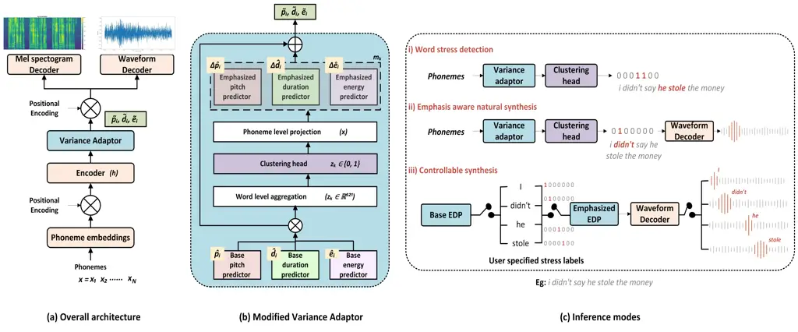
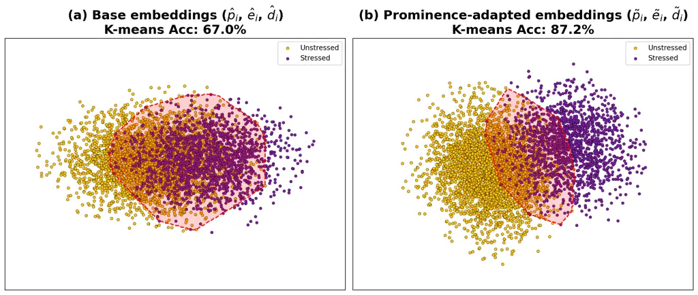
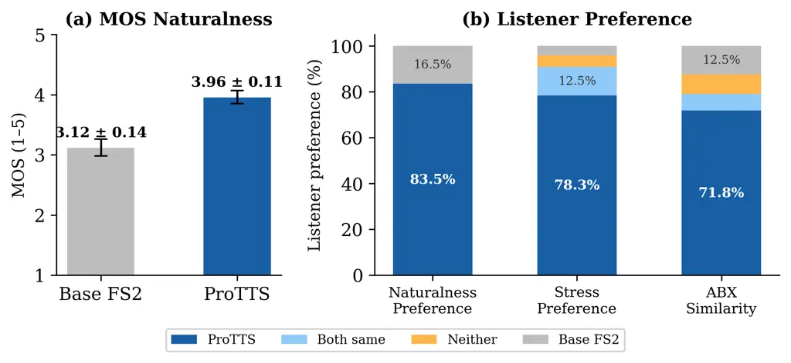
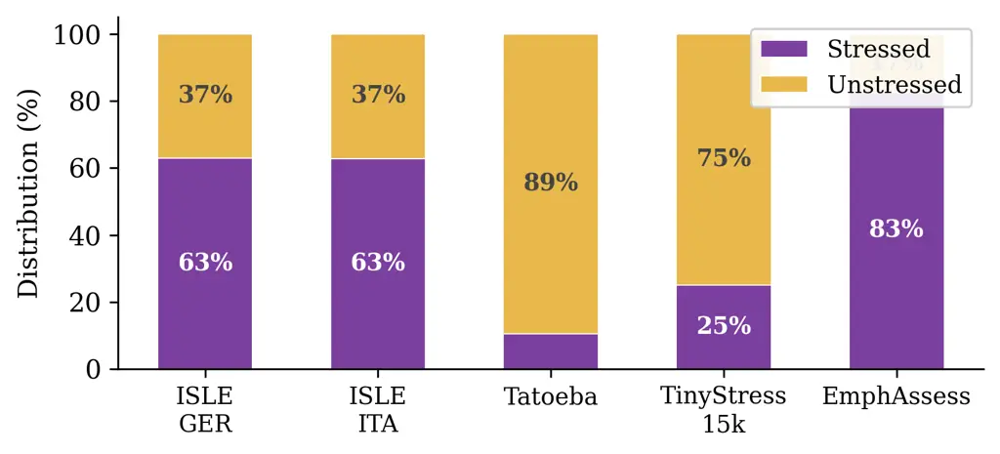
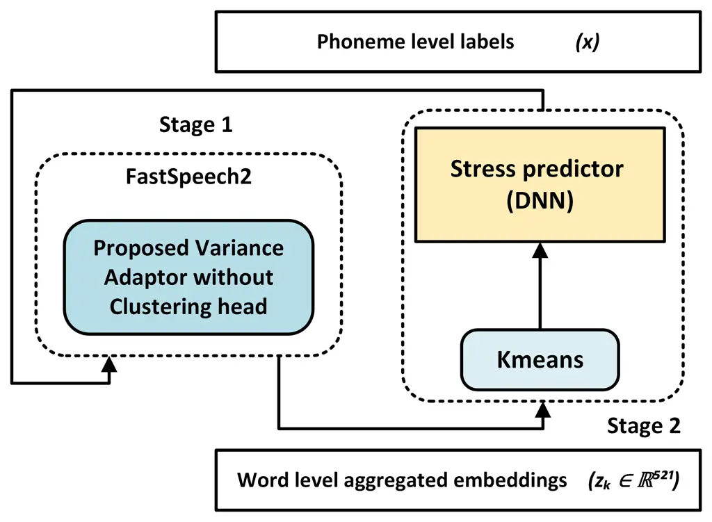
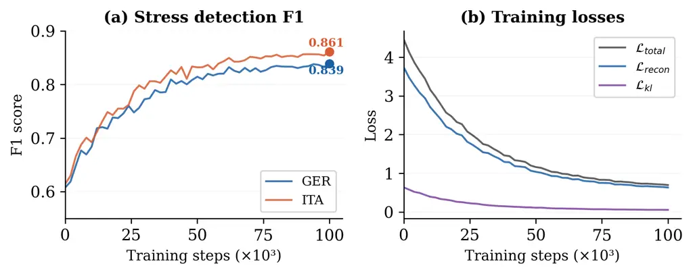
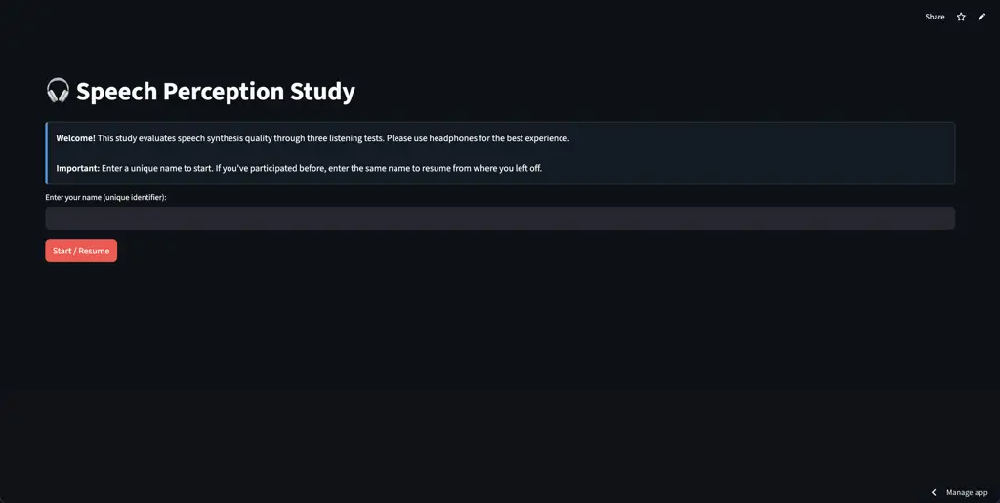
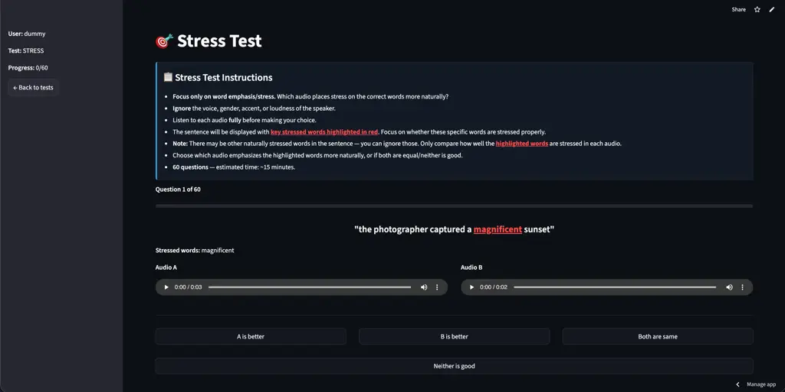
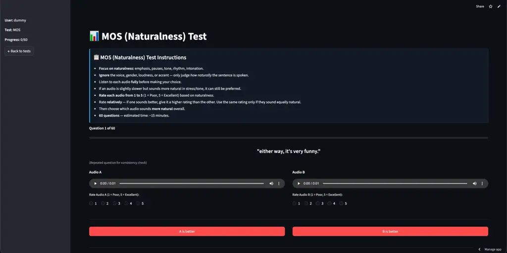
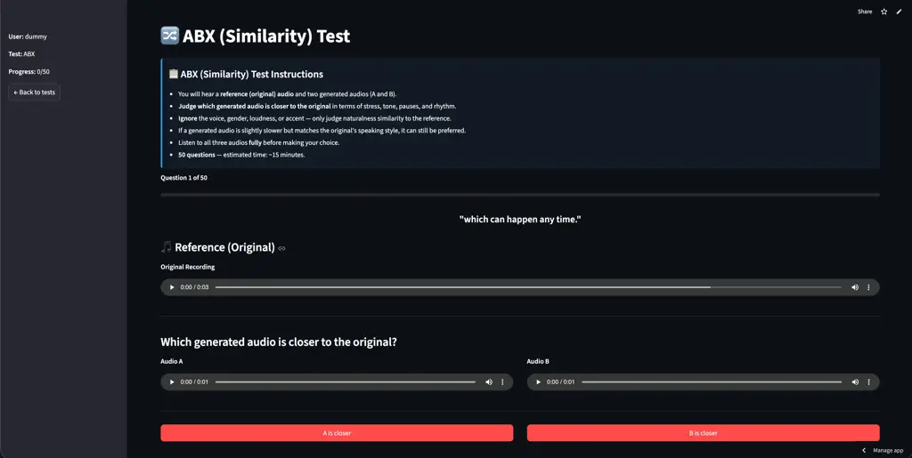

# ProTTS: End-to-End Prominence-aware Natural and Controllable Text-to-Speech via Automatic Word Stress Discovery

Sai Harshitha Aluru Affiliation: Speech Processing Lab, LTRC
Affiliation: IIIT Hyderabad Affiliation: Hyderabad, India
Email: [saiharshitha.aluru@research.iiit.ac.in](mailto:)    Chiranjeevi
Yarra Affiliation: Speech Processing Lab, LTRC Affiliation: IIIT
Hyderabad Affiliation: Hyderabad, India
Email: [chiranjeevi.yarra@iiit.ac.in](mailto:)

###### Abstract

Natural speech conveys meaning not only through words, but also through
the prominence on a few words. Yet most text-to-speech (TTS) systems
remain prominence-unaware, existing prominence-aware TTS require
external stress annotations, while unsupervised stress detectors operate
in isolation, disconnected from synthesis. This creates a fundamental
gap no existing system can automatically discover where stress should be
placed, realize it as natural-sounding prosody, and offer user control
over emphasis placement, all within a single model. To circumvent this,
we propose ProTTS, a unified framework where stress detection emerges
from the TTS model itself and, in turn, guides it to synthesize more
natural and controllable speech. We incorporate a clustering head into
the variance adaptor of FastSpeech 2 that discovers word stress directly
from aggregated prosodic features. The discovered stress then drives
emphasis variance predictors that modify pitch, energy, and duration for
stressed words. The framework is trained end-to-end: TTS reconstruction
and clustering losses jointly shape a stress-discriminative feature
space without requiring stress labels at any stage. At inference, the
same architecture also supports user-controllable emphasis by accepting
a custom stress mask. We evaluate ProTTS on ISLE (non-native), LibriTTS,
VCTK (native training), and three evaluation benchmarks (Tatoeba,
TinyStress-15k, EmphAssess). Listeners prefer ProTTS over the baseline
with a MOS of 3.96 vs. 3.12 and 83.5% preference rate. For stress
detection, ProTTS achieves 0.839/0.861 F1 on ISLE (German/Italian L2),
outperforming unsupervised ($`\sim`$0.70) and supervised ($`\sim`$0.82)
baselines, and 0.933 F1 in zero-shot transfer to Tatoeba.

## 1 Introduction

In spoken language, certain words are produced with greater intensity,
longer duration, and pitch variation (known as stress) to convey
communicative intent. Listeners rely on this word-level stress to
interpret meaning, resolve ambiguity, and perceive naturalness in speech
(Terken and Hermes, 2000; Cutler et al., 1997; van Heuven, 2018; Cole et
al., 2019). Accurate stress placement is therefore especially important
in expressive contexts, where the same sentence can convey correction,
contrast, or surprise depending on which word carries emphasis. For
second-language (L2) learners, producing and perceiving correct stress
patterns remains a persistent challenge (Cutler et al., 1997).
Stress-aware speech synthesis therefore has broad applications from
producing more natural voice assistants, to enabling controllable
emphasis in audiobook narration, to providing corrective feedback in
Computer-Assisted Language Learning (CALL) systems (Gasteiger et al.,
2024).

Despite its importance, word-level stress remains largely absent from
modern text-to-speech systems. Even state-of-the-art models fail to
reliably produce contextually appropriate stress (CAST Authors, 2026).
Research on stress detection and emphasis-controllable synthesis has
progressed along independent tracks. Stress detection methods, whether
supervised or unsupervised, are trained and evaluated in isolation
without considering how detected stress might be realized in speech.
Emphasis-controllable TTS models can modulate prosody for designated
words, but rely on externally provided stress labels, assuming the
problem of _where_ to stress has already been solved. This leaves a
disconnect between knowing where to stress and how to produce it.

A straightforward solution would be to cascade a stress detector with an
emphasis-controllable synthesizer, as in Li and others (2025). However,
an external detector optimized on its own objective produces stress
labels that may not reflect the prosodic distinctions that are useful
for synthesis. At the same time, the TTS model’s own predictions (pitch,
energy, and duration) already encode acoustic contrasts between stressed
and unstressed words, yet this signal is never exploited for stress
discovery in a cascaded setup. This raises a key question: _can we
design a system where stress detection and stress-aware synthesis are
mutually beneficial, one that automatically discovers emphasis, produces
natural speech, and supports controllable stress placement?_

To address this, we propose ProTTS, a unified framework where stress
detection and stress-aware synthesis emerge jointly from a single model.
Our key insight is that the prosodic features predicted inside a TTS
variance adaptor (pitch, energy, and duration) are inherently
stress-discriminative. Stressed words naturally exhibit different
prosodic profiles than unstressed ones, and this distinction can be
discovered without supervision. Motivated by this observation, we
integrate a clustering head within the variance adaptor of FastSpeech 2
that identifies word stress directly from aggregated prosodic features,
requiring no external labels. The discovered stress then drives emphasis
variance predictors that learn how pitch, energy, and duration should
change for stressed words; unstressed words retain their base prosody
unchanged. The framework is trained end-to-end with a joint objective
combining TTS reconstruction and stress-clustering losses. At inference,
the same architecture also supports user-controllable emphasis by
accepting a custom stress mask in place of the clustering head’s
predictions. We evaluate across both native and non-native speech
settings.

Our contributions are as follows:  
(1) We propose the first framework that unifies unsupervised word stress
detection and stress-aware synthesis within a single TTS model, trained
end-to-end without any stress annotations. The same architecture also
supports user-controllable emphasis at inference.  
(2) We demonstrate strong stress detection performance across both
native and non-native speech, outperforming supervised baselines despite
using no labels, with zero-shot transfer to unseen evaluation sets.  
(3) Through subjective evaluations, we show that listeners reliably
perceive the intended stress and consistently prefer ProTTS’s synthesis
over the baseline.

Additionally, we present ablation studies on feature composition, joint
versus cascaded training, cross-domain transfer from native to
non-native speech, and an analysis of the learned prosodic
representations.

## 2 Related Work

### 2.1 Word Stress Detection

Early approaches to word stress detection relied on handcrafted prosodic
features (fundamental frequency, energy, duration, and spectral tilt)
combined with conventional classifiers (Kakouros and Räsänen, 2015;
Kakouros et al., 2017; Sabu and Rao, 2018), HMM-based frameworks (Li et
al., 2007), or sequential models such as bidirectional RNNs (Rosenberg
et al., 2015). More recently, self-supervised speech models have reduced
the dependence on manual feature engineering. Representations from
wav2vec 2.0 (Baevski et al., 2020), HuBERT (Hsu and others, 2021), and
Whisper (Radford et al., 2023) have been applied to stress. Yosha et al.
(2025) predicts word-level stress from Whisper representations, while
Mallela et al. (2025) models suprasegmental dependencies for detecting
the same. These methods demonstrate that pretrained representations
contain rich prosodic information, but they are predominantly
supervised, requiring word-level stress annotations that are expensive
to obtain, particularly for non-native speech where stress patterns vary
across L1 backgrounds.  
Unsupervised stress detection remains comparatively underexplored.
Mondal et al. (2024) conduct a comparative analysis of FastSpeech 2
prosody embeddings for prominence detection, showing that K-Means
clustering on duration, energy, and pitch embeddings can detect word
stress without supervision, though with substantially lower F1 than
supervised methods.

### 2.2 Emphasis-Controllable Speech Synthesis

Emphasis control in non-autoregressive TTS typically involves modifying
the variance adaptor’s pitch, energy, and duration predictions for
designated words (Ren et al., 2021). Li and others (2025) trains
emphasis control alongside emotional expressivity using weakly
supervised pseudo-labels. Mondal et al. (2025) incorporates word stress
into GlowTTS for L2 learners using a separately trained classifier. Chen
et al. (2025) preserves emphasis across speech-to-speech translation via
LLM-based cross-lingual stress mapping. Joly and others (2023) show that
simply scaling phoneme duration produces effective emphasis, though
limited to duration manipulation.  
Across all these methods, stress labels must be provided externally.
None integrates stress discovery into the synthesis model itself,
meaning the two tasks cannot benefit from shared representations or
joint optimization.

### 2.3 Unsupervised Prosody Modeling in TTS

Several lines of work learn prosodic structure within TTS models without
explicit labels. Global Style Tokens (Wang and others, 2018) learn soft
style clusters for utterance-level speaking style control. This has been
extended to finer granularities: Chien and Lee (2021) propose
hierarchical prosody modeling conditioned on word-level features, and
Guo et al. (2022) introduce unsupervised word-level prosody tagging for
controllable synthesis. However, these approaches model general prosodic
variation (speaking rate, intonation contour, expressiveness) rather
than the specific linguistic phenomenon of word stress.  
Word stress is a discrete, binary property determined by both acoustic
realization and communicative intent (Cole et al., 2019; Kakouros et
al., 2016). To the best of our knowledge, no prior work has attempted to
discover word stress unsupervised from within a TTS model and
simultaneously use it to improve synthesis.

## 3 Method



Figure 1: Architecture of ProTTS. (a) Overall FastSpeech 2 model with
our modified variance adaptor. (b) Inside the modified variance adaptor:
base prosody predictions are aggregated into 521-dim word features, a
clustering head discovers stressed words, and emphasis variance
predictors apply learned deltas only to stressed words, gated by
$`m_{k}`$. (c) Three inference modes: (i) word stress detection outputs
binary labels without audio generation, (ii) emphasis-aware synthesis
automatically discovers and realizes stress, and (iii) controllable
synthesis allows users to specify stress placement, producing different
prosodic realizations and meanings from the same sentence.

ProTTS integrates unsupervised word stress detection directly into the
variance adaptor of FastSpeech 2, enabling joint stress discovery and
stress-aware synthesis within a single model. Figure 1(a) shows the
overall architecture, where the standard variance adaptor is replaced
with our modified version containing a clustering head and emphasis
variance predictors. Figure 1(b) details the modified variance adaptor’s
internal structure, and Figure 1(c) illustrates the three inference
modes supported by the framework. We describe each component below.

### 3.1 Background: FastSpeech 2

FastSpeech 2 (Ren et al., 2021) is a non-autoregressive TTS model
comprising a phoneme encoder, a variance adaptor, and a mel-spectrogram
decoder. Given a phoneme sequence $`\mathbf{x}=(x_{1},\ldots,x_{N})`$,
the encoder produces hidden representations
$`\mathbf{h}=(h_{1},\ldots,h_{N})`$. The variance adaptor predicts three
prosodic attributes at the phoneme level: pitch $`\hat{p}_{i}`$, energy
$`\hat{e}_{i}`$, and duration $`\hat{d}_{i}`$. Pitch and energy values
are passed through learned embedding layers to produce
$`\mathbf{p}_{i}^{\text{emb}}\in\mathbb{R}^{256}`$ and
$`\mathbf{e}_{i}^{\text{emb}}\in\mathbb{R}^{256}`$, which are added to
the hidden sequence. A length regulator expands the sequence according
to predicted durations, and the decoder generates the mel-spectrogram.

In the standard model, the variance adaptor treats all phonemes
uniformly, it has no notion of which words should receive prosodic
prominence. ProTTS modifies it to (1) aggregate phoneme-level
predictions into word-level representations, (2) discover stressed words
via a clustering head, and (3) apply learned prosodic shifts through
emphasis variance predictors.

### 3.2 Word-Level Prosodic Feature Aggregation

Since stress is a word-level phenomenon but the variance adaptor
operates at the phoneme level, we bridge this gap by aggregating the
variance adaptor’s own prosodic predictions into word-level
representations (Figure 1(b)). This ensures the clustering head operates
in a space that is both prosodically informative and end-to-end
differentiable with respect to the TTS reconstruction loss.

Let word $`w_{k}`$ span phonemes $`\{x_{s_{k}},\ldots,x_{e_{k}}\}`$. We
construct a word-level feature vector
$`\mathbf{z}_{k}\in\mathbb{R}^{521}`$ by mean-pooling the phoneme-level
pitch embeddings $`\mathbf{p}_{i}^{\text{emb}}\in\mathbb{R}^{256}`$ and
energy embeddings $`\mathbf{e}_{i}^{\text{emb}}\in\mathbb{R}^{256}`$
within the word. Since duration predictions in FastSpeech 2 are scalar
values rather than learned embeddings, we aggregate them into a
fixed-length word-level representation using summary statistics (mean,
std, max, min, total, range, coefficient of variation), along with
normalized word position ($`\text{pos}_{k}`$) and phoneme count
($`n_{k}^{\text{ph}}`$):

```math
\mathbf{z}_{k}=[\mathbf{z}_{k}^{(p)}\;\|\;\mathbf{z}_{k}^{(e)}\;\|\;\mathbf{z}_{k}^{(d)}]\in\mathbb{R}^{521} \tag{1}
```

where $`\mathbf{z}_{k}^{(p)}\in\mathbb{R}^{256}`$,
$`\mathbf{z}_{k}^{(e)}\in\mathbb{R}^{256}`$, and
$`\mathbf{z}_{k}^{(d)}\in\mathbb{R}^{9}`$. Detailed equations are in
Appendix E.

### 3.3 Clustering Head for Stress Discovery

Rather than training a separate classifier, which would require stress
labels, we discover the stressed/unstressed distinction directly from
the prosodic feature space using a clustering approach inspired by deep
embedded clustering (Guo et al., 2017). The clustering head partitions
word-level representations into two categories through soft assignment.

Given $`K=2`$ learnable centroids
$`\{\boldsymbol{\mu}_{0},\boldsymbol{\mu}_{1}\}\in\mathbb{R}^{521}`$, we
compute a soft assignment $`q_{kj}`$ for each word $`\mathbf{z}_{k}`$
using a Student’s $`t`$-distribution kernel:

```math
q_{kj}=\frac{(1+\lVert\mathbf{z}_{k}-\boldsymbol{\mu}_{j}\rVert^{2})^{-1}}{\sum_{j^{\prime}=0}^{1}(1+\lVert\mathbf{z}_{k}-\boldsymbol{\mu}_{j^{\prime}}\rVert^{2})^{-1}} \tag{2}
```

To encourage sharper assignments, we define a target distribution $`P`$
by squaring & normalizing $`Q`$:

```math
p_{kj}=\frac{q_{kj}^{2}/f_{j}}{\sum_{j^{\prime}}q_{kj^{\prime}}^{2}/f_{j^{\prime}}} \tag{3}
```

where $`f_{j}=\sum_{k}q_{kj}`$ is the soft cluster frequency, preventing
large clusters from dominating. The clustering loss minimizes KL
divergence between $`P`$ and $`Q`$:

```math
\mathcal{L}_{\text{kl}}=\text{KL}(P\|Q)=\sum_{k}\sum_{j}p_{kj}\log\frac{p_{kj}}{q_{kj}} \tag{4}
```

Since $`P`$ is derived from $`Q`$ itself, this creates a
self-reinforcing loop that progressively sharpens the cluster
boundaries, discovering stressed words without supervision.

Centroid initialization. $`\boldsymbol{\mu}_{0}`$ and
$`\boldsymbol{\mu}_{1}`$ are initialized via K-Means on the pretrained
FastSpeech 2 prosodic features, following (Guo et al., 2017). We use
only duration and pitch features for initialization, as they yield
better separation than the full EDP combination (Section 4.2.3).

Hard assignment. At each epoch boundary, hard pseudo-labels are derived
from the soft assignments:

```math
y_{k}=\underset{j}{\operatorname{argmax}}\;q_{kj} \tag{5}
```

These serve as the emphasis mask $`m_{k}`$ for the variance predictors
(Section 3.4) and determine which words receive variance supervision at
each epoch.

Cluster identity assignment. Since the two clusters have no inherent
label, we assign identity using a prosodic prior: the centroid with the
larger L2 norm is designated as the stressed cluster. Stressed words
exhibit higher pitch, greater energy, and longer duration (van Heuven,
2018), producing embeddings with larger magnitudes and a centroid
further from the origin.

### 3.4 Emphasis-Gated Variance Adaptation

Following Li and others (2025), we augment the variance adaptor with
three _emphasis variance predictors_ (Figure 1(b)), one each for pitch,
energy, and duration. Given the emphasis mask $`m_{k}\in\{0,1\}`$ from
the clustering head, the emphasis predictors produce phoneme-level
deltas that are added to the _base prosody_ ($`\hat{p}_{i}`$,
$`\hat{e}_{i}`$, $`\hat{d}_{i}`$) to yield the _stress-adapted prosody_:

```math
\displaystyle\tilde{p}_{i} \displaystyle=\hat{p}_{i}+\Delta\hat{p}_{i}\cdot m_{k} \tag{6}
```

```math
\displaystyle\tilde{e}_{i} \displaystyle=\hat{e}_{i}+\Delta\hat{e}_{i}\cdot m_{k} \tag{7}
```

```math
\displaystyle\tilde{d}_{i} \displaystyle=\hat{d}_{i}+\Delta\hat{d}_{i}\cdot m_{k} \tag{8}
```

When $`m_{k}=0`$ (unstressed), the deltas vanish and the phoneme retains
its base prosody. When $`m_{k}=1`$ (stressed), the learned deltas
produce the elevated pitch, increased energy, and longer duration
characteristic of stressed words (van Heuven, 2018). The stress-adapted
prosody is passed to the length regulator and decoder for
mel-spectrogram generation.

### 3.5 Joint Training Objective

All components are differentiable and trained jointly. The full
objective is:

```math
\mathcal{L}_{\text{total}}=\mathcal{L}_{\text{recon}}+\alpha\cdot(\mathcal{L}_{\text{kl}}+\mathcal{L}_{\text{bal}}) \tag{9}
```

Reconstruction loss. Following Li and others (2025),
$`\mathcal{L}_{\text{recon}}`$ comprises mel-spectrogram losses and
prosody prediction losses:

```math
\begin{split}\mathcal{L}_{\text{recon}}=&\;\mathcal{L}_{\text{mel}}+\mathcal{L}_{\text{postnet}}+\mathcal{L}_{\text{pitch}}+\mathcal{L}_{\text{energy}}\\
&+\mathcal{L}_{\text{dur}}+\mathcal{L}_{\text{pv}}+\mathcal{L}_{\text{dv}}+\mathcal{L}_{\text{ev}}\end{split} \tag{10}
```

The _combined prosody losses_ supervise the stress-adapted prosody
against ground-truth targets, e.g.
$`\mathcal{L}_{\text{pitch}}=\text{MSE}(\hat{p}_{i}+\Delta\hat{p}_{i},\;p_{i}^{\text{gt}})`$,
with energy and duration defined analogously. The _variance losses_
separately supervise the emphasis deltas against precomputed variance
targets, e.g.
$`\mathcal{L}_{\text{pv}}=\text{MSE}(\Delta\hat{p}_{i},\;\Delta p^{\text{gt}})`$.
Following a similar strategy to Li and others (2025), the variance
targets $`\Delta p^{\text{gt}}`$, $`\Delta d^{\text{gt}}`$,
$`\Delta e^{\text{gt}}`$ are computed as the difference between the
average prosody of emphasized phonemes and the sentence-level average,
and are regenerated each epoch as pseudo-labels evolve. Full loss
definitions and variance target formulations are in Appendix G.

Clustering loss. $`\mathcal{L}_{\text{kl}}`$ is the KL divergence from
Eq. 4. $`\mathcal{L}_{\text{bal}}`$ penalizes degenerate solutions where
all words collapse into one cluster:

```math
\mathcal{L}_{\text{bal}}=\left(\frac{f_{0}}{f_{0}+f_{1}}-0.5\right)^{2} \tag{11}
```

$`\alpha`$ balances synthesis quality against stress discriminability.

Training procedure. The model is initialized from a pretrained
FastSpeech 2 checkpoint. After each epoch, pseudo-labels and variance
targets are regenerated from the updated soft assignments, creating a
feedback loop that progressively refines both stress detection and
synthesis. Full details are in Appendix F.

### 3.6 Inference

The trained model supports three inference modes (Figure 1(c)). In word
stress detection mode (Figure 1(c-i)), the clustering head outputs
binary stress labels from the aggregated prosodic features without
generating audio, enabling the framework to function as a standalone
stress detector. In emphasis-aware synthesis mode (Figure 1(c-ii)), the
discovered stress mask gates the emphasis variance predictors to produce
stress-adapted prosody, and the decoder generates the mel-spectrogram. A
HiFi-GAN vocoder converts the output to a waveform. In controllable
synthesis mode (Figure 1(c-iii)), the emphasis mask $`m_{k}`$ is
replaced with user-specified stress labels, bypassing the clustering
head and allowing explicit control over which words receive prosodic
prominence without retraining. As illustrated, placing stress on
different words in the same sentence (e.g., _“I didn’t say he stole the
money”_ vs. _“I didn’t say he stole the money”_) produces distinct
prosodic realizations that convey different meanings. Additional
controllability examples are provided in Appendix K.

## 4 Experiments and Results

### 4.1 Experimental Setup

We design experiments to answer four questions: (1) Can ProTTS discover
word stress without labels, and how close does it come to supervised
methods? (2) Does stress learned from one domain transfer to another?
(3) Does the discovered stress translate into perceptibly better
synthesis? (4) How do key design choices affect performance?

Datasets. We conduct experiments along two tracks. _Track 1
(Non-native):_ We train and evaluate on the ISLE corpus (Menzel and
others, 2000), containing L2 English speech from German (GER) and
Italian (ITA) speakers. Word-level stress annotations were obtained
manually (Appendix B) and used only for evaluation; the model never sees
them during training. _Track 2 (Native):_ We train separately on
LibriTTS (Zen et al., 2019) and VCTK (Veaux et al., 2017), both native
English corpora without stress annotations. Stress detection is
evaluated on three test sets: Tatoeba (Tatoeba Community, 2024)
(manually annotated, Appendix B), TinyStress-15k (Yosha et al., 2025),
and EmphAssess (de Seyssel et al., 2024). For synthesis evaluation, we
use the LibriTTS and VCTK test sets. Dataset statistics are in
Appendix A.

Baselines. For stress detection: unsupervised K-Means clustering on
FastSpeech 2 prosody embeddings (Mondal et al., 2024), and supervised
methods including a DNN on the same embeddings (Mondal et al., 2024),
SupraDoRAL (Mallela et al., 2025), and WhiStress (Yosha et al., 2025).
For synthesis: base FastSpeech 2 without any emphasis mechanism.

Evaluation protocol. _Stress detection:_ Word-level F1 against
ground-truth annotations, reported per L1 background (GER, ITA) on ISLE
and per native test set. _Synthesis quality:_ Three subjective
evaluations with 35 listeners of diverse backgrounds, balanced across
gender, native language, and familiarity with speech research
(Appendix J): (a) _MOS + Preference_: listeners rate two audio samples
on a 1–5 naturalness scale and select the more natural one; (b) _Stress
preference_: listeners see target stressed words highlighted and select
which audio better realizes the stress (with “both same” and “neither
good” options); (c) _ABX similarity_: listeners hear an original
reference and two generated versions, and select which is closer to the
original.

Training. We initialize from a pretrained FastSpeech 2 checkpoint and
train for 100k steps with $`\alpha=1.0`$. Full hyperparameters and
convergence analysis are in Appendices D and I.

Ablation configurations. We evaluate three design choices: (1) _Joint
vs. cascaded._ We compare our end-to-end framework against a cascaded
baseline where FS2 and a DNN stress classifier are trained in
alternation but never jointly. FS2 is first fine-tuned without stress,
then prosodic embeddings are clustered via K-Means, a DNN is trained on
these labels, and DNN predictions (confidence $`>0.8`$, else K-Means
fallback) serve as stress labels for the next FS2 iteration. Details in
Appendix H. (2) _Feature composition._ Clustering on
energy+duration+pitch (EDP) vs. duration+pitch only (DP) at centroid
initialization. (3) _Cross-domain transfer._ Training on native speech
(LibriTTS/VCTK) and evaluating on non-native speakers (ISLE).

### 4.2 Results and Discussion

#### 4.2.1 Word Stress Detection

|          |                                   |       |       |
| -------- | --------------------------------- | ----- | ----- |
|          | Method                            | GER   | ITA   |
| Sup.^(†) | DNN (Mondal et al., 2024)         | 0.83  | 0.74  |
|          | SupraDoRAL (Mallela et al., 2025) | 0.78  | 0.87  |
|          | WhiStress (Yosha et al., 2025)    | 0.80  | 0.87  |
|          | ProTTS (sup.)                     | 0.901 | 0.932 |
| Unsup.   | K-Means (Mondal et al., 2024)     | 0.76  | 0.71  |
|          | ProTTS (unsup.)                   | 0.839 | 0.861 |

Table 1: Word stress detection F1 scores on ISLE (non-native).
$`\dagger`$: supervised (requires stress labels)

|          | Method                         | Tat.  | Tiny. | Emph. |
| -------- | ------------------------------ | ----- | ----- | ----- |
| Sup.^(†) | DNN (Mondal et al., 2024)      | 0.891 | —     | —     |
|          | WhiStress (Yosha et al., 2025) | —     | 0.901 | 0.93  |
| Unsup.   | K-Means (Mondal et al., 2024)  | 0.71  | —     | —     |
| ProTTS   | unsup.^(a)                     | 0.933 | 0.911 | 0.923 |
|          | unsup.^(b)                     | 0.921 | 0.90  | 0.915 |

Table 2: Word stress detection F1 scores on native datasets.
$`\dagger`$: supervised. Tat.=Tatoeba, Tiny.=TinyStress-15k,
Emph.=EmphAssess. ^(a)Trained on LibriTTS. ^(b)Trained on VCTK.

Tables 1 and 2 present word stress detection results on native and
non-native datasets.

Native (Table 2). On Tatoeba, training on LibriTTS yields 0.933 F1,
surpassing both the K-Means baseline (0.71) and the supervised DNN
(0.891). VCTK achieves 0.921. This addresses our second question: stress
patterns learned from one corpus generalize to unseen data, and the
clustering head is not memorizing corpus-specific artifacts but
capturing language-level regularities in how stress is realized
prosodically. On TinyStress-15k and EmphAssess, our LibriTTS-trained
model achieves 0.911 and 0.923 respectively, competitive with or
exceeding the supervised WhiStress baseline (0.901 and 0.93).

Non-native (Table 1). ProTTS achieves 0.839 and 0.861 F1 for German and
Italian L2 speakers, surpassing not only the unsupervised K-Means
baseline (0.76/0.71) but, remarkably, all supervised methods as well:
DNN (0.83/0.74), SupraDoRAL (0.78/0.87), and WhiStress (0.80/0.87). This
directly addresses our first question: ProTTS discovers word stress
without any labels, and does so better than methods that have access to
them. The higher F1 on Italian speakers aligns with the observation that
Italian L2 English tends to produce more exaggerated prosodic contrasts
on stressed words (Menzel and others, 2000), while these patterns differ
from native English stress realization, the exaggeration makes the
stressed/unstressed boundary more acoustically salient and easier for
the clustering head to discover in the in-domain setting. To establish a
supervised upper bound, we train a DNN stress classifier on ground-truth
labels using the same cascaded setup as our ablation (Appendix H), where
the DNN’s predictions serve as the emphasis mask. At inference, the DNN
achieves 0.901/0.932 F1. The remaining gap of 0.06–0.07 from our
unsupervised results likely reflects cases where stress depends on
discourse context or speaker intent rather than acoustic cues alone.
Native speech yields higher F1 than non-native overall, which is
expected, native speakers tend to produce more consistent stress
patterns, giving the clustering head a cleaner signal to work with.

Learned prosodic representations. We attribute ProTTS’s strong
performance to the emphasis-gated design. Because the variance
predictors act exclusively on words identified as stressed, the model is
incentivized to produce prosodic features that cleanly separate stressed
from unstressed words. Over training, this creates a virtuous cycle:
better cluster separation leads to more accurate emphasis masks, which
produce more targeted prosodic shifts, which in turn further sharpens
the feature space. Figure 2 provides direct evidence: K-Means on base
prosodic embeddings before training achieves only 67.0% clustering
accuracy, while K-Means on stress-adapted embeddings after joint
training achieves 87.2%, confirming that the model learns
stress-discriminative representations without ever being told which
words are stressed.



Figure 2: PCA of word-level EDP embeddings on ISLE, colored by
ground-truth stress. Left: base prosody embeddings ($`\hat{p}_{i}`$,
$`\hat{e}_{i}`$, $`\hat{d}_{i}`$). Right: stress-adapted prosody
embeddings ($`\tilde{p}_{i}`$, $`\tilde{e}_{i}`$, $`\tilde{d}_{i}`$).

#### 4.2.2 Synthesis Quality



Figure 3: Subjective evaluation results. (a) MOS naturalness ratings
with 95% CIs. (b) Listener preference (%) across naturalness, stress,
and ABX similarity tests.

Figure 3 addresses our third question: whether the discovered stress
translates into perceptibly better synthesis. The listening test was
completed by 35 participants with balanced representation across gender,
native language, English proficiency, and familiarity with speech and
linguistics research (full demographics in Appendix J).

The three tests probe different aspects of synthesis quality, evaluating
both the automatic and controllable modes of the framework. The MOS +
preference test evaluates the automatic mode: the clustering head
discovers stress, the emphasis predictors realize it, and listeners
judge overall naturalness. ProTTS achieves a MOS of 3.96 $`\pm`$ 0.11
compared to 3.12 $`\pm`$ 0.14 for the base FastSpeech 2 (Figure 3a), and
is preferred by 83.5% of listeners (Figure 3b). The stress preference
test evaluates both modes: a subset of test items uses stress labels
predicted by the clustering head (automatic mode), while the remaining
items use manually specified stress patterns (controllable mode).
Listeners see target stressed words highlighted and judge which audio
realizes them better. ProTTS is preferred 78.3% of the time, with 12.5%
rating both as equal, 5.1% selecting neither, and only 4.1% preferring
the baseline (Figure 3b). This holds across both automatic and
controllable modes, confirming that the emphasis variance predictors
produce natural and perceptible prosodic prominence whether stress is
discovered automatically or specified by the user. Per-dataset results
and the automatic vs. controllable breakdown are reported in Appendix K.
Finally, the ABX similarity test asks a complementary question: does
ProTTS’s prosody resemble real speech more closely than the baseline’s?
This test also includes samples from both automatic and controllable
modes. Listeners chose our output as closer to the original recording
71.8% of the time, compared to 12.5% for the baseline, with 7.2% rating
both as equal and 8.5% selecting neither (Figure 3b). Together with the
stress test, this suggests that the emphasis predictors are not simply
exaggerating prosodic contrasts, they are producing stress patterns that
align with how speakers naturally realize prominence, regardless of
whether the stress mask was discovered or user-specified.

Error analysis. The model handles function words well, words like _the_,
_a_, and _of_ are rarely misclassified, as their prosodically weak
profiles (short duration, reduced vowels, low energy) are clearly
captured by the EDP features. The main source of error lies in content
words, where two patterns emerge. First, the model tends to over-predict
stress on content words that are contextually unstressed. Content words
generally carry stronger prosodic profiles (longer duration, higher
energy) even when they do not receive sentential stress, and the
clustering head sometimes confuses this inherent word-level salience
with actual prominence. Second, the model misses stress on monosyllabic
content words with short vowels or voiceless consonants (e.g., _pub_,
_cup_, _bus_), where the acoustic cues for stress (pitch rise, energy
boost, durational lengthening) are inherently weaker and harder to
distinguish from unstressed realizations. This difficulty is amplified
in non-native speech, where L2 speakers often produce reduced prosodic
contrasts between stressed and unstressed words, making the boundary
less acoustically salient. These patterns point to a fundamental
limitation of relying on acoustic prosodic features alone: stress that
depends on discourse context, pragmatic intent, or phonetic properties
of specific segments cannot always be recovered from pitch, energy, and
duration.

#### 4.2.3 Ablation Studies

|                                                  |       |       |
| ------------------------------------------------ | ----- | ----- |
| Configuration                                    | GER   | ITA   |
| _(a) Training strategy_                          |       |       |
| ProTTS (joint)                                   | 0.839 | 0.861 |
| ProTTS (casc.)                                   | 0.803 | 0.831 |
| _(b) Feature composition (centroid init.)_       |       |       |
| Duration + Pitch (DP)                            | 0.731 | 0.782 |
| Energy + Duration + Pitch (EDP)                  | 0.664 | 0.675 |
| _(c) Native $`\rightarrow`$ non-native transfer_ |       |       |
| Trained on LibriTTS                              | 0.781 | 0.752 |
| Trained on VCTK                                  | 0.764 | 0.73  |

Table 3: Ablation results (F1) on ISLE. (a) Joint vs. cascaded training.
(b) Raw feature composition for K-Means centroid initialization. (c)
Native $`\rightarrow`$ non-native cross-domain transfer.

Table 3 addresses our fourth question by examining key design choices.

Joint vs. cascaded (Table 3a). ProTTS achieves 0.839/0.861 vs.
0.803/0.831 for the cascaded baseline (Appendix H). The improvement
confirms that sharing the prosodic feature space between detection and
synthesis, rather than passing labels across a pipeline boundary,
enables the two tasks to mutually refine each other within a single
optimization loop.

Feature composition (Table 3b). To determine which prosodic features
best initialize the clustering centroids, we compared K-Means clustering
using two feature subsets from the raw base predictions: duration +
pitch (DP) and energy + duration + pitch (EDP). DP yields 0.731/0.782,
substantially outperforming EDP at 0.664/0.675. This is consistent with
the phonetic literature (van Heuven, 2018; Gasteiger et al., 2024).
Based on this, we use DP features for centroid initialization in all
main experiments. Note that this ablation reflects only which raw
features initialize centroids, not which features affect the training.
During training we use full 521-dim embeddings (EDP: Equation 1).

Cross-domain transfer (Table 3c). Training on native English speech and
testing on non-native ISLE, the model achieves 0.781/0.752 (LibriTTS)
and 0.764/0.73 (VCTK) on GER/ITA, lower than in-domain, as expected, but
still reasonable given the domain mismatch. Transfer to German speakers
is consistently stronger than to Italian. This reflects typological
proximity: German, like English, is stress-timed, so native English
stress patterns map more naturally onto German L2 speech, whereas
Italian’s syllable-timed rhythm diverges more from English prosody.

## 5 Conclusion

We presented ProTTS, a unified framework that jointly performs
unsupervised word stress detection and stress-aware speech synthesis
within a single TTS model. By integrating a clustering head into the
variance adaptor of FastSpeech 2, ProTTS discovers stressed words
directly from the model’s own prosodic predictions (pitch, energy, and
duration) without requiring stress annotations at any stage. This stress
then guides emphasis variance predictors that modify prosody for
stressed words, producing more natural and expressive speech. The same
architecture also supports user-controllable emphasis by accepting a
custom stress mask at inference. Experiments across native and
non-native speech show that ProTTS outperforms both unsupervised and
supervised baselines on stress detection, achieves strong zero-shot
transfer across corpora and speaker populations, and produces synthesis
that listeners consistently prefer over the baseline. The end-to-end
objective drives the variance adaptor to learn genuinely
stress-discriminative features, an outcome that neither standalone
detection nor cascaded approaches achieve. More broadly, our results
suggest that TTS models already encode richer prosodic structure than is
typically exploited. The prosodic features inside a variance adaptor are
not just intermediate predictions for reconstruction, they are a latent
space where linguistic phenomena like stress can be discovered and
leveraged. We hope this perspective encourages further work on
extracting and utilizing the prosodic knowledge embedded within speech
synthesis models. Code and trained models will be released upon
acceptance.

## Limitations

This work has several limitations that point to directions for future
research.

First, as the error analysis reveals, ProTTS relies solely on acoustic
prosodic features (pitch, energy, and duration) for stress detection.
This works well for function words, whose prosodically weak profiles are
clearly captured, but leads to errors on content words where stress
depends on discourse context, pragmatic intent, or phonetic properties
of specific segments (e.g., short vowels, voiceless consonants).
Incorporating text-level features or language model representations
could help disambiguate these cases.

Second, the clustering head assumes a binary stressed/unstressed
distinction ($`K=2`$), but stress in natural speech is gradient, words
can carry varying degrees of prominence. The current emphasis mechanism
applies a binary mask, making it difficult to extend to finer-grained
stress levels. Future work could explore soft emphasis scaling
proportional to cluster confidence rather than hard assignment.

Third, we evaluate on German and Italian L2 speakers, but stress
realization patterns vary across L1 backgrounds. Speakers of tonal
languages (e.g., Mandarin, Thai) may exhibit qualitatively different
prosodic profiles that interact with English stress in ways not captured
by our current evaluation. Extending to typologically diverse L1
backgrounds is important.

Fourth, ProTTS is demonstrated on FastSpeech 2. While the core idea,
integrating a clustering head into the variance adaptor, is
architecture-general, we have not evaluated on autoregressive or
diffusion-based TTS models, where the variance adaptor structure
differs.

Finally, the current design aggregates phoneme-level features into
word-level representations by mean-pooling, which dilutes the prosodic
signal for polysyllabic words where stress falls on a single syllable. A
syllable-level variant of the clustering head could address this and
potentially improve performance on longer words.

## Ethical Considerations

This work improves the naturalness and expressiveness of synthesized
speech by incorporating word-level stress. While more natural-sounding
TTS has broad positive applications, language learning tools,
accessibility for visually impaired users, more engaging voice
assistants, we acknowledge that improvements in speech synthesis quality
could also lower the barrier for generating convincing synthetic speech
for malicious purposes (e.g., impersonation or misinformation). We note,
however, that ProTTS operates on standard TTS architectures and does not
introduce new capabilities for voice cloning or speaker impersonation;
the emphasis mechanism modifies prosody within an existing speaker’s
voice profile. All human evaluation data was collected with informed
consent from voluntary participants, and no personally identifiable
information was retained. AI writing assistance tools were used during
the drafting and editing of this manuscript. All technical content,
experimental design, methodology, and reported results are entirely the
authors’ original work.

## References

- Baevski et al. (2020) A. Baevski, Y. Zhou, A. Mohamed, and M. Auli
  Wav2vec 2.0: a framework for self-supervised learning of speech
  representations. In Advances in Neural Information Processing Systems,
  Vol. 33, pp. 12449–12460. Cited by: §2.1.
- CAST Authors (2026) CAST Authors Context-aware stress TTS (CAST)
  benchmark. arXiv preprint arXiv:2604.10580. Cited by: §1.
- Chen et al. (2025) X. Chen, Y. Song, and S. Nakamura StressTransfer:
  stress-aware speech-to-speech translation with emphasis preservation.
  arXiv preprint arXiv:2510.13194. Cited by: Table 13, §2.2.
- Chien and Lee (2021) C. Chien and H. Lee Hierarchical prosody modeling
  for non-autoregressive speech synthesis. In Proc. IEEE Spoken Language
  Technology Workshop (SLT), pp. 446–453. Cited by: Table 13, §2.3.
- Cole et al. (2019) J. Cole, J. I. Hualde, C. L. Smith, C. Eager, T.
  Mahrt, and R. N. de Souza Sound, structure and meaning: the bases of
  prominence ratings in English, French and Spanish. Journal of
  Phonetics 75, pp. 113–147. Cited by: §1, §2.3.
- Cutler et al. (1997) A. Cutler, D. Dahan, and W. Van Donselaar Prosody
  in the comprehension of spoken language: a literature review. Language
  and Speech 40 (2), pp. 141–201. Cited by: §1.
- de Seyssel et al. (2024) M. de Seyssel, A. D’Avirro, A. Williams,
  and E. Dupoux EmphAssess: a prosodic benchmark on assessing emphasis
  transfer in speech-to-speech models. In Proceedings of the 2024
  Conference on Empirical Methods in Natural Language Processing,
  pp. 495–507. Cited by: Table 4, Appendix B, §4.1.
- Gasteiger et al. (2024) N. Gasteiger, J. Lim, M. Hellou, B. A.
  MacDonald, and H. S. Ahn A scoping review of the literature on
  prosodic elements related to emotional speech in human–robot
  interaction. International Journal of Social Robotics 16 (4),
  pp. 659–670. Cited by: §1, §4.2.3.
- Guo et al. (2017) X. Guo, L. Gao, X. Liu, and J. Yin Improved deep
  embedded clustering with local structure preservation. In Proc. IJCAI,
  pp. 1753–1759. Cited by: §3.3, §3.3.
- Guo et al. (2022) Y. Guo, C. Du, and K. Yu Unsupervised word-level
  prosody tagging for controllable speech synthesis. In Proc. IEEE
  ICASSP, pp. 7602–7606. Cited by: Table 13, §2.3.
- Hsu et al. (2021) W. Hsu et al. HuBERT: self-supervised speech
  representation learning by masked prediction of hidden units. IEEE/ACM
  Transactions on Audio, Speech, and Language Processing 29,
  pp. 3451–3460. Cited by: §2.1.
- Joly et al. (2023) A. Joly et al. Controllable emphasis with zero data
  for text-to-speech. In 12th ISCA Speech Synthesis Workshop (SSW),
  pp. 113–119. Cited by: Table 13, §2.2.
- Kakouros et al. (2016) S. Kakouros, J. Pelemans, L. Verwimp, P.
  Wambacq, and O. Räsänen Analyzing the contribution of top-down lexical
  and bottom-up acoustic cues in the detection of sentence prominence.
  In Proc. Interspeech, pp. 1074–1078. Cited by: §2.3.
- Kakouros et al. (2017) S. Kakouros, O. Räsänen, and P. Alku Evaluation
  of spectral tilt measures for sentence prominence under different
  noise conditions. In Proc. Interspeech, pp. 3211–3215. Cited by: §2.1.
- Kakouros and Räsänen (2015) S. Kakouros and O. Räsänen Automatic
  detection of sentence prominence in speech using predictability of
  word-level acoustic features. In Proc. Interspeech, pp. 568–572. Cited
  by: §2.1.
- Li et al. (2007) C. Li, J. Liu, and S. Xia English sentence stress
  detection system based on HMM framework. Applied Mathematics and
  Computation 185 (2), pp. 759–768. Cited by: §2.1.
- Li et al. (2025) R. Li et al. EME-TTS: unlocking the emphasis and
  emotion link in speech synthesis. In Proc. Interspeech, Cited by:
  Table 13, Appendix L, Appendix G, Appendix G, §1, §2.2, §3.4, §3.5,
  §3.5.
- Mallela et al. (2025) J. Mallela, U. V. YS, S. B. Rangavajjala, B.
  Bhatt, and C. Yarra SupraDoRAL: automatic word prominence detection
  using suprasegmental dependencies of representations with acoustic and
  linguistic context. In Proc. Interspeech, pp. 5773–5777. Cited by:
  Table 13, §2.1, §4.1, Table 1.
- Menzel et al. (2000) W. Menzel et al. The ISLE corpus of non-native
  spoken English. In Proceedings of LREC, pp. 957–964. Cited by:
  Appendix B, §4.1, §4.2.1.
- Mondal et al. (2024) A. Mondal, S. B. Rangavajjala, J. Mallela, A. K.
  Vuppala, and C. Yarra A preliminary analysis of automatic word and
  syllable prominence detection in non-native speech with text-to-speech
  prosody embeddings. arXiv preprint arXiv:2412.08283. Cited by: Table
  13, Table 13, §2.1, §4.1, Table 1, Table 1, Table 2, Table 2.
- Mondal et al. (2025) A. Mondal, M. Surtani, A. K. Vuppala, P.
  Krishnamurthy, and C. Yarra ExagTTS: an approach towards controllable
  word stress incorporated TTS for exaggerated synthesized speech aiding
  second language learners. In Proc. Interspeech, pp. 449–453. Cited by:
  Table 13, Appendix L, §2.2.
- Nguyen et al. (2023) T. A. Nguyen, W. Hsu, A. D’Avirro, B. Shi, I.
  Gat, M. Fazel-Zarani, T. Remez, J. Copet, G. Synnaeve, M. Hassid, F.
  Kreuk, Y. Adi, and E. Dupoux Expresso: a benchmark and analysis of
  discrete expressive speech resynthesis. In Proc. Interspeech,
  pp. 4823–4827. Cited by: Appendix B.
- Radford et al. (2023) A. Radford, J. W. Kim, T. Xu, G. Brockman, C.
  McLeavey, and I. Sutskever Robust speech recognition via large-scale
  weak supervision. In International Conference on Machine Learning,
  pp. 28492–28518. Cited by: §2.1.
- Ren et al. (2021) Y. Ren, C. Hu, X. Tan, T. Qin, S. Zhao, Z. Zhao,
  and T. Liu FastSpeech 2: fast and high-quality end-to-end text to
  speech. In International Conference on Learning Representations, Cited
  by: §2.2, §3.1.
- Rosenberg et al. (2015) A. Rosenberg, R. Fernandez, and B. Ramabhadran
  Modeling phrasing and prominence using deep recurrent learning. In
  Proc. Interspeech, pp. 3066–3070. Cited by: §2.1.
- Sabu and Rao (2018) K. Sabu and P. Rao Detection of prominent words in
  oral reading by children. In Proc. Speech Prosody, pp. 314–318. Cited
  by: §2.1.
- Tatoeba Community (2024) Tatoeba Community Tatoeba: collection of
  sentences and translations. Note:
  [https://tatoeba.org/en](https://tatoeba.org/en) Cited by: Table 4,
  Appendix B, §4.1.
- Terken and Hermes (2000) J. Terken and D. J. Hermes The perception of
  prosodic prominence. In Prosody: Theory and Experiment: Studies
  Presented to Gösta Bruce, pp. 89–127. Cited by: §1.
- van Heuven (2018) V. J. van Heuven Acoustic correlates and perceptual
  cues of word and sentence stress. In The Study of Word Stress and
  Accent: Theories, Methods and Data, pp. 15–59. Cited by: §1, §3.3,
  §3.4, §4.2.3.
- Veaux et al. (2017) C. Veaux, J. Yamagishi, and K. MacDonald CSTR VCTK
  corpus: English multi-speaker corpus for CSTR voice cloning toolkit.
  Technical report University of Edinburgh. Cited by: §4.1.
- Wang et al. (2018) Y. Wang et al. Style tokens: unsupervised style
  modeling, control and transfer in end-to-end speech synthesis. In
  International Conference on Machine Learning, pp. 5180–5189. Cited by:
  Table 13, §2.3.
- Yosha et al. (2025) I. Yosha, D. Shteyman, and Y. Adi WhiStress:
  enriching transcriptions with sentence stress detection. In Proc.
  Interspeech, pp. 4718–4722. Cited by: Table 4, Table 13, Appendix L,
  Appendix B, §2.1, §4.1, §4.1, Table 1, Table 2.
- Zen et al. (2019) H. Zen, V. Dang, R. Clark, Y. Zhang, R. J. Weiss, Y.
  Jia, Z. Chen, and Y. Wu LibriTTS: a corpus derived from LibriSpeech
  for text-to-speech research. In Proc. Interspeech, pp. 1526–1530.
  Cited by: §4.1.

## Appendix A Dataset Statistics

Table 4 summarizes all datasets used for training and evaluation.
Table 5 reports the word-level stress label distribution for all
annotated datasets.

|                      |       |       |       |         |          |
| -------------------- | ----- | ----- | ----- | ------- | -------- |
| Dataset              | Train | Val   | Test  | Spkrs   | Duration |
| ISLE (GER+ITA)       | 3,750 | 3,252 | —     | 46      | 5.09 h   |
| LibriTTS (clean-100) | 3,000 | 469   | —     | 264     | 59.23 h  |
| VCTK                 | 3,000 | 509   | —     | 20      | 4.35 h   |
| Tatoeba              | 3,000 | 398   | 993   | diverse | —        |
| TinyStress-15k       | —     | —     | 1,000 | synth.  | —        |
| EmphAssess           | —     | —     | 3,652 | 4       | 2.08 h   |

Table 4: Dataset statistics. Splits reported in utterances. Tatoeba is a
community-contributed spoken English corpus (Tatoeba Community, 2024).
TinyStress-15k is a synthetic dataset based on TinyStories (Yosha et
al., 2025); we use only the test split. EmphAssess (de Seyssel et al., 2024) is a prosodic benchmark with emphasis annotations. ISLE stress
evaluation uses the validation split.

The stress distributions vary substantially across datasets. ISLE
exhibits a relatively balanced distribution ($`\sim`$63% stressed),
reflecting the read-aloud nature of the corpus where most content words
receive prominence. Tatoeba is heavily skewed toward unstressed words
(10.6% stressed), as the annotations mark only sentential stress on key
content words in conversational sentences. EmphAssess shows the opposite
extreme (82.6% stressed), consistent with its design as an emphasis
evaluation benchmark where speakers are instructed to produce prominent
realizations. TinyStress-15k falls between these at 25% stressed. This
diversity in label distributions tests the robustness of ProTTS across
different stress definitions and annotation conventions.

| Dataset        | Words   | Stressed | Unstressed | % Str. |
| -------------- | ------- | -------- | ---------- | ------ |
| ISLE GER       | 27,136  | 17,082   | 10,054     | 62.9   |
| ISLE ITA       | 25,225  | 15,848   | 9,377      | 62.8   |
| Tatoeba        | 6,720   | 712      | 6,008      | 10.6   |
| TinyStress-15k | 195,000 | 48,752   | 146,248    | 25.0   |
| EmphAssess     | 35,371  | 29,216   | 6,155      | 82.6   |



Figure 4: Stressed vs. unstressed word distribution across annotated
datasets. The substantial variation in stress ratios (10.6%–82.6%) tests
model robustness across annotation conventions.

Figure 5: Stress label distribution across annotated datasets.

## Appendix B Stress Annotation Procedure

Tatoeba. We selected a subset of English audio files with transcripts
from the Tatoeba platform (Tatoeba Community, 2024), a community-driven
repository of multilingual sentences and recordings. Each utterance was
manually annotated at the word level for binary prominence (1 =
stressed, 0 = unstressed), excluding silences and noise segments. The
annotated subset contains 7,122 words, of which 1,083 are labeled as
stressed and 6,039 as unstressed. We partitioned this into 3,000
training, 398 validation, and 993 test utterances; only the test split
is used for evaluation.

ISLE corpus. The ISLE corpus (Menzel and others, 2000) provides speech
from 46 non-native English speakers (23 German, 23 Italian) with
phoneme-level transcriptions and syllable-level prominence annotations
(48,868 stressed and 16,693 unstressed syllables in the full corpus).
Since ProTTS operates at the word level, we additionally annotated a
subset of 2,000 utterances (1,000 per L1 background) with binary
word-level stress labels, following the same annotation protocol as
Tatoeba. Word boundaries were derived from the existing phoneme
alignments. Training and validation splits were constructed to maintain
balanced representation across speaker attributes including nativity,
age, gender, and proficiency level.

| Symbol                                                                 | Definition                                                                       |
| ---------------------------------------------------------------------- | -------------------------------------------------------------------------------- |
| $`\mathbf{x}=(x_{1},\ldots,x_{N})`$                                    | Input phoneme sequence.                                                          |
| $`\mathbf{h}=(h_{1},\ldots,h_{N})`$                                    | Encoder hidden representations corresponding to the phoneme sequence.            |
| $`w_{k}`$                                                              | $`k`$-th word spanning phonemes $`x_{s_{k}}\ldots x_{e_{k}}`$.                   |
| $`\hat{p}_{i},\ \hat{e}_{i},\ \hat{d}_{i}`$                            | Predicted pitch, energy, and duration from the variance adaptor.                 |
| $`\mathbf{p}_{i}^{\text{emb}},\ \mathbf{e}_{i}^{\text{emb}}`$          | Pitch and energy embeddings associated with phoneme $`x_{i}`$.                   |
| $`\mathbf{z}_{k}`$                                                     | Aggregated word-level feature representation used for clustering.                |
| $`\mathbf{z}_{k}^{(p)},\ \mathbf{z}_{k}^{(e)},\ \mathbf{z}_{k}^{(d)}`$ | Pitch, energy, and duration components of $`\mathbf{z}_{k}`$.                    |
| $`\boldsymbol{\mu}_{0},\ \boldsymbol{\mu}_{1}`$                        | Learnable clustering centroids corresponding to unstressed and stressed groups.  |
| $`q_{kj}`$                                                             | Soft assignment probability of word $`k`$ belonging to cluster $`j`$.            |
| $`p_{kj}`$                                                             | Sharpened target distribution derived from $`q_{kj}`$.                           |
| $`f_{j}`$                                                              | Soft frequency of cluster $`j`$ used for balancing.                              |
| $`y_{k}`$                                                              | Hard pseudo-label assigned to word $`k`$.                                        |
| $`m_{k}\in\{0,1\}`$                                                    | Emphasis mask predicted from the clustering head (0 = unstressed, 1 = stressed). |
| $`\Delta\hat{p}_{i},\ \Delta\hat{e}_{i},\ \Delta\hat{d}_{i}`$          | Predicted emphasis-induced prosodic deltas.                                      |
| $`\tilde{p}_{i},\ \tilde{e}_{i},\ \tilde{d}_{i}`$                      | Final stress-adapted pitch, energy, and duration values.                         |
| $`\mathcal{L}_{\text{recon}}`$                                         | Reconstruction loss for mel-spectrogram and variance prediction.                 |
| $`\mathcal{L}_{\text{kl}}`$                                            | KL-divergence clustering objective.                                              |
| $`\mathcal{L}_{\text{bal}}`$                                           | Cluster balancing regularization loss.                                           |
| $`\mathcal{L}_{\text{total}}`$                                         | Overall training objective combining reconstruction and clustering losses.       |
| $`\alpha`$                                                             | Weight controlling the contribution of clustering-related losses.                |

Table 5: Notation used throughout the paper.

TinyStress-15k. This synthetic dataset (Yosha et al., 2025) contains
approximately 15,000 utterances (roughly 15 hours) generated from
TinyStories text. Stress labels were produced automatically by prompting
GPT-4o-mini to identify semantically important words, and the
corresponding speech was synthesized using the Google TTS API with SSML
markup to explicitly modulate amplitude, pitch, and speaking rate for
stressed words. We use only the 1,000-utterance test split for
evaluation.

EmphAssess. This benchmark (de Seyssel et al., 2024) contains 3,652
utterances derived from 913 unique transcripts, synthesized using four
Expresso TTS voices (Nguyen et al., 2023). Each utterance is designed to
contain at least one emphasized word, with emphasis realized through
controlled voice rendering parameters rather than post-hoc signal
manipulation. The use of multiple synthetic voices provides speaker
variability while ensuring consistent emphasis placement.

## Appendix C Notation

For convenience, Table 5 summarizes the key symbols and notation used
throughout the paper, organized by the component they belong to.

## Appendix D Hyperparameters and Training Details

The model is initialized from a FastSpeech 2 checkpoint pretrained for
900k steps. We use the Adam optimizer with an initial learning rate of
$`1\times 10^{-5}`$ and a cosine annealing scheduler with warm restarts,
batch size of 8, and train for 100,000 steps. The clustering weight is
$`\alpha=1.0`$. The emphasis variance predictors follow the same
architecture as the base variance predictors (2-layer Conv1D, kernel
size 3, ReLU, dropout 0.5), with output layers zero-initialized. K-Means
initialization uses 20 random restarts on the duration + pitch feature
subset. The HiFi-GAN vocoder is pretrained on LJSpeech.

All experiments are conducted on a single NVIDIA GPU. The base
FastSpeech 2 model contains approximately 30M parameters. The three
emphasis variance predictors add $`\sim`$1.5M parameters, and the
clustering head adds minimal overhead (2 centroids $`\times`$ 521
dimensions $`\approx`$ 1K parameters), bringing the total to
approximately 31.5M parameters. Inference overhead is negligible since
the cluster assignment is a single distance computation per word.

## Appendix E Word-Level Feature Components

The word-level feature vector $`\mathbf{z}_{k}\in\mathbb{R}^{521}`$
(Section 3.2) is constructed by concatenating three components. For word
$`w_{k}`$ spanning phonemes $`\{x_{s_{k}},\ldots,x_{e_{k}}\}`$:

Pitch embedding ($`\mathbb{R}^{256}`$): Mean-pooled phoneme-level pitch
embeddings:

```math
\mathbf{z}_{k}^{(p)}=\frac{1}{e_{k}-s_{k}+1}\sum_{i=s_{k}}^{e_{k}}\mathbf{p}_{i}^{\text{emb}} \tag{12}
```

Energy embedding ($`\mathbb{R}^{256}`$): Mean-pooled phoneme-level
energy embeddings:

```math
\mathbf{z}_{k}^{(e)}=\frac{1}{e_{k}-s_{k}+1}\sum_{i=s_{k}}^{e_{k}}\mathbf{e}_{i}^{\text{emb}} \tag{13}
```

Duration and positional statistics ($`\mathbb{R}^{9}`$):

```math
\begin{split}\mathbf{z}_{k}^{(d)}=\big[&\text{mean}(\hat{d}_{s_{k}:e_{k}}),\;\text{std}(\hat{d}_{s_{k}:e_{k}}),\;\max(\hat{d}_{s_{k}:e_{k}}),\\
&\min(\hat{d}_{s_{k}:e_{k}}),\;\text{sum},\;\text{range},\;\text{cv},\;\text{pos}_{k},\;n_{k}^{\text{ph}}\big]\end{split} \tag{14}
```

## Appendix F Training Procedure Details

The model is initialized from a pretrained FastSpeech 2 checkpoint. At
epoch 0, the clustering centroids are initialized from the base model’s
prosodic features (Section 3.3) and the emphasis predictor output layers
are zero-initialized so that the stress-adapted prosody is initially
identical to the base prosody. Each training epoch proceeds as follows:

1.  1.  Forward pass: The encoder produces hidden states; the base variance
        predictors generate the base prosody ($`\hat{p}_{i}`$,
        $`\hat{e}_{i}`$, $`\hat{d}_{i}`$); these are aggregated into 521-dim
        word features; the clustering head computes soft assignments; the
        emphasis mask gates the emphasis predictors to produce the
        stress-adapted prosody ($`\tilde{p}_{i}`$, $`\tilde{e}_{i}`$,
        $`\tilde{d}_{i}`$); the stress-adapted prosody passes through the
        length regulator and decoder to produce the mel-spectrogram.
2.  2.  Backward pass: A single backward pass through
        $`\mathcal{L}_{\text{total}}`$ updates all model parameters jointly,
        including the encoder, base predictors, clustering centroids,
        emphasis predictors, and decoder.
3.  3.  Pseudo-label update: Word-level embeddings are collected for all
        training utterances and hard assignments (Eq. 5) are computed to
        update the emphasis pseudo-labels.
4.  4.  Variance target regeneration: The updated pseudo-labels determine
        which words are considered stressed, and variance targets are
        recomputed accordingly.

## Appendix G Detailed Loss Formulation

The full set of prosody prediction losses in
$`\mathcal{L}_{\text{recon}}`$ (Section 3.5):

Combined prosody losses (stress-adapted prosody vs. ground truth):

```math
\displaystyle\mathcal{L}_{\text{pitch}} \displaystyle=\text{MSE}(\hat{p}_{i}+\Delta\hat{p}_{i},\;p_{i}^{\text{gt}}) \tag{15}
```

```math
\displaystyle\mathcal{L}_{\text{energy}} \displaystyle=\text{MSE}(\hat{e}_{i}+\Delta\hat{e}_{i},\;e_{i}^{\text{gt}}) \tag{16}
```

```math
\displaystyle\mathcal{L}_{\text{dur}} \displaystyle=\text{MSE}(\hat{d}_{i}+\Delta\hat{d}_{i},\;d_{i}^{\text{gt}}) \tag{17}
```

Variance losses (emphasis deltas vs. variance targets):

```math
\displaystyle\mathcal{L}_{\text{pv}} \displaystyle=\text{MSE}(\Delta\hat{p}_{i},\;\Delta p^{\text{gt}}) \tag{18}
```

```math
\displaystyle\mathcal{L}_{\text{dv}} \displaystyle=\text{MSE}(\Delta\hat{d}_{i},\;\Delta d^{\text{gt}}) \tag{19}
```

```math
\displaystyle\mathcal{L}_{\text{ev}} \displaystyle=0.5\cdot\text{MSE}(\Delta\hat{e}_{i},\;\Delta e^{\text{gt}}) \tag{20}
```

where the variance targets $`\Delta p^{\text{gt}}`$,
$`\Delta d^{\text{gt}}`$, $`\Delta e^{\text{gt}}`$ are applied uniformly
to all phonemes within the emphasized region; non-emphasized phonemes
receive zero targets.

Variance targets follow and extend the formulation of Li and others
(2025). For each utterance, the variance features capture the difference
between the average prosody of emphasized phonemes and the
sentence-level average:

```math
\displaystyle\Delta p^{\text{gt}} \displaystyle=\bar{p}^{\text{emph}}-\bar{p}^{\text{sent}}
```

```math
\displaystyle\Delta d^{\text{gt}} \displaystyle=\bar{d}^{\text{emph}}-\bar{d}^{\text{sent}} \tag{21}
```

```math
\displaystyle\Delta e^{\text{gt}} \displaystyle=\bar{e}^{\text{emph}}-\bar{e}^{\text{sent}}
```

where $`\bar{p}^{\text{emph}}`$, $`\bar{d}^{\text{emph}}`$, and
$`\bar{e}^{\text{emph}}`$ are the mean pitch, duration, and energy over
phonemes in emphasized regions (as determined by the current
pseudo-labels), and $`\bar{p}^{\text{sent}}`$,
$`\bar{d}^{\text{sent}}`$, $`\bar{e}^{\text{sent}}`$ are the
corresponding sentence-level means. While Li and others (2025) model
only pitch and duration variance, we extend this to include energy, as
our ablation on feature composition (Section 4.2.3) shows that energy
contributes to stress discriminability after joint training. The energy
variance loss is down-weighted by 0.5 to account for its lesser impact.
Variance features are normalized to $`[0,2]`$ based on data distribution
for stability, and are recomputed each epoch as pseudo-labels evolve.

## Appendix H Cascaded Baseline Architecture



Figure 6: Cascaded (2-stage) baseline architecture. Stage 1 trains
FastSpeech 2 with ProTTS’s variance adaptor but without the clustering
head. Stage 2 applies K-Means to the word-level aggregated embeddings
$`\mathbf{z}_{k}`$, then trains a DNN stress predictor on the resulting
labels. The two stages alternate but are never trained jointly — dashed
borders indicate separate optimization.

Figure 6 illustrates the cascaded baseline used in our ablation study
(Section 4.2.3). Unlike the joint framework, the cascaded approach
separates stress detection and synthesis into two independently
optimized stages that alternate iteratively.

Stage 1 (FastSpeech 2 training). The model uses our proposed variance
adaptor with base and emphasis variance predictors, but without the
clustering head. In Iteration 0, all words are treated as unstressed
($`m_{k}=0`$), so only the base predictors are active and the emphasis
predictors produce zero deltas. From Iteration 1 onward, pseudo-labels
from Stage 2 serve as the emphasis mask, activating the emphasis
predictors for words labeled as stressed.

Stage 2 (Stress classification). After Stage 1 converges, the word-level
aggregated embeddings $`\mathbf{z}_{k}\in\mathbb{R}^{521}`$ are
extracted from the trained model. K-Means clustering is applied to these
embeddings to produce initial binary stress labels. A DNN classifier is
then trained on these labels. At inference within the pipeline, the
DNN’s predictions are used when its confidence exceeds 0.8; otherwise,
the K-Means assignment is retained as a fallback.

Iterative alternation. The two stages repeat: updated pseudo-labels from
Stage 2 feed back into Stage 1 for the next round of FS2 fine-tuning,
and the resulting embeddings are re-clustered and re-classified in Stage 2. Each stage improves from the other’s outputs, but they are never
co-optimized — gradients do not flow across the stage boundary. This is
the key architectural difference from ProTTS, where the clustering head
and emphasis predictors share the same forward-backward pass and
mutually shape the prosodic feature space.

## Appendix I Training Convergence



Figure 7: Training convergence over 100k steps. (a) Word stress
detection F1 on ISLE validation set for GER and ITA speakers, evaluated
at 5k-step intervals. (b) Training losses: total loss
$`\mathcal{L}_{\text{total}}`$, reconstruction loss
$`\mathcal{L}_{\text{recon}}`$, and clustering KL loss
$`\mathcal{L}_{\text{kl}}`$.

Figure 7 shows the convergence behavior of the joint training over 100k
steps. Stress detection F1 (Figure 7a) rises rapidly in the first 20–30k
steps as the clustering head begins to separate stressed from unstressed
words, then gradually plateaus. ITA consistently achieves slightly
higher F1 than GER throughout training, consistent with the final
results reported in Table 1. The training losses (Figure 7b) decrease
smoothly, with the KL clustering loss converging faster than the
reconstruction loss, indicating that the clustering head stabilizes
before the synthesis pathway has fully adapted. No instability or
oscillation is observed, confirming that the joint objective produces
stable co-training dynamics.

## Appendix J Listening Test Interface and Instructions

### J.1 Study Design

We conducted a subjective evaluation study comprising three listening
tests administered through a custom web-based platform. Participants
accessed the study via a unique identifier and completed all three tests
in a single session. The study flow consisted of: (1) a welcome page
explaining the study purpose and recommending headphone use (Figure 8),
(2) a demographic questionnaire (Figure 9), (3) a speech and listening
experience survey (Figure 10), and (4) the three listening tests in
sequence (Figure 11).



Figure 8: Welcome page of the listening test platform.


Figure 9: Demographic questionnaire collecting age range, native
language, English proficiency, headphone use, and hearing status.


Figure 10: Speech and listening experience survey assessing background
in speech/linguistics research, understanding of prosody, and prior
perceptual test experience.


Figure 11: Test selection page. Participants complete three tests:
Stress Test (60 questions, $`\sim`$15 min), MOS Test (60 questions,
$`\sim`$15 min), and ABX Test (50 questions, $`\sim`$15 min).

### J.2 Participant Demographics

A total of 35 participants completed all three listening tests. Table 6
summarizes the demographic distribution. Participants were recruited to
ensure balanced representation across gender, native language
background, English proficiency, and familiarity with speech research.

| Attribute                       | Distribution                      |
| ------------------------------- | --------------------------------- |
| Total participants              | 35                                |
| Gender                          | Balanced (approx. 50/50)          |
| Age range                       | 20–35                             |
| Native language                 | Mix of English and non-English L1 |
| English proficiency             | Advanced to native                |
| Headphone use                   | $`>`$90%                          |
| Speech/linguistics background   | $`\sim`$50%                       |
| Prior listening test experience | $`\sim`$45%                       |
| Hearing difficulties            | None reported                     |

Table 6: Participant demographics.

The mix of expert and non-expert listeners allows us to assess whether
the perceived stress differences are robust across listener backgrounds,
rather than being detectable only by trained phoneticians.

### J.3 Test Details

Stress preference test (60 questions, $`\sim`$15 min). The target
sentence is displayed with stressed words highlighted in red. Listeners
hear two audio samples (randomized order) and select which better
realizes the intended stress, with four options: “A is better,” “B is
better,” “Both are same,” and “Neither is good.” Figure 12 shows the
interface.



Figure 12: Stress preference test interface.

MOS + Preference test (60 questions, $`\sim`$15 min). Listeners hear two
audio samples for the same sentence, rate each independently on a 1–5
scale (1 = Poor, 5 = Excellent) for naturalness, and then select which
sounds more natural overall. Instructions emphasize focusing on
emphasis, pauses, tone, and rhythm while ignoring voice, gender,
loudness, or accent. Figure 13 shows the interface.



Figure 13: MOS (Naturalness) test interface.

ABX similarity test (50 questions, $`\sim`$15 min). Listeners hear a
reference (original) recording and two generated audio samples (A and
B), and judge which generated audio is closer to the original in terms
of stress, tone, pauses, and rhythm. Instructions specify ignoring
voice, gender, loudness, or accent differences. Figure 14 shows the
interface.



Figure 14: ABX (Similarity) test interface.

### J.4 Test Sample Composition

Table 7 summarizes the sample composition across the three listening
tests. Each test includes repeated questions for intra-rater consistency
checks (detailed below). Audio pairs are constructed as baseline
(FastSpeech 2 without stress) vs. ours (with stress), with A/B
assignment randomized per participant via a shuffle seed.

| Test         | Total | Unique | Repeat | Source                             |
| ------------ | ----- | ------ | ------ | ---------------------------------- |
| MOS + Pref.  | 60    | 47     | 13     | 22 Lib. / 25 VCTK                  |
| ABX Sim.     | 50    | 40     | 10     | 21 Lib. / 19 VCTK                  |
| Stress Pref. | 60    | 46     | 14     | 15 GER / 15 ITA / 10 Tat. / 6 Gen. |
| Total        | 170   | 133    | 37     |                                    |

Table 7: Test sample composition. Repeat = duplicated questions for
consistency checking. Lib.=LibriTTS, GER/ITA=ISLE German/Italian,
Tat.=Tatoeba, Gen.=generic sentences (controllable mode).

MOS + Preference test. 60 questions (47 unique, 13 repeated). Audio
pairs consist of baseline and ProTTS’s output for the same sentence.
Samples are drawn from LibriTTS (22) and VCTK (25) test sets, evaluating
the automatic stress discovery mode. Listeners rate each audio
independently on a 1–5 scale and select which sounds more natural.

ABX similarity test. 50 questions (40 unique, 10 repeated). Each
question presents a ground-truth reference recording alongside two
generated versions (baseline and ours). Samples are drawn from LibriTTS
(21) and VCTK (19). A subset of approximately 20% uses manually
specified stress labels (controllable mode) to evaluate emphasis
fidelity under user-specified stress, while the remainder uses
automatically discovered stress.

Stress preference test. 60 questions (46 unique, 14 repeated). Samples
are drawn from ISLE GER (15), ISLE ITA (15), Tatoeba (10), and generic
sentences (6). The ISLE and Tatoeba samples use stress labels predicted
by the clustering head (automatic mode), while the generic sentences use
manually specified stress patterns (controllable mode). The target
sentence is displayed with stressed words highlighted in red, and
listeners select from four options: A is better, B is better, both are
same, or neither is good.

### J.5 Quality Control

Several measures were implemented to ensure response quality. First, 37
of the 170 total questions ($`\sim`$22%) are repeated items, allowing us
to measure intra-rater consistency. A repeated question presents the
same audio pair a second time during the session (visible in the MOS
interface as “Repeated question for consistency check”). Second, audio
A/B assignment is randomized per participant to mitigate position bias.
Third, the per-user progress dashboard (available to experimenters)
tracks the number of answered questions, average response time per
question, and total session duration, enabling identification of
participants who may have rushed through the study. Participants with
average response times below 5 seconds per question or inconsistent
responses on more than 40% of repeated items were flagged for review.
Participants were recruited on a voluntary basis from university
students and researchers. No monetary compensation was provided.

## Appendix K Per-Dataset Synthesis Evaluation

Tables 8–10 report per-dataset breakdowns for the three subjective
evaluations.

|                              |                   |                   |
| ---------------------------- | ----------------- | ----------------- |
| Dataset                      | Base FS2          | ProTTS            |
| _MOS (mean $`\pm`$ 95% CI)_  |                   |                   |
| LibriTTS                     | 3.21 $`\pm`$ 0.18 | 3.89 $`\pm`$ 0.14 |
| VCTK                         | 3.04 $`\pm`$ 0.16 | 4.02 $`\pm`$ 0.12 |
| Overall                      | 3.12 $`\pm`$ 0.14 | 3.96 $`\pm`$ 0.11 |
| _Naturalness preference (%)_ |                   |                   |
| LibriTTS                     | 18.2              | 81.8              |
| VCTK                         | 15.1              | 84.9              |
| Overall                      | 16.5              | 83.5              |

Table 8: Per-dataset MOS and naturalness preference results.

| Dataset         | ProTTS | Both | Neither | Base |
| --------------- | ------ | ---- | ------- | ---- |
| ISLE GER        | 76.8   | 13.2 | 5.5     | 4.5  |
| ISLE ITA        | 80.1   | 11.8 | 4.8     | 3.3  |
| Tatoeba         | 79.4   | 12.1 | 4.6     | 3.9  |
| Generic (ctrl.) | 75.6   | 13.8 | 6.2     | 4.4  |
| Overall         | 78.3   | 12.5 | 5.1     | 4.1  |

Table 9: Per-dataset stress preference results (%). Generic =
controllable mode with manually specified stress.

| Dataset  | ProTTS | Base | Both | Neither |
| -------- | ------ | ---- | ---- | ------- |
| LibriTTS | 73.2   | 11.8 | 7.5  | 7.5     |
| VCTK     | 70.1   | 13.4 | 6.8  | 9.7     |
| Overall  | 71.8   | 12.5 | 7.2  | 8.5     |

Table 10: Per-dataset ABX similarity results (%).

MOS and naturalness preference. ProTTS achieves consistently higher MOS
across both datasets, with VCTK showing a slightly larger improvement
(3.04 $`\rightarrow`$ 4.02) than LibriTTS (3.21 $`\rightarrow`$ 3.89).
The naturalness preference is similarly consistent, with listeners
preferring ProTTS in over 80% of comparisons for both datasets.

Stress preference. Performance is consistent across all four source
categories. ITA samples show the highest preference for ProTTS (80.1%),
consistent with the stronger stress detection F1 on Italian speakers
reported in the main paper. The controllable mode (generic sentences)
achieves 75.6% preference, slightly lower than the automatic mode, which
may reflect the additional challenge of realizing user-specified stress
patterns that may not align with the model’s learned prosodic norms.

ABX similarity. LibriTTS samples show slightly higher similarity
preference (73.2%) than VCTK (70.1%), potentially reflecting the higher
audio quality and more controlled recording conditions of LibriTTS.
Across both datasets, ProTTS’s prosody is judged as substantially closer
to the original recording than the baseline’s.

### K.1 Automatic vs. Controllable Mode

As described in Section 3.6, ProTTS supports two inference modes:
_automatic_ (clustering head discovers stress) and _controllable_ (user
provides a custom stress mask). Table 11 compares listener preferences
between the two modes across the stress preference and ABX tests.

| Mode         | Stress Pref. (%) | ABX (%) |
| ------------ | ---------------- | ------- |
| Automatic    | 79.1             | 72.4    |
| Controllable | 75.6             | 69.8    |

Table 11: Listener preference for ProTTS (%) by inference mode.

Both modes achieve strong listener preference, with the automatic mode
slightly outperforming the controllable mode. This is expected: in
automatic mode, the clustering head assigns stress based on the acoustic
evidence in the prosodic features, which naturally aligns with how the
emphasis predictors were trained. In controllable mode, the
user-specified stress mask may place emphasis on words that the model
has rarely seen as stressed during training, making the prosodic
realization slightly less natural.

Table 12 shows example sentences from the controllable mode evaluation,
illustrating how the user-specified stress mask determines which words
receive prosodic prominence.

| Sentence                                       | Stress                    | Implied meaning                    |
| ---------------------------------------------- | ------------------------- | ---------------------------------- |
| I didn’t say he stole the money                | stole                     | He did something else with it      |
| I didn’t say he stole the money                | didn’t                    | Denying the claim was made         |
| She always arrives early                       | always, early             | Emphasizing habitual punctuality   |
| The photographer captured a magnificent sunset | photographer, magnificent | Highlighting the agent and quality |
| We should never have trusted them              | never, trusted            | Expressing strong regret           |

Table 12: Example sentences from the controllable mode evaluation. Red
bold words indicate user-specified stress. Different stress placements
on the same sentence alter the conveyed meaning.

The first two rows illustrate a key capability: the same sentence can
convey different meanings depending on which word is stressed (“I didn’t
say he _stole_ the money” vs. “I _didn’t_ say he stole the money”). The
emphasis predictors successfully modulate prosody for the designated
word in both cases, as confirmed by listener preferences. This
demonstrates that ProTTS supports meaningful emphasis control without
retraining, fulfilling the controllability objective outlined in the
introduction.

## Appendix L Literature Comparison

Table 13 provides a systematic comparison of related methods across key
dimensions. Several patterns emerge from this landscape.

Detection–synthesis divide. Existing methods fall cleanly into either
stress detection or emphasis-controllable synthesis, with ExagTTS
(Mondal et al., 2025) being the only prior work that addresses both —
but using a separately trained classifier, not joint optimization.
ProTTS is the first to unify both tasks within a single model trained
end-to-end.

Supervision requirements. All detection methods except K-Means require
stress labels during training. Among synthesis methods, even EME-TTS (Li
and others, 2025), which uses pseudo-labels rather than manual
annotations, still depends on an external emphasis recognizer
(EmphaClass) to generate those labels. Our approach eliminates this
dependency entirely.

Evaluation breadth. Most methods evaluate on a single dataset or setting
(native only or non-native only). WhiStress (Yosha et al., 2025)
evaluates across multiple native benchmarks but does not address
synthesis. ProTTS is evaluated across five datasets spanning both native
and non-native speech, with additional cross-domain transfer
experiments.

Joint training. No prior method jointly optimizes stress detection and
synthesis. The unsupervised prosody methods (GST, hierarchical prosody,
prosody tagging) learn general prosodic variation but do not target
word-level stress specifically. ProTTS is the only entry in the table
with checkmarks across all columns: unsupervised, detection, synthesis,
joint, native, and non-native.

|                                           |      |      |      |       |        |          |                                        |
| ----------------------------------------- | ---- | ---- | ---- | ----- | ------ | -------- | -------------------------------------- |
| Method                                    | Sup. | Det. | Syn. | Joint | Native | Non-nat. | Datasets                               |
| _Stress detection only_                   |      |      |      |       |        |          |                                        |
| K-Means on FS2 emb. (Mondal et al., 2024) | U    | ✓    |      |       | ✓      | ✓        | ISLE, Tatoeba                          |
| DNN on FS2 emb. (Mondal et al., 2024)     | S    | ✓    |      |       | ✓      | ✓        | ISLE, Tatoeba                          |
| SupraDoRAL (Mallela et al., 2025)         | S    | ✓    |      |       |        | ✓        | ISLE                                   |
| WhiStress (Yosha et al., 2025)            | S    | ✓    |      |       | ✓      | ✓        | TinyStress, EmphAssess, Expresso, ISLE |
| _Emphasis-controllable synthesis_         |      |      |      |       |        |          |                                        |
| EME-TTS (Li and others, 2025)             | P    |      | ✓    |       | ✓      |          | Internal                               |
| ExagTTS (Mondal et al., 2025)             | S    | ✓    | ✓    |       |        | ✓        | ISLE                                   |
| StressTransfer (Chen et al., 2025)        | S    |      | ✓    |       | ✓      |          | TinyStress                             |
| Joly and others (2023)                    | S    |      | ✓    |       | ✓      |          | Internal                               |
| _Unsupervised prosody in TTS_             |      |      |      |       |        |          |                                        |
| GST (Wang and others, 2018)               | U    |      | ✓    |       | ✓      |          | Internal                               |
| Chien and Lee (2021)                      | U    |      | ✓    |       | ✓      |          | Internal                               |
| Guo et al. (2022)                         | U    |      | ✓    |       | ✓      |          | Internal                               |
| ProTTS                                    | U    | ✓    | ✓    | ✓     | ✓      | ✓        | ISLE, Tatoeba, TinyStress, EmphAssess  |

Table 13: Comparison of related work on word stress detection and
emphasis-controllable synthesis. Sup. = supervision type (S: supervised,
U: unsupervised, P: pseudo-labels). Det. = performs stress detection.
Syn. = performs stress-aware synthesis. Joint = detection and synthesis
trained jointly end-to-end.
