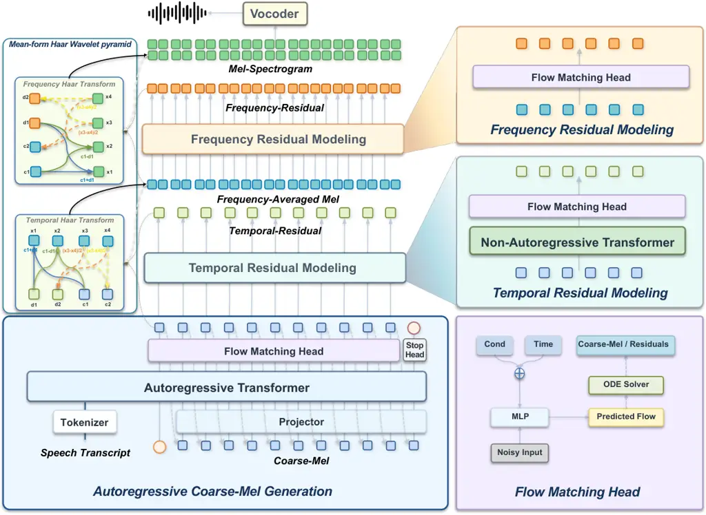

\[ BoldFont=texgyretermes-bold.otf, ItalicFont=texgyretermes-italic.otf,
BoldItalicFont=texgyretermes-bolditalic.otf \]

![[Uncaptioned
image]](arxiv-2611-20254--6cfa777b9091.figures/figure-1.webp)

 

VoxMel TTS Technical Report

 

Wenhao Guan^(1,2)   Jiaxin Ye⁴   Haitao Li⁵   Yifan Duan³   Junxi Liu³  
Wangjin Zhou⁶

Lin Li²   Qingyang Hong²   Xie Chen^(1,3)  

¹Shanghai Innovation Institute  ²Xiamen University  ³Shanghai Jiao Tong
University  
⁴Fudan University  ⁵Zhejiang University  ⁶Kyoto University


## 1  Introduction

Zero-shot text-to-speech (TTS) has advanced rapidly by casting speech
generation as autoregressive sequence modeling with language-model
backbones (Wang et al., 2023; Du et al., 2024a; Anastassiou et al.,
2024). A central design choice in these systems is the acoustic
representation to be generated. Most existing approaches autoregress
over learned, compressed representations, including discrete codec
tokens (Défossez et al., 2022; Kumar et al., 2023; Wang et al., 2023)
and continuous latents from trained autoencoders (Peng et al., 2025;
Zhou et al., 2026). Consequently, synthesis quality depends in part on
the learned encoder and the fidelity of its reconstruction.

Mel spectrograms offer a complementary alternative. As a standard
acoustic target in TTS (Shen et al., 2018; Ren et al., 2021), they avoid
the need for a learned acoustic tokenizer and remain interpretable and
model-independent. Although a vocoder is still required to convert mel
spectrograms into waveforms, it can be independently upgraded without
retraining the autoregressive generator. Despite these advantages, mel
spectrograms have received limited attention as continuous
autoregressive targets (Meng et al., 2024). Direct autoregression over
full-band mel spectrograms presents two challenges. Strong temporal
redundancy may let a model rely on acoustic history under teacher
forcing instead of using the text condition. Moreover, each sampled
frame, including its fine-grained details, is fed back into the history,
where prediction errors may accumulate. Frame patching (Jia et al., 2025) and low-frame-rate learned latents (Peng et al., 2025; Zhou et
al., 2026) reduce the number of autoregressive steps, but their
generated patches or latents still enter the history. Token-wise
coarse-to-fine methods (Wang et al., 2025a; Wu et al., 2025) likewise
feed reconstructed full-band frames into later steps.

We propose VoxMel, a tokenizer-free TTS framework that applies a fixed,
exactly invertible two-axis Haar transform to mel spectrograms. The
transform first splits the frequency axis into Frequency-Averaged Mel
and a frequency residual, then splits Frequency-Averaged Mel along time
into a compact Coarse-Mel sequence and a temporal residual.

A language-model backbone with a flow-matching head generates Coarse-Mel
autoregressively. Two non-autoregressive tiers then predict the temporal
residual from Coarse-Mel and the frequency residual from the
reconstructed Frequency-Averaged Mel. Because neither residual enters
the autoregressive history, the model generates a compact coarse
sequence while retaining enough information to reconstruct the complete
mel spectrogram. We evaluate VoxMel on LibriSpeech and Seed-TTS-eval,
including ablations of residual feedback, comparisons with other speech
generation systems, and experiments on GRPO post-training and flow-head
distillation.

Our contributions are:

- •
  Wavelet-factorized mel modeling. VoxMel applies a fixed, exactly
  invertible two-axis Haar wavelet transform to mel spectrograms. A
  language-model backbone autoregresses only over Coarse-Mel, while
  non-autoregressive residual tiers predict the temporal and frequency
  residuals in dependency order.
- •
  Post-training and distillation. Frozen-head GRPO improves all four
  Seed-TTS-eval metrics. We also distill the guided flow head into
  guidance-conditioned students with two or four inference steps,
  reducing head evaluations per coarse frame from 96 to 2 or 4. The
  four-step student retains competitive SIM and nearly matches the
  supervised model in WER/CER.
- •
  Evaluation and analysis. We evaluate zero-shot synthesis on
  LibriSpeech test-clean and Seed-TTS-eval test-en/test-zh.
  Decomposition ablations examine how removing residuals from the
  autoregressive history affects text reliance and end-to-end synthesis.

## 2  Preliminaries

Let $`X=(x_{1},\dots,x_{T})\in\mathbb{R}^{T\times M}`$ denote a log-mel
spectrogram with $`T`$ frames and $`M`$ mel channels, and let $`y`$
denote the conditioning information (text and a speaker prompt).
Continuous autoregressive TTS factorizes the conditional density as

```math
p(X\mid y)\;=\;\prod_{t=1}^{T}p\!\left(x_{t}\mid x_{<t},\,y\right), \tag{1}
```

where a language-model backbone summarizes the prefix in a hidden state
$`h_{t}=f_{\theta}(x_{<t},y)`$ and a sampling-based prediction head
draws $`x_{t}\sim p_{\phi}(\cdot\mid h_{t})`$. The head may be a
variational latent head (Meng et al., 2024), a diffusion head (Jia et
al., 2025), or a conditional flow-matching head that transports Gaussian
noise to the target conditioned on $`h_{t}`$ (Lipman et al., 2023).
Patch-based variants Jia et al. (2025); Zhou et al. (2026) group $`P`$
consecutive frames into one autoregressive step, with the head modeling
the joint distribution of a $`P\times M`$ block. Training uses teacher
forcing. At inference, each sampled frame or patch is fed back into the
history.

## 3  VoxMel



Figure 1: Overview of VoxMel. _Top left_: Dashed arrows show the
two-axis Haar decomposition. The mel spectrogram is first split along
frequency into Frequency-Averaged Mel and a frequency residual;
Frequency-Averaged Mel is then split along time into Coarse-Mel and a
temporal residual. _Bottom to top_: The pipeline autoregressively
generates Coarse-Mel, then predicts the temporal and frequency residuals
with non-autoregressive tiers in dependency order. The inverse transform
reconstructs the mel spectrogram, which a vocoder converts to a
waveform.

### 3.1  Motivation for Coarse-Mel Autoregression

We analyze 2,000 utterances from LibriSpeech test-clean. Adjacent mel
frames have lag-one autocorrelation of $`0.944`$. A linear predictor
using only the preceding frame reduces target variance by 11.3 dB (about
93%); adding more than two past frames yields only about 0.2 dB of
additional gain.

After the two-axis Haar split, Coarse-Mel accounts for 92.9% of the
summed coefficient variance but only 25% of the coefficients. The
temporal and frequency residuals account for 1.9% and 5.2%,
respectively. The temporal residual has little autocorrelation: using
its own past gives only 0.28 dB of prediction gain. Its probe $`R^{2}`$
rises from about 0.01 with the same-position coarse coefficient to 0.57
when neighboring coarse frames are included. For the frequency residual,
same-frame coarse context gives a probe $`R^{2}`$ of about 0.42, with
little gain from adding temporal context. These measurements motivate
excluding both residuals from the autoregressive history. Section 4.4
reports ablations on trained models.

### 3.2  Two-Axis Haar Wavelet Transform

A single-level Haar decomposition along time maps each adjacent frame
pair to a local average and half-difference:

```math
\displaystyle c_{j} \displaystyle=\tfrac{1}{2}\!\left(x_{2j-1}+x_{2j}\right), \tag{2}
```

```math
\displaystyle d_{j} \displaystyle=\tfrac{1}{2}\!\left(x_{2j-1}-x_{2j}\right),
```

for $`j=1,\dots,T/2`$, with inverse $`x_{2j-1}=c_{j}+d_{j}`$ and
$`x_{2j}=c_{j}-d_{j}`$. The same operation along frequency pairs
adjacent mel channels. VoxMel applies one split per axis, first along
frequency and then along time:

```math
\displaystyle(A,D^{(f)}) \displaystyle=\mathrm{Haar}_{f}(X), \tag{3}
```

```math
\displaystyle(C,D^{(t)}) \displaystyle=\mathrm{Haar}_{t}(A),
```

where $`A`$ is Frequency-Averaged Mel and $`C`$ is Coarse-Mel. The
resulting shapes are $`D^{(f)}\in\mathbb{R}^{T\times M/2}`$,
$`D^{(t)}\in\mathbb{R}^{T/2\times M/2}`$, and
$`C\in\mathbb{R}^{T/2\times M/2}`$. The inverse operations recover $`X`$
exactly, so the transform discards no coefficients. We use the averaging
form in Eq. 2, so the coarse coefficients remain on the mel-value scale
and can use the same normalization. This two-axis Haar decomposition is
a critically sampled discrete wavelet transform (Mallat, 1989). Because
each split acts on adjacent pairs, each residual is local to its
corresponding axis; Section 3.4 describes how the residual tiers use
coarse context.

### 3.3  Conditional Factorization

Let $`H`$ denote the fixed, invertible transform above, and let
$`Z=H\,\mathrm{vec}(X)`$ collect the Coarse-Mel grid $`C`$ and residual
bands $`D^{(t)}`$ and $`D^{(f)}`$. Here, $`A`$ is the Frequency-Averaged
Mel intermediate reconstructed from $`C`$ and $`D^{(t)}`$. Write
$`c_{i}`$ for the Coarse-Mel unit at position $`i`$, and let $`y`$
denote the text and speaker conditions. The change-of-variables formula
gives the first equality below; the second states VoxMel’s modeling
factorization:

```math
\displaystyle p_{X}(X\mid y) \displaystyle=|\det H|\,p_{Z}(Z\mid y) \tag{4}
```

```math
\displaystyle=|\det H|\Biggl[\underbrace{\prod_{i=1}^{T/2}p(c_{i}\mid c_{<i},y)}_{\begin{subarray}{c}\text{autoregressive}\\[-2.0pt]
\text{Coarse-Mel stream}\end{subarray}}
```

```math
\displaystyle\cdot\underbrace{p(D^{(t)}\mid C)\,p(D^{(f)}\mid A)}_{\begin{subarray}{c}\text{non-autoregressive}\\[-2.0pt]
\text{residual prediction}\end{subarray}}\Biggr].
```

The Coarse-Mel units are sampled one at a time, conditioned on earlier
units and $`y`$. The residual tiers do not directly receive $`y`$. The
temporal residual is conditioned on Coarse-Mel; the frequency residual
is conditioned on $`A`$, which is reconstructed from Coarse-Mel and the
temporal residual. Thus, the sampling order follows the dependencies in
the factorization: Coarse-Mel first, then the temporal residual, and
finally the frequency residual. Within each residual tier, positions are
predicted in parallel; this parallelism is across positions, not across
tiers. Neither residual is fed back into the Coarse-Mel history. Since
$`H`$ is fixed and invertible, $`|\det H|`$ is a constant
change-of-variables factor and the transformed representation preserves
all information needed to reconstruct $`X`$.

### 3.4  Architecture

Figure 1 summarizes the data flow: the coarse stream is generated
autoregressively, the residual bands are added in coarse-to-fine order,
and the inverse Haar transform reconstructs the mel spectrogram. The
right side of the figure expands the residual tiers and the
flow-matching head used to sample each band.

Autoregressive Coarse-Mel generation. The transcript is tokenized, and
the text conditions are combined with projected Coarse-Mel history as
input to a decoder-only transformer. At each step, its hidden state
conditions a flow-matching head that samples the next Coarse-Mel unit; a
stop head predicts when to end the sequence. With frame-wise prediction,
there are $`T/2`$ steps, each of dimension $`M/2`$–half as many steps as
frame-level mel generation. Inference applies separate guidance scales
to text and speaker prompt conditions (Section 4.2).

Residual generation and reconstruction. The temporal-residual tier uses
a non-autoregressive transformer and a flow-matching head conditioned on
Coarse-Mel. Its prediction is combined with Coarse-Mel to reconstruct
Frequency-Averaged Mel, which conditions the frequency-residual tier.
This second tier predicts each frame independently. Prediction is
parallel within each tier but sequential across tiers. The inverse Haar
transform then reconstructs the full mel spectrogram, which the vocoder
converts to speech.

|                                             |        |      |                        |                  |                    |                  |                    |                  |
| ------------------------------------------- | ------ | ---- | ---------------------- | ---------------- | ------------------ | ---------------- | ------------------ | ---------------- |
|                                             |        |      | LibriSpeech test-clean |                  | Seed-TTS test-en   |                  | Seed-TTS test-zh   |                  |
| System                                      | Params | Hrs  | WER $`\downarrow`$     | SIM $`\uparrow`$ | WER $`\downarrow`$ | SIM $`\uparrow`$ | CER $`\downarrow`$ | SIM $`\uparrow`$ |
| _Generation with Learned Tokens or Latents_ |        |      |                        |                  |                    |                  |                    |                  |
| CosyVoice (Du et al., 2024a)                | 0.3B   | 170K | 3.59                   | 0.660            | 3.39               | 0.629            | 3.63               | 0.723            |
| CosyVoice 2 (Du et al., 2024b)              | 0.5B   | 167K | 2.46                   | 0.679            | 2.57               | 0.652            | 1.45               | 0.748            |
| CosyVoice 3 (Du et al., 2025)               | 1.1B   | 1.0M | 1.99                   | 0.697            | 2.02               | 0.718            | 1.19               | 0.780            |
| Spark-TTS (Wang et al., 2025b)              | 0.5B   | 102K | –                      | –                | 1.98               | 0.584            | 1.20               | 0.672            |
| MaskGCT (Wang et al., 2025c)                | 1.0B   | 100K | 2.29                   | 0.691            | 2.88               | 0.713            | 2.40               | 0.773            |
| FireRedTTS 2 (Xie et al., 2025)             | 1.5B   | 1.4M | 4.32                   | 0.642            | 1.95               | 0.665            | 1.14               | 0.736            |
| Qwen3-TTS (Hu et al., 2026)                 | 1.7B   | 5.0M | 2.35                   | 0.703            | 1.66               | 0.714            | 1.22               | 0.770            |
| IndexTTS 2 (Zhou et al., 2025)              | 1.7B   | 55K  | 2.47                   | 0.700            | 2.23               | 0.706            | 1.03               | 0.765            |
| VibeVoice (Peng et al., 2025)               | 1.5B   | –    | –                      | –                | 3.04               | 0.689            | 1.16               | 0.744            |
| MOSS-TTS (Gong et al., 2026)                | 8.0B   | –    | 1.98                   | 0.677            | 1.84               | 0.709            | 1.37               | 0.770            |
| MOSS-TTS-Nano (Gong et al., 2026)           | 0.1B   | –    | 4.10                   | 0.484            | 4.62               | 0.499            | 3.13               | 0.643            |
| DiTAR (Jia et al., 2025)                    | 0.6B   | 280K | 2.39                   | 0.670            | 1.69               | 0.735            | 1.02               | 0.753            |
| VoxCPM (Zhou et al., 2026)                  | 0.7B   | 1.8M | 1.74                   | 0.717            | 1.85               | 0.729            | 0.93               | 0.772            |
| OmniVoice-Emilia (Zhu et al., 2026)         | 0.8B   | 100K | 1.57                   | 0.697            | 1.75               | 0.717            | 0.89               | 0.765            |
| _Non-Autoregressive with Mel_               |        |      |                        |                  |                    |                  |                    |                  |
| E2-TTS (32 NFE) (Eskimez et al., 2024)      | 0.3B   | 100K | 2.95                   | 0.690            | 2.32               | 0.706            | 1.91               | 0.713            |
| F5-TTS (32 NFE) (Chen et al., 2024)         | 0.3B   | 100K | 2.42                   | 0.660            | 1.85               | 0.664            | 1.53               | 0.750            |
| ZipVoice (16 NFE) (Zhu et al., 2025)        | 0.1B   | 100K | 2.05                   | 0.674            | 1.70               | 0.697            | 1.40               | 0.751            |
| _Autoregressive with Mel_                   |        |      |                        |                  |                    |                  |                    |                  |
| MELLE (Meng et al., 2024)                   | –      | 50K  | 2.10                   | 0.625            | –                  | –                | –                  | –                |
| MELLE-R2 (Meng et al., 2024)                | –      | 50K  | 2.14                   | 0.608            | –                  | –                | –                  | –                |
| VoxMel (Ours, 32 NFE)                       | 0.6B   | 100K | 1.98                   | 0.721            | 1.51               | 0.738            | 1.29               | 0.755            |
| + GRPO                                      | 0.6B   | 100K | 1.95                   | 0.736            | 1.15               | 0.753            | 1.17               | 0.776            |

Table 1: Objective results on LibriSpeech test-clean and Seed-TTS-eval
test-en/test-zh for zero-shot voice cloning. WER and CER are reported in
percent; lower is better. SIM denotes speaker similarity; higher is
better.

Flow-matching head. As shown in the lower-right inset, each head takes a
noisy input together with the flow time and its conditioning signal (the
transformer state for Coarse-Mel, or coarse-level context for a
residual). An MLP predicts the flow, and an ODE solver integrates it to
produce a Coarse-Mel unit or residual sample.

Training. Each flow-matching head uses the same conditional
flow-matching objective (Lipman et al., 2023):

```math
\displaystyle\mathcal{L}_{\mathrm{CFM}} \displaystyle=\mathbb{E}_{(a,g),s,\epsilon}\Bigl[\bigl\|v_{\phi}(z_{s},s,g)-(a-\epsilon)\bigr\|_{2}^{2}\Bigr], \tag{5}
```

```math
\displaystyle z_{s} \displaystyle=(1-s)\epsilon+sa.
```

Here, $`a`$ is the target from the stream being modeled and $`g`$ is its
conditioning signal, computed or provided for the selected stream from
its training example. The flow time $`s`$ is sampled uniformly from
$`[0,1]`$, and $`\epsilon`$ is standard Gaussian noise with the same
shape as $`a`$. Thus, $`z_{s}`$ interpolates linearly from noise to
target, and $`a-\epsilon`$ is the target velocity. The head $`v_{\phi}`$
predicts this velocity, with $`\phi`$ denoting that head’s parameters.
For Coarse-Mel, $`a=c_{i}`$ and $`g=h_{i}=f_{\theta}(c_{<i},y)`$, where
$`h_{i}`$ is computed from the teacher-forced coarse prefix and the text
and speaker conditions $`y`$, and $`\theta`$ denotes the backbone
parameters. For the temporal and frequency residual heads,
$`(a,g)=(D^{(t)},C)`$ and $`(D^{(f)},A)`$, respectively. Each tier
predicts all positions without autoregressive dependencies, conditioned
on its context. During training of the autoregressive Coarse-Mel stream,
we use condition dropout: examples have both text and speaker prompt,
text dropped with the speaker prompt retained, or both conditions
dropped. These are the three condition states used for two-scale
guidance at inference; the full schedule is given in Section 4.2. Full
training details are in Section 4.1.

### 3.5  GRPO with a Frozen Flow Head

We apply Group Relative Policy Optimization (GRPO) (Shao et al., 2024)
after supervised training to optimize the autoregressive Coarse-Mel
policy. Motivated by prior work that freezing the diffusion head can
stabilize RL in autoregressive–diffusion hybrids (Ma et al., 2026), we
adopt this strategy for VoxMel by updating only the backbone and keeping
the Coarse-Mel flow head, both residual tiers, and the vocoder frozen.
This keeps the mapping from the backbone’s predictions to audio fixed
throughout RL, isolating policy updates from changes to the acoustic
decoder. We evaluate this choice in Section 4.6.

For each text-and-speaker prompt, we sample a group of eight ($`G=8`$)
outputs using the deployment two-scale classifier-free guidance scales,
rather than sampling from the unguided conditional model. Each output
receives a scalar reward. GRPO normalizes rewards within each prompt’s
group to estimate relative advantages: an output is favored when it
scores better than the other outputs for the same prompt. A KL penalty
to the supervised checkpoint limits how far the updated policy can
drift. The reward design and rollout and optimization settings are
detailed in Section 4.6.

### 3.6  Guided Flow-Head Distillation

Sampling cost remains in the Coarse-Mel autoregressive loop. Each coarse
frame requires an ODE solve of the flow head. With two-scale guidance,
each solver step requires three forward passes, corresponding to the
three condition states described in Section 3.4 (full dropout schedule
in Section 4.2). Thus, $`S`$ solver steps require $`3S`$ head
evaluations per coarse frame.

The guidance factor of three is removable because guidance is a
_deterministic_ function of the conditional and dropped-condition
velocities. We distill a few-step student head that absorbs guidance
into its own weights: it matches a $`4`$-step guided teacher trajectory
while taking the guidance scales
$`(\omega_{\text{text}},\omega_{\text{spk}})`$ as explicit inputs,
sampled during training from ranges spanning the useful operating
region. At inference the student uses the requested scales and one
conditional forward pass per solver step, thereby avoiding separate
dropped-condition passes while keeping the scales tunable without
retraining. Distillation starts from the GRPO checkpoint and updates
only the head, with the backbone and tiers fixed. We draw a fraction of
training batches from the student’s own rollouts, so the head trains on
the conditioning it will meet at inference rather than on ground-truth
prefixes alone; without this the distilled head degrades severely
(Section 4.7).

## 4  Experiments

We first report benchmark and model-scaling results, then evaluate GRPO
post-training and sampling efficiency, and finally test transfer to a
DiTAR-style backbone. Decomposition ablations and their mechanism probes
are in Section 4.4.

### 4.1  Experimental Setup

We evaluate three VoxMel sizes (0.15B, 0.3B, and 0.6B), which share the
same wavelet target and training data but vary in backbone and tier
configuration. Unless stated otherwise, results are for VoxMel-0.6B.

#### Architecture and model sizes.

The backbone is initialized from Qwen2.5-0.5B and used as a feature
extractor. Table 2 reports the 0.6B module counts; Table 3 lists all
three sizes. The temporal residual tier uses bidirectional attention,
while the frequency tier processes each frame independently.

| Module             | Configuration                                                  | Params |
| ------------------ | -------------------------------------------------------------- | ------ |
| Backbone           | 24 layers, 896 wide, 4864 FFN, initialized from Qwen2.5-0.5B   | 494.0M |
| Coarse head        | flow matching, 6 layers, 1024 wide                             | 14.8M  |
| Temporal residual  | 6 bidirectional attention layers, 6-layer flow head, 1024 wide | 90.6M  |
| Frequency residual | 6 frame-wise MLP layers, 6-layer flow head, 1024 wide          | 90.6M  |
| Adapters           | coarse-to-backbone projection, special embeddings, stop head   | 0.1M   |
| Total              |                                                                | 690.1M |
| Vocoder            | Vocos, 8 layers, 512 wide (frozen, not counted above)          | 13.6M  |

Table 2: VoxMel-0.6B module configurations and parameter counts.

|                     |        |        |        |
| ------------------- | ------ | ------ | ------ |
| Parameters          | 0.15B  | 0.3B   | 0.6B   |
| _Configuration_     |        |        |        |
| Backbone layers     | 16     | 20     | 24     |
| Backbone width      | 512    | 768    | 896    |
| Backbone FFN        | 1024   | 1792   | 4864   |
| Residual tier width | 512    | 640    | 1024   |
| Blocks per tier     | 4      | 5      | 6      |
| Flow head layers    | 4      | 5      | 6      |
| _Parameters_        |        |        |        |
| Backbone            | 119.8M | 246.5M | 494.0M |
| Coarse head         | 2.7M   | 5.2M   | 14.8M  |
| Temporal residual   | 15.4M  | 30.2M  | 90.6M  |
| Frequency residual  | 15.4M  | 30.2M  | 90.6M  |
| Adapters            | 0.1M   | 0.1M   | 0.1M   |
| Total               | 153.4M | 312.2M | 690.1M |

Table 3: The three VoxMel model sizes.

#### Data and acoustic front-end.

We train on 100K hours of Emilia (He et al., 2024), discarding
utterances shorter than $`0.3`$ s or longer than $`30`$ s. Batches use a
budget of $`24{,}000`$ frames and a maximum sequence length of $`4096`$
tokens. We use the Qwen2.5 tokenizer. The target is a 100-channel
log-mel spectrogram at $`24`$ kHz, computed with an FFT/window size of
$`1024`$ and hop of $`256`$ samples ($`93.75`$ frames/s); a frozen Vocos
vocoder reconstructs 24-kHz waveforms.

#### Optimization and inference.

We use AdamW with learning rate $`2\times 10^{-4}`$, cosine decay, and
$`10{,}000`$ warmup steps. The supervised 0.6B checkpoint is taken after
$`900{,}000`$ steps. Gradients are clipped at global norm $`2`$;
training uses bfloat16 without gradient accumulation and an exponential
moving average for evaluation. Sampling uses an Euler solver with 32
uniform steps for the Coarse-Mel head and each residual tier.

#### Evaluation.

We report WER, CER, and speaker-embedding cosine similarity (SIM),
averaged over utterances, on LibriSpeech test-clean (Chen et al., 2024)
and Seed-TTS-eval test-en (1,088 utterances) and test-zh (2,020
utterances) (Anastassiou et al., 2024). English transcription uses
faster-whisper large-v3, Chinese uses FunASR Paraformer-zh, and speaker
similarity uses WavLM-large embeddings. Inference uses guidance scales
$`(\gamma_{\text{text}},\gamma_{\text{spk}})=(3.5,3.0)`$, selected in
the guidance sweep above.

### 4.2  Classifier-Free Guidance

We use nested text-first condition dropout. Here, $`T`$ and $`S`$ denote
the text and speaker prompt conditions, respectively. For each example,
we independently sample $`r_{\text{text}}\sim\mathrm{Bern}(0.3)`$ and
$`r_{\text{spk}}\sim\mathrm{Bern}(0.5)`$, then set

```math
d_{\text{text}}=r_{\text{text}},\qquad d_{\text{spk}}=r_{\text{text}}\wedge r_{\text{spk}}, \tag{6}
```

where $`d=1`$ denotes a dropped condition. The resulting states
$`(T,S)`$, $`(\emptyset,S)`$, and $`(\emptyset,\emptyset)`$ occur with
probabilities $`0.70`$, $`0.15`$, and $`0.15`$; $`(T,\emptyset)`$ is not
used. Inference uses the matching two-scale guidance path:

```math
\displaystyle v={} \displaystyle v(\emptyset,\emptyset)+\gamma_{\text{text}}\,[v(T,S)-v(\emptyset,S)] \tag{7}
```

```math
\displaystyle+\gamma_{\text{spk}}\,[v(\emptyset,S)-v(\emptyset,\emptyset)],
```

When speaker guidance is much stronger than text guidance,
intelligibility degrades. We select $`(3.5,3.0)`$ as a balanced
operating point: it lies near the CER–SIM trade-off frontier while CER
remains stable.

### 4.3  Benchmark Results

On Seed-TTS-eval test-en, supervised VoxMel-0.6B obtains 1.51% WER and
0.738 SIM, compared with 1.69% and 0.735 for DiTAR and 1.70% and 0.697
for ZipVoice (Table 1). On test-zh, VoxMel obtains 1.29% CER and 0.755
SIM. Several systems have lower CER, while the GRPO variant improves
VoxMel’s results to 1.15% WER / 0.753 SIM on test-en and 1.17% CER /
0.776 SIM on test-zh.

On LibriSpeech test-clean, VoxMel-0.6B obtains 1.98% WER and 0.721 SIM;
GRPO changes these to 1.95% and 0.736. The GRPO model has the highest
SIM in the table, while its WER remains above OmniVoice-Emilia (1.57%)
and VoxCPM (1.74%).

We also compared VoxMel with four baselines in a five-point listening
test. VoxMel’s naturalness/similarity scores are 3.89/3.97 in Chinese
and 3.96/4.11 in English. The highest scores vary by system and metric;
Table 4 reports means and 95% confidence intervals.

|               | ZH              |                 | EN              |                 |
| ------------- | --------------- | --------------- | --------------- | --------------- |
| System        | N-MOS           | S-MOS           | N-MOS           | S-MOS           |
| MaskGCT       | 3.36$`\pm`$0.11 | 3.89$`\pm`$0.11 | 3.83$`\pm`$0.11 | 4.00$`\pm`$0.10 |
| CosyVoice 2   | 3.56$`\pm`$0.12 | 3.93$`\pm`$0.10 | 4.01$`\pm`$0.09 | 3.95$`\pm`$0.10 |
| IndexTTS 2    | 4.19$`\pm`$0.09 | 4.01$`\pm`$0.09 | 4.06$`\pm`$0.10 | 4.16$`\pm`$0.09 |
| VoxCPM        | 3.83$`\pm`$0.12 | 3.98$`\pm`$0.11 | 3.99$`\pm`$0.10 | 4.17$`\pm`$0.09 |
| VoxMel (ours) | 3.89$`\pm`$0.10 | 3.97$`\pm`$0.10 | 3.96$`\pm`$0.09 | 4.11$`\pm`$0.09 |

Table 4: Five-point listening-test ratings for all listed systems. N-MOS
measures naturalness; S-MOS measures speaker similarity. Values are
means with 95% confidence intervals.

#### Listening protocol.

Twenty native speakers per language rated naturalness and speaker
similarity on separate five-point scales. Naturalness raters heard a
synthesized clip with its text; similarity raters compared reference and
synthesized clips while judging voice identity independently of content
and recording quality.

### 4.4  Decomposition Ablations

All ablation variants use the VoxMel-0.15B configuration. For
Seed-TTS-eval, we report results on test-en only.

We compare full-band mel (none), frequency residual excluded ($`f`$),
temporal residual excluded ($`t`$), and both residuals excluded
($`t{+}f`$). Excluded residuals are generated by separate
non-autoregressive tiers. The text-reliance probe measures the loss
increase when correct text is removed at a fixed acoustic prefix. The
exposure gap $`G`$ compares self-sampled and teacher-forced losses after
rollouts re-anchored at ground-truth prefixes.

|           |               |     | probe |       | end-to-end |       |
| --------- | ------------- | --- | ----- | ----- | ---------- | ----- |
| Split     | Recursion     | Hz  | td%   | $`G`$ | WER        | SIM   |
| none      | full-band mel | 94  | 1.10  | 16.1  | 30.35      | 0.493 |
| $`f`$     | freq. out     | 94  | 2.02  | 18.9  | 6.64       | 0.621 |
| $`t`$     | temp. out     | 47  | 3.07  | 5.4   | 11.41      | 0.552 |
| $`t{+}f`$ | both out      | 47  | 4.53  | 6.7   | 1.90       | 0.667 |

Table 5: Frame-level decomposition ablations using VoxMel-0.15B on
Seed-TTS-eval test-en. WER is reported in percent (lower is better); SIM
denotes speaker similarity (higher is better).

Removing residuals from the autoregressive history increases measured
text reliance from 1.10% to 4.53%. The full-band model has the highest
WER, while the fully split model has the lowest WER and highest SIM. the
probes therefore measure different effects of the decomposition.

### 4.5  Model Scaling

From 0.15B to 0.6B, English WER falls from 1.90% to 1.51%, and speaker
similarity rises from 0.667 to 0.738 on test-en and from 0.730 to 0.755
on test-zh. Chinese CER is lowest at 1.17% for the 0.3B model; it is
1.44% for the 0.15B model and 1.29% for the 0.6B model (Table 6).

|              | test-en            |                  | test-zh            |                  |
| ------------ | ------------------ | ---------------- | ------------------ | ---------------- |
| Model        | WER $`\downarrow`$ | SIM $`\uparrow`$ | CER $`\downarrow`$ | SIM $`\uparrow`$ |
| VoxMel-0.15B | 1.90               | 0.667            | 1.44               | 0.730            |
| VoxMel-0.3B  | 1.54               | 0.715            | 1.17               | 0.748            |
| VoxMel-0.6B  | 1.51               | 0.738            | 1.29               | 0.755            |

Table 6: VoxMel scaling results on Seed-TTS-eval.

### 4.6  GRPO Post-Training

We compare two GRPO variants initialized from the same supervised 0.6B
checkpoint. Both update the backbone and use identical guided rollouts,
rewards, and optimization settings. The trainable-head variant also
updates the Coarse-Mel flow head, whereas the frozen-head variant keeps
it fixed; the residual tiers remain frozen in both. We sample eight
guided rollouts per prompt and combine speaker similarity with ASR-based
transcription accuracy using equal reward weights. Advantages are
normalized within each group, with a KL penalty ($`\beta=0.01`$) to the
supervised checkpoint. Rollouts use 10 Euler steps, injected noise
$`\sigma=0.15`$, and learning rate $`2\times 10^{-6}`$. GRPO uses 10,000
Emilia examples for 1,000 updates.

|                 |          |                    |                  |                    |                  |
| --------------- | -------- | ------------------ | ---------------- | ------------------ | ---------------- |
|                 |          | test-en            |                  | test-zh            |                  |
| Training setup  | RL steps | WER $`\downarrow`$ | SIM $`\uparrow`$ | CER $`\downarrow`$ | SIM $`\uparrow`$ |
| Pretrained      | –        | $`1.51`$           | $`0.738`$        | $`1.29`$           | $`0.755`$        |
| GRPO: trainable | $`1000`$ | $`3.21`$           | $`0.715`$        | $`4.27`$           | $`0.733`$        |
| GRPO: frozen    | $`1000`$ | 1.15               | 0.753            | 1.17               | 0.776            |

Table 7: Trainable- versus frozen-head GRPO on Seed-TTS-eval, the
pretrained row is the supervised baseline. Lower WER/CER and higher SIM
are better.

After 1,000 GRPO steps, the frozen-head variant improves all four
Seed-TTS-eval metrics over the supervised baseline: test-en WER falls
from 1.51% to 1.15% and SIM rises from 0.738 to 0.753; test-zh CER falls
from 1.29% to 1.17% and SIM rises from 0.755 to 0.776. The
trainable-head variant performs worse than both the frozen-head variant
and the supervised baseline on all four metrics (Table 7).

### 4.7  Sampling Efficiency

#### Solver-Step Sweep.

We measure the quality–compute trade-off by varying the number of
flow-solver steps for the supervised 0.6B model. For each setting, both
residual tiers use the same number of solver steps as the autoregressive
Coarse-Mel flow head. At each step, two-scale guidance requires three
forward passes through the Coarse-Mel head, so its number of function
evaluations (NFE) is three times the solver-step count. The NFE values
count only Coarse-Mel head evaluations, not those of the residual tiers.

|        |                    |                    |                  |                    |                  |
| ------ | ------------------ | ------------------ | ---------------- | ------------------ | ---------------- |
|        |                    | test-en            |                  | test-zh            |                  |
| Steps  | NFE $`\downarrow`$ | WER $`\downarrow`$ | SIM $`\uparrow`$ | CER $`\downarrow`$ | SIM $`\uparrow`$ |
| $`1`$  | $`3`$              | $`12.21`$          | $`0.637`$        | $`10.32`$          | $`0.644`$        |
| $`2`$  | $`6`$              | $`9.65`$           | $`0.690`$        | $`5.46`$           | $`0.716`$        |
| $`4`$  | $`12`$             | $`3.10`$           | $`0.726`$        | $`2.61`$           | $`0.751`$        |
| $`8`$  | $`24`$             | 1.38               | 0.741            | $`1.39`$           | 0.761            |
| $`32`$ | $`96`$             | $`1.51`$           | $`0.738`$        | 1.29               | $`0.755`$        |

Table 8: Solver-step sweep for supervised VoxMel-0.6B on Seed-TTS-eval.
NFE is head evaluations per Coarse-Mel frame; lower NFE/WER/CER and
higher SIM are better.

Reducing the solver from 32 to 8 steps lowers Coarse-Mel head NFE from
96 to 24. On test-en, WER and SIM improve from 1.51% and 0.738 to 1.38%
and 0.741. On test-zh, SIM rises from 0.755 to 0.761, while CER
increases from 1.29% to 1.39%. At four or fewer steps, both error rates
rise substantially.

#### Few-Step Guided Distillation.

Following Section 3.6, we distill the GRPO checkpoint’s Coarse-Mel flow
head to match the trajectory of a guided, 4-step teacher. The student
takes the guidance scales as inputs, sampled during training from
$`\omega_{\text{text}}\in[3,4]`$ and $`\omega_{\text{spk}}\in[2,4]`$. We
keep the backbone and residual tiers fixed, use a learning rate of
$`5\times 10^{-5}`$, and draw $`30\%`$ of training batches from 48-frame
student rollouts. At inference, the student uses one pure-conditional
forward pass per solver step, with the desired guidance scales supplied
as inputs. We evaluate it at
$`(\omega_{\text{text}},\omega_{\text{spk}})=(3.5,3)`$.

Table 9 compares the guided GRPO checkpoint with the distilled student
at one, two, and four inference steps, using the same guidance scales.

|                    |                    | test-en            |                  | test-zh            |                  |
| ------------------ | ------------------ | ------------------ | ---------------- | ------------------ | ---------------- |
| Model              | NFE $`\downarrow`$ | WER $`\downarrow`$ | SIM $`\uparrow`$ | CER $`\downarrow`$ | SIM $`\uparrow`$ |
| GRPO, guided head  | $`96`$             | $`1.15`$           | $`0.752`$        | $`1.17`$           | $`0.773`$        |
| distilled, 4 steps | $`4`$              | $`1.49`$           | $`0.693`$        | $`1.20`$           | $`0.747`$        |
| distilled, 2 steps | $`2`$              | $`1.75`$           | $`0.693`$        | $`1.57`$           | $`0.744`$        |
| distilled, 1 step  | $`1`$              | $`3.13`$           | $`0.681`$        | $`3.39`$           | $`0.737`$        |

Table 9: Few-step guided distillation on Seed-TTS-eval. NFE counts head
evaluations per Coarse-Mel frame.

With four inference steps, the student reduces Coarse-Mel head
evaluations from 96 to 4 per frame ($`24\times`$). It combines four
solver steps with one forward pass per step by absorbing guidance into
the head. Compared with the guided GRPO checkpoint, test-en WER rises
from 1.15% to 1.49% and test-zh CER from 1.17% to 1.20%. SIM falls from
0.752 to 0.693 on test-en and from 0.773 to 0.747 on test-zh. The one-
and two-step students have higher error rates still (Table 9).

### 4.8  Transfer to a DiTAR-Style Backbone

We assess whether wavelet factorization extends beyond the VoxMel
backbone by adapting a DiTAR-style patch-autoregressive model to the
wavelet-factorized mel target. We compare this variant with models using
full-band mel and VoxCPM VAE latents. The DiTAR-style model uses
patch_size=4 and history_path_size=4.

|                        | test-en            |                  | test-zh            |                  |
| ---------------------- | ------------------ | ---------------- | ------------------ | ---------------- |
| Autoregressive target  | WER $`\downarrow`$ | SIM $`\uparrow`$ | CER $`\downarrow`$ | SIM $`\uparrow`$ |
| full-band mel          | $`36.97`$          | $`0.454`$        | $`49.99`$          | $`0.379`$        |
| VoxCPM VAE latents     | $`1.77`$           | $`0.644`$        | $`1.76`$           | $`0.707`$        |
| wavelet-factorized mel | $`1.89`$           | $`0.660`$        | $`1.74`$           | $`0.725`$        |

Table 10: Autoregressive target comparison with a DiTAR-style
patch-autoregressive backbone on Seed-TTS-eval.

The wavelet-based variant obtains 1.89% WER / 0.660 SIM on test-en and
1.74% CER / 0.725 SIM on test-zh, compared with 1.77% / 0.644 and 1.76%
/ 0.707 for the VAE-latent variant. The configurations are not fully
matched, so these results do not establish that either target is better.
They show that a DiTAR-style backbone can be trained on the fixed
wavelet representation without a learned tokenizer.

## 5  Related Work

#### Mel as a synthesis target.

Before language-model-based speech generation, mel spectrograms were a
standard acoustic target for TTS systems such as Tacotron 2,
Transformer-TTS, and FastSpeech 2. These systems predict mel features
and rely on a separate vocoder to synthesize waveforms (Shen et al.,
2018; Li et al., 2019; Ren et al., 2021). VoxMel retains mel’s
interpretable, tokenizer-free representation, but changes how it is used
autoregressively: only the coarse wavelet component, rather than the
full frame, enters the history.

#### Learned speech representations.

Many zero-shot TTS systems instead generate learned audio
representations, including discrete codec tokens and continuous latents.
This line of work spans AudioLM and VALL-E (Borsos et al., 2023; Wang et
al., 2023), as well as the CosyVoice, IndexTTS, and FireRedTTS families
(Du et al., 2024a; Du et al., 2024b; Du et al., 2025; Deng et al., 2025;
Zhou et al., 2025; Xie et al., 2025). The representations range from
residual and scalar quantization (Défossez et al., 2022; Kumar et al.,
2023; Mentzer et al., 2024) to decoupled token streams (Wang et al.,
2025b) and end-to-end learned latents (Zhou et al., 2026). In contrast
to these learned representations, VoxMel applies a fixed, invertible
coarse–residual transform directly to mel features.

#### Continuous generation and history robustness.

MAR provides a related precedent in image generation, using a per-step
diffusion head to generate continuous image patches rather than discrete
tokens (Li et al., 2024). Speech models employ related generative heads,
but differ from MAR in both architecture and target representation.
MELLE and FELLE autoregress directly over mel-spectrogram frames, using
variational sampling and flow matching, respectively. ARDiT, DiTAR, and
CLEAR instead model learned continuous acoustic latents; these systems
use learned autoencoder-based representations, including VAEs (Meng et
al., 2024; Wang et al., 2025a; Liu et al., 2024; Jia et al., 2025; Wu et
al., 2025). VibeVoice also uses low-rate learned acoustic latents (Peng
et al., 2025). These models differ in what enters the autoregressive
history. DiTAR feeds generated latent patches into later steps, while
MELLE and FELLE feed back generated mel frames; FELLE’s within-step
refinement does not change that feedback. VoxMel instead keeps its
residual bands out of the history. Non-autoregressive flow and diffusion
models avoid this recursion altogether (Le et al., 2023; Shen et al.,
2024; Guan et al., 2024; Eskimez et al., 2024; Chen et al., 2024; Zhu et
al., 2025).

#### Multiscale factorization.

Prior hierarchical speech models learn their coarse-to-fine structure:
HALL-E and MARS6 use layered codecs at different temporal rates, while
HAM-TTS adds a learned acoustic hierarchy over tokens (Nishimura et al.,
2025; Baas et al., 2025; Wang et al., 2024). VoxMel instead obtains its
levels from a fixed Haar transform. This linear split is exactly
invertible and adds no trainable parameters; we use it to keep the
coarse component in the autoregressive history and generate the
residuals separately.

## 6  Conclusion

VoxMel offers a learned-tokenizer-free approach to autoregressive
mel-spectrogram modeling. A fixed, exactly invertible two-axis Haar
transform separates a coarse sequence from temporal and frequency
residuals. The model feeds only the coarse sequence into its
autoregressive history and predicts the residuals in separate
non-autoregressive tiers, preserving the full mel representation without
autoregressive residual feedback.

Our experiments show that this factorization encourages greater reliance
on text than full-band mel autoregression while supporting effective
zero-shot synthesis. Frozen-head GRPO further improves synthesis
quality. Few-step distillation reduces sampling cost while retaining
transcription accuracy close to the supervised model and competitive
speaker similarity. Together, these results show that separating coarse
structure from residual detail is a practical way to model
mel-spectrograms autoregressively.

## Limitations

#### Depth and choice of transform.

We use one Haar split per axis, motivated by the measured first-order
temporal redundancy. We do not evaluate alternative depths, other
wavelet families in this work.

#### Languages and speech styles.

We evaluate English and Chinese on benchmarks of single-speaker
utterances a few seconds long. Tonal languages beyond Chinese, richer
morphology, languages requiring specialized text front ends, long-form
synthesis, multi-speaker dialogue, expressive and paralinguistic
control, singing, and code-switching are all outside this evaluation.

#### Other audio domains.

Our evaluation is limited to speech. Although the Haar transform itself
is not speech-specific, we have not tested whether its subband structure
or the proposed autoregressive factorization is effective for music,
general audio, or sound effects. Evaluating these domains, as well as
alternative time–frequency representations, remains future work.

## Ethics Statement

VoxMel supports zero-shot voice cloning from reference speech, which may
enable impersonation, non-consensual voice synthesis, or attempts to
spoof speaker-verification systems. Any release should document training
data provenance and consent, define acceptable uses, and consider
safeguards such as output watermarking and evaluated synthetic-speech
detection.

## References

- Anastassiou et al. (2024) P. Anastassiou, J. Chen, J. Chen, Y.
  Chen, Z. Chen, et al. Seed-tts: a family of high-quality versatile
  speech generation models. arXiv preprint arXiv:2406.02430. Cited by:
  §1, §4.1.
- Baas et al. (2025) M. Baas, P. Scholtz, A. Mehta, E. Dyson, A.
  Prakash, and H. Kamper MARS6: a small and robust hierarchical-codec
  text-to-speech model. In IEEE International Conference on Acoustics,
  Speech and Signal Processing (ICASSP), pp. 1–5. Cited by: §5.
- Borsos et al. (2023) Z. Borsos, R. Marinier, D. Vincent, E.
  Kharitonov, O. Pietquin, M. Sharifi, D. Roblek, O. Teboul, D.
  Grangier, M. Tagliasacchi, et al. AudioLM: a language modeling
  approach to audio generation. IEEE/ACM Transactions on Audio, Speech,
  and Language Processing 31, pp. 2523–2533. Cited by: §5.
- Chen et al. (2024) Y. Chen, Z. Niu, Z. Ma, K. Deng, C. Wang, et al.
  F5-tts: a fairytaler that fakes fluent and faithful speech with flow
  matching. arXiv preprint arXiv:2410.06885. Cited by: Table 1, §4.1,
  §5.
- Défossez et al. (2022) A. Défossez, J. Copet, G. Synnaeve, and Y. Adi
  High fidelity neural audio compression. arXiv preprint
  arXiv:2210.13438. Cited by: §1, §5.
- Deng et al. (2025) W. Deng, S. Zhou, J. Shu, J. Wang, and L. Wang
  IndexTTS: an industrial-level controllable and efficient zero-shot
  text-to-speech system. arXiv preprint arXiv:2502.05512. Cited by: §5.
- Du et al. (2024a) Z. Du, Q. Chen, S. Zhang, K. Hu, H. Lu, et al.
  CosyVoice: a scalable multilingual zero-shot text-to-speech
  synthesizer based on supervised semantic tokens. arXiv preprint
  arXiv:2407.05407. Cited by: §1, Table 1, §5.
- Du et al. (2025) Z. Du, C. Gao, Y. Wang, F. Yu, T. Zhao, H. Wang, X.
  Lv, H. Wang, C. Ni, X. Shi, et al. CosyVoice 3: towards in-the-wild
  speech generation via scaling-up and post-training. arXiv preprint
  arXiv:2505.17589. Cited by: Table 1, §5.
- Du et al. (2024b) Z. Du, Y. Wang, Q. Chen, X. Shi, X. Lv, et al.
  CosyVoice 2: scalable streaming speech synthesis with large language
  models. arXiv preprint arXiv:2412.10117. Cited by: Table 1, §5.
- Eskimez et al. (2024) S. E. Eskimez, X. Wang, M. Thakker, C. Li, C.
  Tsai, et al. E2 tts: embarrassingly easy fully non-autoregressive
  zero-shot tts. arXiv preprint arXiv:2406.18009. Cited by: Table 1, §5.
- Gong et al. (2026) Y. Gong, B. Jiang, Y. Zhao, Y. Yuan, K. Chen, Y.
  Jiang, C. Chang, D. Hong, M. Chen, R. Li, Y. Zhang, Y. Gao, H.
  Chen, K. Chen, S. Wang, X. Yang, Y. Zhang, K. Huang, Z. Lin, K. Yu, Z.
  Chen, J. Wang, Z. Fei, Q. Cheng, S. Li, and X. Qiu MOSS-tts technical
  report. arXiv preprint arXiv:2603.18090. Cited by: Table 1, Table 1.
- Guan et al. (2024) W. Guan, Q. Su, H. Zhou, S. Miao, X. Xie, L. Li,
  and Q. Hong ReFlow-tts: a rectified flow model for high-fidelity
  text-to-speech. In 2024 IEEE International Conference on Acoustics,
  Speech and Signal Processing (ICASSP), pp. 10501–10505. Cited by: §5.
- He et al. (2024) H. He, Z. Shang, C. Wang, X. Li, Y. Gu, et al.
  Emilia: an extensive, multilingual, and diverse speech dataset for
  large-scale speech generation. arXiv preprint arXiv:2407.05361. Cited
  by: §4.1.
- Hu et al. (2026) H. Hu, X. Zhu, T. He, D. Guo, B. Zhang, X. Wang, Z.
  Guo, Z. Jiang, H. Hao, Z. Guo, X. Zhang, P. Zhang, B. Yang, J. Xu, J.
  Zhou, and J. Lin Qwen3-tts technical report. arXiv preprint
  arXiv:2601.15621. Cited by: Table 1.
- Jia et al. (2025) D. Jia, Z. Chen, J. Chen, C. Du, J. Wu, et al.
  DiTAR: diffusion transformer autoregressive modeling for speech
  generation. arXiv preprint arXiv:2502.03930. Cited by: §1, §2, Table
  1, §5.
- Kumar et al. (2023) R. Kumar, P. Seetharaman, A. Luebs, I. Kumar,
  and K. Kumar High-fidelity audio compression with improved rvqgan.
  Advances in Neural Information Processing Systems 36, pp. 27980–27993.
  Cited by: §1, §5.
- Le et al. (2023) M. Le, A. Vyas, B. Shi, B. Karrer, L. Sari, R.
  Moritz, M. Williamson, V. Manohar, Y. Adi, J. Mahadeokar, et al.
  Voicebox: text-guided multilingual universal speech generation at
  scale. Advances in Neural Information Processing Systems 36,
  pp. 14005–14034. Cited by: §5.
- Li et al. (2019) N. Li, S. Liu, Y. Liu, S. Zhao, and M. Liu Neural
  speech synthesis with transformer network. In Proceedings of the AAAI
  Conference on Artificial Intelligence, Vol. 33, pp. 6706–6713. Cited
  by: §5.
- Li et al. (2024) T. Li, Y. Tian, H. Li, M. Deng, and K. He
  Autoregressive image generation without vector quantization. Advances
  in Neural Information Processing Systems 37, pp. 56424–56445. Cited
  by: §5.
- Lipman et al. (2023) Y. Lipman, R. T. Q. Chen, H. Ben-Hamu, M. Nickel,
  and M. Le Flow matching for generative modeling. In International
  Conference on Learning Representations (ICLR), Cited by: §2, §3.4.
- Liu et al. (2024) Z. Liu, S. Wang, S. Inoue, Q. Bai, and H. Li
  Autoregressive diffusion transformer for text-to-speech synthesis.
  arXiv preprint arXiv:2406.05551. Cited by: §5.
- Ma et al. (2026) X. Ma, J. Lei, T. Ren, J. Huang, S. Fu, A. Hao, J.
  Wu, X. Chu, and F. Zhao MAR-grpo: stabilized grpo for ar-diffusion
  hybrid image generation. arXiv preprint arXiv:2604.06966. Cited by:
  §3.5.
- Mallat (1989) S. G. Mallat A theory for multiresolution signal
  decomposition: the wavelet representation. IEEE Transactions on
  Pattern Analysis and Machine Intelligence 11 (7), pp. 674–693. Cited
  by: §3.2.
- Meng et al. (2024) L. Meng, L. Zhou, S. Liu, S. Chen, B. Han, et al.
  Autoregressive speech synthesis without vector quantization. arXiv
  preprint arXiv:2407.08551. Cited by: §1, §2, Table 1, Table 1, §5.
- Mentzer et al. (2024) F. Mentzer, D. Minnen, E. Agustsson, and M.
  Tschannen Finite scalar quantization: vq-vae made simple. In
  International Conference on Learning Representations (ICLR), Cited by:
  §5.
- Nishimura et al. (2025) Y. Nishimura, T. Hirose, M. Ohi, H. Nakayama,
  and N. Inoue HALL-e: hierarchical neural codec language model for
  minute-long zero-shot text-to-speech synthesis. In International
  Conference on Learning Representations (ICLR), Cited by: §5.
- Peng et al. (2025) Z. Peng, J. Yu, W. Wang, et al. VibeVoice technical
  report. arXiv preprint arXiv:2508.19205. Cited by: §1, §1, Table 1,
  §5.
- Ren et al. (2021) Y. Ren, C. Hu, X. Tan, T. Qin, S. Zhao, Z. Zhao,
  and T. Liu FastSpeech 2: fast and high-quality end-to-end text to
  speech. In International Conference on Learning Representations
  (ICLR), Cited by: §1, §5.
- Shao et al. (2024) Z. Shao, P. Wang, Q. Zhu, R. Xu, J. Song, et al.
  DeepSeekMath: pushing the limits of mathematical reasoning in open
  language models. arXiv preprint arXiv:2402.03300. Cited by: §3.5.
- Shen et al. (2018) J. Shen, R. Pang, R. J. Weiss, M. Schuster, N.
  Jaitly, Z. Yang, Z. Chen, Y. Zhang, Y. Wang, R. Skerry-Ryan, et al.
  Natural tts synthesis by conditioning wavenet on mel spectrogram
  predictions. In IEEE International Conference on Acoustics, Speech and
  Signal Processing (ICASSP), pp. 4779–4783. Cited by: §1, §5.
- Shen et al. (2024) K. Shen, Z. Ju, X. Tan, E. Liu, Y. Leng, L. He, T.
  Qin, J. Bian, et al. NaturalSpeech 2: latent diffusion models are
  natural and zero-shot speech and singing synthesizers. In
  International Conference on Learning Representations (ICLR), Cited by:
  §5.
- Wang et al. (2023) C. Wang, S. Chen, Y. Wu, Z. Zhang, L. Zhou, et al.
  Neural codec language models are zero-shot text to speech
  synthesizers. arXiv preprint arXiv:2301.02111. Cited by: §1, §5.
- Wang et al. (2024) C. Wang, C. Zeng, B. Zhang, Z. Ma, Y. Zhu, Z.
  Cai, J. Zhao, Z. Jiang, and Y. Chen HAM-tts: hierarchical acoustic
  modeling for token-based zero-shot text-to-speech with model and data
  scaling. arXiv preprint arXiv:2403.05989. Cited by: §5.
- Wang et al. (2025a) H. Wang, S. Liu, L. Meng, J. Li, Y. Yang, S.
  Zhao, H. Sun, Y. Liu, H. Sun, J. Zhou, et al. FELLE: autoregressive
  speech synthesis with token-wise coarse-to-fine flow matching. arXiv
  preprint arXiv:2502.11128. Cited by: §1, §5.
- Wang et al. (2025b) X. Wang, M. Jiang, Z. Ma, Z. Zhang, S. Liu, L.
  Li, Z. Liang, Q. Zheng, R. Wang, X. Feng, et al. Spark-tts: an
  efficient llm-based text-to-speech model with single-stream decoupled
  speech tokens. arXiv preprint arXiv:2503.01710. Cited by: Table 1, §5.
- Wang et al. (2025c) Y. Wang, H. Zhan, L. Liu, R. Zeng, H. Guo, J.
  Zheng, Q. Zhang, X. Zhang, S. Zhang, and Z. Wu MaskGCT: zero-shot
  text-to-speech with masked generative codec transformer. In
  International Conference on Learning Representations (ICLR), Cited by:
  Table 1.
- Wu et al. (2025) C. Y. Wu, J. Deng, G. Li, Q. Kong, and S. Lui CLEAR:
  continuous latent autoregressive modeling for high-quality and
  low-latency speech synthesis. arXiv preprint arXiv:2508.19098. Cited
  by: §1, §5.
- Xie et al. (2025) K. Xie, F. Shen, J. Li, F. Xie, X. Tang, and Y. Hu
  FireRedTTS-2: towards long conversational speech generation for
  podcast and chatbot. arXiv preprint arXiv:2509.02020. Cited by: Table
  1, §5.
- Zhou et al. (2025) S. Zhou, Y. Zhou, Y. He, X. Zhou, J. Wang, W. Deng,
  and J. Shu IndexTTS2: a breakthrough in emotionally expressive and
  duration-controlled auto-regressive zero-shot text-to-speech. arXiv
  preprint arXiv:2506.21619. Cited by: Table 1, §5.
- Zhou et al. (2026) Y. Zhou, G. Zeng, X. Liu, X. Li, R. Yu, Z. Wang, R.
  Ye, W. Sun, J. Gui, K. Li, Z. Wu, and Z. Liu Hierarchical
  semantic-acoustic modeling via semi-discrete residual representations
  for expressive end-to-end speech synthesis. In International
  Conference on Learning Representations (ICLR), Cited by: §1, §1, §2,
  Table 1, §5.
- Zhu et al. (2025) H. Zhu, W. Kang, Z. Yao, L. Guo, F. Kuang, et al.
  ZipVoice: fast and high-quality zero-shot text-to-speech with flow
  matching. arXiv preprint arXiv:2506.13053. Cited by: Table 1, §5.
- Zhu et al. (2026) H. Zhu, L. Ye, W. Kang, Z. Yao, L. Guo, F. Kuang, Z.
  Han, W. Zhuang, L. Lin, and D. Povey OmniVoice: towards omnilingual
  zero-shot text-to-speech with diffusion language models. arXiv
  preprint arXiv:2604.00688. Cited by: Table 1.
