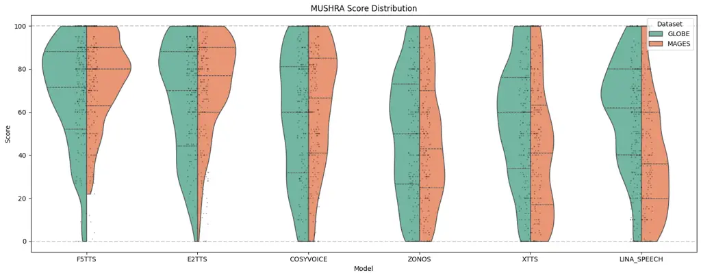

Francis Netzorg Gustafson Székely

# No-Shot Text-to-Speech: Limitations of Zero-Shot TTS and its Evaluation Methods in Representing Queer and Transgender Voices

Juliana    Robin    Joakim    Éva

###### Abstract

Gender expansive voices remain underrepresented in speech datasets,
which could cause challenges with generalizability in zero-shot
Text-To-Speech (TTS) systems. We evaluate six zero-shot TTS models on
two datasets: one containing non gender expansive voices (N-GE) and one
with gender expansive (GE) voices from self-identified speakers. Human
ratings found that 2 of the 6 models synthesize less similar GE voices
compared to N-GE voices, and 3 have improved performance for GE voices.
Automated evaluations yield conflicting results, with speaker similarity
and automated mean opinion score predictors rating performance of GE
voices inconsistently between models and human ratings. This highlights
a potential blind spot in evaluation pipelines, emphasizing a need for
more representative data and metrics that better capture human
perceptual judgments. Our findings stress the need to include
transgender, queer, and minority communities in creation of better
datasets and model training.

###### keywords

zero-shot text-to-speech, transgender speech, queer speech, voice
cloning bias, automated MOS, speaker embeddings

^(†)^(†)address: ¹ KTH Royal Institute of Technology, Sweden  
² University of California, Berkeley, USA ^(†)^(†)email:
jfrancis@kth.se, robin_netzorg@berkeley.edu, jkgu@kth.se,
szekely@kth.se^(†)^(†) Proceedings of Interspeech 2026,
10.21437/Interspeech.2026-709

## 1 Introduction

Artificial intelligence technologies in text-to-speech (TTS) systems and
natural language processing (NLP) have enhanced human-computer
interaction, often at the expense of minority groups \[1, 2\]. While
these offer benefits, they inherit and amplify societal biases, leading
to ethical and practical concerns that remain unaddressed \[3\]. Recent
studies have found that end-to-end TTS models can render ‘gay voices’ to
sound less ‘gay’, as determined by queer people \[4\], erasing key
aspects of a speaker’s identity. Research indicates that models trained
on gender-specific datasets under-perform when compared to non
gender-specific datasets when used for model training \[5\], suggesting
that current data collection practices may inadvertently limit voice
diversity. We evaluate zero-shot TTS performance in replicating voices
from underrepresented groups, and examine whether similar biases are
present in evaluation algorithms. ’Zero-shot TTS’ refers to TTS systems
that can generate speech for unseen speakers using a few second voice
sample without additional fine-tuning. In this study we focus on
“Gender-Expansive” (GE) voices, which refers to voices from speakers who
self-identify as not being cisgender We use the term “Non
Gender-Expansive” (N-GE) to refer to cisgender speakers.

### 1.1 Data Bias and the Necessity for Diverse Training Sets

The ability of current state-of-the-art (SOTA) zero-shot TTS to clone
voices with high fidelity is dependent upon the diversity and quality of
their training data. Studies such as the Globe corpus work \[6\]
demonstrate that models trained on diverse datasets are better able to
generalize to unseen voices. Similarly, a multilingual model has shown
promising results in adapting to a variety of linguistic features across
different languages \[7\]. However, pervasive issues in data collection,
such as sampling skew and aggregation distortions compromise the
representativeness of these datasets \[8\]. For example, the Common
Voice dataset \[9\] reports near zero-percent participation from
transgender individuals. Moreover, as an example within NLP, a large
text dataset disproportionately removed queer and trans-related text,
leading to data on queer people being defined by those without lived
experience \[10\]. A barrier in developing equitable TTS and speech
analysis systems is ensuring training datasets accurately represent real
world voice diversity, as inadequate representation can lead to
significant performance disparities \[6\]. Racial disparities have been
found in automated speech recognition, as well as gender and dialect
biases in YouTube’s automatic captions \[11, 12\]. Although transgender,
queer, and other underrepresented groups constitute a smaller proportion
of the population \[13, 14\], oversampling or other corrective measures
can be essential to ensure these voices are accurately represented, but
these techniques are rarely used \[15, 16\].

### 1.2 Failure of Speech-based Machine Learning Systems

The challenges associated with biased voice datasets extend beyond TTS
systems. Deepfake audio detection algorithms often fail when confronted
with out-of-distribution data \[17\], which can result in cloned voices
from marginalized groups being undetected, increasing risks of
impersonation. In a similar vein, speaker verification systems have
exhibited significant performance degradation, failing to categorize
transgender individuals as the same person when they employ
gender-affirming voice modification techniques \[18\]. This undermines
the technical reliability of these systems and contribute to a broader
sense of exclusion among affected users, reinforcing the perception that
such technologies are not designed for all demographic groups \[19\].

### 1.3 Inherited Societal Norms and the Impact on Speech Generating Device Users

Issues of gender-induced bias in voice synthesis is especially impactful
on frequent users of devices that utilize this technology, especially as
voice models tend to inherit prevailing societal gender norms \[20\].
When not tackled, these biases may be amplified, prompting participants
in a recent study to advocate for the use of gender-neutral voices as a
mitigation strategy \[20\]. This issue also has a particular effect on
users of speech generating devices, who already face stigmatization
within society \[21\]. For these individuals, having personalized voices
that accurately reflect their identity is often a necessity for
effective and dignified communication \[22, 23\].

### 1.4 Research Objectives and Contributions

Motivated by these challenges, this study addresses two key research
questions:

1.  1.  Voice Cloning Bias: Do zero-shot TTS systems have performance
        differences, as judged by human listeners, on GE voices?
2.  2.  Comparative Bias Analysis: Does a bias exist in machine learning
        evaluation algorithms used for speech analysis, when compared
        against other evaluation metrics and subjective perceptual metrics?

## 2 Methods

### 2.1 Voice Synthesis and Preprocessing

Six zero-shot TTS models were used to assess potential biases in
synthesizing GE voices: CosyVoice2, E2TTS, F5TTS, XTTS, Zonos, and
LinaSpeech \[7, 24, 25, 26, 27, 28\]. CosyVoice2, E2TTS, F5TTS, and XTTS
were all chosen as examples of models trained on large multilingual, and
potentially more diverse, datasets. ZONOS was chosen as a current
industry model, and LinaSpeech is used as an example of a smaller
zero-shot TTS model.

Two datasets were utilized for assessing performance. N-GE voices, the
Globe Dataset \[6\] was used, containing assumed majority N-GE speaker
samples. To select speakers from this dataset, an even split was created
between “male” and “female” speakers, and only selected participants
with accents labeled as “United States English”. Gender and accent data
were provided by the metadata of this dataset. We note that the creators
of the GLOBE dataset have assumed the gender of speakers who provided no
gender data and assigned a gender label using a classifier model \[6\].
This could cause incorrect classification as these often fail for
speakers whose voices fall within ambiguous ranges \[29\]. For GE
speakers, the ‘Mid-Atlantic Gender Expansive Speech’ (MAGES) dataset
\[30\] was used which contains GE voices based on an individual’s gender
self-identification, and these labels are maintained in our analyses.

Audio used as reference for generation is created by concatenating audio
files from each speaker, to reach an approximate duration of 10 seconds.
A reference sample generated in this way was created for all 14 MAGES
speakers and 14 GLOBE speakers (chosen using the above criteria), which
were then used for synthesis. This sample size is used due to the
limited availability of datasets explicitly containing GE speakers.

For each speaker, 15 phrases from the Harvard sentences were synthesized
using each model. All audio samples were standardized to 16 kHz and -20
dB to ensure consistency in evaluations.

### 2.2 Human Evaluation

16 participants were recruited to rate the synthesized voices. Each
participant listened to a 3-4 second sample from each speaker used in
the concatenated reference sample, and then asked to rate the similarity
of synthesized samples to this. Subjective evaluations were conducted
using a MUSHRA-like paradigm to compare across models \[31\]. This
MUSHRA-like implementation is a perceptual study design which presents
participants simultaneously with a reference audio and a synthesized
sample from each model (6 samples total) per trial, with 3 trials total
per reference speaker. The order of trials was randomized. Participants
rate each sample’s similarity to the reference audio on a scale between
0-100. A total of 8 speakers, 4 from each dataset, were used for the
MUSHRA-Like assesment, giving a total of 24 trials for a total of 144
ratings.

### 2.3 Machine Learning/Automated Metrics

All synthesized samples were also assessed using three measures,
automated mean opinion score (AMOS), speaker similarity, and word error
rate (WER) \[32, 33, 34\]. speaker similarity was calculated by
computing cosine similarity between the reference audio’s speaker
embedding and each of the synthesized sample’s embedding from this
reference audio. Speaker embeddings were extracted from the reference
and synthesized voices using ECAPA-TDNN, TitaNet-L and ReDimNet-M
(vb2+vox2+cnc-ft-mix), three models which provide speaker embeddings
\[33, 35, 36, 37, 38\]. AMOS was found using models trained to predict
human mean opinion scores (MOS). For this we used UTMOS \[39\] and a
finetuned wav2vec2 model for mean opinion score (MOS) prediction as
described in Cooper, et al. 2022 \[32\]. Between the speaker similarity
ratings and AMOS models respectively we calculated the Intraclass
Correlation Coefficient (ICC) to assess the consistency of the predicted
ratings. WER was calculated using error between the actual generated
audio’s transcription and the sentences used for synthesis. Transcripts
were generated using the ASR system Whisper \[34\].

## 3 Results

### 3.1 Human Listening Results

Results from the listening tests are presented in Table 1. Synthesized
GE voices were rated as significantly more similar to the reference
audio compared to N-GE voices for E2TTS, F5TTS, and CosyVoice2; and GE
voices were rated significantly less similar to the reference audio for
XTTS and LinaSpeech. No significant differences were observed for ZONOS
between GE and N-GE similarity. The greatest effect sizes were seen when
GE voices showed worse performance (LinaSpeech, d=.704; XTTS, d=.419),
in comparison to when N-GE showed worse performance (F5TTS, d=-.311;
E2TTS, d=-.283; CosyVoice2, d=-.226). A graph of these results and their
distribution is also presented in Figure 1.

\captionsetup

justification=centering,singlelinecheck=false Model Human Ratings (Range
0-100) GE N-GE t d F5TTS 74.70 (19.58) 67.80 (24.45) -3.01^(□) -.31
E2TTS 72.13 (22.39) 65.19 (26.42) -2.74^(□) -.28 CosyVoice2 62.57
(27.68) 56.06 (29.81) -2.19\* -.23 ZONOS 46.78 (28.69) 50.07 (28.95)
1.11 .11 XTTS 42.85 (30.29) 55.01 (27.71) 4.07^(△) .42 LinaSpeech 39.92
(27.94) 58.90 (26.00) 6.82^(△) .70

Table 1: Analysis of Human Ratings, \*=p\<.05,^(□)=p\<.005,^(△)=p\<.001

Figure 1: Human ratings for each model, split by dataset

| Model      | ECAPA-TDNN (Range 0-1) |             |           |       | TitaNet-L (Range 0-1) |             |           |       | ReDimNet-M (Range 0-1) |             |           |       | ICC  |      |
| ---------- | ---------------------- | ----------- | --------- | ----- | --------------------- | ----------- | --------- | ----- | ---------------------- | ----------- | --------- | ----- | ---- | ---- |
|            | GE                     | N-GE        | t         | d     | GE                    | N-GE        | t         | d     | GE                     | N-GE        | t         | d     | GE   | N-GE |
| F5TTS      | .759 (.061)            | .712 (.059) | –8.35^(△) | -.789 | .763 (.065)           | .757 (.050) | -1.01     | -.095 | .771 (.052)            | .752 (.042) | -4.26^(△) | -.402 | .739 | .508 |
| E2TTS      | .754 (.063)            | .707 (.064) | -7.85^(△) | -.742 | .788 (.059)           | .763 (.055) | -4.54^(△) | -.429 | .771 (.050)            | .740 (.048) | -6.70^(△) | -.633 | .671 | .509 |
| CosyVoice2 | .755 (.069)            | .716 (.061) | -6.31^(△) | -.596 | .774 (.070)           | .765 (.059) | -1.70     | -.161 | .761 (.050)            | .735 (.042) | -5.87^(△) | -.555 | .743 | .508 |
| ZONOS      | .644 (.077)            | .624 (.055) | –2.83^(□) | -.267 | .680 (.097)           | .698 (.055) | 2.43^(□)  | .229  | .659 (.065)            | .669 (.046) | 1.91      | .180  | .703 | .365 |
| XTTS       | .536 (.104)            | .529 (.104) | -.720     | -.068 | .636 (.069)           | .635 (.069) | -.10      | -.010 | .609 (.069)            | .596 (.063) | -2.03\*   | -.192 | .282 | .397 |
| LinaSpeech | .384 (.115)            | .457 (.100) | 7.15^(△)  | .676  | .428 (.116)           | .533 (.089) | 10.77^(△) | 1.019 | .392 (.097)            | .472 (.072) | 9.74^(△)  | .922  | .778 | .584 |

Table 2: Analysis of speaker similarity,
\*=p\<.05,$`\square`$=p\<.005,$`\triangle`$=p\<.001

### 3.2 Speaker Similarity

Speaker similarity from ECAPA-TDNN, TitaNet-L and ReDimnet-M are
summarized in Table 2. LinaSpeech consistently shows overall worse
speaker similarity, with GE voices performing significantly worse than
N-GE with moderate or high effect sizes for all embedding models. For
XTTS, a significant difference is seen between GE and N-GE voices only
for the ReDimNet-M model, where GE voices are predicted to have improved
performance, though with a small effect size. Results for the ZONOS
model had conflicting results for each embedding model, with ECAPA-TDNN
predicting significantly better GE performance, TitaNet-L predicting
significantly worse GE performance, and ReDimNet-M showing no
significant differences. Conflicting results are similarly seen for
F5TTS and CosyVoice2, where ECAPA-TDNN and ReDimNet-M had significantly
increased speaker similarity for GE voices, but no difference was found
for TitaNet-L. E2TTS consistently showed increased performance for GE
voices across all models. ICC metrics found that agreement between
similarity metrics was higher for GE voices than N-GE, except for XTTS,
where N-GE voices had higher agreement.

### 3.3 Automated MOS

AMOS scores are presented in Table 3. For FT-Wav2Vec2, significant
differences were found between the predicted scores for CosyVoice2, and
LinaSpeech, with GE voices being predicted to have improved performance
compared to N-GE voices. For UTMOS however, N-GE voices were predicted
to have significantly greater AMOS scores for all models, with small to
moderate effect sizes for all of these. ICC was also higher here for GE
voices than for N-GE for all models. Further, for F5TTS and CosyVoice2,
agreement was low for both datasets.

| Model      | FT-Wav2Vec2 (Range 1-5) |              |            |       | UTMOS (Range 1-5) |              |           |      | ICC  |      |
| ---------- | ----------------------- | ------------ | ---------- | ----- | ----------------- | ------------ | --------- | ---- | ---- | ---- |
|            | GE                      | N-GE         | t          | d     | GE                | N-GE         | t         | d    | GE   | N-GE |
| F5TTS      | 4.576 (.242)            | 4.563 (.170) | .646       | -.061 | 4.192 (.260)      | 4.284 (.201) | 4.202^(△) | .398 | .237 | .125 |
| E2TTS      | 4.236 (.426)            | 4.229 (.296) | -.206      | -.019 | 3.978 (.331)      | 4.065 (.280) | 2.993^(□) | .283 | .548 | .421 |
| CosyVoice2 | 4.691(.199)             | 4.586(.186)  | -5.719^(△) | -.542 | 4.366 (.151)      | 4.405 (.120) | 3.026^(□) | .316 | .261 | .244 |
| ZONOS      | 4.253 (.476)            | 4.196 (.349) | 1.451      | .137  | 4.081 (.281)      | 4.143 (.211) | 2.646\*   | .251 | .616 | .520 |
| XTTS       | 4.466 (.483)            | 4.497 (.276) | .850       | .081  | 4.052 (.382)      | 4.155 (.259) | 3.340^(□) | .287 | .533 | .283 |
| LinaSpeech | 4.484 (.310)            | 4.415 (.260) | -2.565\*   | -.243 | 4.206 (.234)      | 4.265 (.161) | 3.124^(□) | .296 | .521 | .410 |

Table 3: Analysis of AMOS, \*=p\<.05,^(□)=p\<.005,^(△)=p\<.001

### 3.4 Word Error Rate

WER differences between GE and N-GE synthesized samples are summarized
in Table  4. Significant differences were observed only for LinaSpeech,
with WER being significantly higher for GE outputs. For F5TTS, outputs
were near significant at p=.051, with similarly higher WER for GE than
N-GE voices.

\captionsetup

justification=centering,singlelinecheck=false

| Model      | WER (Range 0-1) |             |            |       |
| ---------- | --------------- | ----------- | ---------- | ----- |
|            | GE              | N-GE        | t          | d     |
| F5TTS      | .038 (.106)     | .022 (.059) | –1.957     | -.185 |
| E2TTS      | .040 (.121)     | .021 (.057) | -2.167     | -.205 |
| CosyVoice2 | .088 (.123)     | .087 (.131) | -.028      | -.003 |
| ZONOS      | .052 (.087)     | .060 (.098) | .917       | .087  |
| XTTS       | .039 (.187)     | .020 (.077) | -1.389     | -.132 |
| LinaSpeech | .141 (.263)     | .072 (.112) | -3.600^(△) | -.342 |

Table 4: Analysis of Word Error Rate,
\*=p\<.05,^(□)=p\<.005,^(△)=p\<.001

## 4 Discussion

Human evaluations using a MUSHRA-like evaluation found performance
differences in speaker similarity of outputs between GE and N-GE voices
which varied across models. For the models LinaSpeech and XTTS,
participants rated synthesized GE voices as significantly worse
recreations of the reference audio than N-GE voices, whereas for F5TTS,
E2TTS, and CosyVoice2, the opposite results were observed, with N-GE
voices being rated as significantly less similar to the reference audio.

For automated metrics, these models disagree on the performance of the
datasets depending on which evaluation model is used. Speaker similarity
metrics had disparities in how they rated each dataset per model, with
an overall significant difference between datasets for some speaker
verification models which was not present for others. Most notably, all
three speaker similarity metrics for the ZONOS model disagree on dataset
performance, with ECAPA-TDNN predicting improved performance for GE
voices, TitaNet-L predicting improved performance for N-GE voices, and
ReDimNet-M finding no difference between either dataset. Automated MOS
scores also show a similar divergence. The FT-Wav2Vec2 model only finds
significant differences between the datasets for CosyVoice2 and
LinaSpeech, where it predicts higher scores for GE voices, whereas the
UTMOS model predicts significantly better performance for N-GE voices
for all models.

These disparities both between evaluation models and their differences
with human ratings of speaker similarity draw into question the
applicability of these as automated testing measures. These
discrepancies likely stem from the training data used to develop these
automated metrics, which may underrepresent queer and transgender
voices, leading to difficulties in predicting actual performance.
Consequently, although automated tools can detect differences, they do
not appear to accurately reflect the qualitative judgments of human
listeners. Without addressing these issues with automated metrics, it
becomes difficult to assess a models actual performance on minority
voice groups.

We suggest a potential cause of the decreased performance could be that
models which performed worse on subjective evaluations were trained on
datasets containing read speech (XTTS, LinaSpeech), whereas two of the
models (F5TTS, E2TTS) that showed better performance were trained on
spontaneous speech datasets (no information is provided for other
models). Spontaneous speech captures nuances of real speech in
comparison to read speech, leading to a greater data diversity, even if
the dataset doesn’t explicitly contain gender-expansive speakers.
Although the datasets used by these models do not state the
queer-identities of their speakers, F5TTS and E2TTS were trained on the
EMILIA dataset \[40\] which utilizes “in-the-wild” data, and so these
datasets likely contain more diverse individuals. Poor replication of
queer voices also happens with other TTS models \[4\], in that ‘queer’
aspects of these voices are removed from synthesized voices when
suitable datasets are not used, which may come as a result of the model
not being able to learn these aspects. This could also provide an
explanation as to why agreement between automated metrics appears to be
higher for GE voices for most TTS models, if analysis of speech samples
follows a similar pattern in removing queer aspects of voices, and as
such these speakers may end up clustering in similar score ranges
between models, though this would require future research to
investigate.

### 4.1 Data Scarcity and Ethical Dilemmas in Curating Inclusive Datasets

A potential cause of the issues presented here is due to the limited
availability of queer speech datasets. We were only able to find two
speech datasets explicitly containing queer data \[18, 30\], and only a
single dataset that was suitable for assessing a zero-shot TTS model’s
performance on multiple queer voices, and even then, only 14 voices were
available within the dataset utilized \[30\]. Without large high quality
datasets it is hard to expect that the models would be able to perform
better, especially given that TTS models may fail to synthesize voices
accurately which are from sparser sections of a models latent space
\[41\].

A naive solution is to create a large dataset of these voices. However,
this leads to concerns for queer communities. If larger, high quality,
and well labeled datasets are made publicly available, the potential for
abuse rises \[4\]. It is imperative to be aware and ensure that
transgender and queer communities are actively engaged within the
dataset creation process, as disclosure of identity of individuals
within could cause harm to communities and individuals. Moreover, strict
guidelines surrounding data usage, privacy, and consent will be critical
to ensure that risks associated with misuse are avoided. This could also
be enhanced through anonymization techniques, controlled access
protocols, or secure data repositories. Further, it is imperative that
the principle of ’Nothing about us without us’ is followed, meaning that
those the dataset is supposed to represent must also be key contributors
throughout the entire process. While the pursuit of more inclusive
datasets may lead to significant technical gains, it’s important to
ensure that the needs and privacy of marginalized groups is placed at
the forefront to avoid unintended harm.

## 5 Conclusion

We investigated the ability of multiple zero-shot TTS models to
synthesize speech of GE speakers in comparison to N-GE speakers,
assessed via both human ratings and automated metrics. Further, we
assessed whether automated metrics of speaker similarity and AMOS are
effective for evaluating performance on GE speakers in comparison to
subjective metrics, as well as how different evaluation model’s
consistency varies between GE and N-GE datasets. Subjective metrics
varied across models, with two models showing worse performance for GE
speakers, and three models showing better performance. The effect size
was greater when GE voices performed worse. Various speaker similarity
and AMOS models had performance predictions inconsistent with human
scores, and themselves, where there is a disparity between the model’s
predictions on whether GE or N-GE voices perform better. These
disparities could lead to assumptions that assessed models have better
or worse performance on diverse voices than in reality. These results
highlight a need to enhance both model and evaluation performance, as it
is likely that the training data for these models underrepresents
diverse voices. We argue for the creation of more inclusive datasets,
however creation of these should be done with caution, keeping queer and
transgender communities’ needs at the forefront.

## 6 Acknowledgements

This work is funded by the WASP funded project Real-time context-aware
speech prosthesis for conversational interaction.

## 7 Use of Generative AI Disclosure

AI tools were used for minor revision and correction of portions of both
text in this paper and code used for analysis, which authors thoroughly
checked.

## References

- \[1\] S. A. Hussain, M. Bresnahan, and J. Zhuang (2025) The bias
  algorithm: how ai in healthcare exacerbates ethnic and racial
  disparities–a scoping review. Ethnicity & Health 30 (2), pp. 197–214.
  Cited by: §1.
- \[2\] A. Hagerty and I. Rubinov (2019) Global ai ethics: a review of
  the social impacts and ethical implications of artificial
  intelligence. arXiv e-prints, pp. arXiv–1907. Cited by: §1.
- \[3\] D. McAra-Hunter (2024) How ai hype impacts the lgbtq+ community.
  AI and Ethics, pp. 1–20. Cited by: §1.
- \[4\] A. Sigurgeirsson and E. L. Ungless (2024) Just because we camp,
  doesn’t mean we should: the ethics of modelling queer voices.. In
  Interspeech 2024, pp. 3050–3054. External Links:
  [Document](https://dx.doi.org/10.21437/Interspeech.2024-1982), ISSN
  2958-1796 Cited by: §1, §4.1, §4.
- \[5\] M. Z. Boito, L. Besacier, N. Tomashenko, and Y. Estève (2022) A
  study of gender impact in self-supervised models for speech-to-text
  systems. arXiv preprint arXiv:2204.01397. Cited by: §1.
- \[6\] W. Wang, Y. Song, and S. Jha (2024) GLOBE: a high-quality
  english corpus with global accents for zero-shot speaker adaptive
  text-to-speech. In Interspeech 2024, pp. 1365–1369. External Links:
  [Document](https://dx.doi.org/10.21437/Interspeech.2024-70), ISSN
  2958-1796 Cited by: §1.1, §2.1.
- \[7\] E. Casanova, K. Davis, E. Gölge, G. Göknar, I. Gulea, L.
  Hart, A. Aljafari, J. Meyer, R. Morais, S. Olayemi, and J.
  Weber (2024) XTTS: a massively multilingual zero-shot text-to-speech
  model. In Interspeech 2024, pp. 4978–4982. External Links:
  [Document](https://dx.doi.org/10.21437/Interspeech.2024-2016), ISSN
  2958-1796 Cited by: §1.1, §2.1.
- \[8\] N. Mehrabi, F. Morstatter, N. Saxena, K. Lerman, and A.
  Galstyan (2021) A survey on bias and fairness in machine learning. ACM
  computing surveys (CSUR) 54 (6), pp. 1–35. Cited by: §1.1.
- \[9\] R. Ardila, M. Branson, K. Davis, M. Kohler, J. Meyer, M.
  Henretty, R. Morais, L. Saunders, F. Tyers, and G. Weber (2020) Common
  voice: a massively-multilingual speech corpus. pp. 4218–4222 (eng).
  External Links: [Link](https://aclanthology.org/2020.lrec-1.520/),
  ISBN 979-10-95546-34-4 Cited by: §1.1.
- \[10\] A. Zhou (2024) Queer bias in natural language processing:
  towards more expansive frameworks of gender and sexuality in nlp bias
  research. GRACE: Global Review of AI Community Ethics 2. Cited by:
  §1.1.
- \[11\] A. Koenecke, A. Nam, E. Lake, J. Nudell, M. Quartey, Z.
  Mengesha, C. Toups, J. R. Rickford, D. Jurafsky, and S. Goel (2020)
  Racial disparities in automated speech recognition. Proceedings of the
  national academy of sciences 117 (14), pp. 7684–7689. Cited by: §1.1.
- \[12\] R. Tatman (2017) Gender and dialect bias in youtube’s automatic
  captions. In Proceedings of the first ACL workshop on ethics in
  natural language processing, pp. 53–59. Cited by: §1.1.
- \[13\] J. M. Twenge, B. E. Wells, J. Le, and G. N. Rider (2024)
  Increases in self-identifying as transgender among us adults,
  2014–2022. Sexuality Research and Social Policy, pp. 1–19. Cited by:
  §1.1.
- \[14\] Ipsos (2021) LGBT+ pride 2021 global survey. External Links:
  [Link](https://www.ipsos.com/sites/default/files/ct/news/documents/2021-06/LGBT%20Pride%202021%20Global%20Survey%20Report_3.pdf)
  Cited by: §1.1.
- \[15\] G. Fenu, H. Lafhouli, and M. Marras (2020) Exploring
  algorithmic fairness in deep speaker verification. In Computational
  Science and Its Applications–ICCSA 2020: 20th International
  Conference, Cagliari, Italy, July 1–4, 2020, Proceedings, Part IV 20,
  pp. 77–93. Cited by: §1.1.
- \[16\] P. DHERAM, M. Ramakrishnan, A. Raju, I. Chen, B. King, K.
  Powell, M. Saboowala, K. Shetty, and A. Stolcke (2022) Toward fairness
  in speech recognition: discovery and mitigation of performance
  disparities. In Interspeech 2022, pp. 1268–1272. External Links:
  [Document](https://dx.doi.org/10.21437/Interspeech.2022-10816), ISSN
  2958-1796 Cited by: §1.1.
- \[17\] N. M. Müller, N. Evans, H. Tak, P. Sperl, and K.
  Böttinger (2024) Harder or different? understanding generalization of
  audio deepfake detection. In Interspeech 2024, pp. 2705–2709. External
  Links: [Document](https://dx.doi.org/10.21437/Interspeech.2024-247),
  ISSN 2958-1796 Cited by: §1.2.
- \[18\] R. Netzorg, A. Cote, S. Koshin, K. V. Garoute, and G. K.
  Anumanchipalli (2024) Speech after gender: a trans-feminine
  perspective on next steps for speech science and technology. In
  Interspeech 2024, pp. 3075–3079. External Links:
  [Document](https://dx.doi.org/10.21437/Interspeech.2024-2269), ISSN
  2958-1796 Cited by: §1.2, §4.1.
- \[19\] T. Feng, R. Hebbar, N. Mehlman, X. Shi, A. Kommineni, S.
  Narayanan, et al. (2023) A review of speech-centric trustworthy
  machine learning: privacy, safety, and fairness. APSIPA Transactions
  on Signal and Information Processing 12 (3). Cited by: §1.2.
- \[20\] J. Yeon, Y. Park, and D. Kim (2023) Is gender-neutral ai the
  correct solution to gender bias. Using Speech. Cited by: §1.3.
- \[21\] J. Mertl, E. Žáčková, and B. Řepová (2018) Quality of life of
  patients after total laryngectomy: the struggle against stigmatization
  and social exclusion using speech synthesis. Disability and
  Rehabilitation: Assistive Technology 13 (4), pp. 342–352. Cited by:
  §1.3.
- \[22\] G. Castellano (2019) Functions of voice and speech in aac:
  technologies to meet an expressive need of people with disabilities. a
  case report. pp. . Cited by: §1.3.
- \[23\] É. Székely and M. Hope (2024) An inclusive approach to creating
  a palette of synthetic voices for gender diversity. In 25th
  Interspeech Conferece 2024, Kos Island, Greece, Sep 1 2024-Sep 5 2024,
  pp. 3070–3074. Cited by: §1.3.
- \[24\] Z. Du, Y. Wang, Q. Chen, X. Shi, X. Lv, T. Zhao, Z. Gao, Y.
  Yang, C. Gao, H. Wang, et al. (2024) Cosyvoice 2: scalable streaming
  speech synthesis with large language models. arXiv preprint
  arXiv:2412.10117. Cited by: §2.1.
- \[25\] S. E. Eskimez, X. Wang, M. Thakker, C. Li, C. Tsai, Z. Xiao, H.
  Yang, Z. Zhu, M. Tang, X. Tan, et al. (2024) E2 tts: embarrassingly
  easy fully non-autoregressive zero-shot tts. In 2024 IEEE Spoken
  Language Technology Workshop (SLT), pp. 682–689. Cited by: §2.1.
- \[26\] Y. Chen, Z. Niu, Z. Ma, K. Deng, C. Wang, J. Zhao, K. Yu,
  and X. Chen (2024) F5-tts: a fairytaler that fakes fluent and faithful
  speech with flow matching. arXiv preprint arXiv:2410.06885. Cited by:
  §2.1.
- \[27\] Zyphra (2025) GitHub - zyphra/zonos: zonos-v0.1 is a leading
  open-weight text-to-speech model trained on more than 200k hours of
  varied multilingual speech, delivering expressiveness and quality on
  par with—or even surpassing—top tts providers.. GitHub. External
  Links: [Link](https://github.com/Zyphra/Zonos) Cited by: §2.1.
- \[28\] T. Lemerle, H. Vanderbyl, V. Srivastav, N. Obin, and A.
  Roebel (2024) Lina-speech: gated linear attention is a fast and
  parameter-efficient learner for text-to-speech synthesis. arXiv
  preprint arXiv:2410.23320. Cited by: §2.1.
- \[29\] M. Lebourdais, M. Tahon, A. Laurent, and S. Meignier (2022)
  Overlapped speech and gender detection with wavlm pre-trained
  features. arXiv preprint arXiv:2209.04167. Cited by: §2.1.
- \[30\] M. Hope (2023) Mid-atlantic gender expansive speech (mages)
  corpus. Maxwell Hope, Ph.D.. External Links:
  [Link](https://maxwell-hope.com/mages-corpus/) Cited by: §2.1, §4.1.
- \[31\] M. Schoeffler, S. Bartoschek, F. Stöter, M. Roess, S.
  Westphal, B. Edler, and J. Herre (2018) WebMUSHRA—a comprehensive
  framework for web-based listening tests. Journal of Open Research
  Software 6 (1). Cited by: §2.2.
- \[32\] E. Cooper, W. Huang, T. Toda, and J. Yamagishi (2022)
  Generalization ability of mos prediction networks. In ICASSP 2022-2022
  IEEE International Conference on Acoustics, Speech and Signal
  Processing (ICASSP), pp. 8442–8446. Cited by: §2.3.
- \[33\] B. Desplanques, J. Thienpondt, and K. Demuynck (2020)
  ECAPA-TDNN: emphasized channel attention, propagation and aggregation
  in TDNN based speaker verification. In Interspeech 2020, H. Meng, B.
  Xu, and T. F. Zheng (Eds.), pp. 3830–3834. Cited by: §2.3.
- \[34\] A. Radford, J. W. Kim, T. Xu, G. Brockman, C. McLeavey, and I.
  Sutskever (2023) Robust speech recognition via large-scale weak
  supervision. In International conference on machine learning,
  pp. 28492–28518. Cited by: §2.3.
- \[35\] M. Ravanelli, T. Parcollet, P. Plantinga, A. Rouhe, S.
  Cornell, L. Lugosch, C. Subakan, N. Dawalatabad, A. Heba, J. Zhong, J.
  Chou, S. Yeh, S. Fu, C. Liao, E. Rastorgueva, F. Grondin, W. Aris, H.
  Na, Y. Gao, R. D. Mori, and Y. Bengio (2021) SpeechBrain: a
  general-purpose speech toolkit. Note: arXiv:2106.04624 External Links:
  2106.04624 Cited by: §2.3.
- \[36\] A. Nagrani, J. S. Chung, W. Xie, and A. Zisserman (2020)
  Voxceleb: large-scale speaker verification in the wild. Computer
  Speech & Language 60, pp. 101027. External Links: ISSN 0885-2308,
  [Document](https://dx.doi.org/https%3A//doi.org/10.1016/j.csl.2019.101027),
  [Link](https://www.sciencedirect.com/science/article/pii/S0885230819302712)
  Cited by: §2.3.
- \[37\] N. R. Koluguri, T. Park, and B. Ginsburg (2022) Titanet: neural
  model for speaker representation with 1d depth-wise separable
  convolutions and global context. In ICASSP 2022-2022 IEEE
  international conference on acoustics, speech and signal processing
  (ICASSP), pp. 8102–8106. Cited by: §2.3.
- \[38\] I. Yakovlev, R. Makarov, A. Balykin, P. Malov, A. Okhotnikov,
  and N. Torgashov (2024) Reshape dimensions network for speaker
  recognition. arXiv preprint arXiv:2407.18223. Cited by: §2.3.
- \[39\] T. Saeki, D. Xin, W. Nakata, T. Koriyama, S. Takamichi, and H.
  Saruwatari (2022) Utmos: utokyo-sarulab system for voicemos challenge 2022. arXiv preprint arXiv:2204.02152. Cited by: §2.3.
- \[40\] H. He, Z. Shang, C. Wang, X. Li, Y. Gu, H. Hua, L. Liu, C.
  Yang, J. Li, P. Shi, et al. (2024) Emilia: an extensive, multilingual,
  and diverse speech dataset for large-scale speech generation. In 2024
  IEEE Spoken Language Technology Workshop (SLT), pp. 885–890. Cited by:
  §4.
- \[41\] J. Francis, J. Gustafsson, and É. Székely (2025) Interpolating
  speaker identities for synthetic voice generation. In Proc. SSW 2025,
  pp. 168–174. Cited by: §4.1.
