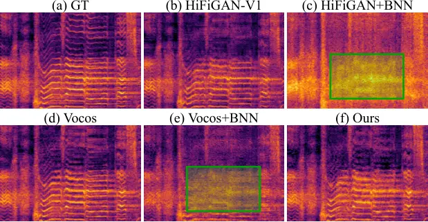
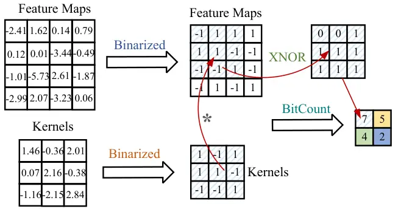
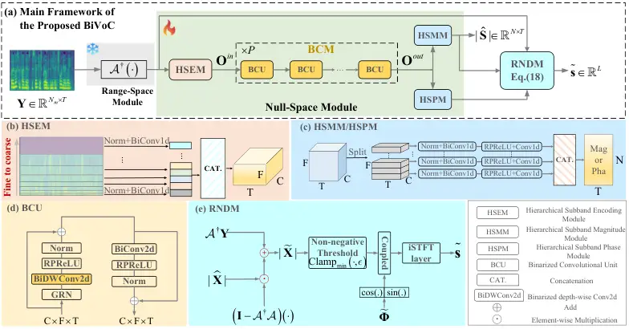
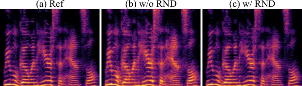
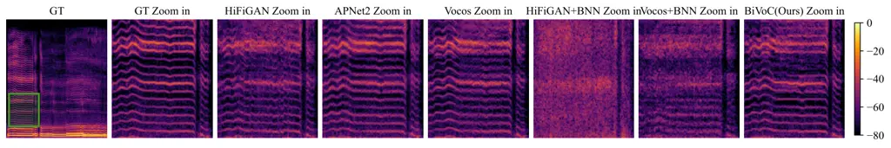

# High-Fidelity Binarized Neural Vocoder

Andong Li    Tong Lei    Xiaodong Li    Chengshi Zheng ^(†)^(†)thanks:
Andong Li, Xiaodong Li, Chengshi Zheng are with the Institute of
Acoustics, Chinese Academy of Sciences, Beijing 100190, China, and are
also with University of Chinese Academy of Sciences, Beijing 10190,
China (e-mail:{liandong, lxd, cszheng}@mail.ioa.ac.cn). Tong Lei is with
Tencent Hunyuan Multimodal Models Department, Tencent, Shenzhen 518054,
China (email: fayelei@tencent.com). Chengshi Zheng is the corresponding
author. This work was supported by the National Natural Science
Foundation of China (NSFC) under Grants 62501588 and Young Elite
Scientists Sponsorship Program of the Beijing High Innovation Plan.

###### Abstract

Neural vocoders have achieved remarkable progress in high-fidelity
waveform generation in recent years, but most existing methods still
rely on full-precision operators, leading to non-negligible storage and
computational costs during inference. Binary neural networks (BNNs)
provide an alternative direction by quantizing weights and activations
to 1 bit. However, directly applying binarization to neural vocoders is
rather challenging as it inherently incurs severe information loss. To
this end, we propose BiVoC, a BNN-oriented time-frequency neural vocoder
for high-fidelity waveform generation. Building on our previous
full-precision RNDVoC framework, BiVoC adapts the inverse-problem
formulation, range-null decomposition, and fine-to-coarse non-uniform
subband modeling to the 1-bit setting. Specifically, we develop a simple
binarized convolutional unit to provide stable time-frequency feature
modeling under binary representations. Furthermore, we analyze the
quality-complexity sensitivity of different modules and propose a
mixed-precision design to retain quality-sensitive components in full
precision while binarizing computation-dominant parts. Extensive
experiments are conducted on LibriTTS and multiple out-of-distribution
benchmarks. Both objective and subjective results demonstrate that BiVoC
substantially outperforms BNN variants obtained by directly binarizing
existing vocoders, while achieving competitive performance against
several mainstream full-precision vocoder baselines under much lower
theoretical computational cost. These results demonstrate the promising
potential of BNNs in the audio generation field. Codes and pre-trained
weights are available at https://github.com/Andong-Li-speech/BiVoC.

###### Index Terms: 

neural vocoder, binary neural networks, subband modeling, range-null
decomposition, audio generation

## I Introduction

Neural audio vocoders aim to synthesize time-domain waveforms from
compact acoustic representations, such as mel-spectrograms or latent
acoustic features \[1\]. As a fundamental technique in the audio
community, neural vocoders have been widely employed in various audio
tasks, such as speech enhancement \[2, 3\], audio codec \[4, 5\],
text-to-speech (TTS) \[6\], and multimodal generation \[7\].



Fig. 1: A typical spectral comparison, where the audio file is from
MUSDB18 test set \[8\]. (a) Ground truth; (b) HiFiGAN-V1; (c)
HiFiGAN+BNN, where float-based convolutional layers in HiFiGAN-V1 are
replaced by the binarized counterparts; (d) Vocos; (e) Vocos+BNN, where
float-based convolutional layers in Vocos are replaced by the binarized
counterparts. (f) Proposed BiVoC.

Traditional vocoders usually rely on manually extracted features, such
as pitch and spectral envelope, for waveform synthesis. Seminal works
include STRAIGHT \[9\] and WORLD \[10\], which, however, often suffer
from audible distortion and unsatisfactory subjective quality. Recent
advances in deep neural networks (DNNs) have substantially improved the
reconstruction quality of neural vocoders, which have gradually become
the mainstream approach. According to the input acoustic
representations, existing methods can be roughly divided into two
categories: mel-spectrogram and latent feature. The former adopts a
fixed linear mel-filter to obtain compact time-frequency (T-F)
representations, while the latter usually extracts acoustic features
through stacked learnable nonlinear layers. In this paper, we focus on
the former due to its wide applicability¹¹ 1 With the rapid development
of generative models, neural audio codecs and variational autoencoders
(VAEs) have attracted increasing attention for feature compression and
reconstruction. Nonetheless, mel-spectrograms remain one of the dominant
acoustic representations, especially when the compression ratio is high
and the frame rate is relatively low \[11\].. The investigation of
latent-feature-based vocoders is left as future work.

For modern neural vocoder designs, processing efficiency and generation
quality are two crucial factors. Early works are usually based on
autoregressive \[12, 13\] or flow-based paradigms \[14, 15\]. Despite
their notable performance improvements, these methods often suffer from
low inference speed or prohibitive computational complexity.
Subsequently, generative adversarial networks (GANs) have become an
appealing solution due to their superiority in both generation quality
and efficiency. Representative works include MelGAN \[16\] and
HiFiGAN \[17\], where the mel-spectrogram is progressively expanded into
waveform samples through stacked upsampling operations, and
multi-perspective discriminators are adopted to detect generation
artifacts across different modeling scales. Beyond waveform-domain
generation, several recent studies propose to model the waveform from
the T-F domain \[1, 18, 19\], that is, the generator estimates the
spectral magnitude and phase component, followed by inverse short-time
Fourier transform (iSTFT) for waveform synthesis. Compared with
waveform-domain methods, T-F domain vocoders can achieve comparable or
even better reconstruction quality with faster generation speed.

Nonetheless, the efficiency issue of neural vocoders is far from being
fully addressed. Most existing high-fidelity vocoders are still built
upon full-precision layers, where model storage, memory access, and
convolutional computation remain non-negligible during inference. This
issue becomes more critical in practical scenarios such as on-device
TTS, where the vocoder is expected to run continuously under strict
latency, power, and memory budgets. Such constraints are common on
affordable, resource-constrained edge platforms, including low-cost
service robots with spoken interaction, embedded human–machine
interfaces in household or industrial equipment, and portable assistive
or medical acoustic devices. These applications often require local
speech generation or reconstruction to reduce response latency, tolerate
intermittent connectivity, and protect user privacy, while operating
with limited memory and energy budgets. This practical demand motivates
the development of compact vocoders with reduced model storage and
high-precision computation.

Existing approaches to efficient neural inference generally follow two
complementary directions. The first is to reduce structural redundancy
through compact architecture design or model pruning. Pruning typically
identifies and removes redundant weights, filters, or channels from a
pre-trained model, followed by fine-tuning to recover performance.
Unstructured pruning provides flexible fine-grained sparsity, whereas
structured pruning removes complete filters or channels and is generally
more amenable to acceleration on general-purpose hardware \[20, 21\].
The second direction is to reduce the numerical precision of the
remaining weights and activations through quantization. These two
directions operate on different dimensions of model compression and can
be jointly applied to obtain additional reductions in storage and
computation \[22\]. In this study, we focus on the latter and
investigate its extreme 1-bit form, which remains largely unexplored for
high-fidelity neural vocoders.

Binary neural networks (BNNs) provide a promising path to this problem.
By constraining weights and activations to binary values, BNNs can
replace most floating-point multiplications with bitwise operations,
leading to compact and hardware-friendly models \[23\]. In theory,
compared with a conventional convolutional layer, binary operations can
achieve a 32$`\times`$ memory compression ratio and up to 64$`\times`$
computational reductions under suitable hardware support \[24\]. In
recent years, BNNs have been explored in various image-related tasks,
such as classification \[25\] and restoration \[26\]. To the best of our
knowledge, BNNs have not been systematically investigated for neural
vocoding.

Directly binarizing neural vocoders remains a technically challenging
task. Unlike image classification, neural vocoding requires the model to
synthesize continuous waveforms with accurate temporal dependency,
harmonic continuity, and phase structure. Small spectral errors can be
directly perceived as audible artifacts. As shown in Fig. 1(b)-(e),
simply replacing the full-precision convolutional layers in existing
neural vocoders, such as HiFiGAN and Vocos, with binarized counterparts
leads to severe spectral degradation. This indicates that existing
vocoder architectures cannot be binarized through naïve layer-wise
replacement, mainly due to the excessive information loss caused by
binary representations.

In \[18\], we proposed RNDVoC, which introduced the formulation of
mel-spectrogram vocoder as a linear inverse problem, the range-null
decomposition framework, and the fine-to-coarse non-uniform subband
modeling strategy. In this paper, we focus on a different question:
given such a structured full-precision framework, how should its
learnable modules, optimization strategy, and precision allocation be
redesigned under the severe representation constraints imposed by 1-bit
weights and activations?

To answer this question, we propose BiVoC, a BNN-oriented T-F neural
vocoder specifically designed for high-fidelity waveform reconstruction
with 1-bit weights and activations. Instead of directly binarizing the
full-precision modules, we re-engineer the learnable null-space
estimator for binary computation. Specifically, the fine-to-coarse
subband scheme is adapted to binary encoding and decoding, and we devise
a simple binarized convolutional unit (BCU) with a stable residual
feature flow. We further inspect the roles of different modules in the
proposed framework and observe that preserving full-precision
information in the encoder can notably improve reconstruction quality
with only a slight increase in computational complexity. To the best of
our knowledge, BiVoC is the first BNN-oriented neural vocoder for
high-fidelity waveform reconstruction and achieves comparable generation
quality to several mainstream full-precision methods including
HiFiGAN-V1 and Vocos (see Fig. 1 for details), while requiring
substantially lower computational cost.

The remainder of the paper is organized as follows. Sec. II reviews the
related work. Our proposed method is introduced in Sec. III. Datasets
and experimental setups are provided in Sec. IV-A, and we present
extensive experiments in Sec. V. Sec. VI concludes this paper.

## II Related Work

### II-A Neural Vocoder Methods

#### II-A1 Autoregressive-based

WaveNet \[12\] formulates waveform generation as an autoregressive
probabilistic modeling problem, where each waveform sample is predicted
conditioned on previously generated samples, and multiple dilated
convolution layers are adopted to gradually enlarge the receptive field.
In \[27\], the linear prediction coefficient (LPC) is adopted to
estimate the current sample, followed by a lightweight RNN for residual
prediction. Due to their autoregressive nature, these methods usually
suffer from slow inference speed.

#### II-A2 Flow-based

Flow-based methods aim to establish a bijective mapping between simple
Gaussian and target distributions. Representative works include
WaveGlow \[14\] and FlowWaveNet \[28\]. Despite their improved
generation speed over autoregressive-based vocoders, they are usually
constrained by carefully designed invertible blocks, and often involve
higher training and inference costs.

#### II-A3 GAN-based

HiFiGAN \[17\] adopts multi-scale and multi-periodicity discriminators
to improve the naturalness of generated waveforms. Later, BigVGAN \[29\]
introduces periodic activation function to provide a useful inductive
bias for audio synthesis and further demonstrates the benefit of model
scaling. Recently, several T-F domain vocoders have also been proposed.
Vocos \[1\] stacks ConvNext blocks and uses two separate output heads to
estimate spectral magnitude and phase, respectively. DegVoC \[30\]
regards vocoding from mel-spectrogram as a degradation-restoration
problem and introduces a subband-based architecture, achieving near
state-of-the-art (SoTA) performance among GAN-based methods.

#### II-A4 Diffusion-based

With the rapid development of diffusion models, a number of
diffusion-based vocoders have been proposed in recent years.
DiffWave \[31\] is one of the earliest methods to incorporate denoising
diffusion probabilistic models (DDPMs) into waveform generation. More
recently, flow-matching (FM) \[32\] has attracted increasing attention
due to its simple formulation. Lee *et al.* \[33\] utilized a
multi-periodic estimator, and optimal transport FM (OTFM) is employed
for trajectory modeling. Meanwhile, RFWave \[34\] introduces a
subband-based velocity estimator to facilitate more fine-grained
spectral generation.

Fig. 2: Comparisons among different gradient approximation strategies.
(a) Straight through estimator; (b) High-order approximation estimator;
(c) Adaptive approximation estimator.

### II-B Binarization

BNN is the extreme case of model quantization as it quantizes the
weights and activations into only 1 bit, which significantly decreases
the model size and computational complexity. In the vision field, it has
been widely used in high-level \[23, 24, 35\] and low-level tasks \[26,
36\]. Beyond vision, BNNs have also been explored in speech and audio
applications, including automatic speech recognition (ASR) \[37, 38\],
and speaker verification \[39\]. These studies mainly target
classification or analysis-related problems. In contrast, neural
vocoding requires sample-level waveform synthesis with accurate harmonic
continuity and phase structure, making it more sensitive to the
information loss caused by binarized weights and activations. Therefore,
the use of BNNs for high-fidelity audio generation remains largely
unexplored.

Another related line of research is spiking neural networks (SNNs),
which process information through sparse spike events and have shown
promising potential for ultra-low-power signal processing \[40, 41\].
However, SNNs usually require specialized designs such as spike
encoding, neuron dynamics, and multi-step temporal simulation, rendering
their training and deployment less straightforward than conventional
ANN-based models. In contrast, BNNs preserve the standard feed-forward
computation graph and can be more directly integrated into existing
neural vocoder architectures, while still replacing most full-precision
operations with bitwise computations.

## III Proposed Method

### III-A Preliminaries: Binary Neural Network

In this subsection, we briefly introduce basic units for binary
operations.

Forward Process: Without loss of generality, for T-F domain scenario, we
denote the full-precision two-dimensional (2-D) feature maps and kernels
as $`\mathbf{\mathcal{X}}^{f}\in\mathbb{R}^{C_{in}\times N\times T}`$
and
$`\mathbf{\mathcal{W}}^{f}\in\mathbb{R}^{C_{out}\times C_{in}\times K_{n}\times K_{t}}`$,
where superscript $`\left(\cdot\right)^{f}`$ denotes the full-precision
case, and $`\left\{C,N,T\right\}`$ are channel, frequency and frame
sizes, respectively. Similarly, let $`\mathcal{X}^{b}`$ and
$`\mathcal{W}^{b}`$ denote the binarized feature maps and kernels,
respectively, and superscript $`\left(\cdot\right)^{b}`$ denotes the
binary case. Here, $`\mathbb{R}`$ describes the algorithmic real-valued
domain rather than prescribing FP32 as the mandatory hardware data type.
Although the mel-spectrogram input is continuous-valued, the input and
non-binary intermediate activations can be quantized into INT8 or
another fixed-point format for integer deployment, while binary operands
can be stored in a bit-packed 1-bit format. For an activation tensor
with $`N_{a}`$ elements, FP32, INT8, and bit-packed binary
representations require approximately $`4N_{a}`$, $`N_{a}`$, and
$`\left\lceil N_{a}/8\right\rceil`$ bytes, respectively. The actual peak
memory additionally depends on accumulators, residual branches, and
operator workspaces. Our current PyTorch implementation uses
floating-point tensors, while end-to-end integer deployment requires
dedicated quantized kernels and is left for future work.

For binary convolution, both weights and feature maps are binarized to
-1 and +1, and efficient bitwise XNOR and bit-counting operations can
then replace heavy floating-point matrix multiplication:

```math
\mathcal{X}^{b}\otimes\mathcal{W}^{b}=\text{BitCount}\left(\text{XNOR}\left(\mathcal{X}^{b},\mathcal{W}^{b}\right)\right), \tag{1}
```

```math
x_{c,n,t}^{b}=\text{Sign}\left(x_{c,n,t}^{f}-\alpha_{c}\right)=\begin{cases}+1,&\text{if }x_{c,n,t}^{f}>\alpha_{c}\\
-1,&\text{if }x_{c,n,t}^{f}\leq\alpha_{c}\end{cases}, \tag{2}
```

```math
\displaystyle w_{i,j,k_{n},k_{t}}^{b} \displaystyle=\frac{\left\|\mathcal{W}_{i,:}^{f}\right\|_{1}}{\mathcal{N}}\,\text{Sign}\left(w_{i,j,k_{n},k_{t}}^{f}\right) \tag{3}
```

```math
\displaystyle=\begin{cases}+\dfrac{\left\|\mathcal{W}_{i,:}^{f}\right\|_{1}}{\mathcal{N}},&\text{if }w_{i,j,k_{n},k_{t}}^{f}>0\\[15.00002pt]
-\dfrac{\left\|\mathcal{W}_{i,:}^{f}\right\|_{1}}{\mathcal{N}},&\text{if }w_{i,j,k_{n},k_{t}}^{f}\leq 0\end{cases}, \tag{4}
```

where $`\left\{x_{c,n,t}^{b},x_{c,n,t}^{f}\right\}`$ are elements of
$`\left\{\mathcal{X}^{b},\mathcal{X}^{f}\right\}`$, with
$`c\in\left[1,C_{in}\right]`$, $`n\in\left[1,N\right]`$,
$`t\in\left[1,T\right]`$,
$`\left\{w_{i,j,k_{n},k_{t}}^{b},w_{i,j,k_{n},k_{t}}^{f}\right\}`$ are
elements of $`\left\{\mathcal{W}^{b},\mathcal{W}^{f}\right\}`$, with
$`i\in\left[1,C_{out}\right]`$, $`j\in\left[1,C_{in}\right]`$,
$`k_{n}\in\left[1,K_{n}\right]`$, $`k_{t}\in\left[1,K_{t}\right]`$.
$`\alpha_{c}`$ is the threshold value for each input channel. Similar
to \[24\],
$`\frac{\left\|\mathcal{W}_{i,:}^{f}\right\|_{1}}{\mathcal{N}}`$ denotes
the average of absolute weight values, serving as a scalar to modulate
the difference between binary and full-precision weights. We show an
example of binary convolution in Fig. 3.

For the activation function, we adopt a ReAct-PReLU (RPReLU) \[42\],
which is defined as:

```math
f(y_{c,n,t})=\begin{cases}y_{c,n,t}-\gamma_{c}+\zeta_{c},&\text{if }y_{c,n,t}>\gamma_{c}\\[15.00002pt]
\beta_{c}\left(y_{c,n,t}-\gamma_{c}\right)+\zeta_{c},&\text{if }y_{c,n,t}\leq\gamma_{c}\end{cases}, \tag{5}
```

where $`y_{c,n,t}`$ denotes the input feature.
$`\left\{\gamma_{c},\zeta_{c}\right\}`$ are learnable shifts to move the
distribution, $`\beta_{c}`$ is a learnable parameter to control the
slope of the negative part.



Fig. 3: Illustration of binary convolution operation. Both $`C_{in}`$
and $`C_{out}`$ are set to 1. We ignore the scalar value and
$`\alpha_{c}`$ is set to 0 for simplification.

Backward Propagation: For quantization function in Eq. (2), the gradient
calculation process can be formulated as:

```math
\frac{\partial\mathcal{L}}{\partial x}=\frac{\partial\mathcal{L}}{\partial B(x)}\frac{\partial B(x)}{\partial x}=\frac{\partial\mathcal{L}}{\partial\mathrm{Sign}(x)}\frac{\partial\mathrm{Sign}(x)}{\partial x}, \tag{6}
```

where $`\mathcal{L}`$ is the loss function, and
$`\mathcal{B}\left(x\right)=\text{Sign}\left(x\right)`$²² 2 Here we
ignore the subscript and superscript for simplification.. Notably, the
derivative of the sign function is zero almost everywhere, and cannot be
directly used during training. To this end, we introduce three surrogate
functions for gradient estimation.

The first type is the straight through estimator (STE) \[23\]. As shown
in Fig. 2(a), it is a clip function, given by:

```math
\mathcal{S}\left(x_{c,n,t}^{f}\right)=\text{Clip}\left(x_{c,n,t}^{f},-1,1\right). \tag{7}
```

The second type is the high-order approximation (HOA), as shown in
Fig. 2(b). Compared with STE, HOA provides a smoother surrogate function
and yields a more informative gradient within the clipping interval,
given by:

```math
\mathcal{S}(x_{c,n,t}^{f})=\begin{cases}-1,&x_{c,n,t}^{f}<-1\\[11.99998pt]
+(x_{c,n,t}^{f})^{2}+2x_{c,n,t}^{f},&-1\leq x_{c,n,t}^{f}<0\\[11.99998pt]
-(x_{c,n,t}^{f})^{2}+2x_{c,n,t}^{f},&0\leq x_{c,n,t}^{f}<1\\[11.99998pt]
+1,&\text{otherwise}\end{cases}, \tag{8}
```

and the corresponding gradient can be represented as:

```math
\mathcal{S}^{{}^{\prime}}(x_{c,n,t}^{f})=\begin{cases}2x_{c,n,t}^{f}+2,&-1\leq x_{c,n,t}^{f}<0\\[11.99998pt]
-2x_{c,n,t}^{f}+2,&0\leq x_{c,n,t}^{f}<1\\[11.99998pt]
0,&\text{otherwise}\end{cases} \tag{9}
```

In \[43\], an adaptive approximation estimator (AAE) was proposed, where
learnable parameters are set for trade-off between clipping range and
gradient representation accuracy, as shown in Fig. 2(c). Its surrogate
function is defined as:

```math
\mathcal{S}\left(x_{c,n,t}^{f}\right)=\begin{cases}-1,&x_{c,n,t}^{f}<-\delta_{c}\\[11.99998pt]
+\lambda_{c}^{2}(x_{c,n,t}^{f})^{2}+2\lambda_{c}x_{c,n,t}^{f},&-\delta_{c}\leq x_{c,n,t}^{f}<0\\[11.99998pt]
-\lambda_{c}^{2}(x_{c,n,t}^{f})^{2}+2\lambda_{c}x_{c,n,t}^{f},&0\leq x_{c,n,t}^{f}<+\delta_{c}\\[11.99998pt]
+1,&\text{otherwise}\end{cases}, \tag{10}
```

where $`\lambda_{c}`$ is a channel-wise learnable parameter, and the
clip range $`\delta_{c}=\frac{1}{\lambda_{c}}`$. Note that HOA can be
regarded as a special case of AAE when $`\lambda_{c}=1`$.

### III-B Review of the Range-Null Decomposition

BNN can incur severe information loss, and simply replacing a
conventional convolution operation with its binary variant inevitably
causes severe degradation in generation quality. Following
RNDVoC \[18\], we adopt the range-null decomposition (RND) formulation
to reduce the reconstruction burden imposed on the binarized generator.
For completeness, we briefly review its formulation below.

Without loss of generality, we consider a classical signal compression
model:

```math
\boldsymbol{y}=\mathbf{A}\boldsymbol{x}+\boldsymbol{n}, \tag{11}
```

where $`\boldsymbol{y}\in\mathbb{R}^{d}`$,
$`\boldsymbol{x}\in\mathbb{R}^{D}`$, and
$`\boldsymbol{n}\in\mathbb{R}^{d}`$ are observed, target, and noise
signals, respectively. $`\mathbf{A}\in\mathbb{R}^{d\times D}`$ is a
linear compression matrix with $`d\ll D`$. For the noise-free scenario,
Eq. (11) can be simplified into
$`\boldsymbol{y}=\mathbf{A}\boldsymbol{x}`$. The solution of the
equation $`\tilde{\boldsymbol{x}}`$ should meet two constraints: (1)
Degradation consistency:
$`\mathbf{A}\tilde{\boldsymbol{x}}\equiv\boldsymbol{y}`$, which means
the estimation should contain all the degradation information of the
observation; (2) Distribution consistency:
$`\tilde{\boldsymbol{x}}\sim p\left(\boldsymbol{x}\right)`$, which means
that the estimation shares the same distribution as the target. Under
these constraints, the solution can be written as:

```math
\tilde{\boldsymbol{x}}=\mathbf{A}^{\dagger}\boldsymbol{y}+\left(\mathbf{I}-\mathbf{A}^{\dagger}\mathbf{A}\right)\hat{\boldsymbol{x}}, \tag{12}
```

where $`\mathbf{A}^{\dagger}\in\mathbb{R}^{D\times d}`$ is the
pseudo-inverse of $`\mathbf{A}`$. Eq. (12) consists of two terms, namely
$`\mathbf{A}^{\dagger}\boldsymbol{y}`$ and
$`\left(\mathbf{I}-\mathbf{A}^{\dagger}\mathbf{A}\right)\hat{\boldsymbol{x}}`$,
which are called range-space (RS) and null-space (NS) components,
respectively. Let $`\mathbf{P}=\mathbf{A}^{\dagger}\mathbf{A}`$. Since
$`\mathbf{P}`$ is Hermitian and idempotent, it is an orthogonal
projector, and thus

```math
\left(\mathbf{A}^{\dagger}\boldsymbol{y}\right)^{\top}\left(\mathbf{I}-\mathbf{A}^{\dagger}\mathbf{A}\right)\hat{\boldsymbol{x}}=\boldsymbol{x}^{\top}\mathbf{P}(\mathbf{I}-\mathbf{P})\hat{\boldsymbol{x}}=0. \tag{13}
```

This suggests that the range-space component can be easily obtained by a
fixed linear transform, and we only need to estimate the null-space
part.

Recall that the mel-spectrogram can be formulated as:

```math
\mathbf{Y}=\mathcal{A}\left|\mathbf{X}\right|, \tag{14}
```

where $`\mathbf{Y}\in\mathbb{R}^{N_{m}\times T}`$ denotes the linear mel
magnitude, obtained after inverse dynamic-range compression when log-mel
features are used. Here, $`N_{m}`$ is the number of mel-frequency bins,
$`\mathcal{A}\in\mathbb{R}^{N_{m}\times N}`$ is the mel-filter matrix,
and $`|\mathbf{X}|\in\mathbb{R}^{N\times T}`$ denotes the target
magnitude spectrum.

In previous works, a neural network serves to estimate the target
waveforms or T-F spectrogram given mel-spectrogram as the input, given
by:

```math
\boldsymbol{\tilde{x}}=\mathcal{F}_{time}\left(\mathbf{Y}\right)\quad\text{or}\quad\tilde{\mathbf{X}}=\mathcal{F}_{tf}\left(\mathbf{Y}\right), \tag{15}
```

where $`\mathcal{F}_{time}\left(\cdot\right)`$ and
$`\mathcal{F}_{tf}\left(\cdot\right)`$ are the corresponding mapping
functions defined in the time and T-F domain, respectively. Notably,
when BNN is adopted, the modeling capability can be dramatically
hampered, leading to severe artifacts. The RND formulation alleviates
this burden by separating the analytically recoverable range-space
component from the learned null-space component.

Note that Eq. (14) can be regarded as a special case of Eq. (11), where
mel-filter $`\mathcal{A}`$ is an instantiation of the general
compression matrix $`\mathbf{A}`$. Instead of following a direct-mapping
paradigm for target estimation as in Eq. (15), similar to Eq. (12), we
rewrite the solution as:

```math
\left|\tilde{\mathbf{X}}\right|=\mathcal{A}^{\dagger}\mathbf{Y}+\left(\mathbf{I}-\mathcal{A}^{\dagger}\mathcal{A}\right)\mathcal{F}\left(\mathcal{A}^{\dagger}\mathbf{Y}\right). \tag{16}
```

It involves two components. First, the mel-spectrogram is transformed
into the linear scale via a linear operation, _i.e._,
$`\mathcal{A}^{\dagger}\mathbf{Y}`$. After that, it acts as an
initialization estimate and a network $`\mathcal{F}\left(\cdot\right)`$
is devised to estimate the remaining spectral part, filtered by
$`\left(\mathbf{I}-\mathcal{A}^{\dagger}\mathcal{A}\right)`$. One may
notice that only the magnitude is considered as the phase component is
dropped in Eq. (14). Motivated by multi-task training, we enforce the
network to also estimate the phase component, and Eq. (16) is thus
rewritten as:

```math
\left\{\left|\hat{\mathbf{X}}\right|,\tilde{\mathbf{\Phi}}\right\}=\mathcal{F}\left(\mathcal{A}^{\dagger}\mathbf{Y}\right), \tag{17}
```

```math
\tilde{\mathbf{X}}=\left(\mathcal{A}^{\dagger}\mathbf{Y}+\left(\mathbf{I}-\mathcal{A}^{\dagger}\mathcal{A}\right)\left|\hat{\mathbf{X}}\right|\right)e^{j\tilde{\mathbf{\Phi}}}, \tag{18}
```

where $`\left|\hat{\mathbf{X}}\right|`$ denotes the residual magnitude,
$`\tilde{\mathbf{\Phi}}`$ denotes the estimated phase. Compared with
previous works, the rationales are two-fold. First, rather than modeling
from scratch, it substantially mitigates the modeling burden by
explicitly preserving the information from the mel observation, which is
especially significant when the modeling capability is heavily
restricted. Besides, as $`\mathcal{A}^{\dagger}\mathbf{Y}`$ has been
aligned with the target spectrogram in the feature size after
initialization, the subsequent reconstruction can be viewed as a T-F
restoration problem, allowing us to borrow architectural principles from
speech enhancement.



Fig. 4: System diagram of the proposed BiVoC. (a) Overall structure of
the BiVoC, which consists of three parts: RSM, NSM and RNDM; (b)
Internal structure of the HSEM; (c) Internal structure of the HSMM/HSPM;
(d) Internal structure of the BCU; (e) Internal structure of the RNDM.

### III-C Proposed Framework

Based on the analysis in Sec. III-B, in this paper, we develop a novel
binary T-F vocoder called BiVoC based on range-null decomposition (RND)
theory. The overall diagram is shown in Fig. 4(a). Following the
modeling paradigm in \[18\], the input mel-spectrogram is first
converted into linear-scale counterpart via a range-space module (RSM).
Then the null-space module attempts to estimate the residual magnitude
spectrum as well as phase component, which consists of three components,
namely hierarchical subband encoding module (HSEM), hierarchical subband
magnitude/phase module (HSMM/HSPM), and binarized convolutional module
(BCM). After that, the range-null decomposition module (RNDM) further
generates the estimated waveform samples. The details are described
below.

#### III-C1 HSEM

Previous T-F domain vocoders often perform spectrum generation with
full-band modeling \[1\], _i.e._, the network is utilized to directly
estimate the target spectrum, thus neglecting the hierarchical
characteristics of subbands under different frequency regions. Besides,
full-band modeling usually incurs excessive network parameters due to
the use of large channel size. Recently, several subband-based modeling
strategies have been proposed in the audio community \[18, 19\]. To this
end, we adopt a hierarchical strategy for spectrum encoding, as shown in
Fig. 4(b). Specifically, given the input spectrum
$`\mathbf{Z}=\mathcal{A}^{\dagger}\mathbf{Y}\in\mathbb{R}^{N\times T}`$,
we explicitly split it into $`F`$ subbands in an uneven manner, _i.e._,
$`N=\sum_{i=1}^{F}N_{i}`$, where $`N_{i}`$ denotes the frequency size of
the $`i`$-th subband. As important acoustic cues, such as $`F_{0}`$ and
harmonic structures, lie in the low- or mid-frequency regions, we follow
a “from-fine-to-coarse” strategy, that is, we gradually increase
$`N_{i}`$ as the subband index increases. For each subband, it is
encoded with a separate normalization and binary Conv1d
(BiConv1d) \[4\]. After that, all encoded features are stacked into a
3-D tensor. The process is formulated as:

```math
\mathbf{O}^{in}_{i}=\text{BiConv1d}\left(\text{Norm}\left(\mathbf{Z}_{b_{i-1}:b_{i}}\right)\right), \tag{19}
```

```math
\mathbf{O}^{in}=\text{CAT}\left(\mathbf{O}^{in}_{1},\cdots,\mathbf{O}^{in}_{F}\right)\in\mathbb{R}^{C\times F\times T}, \tag{20}
```

where $`\left\{b_{i}=\sum_{j=1}^{i}N_{j},\quad b_{0}=0\right\}`$, $`C`$
is the channel size, and $`F`$ denotes the number of subbands. Different
from full-precision subband vocoders, BNN-based vocoders exhibit a
distinct computational profile. Since binary convolution greatly reduces
the cost of convolutional operations, full-precision components,
especially normalization layers, account for a larger proportion of the
overall complexity. Therefore, the normalization choice becomes
significant for balancing reconstruction quality and inference
efficiency. In Sec. V-B, we compare the performance of different
normalization types.

#### III-C2 HSMM/HSPM

In contrast to HSEM, the decoding module attempts to estimate the
magnitude and phase components, as shown in Fig. 4(c). Concretely, given
the input $`\mathbf{O}^{out}\in\mathbb{R}^{C\times F\times T}`$, the
$`i`$-th subband is passed through a normalization layer and BiConv1d,
followed by a RPReLU activation. After that, a full-precision Conv1d is
employed to estimate the corresponding magnitude or phase. The final
layer is kept in full precision to produce continuous-valued spectral
outputs, which is important for accurate magnitude and phase
reconstruction. The process is given by:

```math
\left|\hat{\mathbf{X}}\right|_{i}=\text{Exp}\left(\text{Conv1d}\left(\text{RPReLU}\left(\text{BiConv1d}\left(\text{Norm}\left(\mathbf{O}^{out}_{i}\right)\right)\right)\right)\right), \tag{21}
```

```math
\mathbf{Q}_{i}=\text{Conv1d}\left(\text{RPReLU}\left(\text{BiConv1d}\left(\text{Norm}\left(\mathbf{O}^{out}_{i}\right)\right)\right)\right), \tag{22}
```

```math
\left\{\mathcal{R}\left(\mathbf{Q}_{i}\right),\mathcal{I}\left(\mathbf{Q}_{i}\right)\right\}=\text{Split}\left(\mathbf{Q}_{i}\right), \tag{23}
```

```math
\tilde{\mathbf{\Phi}}_{i}=\mathrm{Atan2}\left(\mathcal{I}\left(\mathbf{Q}_{i}\right),\mathcal{R}\left(\mathbf{Q}_{i}\right)\right), \tag{24}
```

```math
\left|\hat{\mathbf{X}}\right|=\text{CAT}\left(\left|\hat{\mathbf{X}}\right|_{1},\cdots,\left|\hat{\mathbf{X}}\right|_{F}\right)\in\mathbb{R}^{N\times T}, \tag{25}
```

```math
\tilde{\mathbf{\Phi}}=\text{CAT}\left(\tilde{\mathbf{\Phi}}_{1},\cdots,\tilde{\mathbf{\Phi}}_{F}\right)\in\mathbb{R}^{N\times T}, \tag{26}
```

where $`i\in\left\{1,\cdots,F\right\}`$,
$`\mathcal{R}\left(\cdot\right)`$ and $`\mathcal{I}\left(\cdot\right)`$
denote the real and imaginary parts. $`\text{Exp}\left(\cdot\right)`$
and $`\mathrm{Atan2}\left(\cdot\right)`$ operations are adopted for
magnitude and phase estimation, respectively.

#### III-C3 BCM

It is tasked with modeling deep features along the subbands and frame
axes, which consists of $`P`$ binarized convolutional units (BCUs).
Internal structure of the BCU is shown in Fig. 4(d), which includes two
parts. The first part aims to aggregate contextual subband-frame
information via a large kernel, and the second part is similar to
feed-forward network (FFN) and facilitates information interaction along
the channel dimension. Note that all convolution layers within BCU are
binary versions. Specifically, for $`p`$-th unit, given the input
$`\mathbf{O}_{p-1}\in\mathbb{R}^{C\times F\times T}`$, it first passes a
global response normalization (GRN) layer \[44\], then a depthwise
BiConv2d (BiDWConv2d) is adopted for feature aggregation with the kernel
size of $`\left(K_{n},K_{t}\right)`$, followed by RPReLU and
normalization with residual connection. The second part consists of a
BiConv2d with group size of 2, RPReLU and another normalization layer.
The whole process can be written as:

```math
\small\mathbf{O}_{p}^{{}^{\prime}}=\text{Norm}\left(\text{RPReLU}\left(\text{BiDWConv2d}\left(\text{GRN}\left(\mathbf{O}_{p-1}\right)\right)\right)\right)+\mathbf{O}_{p-1}, \tag{27}
```

```math
\mathbf{O}_{p}=\text{Norm}\left(\text{RPReLU}\left(\text{BiConv2d}\left(\mathbf{O}_{p}^{{}^{\prime}}\right)\right)\right)+\mathbf{O}_{p}^{{}^{\prime}}. \tag{28}
```

#### III-C4 RNDM

It aims to generate waveform samples from previous spectral estimation
results, as shown in Fig. 4(e). Given the magnitude components from RSM
and NSM, the target magnitude can be estimated following Eq. (18). Here
$`\left(\mathbf{I}-\mathcal{A}^{\dagger}\mathcal{A}\right)`$ serves as a
signal filter to preserve only the magnitude component defined in the
null space. To guarantee the non-negativity of magnitude, a threshold is
set, given by:

```math
\left|\tilde{\mathbf{X}}\right|=\text{Clamp}_{\min}\left(\left|\mathbf{Z}+\left(\mathbf{I}-\mathcal{A}^{\dagger}\mathcal{A}\right)\left|\hat{\mathbf{X}}\right|\right|,\epsilon\right), \tag{29}
```

where $`\epsilon`$ is empirically set to 1e-5. After that, it is coupled
with phase to yield the real and imaginary spectra, followed by an iSTFT
layer to generate the waveform:

```math
\tilde{\boldsymbol{s}}=\text{iSTFT}\left(\left|\tilde{\mathbf{X}}\right|\cos\left(\mathbf{\tilde{\Phi}}\right),\left|\tilde{\mathbf{X}}\right|\sin\left(\mathbf{\tilde{\Phi}}\right)\right). \tag{30}
```

Remarks: One may ask why BiVoC is designed in this form and what makes
it especially suitable for binarized neural vocoder. Concretely, we
answer the following three questions:  
❑ (Q1): Why use RND?  
❑ (Q2): Why use hierarchical subband modeling?  
❑ (Q3): Why design BCU in this way?

For Q1, we argue that RND provides a principled way to reduce the
modeling burden of the vocoder. Instead of enforcing a binary network to
reconstruct the entire target spectrum, BiVoC obtains the range-space
magnitude component through a fixed pseudo-inverse projection, and lets
the network focus on estimating the remaining null-space magnitude
component and phase. This decomposition mechanism is crucial for
binarized neural vocoding, since the representation capacity of binary
operations is inherently limited. In Sec. V-B, we validate this point
through ablation studies.

For Q2, we argue that hierarchical subband modeling is more compatible
with the limited capacity of binary convolution. Full-band modeling
forces the network to represent heterogeneous frequency regions in a
unified space, which can easily lead to information loss and spectral
distortion under binary operations. By contrast, subband modeling
performs separate encoding for local frequency regions and conducts
feature interaction across subbands and frames, allowing the model to
capture region-specific spectral distributions with finer granularity.
In Sec. V-B, we validate the superiority of subband design through
ablation studies.

For Q3, one seemingly straightforward solution is to replace the
convolutional operations in existing powerful modules, such as
ConvNeXtv2 \[44\] blocks or LKCAB \[30\], with binary counterparts.
However, these modules usually contain complicated feature interaction
mechanisms, including gating, feature modulation, or multiple nonlinear
transformations. Under binary operations, such designs may amplify
representation errors and disturb the spectral modeling process. We
therefore follow a “less is more” design philosophy and adopt an
intentionally simple BCU. This simple residual design provides a more
stable and effective feature flow for binarized neural vocoding, as
validated in Sec. V-B.

| Precision      | Metric                         | HSEM         | BCM           | HSMM+HSPM    |
| -------------- | ------------------------------ | ------------ | ------------- | ------------ |
| Full-precision | \#Params (M)                   | 0.28(4.33%)  | 2.43(37.96%)  | 3.70(57.71%) |
|                | $`\mathrm{OPs}^{f}`$ (Giga/5s) | 0.13(0.44%)  | 28.70(93.78%) | 1.77(5.78%)  |
| Binary         | \#Params (M)                   | 0.01(1.49%)  | 0.20(26.27%)  | 0.56(72.24%) |
|                | $`\mathrm{OPs}^{b}`$ (Giga/5s) | 0.006(0.54%) | 0.83(75.87%)  | 0.26(23.59%) |

TABLE I: Parameter and OP of different NSM components under
full-precision and binary settings. Following Eq. (40),
$`\mathrm{OPs}^{f}`$ and $`\mathrm{OPs}^{b}`$ denote the computational
operations under full-precision and binary settings, respectively.
Values in parentheses denote the proportion of each component within the
corresponding NSM. Parameters are reported in millions (M), and OPs are
reported in Giga operations per 5-second audio clip. Percentages are
calculated from unrounded values.

|           |                            |                |        |       |                            |        |       |
| --------- | -------------------------- | -------------- | ------ | ----- | -------------------------- | ------ | ----- |
|           |                            | Weight storage |        |       | Peak activation I/O buffer |        |       |
| Component | Main operations            | FP32           | Packed | Red.  | FP32                       | Packed | Red.  |
|           |                            | (MB)           | (MB)   | (%)   | (MB)                       | (MB)   | (%)   |
| HSEM      | Norm. + subband enc.       | 1.06           | 0.07   | 93.40 | 0.67                       | 0.47   | 29.85 |
| BCM       | $`8\times`$(MS Conv + MLP) | 9.30           | 0.81   | 91.29 | 22.95                      | 11.83  | 48.45 |
| HSMM+HSPM | Mag./phase dec.            | 14.11          | 2.19   | 84.46 | 0.92                       | 0.47   | 48.91 |

TABLE II: Fine-grained breakdown of the theoretical weight-storage and
peak activation-buffer requirements of different NSM components. “FP32”
denotes the full-precision counterpart, while “Packed” denotes the
bit-packed binary implementation.

### III-D Hybrid Design

As stated in Sec. III-C, except for the last projection layer in the
HSMM/HSPM, all convolutional layers in the NSM are based on binary
operations. The three NSM components, namely HSEM (head), BCM (body),
and HSMM/HSPM (tail), have quite different parameter and OP
distributions. In Table I, we report the proportions of trainable
parameters and computational operations (OPs) under full-precision and
binary settings, respectively. In both cases, the body part dominates
the computational cost, while the tail part accounts for most of the
parameters.

Beyond the parameter and operation distributions reported in Table I,
Table II further separates the resource savings into weight-storage and
activation-buffer reductions. For the full-precision counterpart, all
convolutional weights and their input/output feature maps are
represented in FP32. For the theoretical bit-packed implementation, the
binary convolutional weights are stored using one bit per element,
together with one FP32 scaling factor for each output channel, while the
remaining non-binary parameters are retained in FP32. For activation
memory, only the outputs of the binary activation functions, which serve
as the inputs to binary convolutions, are assumed to be bit-packed. The
convolution outputs, normalization features, nonlinear transformation
outputs, and residual feature maps remain non-binary. Therefore, the
reported activation reduction is calculated from the peak input/output
buffer of the binary convolutional layers, instead of assuming that all
intermediate feature maps can be stored with one bit.

As shown in Table II, bit packing notably reduces the model weight
storage and the peak activation I/O buffer. HSEM exhibits the highest
relative weight-storage reduction of 93.40%, whereas HSMM/HSPM
contributes the largest absolute saving, reducing its weight storage
from 14.11 to 2.19 MB, _i.e._, by 11.92 MB. BCM reduces its weight
storage by 8.49 MB and, more importantly, determines the overall peak
activation-buffer requirement, which is reduced from 22.95 to 11.83 MB.
These values represent theoretical storage and buffering requirements
under bit-packed deployment. Note that the current PyTorch
implementation retains floating-point tensors and therefore does not
directly realize these memory reductions.

This observation suggests that different modules may have varying
impacts on reconstruction quality and inference efficiency. Therefore,
we propose a mixed-precision modeling strategy, which provides a
practical way to balance the two aspects: quality-sensitive modules can
be retained in full precision, while computation-dominant modules can be
binarized to reduce the overall cost. We validate this design in
Sec. V-B.

### III-E Loss Function

We incorporate both reconstruction and adversarial losses for
training.  
Reconstruction Loss: Following previous literature \[18, 30\], it
consists of mel-loss, real and imaginary (RI) loss, log-amplitude loss,
phase loss, and consistency loss. Details are given below.  
(1) Mel Loss: We adopt a multi-resolution Mel loss, defined as the mean
absolute error (MAE) between the estimated and target log-scale
mel-spectrograms:

```math
\mathcal{L}_{mel}=\frac{1}{I}\sum_{i=1}^{I}\frac{1}{TN_{m}^{\left(i\right)}}\sum_{n,t}\left\|\log\left(\tilde{\mathbf{Y}}_{n,t}^{\left(i\right)}\right)-\log\left(\mathbf{Y}_{n,t}^{\left(i\right)}\right)\right\|_{1}, \tag{31}
```

where superscript $`\left(\cdot\right)^{\left(i\right)}`$ denotes the
$`i`$-th resolution index. Seven resolutions are set, with window length
of $`\left[32,64,128,256,512,1024,2048\right]`$, and hop length set to
window_length / 4. The corresponding mel bins are
$`\left[5,10,20,40,80,160,320\right]`$.  
(2) RI Loss: It is defined as the MAE between estimated and target RI
spectra:

```math
\begin{split}\mathcal{L}_{ri}&=\frac{1}{TN}\sum_{n,t}\left(\left\|\mathcal{R}(\mathbf{\tilde{X}}_{n,t})-\mathcal{R}\left(\mathbf{X}_{n,t}\right)\right\|_{1}\right.\\
&\left.+\left\|\mathcal{I}(\mathbf{\tilde{X}}_{n,t})-\mathcal{I}\left(\mathbf{X}_{n,t}\right)\right\|_{1}\right).\end{split} \tag{32}
```

\(3\) Log-amplitude Loss: It is defined as the mean-square error (MSE)
between estimated and target log-scale magnitude spectra:

```math
\mathcal{L}_{a}=\frac{1}{TN}\sum_{n,t}\left\|\log\left(\left|\tilde{\mathbf{X}}_{n,t}\right|\right)-\log\left(\left|\mathbf{X}_{n,t}\right|\right)\right\|_{2}^{2}. \tag{33}
```

\(4\) Phase Loss: Following \[45\], we adopt a weighted version of the
omnidirectional phase (WOP) loss, given by:

```math
\mathcal{L}_{p}=\frac{1}{9TN}\sum_{i,n,t}\frac{\left|\mathbf{X}_{n,t}\right|\cdot f_{AW}\left(\nabla_{i}\mathbf{\Phi}_{n,t}-\nabla_{i}\mathbf{\tilde{\Phi}}_{n,t}\right)}{\max\left(\left|\mathbf{X}\right|\right)}, \tag{34}
```

where $`i\in\left\{1,\cdots,9\right\}`$, $`f_{AW}\left(\cdot\right)`$
denotes the anti-warping function \[46\], and $`\nabla\mathbf{\Phi}`$
denotes the omnidirectional phase, which can extract the differential
relations between the center phase bin and its neighboring bins³³ 3
Interested readers may refer to \[45\] for detailed illustrations..  
(5) Consistency Loss: It is defined as the MSE between estimated
spectrum and its consistency counterpart
$`\mathbf{\hat{X}}_{n,t}`$ \[47\], defined as:

```math
\begin{split}\mathcal{L}_{c}&=\frac{1}{TN}\sum_{n,t}\left(\left\|\mathcal{R}(\mathbf{\tilde{X}}_{n,t})-\mathcal{R}\left(\hat{\mathbf{X}}_{n,t}\right)\right\|_{2}^{2}\right.\\
&\left.+\left\|\mathcal{I}(\mathbf{\tilde{X}}_{n,t})-\mathcal{I}(\mathbf{\hat{X}}_{n,t})\right\|_{2}^{2}\right),\end{split} \tag{35}
```

where
$`\hat{\mathbf{X}}=\text{STFT}\left(\text{iSTFT}\left(\tilde{\mathbf{X}}\right)\right)`$.
The overall reconstruction loss can be defined as:

```math
\mathcal{L}_{recon}=\lambda_{mel}\mathcal{L}_{mel}+\lambda_{ri}\mathcal{L}_{ri}+\lambda_{a}\mathcal{L}_{a}+\lambda_{p}\mathcal{L}_{p}+\lambda_{c}\mathcal{L}_{c}, \tag{36}
```

where
$`\left\{\lambda_{mel},\lambda_{ri},\lambda_{a},\lambda_{p},\lambda_{c}\right\}`$
are weighting hyper-parameters and empirically set to
$`\left\{45,45,45,100,45\right\}`$, respectively.

For Adversarial loss, we incorporate multi-periodic discriminator
(MPD) \[17\] and multi-resolution STFT discriminator (MSTFTD) \[48\].
The hinge-GAN is adopted, and the adversarial loss for discriminator is
defined as:

```math
\mathcal{L}_{d}=\frac{1}{M}\sum_{m=1}^{M}\left[\max\left(0,1-D_{m}(\boldsymbol{s})\right)+\max\left(0,1+D_{m}(\tilde{\boldsymbol{s}})\right)\right], \tag{37}
```

where $`M`$ is the number of sub-discriminators. For generator, the
adversarial loss is defined as:

```math
\mathcal{L}_{g}=\frac{1}{M}\sum_{m=1}^{M}\max\left(0,1-D_{m}\left(\tilde{\boldsymbol{s}}\right)\right). \tag{38}
```

Besides, the feature matching loss is also incorporated:

```math
\mathcal{L}_{fm}=\frac{1}{LM}\sum_{l,m}\left\|g_{l}^{m}\left(\tilde{\boldsymbol{s}}\right)-g_{l}^{m}\left(\boldsymbol{s}\right)\right\|_{1}, \tag{39}
```

where $`g_{l}^{m}\left(\cdot\right)`$ is the $`l`$-th layer for the
$`m`$-th sub-discriminator. The weighting hyper-parameters for
adversarial loss are empirically set to 1.

## IV Datasets and Experimental Setups

### IV-A Datasets

The LibriTTS benchmark \[49\] is adopted for training, which covers
diverse acoustic recording conditions. We use all clips from subsets
{train-clean-100, train-clean-360, train-other-500} as the training set,
and val-full subset is used for model validation. For evaluation, five
test sets are employed: (1) LibriTTS: 208 clips from {dev-clean,
dev-other} are chosen, which are common test sets for vocoder
evaluations \[29, 19, 30\]. (2) EARS \[50\]: Compared with LibriTTS, it
is an expressive anechoic English corpus and covers diverse emotions. We
sample 200 clips for testing. (3) AISHELL3 \[51\]: It is a Mandarin
dataset, and we sample 200 clips for testing. (4) RFWave \[34\]: The
authors provide a unified test set with 900 clips, which covers speech,
sound effects and music. (5) MUSDB18 \[8\]: A music dataset including
bass, drums, vocals, and other instruments. We only use its test set.
All clips are resampled to 24 kHz.

| Ids | Methods             | Neural Type    | Technique Type | Publish      | Domain | Code Link                                                               |
| --- | ------------------- | -------------- | -------------- | ------------ | ------ | ----------------------------------------------------------------------- |
| 1   | HiFiGAN-V1 \[17\]   | Full-precision | GAN            | NeurIPS 2020 | T      | https://github.com/jik876/hifi-gan                                      |
| 2   | iSTFTNet-V1 \[52\]  | Full-precision | GAN            | ICASSP 2022  | T      | https://github.com/rishikksh20/iSTFTNet-pytorch                         |
| 3   | Avocodo \[53\]      | Full-precision | GAN            | AAAI 2023    | T      | https://github.com/ncsoft/avocodo                                       |
| 4   | BigVGAN-base \[29\] | Full-precision | GAN            | ICLR 2023    | T      | https://github.com/NVIDIA/BigVGAN                                       |
| 5   | BigVGAN \[29\]      | Full-precision | GAN            | ICLR 2023    | T      | https://github.com/NVIDIA/BigVGAN                                       |
| 6   | APNet2 \[54\]       | Full-precision | GAN            | NCMMSC 2023  | T-F    | https://github.com/redmist328/APNet2                                    |
| 7   | Vocos \[1\]         | Full-precision | GAN            | ICLR 2024    | T-F    | https://github.com/gemelo-ai/vocos                                      |
| 8   | PriorGrad \[55\]    | Full-precision | DDPM           | ICLR 2022    | T      | https://github.com/microsoft/NeuralSpeech/tree/master/PriorGrad-vocoder |
| 9   | RNDVoC \[18\]       | Full-precision | GAN            | IJCAI 2025   | T-F    | http://github.com/Andong-Li-speech/RNDVoC                               |
| 10  | DegVoC \[30\]       | Full-precision | GAN            | AAAI 2026    | T-F    | https://github.com/Andong-Li-speech/DegVoC                              |

TABLE III: Descriptions of the full-precision vocoders.

### IV-B Miscellaneous Configurations

#### IV-B1 Mel setups

The window size is 1024, with hop length set to 256, and 1024-point FFT
is adopted. 100 mel bins are utilized in total, and the lower and upper
frequencies are set to 0 and 12 kHz, respectively.

#### IV-B2 Network setups

Empirically, twenty-five subbands are set, including twelve 250 Hz
bandwidth subbands for low frequency followed by eight 500 Hz subbands,
four 1 kHz subbands and one remaining subband. In Sec. V-D, we compare
the performance under different number of subbands. The channel size
$`C`$ is set to 256 across the whole network. For BCM, $`P=8`$ BCUs are
adopted for deep modeling, and the kernel size
$`\left(K_{n},K_{t}\right)`$ of BiDWConv2d is set to
$`\left(5,5\right)`$, empirically. Layer normalization is adopted if not
specified otherwise.

#### IV-B3 Training setups

The batch size is set to 16, and each audio clip is segmented into 64
frames (_i.e._, 16384 samples) for stable training. The AdamW optimizer
is adopted, with $`\left(\beta_{1}=0.8,\beta_{2}=0.99\right)`$ and
learning rate initialized at 2e-4. The model is trained with 1 NVIDIA
A100 GPU, and the generator and discriminator are updated for 1 million
steps, respectively.

#### IV-B4 Baseline setups

Since no established BNN-based neural vocoder baselines are available,
we build two BNN variants from representative vocoders, _i.e._,
HiFiGAN-V1 \[17\] and Vocos \[1\]. Specifically, we keep the input and
output convolutional layers in full precision, while replacing the
convolutional operations in the intermediate deep modeling modules with
binarized counterparts. The resulting baselines are termed HiFiGAN+BNN
and Vocos+BNN. Besides, we compare with another 10 advanced ANN-based
baselines: HiFiGAN-V1, iSTFTNet-V1 \[52\], Avocodo \[53\], BigVGAN-base,
BigVGAN \[29\], APNet2 \[54\], Vocos, PriorGrad \[55\], RNDVoC \[18\]
and DegVoC \[30\]. Details are listed in Table III.

Fig. 5: MIPR, MIOPR, MDPR, and MDOPR comparisons _w.r.t_ head, body, and
tail components within the null-space module.

## V Results and Analysis

### V-A Evaluation Metrics

#### V-A1 Objective metrics

Eight metrics are involved: (1) Multi-resolution STFT (M-STFT) \[56\]:
which measures spectral distance across multiple STFT resolutions; (2)
Wide-band perceptual evaluation of speech quality (PESQ) \[57\], which
quantifies the overall speech quality; (3) Mel-cepstral distortion
(MCD) \[58\], where dynamic time warping (DTW) is utilized to calculate
mel distance. (4) Periodicity RMSE and V/UV F₁ score \[59\], which
effectively measure the artifacts for non-autoregressive neural
vocoders. (5) GOMPSNR \[45\], an SNR-based metric, and is highly
correlated with subjective quality by incorporating omnidirectional
phase differential. (6) VISQOL \[60\], an intrusive metric that scores
spectro-temporal similarity between generated and reference signals. (7)
Word error rate (WER), calculated with Whisper-Base by OpenAI.

#### V-A2 Subjective metrics

A total of twenty-one participants were recruited for the subjective
listening test, including MOS testing and AB preference testing, and
each participant was paid for 110 RMB. All participants self-reported
normal hearing and had backgrounds in audio engineering. For the MOS
test, each set includes fifteen reference-generation pairs, and
participants were asked to rate six algorithms in each group on a \[1,
5\] scale (0.5 interval), according to the overall similarity to the
reference. For the AB preference test, each set includes fifteen pairs,
and participants were asked to select the clip with better overall
quality in each pair. An “Equal” option was also provided when no clear
preference could be made. The order of clips was randomly shuffled to
mitigate rating bias.

#### V-A3 Model Efficiency

We report the number of trainable parameters, computational operations
(OPs) per five seconds, and inference speed to evaluate model
efficiency. For full-precision models, all parameters and OPs are
counted in the standard way. For BNN-based models, we follow the
theoretical compression setting commonly used in BNN literature, where
binary parameters are stored with 1 bit and binary operations are
implemented by bitwise operations. Therefore, compared with their
full-precision counterparts, binary parameters and OPs are counted as
(1/32) and (1/64), respectively:

```math
\mathrm{Params}^{b}=\frac{1}{32}\mathrm{Params}^{f},\quad\mathrm{OPs}^{b}=\frac{1}{64}\mathrm{OPs}^{f}. \tag{40}
```

For inference speed on CPU and GPU, we evaluate on an Intel(R) Core(TM)
i7-14700F and NVIDIA GeForce RTX 4060 Ti GPU, respectively⁴⁴ 4 Although
BNNs can be accelerated by dedicated bitwise kernels or specialized
hardware, our implementation is evaluated on general-purpose CPU/GPU
platforms without hardware-specific XNOR-Popcount acceleration.
Therefore, the measured inference speed should be regarded as a
practical reference under common hardware settings, rather than the
ideal theoretical acceleration of BNNs..

| Type | M-STFT$`\downarrow`$ | PESQ$`\uparrow`$ | MCD$`\downarrow`$ | GOMPSNR$`\uparrow`$ | VISQOL$`\uparrow`$ |
| ---- | -------------------- | ---------------- | ----------------- | ------------------- | ------------------ |
| STE  | 1.030                | 3.009            | 3.635             | 3.958               | 4.692              |
| HOA  | 1.030                | 3.048            | 3.584             | 4.021               | 4.699              |
| AAE  | 1.024                | 3.055            | 3.568             | 4.045               | 4.705              |

TABLE IV: Ablation studies on different surrogate functions for
gradient. Layer normalization is adopted. Best results are highlighted
in BOLD.

|     |         |      |      |          |           |                      |                  |                   |                     |                    |
| --- | ------- | ---- | ---- | -------- | --------- | -------------------- | ---------------- | ----------------- | ------------------- | ------------------ |
| Ids | w/i BNN |      |      | \#Params | OPs       | M-STFT$`\downarrow`$ | PESQ$`\uparrow`$ | MCD$`\downarrow`$ | GOMPSNR$`\uparrow`$ | VISQOL$`\uparrow`$ |
|     | Head    | Body | Tail | (in M)   | (Giga/5s) |                      |                  |                   |                     |                    |
| 1   | ✓       | ✓    | ✓    | 0.78     | 1.22      | 1.024                | 3.055            | 3.568             | 4.045               | 4.705              |
| 2   | ✗       | ✓    | ✓    | 1.08     | 1.34      | 0.975                | 3.349            | 3.342             | 4.540               | 4.759              |
| 3   | ✓       | ✗    | ✓    | 3.04     | 29.10     | 0.952                | 3.451            | 3.299             | 4.911               | 4.771              |
| 4   | ✓       | ✓    | ✗    | 3.93     | 2.73      | 0.986                | 3.193            | 3.489             | 4.199               | 4.735              |
| 5   | ✓       | ✗    | ✗    | 6.11     | 30.61     | 0.944                | 3.473            | 3.331             | 4.864               | 4.789              |
| 6   | ✗       | ✓    | ✗    | 4.15     | 2.86      | 0.947                | 3.425            | 3.276             | 4.681               | 4.769              |
| 7   | ✗       | ✗    | ✓    | 3.30     | 29.22     | 0.899                | 3.765            | 2.975             | 5.603               | 4.831              |
| 8   | ✗       | ✗    | ✗    | 6.41     | 30.74     | 0.884                | 3.820            | 2.936             | 5.643               | 4.845              |

TABLE V: Objective metric comparisons under different precision
assignments for the head, body, and tail components of the null-space
module. Layer normalization is adopted. “M” denotes a million
parameters.

| w/i RND | M-STFT$`\downarrow`$ | PESQ$`\uparrow`$ | MCD$`\downarrow`$ | GOMPSNR$`\uparrow`$ | VISQOL$`\uparrow`$ |
| ------- | -------------------- | ---------------- | ----------------- | ------------------- | ------------------ |
| ✗       | 1.512                | 2.676            | 4.968             | 3.464               | 4.536              |
| ✓       | 0.975                | 3.349            | 3.342             | 4.540               | 4.759              |

TABLE VI: Ablation studies on whether to use the RND strategy. Layer
normalization is adopted.

| w/i Subband | M-STFT$`\downarrow`$ | PESQ$`\uparrow`$ | MCD$`\downarrow`$ | GOMPSNR$`\uparrow`$ | VISQOL$`\uparrow`$ |
| ----------- | -------------------- | ---------------- | ----------------- | ------------------- | ------------------ |
| ✗           | 1.049                | 3.117            | 3.670             | 4.531               | 4.687              |
| ✓           | 0.975                | 3.349            | 3.342             | 4.540               | 4.759              |

TABLE VII: Ablation studies on whether the subband-based modeling
strategy is used. Layer normalization is adopted.



Fig. 6: A typical spectral comparison _w.r.t_ whether the RND strategy
is utilized, where the audio file is from the LibriTTS test set.

| Unit Type         | M-STFT$`\downarrow`$ | PESQ$`\uparrow`$ | MCD$`\downarrow`$ | GOMPSNR$`\uparrow`$ | VISQOL$`\uparrow`$ |
| ----------------- | -------------------- | ---------------- | ----------------- | ------------------- | ------------------ |
| ConvNextv2 \[44\] | 1.053                | 2.890            | 3.720             | 3.842               | 4.710              |
| LKCAB \[30\]      | 1.005                | 3.169            | 3.494             | 4.185               | 4.743              |
| BCU w/o Norm      | 0.982                | 3.287            | 3.433             | 4.382               | 4.763              |
| BCU (Ours)        | 0.975                | 3.349            | 3.342             | 4.540               | 4.759              |

TABLE VIII: Ablation studies on different basic units. Layer
normalization is adopted.

|              |     |           |           |                  |                |                      |                  |                   |                  |                       |                     |                    |                   |
| ------------ | --- | --------- | --------- | ---------------- | -------------- | -------------------- | ---------------- | ----------------- | ---------------- | --------------------- | ------------------- | ------------------ | ----------------- |
| Models       | w/i | \#Params. | OPs       | Inference Speed  |                | M-STFT$`\downarrow`$ | PESQ$`\uparrow`$ | MCD$`\downarrow`$ | V/UV$`\uparrow`$ | Period.$`\downarrow`$ | GOMPSNR$`\uparrow`$ | VISQOL$`\uparrow`$ | WER$`\downarrow`$ |
|              | BNN | (M)       | (Giga/5s) | CPU              | GPU            |                      |                  |                   | F1               | RMSE                  |                     |                    | (in %)            |
| GT           | -   | -         | -         | -                | -              | -                    | -                | -                 | -                | -                     | -                   | -                  | 6.21              |
| HiFiGAN-V1   | ✗   | 14.01     | 166.41    | 5.88$`\times`$   | 157$`\times`$  | 1.104                | 3.056            | 4.284             | 0.921            | 0.167                 | 3.293               | 4.721              | 7.89              |
| iSTFTNet-V1  | ✗   | 13.33     | 117.30    | 10.66$`\times`$  | 299$`\times`$  | 1.157                | 2.880            | 4.480             | 0.918            | 0.167                 | 3.159               | 4.655              | 7.54              |
| Avocodo      | ✗   | 14.01     | 166.47    | 5.29$`\times`$   | 148$`\times`$  | 1.113                | 3.217            | 4.314             | 0.913            | 0.161                 | 3.541               | 4.762              | 7.25              |
| BigVGAN-base | ✗   | 14.01     | 166.41    | 2.33$`\times`$   | 23$`\times`$   | 0.884                | 3.521            | 3.034             | 0.941            | 0.131                 | 4.871               | 4.869              | 6.77              |
| BigVGAN      | ✗   | 112.39    | 454.08    | 1.54$`\times`$   | 17$`\times`$   | 0.812                | 3.991            | 2.547             | 0.955            | 0.104                 | 5.774               | 4.934              | 6.29              |
| APNet2       | ✗   | 31.52     | 14.79     | 58.82$`\times`$  | 749$`\times`$  | 1.143                | 2.834            | 4.153             | 0.923            | 0.153                 | 4.015               | 4.582              | 7.44              |
| Vocos^(‡)    | ✗   | 13.53     | 6.35      | 142.76$`\times`$ | 1538$`\times`$ | 0.854                | 3.615            | 3.105             | 0.948            | 0.115                 | 5.005               | 4.879              | 6.61              |
| PriorGrad    | ✗   | 2.70      | 8364      | 0.56$`\times`$   | 8$`\times`$    | 1.393                | 4.017            | 5.854             | 0.938            | 0.130                 | 0.148               | 4.737              | 7.52              |
| RNDVoC       | ✗   | 3.14      | 37.20     | 15.17$`\times`$  | 211$`\times`$  | 0.746                | 4.226            | 1.914             | 0.970            | 0.074                 | 6.920               | 4.915              | 6.42              |
| DegVoC       | ✗   | 3.89      | 45.62     | 18.20$`\times`$  | 217$`\times`$  | 0.803                | 4.225            | 2.209             | 0.966            | 0.088                 | 6.812               | 4.928              | 6.29              |
| HiFiGAN+BNN  | ✓   | 0.81      | 2.80      | 4.03$`\times`$   | 121$`\times`$  | 2.111                | 1.246            | 6.654             | 0.673            | 0.375                 | 1.065               | 3.587              | 16.18             |
| Vocos+BNN    | ✓   | 1.37      | 0.53      | 68.05$`\times`$  | 1062$`\times`$ | 1.381                | 1.829            | 4.925             | 0.869            | 0.237                 | 2.041               | 4.378              | 9.46              |
| BiVoC (Ours) | ✓   | 1.08      | 1.01      | 14.24$`\times`$  | 191$`\times`$  | 0.962                | 3.447            | 3.222             | 0.938            | 0.134                 | 4.645               | 4.779              | 6.98              |

TABLE X: Objective comparisons among different baselines on the LibriTTS
benchmark. “$`a\times`$” denotes the speed-up ratio over real-time.
$`\left(\cdot\right)^{\ddagger}`$ indicates the use of pre-trained
checkpoint from the original papers. The best performance within BNN
category is highlighted with BOLD.

| Norm Type | \#Params | OPs       | PESQ$`\uparrow`$ | GOMPSNR$`\uparrow`$ | VISQOL$`\uparrow`$ |
| --------- | -------- | --------- | ---------------- | ------------------- | ------------------ |
|           | (in M)   | (Giga/5s) |                  |                     |                    |
| LN        | 1.08     | 1.34      | 3.349            | 4.540               | 4.759              |
| DyT       | 1.08     | 1.12      | 3.347            | 4.512               | 4.759              |
| BN        | 1.08     | 1.01      | 3.447            | 4.645               | 4.779              |

TABLE IX: Ablation studies on different normalization types.

| Datasets | Metrics              | Full-precision Vocoders |             |         |               |         |        |           |           |        |        | BNN-based Vocoders |            |              |
| -------- | -------------------- | ----------------------- | ----------- | ------- | ------------- | ------- | ------ | --------- | --------- | ------ | ------ | ------------------ | ---------- | ------------ |
|          |                      | HiFiGAN-V1              | iSTFTNet-V1 | Avocodo | BigVGAN -base | BigVGAN | APNet2 | Vocos^(‡) | PriorGrad | RNDVoC | DegVoC | HiFiGAN +BNN       | Vocos +BNN | BiVoC (Ours) |
| AISHELL3 | M-STFT$`\downarrow`$ | 1.059                   | 1.132       | 1.040   | 0.858         | 0.769   | 0.975  | 0.845     | 1.054     | 0.702  | 0.747  | 2.599              | 1.355      | 0.897        |
|          | PESQ$`\uparrow`$     | 2.823                   | 2.595       | 3.003   | 3.414         | 3.878   | 2.846  | 3.342     | 3.995     | 4.049  | 4.075  | 1.167              | 1.742      | 3.330        |
|          | MCD$`\downarrow`$    | 2.827                   | 3.061       | 2.864   | 1.902         | 1.602   | 2.743  | 2.046     | 1.717     | 1.267  | 1.508  | 6.327              | 3.666      | 1.950        |
|          | GOMPSNR$`\uparrow`$  | 3.351                   | 3.242       | 3.721   | 4.860         | 5.746   | 4.182  | 4.549     | 6.067     | 6.436  | 6.560  | 1.039              | 2.423      | 4.928        |
|          | VISQOL$`\uparrow`$   | 4.651                   | 4.486       | 4.731   | 4.806         | 4.907   | 4.715  | 4.836     | 4.675     | 4.897  | 4.904  | 3.249              | 4.331      | 4.737        |
| EARS     | M-STFT$`\downarrow`$ | 1.210                   | 1.245       | 1.197   | 1.025         | 0.839   | 1.202  | 0.898     | 1.062     | 0.754  | 0.769  | 2.613              | 1.526      | 0.990        |
|          | PESQ$`\uparrow`$     | 2.907                   | 2.604       | 3.065   | 3.492         | 3.892   | 2.450  | 3.522     | 3.847     | 3.989  | 4.147  | 1.239              | 1.783      | 3.163        |
|          | MCD$`\downarrow`$    | 2.733                   | 2.819       | 2.703   | 1.871         | 1.400   | 2.768  | 1.949     | 1.692     | 0.951  | 1.114  | 4.804              | 3.193      | 1.979        |
|          | GOMPSNR$`\uparrow`$  | 2.923                   | 2.583       | 2.972   | 4.227         | 5.287   | 3.098  | 4.495     | 5.374     | 6.307  | 6.452  | 0.636              | 1.726      | 4.148        |
|          | VISQOL$`\uparrow`$   | 4.570                   | 4.480       | 4.641   | 4.739         | 4.898   | 4.456  | 4.848     | 4.636     | 4.869  | 4.903  | 3.085              | 4.157      | 4.673        |
| RFWave   | M-STFT$`\downarrow`$ | 1.263                   | 1.352       | 1.280   | 1.033         | 0.933   | 1.487  | 0.950     | 1.285     | 0.793  | 0.935  | 3.664              | 1.728      | 0.998        |
|          | PESQ$`\uparrow`$     | 2.558                   | 2.342       | 2.756   | 3.080         | 3.585   | 2.458  | 3.186     | 3.508     | 3.839  | 3.758  | 1.198              | 1.652      | 3.180        |
|          | MCD$`\downarrow`$    | 4.703                   | 4.997       | 4.634   | 3.590         | 3.081   | 5.315  | 3.408     | 3.620     | 2.470  | 3.075  | 9.698              | 6.374      | 3.430        |
|          | GOMPSNR$`\uparrow`$  | 2.699                   | 2.536       | 2.958   | 3.755         | 4.720   | 3.231  | 3.880     | 3.989     | 5.681  | 5.477  | 0.658              | 1.685      | 4.147        |
|          | VISQOL$`\uparrow`$   | 4.509                   | 4.409       | 4.590   | 4.730         | 4.842   | 4.527  | 4.826     | 4.569     | 4.907  | 4.844  | 2.968              | 4.084      | 4.718        |

TABLE XI: Out-of-distribution objective comparisons among different
vocoders on AISHELL3, EARS, and RFWave test sets. The best performance
within BNN category is highlighted with BOLD.

Fig. 7: Internal structure of different basic modeling units. (a)
ConvNextv2 block; (b) LKCAB block; (c) Our proposed BCU without
normalization layer; (d) Our proposed BCU.

### V-B Ablation Studies

We conduct extensive experiments on the LibriTTS test set.

Different surrogate functions for gradient estimation: We first compare
different surrogate functions for gradient estimation. As shown in
Table IV, STE yields the lowest overall objective performance among the
three surrogate types, suggesting that the simple clipped surrogate is
insufficient for optimizing high-fidelity binarized vocoders. HOA
improves the results by providing a smoother high-order approximation,
while AAE further achieves slightly better performance by adaptively
adjusting the clipping range for different channels. This indicates that
a more informative and distribution-aware surrogate gradient is
important for mitigating the optimization difficulty of BNN-based
vocoders. We thus choose AAE as the surrogate function for optimization
by default.

Impact of hybrid design: To quantitatively evaluate the benefit of
mixed-precision design, we analyze module-wise precision sensitivity
from both the full binarized and full-precision baselines. Let
$`\mathcal{M}^{b}`$ and $`\mathcal{M}^{f}`$ denote the full binarized
and full-precision baselines, respectively. Further, let
$`\mathcal{M}^{m\rightarrow f}`$ denote the hybrid variant in which
module $`m\in\{\mathrm{head},\mathrm{body},\mathrm{tail}\}`$ is changed
from binary to full precision while the other modules remain binary, and
let $`\mathcal{M}^{m\rightarrow b}`$ denote the complementary variant in
which only module $`m`$ is changed from full precision to binary. We
then define four indicators: metric improvement parameter ratio (MIPR),
metric improvement OP ratio (MIOPR), metric degradation parameter ratio
(MDPR), and metric degradation OP ratio (MDOPR), as follows:

```math
\operatorname{MIPR}^{m}=\frac{\operatorname{Metric}\left(\mathcal{M}^{m\rightarrow f}\right)-\operatorname{Metric}\left(\mathcal{M}^{b}\right)}{\operatorname{Params}\left(\mathcal{M}^{m\rightarrow f}\right)-\operatorname{Params}\left(\mathcal{M}^{b}\right)}, \tag{41}
```

```math
\operatorname{MIOPR}^{m}=\frac{\operatorname{Metric}\left(\mathcal{M}^{m\rightarrow f}\right)-\operatorname{Metric}\left(\mathcal{M}^{b}\right)}{\operatorname{OPs}\left(\mathcal{M}^{m\rightarrow f}\right)-\operatorname{OPs}\left(\mathcal{M}^{b}\right)}, \tag{42}
```

```math
\operatorname{MDPR}^{m}=\frac{\operatorname{Metric}\left(\mathcal{M}^{f}\right)-\operatorname{Metric}\left(\mathcal{M}^{m\rightarrow b}\right)}{\operatorname{Params}\left(\mathcal{M}^{f}\right)-\operatorname{Params}\left(\mathcal{M}^{m\rightarrow b}\right)}, \tag{43}
```

```math
\operatorname{MDOPR}^{m}=\frac{\operatorname{Metric}\left(\mathcal{M}^{f}\right)-\operatorname{Metric}\left(\mathcal{M}^{m\rightarrow b}\right)}{\operatorname{OPs}\left(\mathcal{M}^{f}\right)-\operatorname{OPs}\left(\mathcal{M}^{m\rightarrow b}\right)}. \tag{44}
```

where positive improvement for higher-is-better metrics and negative
reduction for lower-is-better metrics. Notably, a larger MIPR or MIOPR
indicates a larger performance per unit additional resource, while a
larger MDPR or MDOPR indicates a larger performance degradation per unit
resource saving.

| Models           | GT              | HiFiGAN-V1      | Vocos           | APNet2          | HiFiGAN+BNN     | Vocos+BNN       | BiVoC (Ours)    | Friedman $`p`$-value |
| ---------------- | --------------- | --------------- | --------------- | --------------- | --------------- | --------------- | --------------- | -------------------- |
| AISHELL3         | 4.32$`\pm`$0.08 | 3.93$`\pm`$0.09 | 4.07$`\pm`$0.08 | 3.69$`\pm`$0.09 | 1.49$`\pm`$0.05 | 2.64$`\pm`$0.08 | 4.00$`\pm`$0.08 | $`<0.001`$           |
| MUSDB18 (Vocals) | 4.22$`\pm`$0.08 | 3.38$`\pm`$0.09 | 3.49$`\pm`$0.08 | 2.84$`\pm`$0.08 | 1.35$`\pm`$0.04 | 2.11$`\pm`$0.07 | 3.61$`\pm`$0.09 | $`<0.001`$           |

TABLE XII: Subjective MOS among different vocoders on the
out-of-distribution AISHELL3 and MUSDB18 benchmarks. We report mean with
95% confidence intervals (CI95), and we perform a Friedman test to
evaluate the overall statistical significance.

| Dataset  | HiFiGAN                 | Vocos                   | HiFiGAN-V1 +BNN         | Vocos +BNN              |
| -------- | ----------------------- | ----------------------- | ----------------------- | ----------------------- |
| AISHELL3 | $`+0.07`$ ($`p=0.260`$) | $`-0.07`$ ($`p=0.260`$) | $`+2.51`$ ($`p<0.001`$) | $`+1.36`$ ($`p<0.001`$) |
| MUSDB18  | $`+0.22`$ ($`p=0.002`$) | $`+0.12`$ ($`p=0.027`$) | $`+2.26`$ ($`p<0.001`$) | $`+1.50`$ ($`p<0.001`$) |

TABLE XIII: Pairwise subjective comparisons between BiVoC and
representative baselines. Each cell reports the MOS difference and the
Holm-adjusted $`p`$-value obtained using a two-sided Wilcoxon
signed-rank test, where
$`\Delta\mathrm{MOS}=\mathrm{MOS}_{\mathrm{BiVoC}}-\mathrm{MOS}_{\mathrm{baseline}}`$.
Positive and negative values indicate higher and lower mean MOS for
BiVoC, respectively.

Fig. 5 presents the MIPR, MIOPR, MDPR, and MDOPR _w.r.t._ different
modules within the null-space module, where PESQ is chosen as the
representative metric. Converting the head module, _i.e._, HSEM, from
binary to full-precision yields the highest MIPR and MIOPR among all
three modules. Conversely, binarizing the head from the full-precision
baseline results in the highest MDPR and MDOPR. These consistent
observations indicate that the head is particularly sensitive to
binarization, _i.e._, retaining the head in full precision provides the
largest PESQ improvement per unit additional resource, while binarizing
it causes the largest degradation per unit resource saving.

To further substantiate this observation, Table V presents the objective
performance under different precision configurations. Starting from the
fully binarized model, using a full-precision head notably improves
performance with only minor increases in model size and computation.
Although converting the body yields larger absolute improvements, it
incurs a substantial increase in OPs, while converting the tail brings
limited gains despite a large parameter increase. From the opposite
direction, binarizing the head from the full-precision model causes
pronounced performance degradation with only minor resource savings,
whereas binarizing the body or tail provides a more favorable reduction
in complexity. These complementary results demonstrate that retaining
the head in full precision while binarizing the body and tail provides
the most favorable quality-complexity trade-off, and this configuration
is adopted in the subsequent study.

Effect of RND strategy: In Table VI, we compare the objective
performance in terms of whether to use RND strategy. Compared with the
model without RND, the RND-based model achieves much lower M-STFT and
MCD, as well as higher PESQ and GOMPSNR, demonstrating the importance of
RND for BNN-based neural vocoder. Fig. 6 further presents a qualitative
comparison. Notably, without RND, the generated spectrum contains
blurred harmonic structures and strong noise-like artifacts in the
inter-harmonic regions. In contrast, with RND, these artifacts are well
suppressed and the spectrum is closer to the reference. This fully
indicates the effectiveness of the RND strategy in information
preservation, which is significant for BNN-based vocoder and is adopted
by default.

Effect of subband strategy: We explore the effectiveness of the adopted
subband modeling strategy by comparing it with a full-band variant.
Specifically, we replace the subband-based encoding and decoding modules
with their full-band versions, and set the channel size to 1024 for a
comparable modeling capacity. The resulting full-band variant contains
2.69 M trainable parameters and requires 1.29 Giga OPs per 5-second
audio clip. As shown in Table VII, the subband-based model achieves
better results across all objective metrics with fewer parameters,
_i.e._, 1.08 M vs. 2.69 M, and comparable computational cost. These
results indicate that full-band modeling is not well suited to BNN-based
vocoding, since heterogeneous frequency regions are forced to be
represented in a unified binary feature space. In contrast, subband
modeling provides a finer representation granularity and allows the
model to capture region-specific spectral characteristics more
effectively, leading to a better quality-complexity trade-off. In
Sec. V-D, we further compare the performance under different number of
subbands.

Comparisons of different modeling units: We compare different basic
modeling units under the binarized setting, as shown in Fig. 7 and
Table VIII. Although directly binarizing existing powerful
full-precision modules, such as ConvNeXtV2 and LKCAB, is a natural
choice, we surprisingly observe notably worse performance than the
proposed BCU. This suggests that modules designed for full-precision
networks are not necessarily suitable for binarized design. Their
complicated feature interaction mechanisms, such as feature modulation
or gating-like operations, may amplify the representation error caused
by 1-bit weights and activations, and thus hamper the modeling process.

By contrast, BCU adopts a simple residual feature flow, which provides a
more stable information path for binary features and achieves the best
objective results. In addition, removing normalization layers from BCU
leads to consistent performance degradation, indicating that
normalization is necessary to stabilize the numerical range of binary
convolution outputs and maintain a balanced residual feature flow.

Effect of normalization type: In previous sections, LN is chosen by
default. In this part, we compare different normalization strategies in
Table IX. Unlike full-precision models, where the cost of normalization
is usually negligible, normalization becomes a non-trivial component in
BNN-based vocoders because binary convolution greatly reduces the
convolutional OPs. According to our internal analysis, LN accounts for
about 35.9% of the overall OPs, motivating us to explore more efficient
normalization designs.

Three normalization types are chosen: LN, batch normalization (BN), and
DyT \[61\]. Among the three candidates, BN achieves the best scores
while requiring the lowest OPs. This result suggests that BN provides a
favorable quality-complexity trade-off for binarized vocoders. A
possible reason is that binary operations lead to more discrete and
locally fluctuating feature distributions, making sample-wise statistics
used by LN less reliable. BN, instead, uses running statistics
accumulated during training, which may provide a more global and stable
normalization reference during inference. DyT reduces the computational
cost compared with LN, but its lack of explicit mean-variance
normalization may limit its ability to stabilize binary feature
distributions. As a result, BN is selected by default in the subsequent
studies.



Fig. 8: A typical visualization example of T-F spectra generated by
different neural vocoders. From left to right: ground-truth (GT),
HiFiGAN, APNet2, Vocos, HiFiGAN+BNN, Vocos+BNN, and the proposed BiVoC.
The audio file is a vocal sound from the MUSDB18 \[8\] test set.

Fig. 9: Average preference scores (in %) of AB tests between two
baselines and the proposed BiVoC. Audio clips are from RFWave test set.

| Ids | Subband      | w/i Even | \#Params. | OPs       | M-STFT$`\downarrow`$ | PESQ$`\uparrow`$ | MCD$`\downarrow`$ | V/UV$`\uparrow`$ | Period.$`\downarrow`$ | GOMPSNR$`\uparrow`$ | VISQOL$`\uparrow`$ |
| --- | ------------ | -------- | --------- | --------- | -------------------- | ---------------- | ----------------- | ---------------- | --------------------- | ------------------- | ------------------ |
|     | Number $`F`$ |          | \(M\)     | (Giga/5s) |                      |                  |                   | F1               | RMSE                  |                     |                    |
| 1   | 7            | ✗        | 0.84      | 0.60      | 1.066                | 2.916            | 3.751             | 0.922            | 0.159                 | 4.033               | 4.665              |
| 2   | 13           | ✗        | 0.91      | 0.74      | 1.021                | 3.125            | 3.538             | 0.929            | 0.151                 | 4.249               | 4.716              |
| 3   | 25           | ✗        | 1.08      | 1.01      | 0.962                | 3.447            | 3.222             | 0.938            | 0.134                 | 4.645               | 4.779              |
| 4   | 25           | ✓        | 1.05      | 1.01      | 0.994                | 3.163            | 3.498             | 0.927            | 0.153                 | 4.233               | 4.728              |
| 5   | 49           | ✗        | 1.32      | 1.57      | 0.937                | 3.528            | 3.127             | 0.939            | 0.130                 | 4.853               | 4.806              |

TABLE XIV: Objective performance under different number of subbands.
Results are reported based on the LibriTTS test set.

|            |              |                     |                |
| ---------- | ------------ | ------------------- | -------------- |
| Split-Type | Total Number | Subband Width (kHz) | Subband Number |
| Uneven     | 7            | 1                   | 3              |
|            |              | 2                   | 2              |
|            |              | 4                   | 1              |
|            |              | 1                   | 1              |
|            | 13           | 0.5                 | 6              |
|            |              | 1                   | 4              |
|            |              | 2                   | 2              |
|            |              | 1                   | 1              |
|            | 25           | 0.25                | 12             |
|            |              | 0.5                 | 8              |
|            |              | 1                   | 5              |
|            | 49           | 0.125               | 24             |
|            |              | 0.25                | 16             |
|            |              | 0.5                 | 8              |
|            |              | 1                   | 1              |
| Even       | 25           | 0.46875             | 24             |
|            |              | 0.75                | 1              |

TABLE XV: Different subband division schemes, including total number of
subbands and bandwidths.

### V-C Comparisons with Advanced Baselines

#### V-C1 Objective comparisons

Table X reports the objective results on the in-distribution LibriTTS
test set. Several valuable conclusions can be drawn. First, within the
BNN category, the proposed BiVoC achieves the best performance across
all metrics over two BNN-variants that are converted from full-precision
baselines. This indicates that directly binarizing off-the-shelf neural
vocoders is insufficient for high-fidelity waveform reconstruction. In
contrast, the RND formulation and hierarchical subband modeling,
together with the proposed BCU and mixed-precision design, effectively
alleviate the information loss caused by binary representations. Second,
compared with representative full-precision vocoders, the proposed BiVoC
still shows competitive reconstruction quality under much lower
theoretical model complexity. Although it does not surpass recent strong
methods such as BigVGAN and DegVoC, it clearly outperforms several
commonly used baselines like HiFiGAN and APNet2, and also approaches
Vocos while using far fewer parameters and OPs. These results
demonstrate that BiVoC provides a favorable quality-complexity trade-off
for efficient audio generation.

It is important to distinguish the theoretical equivalent OPs from the
measured inference speed in Table X. To be specific, for the BNN-based
models, the reported OPs are calculated following Eq. (40), assuming
that binary operations are implemented using bit-packed XNOR-Popcount
instructions. However, current PyTorch platform does not support such
specialized binary kernels. The binarized activations and scaled binary
weights are represented as floating-point tensors, and the subsequent
convolutions are still executed using standard floating-point kernels.
Moreover, the on-the-fly binarization and scaling operations introduce
additional element-wise computation and memory-access overhead.
Consequently, the theoretical reduction in equivalent OPs does not
directly translate into proportional acceleration on the tested
general-purpose CPU/GPU.

Further, one may ask with much fewer OPs, why is the BiVoC still slower
than the full-precision Vocos and why is the BNN-based Vocos slower than
the full-precision variant. For the first question, BiVoC performs
hierarchical encoding and magnitude/phase decoding separately over
$`F=25`$ subbands, which are executed sequentially. These operations
lead to lower hardware utilization than the full-band and highly
vectorized implementation of Vocos. For the second question, Vocos+BNN
preserves a similar layer topology and tensor dimensions to Vocos while
introducing additional on-the-fly binarization, but does not benefit
from bit-packed binary convolution. Nonetheless, BiVoC still operates
substantially faster than real time on both platforms. Developing
bit-packed XNOR-Popcount kernels and parallelizing the subband branches
will be investigated in future work.

Table XI presents the objective performance on another three
out-of-distribution benchmarks, where models are pre-trained on the
LibriTTS dataset. Again, the proposed BiVoC consistently outperforms the
two BNN-based baselines by a large margin across the three test sets.
BiVoC also surpasses several commonly used baselines like HiFiGAN and
APNet2, and achieves competitive results with stronger T-F domain
vocoders such as Vocos. These results demonstrate that the proposed
method exhibits promising generalization capability on unseen audio
domain.

Fig. 8 further provides a qualitative example from the
out-of-distribution MUSDB18 \[8\] test set. One can see that HiFiGAN+BNN
and Vocos+BNN entirely fail to reconstruct harmonic structure. In
contrast, BiVoC produces much cleaner harmonic trajectories and lower
inter-harmonic noise floor, which is closer to the ground-truth
spectrum. Compared with HiFiGAN, BiVoC also preserves more
distinguishable harmonic details in the zoomed region, which further
confirms the robustness of the proposed BNN-oriented vocoder.

#### V-C2 Subjective comparisons

MOS evaluations are conducted on the speech (AISHELL3) and music
(MUSDB18) types, and a Friedman test is adopted to evaluate the overall
statistical significance⁵⁵ 5 BigVGAN and DegVoC are included as strong
full-precision references in the objective comparisons. The subjective
tests focus on representative full-precision baselines to assess whether
BiVoC can achieve competitive perceptual quality under a low-complexity
binarized setting. . As shown in Table XII, compared with three
full-precision baselines, BiVoC obtains comparable MOS on AISHELL3 and
the highest MOS on MUSDB18 vocals. The Friedman test results reveal
significant overall differences on both AISHELL3
($`\chi_{F}^{2}\left(5\right)=90.32`$, $`p<0.001`$) and MUSDB18
($`\chi_{F}^{2}\left(5\right)=95.48`$, $`p<0.001`$), indicating that at
least one vocoder differs from the others. To further determine the
significance of the differences between BiVoC and representative
baselines, we conduct post-hoc two-sided Wilcoxon signed-rank tests,
with Holm correction for the four comparisons within each datasets. As
shown in Table XIII, on AISHELL3, BiVoC significantly outperforms both
HiFiGAN+BNN and Vocos+BNN with statistical significance. No
statistically significant difference is observed between BiVoC and
either full-precision HiFiGAN or Vocos, although the mean MOS of BiVoC
is slightly higher than that of HiFiGAN and slightly lower than that of
Vocos. On MUSDB18, BiVoC achieves significantly higher MOS than all four
baselines, with $`p<0.05`$ against HiFiGAN-V1 and Vocos, and $`p<0.001`$
against both BNN-based baselines. These results demonstrate that BiVoC
substantially improves subjective quality over directly binarized
vocoders, while maintaining competitive subjective quality relative to
representative full-precision vocoders.

Fig. 9 shows the AB preference scores between HiFiGAN/Vocos and the
proposed BiVoC, audio samples are from the RFWave test set. The
one-sided paired Wilcoxon test is conducted and the null-hypothesis is
rejected if the $`p`$-value is lower than 0.05. Notably, the proposed
method yields notable preference with statistical difference, further
validating the effectiveness of our method.

### V-D Performance of Different Subband Division

Recall that in Sec. IV-B, the number of subbands $`F`$ is set to 25 by
default. In this section, we investigate the effect of BiVoC under
different $`F`$ as well as whether to split subbands in an uneven
manner. As shown in Table XIV, four $`F`$ setups are considered:
$`\left\{7,13,25,49\right\}`$. For $`F=25`$, we also consider whether to
split the subbands evenly. Detailed division configurations are
illustrated in Table XV. Several conclusions can be drawn. First, the
increase in number of subbands often leads to more fine-grained spectral
modeling, which can be observed by the notable improvements in objective
metrics, but also at the cost of increase in parameters and
computational cost. $`F=25`$ seems to be a reasonable trade-off between
performance and calculation complexity. Besides, uneven division
strategy can result in substantial performance gains over the even
scenario, as shown in Id3 and Id5, which suggests the unbalanced feature
distribution of the spectrum.

| Models       | OPs       | M-STFT$`\downarrow`$ | PESQ$`\uparrow`$ | GOMPSNR$`\uparrow`$ |
| ------------ | --------- | -------------------- | ---------------- | ------------------- |
|              | (Giga/5s) |                      |                  |                     |
| HiFiGAN-V1   | 0.99      | 1.867                | 1.829            | 1.904               |
| Vocos        | 0.98      | 0.987                | 3.196            | 4.004               |
| DegVoC       | 1.13      | 0.965                | 3.224            | 4.305               |
| BiVoC (Ours) | 1.01      | 0.962                | 3.447            | 4.645               |

TABLE XVI: Comparisons between three baselines and BiVoC under similar
computational complexity. Results are reported based on the LibriTTS
test set.

Fig. 10: Average preference scores (in %) of AB tests between the
proposed BiVoC and three full-precision baselines under similar OPs.
Audio clips are from RFWave test set.

### V-E Comparisons with Full-precision Baselines with Similar Complexity

There are several recent works that propose light-weight full-precision
neural vocoders \[17, 18\]. As such, a natural question arises: why not
simply use a compact full-precision vocoder with similar computational
cost? To answer this question, we compare the proposed BiVoC with
several advanced full-precision baselines whose OPs are adjusted to a
similar scale.

Three baselines are chosen: HiFiGAN-V1, Vocos, and DegVoC. Their number
of channels in each baseline are adjusted to exhibit similar OPs to
BiVoC. Specifically, for HiFiGAN-V1, the number of input channels is
squeezed to 40. For Vocos, the number of input channels is squeezed to
190, and the intermediate channel is set to 570. For DegVoC, the number
of LKCABs is set to 4 and the number of channels is set to 32. As shown
in Table XVI, the proposed method notably outperforms them in three
objective metrics. In Fig. 10, we also conduct the AB preference test
between BiVoC and the three baselines. Notably, BiVoC is overwhelmingly
preferred over HiFiGAN. When compared with Vocos and DegVoC, BiVoC also
receives a clearly higher preference ratio with statistical
significance. These results indicate that directly slimming down
full-precision vocoders is not necessarily the optimal solution for
low-complexity vocoder, and the proposed BNN-oriented design achieves a
better quality-complexity trade-off.

## VI Conclusion

In this paper, we propose BiVoC, a BNN-oriented T-F neural vocoder for
high-fidelity waveform generation. Different from directly binarizing
existing vocoder architectures, BiVoC is specifically designed according
to the characteristics and limitations of binary operations. First, we
leverage the range-null decomposition formulation to explicitly preserve
the information contained in the mel spectrum, thereby reducing the
reconstruction burden of the binarized generator. Second, we combine
hierarchical subband modeling with a simple binarized convolutional unit
specifically designed to improve representation granularity and feature
modeling under 1-bit weights and activations. Third, based on a
module-wise quality-complexity sensitivity analysis, we derive a
mixed-precision configuration that better balances reconstruction
quality and computational cost. Both quantitative and qualitative
results demonstrate the effectiveness of the proposed method.

Limitations: Although our results demonstrate substantial theoretical
reductions in computational and storage costs, the current PyTorch
implementation does not exploit dedicated bitwise operations. Future
work will therefore focus on hardware-aware optimization and real-device
deployment with bit-packed binary kernels to further investigate the
achievable improvements in inference latency, memory consumption, and
energy on resource-constrained platforms.

## References

- \[1\] H. Siuzdak (2024) Vocos: closing the gap between time-domain and
  fourier-based neural vocoders for high-quality audio synthesis. In
  Proc. ICLR, pp. 1–15. Cited by: §I, §I, §II-A3, §III-C1, §IV-B4, TABLE
  III.
- \[2\] A. Li, W. Liu, C. Zheng, C. Fan, and X. Li (2021) Two heads are
  better than one: a two-stage complex spectral mapping approach for
  monaural speech enhancement. IEEE/ACM Trans. Audio, Speech, Lang.
  Process. 29, pp. 1829–1843. Cited by: §I.
- \[3\] N. Shao, R. Zhou, P. Wang, X. Li, Y. Fang, Y. Yang, and X.
  Li (2025) CleanMel: mel-spectrogram enhancement for improving both
  speech quality and ASR. IEEE/ACM Trans. Audio Speech Lang. Process..
  Cited by: §I.
- \[4\] A. Li, L. Xu, Z. Han, L. Dai, Y. Guo, H. Gao, X. Li, and C.
  Zheng (2026) NanoCodec: Towards Low Bitrate and Low Complexity
  Real-Time Neural Audio Codec. In Proc. ICASSP, pp. 21997–22001. Cited
  by: §I, §III-C1.
- \[5\] N. Zeghidour, A. Luebs, A. Omran, J. Skoglund, and M.
  Tagliasacchi (2021) Soundstream: an end-to-end neural audio codec.
  IEEE/ACM Trans. Audio Speech Lang. Process. 30, pp. 495–507. Cited by:
  §I.
- \[6\] X. Tan, J. Chen, H. Liu, J. Cong, C. Zhang, Y. Liu, X. Wang, Y.
  Leng, Y. Yi, L. He, et al. (2024) NaturalSpeech: end-to-end
  text-to-speech synthesis with human-level quality. IEEE Trans. Pattern
  Anal. Mach. Intell.. Cited by: §I.
- \[7\] X. Liang, W. Li, L. Huang, and C. Gao (2024) DanceComposer:
  dance-to-music generation using a progressive conditional music
  generator. IEEE Trans. Multimedia 26, pp. 10237–10250. Cited by: §I.
- \[8\] Z. Rafii, A. Liutkus, F. Stöter, S. I. Mimilakis, and R.
  Bittner (2019) MUSDB18-hq - an uncompressed version of musdb18. Cited
  by: Fig. 1, §IV-A, Fig. 8, §V-C1.
- \[9\] H. Kawahara (2006) STRAIGHT, exploitation of the other aspect of
  VOCODER: perceptually isomorphic decomposition of speech sounds.
  Acoust. Sci. Technol. 27 (6), pp. 349–353. Cited by: §I.
- \[10\] M. Morise, F. Yokomori, and K. Ozawa (2016) World: a
  vocoder-based high-quality speech synthesis system for real-time
  applications. IEICE Trans Inf Syst 99 (7), pp. 1877–1884. Cited by:
  §I.
- \[11\] J. Wang, C. Zhang, J. Qian, H. Luo, H. Wang, Z. Jin, and C.
  Zhang (2026) Optimising Neural Speech Codecs for 300bps Communication
  using Reinforcement learning. arXiv preprint arXiv:2605.19541. Cited
  by: footnote 1.
- \[12\] A. van den Oord, S. Dieleman, H. Zen, K. Simonyan, O.
  Vinyals, A. Graves, N. Kalchbrenner, A. Senior, and K.
  Kavukcuoglu (2016) WaveNet: A Generative Model for Raw Audio. In 9th
  ISCA Workshop on Speech Synthesis Workshop (SSW 9), pp. 125. Cited by:
  §I, §II-A1.
- \[13\] N. Kalchbrenner, E. Elsen, K. Simonyan, S. Noury, N.
  Casagrande, E. Lockhart, F. Stimberg, A. Oord, S. Dieleman, and K.
  Kavukcuoglu (2018) Efficient neural audio synthesis. In Proc. ICML,
  pp. 2410–2419. Cited by: §I.
- \[14\] R. Prenger, R. Valle, and B. Catanzaro (2019) Waveglow: a
  flow-based generative network for speech synthesis. In Proc. ICASSP,
  pp. 3617–3621. Cited by: §I, §II-A2.
- \[15\] W. Ping, K. Peng, K. Zhao, and Z. Song (2020) Waveflow: a
  compact flow-based model for raw audio. In Proc. ICML, pp. 7706–7716.
  Cited by: §I.
- \[16\] K. Kumar, R. Kumar, T. de Boissiere, L. Gestin, W. Z. Teoh, J.
  Sotelo, A. de Brebisson, Y. Bengio, and A. Courville (2019) MelGAN:
  generative adversarial networks for conditional waveform synthesis. In
  Proc. NeurIPS, pp. 14910–14921. Cited by: §I.
- \[17\] J. Kong, J. Kim, and J. Bae (2020) Hifi-gan: generative
  adversarial networks for efficient and high fidelity speech synthesis.
  In Proc. NeurIPS, pp. 17022–17033. Cited by: §I, §II-A3, §III-E,
  §IV-B4, TABLE III, §V-E.
- \[18\] A. Li, T. Lei, Z. Sun, R. Chen, E. Yin, X. Li, and C.
  Zheng (2025) Learning neural vocoder from range-null space
  decomposition. In Proc. IJCAI, pp. 8131–8140. Cited by: §I, §I,
  §III-B, §III-C1, §III-C, §III-E, §IV-B4, TABLE III, §V-E.
- \[19\] A. Li, T. Lei, R. Chen, K. Li, M. Yu, X. Li, D. Yu, and C.
  Zheng (2025) BridgeVoC: revitalizing Neural Vocoder from a Restoration
  Perspective. arXiv preprint arXiv:2511.07116. Cited by: §I, §III-C1,
  §IV-A.
- \[20\] S. Han, J. Pool, J. Tran, and W. Dally (2015) Learning both
  weights and connections for efficient neural network. In
  Proc. NeurIPS, pp. 1135–1143. Cited by: §I.
- \[21\] H. Li, A. Kadav, I. Durdanovic, H. Samet, and H. P. Graf (2017)
  Pruning filters for efficient convnets. In Proc. ICLR, pp. 1–13. Cited
  by: §I.
- \[22\] S. Han, H. Mao, and W. J. Dally (2015) Deep compression:
  compressing deep neural networks with pruning, trained quantization
  and huffman coding. arXiv preprint arXiv:1510.00149. Cited by: §I.
- \[23\] I. Hubara, M. Courbariaux, D. Soudry, R. El-Yaniv, and Y.
  Bengio (2016) Binarized neural networks. In Proc. NeurIPS,
  pp. 4114–4122. Cited by: §I, §II-B, §III-A.
- \[24\] M. Rastegari, V. Ordonez, J. Redmon, and A. Farhadi (2016)
  Xnor-net: imagenet classification using binary convolutional neural
  networks. In Proc. ECCV, pp. 525–542. Cited by: §I, §II-B, §III-A.
- \[25\] Z. Liu, B. Wu, W. Luo, X. Yang, W. Liu, and K. Cheng (2018)
  Bi-real net: enhancing the performance of 1-bit cnns with improved
  representational capability and advanced training algorithm. In
  Proc. ECCV, pp. 722–737. Cited by: §I.
- \[26\] Y. Cai, Y. Zheng, J. Lin, X. Yuan, Y. Zhang, and H. Wang (2023)
  Binarized spectral compressive imaging. In Proc. NeurIPS,
  pp. 38335–38346. Cited by: §I, §II-B.
- \[27\] J. Valin and J. Skoglund (2019) LPCNet: Improving neural speech
  synthesis through linear prediction. In Proc. ICASSP, pp. 5891–5895.
  Cited by: §II-A1.
- \[28\] S. Kim, S. Lee, J. Song, J. Kim, and S. Yoon (2019) FloWaveNet:
  a Generative Flow for Raw Audio. In Proc. ICML, pp. 3370–3378. Cited
  by: §II-A2.
- \[29\] S. Lee, W. Ping, B. Ginsburg, B. Catanzaro, and S. Yoon (2023)
  BigVGAN: a Universal Neural Vocoder with Large-Scale Training. In
  Proc. ICLR, pp. 1–13. Cited by: §II-A3, §IV-A, §IV-B4, TABLE III,
  TABLE III.
- \[30\] A. Li, T. Lei, L. Dai, K. Li, R. Chen, M. Yu, X. Li, D. Yu,
  and C. Zheng (2026) DegVoC: revisiting Neural Vocoder from a
  Degradation Perspective. In Proc. AAAI, Vol. 40, pp. 31510–31518.
  Cited by: §II-A3, §III-C4, §III-E, §IV-A, §IV-B4, TABLE III, TABLE
  VIII.
- \[31\] Z. Kong, W. Ping, J. Huang, K. Zhao, and B. Catanzaro (2021)
  DiffWave: a Versatile Diffusion Model for Audio Synthesis. In
  Proc. ICLR, pp. 1–12. Cited by: §II-A4.
- \[32\] Y. Lipman, R. T. Chen, H. Ben-Hamu, M. Nickel, and M. Le (2023)
  Flow Matching for Generative Modeling. In Proc. ICLR, pp. 1–13. Cited
  by: §II-A4.
- \[33\] S. Lee, H. Choi, and S. Lee (2025) Periodwave: multi-period
  flow matching for high-fidelity waveform generation. In Proc. ICLR,
  pp. 1–13. Cited by: §II-A4.
- \[34\] P. Liu, D. Dai, and Z. Wu (2025) Rfwave: multi-band rectified
  flow for audio waveform reconstruction. In Proc. ICLR, Vol. 2025,
  pp. 1–15. Cited by: §II-A4, §IV-A.
- \[35\] H. Qin, R. Gong, X. Liu, M. Shen, Z. Wei, F. Yu, and J.
  Song (2020) Forward and backward information retention for accurate
  binary neural networks. In Proc. CVPR, pp. 2250–2259. Cited by: §II-B.
- \[36\] Y. Zhang, H. Qin, Z. Zhao, X. Liu, M. Danelljan, and F.
  Yu (2024) Flexible residual binarization for image super-resolution.
  In Proc. ICML, Cited by: §II-B.
- \[37\] X. Xiang, Y. Qian, and K. Yu (2017) Binary Deep Neural Networks
  for Speech Recognition. In Proc. Interspeech, pp. 533–537. Cited by:
  §II-B.
- \[38\] Y. Qian and X. Xiang (2019) Binary Neural Networks for Speech
  Recognition. Front. Inf. Technol. Electron. Eng. 20, pp. 701–715.
  Cited by: §II-B.
- \[39\] T. Zhu, X. Qin, and M. Li (2021) Binary Neural Network for
  Speaker Verification. In Proc. Interspeech, pp. 86–90. Cited by:
  §II-B.
- \[40\] Y. Chen, Z. Mu, A. Li, P. Li, and X. Yang (2025) Spiking Vocos:
  An Energy-Efficient Neural Vocoder. arXiv preprint arXiv:2509.13049.
  Cited by: §II-B.
- \[41\] E. Liu, A. Li, C. Fan, C. Zheng, J. Yi, R. Fu, X. Li, J. Zhou,
  and Z. Lv (2026) SSE-Net: Toward Low-Power-Consumption Spiking Neural
  Network for Monaural Speech Enhancement. IEEE Trans. Audio Speech
  Lang. Process. 34, pp. 2077–2089. Cited by: §II-B.
- \[42\] Z. Liu, Z. Shen, M. Savvides, and K. Cheng (2020) Reactnet:
  towards precise binary neural network with generalized activation
  functions. In Proc. ECCV, pp. 143–159. Cited by: §III-A.
- \[43\] J. Xin, N. Wang, X. Jiang, J. Li, X. Wang, and X. Gao (2024)
  Rectified binary network for single-image super-resolution. IEEE
  Trans. Neural Netw. Learn. Syst. 36 (5), pp. 9341–9355. Cited by:
  §III-A.
- \[44\] S. Woo, S. Debnath, R. Hu, X. Chen, Z. Liu, I. S. Kweon, and S.
  Xie (2023) Convnext v2: co-designing and scaling convnets with masked
  autoencoders. In Proc. CVPR, pp. 16133–16142. Cited by: §III-C3,
  §III-C4, TABLE VIII.
- \[45\] L. Dai, A. Li, C. Chi, Y. Liang, X. Li, and C. Zheng (2026)
  GOMPSNR: Reflourish the Signal-to-Noise Ratio Metric for Audio
  Generation Tasks. In Proc. AAAI, pp. 30449–30457. Cited by: §III-E,
  §V-A1, footnote 3.
- \[46\] Y. Ai and Z. Ling (2024) Low-latency neural speech phase
  prediction based on parallel estimation architecture and anti-wrapping
  losses for speech generation tasks. IEEE/ACM Trans. Audio Speech Lang.
  Process. 32, pp. 2283–2296. Cited by: §III-E.
- \[47\] S. Wisdom, J. R. Hershey, K. Wilson, J. Thorpe, M. Chinen, B.
  Patton, and R. A. Saurous (2019) Differentiable consistency
  constraints for improved deep speech enhancement. In Proc. ICASSP,
  pp. 900–904. Cited by: §III-E.
- \[48\] W. Jang, D. Lim, J. Yoon, B. Kim, and J. Kim (2021) UnivNet: A
  Neural Vocoder with Multi-Resolution Spectrogram Discriminators for
  High-Fidelity Waveform Generation. In Proc. Interspeech,
  pp. 2207–2211. Cited by: §III-E.
- \[49\] H. Zen, V. Dang, R. Clark, Y. Zhang, R. J. Weiss, Y. Jia, Z.
  Chen, and Y. Wu (2019) LibriTTS: a Corpus Derived from LibriSpeech for
  Text-to-Speech. In Proc. Interspeech, pp. 1526–1530. Cited by: §IV-A.
- \[50\] J. Richter, Y. Wu, S. Krenn, S. Welker, B. Lay, S. Watanabe, A.
  Richard, and T. Gerkmann (2024) EARS: An Anechoic Fullband Speech
  Dataset Benchmarked for Speech Enhancement and Dereverberation. In
  Proc. Interspeech, pp. 4873–4877. Cited by: §IV-A.
- \[51\] Y. Shi, H. Bu, X. Xu, S. Zhang, and M. Li (2021) AISHELL-3: A
  Multi-Speaker Mandarin TTS Corpus. In Proc. Interspeech,
  pp. 2756–2760. External Links:
  [Document](https://dx.doi.org/10.21437/Interspeech.2021-755), ISSN
  2958-1796 Cited by: §IV-A.
- \[52\] T. Kaneko, K. Tanaka, H. Kameoka, and S. Seki (2022) ISTFTNet:
  fast and lightweight mel-spectrogram vocoder incorporating inverse
  short-time Fourier transform. In Proc. ICASSP, pp. 6207–6211. Cited
  by: §IV-B4, TABLE III.
- \[53\] T. Bak, J. Lee, H. Bae, J. Yang, J. Bae, and Y. Joo (2023)
  Avocodo: generative adversarial network for artifact-free vocoder. In
  Proc. AAAI, pp. 12562–12570. Cited by: §IV-B4, TABLE III.
- \[54\] H. Du, Y. Lu, Y. Ai, and Z. Ling (2023) Apnet2: high-quality
  and high-efficiency neural vocoder with direct prediction of amplitude
  and phase spectra. In Proc. NCMMSC, pp. 66–80. Cited by: §IV-B4, TABLE
  III.
- \[55\] S. Lee, H. Kim, C. Shin, X. Tan, C. Liu, Q. Meng, T. Qin, W.
  Chen, S. Yoon, and T. Liu (2022) PriorGrad: improving Conditional
  Denoising Diffusion Models with Data-Dependent Adaptive Prior. In
  Proc. ICLR, Cited by: §IV-B4, TABLE III.
- \[56\] R. Yamamoto, E. Song, and J. Kim (2020) Parallel WaveGAN: a
  fast waveform generation model based on generative adversarial
  networks with multi-resolution spectrogram. In Proc. ICASSP,
  pp. 6199–6203. Cited by: §V-A1.
- \[57\] I. Rec (2005) P. 862.2: wideband extension to
  recommendation p. 862 for the assessment of wideband telephone
  networks and speech codecs. International Telecommunication Union,
  CH–Geneva 41, pp. 48–60. Cited by: §V-A1.
- \[58\] R. Kubichek (1993) Mel-cepstral distance measure for objective
  speech quality assessment. In Proc. IEEE Pacific Rim Conf. Commun.,
  Comput. Signal Process., Vol. 1, pp. 125–128. Cited by: §V-A1.
- \[59\] M. Morrison, R. Kumar, K. Kumar, P. Seetharaman, A. Courville,
  and Y. Bengio (2022) Chunked Autoregressive GAN for Conditional
  Waveform Synthesis. In Proc. ICLR, pp. 1–19. Cited by: §V-A1.
- \[60\] A. Hines, J. Skoglund, A. C. Kokaram, and N. Harte (2015)
  ViSQOL: an objective speech quality model. EURASIP J. Audio Speech
  Music Process. 2015, pp. 1–18. Cited by: §V-A1.
- \[61\] J. Zhu, X. Chen, K. He, Y. LeCun, and Z. Liu (2025)
  Transformers without normalization. In Proc. CVPR, pp. 14901–14911.
  Cited by: §V-B.
