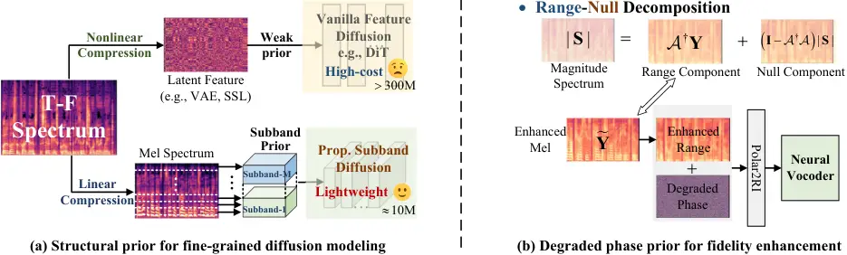
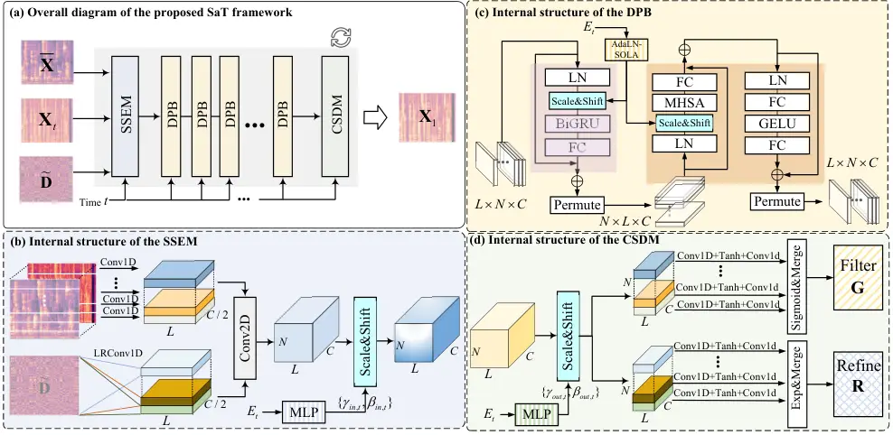
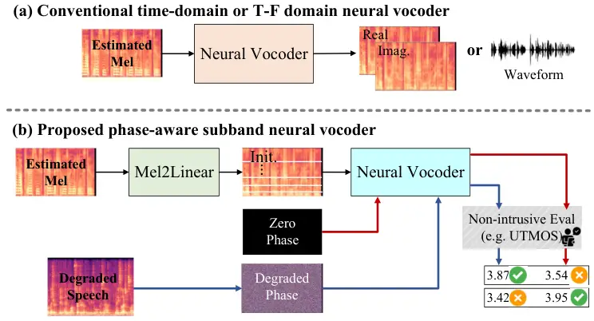
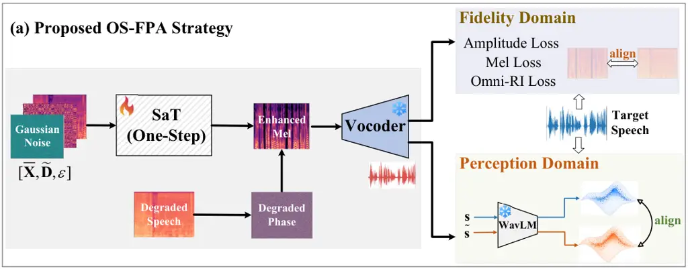
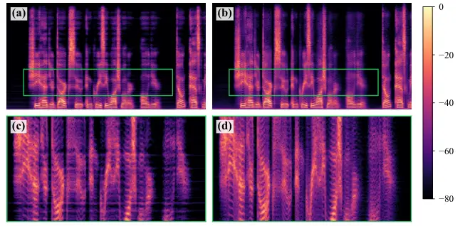
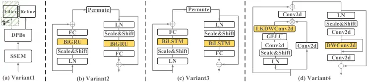
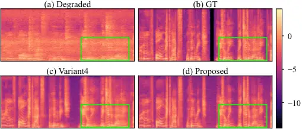
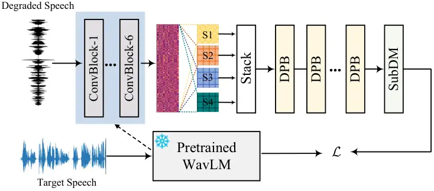
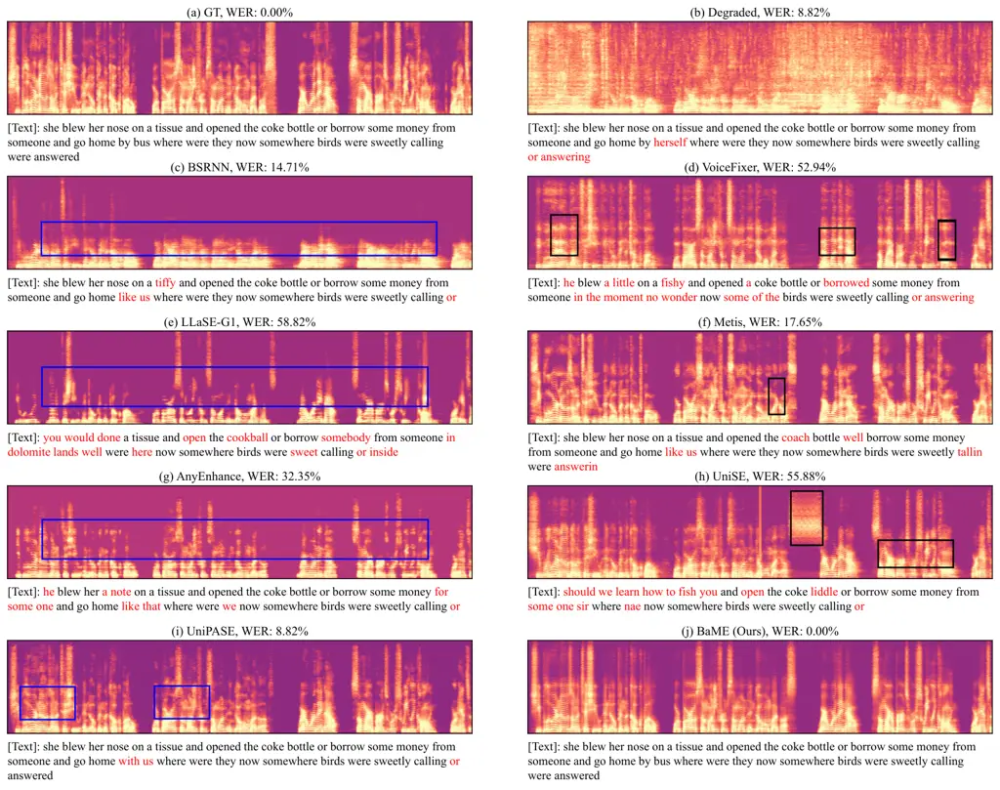

# Back to Mel: Learning to Bridge Fidelity and Perception in Generative Speech Enhancement

Andong Li    Kun Zhou    Xiaodong Li    Chengshi Zheng ^(†)^(†)thanks:
Andong Li, Xiaodong Li, Chengshi Zheng are with the Institute of
Acoustics, Chinese Academy of Sciences, Beijing 100190, China, and are
also with University of Chinese Academy of Sciences, Beijing 100190,
China (e-mail:{liandong, lxd, cszheng}@mail.ioa.ac.cn). Kun Zhou is with
the Laboratoire de Traitement et Communication de I’Information (LTCI),
Télécom Paris, Institut Polytechnique de Paris, 91120 Palaiseau, France
(e-mail: kun.zhou@telecom-paris.fr). Chengshi Zheng is the corresponding
author. This work was supported by the National Natural Science
Foundation of China (NSFC) under Grants 62501588 and Young Elite
Scientists Sponsorship Program of the Beijing High Innovation Plan. The
work done by Kun Zhou was benefited from State funding managed by the
French National Research Agency (ANR) under the France 2030 program,
reference ANR-23-IACL-0005.

###### Abstract

Recent generative techniques have facilitated the rapid proliferation of
speech enhancement approaches built upon learnable compact latent
representations and large generative backbones. Nevertheless, it remains
inherently challenging to balance between acoustic fidelity, perceptual
quality, and processing efficiency. In this paper, we revisit the Mel
spectrum as a structured acoustic representation and propose BAME, a
flow-matching-based framework that exploits the complementary priors for
generative speech enhancement task. First, leveraging the explicit
hierarchical frequency distribution of Mel spectrum, we elaborately
devise a subband-aware Transformer (SaT) for efficient generative
modeling. Using only 2.9% of the parameters, the proposed SaT achieves
superior enhancement performance compared with a 331 M DiT backbone.
Second, motivated by range-null decomposition theory of Mel filtering in
the magnitude-spectral domain, we introduce a phase-aware neural vocoder
that incorporates degraded-phase prior, together with a quality-guided
dual-phase strategy to adaptively mitigate the effects of unreliable
phase information. Third, we devise a simple yet effective one-step
fidelity-perception alignment strategy that fine-tunes the flow model
with complementary constraints from fidelity and perception domains.
Extensive experiments are conducted on DNS-Challenge, EARS, GSR, and
URGENT benchmarks, and both objective and subjective results demonstrate
promising performance on various intrusive and non-intrusive evaluation
metrics. These results further advocate the potential of exploiting
structured acoustic representations for reliable and efficient
generative speech enhancement. Audio samples and codes are available at
https://github.com/Andong-Li-speech/BAME.

###### Index Terms: 

generative speech enhancement, mel spectrum, subband-modeling,
phase-aware, one-step generation

## I Introduction

Speech enhancement (SE) aims to recover target speech from various
acoustic degradations, such as environmental noise, room reverberation
and bandwidth loss \[1, 2\]. Over the past decade, advances in deep
neural networks (DNNs) have driven a paradigm shift from conventional
statistical approaches to data-driven methods, substantially improving
speech quality and intelligibility \[3, 4, 5\]. Nevertheless, most
DNN-based methods follow a discriminative paradigm, learning
“many-to-one” deterministic mappings from degraded speech to its clean
counterpart, which often struggle to reconstruct fine-grained acoustic
details \[6\].

Generative models have become the research hotspot in this field for
their ability to model the distribution of target speech. Early studies
primarily relied on generative adversarial networks (GANs), which can
suffer from training instability and mode collapse \[7, 8\]. More
recently, large language models (LLMs) and diffusion-based models have
emerged as prominent paradigms for generative speech enhancement.
LLM-based approaches typically predict clean speech tokens from discrete
representations obtained through neural audio codecs (NACs), followed by
waveform reconstruction using codec decoders \[9, 10, 11\]. Despite
their promising perceptual quality, discrete tokenization may discard
fine-grained acoustic information and compromise reconstruction
fidelity \[12, 13, 14\]. Meanwhile, diffusion-based generative models
enable the direct modeling of continuous speech representations. Early
research lines employed denoising diffusion probabilistic models
(DDPMs) \[15, 16\] and score-based generative models (SGMs) \[17, 6,
18\], while more recent flow-matching (FM) and bridge-based models offer
potentially more efficient sampling through suitable probability paths
and direct modeling between source and clean speech distributions \[19,
20, 21, 22\].

Beyond generative modeling paradigms, acoustic representations play a
crucial role in speech enhancement. Existing approaches can be broadly
categorized into three classes. Raw representations, including waveforms
and complex spectra, theoretically allow perfect reconstruction but may
pose modeling challenges due to their high dimensionality and
redundancy \[16, 6\]. Handcrafted compressed representations, _e.g._,
Mel spectrum, reduce spectral dimension through perceptually motivated
filterbanks and have been widely adopted for speech enhancement with
neural vocoders \[8, 19\]. However, their relatively high feature
dimension and lack of explicit phase information may limit modeling
efficiency and reconstruction fidelity, respectively. More recently,
learned latent representations, such as variational autoencoders
(VAEs) \[23\] and neural audio codecs (NACs) \[11\], have attracted
increasing attention. By learning compact representations that retain
salient speech information, these approaches can facilitate generative
modeling while leveraging powerful neural decoders to produce
perceptually natural speech.

Despite these advances, learned latent representations are not
necessarily optimal for speech enhancement. Many were originally
designed for audio compression \[24\] or speech synthesis \[25\], where
preserving fine-grained acoustic details is not always the primary
objective. Recent studies have incorporated denoised self-supervised
learning (SSL) representations to improve linguistic consistency and
mitigate speech hallucinations \[26\]. However, semantic fidelity alone
does not guarantee acoustic fidelity, which also requires preserving
speaker characteristics, prosodic variations, and fine-grained spectral
details. Therefore, there is a significant need to reconsider acoustic
representations for generative speech enhancement, with a particular
emphasis on balancing reconstruction fidelity and perceptual quality. In
this paper, we revisit Mel spectrum from a representation-centric
perspective, aiming to exploit the under-utilized acoustic properties
for high-fidelity generative speech enhancement.



Fig. 1: Illustration of two complementary priors exploited in BaME. (a)
Structural prior: the explicit hierarchical frequency distribution of
Mel representations facilitates fine-grained subband modeling with a
lightweight generative backbone. (b) Degraded phase prior: range-null
decomposition enables the recovery of magnitude information from Mel
representation, which can be combined with degraded phase prior for
high-fidelity waveform reconstruction.

Why revisit Mel? The rationale is twofold. First, Mel spectrum offers a
structural prior that combines signal-related acoustic structures with
compact representations. As illustrated in Fig. 1(a), Mel extraction can
be formulated as a structured linear compression of the linear-frequency
magnitude spectrum¹¹ 1 The logarithmic operation can be ignored herein
as it is invertible.. This preserves an explicit hierarchical frequency
distribution. Second, Mel representations enable the effective
incorporation of a degraded phase prior for high-fidelity
reconstruction. With range-null decomposition (RND) theory \[27\], Mel
spectrum can be converted into the range-space component of the
linear-scale magnitude spectrum via a pseudo-inverse projection. As
shown in Fig. 1(b), this allows the recovered magnitude information to
be combined with phase prior from degraded observations, providing
additional constraints for the neural vocoder to improve enhancement
fidelity.

Motivated by these insights, we propose a flow-matching-based generative
SE framework dubbed BaME (short for Back to MEl), which explicitly
exploits the complementary priors brought by Mel representations.
Following a typical Mel enhancement and vocoding pipeline, BaME
incorporates three key designs: ① We develop a subband-aware Transformer
(SaT) as the backbone that exploits the explicit frequency-band
structure of Mel spectrum for fine-grained and lightweight generative
modeling. Despite using only 2.9% of the parameters and 66.6% of the
computational complexity of DiT-331M, the proposed backbone achieves
superior enhancement performance. ② We propose a phase-aware neural
vocoder that incorporates degraded phase information into
Mel-conditioned waveform reconstruction. ③ We develop a simple yet
effective one-step fidelity-perception alignment (OS-FPA) strategy that
enables efficient speech generation with a single step. By jointly
imposing fidelity- and perception-domain constraints, the proposed
strategy effectively aligns both acoustic fidelity and perceptual
quality. Extensive experiments on the DNS-Challenge, EARS, GSR, and
URGENT benchmarks demonstrate that BaME consistently outperforms
competitive baselines across a wide range of intrusive and non-intrusive
metrics, achieving state-of-the-art performance.

The remainder of this paper is organized as follows. In Sec. II, we
review related work. We present the proposed method in Sec. III.
Experimental setups are given in Sec. IV. Experimental results and
analysis are shown in Sec. V, and we draw some conclusions in Sec. VI.

## II Related Work

In this section, we will briefly review related research work on
generative speech enhancement and one-step methods.

### II-A Generative Speech Enhancement

Existing generative SE methods can be broadly categorized into discrete
and continuous methods according to their target representations.
Discrete methods typically adopt NACs to quantize clean speech into
acoustic tokens for conditional generation. MaskSR \[9\] adopted masked
generative modeling (MGM) to iteratively predict clean acoustic tokens,
while its extended version MaskSR2 \[28\] further incorporated semantic
knowledge distillation to improve speech intelligibility.
AnyEnhance \[29\] extended MGM with prompt guidance and self-critic for
diverse speech and singing voice restoration tasks. Alternatively,
autoregressive (AR) language models have been widely adopted for token
prediction. GenSE \[30\] adopted hierarchical modeling to sequentially
generate semantic and acoustic tokens. LLaSE-G1 \[31\] predicted
acoustic tokens conditioned on continuous WavLM representations.

Continuous methods, in contrast, operate on continuous speech
representations. Early approaches such as VoiceFixer \[32\] adopted a
two-stage paradigm that combines discriminative Mel estimation with a
neural vocoder. Subsequently, CDiffuSE \[16\] and SGMSE \[6\] introduced
diffusion modeling in the waveform and complex spectrum domains,
respectively. More recently, with the proliferation of flow-matching,
FlowSE \[19\] employed FM for Mel spectrum generation, while
SenSE \[33\] further combined language-model-based semantic guidance to
improve the semantic consistency. Besides, bridge models have also
gained increasing attention. For example, Zhang *et al.* \[23\] employed
a Schrodinger bridge to establish the mapping trajectory between
degraded and target latent features. To mitigate speech hallucinations,
recent studies have leveraged SSL representations. For example,
PASE \[26\] leveraged denoised WavLM representations for linguistically
faithful reconstruction, while subsequent extensions incorporated
FM-based generative modeling to further improve perceptual quality \[34,
35\].

### II-B One-step Generative Speech Enhancement

Recently, one-step diffusion generative models have attracted increasing
attention due to their notable advantage in generation efficiency. Early
approaches primarily relied on distilling pre-trained teacher models
into one-step generators \[36\], while consistency models enabled
efficient generation by enforcing trajectory consistency \[37\]. More
recently, distillation-free approaches, such as shortcut models \[38\]
and MeanFlow \[39\], have emerged to directly learn long-range
transitions for one-step generation.

One-step generation methods have recently been introduced into SE task.
SE-Bridge \[40\] combined consistency modeling with Brownian bridge to
enable one-step restoration, while Thunder \[41\] unified regression and
Brownian bridge with a single reverse step. More recently, MeanFlow has
been explored in \[42\]. Alternatively, DriftSE \[43\] formulated SE as
a generative drifting process, enabling one-step inference through
distribution alignment. Despite these advances, it remains challenging
to achieve high reconstruction fidelity and perceptual quality under a
strict one-step inference setup.

## III Methodology

### III-A Mel Formulation

Despite recent advances in generative speech enhancement, the choice of
acoustic representations remains largely empirical, with their intrinsic
properties often under-explored in model design. In this paper, we
revisit the mathematical formulation of Mel spectrum.

Formally, given the complex-valued spectrum
$`\mathbf{S}\in\mathbb{C}^{F\times L}`$ in the time-frequency (T-F)
domain, where $`F`$ and $`L`$ denote the number of frequency bins and
frames, respectively, log-scale Mel spectrum can be calculated as
$`\mathbf{X}=\log\left(\mathcal{A}\left|\mathbf{S}\right|\right)\in\mathbb{R}^{F_{m}\times L}`$,
where $`\mathcal{A}\in\mathbb{R}^{F_{m}\times F}`$ denotes the Mel
filter, and $`F_{m}`$ is the number of Mel bands and usually satisfies
$`F_{m}\ll F`$, $`\left|\cdot\right|`$ denotes the modulus operation.
Removing the logarithmic operation, we obtain:

```math
\mathbf{Y}=\exp\left(\mathbf{X}\right)=\mathcal{A}\left|\mathbf{S}\right|. \tag{1}
```

The Mel filterbank is constructed on a perceptually motivated frequency
scale, with finer frequency resolution at lower frequencies and
progressively coarser resolution at higher frequencies. Specifically,
the $`m`$-th Mel band can be expressed as a weighted aggregation of
local spectral magnitudes:

```math
Y_{m,l}=\sum_{f\in\mathcal{B}m}\mathcal{A}_{m,f}|S_{f,l}|, \tag{2}
```

where $`\mathcal{B}_{m}`$ denotes the set of frequency bins covered by
the $`m`$-th Mel filter. Consequently, Mel compression retains the
explicit frequency-band organization of the original magnitude spectrum,
while progressively aggregating fine-grained spectral details toward
higher frequencies, as illustrated in Fig. 1(a). Given the prevalence of
subband modeling in the T-F domain-based speech processing tasks \[44,
45\], we thus argue that Mel spectrum can be regarded as a coarse
counterpart of T-F spectrum and modeled in a similar subband
manner \[8\].

On the other hand, Eq. (1) reveals that Mel extraction constitutes an
under-determined linear mapping from the magnitude spectrum to its
compressed observation. Based on range-null decomposition (RND)
theory \[27\], the magnitude spectrum can be decomposed as:

```math
\left|\mathbf{S}\right|=\mathcal{A}^{\dagger}\mathbf{Y}+(\mathbf{I}-\mathcal{A}^{\dagger}\mathcal{A})|\mathbf{S}|, \tag{3}
```

where $`\mathcal{A}^{\dagger}`$ denotes the Moore-Penrose pseudoinverse
of $`\mathcal{A}`$. The two terms correspond to the range-space (RS) and
null-space (NS) components, respectively. The RS component can be
directly determined by the Mel spectrum, whereas the NS component
contains the missing spectral information that can be recovered by
neural vocoder, as shown in Fig. 1(b). Notably, although Mel spectra
discard explicit phase information, degraded speech provides
complementary phase cues that are often neglected in conventional
Mel-based vocoding. Concretely, given the enhanced Mel spectrum
$`\tilde{\mathbf{Y}}`$ estimated from degraded speech $`\mathbf{Z}`$, we
construct a phase-guided complex spectral estimate

```math
\tilde{\mathbf{S}}^{\left(0\right)}=\left|\mathcal{A}^{\dagger}\tilde{\mathbf{Y}}\right|e^{j\mathbf{\Phi}_{Z}}\in\mathbb{C}^{F\times L} \tag{4}
```

as the input to a subsequent pretrained neural vocoder, where
$`\mathbf{\Phi}_{Z}`$ denotes the phase from degraded speech
$`\boldsymbol{z}`$.

### III-B Flow Matching Preliminaries

Flow matching (FM) \[46\] learns a continuous transport between a simple
source distribution and the target data distribution by estimating a
time-dependent velocity field. Specifically, let
$`\boldsymbol{\epsilon}\sim\mathcal{N}\left(\mathbf{0},\mathbf{I}\right)`$
denote Gaussian noise and $`\boldsymbol{x}_{1}`$ denote the target data.
Following rectified flow \[47\], the interpolation path is defined as:

```math
\boldsymbol{x}_{t}=\left(1-t\right)\boldsymbol{\epsilon}+t\boldsymbol{x}_{1},\quad\boldsymbol{u}_{t}=\boldsymbol{x}_{1}-\boldsymbol{\epsilon}, \tag{5}
```

where $`t\in\left[0,1\right]`$ and
$`\boldsymbol{u}_{t}=d\boldsymbol{x}_{t}/dt`$ denotes the target
velocity. Conventionally, FM trains a velocity network
$`\boldsymbol{v}_{\theta}`$ by minimizing

```math
\mathcal{L}_{\mathrm{FM}}^{\left(vel\right)}=\mathbb{E}_{t,\boldsymbol{\epsilon},\boldsymbol{x}_{1}}\left[\left\|\boldsymbol{v}_{\theta}(\boldsymbol{x}_{t},t,\boldsymbol{c})-\boldsymbol{u}_{t}\right\|_{F}^{2}\right], \tag{6}
```

where $`\boldsymbol{c}`$ denotes the conditioning information extracted
from degraded speech. Recently, Li *et al.* \[48\] have advocated
directly predicting target data instead of velocity. Specifically, given
the data prediction
$`\tilde{\boldsymbol{x}}_{1,\theta}=\mathcal{F}_{\theta}\left(\boldsymbol{x}_{t},t,\boldsymbol{c}\right)`$,
where $`\mathcal{F}_{\theta}\left(\cdot\right)`$ indicates the mapping
instantiated by a neural network, the corresponding velocity can be
derived as:

```math
\tilde{\boldsymbol{v}}_{\theta}(\boldsymbol{x}_{t},t,\boldsymbol{c})=\frac{\tilde{\boldsymbol{x}}_{1,\theta}-\boldsymbol{x}_{t}}{\max\left(1-t,\tau\right)}, \tag{7}
```

where $`\tau`$ is a small value (empirically set to 0.05) to prevent
zero division. Accordingly, the velocity-matching objective can be
rewritten as:

```math
\mathcal{L}_{\mathrm{FM}}^{\left(data\right)}=\mathbb{E}_{t,\boldsymbol{x}_{0},\boldsymbol{x}_{1}}\left[\frac{\left\|\tilde{\boldsymbol{x}}_{1,\theta}-\boldsymbol{x}_{1}\right\|_{F}^{2}}{(1-t)^{2}}\right], \tag{8}
```

which corresponds to a time-weighted data prediction loss. During
inference, samples are generated by integrating the learned velocity
field from $`t=0`$ to $`t=1`$. Taking discrete Euler solver as an
example, the update procedure can be given by:

```math
\tilde{\boldsymbol{x}}_{t_{\left(k+1\right)}}=\tilde{\boldsymbol{x}}_{t_{k}}+\left(t_{k+1}-t_{k}\right)\tilde{\boldsymbol{v}}_{\theta}\left(\boldsymbol{x}_{t_{k}},t_{k},\boldsymbol{c}\right). \tag{9}
```



Fig. 2: Illustration of the proposed framework for Mel enhancement. (a)
Overall diagram of the proposed SaT diffusion network. Degraded Mel
spectrum $`\overline{\mathbf{X}}`$ and $`\tilde{\mathbf{D}}`$ are
acoustic and semantic conditions, respectively, and $`\mathbf{X}_{t}`$
denotes the interpolated state at timestep $`t`$. The network consists
of synergistic subband encoding module (SSEM), multiple dual-path blocks
(DPBs) and collaborative subband decoding module (CSDM). (b) Internal
structure of the SSEM. (c) Internal structure of the DPB. (d) Internal
structure of the CSDM. Different modules are indicated with different
colors for better illustrations.

### III-C Proposed SaT Network

In Fig. 2(a), we present the proposed subband-aware transformer (SaT)
network, which aims to achieve fine-grained diffusion modeling with
lightweight parameters and computational cost. It consists of three
parts: synergistic subband encoding module (SSEM), stacked dual-path
blocks (DPBs) and collaborative subband decoding module (CSDM). Detailed
illustrations are given below.

#### III-C1 SSEM

Despite the promising perceptual quality of generative SE methods, they
may suffer from inherent speech hallucinations under severe acoustic
degradations, such as heavy noise and reverberation. Recently, Rong _et
al._ proposed to incorporate the phonological prior of WavLM to
alleviate the hallucination \[26\]. Concretely, they fine-tune a
pretrained WavLM through denoising representation distillation,
encouraging its final-layer representations extracted from degraded
speech to match those of clean speech. Inspired by this, we adopt a
similar strategy and extract the final-layer semantic representations of
the adapted WavLM \[49\] as auxiliary features, denoted by
$`\tilde{\mathbf{D}}\in\mathbb{R}^{L\times C_{D}}`$, where $`C_{D}`$ is
the channel dimension of the semantic feature.

The SSEM aims to jointly encode acoustic and semantic features in the
subband space, as shown in Fig. 2(b). For a given timestep $`t`$, the
interpolated noisy and original degraded log-scale Mel spectra are
denoted as $`\mathbf{X}_{t}`$ and $`\overline{\mathbf{X}}`$,
respectively²² 2 To avoid ambiguity, here “noisy” refers to the Gaussian
noise introduced during FM interpolation, whereas “degraded” refers to
acoustic distortions arising from real-world conditions, such as noise
and reverberation., and $`\mathbf{X}_{t}`$ is given by

```math
\mathbf{X}_{t}=\left(1-t\right)\boldsymbol{\epsilon}+t\mathbf{X}_{1}, \tag{10}
```

where $`\mathbf{X}_{1}`$ denotes the target log-Mel spectrum. The Mel
spectra are evenly split into $`N`$ subbands. For the $`n`$-th subband,
acoustic features are extracted using a 1-D convolutional layer
(Conv1D):

```math
\mathbf{I}_{n}^{\left(a\right)}=\text{Conv1D}\left(\text{Cat}\left(\mathbf{X}_{t,n},\overline{\mathbf{X}}_{n}\right)\right)\in\mathbb{R}^{L\times\frac{C}{2}}, \tag{11}
```

where the subscript $`n`$ denotes the subband index,
$`\text{Cat}\left(\cdot\right)`$ refers to the concatenation along the
feature axis, and $`C`$ is the encoding channel dimension. Unlike Mel
spectrum, SSL representations lack an explicit frequency-band structure.
Inspired by the low-rank subband embedding strategy in \[50\], we employ
$`N`$ independent low-rank convolutional layers (LRConv1D) to project
the semantic features into corresponding subband representations:

```math
\mathbf{I}_{n}^{\left(s\right)}=\text{LRConv1D}\left(\tilde{\mathbf{D}}\right)\in\mathbb{R}^{L\times\frac{C}{2}}, \tag{12}
```

where each LRConv1D comprises two consecutive Conv1D layers with an
intermediate bottleneck to reduce parameter overhead. Subsequently, the
acoustic and semantic features are fused through a point-wise 2-D
convolutional layer (Conv2D) and concatenated into 3-D representation
$`\mathbf{H}_{in}`$³³ 3 The window shift size of the Mel spectrum is
specially set to guarantee the same frame rate as the semantic feature.:

```math
\mathbf{H}_{n}=\text{Conv2D}\left(\text{Cat}(\mathbf{I}_{n}^{\left(a\right)},\mathbf{I}_{n}^{\left(s\right)})\right)\in\mathbb{R}^{L\times C}, \tag{13}
```

```math
\mathbf{H}_{in}=\text{Stack}\left(\mathbf{H}_{1},\cdots,\mathbf{H}_{N}\right)\in\mathbb{R}^{L\times N\times C}, \tag{14}
```

where $`\text{Stack}\left(\cdot\right)`$ denotes the stack operation
along the subband axis. To control the encoded feature stream across
different diffusion timesteps, we modulate $`\mathbf{H}_{in}`$ as:

```math
\mathbf{H}_{in}^{{}^{\prime}}=\left(1+\gamma_{in,t}\right)\mathbf{H}_{in}+\beta_{in,t} \tag{15}
```

where $`\left\{\gamma_{in,t},\beta_{in,t}\right\}\in\mathbb{R}^{C}`$ are
scale and shift parameters, generated from the timestep embedding
$`E_{t}`$.

Fig. 4: Performance comparisons of intrusive and non-intrusive metrics
given different levels of degradation phase as auxiliary input of neural
vocoder. For all cases, Mel spectra are enhanced from DNS-Challenge 2020
without reverb test set. “Case1” denotes the zero-phase, “Case2” denotes
the phase extracted from noisy speech, “Case3” denotes the phase
extracted from reverberated speech, “Case4” denotes the phase extracted
from the degraded speech where both environmental noise and room
reverberation are involved, “Case5” denotes the random-phase.



Fig. 3: Generation comparisons of different neural vocoders for enhanced
speech generation. (a) Conventional time-domain or T-F domain neural
vocoder. (b) Proposed phase-aware subband neural vocoder.

#### III-C2 DPB

To model the latent frame-subband relations, we stack $`P`$ dual-path
blocks (DPBs), each of which is shown in Fig. 2(c). Taking the $`p`$-th
DPB as an example, for input feature $`\mathbf{H}^{\left(p-1\right)}`$,
it first passes a bidirectional GRU (BiGRU) with residual connection to
bridge the relations between subbands. After that, it is permuted and
processed by multi-head attention (MHSA) to bridge global time
relations, followed by a feedforward network (FFN). Besides, the
AdaLN-SOLA \[22\] is utilized for timestep-aware feature modulation.
Note that we deliberately keep the DPB architecture simple, as the
combination of GRU and MHSA provides effective contextual modeling for
dual-path design. Moreover, both are well-established and widely
supported operations, facilitating practical implementation and
deployment. In Sec. V-A2, we further compare between different module
combinations.

#### III-C3 CSDM

In contrast to SSEM, CSDM attempts to decode the target log-Mel spectrum
from the subband representation, as shown in Fig. 2(d). Inspired by the
collaborative processing mechanism in speech enhancement \[51\], we
devise a “filtering-and-refinement” decoding strategy. Specifically,
given the input $`\mathbf{O}\in\mathbb{R}^{\times{L\times N\times C}}`$,
it is first modulated by $`\left\{\gamma_{out},\beta_{out}\right\}`$,
and two output branches are utilized. Taking the filtering branch as an
example, each subband feature is processed via a Conv1D, Tanh activation
and another Conv1D layer. After that, the sigmoid function is adopted to
estimate the gain coefficient
$`\mathbf{G}\in\mathbb{R}^{F_{m}\times L}`$. For the refinement branch,
the similar operation is conducted to estimate the refinement component
$`\mathbf{R}\in\mathbb{R}^{F_{m}\times L}`$ except the exponential
function is utilized. Then, the estimated log-Mel spectrum is obtained
as:

```math
\tilde{\mathbf{X}}_{1,\theta}=\log\left(\exp(\overline{\mathbf{X}})\odot\mathbf{G}+\mathbf{R}\right), \tag{16}
```

where $`\odot`$ denotes element-wise multiplication operation. Note that
we directly predict the data and adopt the loss in Eq. (8).

Remarks: Although recent work CleanMel \[8\] also investigates
Mel-domain subband modeling, the proposed SaT differs from it in three
key aspects. First, CleanMel performs narrow-band modeling at individual
Mel bins, whereas the proposed SaT groups adjacent Mel bands into a
single subband, substantially reducing computational overhead. In
Sec. V-A2, we reveal that excessively fine-grained subband partitioning
may provide limited performance gains, suggesting modeling redundancy
among adjacent Mel bands. Second, while CleanMel adopts a discriminative
Mel estimation paradigm, our SaT is the first Mel subband-aware backbone
specially designed for generative SE tasks. Third, CleanMel employs
Mamba for temporal modeling, whose commonly used optimized
implementation relies on specialized CUDA kernels. In contrast, SaT
adopts conventional GRU and MHSA operations, offering broader
compatibility with standard deep learning runtimes and facilitating
deployment on CPU-oriented platforms.

Fig. 5: Metric performance under different NFEs. Scores are calculated
and averaged upon the DNS-Challenge 2020 without reverb and with reverb
test sets.



Fig. 6: Diagram of the proposed OS-FPA scheme. Gaussian noise and
conditioning feature serves as input to SaT to obtain the enhanced Mel
spectrum with a single step, and the enhanced waveform is generated
using a pretrained neural vocoder. Two domains are employed to encourage
fidelity preservation and perceptual quality, respectively. For the
former, amplitude loss, mel-loss and omnidirectional RI-loss are
adopted. For the latter, both enhanced and target signals are passed to
the pretrained WavLM and the latent features are forced to align.

### III-D Phase-aware Neural Vocoder

Existing Mel-based generative SE methods typically reconstruct enhanced
speech from the estimated Mel spectrum using a pre-trained neural
vocoder, as illustrated in Fig. 3(a). However, Mel representations
discard explicit phase information, requiring the vocoder to infer the
missing phase from the learned speech prior. Previous studies have
demonstrated the significance of phase information for speech
enhancement \[52, 53\]. Unlike speech synthesis, SE provides degraded
observations as an auxiliary prior, and simply neglecting it may
compromise reconstruction fidelity.

Recently, we developed subband-based neural vocoders called
DegVoC \[54\], which exploit the degradation structure of Mel
representations for efficient waveform generation. Specially, the Mel
spectrum is first mapped to the linear-scale T-F domain as the RS
component to obtain an initial magnitude estimate, which is then
combined with zero-phase initialization to construct a complex spectrum.
A lightweight network then performs subband encoding, contextual
modeling and spectral decoding to recover the target spectrum. This
design enables fine-grained spectral reconstruction with relatively low
computational complexity. To further exploit the prior in SE, we extend
DegVoC by incorporating degraded phase into the spectral initialization,
as illustrated in Fig. 3(b). Specifically, given the enhanced log-scale
Mel spectrum $`\mathbf{\tilde{X}}_{1}`$, the reconstructed waveform
$`\tilde{\boldsymbol{s}}`$ can be given by:

```math
\tilde{\boldsymbol{s}}=\mathcal{V}_{\psi}\left(\tilde{\mathbf{M}}\odot\cos\left(\mathbf{\Phi}_{Z}\right),\tilde{\mathbf{M}}\odot\sin\left(\mathbf{\Phi}_{Z}\right)\right),\vskip-7.11317pt \tag{17}
```

where
$`\tilde{\mathbf{M}}=\mathcal{A}^{\dagger}\exp\left(\mathbf{\tilde{X}}_{1}\right)`$
denotes the initialized magnitude spectrum, and $`\mathcal{V}_{\psi}`$
denotes the neural vocoder, and $`\mathbf{\Phi}_{Z}`$ is the degraded
phase.

Nonetheless, degraded phase is not always beneficial for speech
reconstruction, as it heavily relies on practical acoustic degradation
scenarios. To investigate the effect of different phase initialization
conditions, we train a phase-conditioned DegVoC using the clean Mel
spectra and degraded phase generated through on-the-fly noise and
reverberation simulation, and evaluate five phase initialization
conditions: zero phase, phase extracted from noisy speech, reverberant
phase, noisy-reverberant phase, and random phase. In the inference
stage, the restored Mel spectra are generated by SaT with eight sampling
steps (NFE=8), and five phase conditions are adopted for waveform
generation.

Fig. 4 presents the results on six representative objective metrics,
including three intrusive metrics (PESQ \[55\], eSTOI \[56\] and
SpkSim \[57\]) to assess complementary aspects of reconstruction
quality, intelligibility, and speaker consistency, and three
non-intrusive metrics (UTMOS \[58\], WVMOS \[59\] and SCOREQ \[60\]) as
proxies for perceptual quality. Higher scores indicate better
performance, and detailed illustrations of the metrics are provided in
Sec. IV-C. Notably, noisy phase consistently yields the best performance
across all metrics, indicating the potential benefit of incorporating
degraded phase as an acoustic prior. However, reverberant and
noisy-reverberant phase cases exhibit considerably lower non-intrusive
quality scores than the zero-phase case. The phenomenon may be
associated with reverberation-induced phase distortion and temporal
smearing, which can introduce inconsistent acoustic cues when combined
with enhanced spectral magnitudes \[61\]. These observations suggest
that the effectiveness of degraded phase is highly constrained by
acoustic conditions, which can be unstable under practical acoustic
scenarios.

To tackle this problem, we propose a quality-guided dual-phase vocoding
(QDV) strategy, as shown in Fig. 3(b). Concretely, the enhanced Mel
spectrum is decoded using both zero-phase and degraded-phase
initialization, yielding two candidate waveforms
$`\tilde{\boldsymbol{s}}_{0}`$ and $`\tilde{\boldsymbol{s}}_{deg}`$. A
non-intrusive evaluator (NIE) is then employed to assess their
perceptual quality without requiring clean reference. The final enhanced
speech can be chosen as:

```math
\displaystyle\phi \displaystyle=\arg\max_{\phi\in\{0,deg\}}Q_{\mathrm{NIE}}(\tilde{\boldsymbol{s}}_{\phi}),\ \tilde{\boldsymbol{s}} \displaystyle=\tilde{\boldsymbol{s}}_{\phi}, \tag{18}
```

where $`Q_{\text{NIE}}\left(\cdot\right)`$ denotes the predicted quality
score. By adaptively selecting between the two reconstruction
candidates, the proposed strategy effectively alleviates the risk of
incorporating unreliable degraded phase. Further, due to the use of
lightweight DegVoC as the vocoder, the proposed scheme only introduces
modest computational overhead.

### III-E One-Step Fidelity-Perception Alignment Strategy

While FM-based generative SE methods have demonstrated promising
perceptual quality, they usually rely on iterative sampling, heavily
impeding the processing efficiency. Moreover, we observe a notable
discrepancy between intrusive and non-intrusive metrics _w.r.t._ the
number of function evaluations (NFEs). Specifically, we evaluate six
metrics under different NFEs, including three intrusive metrics (PESQ,
eSTOI, SpkSim) to assess reference-based reconstruction quality and
three non-intrusive metrics (DNSMOS-OVRL \[62\], UTMOS and SCOREQ) to
measure the perceptual quality. Higher scores indicate better
performance. The proposed SaT serves as the generative network and the
phase-aware neural vocoder in Sec. III-D is employed for waveform
reconstruction.

As shown in Fig. 5, the three intrusive metrics achieve the highest
scores at $`\text{NFE}=1`$ or 2, whereas larger NFEs are needed for
non-intrusive metrics. These observation suggest that low-NFE generation
already preserves considerable reference-based fidelity, which can
benefit from the strong alignment of the degraded Mel condition.
However, its predicted perceptual quality remains suboptimal and may
benefit from additional generative refinement. As a result, it is
significant to develop a one-step strategy that can improve both
perceptual quality and reconstruction fidelity.

Motivated by \[63\], we propose a simple yet effective one-step
fidelity-perception alignment strategy called OS-FPA, whose overall
diagram is shown in Fig. 6. After training SaT with standard FM
objective, we adopt fine-tuning for one-step generation. Since SaT
adopts a data-prediction parameterization in Eq. 8, the output of the
network directly estimates the target log-scale Mel spectrum:

```math
\tilde{\mathbf{X}}_{1}=\mathcal{F}_{\theta}\left(\boldsymbol{\epsilon},0,\boldsymbol{c}\right),\qquad\boldsymbol{\epsilon}\sim\mathcal{N}(\mathbf{0},\mathbf{I}),\vskip-7.11317pt \tag{19}
```

where
$`\boldsymbol{c}=\left(\overline{\mathbf{X}},\tilde{\mathbf{D}}\right)`$
denotes the condition, “0” denotes the beginning timestep. Following the
vocoding procedure in Eq. (17), the predicted Mel spectrum is converted
into an enhanced waveform. To accommodate both phase initialization
conditions, we randomly select zero-phase or degraded-phase with equal
probability during OS-FPA fine-tuning.

After that, we jointly optimize the enhanced waveform in the perception
and fidelity domains. To be specific, for perceptual alignment, the
enhanced speech $`\tilde{\boldsymbol{s}}`$ and clean speech
$`\boldsymbol{s}`$ are passed through a frozen pretrained SSL model
(_e.g._, WavLM) to extract the latent features from multiple layers. Let
the features from the $`k`$-th Transformer layer of the WavLM be denoted
by $`\tilde{\mathbf{\Theta}}^{\left(k\right)}`$ and
$`\mathbf{\Theta}^{\left(k\right)}`$, respectively, we attempt to align
the corresponding feature representations to be as close as possible,
that is:

```math
\mathcal{L}_{perc}=-\frac{1}{\left|\mathcal{K}\right|}\sum_{k\in\mathcal{K}}\frac{1}{L_{k}}\sum_{l=1}^{L_{k}}\text{CosSim}\left(\tilde{\mathbf{\Theta}}^{\left(k\right)}_{l},\mathbf{\Theta}^{\left(k\right)}_{l}\right), \tag{20}
```

where $`\mathcal{K}`$ denotes the selected layer set, $`L_{k}`$ is the
number of frames, and $`\text{CosSim}\left(\cdot,\cdot\right)`$
calculates cosine similarity along the feature dimension.

However, perceptual loss alone can introduce noticeable artifacts, as
shown in Fig. 7, indicating that SSL feature alignment may not fully
constrain fine-grained spectral reconstruction. To this remedy, we
introduce complementary fidelity-domain constraints, which include
log-amplitude loss, multi-resolution Mel loss and Omnidirectional RI
loss \[64\], given by:

```math
\mathcal{L}_{fid}=\lambda_{amp}\mathcal{L}_{amp}+\lambda_{mel}\mathcal{L}_{mel}+\lambda_{ori}\mathcal{L}_{ori}, \tag{21}
```

where $`\left\{\lambda_{amp},\lambda_{mel},\lambda_{ori}\right\}`$ are
corresponding weighting parameters. The overall dual-domain objective
can be written as:

```math
\mathcal{L}_{OS-FPA}=\mathcal{L}_{fid}+\lambda_{perc}\mathcal{L}_{perc}, \tag{22}
```

where $`\lambda_{perc}`$ denotes the weighting parameter of the
perceptual loss.



Fig. 7: Spectral visualizations in terms of whether to include fidelity
constraints. (a) Enhanced spectrum with only perceptual-domain loss. (b)
Enhanced spectrum with additional fidelity-domain loss. (c)-(d) Zoom-in
views of the regions highlighted by green boxes in (a)-(b),
respectively. The audio file is from DNS-Challenge 2020 with reverb test
set.

[TABLE]

TABLE I: Data augmentation configurations.

|     |                       |      |                  |                     |                                                                     |                   |
| --- | --------------------- | ---- | ---------------- | ------------------- | ------------------------------------------------------------------- | ----------------- |
| Ids | Methods               | Type | Publish          | Representation Type | Code Links                                                          | Weights Available |
| 1   | TFGridNet \[65\]      | D    | TASLP 2023       | Complex Spectrum    | https://github.com/espnet/espnet                                    | ✓                 |
| 2   | BSRNN \[66\]          | D    | Interspeech 2023 | Complex Spectrum    | https://github.com/espnet/espnet                                    | ✓                 |
| 3   | StoRM \[18\]          | G    | TASLP 2023       | Complex Spectrum    | https://github.com/sp-uhh/storm                                     | ✓                 |
| 4   | VoiceFixer \[32\]     | G    | Interspeech 2022 | Mel                 | https://github.com/Render-AI-Team/voicefixer2                       | ✓                 |
| 5   | CleanMel \[8\]        | G    | TASLP 2025       | Mel                 | https://github.com/Audio-WestlakeU/CleanMel                         | ✓                 |
| 6   | FlowSE \[19\]         | G    | Interspeech 2025 | Mel                 | $`\dagger`$                                                         | ✗                 |
| 7   | SenSE \[33\]          | G    | ICME 2026        | Mel                 | https://github.com/ASLP-lab/SenSE                                   | ✓                 |
| 8   | StuPASE \[34\]        | G    | Interspeech 2026 | Mel                 | https://github.com/cisco-open/pase/tree/main/stupase                | ✓                 |
| 9   | SELM \[67\]           | G    | ICASSP 2024      | Discrete Token      | -                                                                   | ✗                 |
| 10  | MaskSR \[9\]          | G    | Interspeech 2024 | Discrete Token      | -                                                                   | ✗                 |
| 11  | MaskSR2 \[28\]        | G    | ICASSP 2025      | Discrete Token      | -                                                                   | ✗                 |
| 12  | LLaSE-G1 \[31\]       | G    | ACL 2025         | Discrete Token      | https://github.com/Kevin-naticl/LLaSE-G1/tree/main                  | ✓                 |
| 13  | Metis \[68\]          | G    | NeurIPS 2025     | Discrete Token      | https://github.com/open-mmlab/Amphion/tree/main/models/tts/metis    | ✓                 |
| 14  | AnyEnhance \[29\]     | G    | TASLP 2025       | Discrete Token      | $`\dagger`$                                                         | ✗                 |
| 15  | GenSE \[30\]          | G    | ICLR 2025        | Discrete Token      | https://github.com/yaoxunji/gen-se                                  | ✓                 |
| 16  | UniSE \[69\]          | G    | Interspeech 2026 | Discrete Token      | https://github.com/alibaba/unified-audio/tree/main/QuarkAudio-UniSE | ✓                 |
| 17  | L3-SE \[70\]          | G    | Arxiv 2026       | Discrete Token      | -                                                                   | ✗                 |
| 18  | Xingchen-UniFE \[71\] | G    | Arxiv 2026       | Discrete Token      | -                                                                   | ✗                 |
| 19  | VoiceBridge \[23\]    | G    | ICML 2026        | VAE                 | -                                                                   | ✗                 |
| 20  | PASE \[26\]           | G    | AAAI 2026        | SSL                 | https://github.com/cisco-open/pase                                  | ✓                 |
| 21  | PhASE-Flow \[35\]     | G    | Interspeech 2026 | SSL                 | -                                                                   | ✗                 |
| 22  | UniPASE \[72\]        | G    | TASLP 2026       | SSL                 | https://github.com/Xiaobin-Rong/unipase                             | ✓                 |

TABLE II: Descriptions of the adopted baseline methods. “D” and “G”
denote discriminative and generative SE approaches, respectively. “-”
denotes no code is provided, and “$`\dagger`$” denotes that only a
mismatched implementation is open-sourced, which is inconsistent with
the original setup in the paper.

## IV Experimental Setups

### IV-A Datasets Setup

#### IV-A1 Training Datasets

We construct a large-scale training corpus. Clean speech clips are
collected from multiple sources, including the LibriVox subset of the
DNS5 Challenge \[73\], AISHELL3 \[74\], DiDi \[75\], EARS \[76\],
VCTK \[77\], LibriTTS \[78\], MLS \[79\], and four additional datasets
specially provided by URGENT Challenge 2026 (ESD, NNCES, SeniorTalk and
VocalSet)⁴⁴ 4
https://github.com/urgent-challenge/urgent2026_challenge_track1. For the
first seven datasets, we assess speech quality using UTMOS and
DNSMOS-OVRL, and retain the top 25% of clips ranked by the averaged
score to improve speech quality. To prevent potential overlap with the
evaluation sets, we exclude speakers p102-p107 from EARS and the last
eight speakers from VCTK, following \[32\] for the latter. Besides, the
English subset of MLS is excluded due to its relatively poor audio
quality. After filtering, the total duration of the clean speech corpus
is $`\approx`$ 600 hours. Noise clips are collected from the
DNS-Challenge noise corpus, FMA \[80\], FSD50K \[81\] and WHAM! \[82\].
To prevent data overlap with EARS-WHAM_v2 benchmark, we exclude the
WHAM! test split from the training noise pool. Room impulse responses
(RIRs) are sourced from openSLR26, OpenSLR28⁵⁵ 5
https://www.openslr.org/resources.php., ARNI \[83\], and BRUDEX \[84\].

We generate degraded-target speech pairs on the fly using two
degradation schemes. The first simulates additive noise and convolutive
reverberation. Specifically, environmental noise and wind noise are
added to each clean speech clip with probabilities of 0.5 and 0.08,
respectively, with the signal-to-noise ratio (SNR) uniformly sampled
from $`[-8,15]`$ dB. Room reverberation is applied with a probability of
0.5, with the corresponding direct-path speech serving as the target.
The second scheme introduces additional acoustic degradations, including
low-pass filtering (LPF), audio clipping, audio codecs, packet loss, and
spectral T-F masking. For each training sample, one to three degradation
operations are randomly selected and applied in a shuffled order to
increase degradation diversity. Detailed configurations are summarized
in Table I.

#### IV-A2 Evaluation Datasets

We evaluate performance on four mainstream benchmarks, which are given
below:

- •
  DNS-Challenge 2020 test set: It is a synthesized test set with
  sampling rate of 16 kHz and involves two subsets, namely without
  reverb and with reverb, each containing 150 degraded-clean pairs. For
  the former, only environmental noise is added. For the latter, both
  reverberation and noise are involved, corresponding to joint denoising
  and dereverberation task. No transcript is provided for both subsets.
- •
  EARS-WHAM_v2 and EARS-Reverb_v2: The former mixed clean speech
  p102-p107 from the EARS with nonstationary noise from WHAM! at SNRs
  ranging from -2.5 to 17.5 dB. The latter generated reverberant speech
  by convolving the same clean speech with RIRs from the ACE-Challenge
  corpus, with reverberation time (RT60) limited to 2.0 s. Each test set
  comprises 886 degraded-clean pairs, and are adopted to evaluate
  denoising and reverberation performance, respectively. No clean
  transcript is available. The original sampling rate of the benchmark
  is 48 kHz and we resample it to 16 kHz.
- •
  GSR test set: introduced in \[32\], the GSR test set consists of 503
  degraded-clean pairs and involves four acoustic degradations: noise,
  reverberation, clipping and bandwidth loss. No clean transcript is
  available. The original sampling rate of the benchmark is 44.1 kHz and
  we resample it to 16 kHz.
- •
  URGENT Challenge 2025 non-blind test set: It is an official non-blind
  test set from the URGENT 2025 Challenge⁶⁶ 6
  https://urgent-challenge.github.io/urgent2025., which aims to evaluate
  the performance of unified speech enhancement (USE), _i.e._, a wide
  variety of acoustic distortions and different sampling rates. It
  includes 1000 degraded-clean pairs. All degraded and clean speech
  clips are resampled to 16 kHz whenever their original sampling rates
  differ from 16 kHz.

### IV-B Baselines

We compare with various advanced baselines, covering discriminative,
discrete and continuous generative SE methods. Details are summarized in
Table II.

|     |      |          |        |     |                  |                   |                 |                 |                    |                    |                   |                   |
| --- | ---- | -------- | ------ | --- | ---------------- | ----------------- | --------------- | --------------- | ------------------ | ------------------ | ----------------- | ----------------- |
| Ids | Loss | Backbone | Traj.  | N   | PESQ$`\uparrow`$ | eSTOI$`\uparrow`$ | LPS$`\uparrow`$ | SBS$`\uparrow`$ | SpkSim$`\uparrow`$ | DNSMOS$`\uparrow`$ | UTMOS$`\uparrow`$ | WER$`\downarrow`$ |
|     |      |          |        |     |                  |                   |                 |                 |                    | OVRL               |                   | (in %)            |
| 1   | V    | DiT      | FM     | \-  | 2.357            | 0.804             | 0.883           | 0.881           | 0.844              | 3.376              | 3.860             | 13.486            |
| 2   | D    | DiT      | FM     | \-  | 2.448            | 0.815             | 0.896           | 0.891           | 0.849              | 3.390              | 3.847             | 11.615            |
| 3   | D    | SaT      | FM     | 25  | 2.487            | 0.824             | 0.907           | 0.893           | 0.854              | 3.391              | 3.857             | 9.242             |
| 4   | D    | Variant1 | FM     | 25  | 2.424            | 0.810             | 0.891           | 0.881           | 0.833              | 3.390              | 3.797             | 10.937            |
| 5   | D    | Variant2 | FM     | 25  | 2.412            | 0.814             | 0.893           | 0.879           | 0.793              | 3.389              | 3.773             | 10.912            |
| 6   | D    | Variant3 | FM     | 25  | 2.411            | 0.812             | 0.894           | 0.881           | 0.810              | 3.361              | 3.782             | 11.404            |
| 7   | D    | Variant4 | FM     | 25  | 2.074            | 0.754             | 0.826           | 0.830           | 0.759              | 3.362              | 3.353             | 18.496            |
| 8   | D    | SaT      | Sch-VP | 25  | 2.240            | 0.775             | 0.870           | 0.859           | 0.765              | 3.356              | 3.407             | 11.665            |
| 9   | D    | SaT      | Sch-VE | 25  | 2.293            | 0.778             | 0.875           | 0.862           | 0.761              | 3.365              | 3.538             | 10.962            |

TABLE III: Ablation studies _w.r.t._ the data-prediction loss, different
modules in DPB, the adopted trajectory. “V” and “D” denote
velocity-prediction and data-prediction loss, respectively. “Traj.”
denotes the type of trajectory modeling. “Sch-VP” denotes the
Schrodinger bridge with variance preserving scheduler, and “Sch-VE”
denotes the Schrodinger bridge with variance exploding scheduler. All
results are averaged upon DNS-Challenge 2020 without reverb and with
reverb test sets. $`\text{NFE}=8`$ is adopted by default. The best and
second-best results are highlighted with“BOLD” and “UNDERLINED”,
respectively.



Fig. 8: Internal structures of different backbone variants. (a) Internal
structure of the variant1, where the filtering branch of the CSDM is
removed. (b) Internal structure of the variant2, where the BiGRU is
utilized for both frame and subband relation modeling within the DPB.
(c) Internal structure of the variant3, where the BiLSTM is utilized for
both frame and subband relation modeling within the DPB. (d) Internal
structure of the variant4, where we replace the DPB with the
convolution-based basic unit proposed in \[22\].

|     |                             |                             |           |                  |                   |                   |                   |
| --- | --------------------------- | --------------------------- | --------- | ---------------- | ----------------- | ----------------- | ----------------- |
| Ids | \#Params.                   | MACs                        | Semantic  | PESQ$`\uparrow`$ | eSTOI$`\uparrow`$ | UTMOS$`\uparrow`$ | WER$`\downarrow`$ |
|     | (M)                         | (Giga/s)                    | Extractor |                  |                   |                   | (in %)            |
| 1   | 15.45                       | 58.72                       | ✗         | 2.487            | 0.824             | 3.857             | 9.242             |
| 2   | 332.38                      | 73.43                       | DeWavLM   | 2.630            | 0.838             | 3.968             | 4.269             |
| 3   | 27.14($`\downarrow`$91.83%) | 63.52($`\downarrow`$13.50%) | SubNet    | 2.520            | 0.830             | 3.871             | 8.538             |

TABLE IV: Effect of different semantic representations. Note that the
reported model parameters and computational complexity account for the
semantic extractor, SaT with NFE=8, and the neural vocoder. Results are
averaged upon DNS-Challenge 2020 without reverb and with reverb test
sets.

### IV-C Metrics

For comprehensive comparisons, we evaluate multiple intrusive and
non-intrusive objective metrics, spanning speech quality,
intelligibility, speaker similarity, phoneme similarity, and linguistic
correctness. Here the terms _intrusive_ and _non-intrusive_ differ in
whether reference is required, rather than directly corresponding to
fidelity and perceptual quality. In the following parts, we use
intrusive metrics as complementary indicators of reference consistency,
while non-intrusive speech quality predictors serve as proxies for
perceptual quality. Details are provided below.

#### IV-C1 Intrusive Metrics

A time-aligned clean reference is needed to evaluate the enhanced
speech.

- •
  PESQ \[55\]: Perceptual Evaluation of Speech Quality (PESQ) estimates
  overall speech quality. We adopt the wideband version, with score
  ranging from -0.5 to 4.5.
- •
  eSTOI \[56\]: Extended Short-Time Objective Intelligibility (eSTOI)
  measures speech intelligibility, with score ranging from 0 to 1.
- •
  LPS \[85\]: Levenshtein Phoneme Similarity (LPS) uses a wav2vec 2.0
  model fine-tuned for phoneme recognition to evaluate phonetic
  similarity between reference and enhanced speech, with the range of
  \[0, 1\].
- •
  SpkSim \[57\]: Speaker similarity (SpkSim) uses a pretrained
  voxcelebs12_rawnet3⁷⁷ 7
  https://huggingface.co/espnet/voxcelebs12_rawnet3. to calculate the
  speaker similarity between reference and enhanced speech, with the
  range of \[0, 1\].
- •
  SBS \[86\]: SpeechBERTScore (SBS) measures the overall similarity
  between reference and enhanced speech using self-supervised speech
  representation, with the range of \[0, 1\].
- •
  Word error rate (WER) or character error rate (CER), depending on
  whether the dataset is English-only or multilingual. For URGENT
  Challenge 2025 non-blind test set, we adopt OWSM v3.1⁸⁸ 8
  https://huggingface.co/espnet/owsm_v3.1_ebf. following the evaluation
  procedure of \[2\] to measure CER. For other benchmarks, due to the
  absence of reference transcripts, we use ASR transcriptions of clean
  speech as pseudo-labels to measure WER, which is based on
  Whisper-Large-v3⁹⁹ 9 https://github.com/openai/whisper..

#### IV-C2 Non-intrusive Metrics

Non-intrusive metrics aim to predict human perceptual quality on a
standard Mean Opinion Score (MOS) without relying on ground-truth (GT)
reference.

- •
  DNSMOS-OVRL \[62\]: DNSMOS-OVRL is a non-intrusive speech quality
  predictor under the ITU-T P.835 framework, which can evaluate overall
  speech perceptual quality.
- •
  UTMOS \[58\]: UTMOS leverages fine-tuned self-supervised speech
  representations and ensemble to estimate human-perceived speech
  quality.
- •
  DiMOS \[87\]: DiMOS is a speech quality predictor that employs
  knowledge distillation on scalable SSL to achieve robust MOS
  estimation.
- •
  WVMOS \[59\]: WVMOS is based on fine-tuned wav2vec 2.0 features,
  exhibiting strong correlations with human perceptual ratings under
  various acoustic distortions.
- •
  SCOREQ \[60\]: SCOREQ is a speech quality evaluation model that
  integrates contrastive learning with regression to improve
  generalization across different acoustic conditions.

For all the objective metrics mentioned above, except WER and CER,
higher scores indicate better performance, whereas lower WER and CER
values are preferred. In addition to objective metrics, we conduct two
types of subjective A/B preference tests, namely Absolute Preference
Test and Similarity Preference Test. A total of 22 participants with a
background in audio signal processing are recruited, each receiving 180
RMB as compensation for their participation. The former assesses the
overall perceptual quality without providing clean reference speech and
testing clips are randomly selected from URGENT Challenge 2025 blind
test set, whereas the latter evaluates the similarity to the clean
reference in terms of linguistic content, speaker characteristics, and
other acoustic details, and testing clips are selected from
DNS-Challenge 2020 with reverb test set. Each test comprises 20
listening trials, where participants are instructed to select the
preferred sample from two enhanced speech candidates or choose “Equal”
if no clear preference exists. For the Similarity Preference, the
corresponding clean reference is additionally provided. To mitigate the
possible selection bias, the trial order and A/B labels are randomized.
Statistical significance is assessed using one-sided Kolmogorov–Smirnov
(KS) tests, with $`p<0.05`$ considered statistically significant.

Fig. 10: Metric performance under different number of Mel subbands.
Results are calculated and averaged upon the DNS-Challenge 2020 without
reverb and with reverb test sets.

### IV-D Miscellaneous Configurations

#### IV-D1 Feature Configurations

For Mel extraction, all audio clips are resampled to 16 kHz. The window
size is set to 1280, with 25% shift between adjacent frames. We use a
1280 FFT and 100 Mel-frequency bins ($`F_{m}=100`$),
$`\left\{f_{min},f_{max}\right\}`$ are set to 0 and 8 kHz, respectively.
We use the mean and standard deviation of log-Mel spectra from 50 k
clean speech clips and use these statistics to standardize the log-Mel
inputs, and observe that it notably stabilizes the training process¹⁰¹⁰
10 https://github.com/2ineddine/MatchaTTS-Implementation-Analysis?.

#### IV-D2 Network Configurations

For SaT network, we use $`N=25`$ subbands in Mel division, and the
number of feature channels $`C`$ is set to 256 by default. $`P=6`$ DPBs
are utilized. Within each DPB, the hidden feature sizes of both MHSA and
FFN are both 256, and 4 attention heads are adopted. For AdaLN-SOLA, the
rank is set to 8. As a result, the number of trainable parameters of SaT
is 11.2 M¹¹¹¹ 11 Note that here we exclude the parameters of the
fine-tuned WavLM in calculation of the SaT backbone.. For the adopted
vocoder, similar to previous setup of DegVoC, totally 24 subbands are
divided, and the number of channels is set to 256. Totally 12 LKCABs are
adopted. As a result, the number of trainable parameters for DegVoC is
5.8 M.

#### IV-D3 Training Configurations

All experiments are based on 1 NVIDIA A100-80G GPU. For standard FM
training, the batch size is 8 and the learning rate is initialized at
1e-4. The AdamW optimizer \[88\] is employed, with
$`\left\{\beta_{1},\beta_{2}\right\}=\left\{0.8,0.99\right\}`$ and
weight decay of 0.01. The network is updated for 1 M steps in total. For
OS-FPA, the batch size is set to 4 and the learning rate is initialized
at 1e-5 and we fine-tune the network for 60 k steps. For the loss
weights,
$`\left\{\lambda_{amp},\lambda_{mel},\lambda_{ori},\lambda_{perc}\right\}`$
are empirically set to $`\left\{40.0,40.0,40.0,25.0\right\}`$,
respectively, to balance fidelity and perceptual quality. For both
training stages, we track an exponential moving average of the DNN
weights with a decay of 0.999, to be used for sampling.



Fig. 9: Spectral visualizations when the LKCAB and the proposed DPB are
adopted. (a) Degraded speech, including noise and reverberation. (b) GT.
(c) Variant4, where the LKCAB serves as the basic unit. (d) The DPB is
adopted. The audio file is from DNS-Challenge 2020 with reverb test set.



Fig. 11: Overall diagram of the adopted SubNet, where the degraded
speech first passes consecutive ConvBlocks, and the output latent
feature is projected into several subspaces, followed by subspace
modeling and decoding. The output is aligned with the final-layer
semantic representations of the frozen pretrained WavLM given the target
speech serving as the input.

|     |                |                    |                   |                   |                   |                    |                  |                   |                 |                    |                   |               |
| --- | -------------- | ------------------ | ----------------- | ----------------- | ----------------- | ------------------ | ---------------- | ----------------- | --------------- | ------------------ | ----------------- | ------------- |
| Ids | NIEs           | DNSMOS$`\uparrow`$ | UTMOS$`\uparrow`$ | DiMOS$`\uparrow`$ | WVMOS$`\uparrow`$ | SCOREQ$`\uparrow`$ | PESQ$`\uparrow`$ | eSTOI$`\uparrow`$ | LPS$`\uparrow`$ | SpkSim$`\uparrow`$ | WER$`\downarrow`$ | Replace Ratio |
|     |                | OVRL               |                   |                   |                   |                    |                  |                   |                 |                    | (in%)             | (in %)        |
| 1   | DNSMOS         | 3.403              | 4.058             | 4.646             | 3.783             | 4.379              | 3.199            | 0.933             | 0.973           | 0.943              | 1.883             | 54.00         |
| 2   | UTMOS          | 3.389              | 4.124             | 4.636             | 3.816             | 4.432              | 3.295            | 0.944             | 0.976           | 0.948              | 1.783             | 79.33         |
| 3   | DiMOS          | 3.388              | 4.046             | 4.659             | 3.757             | 4.364              | 3.137            | 0.928             | 0.972           | 0.939              | 1.959             | 36.67         |
| 4   | WVMOS          | 3.388              | 4.105             | 4.643             | 3.851             | 4.444              | 3.303            | 0.944             | 0.977           | 0.951              | 1.733             | 81.33         |
| 5   | SCOREQ         | 3.382              | 4.107             | 4.636             | 3.834             | 4.458              | 3.445            | 0.949             | 0.978           | 0.956              | 1.657             | 98.00         |
| 6   | Zero-phase     | 3.386              | 4.004             | 4.651             | 3.719             | 4.298              | 3.031            | 0.916             | 0.969           | 0.928              | 1.783             | 0.00          |
| 7   | Degraded-phase | 3.386              | 4.110             | 4.636             | 3.827             | 4.456              | 3.345            | 0.949             | 0.977           | 0.956              | 1.984             | 100.00        |

TABLE V: Impact of the proposed Quality-guided dual-phase vocoding
strategy on DNS-Challenge 2020 without reverb test set.

|     |                |        |                   |                   |                   |                    |                  |                   |                 |                    |                   |               |
| --- | -------------- | ------ | ----------------- | ----------------- | ----------------- | ------------------ | ---------------- | ----------------- | --------------- | ------------------ | ----------------- | ------------- |
| Ids | NIEs           | DNSMOS | UTMOS$`\uparrow`$ | DiMOS$`\uparrow`$ | WVMOS$`\uparrow`$ | SCOREQ$`\uparrow`$ | PESQ$`\uparrow`$ | eSTOI$`\uparrow`$ | LPS$`\uparrow`$ | SpkSim$`\uparrow`$ | WER$`\downarrow`$ | Replace Ratio |
|     |                | OVRL   |                   |                   |                   |                    |                  |                   |                 |                    | (in%)             | (in%)         |
| 1   | DNSMOS         | 3.400  | 3.686             | 4.557             | 3.566             | 4.107              | 2.275            | 0.759             | 0.954           | 0.804              | 6.956             | 52.67         |
| 2   | UTMOS          | 3.393  | 3.946             | 4.561             | 3.627             | 4.162              | 2.229            | 0.758             | 0.934           | 0.789              | 6.906             | 2.67          |
| 3   | DiMOS          | 3.384  | 3.726             | 4.587             | 3.562             | 4.113              | 2.270            | 0.758             | 0.935           | 0.794              | 6.931             | 53.33         |
| 4   | WVMOS          | 3.384  | 3.892             | 4.557             | 3.643             | 4.151              | 2.245            | 0.760             | 0.955           | 0.790              | 6.897             | 14.67         |
| 5   | SCOREQ         | 3.390  | 3.904             | 4.557             | 3.639             | 4.166              | 2.248            | 0.761             | 0.936           | 0.789              | 6.655             | 16.00         |
| 6   | Zero-phase     | 3.381  | 3.932             | 4.559             | 3.636             | 4.141              | 2.228            | 0.760             | 0.936           | 0.790              | 6.680             | 0.00          |
| 7   | Degraded-phase | 3.379  | 3.479             | 4.500             | 3.506             | 4.049              | 2.301            | 0.758             | 0.935           | 0.796              | 6.755             | 100.00        |

TABLE VI: Impact of the proposed Quality-guided dual-phase vocoding
strategy on DNS-Challenge 2020 with reverb test set.

|                |        |       |       |       |        |
| -------------- | ------ | ----- | ----- | ----- | ------ |
| NIEs           | DNSMOS | UTMOS | DiMOS | WVMOS | SCOREQ |
| $`\Delta`$MACS | 45.5   | 14.3  | 17.9  | 13.9  | 19.4   |
| (Giga/s)       |        |       |       |       |        |

TABLE VII: Additional computational cost of QDV with different
non-intrusive evaluators. The overhead includes one extra vocoder pass
and two NIE evaluations.

|     |          |                   |                  |                   |                 |                 |                    |                    |                   |                   |                   |                    |                          |
| --- | -------- | ----------------- | ---------------- | ----------------- | --------------- | --------------- | ------------------ | ------------------ | ----------------- | ----------------- | ----------------- | ------------------ | ------------------------ |
| Ids | Fidelity | Perceptual        | PESQ$`\uparrow`$ | eSTOI$`\uparrow`$ | LPS$`\uparrow`$ | SBS$`\uparrow`$ | SpkSim$`\uparrow`$ | DNSMOS$`\uparrow`$ | UTMOS$`\uparrow`$ | DiMOS$`\uparrow`$ | WVMOS$`\uparrow`$ | SCOREQ$`\uparrow`$ | WER (in %)$`\downarrow`$ |
|     | Domain   | SSL               |                  |                   |                 |                 |                    | OVRL               |                   |                   |                   |                    |                          |
| 1   | ✗        | ✗                 | 3.321            | 0.947             | 0.976           | 0.955           | 0.939              | 3.354              | 4.098             | 4.588             | 3.803             | 4.341              | 2.008                    |
| 2   | ✗        | WavLM-Large       | 3.378            | 0.949             | 0.978           | 0.959           | 0.948              | 3.390              | 4.190             | 4.664             | 3.983             | 4.577              | 1.833                    |
| 3   | ✓        | ✗                 | 3.429            | 0.950             | 0.978           | 0.960           | 0.958              | 3.378              | 4.091             | 4.576             | 3.870             | 4.453              | 1.683                    |
| 4   | ✓        | WavLM-Large       | 3.430            | 0.951             | 0.979           | 0.960           | 0.957              | 3.387              | 4.119             | 4.603             | 3.933             | 4.501              | 1.607                    |
| 5   | ✓        | Wav2vec 2.0-Large | 3.422            | 0.952             | 0.978           | 0.960           | 0.957              | 3.387              | 4.117             | 4.590             | 3.927             | 4.492              | 1.482                    |
| 6   | ✓        | HuBERT-Large      | 3.426            | 0.952             | 0.978           | 0.960           | 0.957              | 3.386              | 4.108             | 4.585             | 3.913             | 4.485              | 1.683                    |

TABLE VIII: Ablation studies _w.r.t._ the effect of the proposed OS-FPA
strategy. All results are calculated from the DNS-Challenge 2020 without
reverb test set. The QDV strategy is utilized by default.

|     |          |                   |                  |                   |                 |                 |                    |                    |                   |                   |                   |                    |                          |
| --- | -------- | ----------------- | ---------------- | ----------------- | --------------- | --------------- | ------------------ | ------------------ | ----------------- | ----------------- | ----------------- | ------------------ | ------------------------ |
| Ids | Fidelity | Perceptual        | PESQ$`\uparrow`$ | eSTOI$`\uparrow`$ | LPS$`\uparrow`$ | SBS$`\uparrow`$ | SpkSim$`\uparrow`$ | DNSMOS$`\uparrow`$ | UTMOS$`\uparrow`$ | DiMOS$`\uparrow`$ | WVMOS$`\uparrow`$ | SCOREQ$`\uparrow`$ | WER (in %)$`\downarrow`$ |
|     | Domain   | SSL               |                  |                   |                 |                 |                    | OVRL               |                   |                   |                   |                    |                          |
| 1   | ✗        | ✗                 | 2.293            | 0.752             | 0.939           | 0.903           | 0.790              | 3.300              | 3.889             | 4.409             | 3.539             | 3.925              | 7.050                    |
| 2   | ✗        | WavLM-Large       | 2.330            | 0.768             | 0.942           | 0.911           | 0.807              | 3.399              | 4.159             | 4.625             | 3.914             | 4.515              | 6.931                    |
| 3   | ✓        | ✗                 | 2.340            | 0.770             | 0.942           | 0.911           | 0.839              | 3.381              | 3.950             | 4.469             | 3.732             | 4.235              | 6.605                    |
| 4   | ✓        | WavLM-Large       | 2.357            | 0.769             | 0.942           | 0.913           | 0.854              | 3.394              | 4.039             | 4.536             | 3.874             | 4.360              | 6.429                    |
| 5   | ✓        | Wav2vec 2.0-Large | 2.356            | 0.770             | 0.941           | 0.912           | 0.841              | 3.399              | 4.052             | 4.518             | 3.893             | 4.360              | 6.755                    |
| 6   | ✓        | HuBERT-Large      | 2.351            | 0.771             | 0.941           | 0.913           | 0.852              | 3.394              | 4.025             | 4.499             | 3.852             | 4.340              | 6.655                    |

TABLE IX: Ablation studies _w.r.t._ the effect of the proposed OS-FPA
strategy. All results are calculated from the DNS-Challenge 2020 with
reverb test set. The QDV strategy is utilized by default.

|     |                |      |                   |                   |                 |                 |                    |                          |                       |                   |                   |                   |                    |
| --- | -------------- | ---- | ----------------- | ----------------- | --------------- | --------------- | ------------------ | ------------------------ | --------------------- | ----------------- | ----------------- | ----------------- | ------------------ |
| Ids | Models         | Type | Intrusive Metrics |                   |                 |                 |                    |                          | Non-intrusive Metrics |                   |                   |                   |                    |
|     |                |      | PESQ$`\uparrow`$  | eSTOI$`\uparrow`$ | LPS$`\uparrow`$ | SBS$`\uparrow`$ | SpkSim$`\uparrow`$ | WER (in %)$`\downarrow`$ | DNSMOS$`\uparrow`$    | UTMOS$`\uparrow`$ | DiMOS$`\uparrow`$ | WVMOS$`\uparrow`$ | SCOREQ$`\uparrow`$ |
|     |                |      |                   |                   |                 |                 |                    |                          | OVRL                  |                   |                   |                   |                    |
| 1   | Degraded       | -    | 1.582             | 0.810             | 0.898           | 0.882           | 0.945              | 3.616                    | 2.483                 | 2.365             | 3.064             | 1.788             | 2.789              |
| 2   | TFGridNet      | D    | 3.180             | 0.943             | 0.966           | 0.936           | 0.938              | 2.938                    | 3.310                 | 3.832             | 4.350             | 3.571             | 4.150              |
| 3   | BSRNN          | D    | 3.347             | 0.954             | 0.971           | 0.946           | 0.945              | 3.064                    | 3.335                 | 3.984             | 4.517             | 3.733             | 4.373              |
| 4   | StoRM          | G    | 2.695             | 0.923             | 0.955           | 0.926           | 0.935              | 4.074                    | 3.290                 | 3.725             | 4.389             | 3.523             | 3.992              |
| 5   | VoiceFixer     | G    | 1.923             | 0.742             | 0.900           | 0.846           | 0.469              | 7.389                    | 3.249                 | 3.107             | 4.056             | 2.887             | 3.550              |
| 6   | CleanMel       | G    | 3.077             | 0.932             | 0.961           | 0.941           | 0.933              | 2.809                    | 3.401                 | 3.686             | 4.564             | 3.798             | 4.400              |
| 7   | FlowSE         | G    | 2.168             | 0.859             | 0.911           | 0.888           | 0.828              | 8.578                    | 3.274                 | 3.072             | 4.196             | 3.010             | 3.895              |
| 8   | SenSE          | G    | 2.809             | 0.925             | 0.966           | 0.939           | 0.931              | 4.319                    | 3.375                 | 3.850             | 4.659             | 3.865             | 4.592              |
| 9   | StuPASE        | G    | 2.508             | 0.883             | 0.967           | 0.936           | 0.897              | 2.075                    | 3.393                 | 3.912             | 4.657             | 3.740             | 4.483              |
| 10  | SELM           | G    | -                 | -                 | -               | -               | -                  | -                        | 3.258                 | -                 | -                 | -                 | -                  |
| 11  | MaskSR         | G    | -                 | -                 | -               | -               | -                  | -                        | 3.339                 | -                 | -                 | -                 | -                  |
| 12  | MaskSR2        | G    | -                 | -                 | -               | -               | -                  | -                        | 3.400                 | -                 | -                 | -                 | -                  |
| 13  | LLaSE-G1       | G    | 1.342             | 0.658             | 0.896           | 0.849           | 0.602              | 8.451                    | 3.138                 | 3.237             | 4.379             | 3.164             | 3.967              |
| 14  | Metis          | G    | 1.279             | 0.748             | 0.940           | 0.894           | 0.493              | 5.424                    | 3.434                 | 4.195             | 4.684             | 4.029             | 4.617              |
| 15  | AnyEnhance     | G    | 2.949             | 0.909             | 0.961           | 0.929           | 0.682              | 4.420                    | 3.416                 | 3.955             | 4.487             | 3.755             | 4.481              |
| 16  | GenSE          | G    | 1.254             | 0.593             | 0.819           | 0.834           | 0.769              | 14.867                   | 3.422                 | 3.924             | 4.663             | 3.710             | 4.285              |
| 17  | UniSE          | G    | 1.969             | 0.833             | 0.926           | 0.904           | 0.771              | 7.559                    | 3.424                 | 4.057             | 4.588             | 4.049             | 4.464              |
| 18  | L3-SE          | G    | 2.534             | 0.875             | 0.959           | 0.930           | 0.837              | 4.219                    | 3.432                 | 3.859             | 4.639             | 3.854             | 4.474              |
| 19  | Xingchen-UniFE | G    | 2.396             | 0.859             | 0.952           | 0.929           | 0.838              | 4.721                    | 3.423                 | 4.115             | 4.653             | 4.042             | 4.526              |
| 20  | PASE           | G    | 2.665             | 0.903             | 0.972           | 0.944           | 0.633              | 2.129                    | 3.381                 | 4.009             | 4.495             | 3.967             | 4.491              |
| 21  | PhASE-Flow     | G    | 2.973             | 0.925             | 0.970           | 0.945           | 0.854              | 2.708                    | 3.398                 | 4.110             | 4.581             | 3.908             | 4.577              |
| 22  | UniPASE        | G    | 3.019             | 0.929             | 0.974           | 0.950           | 0.691              | 2.509                    | 3.368                 | 4.041             | 4.518             | 3.999             | 4.588              |
| 23  | BaME (Pro.)    | G    | 3.430             | 0.951             | 0.979           | 0.960           | 0.957              | 1.607                    | 3.387                 | 4.119             | 4.603             | 3.933             | 4.501              |

TABLE X: Objective comparisons with multiple advanced SE models on the
DNS-Challenge 2020 without reverb test set. “Type” denotes the type of
SE methods. “-” denotes no score is reported due to the lack of
pretrained model weights.



Fig. 12: Spectral visualizations among different SE methods. The audio
file is selected from DNS-Challenge 2020 with reverb test set. Words
highlighted in red indicate transcription errors.

|     |                |      |                   |                   |                 |                 |                    |                          |                       |                   |                   |                   |                    |
| --- | -------------- | ---- | ----------------- | ----------------- | --------------- | --------------- | ------------------ | ------------------------ | --------------------- | ----------------- | ----------------- | ----------------- | ------------------ |
| Ids | Models         | Type | Intrusive Metrics |                   |                 |                 |                    |                          | Non-intrusive Metrics |                   |                   |                   |                    |
|     |                |      | PESQ$`\uparrow`$  | eSTOI$`\uparrow`$ | LPS$`\uparrow`$ | SBS$`\uparrow`$ | SpkSim$`\uparrow`$ | WER (in %)$`\downarrow`$ | DNSMOS$`\uparrow`$    | UTMOS$`\uparrow`$ | DiMOS$`\uparrow`$ | WVMOS$`\uparrow`$ | SCOREQ$`\uparrow`$ |
|     |                |      |                   |                   |                 |                 |                    |                          | OVRL                  |                   |                   |                   |                    |
| 1   | Degraded       | -    | 1.164             | 0.348             | 0.633           | 0.739           | 0.699              | 9.669                    | 1.392                 | 1.300             | 2.321             | -0.679            | 2.105              |
| 2   | TFGridNet      | D    | 1.509             | 0.494             | 0.878           | 0.837           | 0.695              | 8.764                    | 2.603                 | 1.420             | 3.001             | 2.343             | 2.785              |
| 3   | BSRNN          | D    | 1.832             | 0.640             | 0.819           | 0.816           | 0.678              | 18.584                   | 2.913                 | 2.294             | 3.158             | 2.543             | 2.683              |
| 4   | StoRM          | G    | 1.367             | 0.493             | 0.594           | 0.699           | 0.585              | 48.001                   | 2.866                 | 1.829             | 3.140             | 1.874             | 2.139              |
| 5   | VoiceFixer     | G    | 1.387             | 0.638             | 0.671           | 0.726           | 0.315              | 30.305                   | 3.136                 | 2.310             | 3.569             | 2.420             | 3.550              |
| 6   | CleanMel       | G    | 2.599             | 0.771             | 0.936           | 0.897           | 0.839              | 6.210                    | 3.285                 | 3.378             | 4.427             | 3.433             | 2.744              |
| 7   | FlowSE         | G    | 1.269             | 0.370             | 0.708           | 0.742           | 0.641              | 26.670                   | 2.285                 | 1.350             | 2.818             | 1.194             | 2.645              |
| 8   | SenSE          | G    | 1.836             | 0.694             | 0.918           | 0.884           | 0.780              | 10.171                   | 3.367                 | 3.556             | 4.588             | 3.617             | 4.410              |
| 9   | StuPASE        | G    | 1.764             | 0.765             | 0.921           | 0.889           | 0.725              | 8.513                    | 3.360                 | 3.911             | 4.630             | 3.696             | 4.445              |
| 10  | SELM           | G    | -                 | -                 | -               | -               | -                  | -                        | 2.695                 | -                 | -                 | -                 | -                  |
| 11  | MaskSR         | G    | -                 | -                 | -               | -               | -                  | -                        | 3.253                 | -                 | -                 | -                 | -                  |
| 12  | LLaSE-G1       | G    | 1.096             | 0.520             | 0.676           | 0.748           | 0.385              | 38.841                   | 3.049                 | 2.347             | 3.896             | 2.647             | 3.072              |
| 13  | Metis          | G    | 1.207             | 0.594             | 0.857           | 0.848           | 0.456              | 20.568                   | 3.430                 | 4.152             | 4.625             | 3.995             | 4.528              |
| 14  | AnyEnhance     | G    | 1.794             | 0.647             | 0.871           | 0.846           | 0.719              | 14.139                   | 3.201                 | 2.747             | 4.102             | 2.840             | 3.584              |
| 15  | GenSE          | G    | 1.126             | 0.305             | 0.513           | 0.680           | 0.516              | 59.543                   | 3.173                 | 2.085             | 3.708             | 2.672             | 2.684              |
| 16  | UniSE          | G    | 1.464             | 0.629             | 0.742           | 0.804           | 0.593              | 36.188                   | 3.415                 | 3.780             | 4.398             | 3.715             | 4.174              |
| 17  | L3-SE          | G    | 1.671             | 0.735             | 0.916           | 0.880           | 0.662              | 8.287                    | 3.426                 | 3.594             | 4.604             | 3.817             | 4.163              |
| 18  | Xingchen-UniFE | G    | 1.921             | 0.700             | 0.874           | 0.869           | 0.716              | 16.349                   | 3.289                 | 3.790             | 4.499             | 3.727             | 4.161              |
| 19  | VoiceBridge    | G    | 1.583             | -                 | -               | -               | -                  | -                        | 3.318                 | 3.382             | -                 | -                 | -                  |
| 20  | PASE           | G    | 1.418             | 0.475             | 0.905           | 0.860           | 0.589              | 10.095                   | 2.701                 | 1.636             | 3.303             | 2.953             | 3.289              |
| 21  | PhASE-Flow     | G    | 1.765             | 0.764             | 0.895           | 0.875           | 0.593              | 13.111                   | 3.365                 | 3.807             | 4.455             | 3.888             | 4.298              |
| 22  | UniPASE        | G    | 1.742             | 0.761             | 0.931           | 0.896           | 0.582              | 8.162                    | 3.310                 | 3.619             | 4.418             | 3.946             | 4.392              |
| 23  | BaME (Pro.)    | G    | 2.357             | 0.769             | 0.942           | 0.913           | 0.854              | 6.429                    | 3.394                 | 4.054             | 4.536             | 3.874             | 4.360              |

TABLE XI: Objective comparisons with multiple advanced SE models on the
DNS-Challenge 2020 with reverb test set. “-” denotes no score is
reported due to the lack of pretrained model weights.

|     |             |      |                          |                   |                      |                   |                    |                                  |                   |                          |                   |                    |
| --- | ----------- | ---- | ------------------------ | ----------------- | -------------------- | ----------------- | ------------------ | -------------------------------- | ----------------- | ------------------------ | ----------------- | ------------------ |
| Ids | Models      | Type | EARS-WHAM_v2 (Denoising) |                   |                      |                   |                    | EARS-Reverb_v2 (Dereverberation) |                   |                          |                   |                    |
|     |             |      | PESQ$`\uparrow`$         | eSTOI$`\uparrow`$ | WER(%)$`\downarrow`$ | DiMOS$`\uparrow`$ | SCOREQ$`\uparrow`$ | PESQ$`\uparrow`$                 | eSTOI$`\uparrow`$ | WER (in %)$`\downarrow`$ | DiMOS$`\uparrow`$ | SCOREQ$`\uparrow`$ |
| 1   | Degraded    | -    | 1.243                    | 0.640             | 4.666                | 2.468             | 2.108              | 1.321                            | 0.584             | 1.950                    | 3.021             | 3.116              |
| 2   | TFGridNet   | D    | 2.343                    | 0.815             | 10.643               | 3.834             | 3.607              | 1.654                            | 0.690             | 1.937                    | 3.370             | 3.363              |
| 3   | BSRNN       | D    | 2.360                    | 0.822             | 8.529                | 3.768             | 3.429              | 1.993                            | 0.772             | 4.713                    | 3.616             | 3.278              |
| 4   | StoRM       | G    | 1.926                    | 0.774             | 14.350               | 4.030             | 3.328              | 2.371                            | 0.846             | 1.995                    | 4.055             | 3.379              |
| 5   | VoiceFixer  | G    | 1.588                    | 0.642             | 16.000               | 3.411             | 2.827              | 1.561                            | 0.655             | 5.940                    | 3.495             | 2.771              |
| 6   | CleanMel    | G    | 2.531                    | 0.818             | 6.357                | 4.297             | 3.908              | 2.697                            | 0.851             | 1.122                    | 4.281             | 3.591              |
| 7   | FlowSE      | G    | 1.884                    | 0.754             | 16.659               | 4.063             | 3.518              | 1.335                            | 0.560             | 4.034                    | 2.981             | 2.941              |
| 8   | SenSE       | G    | 2.150                    | 0.768             | 12.535               | 4.190             | 4.050              | 2.251                            | 0.798             | 2.473                    | 4.388             | 3.907              |
| 9   | StuPASE     | G    | 2.073                    | 0.777             | 7.057                | 4.331             | 4.295              | 1.954                            | 0.760             | 3.024                    | 4.407             | 4.123              |
| 10  | LLaSE-G1    | G    | 1.291                    | 0.581             | 17.334               | 3.893             | 3.353              | 1.172                            | 0.492             | 11.363                   | 3.809             | 3.248              |
| 11  | Metis       | G    | 1.286                    | 0.669             | 12.987               | 4.559             | 4.523              | 1.275                            | 0.672             | 4.413                    | 4.530             | 4.488              |
| 12  | GenSE       | G    | 1.360                    | 0.513             | 47.035               | 4.021             | 3.006              | 1.217                            | 0.430             | 44.277                   | 3.549             | 2.361              |
| 13  | UniSE       | G    | 1.659                    | 0.816             | 21.793               | 4.401             | 4.240              | 1.603                            | 0.732             | 7.912                    | 4.240             | 4.222              |
| 14  | PASE        | G    | 2.200                    | 0.816             | 4.761                | 4.260             | 3.980              | 1.514                            | 0.635             | 3.167                    | 3.391             | 3.276              |
| 15  | UniPASE     | G    | 2.406                    | 0.846             | 3.153                | 4.249             | 4.164              | 1.878                            | 0.730             | 1.568                    | 4.221             | 4.204              |
| 16  | BaME (Pro.) | G    | 2.673                    | 0.847             | 6.272                | 4.354             | 4.325              | 2.807                            | 0.869             | 1.227                    | 4.502             | 4.322              |

TABLE XII: Objective comparisons with advanced SE methods on the
EARS-WHAM_v2 denoising and EARS-Reverb_v2 dereverberation benchmarks.
“D” and “G” denote discriminative and generative methods, respectively.
“-” indicates unavailable results.

|     |             |      |                   |                   |                 |                 |                    |                          |                       |                   |                   |                   |                    |
| --- | ----------- | ---- | ----------------- | ----------------- | --------------- | --------------- | ------------------ | ------------------------ | --------------------- | ----------------- | ----------------- | ----------------- | ------------------ |
| Ids | Models      | Type | Intrusive Metrics |                   |                 |                 |                    |                          | Non-intrusive Metrics |                   |                   |                   |                    |
|     |             |      | PESQ$`\uparrow`$  | eSTOI$`\uparrow`$ | LPS$`\uparrow`$ | SBS$`\uparrow`$ | SpkSim$`\uparrow`$ | WER (in %)$`\downarrow`$ | DNSMOS$`\uparrow`$    | UTMOS$`\uparrow`$ | DiMOS$`\uparrow`$ | WVMOS$`\uparrow`$ | SCOREQ$`\uparrow`$ |
|     |             |      |                   |                   |                 |                 |                    |                          | OVRL                  |                   |                   |                   |                    |
| 1   | Degraded    | -    | 1.943             | 0.582             | 0.845           | 0.814           | 0.780              | 7.831                    | 2.392                 | 2.634             | 3.206             | 2.000             | 3.010              |
| 2   | TFGridNet   | D    | 2.457             | 0.681             | 0.882           | 0.858           | 0.781              | 7.801                    | 2.993                 | 3.357             | 3.157             | 3.782             | 3.775              |
| 3   | BSRNN       | D    | 2.612             | 0.698             | 0.888           | 0.882           | 0.803              | 8.156                    | 2.984                 | 3.551             | 3.465             | 3.868             | 3.727              |
| 4   | VoiceFixer  | G    | 2.032             | 0.557             | 0.798           | 0.835           | 0.423              | 12.648                   | 2.997                 | 3.432             | 3.691             | 3.806             | 3.693              |
| 5   | Metis       | G    | 1.335             | 0.531             | 0.858           | 0.826           | 0.344              | 16.401                   | 3.287                 | 4.074             | 3.723             | 4.355             | 4.498              |
| 6   | UniSE       | G    | 1.759             | 0.582             | 0.806           | 0.830           | 0.531              | 16.401                   | 3.135                 | 3.933             | 3.622             | 3.941             | 4.174              |
| 7   | UniPASE     | G    | 2.488             | 0.687             | 0.909           | 0.898           | 0.582              | 6.915                    | 3.075                 | 3.875             | 3.732             | 4.169             | 4.172              |
| 8   | BaME (Pro.) | G    | 2.888             | 0.733             | 0.922           | 0.924           | 0.836              | 6.087                    | 3.163                 | 3.943             | 3.661             | 4.274             | 4.309              |

TABLE XIII: Objective comparisons with multiple advanced SE models on
the GSR test set.

|     |             |      |                  |                   |                 |                 |                    |                          |                         |                   |
| --- | ----------- | ---- | ---------------- | ----------------- | --------------- | --------------- | ------------------ | ------------------------ | ----------------------- | ----------------- |
| Ids | Models      | Type | PESQ$`\uparrow`$ | eSTOI$`\uparrow`$ | LPS$`\uparrow`$ | SBS$`\uparrow`$ | SpkSim$`\uparrow`$ | CER (in %)$`\downarrow`$ | DNSMOS-OVRL$`\uparrow`$ | UTMOS$`\uparrow`$ |
| 1   | Degraded    | \-   | 1.37             | 0.61              | 0.62            | 0.75            | 0.63               | 18.71                    | 1.84                    | 1.56              |
| 2   | Rank-1      | D    | 2.95             | 0.86              | 0.86            | 0.91            | 0.85               | 11.08                    | 3.01                    | 2.40              |
| 3   | Rank-2      | D+G  | 2.74             | 0.84              | 0.84            | 0.89            | 0.83               | 12.06                    | 3.00                    | 2.31              |
| 4   | Rank-3      | D+G  | 2.63             | 0.82              | 0.82            | 0.88            | 0.82               | 13.85                    | 3.02                    | 2.34              |
| 5   | TFGridNet   | D    | 2.434            | 0.801             | 0.792           | 0.851           | 0.592              | 15.044                   | 2.942                   | 2.108             |
| 6   | BSRNN       | D    | 1.840            | 0.636             | 0.674           | 0.780           | 0.531              | 26.803                   | 2.738                   | 2.226             |
| 7   | VoiceFixer  | G    | 1.548            | 0.571             | 0.599           | 0.746           | 0.390              | 34.082                   | 2.898                   | 2.057             |
| 8   | Metis       | G    | 1.211            | 0.545             | 0.718           | 0.800           | 0.442              | 22.223                   | 3.298                   | 3.112             |
| 9   | UniSE       | G    | 1.551            | 0.613             | 0.601           | 0.783           | 0.562              | 36.077                   | 3.281                   | 3.040             |
| 10  | UniPASE     | G    | 2.113            | 0.694             | 0.844           | 0.892           | 0.799              | 12.709                   | 3.212                   | 2.956             |
| 11  | BaME (Pro.) | G    | 2.259            | 0.739             | 0.843           | 0.896           | 0.778              | 12.584                   | 3.336                   | 3.293             |

TABLE XIV: Objective comparisons with multiple advanced SE models on the
URGENT Challenge 2025 non-blind test set. “D+G” denotes discriminative
and generative SE methods are combined. The results of degraded speech
as well as that of Rank-1/Rank-2/Rank-3 are directly used from the
challenge leaderboard.

## V Experimental Results and Analysis

### V-A Ablation Studies

Let us begin with a DiT trained with velocity loss, and the semantic
input $`\mathbf{\tilde{D}}`$ is removed, whose structure configuration
is similar to \[19\]. $`\text{NFE}=8`$ is adopted and the proposed QDV
tactic is not employed if not otherwise specified. Only noise and
reverberation degradations are considered in the training process. The
DNS-Challenge 2020 without reverb and with reverb test sets are utilized
for ablation evaluations.

#### V-A1 Impact of Data Prediction Loss

From Id1 to Id2 in Table III, replacing velocity prediction with data
prediction can improve most metrics, especially those related to speech
fidelity and a marginal decrease is observed in UTMOS. It indicates that
it is beneficial for generative SE to improve speech fidelity by
directly estimating the target Mel spectrum and data-prediction
parameterization in the inference stage.

#### V-A2 Impact of Backbone Architecture

We first compare the proposed SaT with the conventional DiT backbone. As
given by Id2 and Id3 in Table III, SaT achieves overall better
performance with only 2.9% (9.67 M vs. 331 M) of the parameters and
66.6% of the computational complexity (6.65 vs 9.98 GMACs/s for a single
sampling pass), demonstrating the efficiency of Mel subband-aware
modeling. Further, we investigate four architectural variants, as shown
in Fig. 8. Concretely, Variant1 removes the filtering branch of CSDM,
_i.e._, we directly map the enhanced Mel spectrum. Variant2 and Variant3
adopt BiGRU and BiLSTM for both frame- and subband modeling,
respectively, and the FFN is removed. Variant4 replaces the DPB with the
convolution-based module called LKCAB proposed in \[22\]. The channel
size $`C`$ remains 256 for fairness. Notably, comparing Id3 and Id4, the
proposed SaT consistently achieves the best metric performance,
revealing the effectiveness of collaborative filtering and refinement.
Besides, Id3 consistently outperforms Id5-Id6, indicating the
superiority of self-attention for frame modeling, and GRU is adequate
for subband modeling. Interestingly, although LKCAB has exhibited
promising performance in the information generation-related task,
_i.e._, neural vocoder, it is notably inferior to the adopted DPB, as
shown in Id3 and Id7, as well as the spectral visualization in Fig. 9,
indicating that convolution-based modeling, with its spatially shared
kernels, may be more challenging in capturing feature dependencies for
suppression-oriented speech restoration tasks, _e.g._, speech denoising
or dereverberation.

#### V-A3 Impact of Trajectory Modeling

We investigate different trajectory modeling strategies, including FM
and Schrodinger bridge with variance-preserving (Sch-VP) and
variance-exploding (Sch-VE) schedulers \[21\]. As given by Id3, Id8-Id9
in Table III, FM remarkably outperforms both bridge variants across
various metrics. This suggests that simple linear interpolation path of
FM may be sufficient for Mel-domain generative modeling. Moreover,
unlike the bridge variants that adopt degraded Mel spectra as the source
distribution, FM herein starts from standard Gaussian noise. Therefore,
by incorporating the structural prior of Mel-spectrum for backbone
design, the choice of source distribution may be less critical than
expected.

#### V-A4 Impact of Number of Subbands

We analyze the effect of the number of Mel subbands $`N`$, ranging from
$`N=2`$ to $`N=50`$. As shown in Fig. 10, as $`N`$ increases, most
objective metrics gradually improve, indicating the benefit of
fine-grained subband modeling for Mel representations. Note that the
performance gains gradually diminish, especially when $`N`$ increases
from 25 to 50, while the parameters and complexity are substantially
increased. Therefore, we finally choose $`N=25`$ by default to achieve a
favorable trade-off between performance and computational efficiency.

#### V-A5 Effect of Auxiliary Semantic Features

We explore the impact of auxiliary semantic features on enhancement
performance, as shown in Table IV. Going from Id1 to Id2, _i.e._,
incorporating denoised semantic representations extracted by the
fine-tuned WavLM (DeWavLM), yields remarkable improvements across
multiple metrics, particularly reducing WER by 53.81%. This fully
demonstrates the effectiveness of semantic conditioning in preserving
linguistic content and mitigating speech hallucinations.

Nonetheless, the additional WavLM can introduce substantial parameters
and computational overhead. To alleviate this issue, we further explore
a lightweight semantic extractor, termed SubNet, as shown in Fig. 11. To
be specific, it adopts the first six convolutional blocks of WavLM
initialized with pretrained weights, followed by four independent
low-rank projections similar to Eq. (12). Inspired by the subband
modeling paradigm of SaT, we regard each subspace as a special type of
subband, processed by $`P=6`$ DPBs, followed by a subspace decoding
module (SubDM) to estimate semantic representations. The training
procedure of SubNet is similar to DeWavLM.

Compared with Id2, SubNet reduces the parameters by 91.83% and
computational complexity by 13.50%, while consistently outperforming the
case without semantic features (Id1). Nevertheless, a noticeable
performance gap still exists compared with DeWavLM. Therefore, it
remains challenging to effectively extract semantic information under
limited computational resources, and we still adopt DeWavLM as the
default semantic extractor.

#### V-A6 Effect of the QDV Strategy

We explore the effectiveness of the proposed quality-guided dual-phase
vocoding (QDV) strategy with five NIEs: DNSMOS-OVRL, UTMOS, DiMOS, WVMOS
and SCOREQ. The results on DNS-Challenge 2020 without reverb and with
reverb test sets are presented in Table V and Table VI, respectively.
Note that the replace ratio denotes the proportion of samples for which
degraded-phase reconstruction is selected.

Several observations can be made. First, simply incorporating degraded
phase in the vocoder generally improves speech quality and fidelity
under noise-only cases except WER. However, when reverberation is
involved, degraded phase can degrade most non-intrusive scores
especially UTMOS, while obtaining comparable performance in intrusive
metrics. This fully illustrates the necessity of adaptive phase
selection. Second, as expected, each NIE achieves the highest score on
its corresponding metric due to the selection criterion. Besides, we
notice that different NIEs may exhibit distinct preferences for degraded
phase. To be specific, UTMOS and SCOREQ seem less likely to select
degraded-phase-oriented speech generation under reverberation, whereas
DNSMOS and DiMOS show less sensitivity to this change. Despite these
differences, the overall performance across evaluation metrics remains
relatively consistent, indicating the robustness of the QDV strategy.

As QDV requires two NIE evaluations and an additional vocoding pass, we
report the resulting increased computational complexity, as shown in
Table VII. Considering its favorable overall performance and moderate
additional complexity, SCOREQ is adopted as the NIE by default.

#### V-A7 Effect of the OS-FPA Strategy

We finally investigate the effect of the proposed OS-FPA strategy, as
shown in Table VIII and Table IX. Several observations can be made.
First, comparing Id1 and Id2, finetuning with perception-domain loss
consistently improves all objective metrics over that in standard
FM-based one-step generation. This is reasonable as standard FM
optimizes predictions across all timesteps and OS-FPA directly focuses
on the beginning timestep. Second, perception-only finetuning can
substantially improves non-intrusive scores, but may introduce
noticeable spectral artifacts, as illustrated in Fig. 7. Incorporating
additional fidelity-domain constraints can alleviate this issue,
although at the cost of modest performance degradations in perceptual
quality (_e.g._, Id2 vs. Id4). Meanwhile, only adopting fidelity-domain
loss can improve performance but is generally inferior to the
dual-domain setting. These results demonstrate the significance of
jointly considering reconstruction fidelity and perceptual quality. We
also compare between different pretrained SSL models for
perception-domain alignment, including WavLM-Large, Wav2vec 2.0-Large,
and HuBERT-Large. As indicated in Id4-Id6, comparable performance is
achieved across three cases without a consistently superior choice. As a
result, we empirically adopt WavLM-Large as the default configuration.

### V-B Objective Comparisons for Speech Denoising and Dereverberation Tasks

Based on the analysis above, the fine-tuned single-step counterpart of
the BaME is adopted by default. In this part, we first compare the
performance on denoising and dereverberation tasks. In Table X, we
present objective performance on DNS-Challenge 2020 without reverb test
set. Several observations can be made. First, discriminative methods
remain overall competitive in intrusive metrics, while advanced
generative methods generally achieve better perceptual scores. For
example, BSRNN achieves the highest eSTOI, whereas Metis obtains the
highest scores in several non-intrusive metrics. Second, generative
methods operating on continuous representations, such as Mel and SSL,
generally exhibit better fidelity quality over discrete-token-based
methods. Besides, we observe that the PASE family (including PASE,
StuPASE, PhaseFlow and UniPASE) achieves relatively lower WER,
demonstrating the benefit of auxiliary semantic information. Notably,
the proposed best results on five intrusive metrics, with only eSTOI
slightly inferior to BSRNN. Despite somewhat lower perceptual quality
scores than Metis, our proposed BaME maintains competitive performance,
indicating a favorable fidelity-perception trade-off.

In Table XI, we present the performance on with reverb test set.
Similarly, BaME exhibits the best scores in LPS, SBS, and SpkSim, and is
slightly inferior to CleanMel in PESQ, eSTOI and WER. The reduced
advantage may be partly attributed to the unreliable degraded phase
under reverberation. Nonetheless, BaME still exhibits competitive scores
in multiple non-intrusive metrics, demonstrating the effectiveness under
complicated acoustic degradations.

Fig. 12 presents spectral visualizations of different methods. As
observed, the discriminative method BSRNN introduces severe spectral
distortions while generative methods such as LLaSE-G1 and AnyEnhance
also exhibit missing spectral components in the mid- and high-frequency
regions, as indicated in the blue boxes. Although more advanced
generative approaches like Metis and UniSE exhibit promising perceptual
quality, they may introduce hallucinated speech content and alter the
original acoustic characteristics, as indicated by the black boxes. In
contrast, the proposed BaME better preserves the target spectral
structures while maintaining perceptually plausible details,
demonstrating a favorable balance between fidelity and perceptual
quality. Note that despite severe acoustic degradation, the degraded
speech exhibits a relatively low WER, which is possibly due to the
training procedure of Whisper-Large model on diverse audio data.
Nonetheless, generative speech hallucinations may alter linguistic
content and consequently lead to higher WER.

Table XII presents the results on EARS-WHAM_v2 and EARS-Reverb_v2 test
sets, corresponding to denoising and dereverberation tasks,
respectively. Note that only a set of the baselines is listed due to the
lack of pretrained model weights. Notably, the proposed method yields
the best PESQ and eSTOI on both benchmarks, demonstrating its
effectiveness in preserving acoustic fidelity under different
degradation conditions. Meanwhile, it maintains competitive
non-intrusive scores and is slightly inferior to Metis.

|               |                         |                         |                         |                          |                        |                        |                        |                          |                         |                       |                         |                          |                         |                       |                         |
| ------------- | ----------------------- | ----------------------- | ----------------------- | ------------------------ | ---------------------- | ---------------------- | ---------------------- | ------------------------ | ----------------------- | --------------------- | ----------------------- | ------------------------ | ----------------------- | --------------------- | ----------------------- |
| Models        | TF-GridNet              | BSRNN                   | CleanMel                | StoRM                    | VoiceFixer             | FlowSE                 | SenSE                  | GenSE                    | LLaSE-G1                | Metis                 | PASE                    | UniPASE                  | StuPASE                 | UniSE                 | BaME                    |
| \#Params (M)  | 8.52                    | 63.1                    | 20.4                    | 55.1                     | 122.1                  | 350.6                  | 1575.7                 | 667.6                    | 1895.6                  | 2134.2                | 382.1                   | 543.7                    | 565.6                   | 263.9                 | 332.4                   |
| MACs (Giga/s) | 134.7                   | 60.6                    | 65.5                    | 31539.0                  | 61.8                   | 1292.5                 | 475.3                  | 99.0                     | 63.9                    | 1660.0                | 16.9                    | 25.0                     | 107.2                   | 42.2                  | 45.5                    |
| RTF (CPU)     | 2.95 (0.34$`\times`$)   | 1.48 (0.68$`\times`$)   | -                       | 677.04 (0.001$`\times`$) | 0.49 (2.03$`\times`$)  | 19.12 (0.05$`\times`$) | 16.31 (0.06$`\times`$) | 321.35 (0.003$`\times`$) | 0.94 (1.06$`\times`$)   | 7.24 (0.24$`\times`$) | 0.39 (2.52$`\times`$)   | 0.42 (2.36$`\times`$)    | 1.82 (0.55$`\times`$)   | 2.96 (0.28$`\times`$) | 0.85 (1.18$`\times`$)   |
| RTF (GPU)     | 0.061 (16.41$`\times`$) | 0.031 (31.85$`\times`$) | 0.029 (33.94$`\times`$) | 3.624 (0.28$`\times`$)   | 0.012 (85.8$`\times`$) | 0.566 (1.77$`\times`$) | 0.56 (1.79$`\times`$)  | 3.44 (0.29$`\times`$)    | 0.013 (78.88$`\times`$) | 0.36 (2.75$`\times`$) | 0.012 (80.39$`\times`$) | 0.007 (152.28$`\times`$) | 0.092 (10.82$`\times`$) | 0.61 (1.64$`\times`$) | 0.025 (40.78$`\times`$) |

TABLE XV: Comparison of model complexity and inference efficiency.
Inference time is measured in seconds, with the corresponding real-time
factor (RTF). “a$`\times`$” denotes the speed-up ratio over real time.
The RTF of CleanMel on CPU is not provided as it adopts Mamba block,
which relies on optimized CUDA kernels and does not provide a directly
comparable CPU inference configuration.

### V-C Objective Comparisons for Universal Speech Enhancement Tasks

In this part, we further investigate the performance on the universal SE
task, _i.e._, various degradations are involved. In Table XIII, we show
the results on the GSR test set, which involve diverse acoustic
degradations. Note that we select only six baselines as other models
either do not support universal SE or lack publicly available pretrained
weights. Again, the proposed BaME yields the best results on all
intrusive metrics and achieves suboptimal performance on non-intrusive
metrics and is slightly inferior to Metis. Overall, these results
demonstrate the effectiveness of the proposed method in universal
acoustic degradation scenarios.

Besides, we also compare with the top tiers in the URGENT Challenge, one
of the most representative challenges for universal SE task in more
recent years. As shown in Table XIV, compared with baselines, the
proposed BaME achieves the best or second-best performance across all
reported metrics, validating its effectiveness under diverse acoustic
degradations. Notably, the top three systems predominantly adopt
discriminative or hybrid discriminative-generative paradigms, which
indicate that guaranteeing reliable speech restoration under complex
acoustic scenarios remains rather challenging for pure generative SE
methods.

Overall, BaME outperforms the top-ranked challenge systems in
non-intrusive metrics. However, a performance gap remains in several
intrusive metrics, and further optimization is still needed.

Fig. 13: Absolute preference test results between the proposed BaME and
five representative baselines.

Fig. 14: Similarity preference test results between the proposed BaME
and five representative baselines.

### V-D Subjective Comparisons with Advanced Baselines

In addition to objective evaluations, we conduct two types of subjective
A/B preference tests. To segregate subjective quality in terms of
perceptual quality and fidelity, we design two types of A/B preference
tests, namely Absolute Preference Test and Similarity Preference Test.
The former measures overall listening quality without providing clean
references, whereas the latter requires listeners to select the item
that is more similar to the provided reference. For detailed testing
procedure, please refer to Sec. IV-C.

Fig. 13 and Fig. 14 show the preference results of two scenarios,
respectively. For absolute subjective quality, BaME is consistently
preferred over five representative baselines with statistical
significance, _i.e._, $`p<0.001`$. Note that although Metis achieves
relatively better performance on several non-intrusive metrics, most
listeners still favor BaME, indicating that objective metrics may not
fully align with human ratings. For similarity subjective quality, BaME
again exhibits clear superiority over all five baselines, with
particularly pronounced preference margins against Metis and UniPASE.
These results further reveal the superiority of BaME in both perceptual
quality and fidelity. For interested readers, we provide collected
subjective results and subjective evaluation platform in
https://huggingface.co/AndongLi/BaME/tree/main.

### V-E Model Size and Computational Complexity

Table XV compares the model parameters, computational overhead, and
inference efficiency of different approaches in terms of real-time
factor (RTF). The CPU and GPU inference times are measured on an Intel
Xeon Platinum 8336C CPU (2.30 GHz) and an NVIDIA A100 GPU, respectively.
As observed, BaME yields moderate computational complexity despite its
relatively large parameters, which mainly stems from the DeWavLM
semantic extractor. As illustrated in Sec. V-A5, replacing DeWavLM with
a lightweight semantic extractor can substantially reduce the model
size, albeit with some performance degradation. Further, due to the
one-step generation, BaME enjoys real-time inference on CPU with an RTF
of 0.85 (1.18$`\times`$ speedup), outperforming advanced discriminative
methods such as TF-GridNet and BSRNN in inference efficiency. It
achieves a processing speed of 40.78$`\times`$ real time on GPU,
demonstrating its practical efficiency.

Fig. 15: Comparisons of Mel with three alternative input
representations: complex-valued spectrum, VAE latent features from
Semantic-VAE, and latent features from WavCube. (a) Enhancement
performance across ten objective metrics, averaged over the
DNS-Challenge without reverb and with reverb test sets. (b) Oracle
reconstruction performance using the corresponding ground-truth
representations as inputs. Note that the WER axis is reversed so that
larger radii consistently indicate better performance across all
metrics. The two radar charts are independently normalized for
visualization.

|                  |             |              |             |              |
| ---------------- | ----------- | ------------ | ----------- | ------------ |
| Representation   | Encoder     |              | Decoder     |              |
| Type             | \#Params(M) | MACs(Giga/s) | \#Params(M) | MACs(Giga/s) |
| Complex Spectrum | -           | -            | -           | -            |
| Mel              | -           | -            | 5.8         | 5.55         |
| Semantic-VAE     | 21.6        | 7.24         | 50.6        | 23.30        |
| WavCube          | 240.6       | 20.54        | 315.6       | 17.35        |

TABLE XVI: Comparison of parameters and computational complexity for
encoder and decoder across different representation types. “-” denotes
no learnable encoder or decoder is adopted.

### V-F Comparisons on Different Input Representations

To further investigate the effectiveness of Mel representation in
balancing fidelity and perceptual quality, we compare it with another
three alternative representations: complex-valued spectrum, VAE-based
continuous latents, and SSL-derived continuous latents. For the latter
two, we utilize Semantic-VAE \[89\] and WavCube \[90\], respectively.
Semantic-VAE operates at 16 kHz with a frame rate of 40 Hz and a latent
dimension of 64 and that of {16 kHz, 50 Hz, 128} for WavCube. For
complex-valued spectrum, we adopt the non-uniform subband division
strategy in \[22\] to construct 25 subbands, followed by a subband-aware
generative backbone similar to SaT. For the two learned latent
representations, which lack an explicit frequency-band organization, we
adopt a DiT backbone similar to \[19\]. All cases incorporate DeWavLM
for semantic conditioning and follow the same training configurations as
BaME. $`\text{NFE}=8`$ is adopted during inference by default.

Fig. 15(a) shows the enhancement performance across different
representations. Notably, Mel achieves the best performance on the
intrusive metrics while yielding suboptimal scores on the non-intrusive
metrics, indicating a favorable fidelity-perception trade-off. Despite
the lossless nature of complex-valued spectrum, it exhibits considerably
worse performance than Mel-domain modeling. It can be attributed to the
higher dimensionality of complex spectrum, which heavily increases the
difficulty of generative modeling, as well as the strong reconstruction
prior by the pretrained neural vocoder.

To further investigate whether these differences arise from the
reconstruction capability of the representations themselves, we evaluate
oracle reconstruction by directly decoding clean representations, as
shown in Fig. 15(b). As observed, complex spectrum allows nearly perfect
reconstruction, whereas the compressed representations exhibit varying
degrees of reconstruction loss. Nonetheless, the differences in oracle
reconstruction are generally less pronounced than those observed in
enhanced speech, indicating that reconstruction capability alone cannot
fully explain the enhancement performance. Rather, the suitability of a
representation for generative modeling also plays an important role.

Table XVI shows the parameters and computational complexity of the
encoders and decoders across different representations. Unlike learned
latent representations, Mel requires no learnable encoder and employs a
lightweight neural vocoder, substantially reducing
representation-related computational overhead. Although complex spectra
also require no learnable encoder or decoder, their high dimensionality
increases the difficulty of generative modeling. These results further
highlight the potential of Mel representations for efficient generative
SE, particularly in resource-constrained scenarios.

## VI Conclusion

In this paper, we revisit Mel spectrum as a structured acoustic
representation for generative speech enhancement and develop BaME to
exploit their inherent frequency-band structure and complementary
information from degraded observations. First, we leverage the explicit
frequency-band distribution of Mel representation and propose a
lightweight SaT backbone that achieves superior performance over a
substantially larger DiT backbone. we incorporate degraded-phase
information into a phase-aware neural vocoder and propose a
quality-guided dual-phase vocoding strategy to mitigate the adverse
effects of unreliable phase priors under complicated acoustic
conditions. Third, we develop a simple yet effective one-step generation
strategy that jointly optimizes signal-level fidelity and perceptual
quality. Extensive objective and subjective evaluations across multiple
benchmarks demonstrate the effectiveness of BaME in balancing acoustic
fidelity and perceptual quality. These findings suggest that learnable
latent representations based on complex neural audio tokenzier are not
necessarily prerequisites for competitive generative speech enhancement,
particularly when acoustic fidelity and perceptual quality are joinly
considered. Instead, explicitly exploiting the inherent structure of
conventional Mel representations provides a promising alternative for
faithful and efficient speech restoration.

Limitations: Existing objective metrics do not yet provide a “golden”
measure that accurately reflects acoustic fidelity and perceptual
quality, motivating further research into more accurate and
comprehensive evaluation criteria. Besides, our findings do not advocate
the optimality of Mel representation for generative speech enhancement,
and it remains an significant direction to identify better and more
suitable acoustic representations for speech front-end tasks.

## VII Acknowledgement

The authors would like to thank Xiaobin Rong, Zheng Wang, and Kelan
Kuang for kindly providing the enhanced speech samples generated by
PhASE-Flow, L3-SE and AnyEnhance, and Xingchen-UniFE, respectively, on
the DNS-Challenge test sets.

## References

- \[1\] C. Zheng, H. Zhang, W. Liu, X. Luo, A. Li, X. Li, and B. C.
  Moore (2023) Sixty years of frequency-domain monaural speech
  enhancement: from traditional to deep learning methods. Trends Hear.
  27, pp. 23312165231209913. Cited by: §I.
- \[2\] W. Zhang, R. Scheibler, K. Saijo, S. Cornell, C. Li, Z. Ni, J.
  Pirklbauer, M. Sach, S. Watanabe, T. Fingscheidt, and Y. Qian (2024)
  URGENT Challenge: Universality, Robustness, and Generalizability For
  Speech Enhancement. In Proc. Interspeech, pp. 4868–4872. Cited by: §I,
  6th item.
- \[3\] C. Fan, E. Liu, J. Zhou, J. Kang, J. Li, A. Li, J. Zhou, Z. Lv,
  and X. Li (2026) DBHN-net: dual-branch hybrid neural network for
  low-complexity monaural speech enhancement. IEEE Trans. Pattern Anal.
  Mach. Intell. 48 (10), pp. 12196–12210. Cited by: §I.
- \[4\] A. Li, G. Yu, C. Zheng, W. Liu, and X. Li (2023) A general
  unfolding speech enhancement method motivated by taylor’s theorem.
  IEEE/ACM Trans. Audio, Speech, Lang. Process. 31, pp. 3629–3646. Cited
  by: §I.
- \[5\] X. Rong, T. Sun, X. Zhang, Y. Hu, C. Zhu, and J. Lu (2024)
  GTCRN: a speech enhancement model requiring ultralow computational
  resources. In Proc. ICASSP, pp. 971–975. Cited by: §I.
- \[6\] J. Richter, S. Welker, J. Lemercier, B. Lay, and T.
  Gerkmann (2023) Speech enhancement and dereverberation with
  diffusion-based generative models. IEEE/ACM Trans. Audio, Speech,
  Lang. Process. 31, pp. 2351–2364. Cited by: §I, §I, §I, §II-A.
- \[7\] S. Pascual, A. Bonafonte, and J. Serrà (2017) SEGAN: Speech
  Enhancement Generative Adversarial Network. In Proc. Interspeech,
  pp. 3642–3646. Cited by: §I.
- \[8\] N. Shao, R. Zhou, P. Wang, X. Li, Y. Fang, Y. Yang, and X.
  Li (2025) CleanMel: mel-spectrogram enhancement for improving both
  speech quality and ASR. IEEE Trans. Audio, Speech, Lang. Process. 33,
  pp. 3202–3214. Cited by: §I, §I, §III-A, §III-C3, TABLE II.
- \[9\] X. Li, Q. Wang, and X. Liu (2024) MaskSR: Masked Language Model
  for Full-band Speech Restoration. In Proc. Interspeech, pp. 2275–2279.
  Cited by: §I, §II-A, TABLE II.
- \[10\] H. Yang, J. Su, M. Kim, and Z. Jin (2024) Genhancer:
  High-Fidelity Speech Enhancement via Generative Modeling on Discrete
  Codec Tokens. In Proc. Interspeech, pp. 1170–1174. Cited by: §I.
- \[11\] Z. Mu, R. Chen, A. Li, M. Yu, X. Yang, and D. Yu (2025) From
  continuous to discrete: cross-domain collaborative general speech
  enhancement via hierarchical language models. In Proc. ACM MM,
  pp. 219–228. Cited by: §I, §I.
- \[12\] T. Li, Y. Tian, H. Li, M. Deng, and K. He (2024) Autoregressive
  image generation without vector quantization. In Proc. NeurIPS, Vol.
  37, pp. 56424–56445. Cited by: §I.
- \[13\] S. Kammoun, X. Alameda-Pineda, and S. Leglaive (2026) Modeling
  strategies for speech enhancement in the latent space of a neural
  audio codec. In Proc. ICASSP, pp. 17407–17411. Cited by: §I.
- \[14\] Y. Fu, Z. Li, and T. Fingscheidt (2026) Rethinking language
  model-based generative speech enhancement in the latent space of a
  neural audio codec. arXiv preprint arXiv:2608.12082. Cited by: §I.
- \[15\] J. Ho, A. Jain, and P. Abbeel (2020) Denoising diffusion
  probabilistic models. In Proc. NeurIPS, Vol. 33, pp. 6840–6851. Cited
  by: §I.
- \[16\] Y. Lu, Z. Wang, S. Watanabe, A. Richard, C. Yu, and Y.
  Tsao (2022) Conditional diffusion probabilistic model for speech
  enhancement. In Proc. ICASSP, pp. 7402–7406. Cited by: §I, §I, §II-A.
- \[17\] Y. Song, J. Sohl-Dickstein, D. P. Kingma, A. Kumar, S. Ermon,
  and B. Poole (2021) Score-based generative modeling through stochastic
  differential equations. In Proc. ICLR, pp. 1–12. Cited by: §I.
- \[18\] J. Lemercier, J. Richter, S. Welker, and T. Gerkmann (2023)
  StoRM: a diffusion-based stochastic regeneration model for speech
  enhancement and dereverberation. IEEE/ACM Trans. Audio, Speech, Lang.
  Process. 31, pp. 2724–2737. Cited by: §I, TABLE II.
- \[19\] Z. Wang, Z. Liu, X. Zhu, Y. Zhu, M. Liu, J. Chen, L. Xiao, C.
  Weng, and L. Xie (2025) FlowSE: Efficient and High-Quality Speech
  Enhancement via Flow Matching. In Proc. Interspeech, pp. 4858–4862.
  Cited by: §I, §I, §II-A, TABLE II, §V-A, §V-F.
- \[20\] H. Wang, B. Tian, Y. Jiang, Z. Pan, S. Zhao, B. Ma, D. Chen,
  and X. Li (2026) FlowSE-GRPO: training flow matching speech
  enhancement via online reinforcement learning. In Proc. ICASSP,
  pp. 16182–16186. Cited by: §I.
- \[21\] A. Jukić, R. Korostik, J. Balam, and B. Ginsburg (2024)
  Schrödinger Bridge for Generative Speech Enhancement. In
  Proc. Interspeech, pp. 1175–1179. Cited by: §I, §V-A3.
- \[22\] A. Li, T. Lei, R. Chen, K. Li, M. Yu, X. Li, D. Yu, and C.
  Zheng (2025) BridgeVoC: revitalizing neural vocoder from a restoration
  perspective. arXiv preprint arXiv:2511.07116. Cited by: §I, §III-C2,
  Fig. 8, §V-A2, §V-F.
- \[23\] C. Zhang, Z. Chen, K. Zheng, and J. Zhu (2025) VoiceBridge:
  designing latent bridge models for general speech restoration at
  scale. arXiv preprint arXiv:2509.25275. Cited by: §I, §II-A, TABLE II.
- \[24\] A. Défossez, J. Copet, G. Synnaeve, and Y. Adi (2023) High
  fidelity neural audio compression. Trans. Mach. Learn. Res.. Cited by:
  §I.
- \[25\] X. Zhang, D. Zhang, S. Li, Y. Zhou, and X. Qiu (2024)
  SpeechTokenizer: unified speech tokenizer for speech language models.
  In Proc. ICLR, pp. 1–12. Cited by: §I.
- \[26\] X. Rong, Q. Hu, M. Yesilbursa, K. Wojcicki, and J. Lu (2026)
  PASE: leveraging the phonological prior of WavLM for low-hallucination
  generative speech enhancement. In Proc. AAAI, pp. 32826–32834. Cited
  by: §I, §II-A, §III-C1, TABLE II.
- \[27\] A. Li, T. Lei, Z. Sun, R. Chen, E. Yin, X. Li, and C.
  Zheng (2025) Learning neural vocoder from range-null space
  decomposition. In Proc. IJCAI, pp. 8131–8140. Cited by: §I, §III-A.
- \[28\] X. Liu, X. Li, J. Serrà, and S. Pascual (2025) Joint semantic
  knowledge distillation and masked acoustic modeling for full-band
  speech restoration with improved intelligibility. In Proc. ICASSP,
  pp. 1–5. Cited by: §II-A, TABLE II.
- \[29\] J. Zhang, J. Yang, Z. Fang, Y. Wang, Z. Zhang, Z. Wang, F. Fan,
  and Z. Wu (2025) AnyEnhance: a unified generative model with
  prompt-guidance and self-critic for voice enhancement. IEEE Trans.
  Audio, Speech, Lang. Process. 33, pp. 3085–3098. Cited by: §II-A,
  TABLE II.
- \[30\] J. Yao, H. Liu, C. Chen, Y. Hu, E. S. Chng, and L. Xie (2025)
  GenSE: generative speech enhancement via language models using
  hierarchical modeling. In Proc. ICLR, pp. 1–15. Cited by: §II-A, TABLE
  II.
- \[31\] B. Kang, X. Zhu, Z. Zhang, Z. Ye, M. Liu, Z. Wang, Y. Zhu, G.
  Ma, J. Chen, L. Xiao, C. Weng, W. Xue, and L. Xie (2025) LLaSE-G1:
  incentivizing generalization capability for LLaMA-based speech
  enhancement. In Proc. ACL, pp. 13292–13305. Cited by: §II-A, TABLE II.
- \[32\] H. Liu, X. Liu, Q. Kong, Q. Tian, Y. Zhao, D. Wang, C. Huang,
  and Y. Wang (2022) VoiceFixer: a unified framework for high-fidelity
  speech restoration. In Proc. Interspeech, pp. 4232–4236. Cited by:
  §II-A, TABLE II, 3rd item, §IV-A1.
- \[33\] X. Li, H. Xie, Z. Wang, Z. Zhang, L. Xiao, S. Wang, and L.
  Xie (2026) SenSE: semantic-aware high-fidelity universal speech
  enhancement. In Proc. ICME, Cited by: §II-A, TABLE II.
- \[34\] X. Rong, J. Gao, Z. Wang, M. Yesilbursa, K. Wojcicki, and J.
  Lu (2026) StuPASE: towards low-hallucination studio-quality generative
  speech enhancement. In Proc. Interspeech, pp. 1795–1800. Cited by:
  §II-A, TABLE II.
- \[35\] J. Gao, X. Rong, Y. Sun, D. Wang, and J. Lu (2026) PhASE-Flow:
  Phonetic-Conditioned Acoustic Flow Matching in SSL Representation
  Domain for Speech Enhancement. In Proc. Interspeech, pp. 434–439.
  Cited by: §II-A, TABLE II.
- \[36\] T. Salimans and J. Ho (2022) Progressive distillation for fast
  sampling of diffusion models. In Proc. ICLR, pp. 1–12. Cited by:
  §II-B.
- \[37\] Y. Song, P. Dhariwal, M. Chen, and I. Sutskever (2023)
  Consistency models. In Proc. ICML, Vol. 202, pp. 32211–32252. Cited
  by: §II-B.
- \[38\] K. Frans, D. Hafner, S. Levine, and P. Abbeel (2025) One step
  diffusion via shortcut models. In Proc. ICLR, pp. 1–13. Cited by:
  §II-B.
- \[39\] Z. Geng, M. Deng, X. Bai, J. Z. Kolter, and K. He (2025) Mean
  flows for one-step generative modeling. In Proc. NeurIPS, Vol. 38,
  pp. 75460–75482. Cited by: §II-B.
- \[40\] Z. Qiu, M. Fu, F. Sun, G. Altenbek, and H. Huang (2023)
  SE-Bridge: speech enhancement with consistent brownian bridge. arXiv
  preprint arXiv:2305.13796. Cited by: §II-B.
- \[41\] T. Trachu, C. Piansaddhayanon, and E. Chuangsuwanich (2024)
  Thunder: unified regression-diffusion speech enhancement with a single
  reverse step using brownian bridge. In Proc. Interspeech,
  pp. 1180–1184. Cited by: §II-B.
- \[42\] D. Li, S. Lu, H. Pan, Z. Zhan, Q. Hong, and L. Li (2026)
  MeanFlowSE: one-step generative speech enhancement via conditional
  mean flow. In Proc. ICASSP, pp. 16172–16176. Cited by: §II-B.
- \[43\] L. Xu, D. Caviedes-Nozal, W. B. Kleijn, L. F. Yan, and R. K.
  Olsson (2026) Speech enhancement based on drifting models. In
  Proc. Interspeech, pp. 1369–1374. Cited by: §II-B.
- \[44\] G. Yu, A. Li, H. Wang, Y. Wang, Y. Ke, and C. Zheng (2022)
  DBT-Net: dual-branch federative magnitude and phase estimation with
  attention-in-attention transformer for monaural speech enhancement.
  IEEE/ACM Trans. Audio, Speech, Lang. Process. 30, pp. 2629–2644. Cited
  by: §III-A.
- \[45\] Y. Luo and J. Yu (2023) Music source separation with band-split
  rnn. IEEE/ACM Trans. Audio, Speech, Lang. Process. 31, pp. 1893–1901.
  Cited by: §III-A.
- \[46\] Y. Lipman, R. T. Q. Chen, H. Ben-Hamu, M. Nickel, and M.
  Le (2023) Flow matching for generative modeling. In Proc. ICLR,
  pp. 1–13. Cited by: §III-B.
- \[47\] X. Liu, C. Gong, and Q. Liu (2023) Flow straight and fast:
  learning to generate and transfer data with rectified flow. In
  Proc. ICLR, pp. 1–15. Cited by: §III-B.
- \[48\] T. Li and K. He (2026) Back to basics: let denoising generative
  models denoise. In Proc. CVPR, pp. 36115–36125. Cited by: §III-B.
- \[49\] S. Chen, C. Wang, Z. Chen, Y. Wu, S. Liu, Z. Chen, J. Li, N.
  Kanda, T. Yoshioka, X. Xiao, J. Wu, L. Zhou, S. Ren, Y. Qian, Y.
  Qian, J. Wu, M. Zeng, X. Yu, and F. Wei (2022) WavLM: large-scale
  self-supervised pre-training for full stack speech processing. IEEE J.
  Sel. Topics Signal Process. 16 (6), pp. 1505–1518. Cited by: §III-C1.
- \[50\] A. Li, T. Lei, C. Fan, X. Li, and C. Zheng Learning practical
  high-fidelity neural audio decoder via subband-aware guidance.
  Submitted to IEEE Signal Process. Lett.. Note: Manuscript under
  review; publication details not verified Cited by: §III-C1.
- \[51\] A. Li, C. Zheng, L. Zhang, and X. Li (2022) Glance and gaze: a
  collaborative learning framework for single-channel speech
  enhancement. Appl. Acoust. 187, pp. 108499. Cited by: §III-C3.
- \[52\] A. V. Oppenheim and J. S. Lim (1981) The importance of phase in
  signals. Proc. IEEE 69 (5), pp. 529–541. Cited by: §III-D.
- \[53\] T. Gerkmann, M. Krawczyk-Becker, and J. Le Roux (2015) Phase
  processing for single-channel speech enhancement: history and recent
  advances. IEEE Signal Process. Mag. 32 (2), pp. 55–66. Cited by:
  §III-D.
- \[54\] A. Li, T. Lei, L. Dai, K. Li, R. Chen, M. Yu, X. Li, D. Yu,
  and C. Zheng (2026) DegVoC: revisiting neural vocoder from a
  degradation perspective. In Proc. AAAI, Vol. 40, pp. 31510–31518.
  Cited by: §III-D.
- \[55\] ITU-T (2005) P.862.2: wideband extension to recommendation
  P.862 for the assessment of wideband telephone networks and speech
  codecs. Technical report Technical Report ITU-T Recommendation
  P.862.2, International Telecommunication Union. Cited by: §III-D, 1st
  item.
- \[56\] J. Jensen and C. H. Taal (2016) An algorithm for predicting the
  intelligibility of speech masked by modulated noise maskers. IEEE/ACM
  Trans. Audio, Speech, Lang. Process. 24 (11), pp. 2009–2022. Cited by:
  §III-D, 2nd item.
- \[57\] J. Jung, H. Heo, J. Kim, H. Shim, and H. Yu (2019) RawNet:
  advanced end-to-end deep neural network using raw waveforms for
  text-independent speaker verification. In Proc. Interspeech,
  pp. 1268–1272. Cited by: §III-D, 4th item.
- \[58\] T. Saeki, D. Xin, W. Nakata, T. Koriyama, S. Takamichi, and H.
  Saruwatari (2022) UTMOS: UTokyo-SaruLab system for VoiceMOS challenge 2022. In Proc. Interspeech, pp. 4521–4525. Cited by: §III-D, 2nd item.
- \[59\] P. Andreev, A. Alanov, O. Ivanov, and D. Vetrov (2023) HiFi++:
  a unified framework for bandwidth extension and speech enhancement. In
  Proc. ICASSP, pp. 1–5. Cited by: §III-D, 4th item.
- \[60\] A. Ragano, J. Skoglund, and A. Hines (2024) SCOREQ: speech
  quality assessment with contrastive regression. In Proc. NeurIPS, Vol.
  37, pp. 105702–105729. Cited by: §III-D, 5th item.
- \[61\] X. Luo, C. Zheng, A. Li, Y. Ke, and X. Li (2022) Analysis of
  trade-offs between magnitude and phase estimation in loss functions
  for speech denoising and dereverberation. Speech Commun. 145,
  pp. 71–87. Cited by: §III-D.
- \[62\] C. K. A. Reddy, V. Gopal, and R. Cutler (2022) DNSMOS P.835: a
  non-intrusive perceptual objective speech quality metric to evaluate
  noise suppressors. In Proc. ICASSP, pp. 886–890. Cited by: §III-E, 1st
  item.
- \[63\] C. Zhao, Y. Song, H. Wang, J. Yuan, Y. Zhang, S. Fu, Z.
  Chen, H. Deng, H. Huang, and N. Duan (2026) Perceptual flow matching
  for few-step generative modeling. arXiv preprint arXiv:2607.03524.
  Cited by: §III-E.
- \[64\] L. Dai, A. Li, C. Chi, Y. Liang, X. Li, and C. Zheng (2026)
  GOMPSNR: reflourish the signal-to-noise ratio metric for audio
  generation tasks. In Proc. AAAI, Vol. 40, pp. 30449–30457. Cited by:
  §III-E.
- \[65\] Z. Wang, S. Cornell, S. Choi, Y. Lee, B. Kim, and S.
  Watanabe (2023) TF-GridNet: integrating full- and sub-band modeling
  for speech separation. IEEE/ACM Trans. Audio, Speech, Lang. Process.
  31, pp. 3221–3236. Cited by: TABLE II.
- \[66\] J. Yu, H. Chen, Y. Luo, R. Gu, and C. Weng (2023) High fidelity
  speech enhancement with band-split RNN. In Proc. Interspeech,
  pp. 2483–2487. Cited by: TABLE II.
- \[67\] Z. Wang, X. Zhu, Z. Zhang, Y. Lv, N. Jiang, G. Zhao, and L.
  Xie (2024) SELM: speech enhancement using discrete tokens and language
  models. In Proc. ICASSP, pp. 11561–11565. Cited by: TABLE II.
- \[68\] Y. Wang, J. Zheng, J. Zhang, X. Zhang, H. Liao, and Z.
  Wu (2025) Metis: a foundation speech generation model with masked
  generative pre-training. In Proc. NeurIPS, Vol. 38, pp. 131615–131645.
  Cited by: TABLE II.
- \[69\] H. Yan, C. Liu, S. Xue, X. Liang, Y. Liu, Y. Kong, and Z.
  Xue (2026) UniSE: a unified framework for decoder-only autoregressive
  LM-based speech enhancement. In Proc. Interspeech, pp. 1784–1789.
  Cited by: TABLE II.
- \[70\] Z. Wang, X. Rong, H. Su, T. Tan, J. Wu, L. Fan, Z. Luo, J.
  Luan, and J. Lu (2026) Reducing linguistic hallucination in LM-based
  speech enhancement via noise-invariant acoustic-semantic distillation.
  arXiv preprint arXiv:2605.08608. Cited by: TABLE II.
- \[71\] K. Kuang, Q. Hu, J. Kang, J. Li, Y. Li, and Y. Liu (2026)
  XingChen-UniFE: A Unified Generative Speech Front-End via
  Complementary Acoustic-Semantic Modeling. arXiv preprint
  arXiv:2610.29164. Cited by: TABLE II.
- \[72\] X. Rong, Z. Wang, Y. Wang, J. Gao, and J. Lu (2026) UniPASE: a
  generative model for universal speech enhancement with high fidelity
  and low hallucinations. IEEE/ACM Trans. Audio, Speech, Lang. Process.
  34, pp. 3901–3915. Cited by: TABLE II.
- \[73\] H. Dubey, A. Aazami, V. Gopal, B. Naderi, S. Braun, R.
  Cutler, A. Ju, M. Zohourian, M. Tang, H. Gamper, M. Golestaneh, and R.
  Aichner (2024) ICASSP 2023 deep noise suppression challenge. IEEE
  Open J. Signal Process. 5, pp. 725–737. Cited by: §IV-A1.
- \[74\] Y. Shi, H. Bu, X. Xu, S. Zhang, and M. Li (2021) AISHELL-3: a
  multi-speaker mandarin TTS corpus. In Proc. Interspeech,
  pp. 2756–2760. Cited by: §IV-A1.
- \[75\] T. Guo, C. Wen, D. Jiang, N. Luo, R. Zhang, S. Zhao, W. Li, C.
  Gong, W. Zou, K. Han, and X. Li (2021) DiDiSpeech: a large scale
  mandarin speech corpus. In Proc. ICASSP, pp. 6968–6972. Cited by:
  §IV-A1.
- \[76\] J. Richter, Y. Wu, S. Krenn, S. Welker, B. Lay, S. Watanabe, A.
  Richard, and T. Gerkmann (2024) EARS: an anechoic fullband speech
  dataset benchmarked for speech enhancement and dereverberation. In
  Proc. Interspeech, pp. 4873–4877. Cited by: §IV-A1.
- \[77\] C. Veaux, J. Yamagishi, and S. King (2013) The Voice Bank
  corpus: design, collection and data analysis of a large regional
  accent speech database. In Proc. O-COCOSDA/CASLRE, pp. 1–4. Cited by:
  §IV-A1.
- \[78\] H. Zen, V. Dang, R. Clark, Y. Zhang, R. J. Weiss, Y. Jia, Z.
  Chen, and Y. Wu (2019) LibriTTS: a corpus derived from LibriSpeech for
  text-to-speech. In Proc. Interspeech, pp. 1526–1530. Cited by: §IV-A1.
- \[79\] V. Pratap, Q. Xu, A. Sriram, G. Synnaeve, and R.
  Collobert (2020) MLS: a large-scale multilingual dataset for speech
  research. In Proc. Interspeech, pp. 2757–2761. Cited by: §IV-A1.
- \[80\] M. Defferrard, K. Benzi, P. Vandergheynst, and X.
  Bresson (2017) FMA: a dataset for music analysis. In Proc. ISMIR,
  pp. 316–323. Cited by: §IV-A1.
- \[81\] E. Fonseca, X. Favory, J. Pons, F. Font, and X. Serra (2022)
  FSD50K: an open dataset of human-labeled sound events. IEEE/ACM Trans.
  Audio, Speech, Lang. Process. 30, pp. 829–852. Cited by: §IV-A1.
- \[82\] G. Wichern, J. Antognini, M. Flynn, L. R. Zhu, E. McQuinn, D.
  Crow, E. Manilow, and J. Le Roux (2019) WHAM!: extending speech
  separation to noisy environments. In Proc. Interspeech, pp. 1368–1372.
  Cited by: §IV-A1.
- \[83\] K. Prawda, S. J. Schlecht, and V. Välimäki (2022) Calibrating
  the sabine and eyring formulas. J. Acoust. Soc. Am. 152 (2),
  pp. 1158–1169. Cited by: §IV-A1.
- \[84\] D. Fejgin, W. Middelberg, and S. Doclo (2023) BRUDEX database:
  binaural room impulse responses with uniformly distributed external
  microphones. In Proc. ITG Conf. Speech Commun., pp. 126–130. Cited by:
  §IV-A1.
- \[85\] J. Pirklbauer, M. Sach, K. Fluyt, W. Tirry, W. Wardah, S.
  Möller, and T. Fingscheidt (2023) Evaluation metrics for generative
  speech enhancement methods: issues and perspectives. In Proc. ITG
  Conf. Speech Commun., pp. 265–269. Cited by: 3rd item.
- \[86\] T. Saeki, S. Maiti, S. Takamichi, S. Watanabe, and H.
  Saruwatari (2024) SpeechBERTScore: reference-aware automatic
  evaluation of speech generation leveraging NLP evaluation metrics. In
  Proc. Interspeech, pp. 4943–4947. Cited by: 5th item.
- \[87\] B. Stahl and H. Gamper (2025) Distillation and pruning for
  scalable self-supervised representation-based speech quality
  assessment. In Proc. ICASSP, Cited by: 3rd item.
- \[88\] I. Loshchilov and F. Hutter (2019) Decoupled weight decay
  regularization. In Proc. ICLR, pp. 1–10. Cited by: §IV-D3.
- \[89\] Z. Niu, S. Hu, J. Choi, Y. Chen, P. Chen, P. Zhu, Y. Yang, B.
  Zhang, J. Zhao, C. Wang, and X. Chen (2026) Semantic-VAE:
  semantic-alignment latent representation for better speech synthesis.
  In Proc. Interspeech, pp. 3955–3959. Cited by: §V-F.
- \[90\] G. Yang, T. Tan, Q. Chen, Z. Niu, Y. Song, Z. Ma, Y. Chen, Z.
  Xie, T. Wang, Y. Yang, W. Chen, Q. Chen, W. Liu, S. Yang, and X.
  Chen (2026) WavCube: unifying speech representation for understanding
  and generation via semantic-acoustic joint modeling. arXiv preprint
  arXiv:2605.06407. Cited by: §V-F.

|                                                                                 |                                                                                                                                                                                                                                                                                                                                                                                                                                                                                                                                                                                                                                                                                                                                                                                                                                                  |
| ------------------------------------------------------------------------------- | ------------------------------------------------------------------------------------------------------------------------------------------------------------------------------------------------------------------------------------------------------------------------------------------------------------------------------------------------------------------------------------------------------------------------------------------------------------------------------------------------------------------------------------------------------------------------------------------------------------------------------------------------------------------------------------------------------------------------------------------------------------------------------------------------------------------------------------------------ |
| ![[Uncaptioned image]](arxiv-2611-22628v1--bf5b6f50b312.figures/figure-10.webp) | Andong Li (Member, IEEE) received the B.S. degree in information engineering from Southeast University, Nanjing, China, in 2018, and the Ph.D. degree in signal and information processing from the Institute of Acoustics, Chinese Academy of Sciences, Beijing, China, in 2023. From 2023 to 2024, he was a Senior Researcher with Tencent AI Lab. He is currently an Assistant Professor with the Institute of Acoustics, Chinese Academy of Sciences. His research interests include speech enhancement, audio coding, array signal processing, and speech editing. He is also an active reviewer for multiple leading conferences and journals, such as INTERSPEECH, ICASSP, ACM MM, SLT, ASRU, IEEE Signal Processing Letters, Speech Communication, Neural Networks, and IEEE/ACM Transactions on Audio, Speech, and Language Processing. |

|                                                                                 |                                                                                                                                                                                                                                                                                                                                                                                                                                                                                                                                                                                                                                                                                                                                                                                                                                           |
| ------------------------------------------------------------------------------- | ----------------------------------------------------------------------------------------------------------------------------------------------------------------------------------------------------------------------------------------------------------------------------------------------------------------------------------------------------------------------------------------------------------------------------------------------------------------------------------------------------------------------------------------------------------------------------------------------------------------------------------------------------------------------------------------------------------------------------------------------------------------------------------------------------------------------------------------- |
| ![[Uncaptioned image]](arxiv-2611-22628v1--bf5b6f50b312.figures/figure-11.webp) | Kun Zhou (Member, IEEE) received the B.Eng. degree from the University of Electronic Science and Technology of China (UESTC) in 2018, and the M.Sc. and Ph.D. degrees from the National University of Singapore (NUS) in 2019 and 2023, respectively. He is currently a Postdoctoral Researcher at Télécom Paris, France, affiliated with Hi! PARIS. Previously, he was a Research Engineer at Tongyi Lab, Alibaba Group (2023–2026), and a Visiting Ph.D. Student at the University of Bremen (2023) and the University of Texas at Dallas (2022). His research focuses on speech generation. He received the PREMIA Best Student Paper Award in 2022 and the Best Overview Paper Award from Speech Communication. He has also served as an organizing committee member and reviewer for leading international conferences and journals. |

|                                                                                 |                                                                                                                                                                                                                                                                                                                                                                                                                                                                                                                                                                                                                                                                                                                           |
| ------------------------------------------------------------------------------- | ------------------------------------------------------------------------------------------------------------------------------------------------------------------------------------------------------------------------------------------------------------------------------------------------------------------------------------------------------------------------------------------------------------------------------------------------------------------------------------------------------------------------------------------------------------------------------------------------------------------------------------------------------------------------------------------------------------------------- |
| ![[Uncaptioned image]](arxiv-2611-22628v1--bf5b6f50b312.figures/figure-12.webp) | Xiaodong Li received the B.S. degree from Nanjing University, Nanjing, China, in 1988, the M.Eng. degree from the Harbin Engineering University, Harbin, China, in 1991, and the Ph.D. degree in physical acoustics from the Institute of Acoustics, Chinese Academy of Sciences (IACAS), Beijing, China, in 1995. After a short period as a Research Fellow with the Hong Kong Polytechnic University, Hong Kong, working on active control of sound, he was appointed Assistant Professor with IACAS in 1997. He was made an Associate Professor with IACAS in 1998 and Professor in 2002. His research interests include acoustic signal processing, active control of sound and vibration, and engineering acoustics. |

|                                                                                 |                                                                                                                                                                                                                                                                                                                                                                                                                                                                                                                                                                                                                                                                                                                                                                                                                                                                                                   |
| ------------------------------------------------------------------------------- | ------------------------------------------------------------------------------------------------------------------------------------------------------------------------------------------------------------------------------------------------------------------------------------------------------------------------------------------------------------------------------------------------------------------------------------------------------------------------------------------------------------------------------------------------------------------------------------------------------------------------------------------------------------------------------------------------------------------------------------------------------------------------------------------------------------------------------------------------------------------------------------------------- |
| ![[Uncaptioned image]](arxiv-2611-22628v1--bf5b6f50b312.figures/figure-13.webp) | Chengshi Zheng (Senior Member, IEEE) received the B.S. degree in electronic engineering and information science from the University of Science and Technology of China, Hefei, China, in 2004, and the Ph.D. degree in acoustics from the Institute of Acoustics, Chinese Academy of Sciences, Beijing, China, in 2009. Since then, he has been with the Institute of Acoustics, Chinese Academy of Sciences, where he is currently a Full Professor with the Key Laboratory of Noise and Vibration Research. From 2014 to 2015, he was a Visiting Scientist with the Chair of Multimedia Communications and Signal Processing, University Erlangen-Nuremberg, Erlangen, Germany. His research interests include speech enhancement, deep learning, array signal processing, and signal processing for hearing aids. He was the recipient of the Outstanding Reviewer Awards at INTERSPEECH 2023. |
