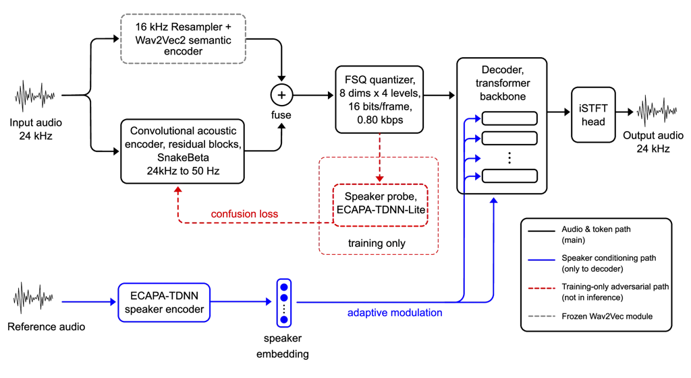

# 21Codec: Decoder-side Speaker Control for Text-to-Speech

David Lindevelt    Suzan Verberne    Joost Broekens

###### Abstract

We propose 21Codec, a streaming codec model with reduced recoverable
speaker information from the token stream and decoder-side speaker
control. Existing codec models infer speaker identity from token stream.
Making them streamable is not sufficiently robust to speaker drift,
because each chunk re-infers the identity from the local chunk context
alone. Our adversarial speaker classifier and NANSY-style formant-shift
data augmentation pushes the model to rely on the provided speaker
embedding while reducing the recoverable speaker information from the
token stream. We show that 21Codec can control speaker identity through
the conditioning vector, and that the speaker identity is maintained
across chunks during streaming. With the ability to control speaker
identity even in mid-stream, 21Codec is a promising candidate for
streaming TTS systems for better controllability of speaker identity.

###### Index Terms: 

text-to-speech, speaker information, audio compression, neural audio
codec, finite scalar quantization

^(†)^(†)address: Leiden University  
LIACS  
Leiden, The Netherlands

## 1 Introduction

Autoregressive text-to-speech (TTS) systems increasingly operate over
discrete audio tokens, which makes the codec an intermediate
representation for the whole pipeline. Most of the existing codec models
\[1, 2, 3\] are trained to reconstruct the audio with a sufficiently
large window, and their decoders exploit the global context for
inferring mostly static information such as speaker identity. Speaker
identity is inferred from the full token sequence rather than supplied
explicitly. When these codec models are used in streaming TTS
systems\[4\], the decoder is forced to operate on short chunks of
tokens, which makes the speaker identity inference unstable: When an
unchanged token sequence is decoded in chunks, each chunk re-infers the
identity from the local chunk context alone, and arrives at a different
speaker identity. So, in current SOTA codec models, the decoded voice
audibly drifts between speaker identities, even within the same
utterance. This makes the models incompatible with the real-time
synthesis where shorter token windows are needed for better real-time
performance.

We argue that this is a representational problem rather than a decoding
problem. The speaker information is encoded in the codec codes. We
propose 21Codec¹¹ 1 A complete text-to-speech system has two halves: an
acoustic model and a codec vocoder. This paper is about the second half,
therefore half of Douglas Adams’ Answer to Life, the Universe, and
Everything ($`42`$) , an 800 bps streaming codec at 50 Hz frame rate
that suppresses speaker identity from the token stream. 21Codec uses an
adversarial speaker classifier and NANSY-style formant-shift data
augmentation. It then reintroduces speaker identify at the decoder
through adaptive modulation on speaker embedding. Identity enters once,
as a single external embedding that conditions every frame, instead of
being re-inferred from each chunk, preventing speaker drift.

Conditioning allows our model to re-voice the same token sequence onto
different speakers without changing its content. Suppressing the speaker
identity in a learned representation and re-supplying it at the decoder
is established in voice conversion \[5, 6\], but those systems are not
streaming and operate on an internal continuous latent. We operate on
the discrete $`0.80`$ kbps bitstream the TTS pipeline uses, and decode
it chunk-causally. No component, parameter, or added latency enters the
pipeline.

Our first motivation is to keep identity consistent throughout streaming
inference. Our second motivation concerns our prior observation about
where speaker identity should enter a controllable TTS system. Style
control is far more sensitive to conditioning depth than speaker
identity is, yet compete for the same early layers. Under a joint
objective, style should hold those layers and identity should be applied
as late as possible. We remove identity from the token stream. So, the
two signals never compete for the capacity at any depth.

Our contributions are: 1. A streaming codec model with reduced speaker
identity in its codes. Re-voicing a source utterance onto a different
speaker puts the output closer to the reference. 2. The ability to
change speaker identity mid-stream, at no additional bitrate. 3. An
evaluation showing that causal streaming decoding matches non-causal
decoding down to a chunk size of 500 ms (25 frames).

## 2 Method

Figure 1: 21Codec Architecture. The encoder is non-causal, the decoder
chunk-causal.

Our encoder consists of acoustic and semantic encoders. The acoustic
encoder is a convolutional neural network with residual blocks with
SnakeBeta activation function. The acoustic encoder downsamples 24 kHz
input audio to 50 Hz frame rate. The frozen Wav2Vec2 \[7\] semantic
encoder output is concatenated and fused with acoustic encoder output.
The fused representation is quantized with FSQ \[8\]. With eight
dimensions at four levels each, every frame carries $`\log_{2}4^{8}=16`$
bits, giving a bitrate of $`0.80`$ kbps. We adopt FSQ \[8\] rather than
residual vector quantization to avoid codebook collapse. We measure
codebook utilization over 582 hours of LibriTTS dataset. All 65,536
implicit codes are used, the code distribution reaches $`15.66`$ of
$`16`$ bits of entropy ($`783`$ bps and $`97.9\%`$ of the theoretical
maximum), and the total correlation between the code dimension is
$`0.18`$ bits. So, an ideal entropy coder could recover only $`0.02`$
kbps, which shows the codes are well utilized and close to
incompressable.

The decoder consists of a transformer backbone and ISTFT head \[9, 10\]
to reconstruct the audio from quantized representation. While our
encoder is non-causal, our decoder is chunk causal. Self-attention in
transformers creates a mask to block only future chunks. It is designed
to work with random chunk sizes which makes the model streamable at
arbitrary chunk sizes for TTS systems. We use DiT \[11\] inspired
adaptive modulation in decoder to condition on Ecapa-TDNN \[12\] speaker
embeddings, as in \[13, 14\], but on a representation from which
identity has already been suppressed. Separately, we implement
ECAPA-TDNN-Lite \[15\] speaker classifier probe $`\phi`$. The probe
$`\phi`$ is trained to predict the speaker from the frozen codec’s
quantized codes $`q`$ under an additive-angular-margin softmax
objective. It is trained on the same formant-shifted distribution,
always under the original speaker label, so it becomes shift-invariant
and relies on cues the augmentation cannot remove. The codec is then
trained against it with a confusion penalty that drives the probe’s
posterior toward uniform,
$`\mathcal{L}_{\mathrm{conf}}=D_{\mathrm{KL}}\!\left(\mathcal{U}\;\|\;p_{\phi}(s\mid q)\right)`$,
evaluated on margin-free cosine logits, with gradients flowing back into
the encoder. The two are optimized in alternation. The penalty is
label-free and therefore applies to every utterance. The full generator
objective is
$`\mathcal{L}_{G}=45\mathcal{L}_{\mathrm{mel}}+\mathcal{L}_{\mathrm{energy}}+3\mathcal{L}_{\mathrm{adv}}+6\mathcal{L}_{\mathrm{feat}}+\lambda_{\mathrm{spk}}\mathcal{L}_{\mathrm{conf}}`$
with $`\lambda_{\mathrm{spk}}=1`$.

We use NANSY \[16\] style data augmentation to the input audio. The
module warps the spectral envelope along the frequency axis by a random
factor between $`1.14`$ and $`1.33`$ while leaving the harmonic fine
structure intact. This way, the fundamental frequency (F0) and the
intonation contours are preserved, while the speaker timbre (formants)
changes. We apply the formant shift augmentation and measured the
speaker embedding shift using cosine similarity between the original and
augmented audio. The random factor boundaries are chosen based on our
analysis of that shift.

## 3 Experimental Setup

Models. We compare 4 models: 21Codec, 21Codec-U, NeuCodec \[1\], and
WavTokenizer \[2\]. 21Codec is both streamable and speaker-conditioned.
For better comparison, we implement 21Codec-U: an unconditional version
with the same architecture; without the speaker adversarial and
formant-shift augmentation.

Training details. Our models are trained on single node with 4 NVIDIA
H100 GPUs for $`560k`$ iterations. Training uses $`6`$ seconds of audio
slices with effective batch size $`128`$. Shorter samples are looped to
$`6`$ seconds. Models are optimized using AdamW. For codec,
discriminator, and speaker adversarial learning rates
$`4\times 10^{-4}`$, $`2\times 10^{-4}`$, $`1\times 10^{-3}`$ and cosine
annealing schedulers with $`10k`$, $`10k`$, $`2k`$ warmup steps
respectively. We adapt zclip \[17\] for per-module adaptive gradient
clipping using EMA and z-score outlier detection. We will release our
code repository.²² 2
[https://github.com/dcze4/21Codec](https://github.com/dcze4/21Codec)

Training data is a weighted mixture of seven corpora (Table 1). Groups
are sampled at fixed weights rather than in proportion to their sizes,
so the distribution the model sees is set by the weights, not by corpus
hours. Utterances shorter than $`4`$ s or longer than $`30`$ s are
filtered out. Audio is converted to $`24`$ kHz mono and
loudness-normalized to EBU R128 at $`-22`$ LUFS integrated, $`7`$ LU
loudness range and a true peak of $`-3`$ dBTP. Common Voice and HUI are
additionally passed through a source separation, de-reverberation and
denoising chain before normalization; remaining corpora did not.

|                           |      |         |       |        |
| ------------------------- | ---- | ------- | ----- | ------ |
| Corpus                    | Lang | Hours   | Spk.  | Weight |
| In-house (audiobooks)     | en   | 862.08  | 44    | .30    |
| LibriTTS-R                | en   | 449.68  | 2277  | .18    |
| Common Voice 23.0         | 54   | 1865.16 | 36382 | .15    |
| MLS                       | 7    | 5870.32 | 518   | .15    |
| In-house (acted dialogue) | 2    | 532.37  | 2135  | .15    |
| HUI                       | de   | 322.88  | 121   | .05    |
| Expresso                  | en   | 4.87    | 4     | .02    |
| Total                     | 54   | 9907.36 | 41481 | 1.00   |

Table 1: Training mixture. Weights are per-batch sampling probabilities,
not proportions of the available hours.

Evaluation details. We evaluate identity control (re-voicing, SMOS),
recoverability (speaker probe), stability (speaker drift, chunk size),
and cost (reconstruction, MOS). Identity control. Training data is
English-dominant, so we evaluate on every unseen LibriTTS-R speaker with
at least two utterances of $`15`$ s or longer, total of $`80`$ in
speakers (EN-80), sampling 2 utterances per speaker. Re-voicing trials
pair each source with a reference utterance from the same speaker and
four from different speakers. By alternating the source and reference in
the same-speaker condition, we have $`480`$ trials. Similarity listening
test instead uses five languages (en, nl, de, fr, it) since judging
whether two voices match does not require understanding the content. It
consists disjoint set of $`100`$ source and $`100`$ reference speakers,
balanced over languages, and presents the re-voiced output next to a
codec reconstruction of either the source or the reference speaker. Each
source is paired with one matched-language and four cross-language
references, plus two calibration conditions: a genuine same- and
different-speaker pairs.

Recoverability. Speaker probe evaluation uses $`5000`$ utterances from
speakers seen during training, $`355`$ of them are held-out. The probe
is trained on the frozen codes of both unconditional baseline and
21Codec for $`100k`$ steps using the same training setup used in codec
training. Then, we report the top-1 accuracy. Stability. We select
$`40`$ utterances across five languages, each 20–30 seconds and from a
different unseen speaker. These utterances are used to measure speaker
identity drift when the same token sequence is decoded in various chunk
sizes. Speaker embeddings are extracted from non-overlapping 2 second
windows, and the cosine similarity is measured between synthesized and
source utterance windows. The chunk-size sweep evaluation uses $`30`$
utterances from $`30`$ different LibriTTS-R speakers. Cost.
Reconstruction evaluation uses EN-80 set, total 160 trials. MOS
evaluation uses the same subset as chunk-size evaluation.

Evaluation metrics. We evaluate the models on objective metrics: DNSMOS
ovrl\[18\], NISQA mos\[19\], WER/CER and speaker similarity using cosine
similarity. Reference-based metrics such as PESQ, STOI and SI-SNR are
not reported because they measure waveform mismatch rather than
perceived quality for every system compared here. Whisper \[20\] turbo
is used as ASR model for WER/CER. For speaker similarity, we use
ECAPA-TDNN \[12\] speaker embedding model to extract embeddings from the
source, reference and synthesized audio, and compute cosine similarity
between them.

Listening Tests. We conducted two human evaluation studies: 1. SMOS: we
asked $`21`$ participants to rate $`30`$ samples on a $`1`$ to $`5`$
scale, where $`1`$ means different speaker and $`5`$ means same speaker. 2. MOS: we asked $`24`$ raters to rate the naturalness of the audio on a
$`1`$ to $`5`$ scale, where $`1`$ means bad and $`5`$ means excellent.
For both studies, we excluded raters who submitted more than $`20\%`$ of
their ratings without playing the audio. The SMOS study had $`20`$
raters, and the MOS study had $`22`$ raters after exclusion.

|                   |         |                  |                    |          |              |              |                     |
| ----------------- | ------- | ---------------- | ------------------ | -------- | ------------ | ------------ | ------------------- |
| Reference         | $`n`$   | Sim.             | Sim.               | Sim.     | DNSMOS       | NISQA        | WER / CER           |
|                   |         | ref $`\uparrow`$ | src $`\downarrow`$ | ref-src  | $`\uparrow`$ | $`\uparrow`$ | $`\downarrow`$      |
| Own utterance     | $`160`$ | –                | $`.903`$           | –        | $`3.415`$    | $`4.618`$    | $`.095`$ / $`.052`$ |
| Same spk., other  | $`160`$ | $`.869`$         | $`.806`$           | $`.817`$ | $`3.413`$    | $`4.610`$    | $`.099`$ / $`.055`$ |
| Different speaker | $`320`$ | $`.763`$         | $`.283`$           | $`.191`$ | $`3.374`$    | $`4.587`$    | $`.140`$ / $`.079`$ |
| same gender       | $`160`$ | $`.753`$         | $`.373`$           | $`.248`$ | $`3.397`$    | $`4.619`$    | $`.122`$ / $`.069`$ |
| cross gender      | $`160`$ | $`.772`$         | $`.194`$           | $`.134`$ | $`3.350`$    | $`4.555`$    | $`.158`$ / $`.089`$ |

Table 2: Re-voicing EN-80

| Condition           | SMOS     | 95% CI          |
| ------------------- | -------- | --------------- |
| Same speaker        | $`3.89`$ | $`[3.63,4.15]`$ |
| Ref., matched lang. | $`3.58`$ | $`[3.33,3.83]`$ |
| Ref., cross lang.   | $`3.25`$ | $`[2.99,3.51]`$ |
| Src., matched lang. | $`2.05`$ | $`[1.77,2.33]`$ |
| Src., cross lang.   | $`1.38`$ | $`[1.21,1.55]`$ |
| Different speakers  | $`1.50`$ | $`[1.30,1.70]`$ |

Table 3: Speaker similarity, $`20`$ listeners

## 4 Results

The embedding controls speaker identity. Identity is carried by the
conditioning embedding rather than the codes themselves. Table 3 shows
the results of decoding the same source codes with an embedding from a
reference speaker. Similarity to the reference of a different speaker
reaches $`.763`$, compared to $`.869`$ when the reference is a different
utterance from the same speaker. Similarity to the source drops to
$`.283`$ while the similarity between genuinely different speakers is at
$`.191`$. This shows that the source speaker signal is largely removed
from the output.

Cosine similarity does not reflect the perceptual scale. So, we use
perceptual human evaluation (SMOS) to ground the cosine similarity.
Table 3 shows that re-voiced utterances are close to genuine
same-speaker pairs ($`3.58`$ vs. $`3.89`$). When the reference is in
another language, it is no more similar to the source than genuinely
different speakers ($`1.38`$ vs. $`1.50`$). A two-way repeated-measures
ANOVA over per-listener cell means shows that the comparison effect is
large ($`F(1,19)=78.7`$, $`p<.001`$, $`\eta_{p}^{2}=.81`$). This
indicates that the outputs are rated much closer to the reference
speaker than the source, confirming the effectiveness of our method.

Reduced recoverable speaker information from tokens. Standalone speaker
probe training shows that our proposed method reduces recoverable
speaker information by $`30\%`$: top-1 accuracy falls from $`7.36\%`$ to
$`5.14\%`$ over $`41{,}481`$ classes against a chance rate of
$`0.002\%`$. The unconditional baseline is uniquely correct on 265
speakers, the conditional model on 154. The differences between models
are statistically significant according to paired McNemar test \[21\]
with $`p<10^{-7}`$. The relative reduction rate holds equally on
held-out utterances subset (n=355); from $`15.8\%`$ to $`11.0\%`$ for
unconditional baseline model and 21Codec respectively.

| Chunk           | Spk. sim.    | WER/CER        | DNSMOS       | NISQA        |
| --------------- | ------------ | -------------- | ------------ | ------------ |
|                 | $`\uparrow`$ | $`\downarrow`$ | $`\uparrow`$ | $`\uparrow`$ |
| 1^(†) (020 ms)  | .854         | .107 / .062    | 3.28         | 4.58         |
| 4^(†) (080 ms)  | .872         | .099 / .055    | 3.32         | 4.64         |
| 8^(†) (160 ms)  | .875         | .095 / .052    | 3.34         | 4.68         |
| 16^(†) (320 ms) | .878         | .093 / .052    | 3.34         | 4.69         |
| 250 (500 ms)    | .881         | .087 / .051    | 3.35         | 4.68         |
| 500 (001 s0)    | .882         | .097 / .056    | 3.36         | 4.69         |
| non-causal      | .881         | .104 / .069    | 3.36         | 4.68         |

Table 4: Decoder chunk size vs. quality for 21Codec. $`\dagger`$ marks
chunk sizes seen during training

Decoding in chunks does not change the voice. We evaluate chunk sizes
from $`20`$ ms to $`1`$ s, including chunk sizes that were never seen
during training. Reconstruction quality is not affected, and the speaker
similarity remains within $`.002`$ of the non-causal decoder at $`500`$
ms (Table 4). Our model is chunk-causal, so these measurements reflect
the real-time streaming setup where the decoder can use cache from
previous chunks. We also measure the real-time factor (RTF) of the
proposed model on CPU and GPU. Streaming decoding runs at RTF $`.129`$
on CPU and $`.035`$ on GPU at a 160 ms chunk (Intel i9-13900K, RTX 4090,
batch 1, ONNX Runtime). Per-call latency is nearly independent of chunk
size ($`16.8–20.6`$ ms on CPU, $`5.3-5.5`$ ms on GPU across $`20-160`$
ms chunks). Additionally, we run all the models on uncached chunked
decoding, where the same encoder output is decoded in chunks without any
cache from previous chunks (speaker drift evaluation). Figure 2 shows
that our proposed model is able to maintain the speaker identity across
chunks, while other models drift to different speakers.

Figure 2: Speaker drift under _un-cached_ chunked decoding. Markers are
means over 2 s windows and files, bars the within-utterance standard
deviation. The gray band is natural audio through the same windowing
($`0.735\pm 0.063`$), the zero-drift floor.

|              |              |              |              |                     |
| ------------ | ------------ | ------------ | ------------ | ------------------- |
| System       | Sim. src     | DNSMOS       | NISQA        | WER / CER           |
|              | $`\uparrow`$ | $`\uparrow`$ | $`\uparrow`$ | $`\downarrow`$      |
| Ground Truth | –            | $`3.390`$    | $`4.754`$    | –                   |
| NeuCodec     | $`.889`$     | $`3.309`$    | $`4.735`$    | $`.027`$ / $`.013`$ |
| WavTokenizer | $`.801`$     | $`3.408`$    | $`4.698`$    | $`.037`$ / $`.019`$ |
| 21Codec      | $`.903`$     | $`3.415`$    | $`4.618`$    | $`.095`$ / $`.052`$ |
| 21Codec-U    | $`.818`$     | $`3.378`$    | $`4.569`$    | $`.047`$ / $`.025`$ |

Table 5: Reconstruction on EN-80, $`n=160`$. All systems run at
$`0.80`$ kbps except WavTokenizer ($`0.90`$).

The cost of an identity-free token stream. Our proposed method
successfully improves the controllability of the speaker identity, but
it comes at a cost of intelligibility. Table 5 reports reconstruction on
unseen speakers. Against the unconditional baseline, the proposed model
raises WER from $`.047`$ to $`.095`$ while improving speaker similarity
from $`.818`$ to $`.903`$. Naturalness, however, is not part of the
trade-off. DNSMOS and NISQA are higher for the conditional model
($`3.415`$ vs. $`3.378`$; $`4.618`$ vs. $`4.569`$), and $`22`$ listeners
rate naturalness for the two settings indistinguishably ($`3.30`$
$`[3.10,3.50]`$ vs. $`3.19`$ $`[2.98,3.39]`$). The listening test also
separates the systems where the non-intrusive metrics do not: DNSMOS
places 21Codec first of five and above unprocessed audio, while
listeners place it fourth, behind WavTokenizer ($`3.98`$) and
unprocessed audio ($`3.92`$). We therefore read DNSMOS and NISQA as
evidence that conditioning does not degrade quality, rather than as a
ranking across codecs.

## 5 Conclusions

We propose a streaming codec that suppresses the speaker identity in its
token stream and reintroduces it at the decoder side with an external
identity signal. Re-voiced output reaches a similarity of $`.763`$ to
the unseen reference, while the similarity to the source drops to
$`.283`$. Our findings show the potential of decoder-side speaker
identity control and the trade-off between the intelligibility and
speaker removal from the token stream.

Limitations and future work. Training was stopped after 5 days for
budget reasons, and had not fully converged. So, reported numbers are
lower bound. The method also depends on the speaker embedding model; a
different embedding model or a learned speaker table may shift the
results.

## References

- \[1\] Harry Julian, Rachel Beeson, Lohith Konathala, Johanna Ulin, and
  Jiameng Gao, “Finite Scalar Quantization Enables Redundant and
  Transmission-Robust Neural Audio Compression at Low Bit-rates,”
  Sept. 2025.
- \[2\] Shengpeng Ji, Ziyue Jiang, Wen Wang, Yifu Chen, Minghui Fang,
  Jialong Zuo, et al., “WavTokenizer: An Efficient Acoustic Discrete
  Codec Tokenizer for Audio Language Modeling,” in The Thirteenth
  International Conference on Learning Representations, 2025.
- \[3\] Rithesh Kumar, Prem Seetharaman, Alejandro Luebs, Ishaan Kumar,
  and Kundan Kumar, “High-Fidelity Audio Compression with Improved
  RVQGAN,” in Proc. NeurIPS, 2023, pp. 27980–27993.
- \[4\] Yisi Liu, Nicholas Lee, and Gopala Anumanchipalli, “StyleStream:
  Real-Time Zero-Shot Voice Style Conversion,” Feb. 2026.
- \[5\] Jing-Xuan Zhang, Zhen-Hua Ling, and Li-Rong Dai, “Non-Parallel
  Sequence-to-Sequence Voice Conversion With Disentangled Linguistic and
  Speaker Representations,” IEEE/ACM Transactions on Audio, Speech, and
  Language Processing, vol. 28, pp. 540–552, 2020.
- \[6\] Ju-chieh Chou, Cheng-chieh Yeh, Hung-yi Lee, and Lin-shan Lee,
  “Multi-target voice conversion without parallel data by adversarially
  learning disentangled audio representations,” in Proc. Interspeech.
  2018, pp. 501–505, ISCA.
- \[7\] Seamless Communication, Loïc Barrault, Yu-An Chung,
  Mariano Coria Meglioli, David Dale, Ning Dong, et al., “Seamless:
  Multilingual Expressive and Streaming Speech Translation,” Dec. 2023.
- \[8\] Fabian Mentzer, David Minnen, Eirikur Agustsson, and Michael
  Tschannen, “Finite scalar quantization: VQ-VAE made simple,” in
  International Conference on Learning Representations, 2024, pp.
  51772–51783.
- \[9\] Hubert Siuzdak, “Vocos: Closing the gap between time-domain and
  Fourier-based neural vocoders for high-quality audio synthesis,” in
  Proc. ICLR, 2024, pp. 25719–25733.
- \[10\] Takuhiro Kaneko, Kou Tanaka, Hirokazu Kameoka, and Shogo Seki,
  “ISTFTNET: Fast and lightweight mel-spectrogram vocoder incorporating
  inverse short-time fourier transform,” in Proc. ICASSP. 2022, pp.
  6207–6211, IEEE.
- \[11\] William Peebles and Saining Xie, “Scalable Diffusion Models
  with Transformers,” in Proc. ICCV. Oct. 2023, pp. 4172–4182, IEEE.
- \[12\] Brecht Desplanques, Jenthe Thienpondt, and Kris Demuynck,
  “ECAPA-TDNN: Emphasized Channel Attention, Propagation and Aggregation
  in TDNN Based Speaker Verification,” in Proc. Interspeech. Oct. 2020,
  pp. 3830–3834, ISCA.
- \[13\] Ahmed Mustafa, Nicola Pia, and Guillaume Fuchs, “StyleMelGAN:
  An Efficient High-Fidelity Adversarial Vocoder with Temporal Adaptive
  Normalization,” in Proc. ICASSP, June 2021, pp. 6034–6038.
- \[14\] Dipjyoti Paul, Yannis Pantazis, and Yannis Stylianou, “Speaker
  Conditional WaveRNN: Towards Universal Neural Vocoder for Unseen
  Speaker and Recording Conditions,” in Proc. Interspeech, 2020, pp.
  235–239.
- \[15\] Qingjian Li, Lin Yang, Xuyang Wang, Xiaoyi Qin, Junjie Wang,
  and Ming Li, “Towards Lightweight Applications: Asymmetric
  Enroll-Verify Structure for Speaker Verification,” in Proc. ICASSP,
  2022, pp. 7067–7071.
- \[16\] Hyeong-Seok Choi, Juheon Lee, Wansoo Kim, Jie Lee, Hoon Heo,
  and Kyogu Lee, “Neural Analysis and Synthesis: Reconstructing Speech
  from Self-Supervised Representations,” in Proc. NeurIPS. 2021,
  vol. 34, pp. 16251–16265, Curran Associates, Inc.
- \[17\] Abhay Kumar, Louis Owen, Nilabhra Roy Chowdhury, and Fabian
  Güra, “ZClip: Adaptive Spike Mitigation for LLM Pre-Training,”
  Apr. 2025.
- \[18\] Chandan K A Reddy, Vishak Gopal, and Ross Cutler, “Dnsmos
  P.835: A non-intrusive perceptual objective speech quality metric to
  evaluate noise suppressors,” in Proc. ICASSP, 2022, pp. 886–890.
- \[19\] Gabriel Mittag, Babak Naderi, Assmaa Chehadi, and Sebastian
  Möller, “NISQA: A deep CNN-self-attention model for multidimensional
  speech quality prediction with crowdsourced datasets,” in Proc.
  Interspeech, 2021, pp. 2127–2131.
- \[20\] Alec Radford, Jong Wook Kim, Tao Xu, Greg Brockman, Christine
  Mcleavey, and Ilya Sutskever, “Robust Speech Recognition via
  Large-Scale Weak Supervision,” in Proc. ICML, 2023, pp. 28492–28518.
- \[21\] Quinn McNemar, “Note on the sampling error of the difference
  between correlated proportions or percentages,” Psychometrika, vol.
  12, no. 2, pp. 153–157, 1947.
