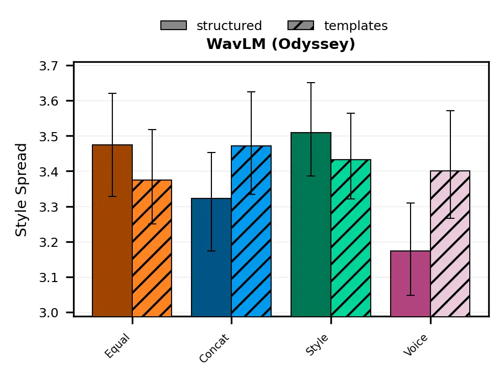

# Location Matters: Layer-wise Prompt Conditioning for Voice–Style Disentanglement in Text-to-Speech

David Lindevelt    Suzan Verberne    Joost Broekens

###### Abstract

Independent control of voice and emotional style characteristics of
speech is a long-standing problem in text-to-speech (TTS) systems. We
investigate how the conditioning location of voice and style prompts
across TTS decoder layers affects the trade-off between preservation and
expressiveness for voice identity and emotional style. We introduce a
layer-dependent gated fusion mechanism and systematically study which
layers should be influenced by which prompt type. Our findings show an
asymmetric relationship. Voice benefits from early conditioning for
identity preservation, while style benefits from early conditioning for
expressiveness. Our findings provide practical guidance that helps
neural network architects make an appropriate trade-off for the
architecture of TTS systems according to their use cases.

###### Index Terms: 

text-to-speech synthesis, voice and style control, voice and style
disentanglement

^(†)^(†)address: Leiden University  
LIACS  
Leiden, The Netherlands

## 1 Introduction

Text-to-Speech (TTS) systems have made impressive progress in the past
years. Applications ranging from audiobook narration, podcast generation
to dubbing, advertisement voice-overs and conversational agents
increasingly demand independent control over speaker identity and
expressive style \[1\]. For instance, in audiobook generation, a single
character voice needs to convey varying emotions across scenes while
preserving the voice identity. For conversational agents, appropriate
emotions must be independent of the speaker’s voice to create engaging
experiences. Current TTS systems, however, entangle these features,
which hinders their applicability in real world scenarios.

Recent TTS systems control voice and style characteristics through
natural-language prompts, but the effect of where and how strongly these
prompts are injected into the model architecture remains underexplored.
In this paper, we propose and evaluate a method for layer-wise
conditioning with natural-language prompts to enable better control over
emotional expressiveness and speaker characteristics. Lyth et al. \[2\]
condition a codec-based TTS on a single prompt covering speaker
identity, style and recording conditions, without separating those
factors. PromptTTS \[3\] defines style through five factors and augments
expert-written prompts with a language model. InstructTTS \[4\] trains a
prompt encoder and applies mutual information minimization to separate
style from speaker identity. PromptTTS++ \[5\], whose LibriTTS-P \[6\]
annotations we use, conditions on separate speaker and style prompts.
All four works inject the prompt at a single fixed point in the
architecture.

A second line of work varies the granularity of conditioning.
DiffStyleTTS  \[7\] models prosody at two levels with adjustable
classifier-free guidance, showing that level-wise control beats global
conditioning, but does not address voice–style disentanglement.
StyleFusion-TTS  \[8\] is closest to our work: it fuses speaker and
style embeddings hierarchically, rendering speaker before style on the
principle that identity is coarse guidance and style is fine
customization. That ordering is fixed by design and never varied. We
explicitly study the effect of variation.

Our contributions are therefore: 1. We introduce a layer-dependent gated
fusion mechanism that controls the extent to which a layer is
conditioned by a prompt. 2. We systematically investigate how
conditioning _location_ affects control over, and disentanglement of,
voice and style. 3. We show that voice and style should be conditioned
at different layers for transformer-based token prediction models.

## 2 Method

We propose a conditioning paradigm called Gated-Fusion to control the
influence of voice and style prompts at different layers of the TTS
model. As TTS backbone, we use a transformer-based encoder-decoder
architecture inspired by Battenberg et al. \[9\] with learnable position
encoding. The model operates on discrete WavTokenizer \[10\] codes. Our
decoder consists of 6 decoder blocks with 16 attention heads and hidden
width 1024. The alignment block uses a single 256-width LSTM layer and 4
heads in the location-based attention mechanism. The encoder contains 2
residual convolution stages that down-sample the input phoneme sequence
by 2x in time, followed by 3 non-causal self-attention blocks with 8
heads and width 512.

We condition our models with natural language prompts for voice and
style separately. Each prompt is processed by a T5-large encoder \[11\].
Gated-Fusion processes each prompt separately, and fuses the resulting
embeddings with layer-dependent gating weights before cross-attention,
where each token has information from both signals. We use non-learnable
gating weights to isolate the effect of conditioning location from any
impact introduced by learned gates. The fusion signal is computed as:

```math
\text{FS}=\sigma(\alpha_{l})\cdot\text{SSP}+(1-\sigma(\alpha_{l}))\cdot\text{VSP} \tag{1}
```

Where FS is the fused signal, SSP and VSP are style and voice signals
projections, $`\sigma`$ is a sigmoid function, and $`\alpha_{l}`$ is the
gating weight for layer l. Style and voice signal projections are
obtained by projecting style and voice signals into the same dimension
as cross-attention conditioning.

We define 4 model variants for comparison. Baseline Concat concatenates
two prompts into a single unified text for cross-attention, allowing the
model to freely attend to any part of the combined prompt (no gating
mechanism). The remaining three use Gated-Fusion by fixing gating
weights across the six decoder layers: Equal sets $`\alpha_{l}=0`$ for
all layers ($`\sigma(\alpha_{l})=0.5`$); Style-early sets
$`\alpha_{l}=10`$ for layers 1–3 and $`\alpha_{l}=-10`$ for layers 4–6,
yielding near-binary gating ($`\sigma(\textpm 10)\approx 1/0`$) with
style dominating early layers and voice dominating later layers;
Voice-early inverts this assignment.

## 3 Experimental Setup

Data We use LibriTTS-R \[12\] audio samples together with
LibriTTS-P \[6\] human annotations. Note that the human annotations were
created at the speaker level, not at the individual samples. The dataset
contains $`515.1`$ hours of speech from $`2295`$ speakers, with a total
of $`331{,}141`$ samples.

Feature Design and Prompt Creation We describe voice identity and
speaking style with four discrete features each. Style features are
Speed, Loudness, Arousal and Valence. Voice is described with Age, Sex,
Pitch and Texture. Speaking rate, loudness, and pitch (with Penn \[13\])
are measured from the audio; arousal and valence predicted with the
Odyssey model \[14\]. The other features are derived from
LibriTTS-P\[6\] annotations through a scoring function that normalizes
for how many keywords each annotator uses. Pitch is discretized within
annotated sex, so the category is relative to speakers of the same voice
type rather than to an absolute threshold. Every feature is discretized
into three categories at the 25th and 75th percentiles, except sex,
which is bipolar and uses fixed thresholds. Full extraction and scoring
details and the supplementary material are in the accompanying
repository¹¹ 1 [Supplementary code
repository](https://github.com/dcze4/ICASSP_location_matters/tree/4b10df117efc0622c808e0808296a1a00759a4fd).

Four style features with three values give 81 style prompts; four voice
features, with at most one texture keyword, result in 243 voice prompts.
We compare two prompting strategies. Structured prompts concatenate the
feature categories directly, isolating architectural effects from prompt
variation. Template-based prompts render the same categories through 20
style and 15 voice handwritten sentence templates, randomized per sample
during training, introducing the free-text diversity a deployed system
would face.

Pitch enters the experiment twice, but as two different quantities: the
voice prompt conditions on the speaker’s absolute register (median
$`F_{0}`$ over their ten longest samples), while the style
representation used for evaluation (Section 3) measures within-utterance
$`F_{0}`$ variation in semitones relative to each utterance’s own mean.
Because mean-normalization removes absolute register, the style
dimensions cannot respond to the pitch token in the voice prompt.

Evaluation Framework We measure control with two metrics defined using
pairwise distances in a proxy embedding space. Spread is the mean
pairwise distances between samples generated from different prompts and
measures how much the model varies its output; drift is the mean
pairwise distance between samples with the same prompt and measures how
much the corresponding attribute changes when only the other prompt is
varied.

Let $`\mathbf{x}_{v,s}`$ be a sample synthesized with voice prompt
$`v\in V`$ and style prompt $`s\in S`$. Fixing each voice and varying
style,

```math
\bar{D}(\mathbf{e},d)=\frac{1}{|V|}\sum_{v\in V}\frac{2}{|S|(|S|-1)}\sum_{i<j}d\!\left(\mathbf{e}(\mathbf{x}_{v,s_{i}}),\;\mathbf{e}(\mathbf{x}_{v,s_{j}})\right) \tag{2}
```

gives Style Spread on style embeddings and Voice Drift on voice
embeddings; fixing style and varying voice gives Voice Spread and Style
Drift. A well disentangled model should have high spread on the varied
factor and low drift on the fixed one.

To avoid conclusions that depend on a single embedding space, we compute
every metric in several. Voice is represented by ECAPA-TDNN, TitaNet and
WavLM \[15, 16, 17\] speaker embeddings under cosine distance. Style is
represented by seven acoustic-prosodic features aligned with the style
prompt (syllable rate, energy mean and standard deviation, pitch
standard deviation and range, arousal, valence), with arousal and
valence from either Audeering \[18\] or Odyssey \[14\]; we use Euclidean
distance on z-normalized features, since cosine distance discards
magnitude differences that are meaningful on these dimensions.

Because the same prompt units and generated audio recur across
conditions, the observations are clustered rather than independent. We
therefore model each metric with a linear mixed-effects model with a
random intercept per prompt unit and a variance component for shared
generated audio, using conditioning strategy and proxy embedding model
as fixed effects. We test the conditioning-strategy effect and its
interaction with the proxy embedding model by likelihood-ratio tests,
and compare strategies with Holm-corrected pairwise contrasts. As a
robustness check we re-estimate all fixed effects with generalized
estimating equations using cluster-robust standard errors; conclusions
are unchanged (supplementary).

Model Training and Inference Details All model variants are trained on a
single A100 GPU for 150k iterations. For the generation of the speech,
we use a temperature of 1.0, top-$`p=0.95`$ and top-$`k=200`$.

## 4 Results and Analysis

(1) Conditioning location affects voice and style control differently We
fix input text and vary the prompts to investigate the effects of
conditioning location on the synthesized output and report each metric
averaged over the fixed factor. Table 3 shows that the Voice-early model
preserves voice identity best against a variety of style prompts,
achieving the lowest drift across all three proxy embedding spaces
(ECAPA-TDNN: $`.227`$; TitaNet: $`.470`$; WavLM: $`.125`$). The ranking
of the models for voice drift holds across all embedding spaces. The
order shows us that voice drift falls as voice conditioning moves to
earlier layers. This suggests the model locks in speaker identity early
in the forward pass, and allows subsequent layers (where style
conditioning is stronger) to modulate prosody without disturbing
identity representation. In contrast, voice spread rankings are
inconsistent across proxy spaces. This indicates that conditioning
location has limited influence on how much voice identity varies across
different voice prompts.

|                                                                            |              |                  |                |                |       |      |
| -------------------------------------------------------------------------- | ------------ | ---------------- | -------------- | -------------- | ----- | ---- |
|                                                                            |              | LRT $`\chi^{2}`$ |                | Variance share |       |      |
|                                                                            | Metric       | Model            | M$`\times`$PEM | Unit           | Audio | Res. |
| Structured                                                                 | Style spread | 411.3            | 98.7           | .38            | .53   | .09  |
|                                                                            | Style drift  | 216.5            | 35.1           | .72            | .24   | .04  |
|                                                                            | Voice spread | 104.8            | 104.8          | .37            | —     | .63  |
|                                                                            | Voice drift  | 366.9            | 311.6          | .34            | .25   | .41  |
| Templates                                                                  | Style spread | 63.8             | 102.3          | .50            | .42   | .08  |
|                                                                            | Style drift  | 22.6             | 120.7          | .84            | .13   | .03  |
|                                                                            | Voice spread | 125.8            | 124.6          | .45            | —     | .55  |
|                                                                            | Voice drift  | 351.7            | 171.6          | .43            | .14   | .43  |
| Random intercept per prompt unit, variance component for shared            |              |                  |                |                |       |      |
| generated audio (unit $`\times`$ model). Voice spread: the audio component |              |                  |                |                |       |      |
| was zero and is omitted. $`n=1944,648,972,2916`$ in row order.             |              |                  |                |                |       |      |

Table 1: Mixed-effects analysis. Likelihood-ratio tests for conditioning
strategy (Model, $`df=3`$) and its interaction with the proxy embedding
model (Model $`\times`$ PEM; $`df=3`$ for style, $`df=6`$ for voice),
with variance shares of the random effects. All $`\chi^{2}`$ significant
at $`p<.001`$.

|                                                        |         |         |                     |                     |                     |                     |
| ------------------------------------------------------ | ------- | ------- | ------------------- | ------------------- | ------------------- | ------------------- |
|                                                        |         |         | Style               |                     | Voice               |                     |
|                                                        | Group 1 | Group 2 | Spread              | Drift               | Spread              | Drift               |
| Structured                                             | Equal   | Concat  | $`-.153`$           | $`-.246`$           | $`-.003`$           | $`\phantom{-}.017`$ |
|                                                        | Equal   | Style   | $`\phantom{-}.071`$ | $`-.114`$           | $`-.009`$           | $`\phantom{-}.008`$ |
|                                                        | Equal   | Voice   | $`-.254`$           | $`-.217`$           | $`-.007`$           | $`-.015`$           |
|                                                        | Concat  | Style   | $`\phantom{-}.224`$ | $`\phantom{-}.131`$ | $`-.006`$           | $`-.009`$           |
|                                                        | Concat  | Voice   | $`-.101`$           | $`\phantom{-}.029`$ | $`-.004`$           | $`-.033`$           |
|                                                        | Style   | Voice   | $`-.325`$           | $`-.103`$           | $`\phantom{-}.003`$ | $`-.023`$           |
| Templates                                              | Equal   | Concat  | $`\phantom{-}.073`$ | $`\phantom{-}.046`$ | $`\phantom{-}.008`$ | $`\phantom{-}.008`$ |
|                                                        | Equal   | Style   | $`\phantom{-}.064`$ | —                   | —                   | $`\phantom{-}.020`$ |
|                                                        | Equal   | Voice   | —                   | $`\phantom{-}.049`$ | —                   | $`-.008`$           |
|                                                        | Concat  | Style   | —                   | —                   | $`-.008`$           | $`\phantom{-}.013`$ |
|                                                        | Concat  | Voice   | $`-.083`$           | —                   | $`-.009`$           | $`-.015`$           |
|                                                        | Style   | Voice   | $`-.075`$           | —                   | —                   | $`-.028`$           |
| Values show $`\Delta M`$; all $`p_{\text{Holm}}<.05`$. |         |         |                     |                     |                     |                     |

Table 2: Pairwise model contrasts from the mixed-effects model
(Holm-corrected, FWER $`=0.05`$), — $`=`$ insignificant.

|                                         |                   |                 |                   |                 |                   |                 |
| --------------------------------------- | ----------------- | --------------- | ----------------- | --------------- | ----------------- | --------------- |
| Model                                   | EC^(∗)            |                 | TN^(∗)            |                 | WL^(∗)            |                 |
|                                         | D. $`\downarrow`$ | S. $`\uparrow`$ | D. $`\downarrow`$ | S. $`\uparrow`$ | D. $`\downarrow`$ | S. $`\uparrow`$ |
| Concat                                  | .250 ±.025        | .353 ±.006      | .525 ±.039        | .624 ±.020      | .146 ±.016        | .264 ±.010      |
| Style                                   | .250 ±.019        | .352 ±.006      | .505 ±.028        | .613 ±.020      | .139 ±.018        | .257 ±.007      |
| Voice                                   | .227 ±.023        | .349 ±.005      | .470 ±.046        | .621 ±.016      | .125 ±.022        | .260 ±.005      |
| Equal                                   | .242 ±.022        | .365 ±.007      | .491 ±.038        | .618 ±.020      | .136 ±.016        | .267 ±.007      |
| ^(∗)EC=ECAPA-TDNN, TN=TitaNet, WL=WavLM |                   |                 |                   |                 |                   |                 |

Table 3: Voice Embeddings Pairwise Distance mean ± std. Drift (D.) and
Spread (S.)

| Model  | Audeering            |                     | Odyssey              |                     |
| ------ | -------------------- | ------------------- | -------------------- | ------------------- |
|        | Drift $`\downarrow`$ | Spread $`\uparrow`$ | Drift $`\downarrow`$ | Spread $`\uparrow`$ |
| Concat | 2.897 ±.192          | 3.300 ±.205         | 2.815 ±.185          | 3.320 ±.182         |
| Style  | 3.033 ±.213          | 3.536 ±.233         | 2.941 ±.198          | 3.532 ±.230         |
| Voice  | 2.941 ±.184          | 3.239 ±.242         | 2.828 ±.164          | 3.179 ±.218         |
| Equal  | 3.133 ±.176          | 3.461 ±.239         | 3.070 ±.148          | 3.466 ±.225         |

Table 4: Style Embeddings Pairwise Distance mean ± std

Table 4 shows that rankings are preserved across proxy spaces for both
spread and drift metrics. Style-early achieves the highest spread
(Audeering: $`3.536`$; Odyssey: $`3.532`$), while Voice-early the
lowest. For style drift, Concat is the lowest, and Equal the highest.
These patterns indicate that style spread improves when the style signal
is introduced early in the architecture, while style drift falls when
style conditioning is placed later after voice conditioning. The
consistency of these rankings across proxy models with different
architectures confirms that the observed differences stem from
conditioning location rather than proxy model bias.

The mixed-effects analysis (Table 1) confirms a significant effect of
conditioning location on every metric (LRT
$`\chi^{2}(3)=104.8`$–$`411.3`$, all $`p<.001`$). For style, the effect
is strongest on spread ($`\chi^{2}=411.3`$) and remains large for drift
($`\chi^{2}=216.5`$). The random effects show how strongly the
observations are clustered: between-unit differences account for 34–72%
of the variance and the shared generated audio for up to 53%, which is
why the metrics are modeled with random effects rather than as
independent observations. For voice metrics, the proxy embedding model
remains the dominant fixed effect due to large scale differences between
embedding spaces; after accounting for it, voice drift retains a strong
placement effect ($`\chi^{2}=366.9`$) while voice spread shows the
weakest of the four ($`\chi^{2}=104.8`$, with all pairwise differences
below $`.01`$). This confirms the inconsistent rankings of voice spread
in Table 3. Post-hoc comparisons (Table 2) reveal the asymmetry: the
largest pairwise difference is seen in style spread ($`\Delta M=-.325`$)
for Style-early vs. Voice-early, while voice drift differences remain
small ($`\Delta M=-.023`$) and voice spread differences are negligible
($`\Delta M=.003`$). This indicates that swapping conditioning location
has large effects on style expressiveness but only a modest effect on
voice preservation.

(2) The model needs architectural pressure to disentangle We compare
Concat and Equal as baselines to understand whether signal separation
alone affects disentanglement. Tables 3 and 4 show that the Concat model
achieves the lowest style drift, but the highest voice drift, while the
Equal model shows the opposite pattern: highest style drift but
second-lowest voice drift. This suggests that when the model receives
both signals without explicit separation, it favors encoding style over
voice, possibly because prosodic features are more immediately useful
for next-token prediction than global identity. Separating the signals
forces the model (Equal) to attend to voice information, but at the cost
of increased style drift. Post-hoc comparisons (Table 2) confirm this:
the Equal vs. Concat difference is largest for style drift
($`\Delta M=-.246`$) and style spread ($`\Delta M=-.153`$). The
corresponding voice differences reach significance under the mixed model
but are far smaller ($`\Delta M=.017`$ and $`-.003`$). Separation
primarily redistributes how the model handles style; reducing voice
drift requires not just separation but early placement as shown above.



Figure 1: Style spread across conditioning strategies for structured and
template prompting.

Template prompting tests whether the architectural effects observed with
structured prompts survive under more realistic conditioning.

(3) Effect of prompt diversity Placement effects shrink sharply under
template prompting (Table 1). For style, the LRT statistic drops from
$`411.3`$ to $`63.8`$ for spread and from $`216.5`$ to $`22.6`$ for
drift. Prompt diversity introduces variance that partially overrides the
architectural steering observed with structured prompts. Voice drift is
the exception: its placement effect is essentially unchanged
($`366.9\rightarrow 351.7`$, a 4% reduction), making voice identity
preservation through early conditioning the most robust of the four
metrics to prompt diversity. Post-hoc comparisons (Table 2) reflect this
robustness. All six voice drift contrasts remain significant, whereas
style drift retains only two and voice spread three; the Style-early vs.
Voice-early voice drift difference is the largest of them
($`\Delta M=-.028`$). For style spread, the surviving significant pairs
cluster into two groups: Concat vs. Style and Equal vs. Voice are not
significantly different within each group, but the groups differ from
each other. Notably, Fig. 1 shows that only Concat and Voice-early
models show increased style spread under template prompting, while Equal
and Style-early models show reduced spread, indicating an asymmetric
effect of prompt diversity across model architectures. Also, input text
is itself a competing style signal. When prompts are fixed, varying the
text produces style distances approaching the style spread under neutral
prompts (supplementary, Section 7).

## 5 Conclusions

We show that layer-dependent conditioning with natural-language prompts
has an asymmetric effect on voice and style disentanglement in TTS:
voice benefits from early placement for identity preservation, style
benefits from early placement for expressiveness. The model prioritizes
style over voice when signals are combined, requiring architectural
pressure for disentanglement.

Voice identity and speaking style operate at different scopes. Voice is
a global, time-invariant property that holds across an utterance, while
style varies locally. This also explains model’s default behavior; style
operates at the same granularity as the token-level prediction task,
making it more actionable than global voice identity. There is no single
best strategy. Placement should be chosen by the application priority.

Limitations We use an encoder-decoder transformer architecture; findings
may differ for other architectures. We use fixed gating weights in the
fusion mechanism to isolate conditioning location effects. Learnable
weights might achieve better configurations but would introduce
additional noise. We rely on (standard) proxies rather than perceptual
listening tests, which limits our ability to confirm whether the
measured differences are perceptually meaningful. Our training data is
limited to LibriTTS-R, which is predominantly neutral audiobook speech.
Corpora with more diverse emotional and stylistic content may yield
different patterns.

## References

- \[1\] Tianxin Xie, Yan Rong, Pengfei Zhang, Wenwu Wang, and Li Liu,
  “Towards Controllable Speech Synthesis in the Era of Large Language
  Models: A Systematic Survey,” in Proceedings of EMNLP 2025, Suzhou,
  China, 2025, pp. 764–791.
- \[2\] Dan Lyth and Simon King, “Natural language guidance of
  high-fidelity text-to-speech with synthetic annotations,” Feb. 2024.
- \[3\] Zhifang Guo, Yichong Leng, Yihan Wu, Sheng Zhao, and Xu Tan,
  “Prompttts: Controllable Text-To-Speech With Text Descriptions,” in
  ICASSP, 2023, Rhodes Island, Greece, June 2023, pp. 1–5, IEEE.
- \[4\] Dongchao Yang, Songxiang Liu, Rongjie Huang, Chao Weng, and
  Helen Meng, “InstructTTS: Modelling Expressive TTS in Discrete Latent
  Space With Natural Language Style Prompt,” IEEE/ACM Transactions on
  Audio, Speech, and Language Processing, vol. 32, pp. 2913–2925, 2024.
- \[5\] Reo Shimizu, Ryuichi Yamamoto, Masaya Kawamura, Yuma Shirahata,
  et al., “PromptTTS++: Controlling Speaker Identity in Prompt-Based
  Text-To-Speech Using Natural Language Descriptions,” in ICASSP, 2024,
  Seoul, Korea, Republic of, Apr. 2024, pp. 12672–12676, IEEE.
- \[6\] Masaya Kawamura, Ryuichi Yamamoto, Yuma Shirahata, Takuya
  Hasumi, and Kentaro Tachibana, “LibriTTS-P: A Corpus with Speaking
  Style and Speaker Identity Prompts for Text-to-Speech and Style
  Captioning,” in INTERSPEECH 2024. Sept. 2024, pp. 1850–1854, ISCA.
- \[7\] Jiaxuan Liu, Zhaoci Liu, Yajun Hu, Yingying Gao, Shilei Zhang,
  and Zhenhua Ling, “DiffStyleTTS: Diffusion-based Hierarchical Prosody
  Modeling for Text-to-Speech with Diverse and Controllable Styles,” in
  Proc. COLING, Jan. 2025, pp. 5265–5272.
- \[8\] Zhiyong Chen, Xinnuo Li, Zhiqi Ai, and Shugong Xu, “StyleFusion
  TTS: Multimodal Style-Control and Enhanced Feature Fusion for
  Zero-Shot Text-to-Speech Synthesis,” in Pattern Recognition and
  Computer Vision, vol. 15041, pp. 263–277. Springer Nature Singapore,
  Singapore, 2025.
- \[9\] Eric Battenberg, RJ Skerry-Ryan, Daisy Stanton, Soroosh
  Mariooryad, et al., “Robust and Unbounded Length Generalization in
  Autoregressive Transformer-Based Text-to-Speech,” in Proc. NAACL-HLT,
  2025, Albuquerque, New Mexico, Apr. 2025, pp. 11789–11806.
- \[10\] Shengpeng Ji, Ziyue Jiang, Wen Wang, Yifu Chen, Minghui Fang,
  Jialong Zuo, et al., “WavTokenizer: An Efficient Acoustic Discrete
  Codec Tokenizer for Audio Language Modeling,” in The Thirteenth
  International Conference on Learning Representations, 2025.
- \[11\] Colin Raffel, Noam Shazeer, Adam Roberts, Katherine Lee, Sharan
  Narang, Michael Matena, et al., “Exploring the limits of transfer
  learning with a unified text-to-text transformer,” Journal of Machine
  Learning Research, vol. 21, no. 140, pp. 1–67, 2020.
- \[12\] Yuma Koizumi, Heiga Zen, Shigeki Karita, Yifan Ding, Kohei
  Yatabe, Nobuyuki Morioka, et al., “LibriTTS-R: A Restored
  Multi-Speaker Text-to-Speech Corpus,” in INTERSPEECH 2023. Aug. 2023,
  pp. 5496–5500, ISCA.
- \[13\] Max Morrison, Caedon Hsieh, Nathan Pruyne, and Bryan Pardo,
  “Cross-domain Neural Pitch and Periodicity Estimation,” Aug. 2024.
- \[14\] Lucas Goncalves, Ali N. Salman, Abinay Reddy Naini, Laureano
  Moro-Velázquez, Thomas Thebaud, Paola Garcia, et al., “Odyssey 2024 -
  Speech Emotion Recognition Challenge: Dataset, Baseline Framework, and
  Results,” in The Speaker and Language Recognition Workshop (Odyssey
  2024). June 2024, pp. 247–254, ISCA.
- \[15\] Brecht Desplanques, Jenthe Thienpondt, and Kris Demuynck,
  “ECAPA-TDNN: Emphasized Channel Attention, Propagation and Aggregation
  in TDNN Based Speaker Verification,” in INTERSPEECH 2020. Oct. 2020,
  pp. 3830–3834, ISCA.
- \[16\] Nithin Rao Koluguri, Taejin Park, and Boris Ginsburg, “TitaNet:
  Neural Model for Speaker Representation with 1D Depth-Wise Separable
  Convolutions and Global Context,” in ICASSP, 2022, May 2022, pp.
  8102–8106.
- \[17\] Sanyuan Chen, Chengyi Wang, Zhengyang Chen, Yu Wu, Shujie Liu,
  Zhuo Chen, et al., “WavLM: Large-Scale Self-Supervised Pre-Training
  for Full Stack Speech Processing,” IEEE Journal on Selected Topics in
  Signal Processing, vol. 16, no. 6, pp. 1505–1518, 2021.
- \[18\] Johannes Wagner, Andreas Triantafyllopoulos, Hagen Wierstorf,
  Maximilian Schmitt, Felix Burkhardt, et al., “Dawn of the Transformer
  Era in Speech Emotion Recognition: Closing the Valence Gap,” IEEE
  Transactions on Pattern Analysis and Machine Intelligence, vol. 45,
  no. 9, pp. 10745–10759, Sept. 2023.
