# Gaspard: Expressive unified speech and gesture synthesis with continuous autoregressive flow-matching and decoupled classifier-free guidance

Téo Guichoux Affiliation: ISIR Affiliation: IRCAM    Théodor Lemerle
Affiliation: IRCAM    Catherine Pelachaud Affiliation: ISIR
Affiliation: CNRSSorbonne University, Paris, FranceCorresponding author:
teo.guichoux@sorbonne-universite.fr    Nicolas Obin Affiliation: IRCAM

###### Abstract

Human communication involves highly coordinated multimodal signals such
as speech and co-speech gestures. Existing approaches for generating
both modalities commonly follow a cascaded pipeline, where speech is
generated first and subsequently used to drive gesture generation;
speech generation is therefore independent of gestures. We introduce
Gaspard, a unified speech–gesture generation model based on continuous
autoregressive generation with next-step flow-matching predictions, and
trained on Seamless Interaction, a large-scale multimodal dataset. The
heterogeneous temporal properties of speech and gesture motivate
modality-specific prediction heads and decoupled classifier-free
guidance over the two generation streams. This guidance rebalances the
influence of speech and gesture at inference time, improving
expressivity while mitigating dynamics collapse in continuous
autoregressive gesture generation. Objective and perceptual evaluations
show that Gaspard is a strong gesture generation model against unimodal
baselines and that it produces highly synchronous speech and gestures
compared to a matched cascaded system.

## 1 Introduction

In human communication, speech and co-speech gestures are highly
coordinated signals exhibiting bidirectional dependencies: speech
influences gestures and gestures influence timing \[23, 13\]. For
instance, gesture dynamics may be associated with changes in speech
prosody, such as rhythm, pauses, pitch, or emphasis \[14, 40\]. Despite
such multimodal coupling, existing approaches for generating both
modalities commonly rely on separate generative pipelines, where speech
is first generated from text and subsequently used to condition gesture
generation \[29\]. This design has several limitations. First, its
cascaded nature requires two successive inference processes, introducing
additional computational cost for real-time human-machine interactions.
Second, the two modalities are modeled with a directed dependency: text
drives speech, and speech drives gestures. As a consequence, gestures
can adapt to speech, but cannot condition speech generation,
contradicting psycholinguistic evidence of speech and gesture
co-production. Unified generation therefore provides an attractive
alternative, where speech and gestures are generated within the same
model and can both contribute to a shared multimodal communicative
state.

Unified speech–gesture generation, however, is not simply a matter of
combining two generative processes. Speech and gestures exhibit
fundamentally different temporal dynamics: speech contains rapidly
varying acoustic information, whereas gestures evolve more slowly,
exhibit strong temporal correlations, and often contain extended periods
of limited motion. When modeled jointly, these heterogeneous dynamics
can create asymmetric autoregressive dependencies, where excessive
reliance on previously generated gestures progressively suppresses
motion dynamics. Preserving expressive gestures while maintaining
cross-modal coordination is therefore a central challenge for unified
generation.

In this work, we introduce Gaspard (Gesture and Speech autoregressive
diffusion), a continuous autoregressive model for the unified synthesis
of speech and co-speech gestures from text. Gaspard performs next-step
prediction in continuous speech and gesture latent spaces, with each
next-step distribution modeled using flow matching.

Gaspard addresses the challenges of unified speech–gesture synthesis by
jointly modeling two modalities with fundamentally different temporal
dynamics. We show that these asymmetries give rise to imbalanced
autoregressive feedback, leading to progressive motion collapse where
gesture autoregressive history overpowers cross-modal conditioning.
Inspired by compositional guidance \[22, 33\], we introduce a _decoupled
classifier-free guidance_ strategy applied to jointly generated speech
and gesture streams. Unlike prior formulations that combine multiple
conditioning signals for a single generated stream, our method
separately regulates self-modal autoregressive feedback and cross-modal
conditioning in both modalities, preserving expressive gesture dynamics
while enabling tightly coordinated speech–gesture generation.

Through objective and perceptual evaluations, we show that Gaspard
enables controllable and expressive speech and gesture synthesis while
generating both modalities in real time. We further compare Gaspard with
recent unimodal gesture-generation baselines \[28\] and with a matched
cascaded system, investigate the role of modality-specific guidance, and
show that generated speech is sensitive to changes in gesture dynamics.

Our main contributions can be summarized as follows:

- •
  We introduce a continuous autoregressive next-step flow-matching model
  for joint speech–gesture generation.
- •
  We identify and characterize an autoregressive feedback imbalance in
  unified generation, where excessive reliance on gesture history leads
  to progressive motion dynamics collapse.
- •
  We adapt compositional classifier-free guidance to the autoregressive
  dependencies of jointly generated speech and gestures. Unlike
  conventional formulations that independently weight multiple
  conditions for a single generated stream, our _decoupled CFG_
  separately regulates self-modal and cross-modal feedback in both
  generation streams, mitigating gesture dynamics collapse while
  strengthening speech–gesture coordination.

Example videos are provided at our project page:
[https://tguichoux.github.io/papers/Gaspard](https://tguichoux.github.io/papers/Gaspard)

## 2 Related Work

##### Continuous autoregressive generation.

Autoregressive generation of continuous data, such as speech or motion,
is often performed through data discretization \[6, 3, 9, 21, 45\]. In
this paradigm, VQ-VAEs \[39\] are used to quantize continuous signals
into discrete codes, and the resulting code sequences are treated as
tokens in an autoregressive language model. However, it also introduces
an information bottleneck caused by compression and quantization, which
can limit reconstruction quality \[37\].

Motivated by the success of continuous diffusion-based models, several
recent works \[20, 37, 38, 34, 32, 43\] have shifted toward continuous
latent representations for autoregressive generation. In these
approaches, autoregressive generation is typically performed through
next-step diffusion over continuous codes. In particular, an
autoregressive backbone predicts a conditioning representation from the
preceding sequence, while a diffusion head generates the next continuous
latent code.

##### Dynamics collapse.

A common issue in autoregressive human motion synthesis is dynamics
collapse, where generated motion becomes repetitive, converges toward
average poses, or drifts away from the latent manifold, a phenomenon
often associated with regression to the mean \[31\]. One approach to
mitigating this issue is to reduce the model’s reliance on
autoregressive motion history. During training, \[11\] employ high
motion dropout, while \[15\] combine non-autoregressive pre-training
with scheduled teacher forcing for co-speech gesture generation. At
inference time, \[4\] explore reducing motion-history guidance to
improve style controllability in character animation. Gaspard builds on
this principle by using classifier-free guidance at inference time to
balance autoregressive gesture history and speech conditioning in joint
speech–gesture generation.

##### Unified speech and gesture synthesis.

A growing body of work investigates joint modeling of speech and
co-speech gestures. Tacotron-ISG \[41\] first showed that intermediate
TTS representations can effectively condition gesture generation, while
Diff-TTSG \[25\] uses shared text representations to drive speech and
gesture diffusion models. Closer coupling has also been explored by
directly modeling both modalities within the same generative process.
GlowTTS-ISG \[41\] jointly generates acoustic and motion features
through a flow-based decoder, while Match-TTSG \[24\] adopts a single
flow-matching model for speech and gesture synthesis. Recently, several
works have explored full-duplex speech and gesture generation \[26, 42,
27\]. Unlike the present work, these approaches focus on modeling dyadic
interactions. However, ELLSA 2 \[42\] also employs classifier-free
guidance to enhance gesture expressivity. Closer to our work, Gelina
\[9\] is an autoregressive model that jointly generates discrete speech
and gesture tokens through a single interleaved sequence. Its discrete
gesture representation also required a flow-matching decoder to recover
smooth motion, while the 75 Hz speech-token rate led to long
autoregressive sequences that hindered real-time inference. These works
establish unified speech–gesture generation as a viable approach, but
largely leave unexplored the cross-modal dependencies that emerge during
joint generation, including how speech and gesture histories differently
influence subsequent predictions.

## 3 Method

Gaspard generates speech and co-speech gestures from a text input, using
an encoder-decoder transformer architecture. Generation can further be
conditioned on an example prefix. Autoregressive prediction is performed
with two separate flow-matching heads that synthesize the next-step
speech and gesture embeddings. An overview of the Gaspard architecture
is provided in Figure 1.

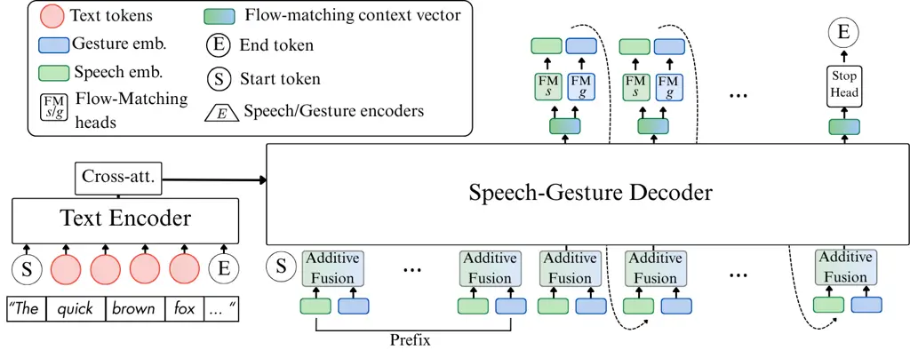

Figure 1: Gaspard generates speech and gesture continuous embeddings
from text using modality-specific flow-matching heads. Speech and
gesture embeddings are fused additively after modality-specific
projection. At inference, a short reference prefix is provided to
condition the generation, allowing both voice and gesturing style
cloning.

### 3.1 Aligning speech and gesture representations

Speech waveform and gesture sequences are encoded with separate VAEs.
Specifically, we use Z-Codec \[17\] for speech encoding; given a speech
input $`X^{s}\in\mathbb{R}^{M\times 1}`$, Z-Codec encodes it into a
sequence of latent embeddings denoted
$`Z^{s}\in\mathbb{R}^{d\times N}`$. For gesture representations, we use
a fully convolutional $`\sigma`$-VAE that takes as input a gesture
sequence $`X^{g}\in\mathbb{R}^{r\times J\times L}`$ and encodes it into
a latent embedding sequence $`Z^{g}\in\mathbb{R}^{d^{\prime}\times N}`$.
Both speech and gesture VAEs operate at the same latent frame rate,
which simplifies downstream autoregressive modeling.

Speech and gesture signals, although represented in a learned latent
space, exhibit different properties. Speech embeddings, for example,
form a fast-varying signal, whereas gesture embeddings form a slower and
more conservative signal with many repetitive patterns, for example when
a limb is not used for gesturing. Figure 2 illustrates the different
properties of speech and gestures.

### 3.2 Continuous autoregressive speech-gesture generation

Gaspard is trained to autoregressively generate a sequence of speech and
gesture embeddings conditioned on textual input and next-step prediction
is performed through flow-matching sampling. Voice and gestural style
cloning can be performed via prefix continuation.

At each autoregressive step, the previously generated speech and gesture
embeddings are first projected to the model dimension and fused
additively on the input side. The resulting fused sequence $`e_{<t}`$ is
processed by the autoregressive backbone $`B_{\theta}`$, together with
the encoded text representation, to produce a shared context vector:

```math
c_{t}=B_{\theta}(e_{<t},x). \tag{1}
```

This context vector conditions two modality-specific flow-matching
heads, $`h^{s}_{\theta}`$ and $`h^{g}_{\theta}`$, parameterized as small
MLPs following \[37, 32\], which model the next speech and gesture
embeddings in continuous space.

For next-step prediction, the model samples the next embeddings by
integrating two conditional velocity fields, one for speech and one for
gesture. For each modality $`m\in\{s,g\}`$, inference starts from a
Gaussian sample $`z^{m}_{0,t}\sim\mathcal{N}(0,I)`$ and integrates the
ODE:

```math
\frac{dz^{m}_{\tau,t}}{d\tau}=h^{m}_{\theta}(z^{m}_{\tau,t},\tau,c_{t}),\qquad\tau\in[0,1], \tag{2}
```

where $`\tau`$ denotes the flow-matching sampling time. The generated
next embedding is obtained at the end of the integration:
$`\hat{z}^{m}_{t}=z^{m}_{1,t}`$.

The overall backbone architecture follows Gelina \[9\]. Text is encoded
by a non-causal GLA-based encoder \[44\] and conditions the
autoregressive decoder through cross-attention, while the causal
GLA-based decoder models the fused speech-gesture history. At each
autoregressive step, a binary classification head predicts whether the
generation should stop.

##### Training:

Training is performed in a teacher-forcing next-step prediction regime,
with a flow-matching objective. At each autoregressive step $`t`$, the
backbone receives the ground-truth prefix $`(z^{s}_{<t},z^{g}_{<t})`$
and outputs the context vector $`c_{t}`$. For each modality
$`m\in\{s,g\}`$ the modality-specific flow-matching heads are trained to
predict the target velocity field $`v^{m}_{t}=z^{m}_{1,t}-z^{m}_{0,t}`$
from the intermediate state $`z^{m}_{\tau,t}`$, the flow-matching time
$`\tau`$, and the autoregressive context $`c_{t}`$:

```math
\mathcal{L}^{m}_{\mathrm{FM}}=\mathbb{E}_{t,\tau,z^{m}_{0,t}}\left[||v^{m}_{t}-h^{m}_{\theta}(z^{m}_{\tau,t},\tau,c_{t})||_{2}^{2}\right],\qquad m\in\{s,g\}. \tag{3}
```

The final Gaspard objective is a weighted combination of the speech and
gesture flow-matching losses:

```math
\mathcal{L}=\lambda_{s}\mathcal{L}^{s}_{\mathrm{FM}}+\lambda_{g}\mathcal{L}^{g}_{\mathrm{FM}}+\lambda_{\mathrm{stop}}\mathcal{L}_{\mathrm{stop}} \tag{4}
```

where $`\lambda_{s}`$ and $`\lambda_{g}`$ are modality-specific loss
weights, and $`\mathcal{L}_{\mathrm{stop}}`$ is the binary Cross-Entropy
loss term controlling the stop-prediction head.

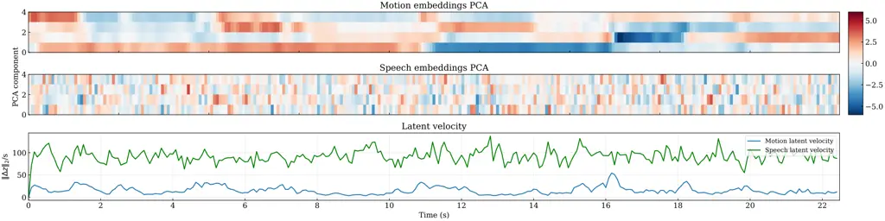

Figure 2: Top and middle: PCA views of gesture and speech latent
sequences at 12.5 Hz. Gesture and speech embedding sequences exhibit
different properties. Gesture latent sequences (top) are smooth and
slow-evolving, as demonstrated by repetitive patterns. In contrast, the
speech latent sequence is fast-varying and discontinuous. Bottom: Latent
velocity of speech and gesture sequences. Velocity is computed as the
difference between consecutive steps:
$`v^{s|g}=|z^{s|g}_{t+1}-z^{s|g}_{t}|`$. Speech latent velocity (green)
is much higher and more stable than the gesture latent velocity (blue),
illustrating the different nature of both signals.

### 3.3 Decoupled classifier-free guidance for expressive multimodal synthesis

Classifier-free guidance is a common strategy to encourage fidelity to a
control signal in diffusion-based generative models, and has been widely
used in continuous autoregressive next-step diffusion settings \[12, 37,
34, 18\]. By masking one input at a time, we can obtain context vectors
that remove the contribution of specific modalities. We denote by
$`c_{t}^{\neg G}`$ and $`c_{t}^{\neg S}`$ the contexts obtained by
masking gesture and speech, respectively:

```math
\displaystyle c_{t}^{\neg G} \displaystyle=B_{\theta}\left(\mathrm{Fuse}(z^{s}_{<t},\varnothing),x\right), \tag{5}
```

```math
\displaystyle c_{t}^{\neg S} \displaystyle=B_{\theta}\left(\mathrm{Fuse}(\varnothing,z^{g}_{<t}),x\right).
```

Given a flow-matching head $`h_{\theta}`$,and $`m\in\{S,G\}`$, the
corresponding velocity fields are:

```math
v=h_{\theta}(c_{t},z_{\tau},\tau),\qquad v^{\neg m}=h_{\theta}(z_{\tau},\tau,c_{t}^{\neg m}) \tag{6}
```

Inspired by \[33\] and \[18\], we define a chained multimodal CFG by
progressively rebalancing the contribution of each modality. For each
flow head $`h_{\theta}^{m}`$, and starting from the full conditional
velocity $`v`$, the guided velocity is updated as:

```math
\displaystyle v_{\mathrm{cfg}} \displaystyle\leftarrow v, \tag{7}
```

```math
\displaystyle v_{\mathrm{cfg}} \displaystyle\leftarrow v^{\neg G}+\gamma_{g}^{m}\left(v_{\mathrm{cfg}}-v^{\neg G}\right),
```

```math
\displaystyle v_{\mathrm{cfg}} \displaystyle\leftarrow v^{\neg S}+\gamma_{s}^{m}\left(v_{\mathrm{cfg}}-v^{\neg S}\right),
```

Here, $`\gamma_{G}`$ and $`\gamma_{S}`$ control the contribution of
gesture and speech, respectively. With $`\gamma^{G}_{g}<1`$, the
difference between the full and gesture-masked predictions is reduced,
reducing the influence associated with gesture history. In contrast,
$`\gamma^{G}_{s}>1`$ increases the influence of the speech history on
gesture prediction. Similarly, $`\gamma^{S}_{g}`$ controls the influence
of gesture history on speech generation, while $`\gamma^{S}_{s}`$
controls the influence of the speech history. The guidance scales assign
distinct coefficients to the contribution of each modality, providing
modality-specific control over self-modal and cross-modal conditioning.
The corresponding guidance updates are composed sequentially, and in all
experiments, gesture guidance is applied first, followed by speech
guidance.¹¹ 1 For fixed guidance scales, the chained formulation is
algebraically equivalent to an explicit compositional CFG formulation
with independently weighted gesture- and speech-conditioning terms. See
Sup. 12.3.1 for discussion. We found this chained formulation practical
for hyperparameter tuning. We summarize the intuition behind each
coefficient in Table 6, and Figure 3 illustrates the decoupled CFG
strategy.

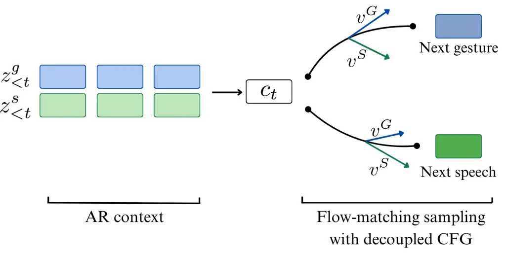

Figure 3: Overview of our decoupled CFG strategy. Next-step speech and
gesture latents are sampled conditioned on the context vector $`c_{t}`$
predicted from the gesture and speech fused history, $`z^{g}_{<t}`$ and
$`z^{s}_{<t}`$

An overview of the autoregressive inference loop with our decoupled CFG
mechanism is depicted in Algorithm 1.

## 4 Experimental Setup

##### Data and training.

We trained Z-Codec’s PatchVAE, the gesture $`\sigma`$-VAE, and Gaspard
on the Seamless Interaction dataset \[1\]. The public dataset contains
$`4,008`$ h of paired speech–gesture data from $`4,284`$ participants,
together with transcriptions, and is divided into naturalistic
($`2,745`$ h) and improvised ($`1,319`$ h) interactions. Speech is
resampled from $`48`$ to $`24`$ kHz to match Z-Codec. We retain
upper-body SMPL-H motion, remove leg motion and root translation,
convert relative joint rotations to Rot6D \[47\], and resample motion
from $`30`$ to $`25`$ fps. Recordings are resegmented using the provided
voice activity annotations, and we retain active-speaking segments only.
Detailed split statistics, preprocessing parameters, and segmentation
procedures are provided in Appendix 11.

The backbone is a 246M-parameter encoder–decoder Transformer with gated
linear attention, comprising a 6-layer text encoder, a 12-layer causal
decoder, and a 1024-dimensional hidden space. Gaspard was trained for
200k steps on 2 H100 GPUs using bf16 mixed-precision, corresponding to
approximately 40 h of training. The pretrained speech and gesture
autoencoders are kept frozen during this training stage. At inference
time, we use $`15`$ flow-matching sampling steps for both the speech and
gesture heads. Full architecture and optimizer configurations are
provided in Appendix 12.

##### Evaluation sets and baselines.

We conduct our evaluation on two evaluation subsets of the test split of
the Seamless Interaction dataset. The comparison against
gesture-generation baselines is performed on a manually curated subset
used in the Genea Challenge \[28\], referred to as Genea-95 (95
segments). We also include an automatically curated subset,
Seamless-416, containing $`416`$ segments from $`93`$ speakers, for a
total duration of approximately $`2`$ h $`35`$ min. Evaluation
recordings range from $`15`$ to $`35`$ s. For each speaker, a unique
separate segment of at most $`10`$ s is selected as a speech and gesture
prefix for generation. We provide additional details regarding segment
selection, curation, and other processing steps in Appendix 14.1.

At the time of the research and to the best of our knowledge, there
exist no open-source unified speech and gesture generation models
trained on the Seamless Interaction dataset. Because of differing pose
representations (rotations/positions, considered limbs, etc.), adapting
existing models to the dataset would require substantial engineering
efforts. We therefore compare Gaspard against recent unimodal
speech-driven gesture generation models: UNICAMP \[36\], GestFlow
\[10\], DyaSync-Sem \[8\], and UM-FERI \[7\], trained on Seamless
Interaction and evaluated in the Genea Challenge 2026 \[28\]. These
baselines use ground-truth speech originating from the dataset, whereas
Gaspard generates both the speech and the gestures from text. We
additionally compare Gaspard against the teacher-version of PocketTTS
\[34\], a 350M-parameter continuous autoregressive TTS model, which we
trained on the Seamless Interaction dataset. We finally construct a
Cascaded baseline combining a unimodal text-to-speech model with a
speech-driven gesture generation model, which follows the same training
recipe as Gaspard. Its TTS component corresponds exactly to Gaspard,
without gesture embedding inputs and gesture flow-matching head. The
speech-driven gesture generation component follows the Gaspard
architecture, except that the speech objective weight,
$`\lambda_{\mathrm{s}}`$ in Equation 4, is set to $`0.0001`$ and kept
only for regularization purposes. All remaining architectural components
and training settings are kept unchanged. We provide additional details
about the baseline models in Appendix 12.4.

##### Common evaluation protocol.

We evaluate speech and gesture synthesis separately. Gesture metrics
include Fréchet Gesture Distance (FGD) \[46\], Beat Consistency (BC)
\[19\], and $`\ell_{1}`$-Diversity \[21\]. To complement FGD and
inspired by \[30\], we introduce kinetic Fréchet Gesture Distance,
denoted by $`\mathrm{FGD}_{k}`$. Rather than comparing latent features
directly, $`\mathrm{FGD}_{k}`$ compares distributions of first-order
temporal variations in the latent space. Appendix 13 describes and
validates the metric. FGD measures pose-distribution similarity, whereas
$`\mathrm{FGD}_{k}`$ aims to capture motion dynamics similarities. BC
measures speech–gesture synchrony, and diversity measures motion
variability. For speech, we report Word Error Rate (WER), UTMOS \[35\],
and Speaker Similarity (SS) computed with WavLM \[5\]. We also report
real-time factor (RTF).

We conducted two perceptual studies, one for comparison against gesture
generation baselines and one for our ablation study. For both studies,
all stimuli were rendered in Blender using the 3D scene and avatar
representations used in the Genea Leaderboard \[16\]. The average
duration of the stimuli is 20 s. Participants recruited through Prolific
evaluated $`30`$ randomly sampled stimuli on a $`1`$–$`5`$ Likert scale
and completed two attention checks. Human-likeness of gestures was
evaluated from muted videos; speech–gesture synchronization was
evaluated from audiovisual stimuli. The ablation study additionally
evaluated voice human-likeness from audio alone. The evaluation subsets
and participant groups differed between studies, as specified below and
further detailed in Appendix 14.1. For both studies, participant-level
MOS were analyzed with repeated-measures ANOVA and Holm-corrected
pairwise tests.

## 5 Results

### 5.1 Comparison to gesture-generation baselines

| Method         | FGD $`\downarrow`$           | $`\mathrm{FGD}_{k}`$ $`\downarrow`$ | BC $`\sim`$          | Div. $`\sim`$                 |
| -------------- | ---------------------------- | ----------------------------------- | -------------------- | ----------------------------- |
| Human          | –                            | –                                   | $`0.63`$             | $`26.15`$                     |
| DyaSync-S      | $`31.00\pm 0.12`$            | $`3.40\pm 0.04`$                    | $`0.82`$             | $`18.46\pm 0.05`$             |
| GestFlow       | $`\underline{8.84\pm 0.35}`$ | $`1.49\pm 0.08`$                    | $`0.91`$             | $`19.31\pm 0.17`$             |
| UM-FERI        | $`11.01\pm 0.14`$            | $`\mathbf{1.02\pm 0.04}`$           | $`\underline{0.74}`$ | $`\mathbf{25.33\pm 0.14}`$    |
| UNICAMP        | $`11.93\pm 0.78`$            | $`2.04\pm 0.23`$                    | $`0.86`$             | $`16.35\pm 0.41`$             |
| Gaspard (ours) | $`\mathbf{6.56\pm 0.16}`$    | $`\underline{1.35\pm 0.21}`$        | $`\mathbf{0.67}`$    | $`\underline{21.65\pm 0.54}`$ |

Table 1: Evaluation results. Best results are shown in bold and
second-best results are underlined. For BC, performance is ranked by
proximity to the ground-truth value. $`\pm`$ indicates $`95\%`$
confidence intervals.

We present the comparison with unimodal gesture-generation models on
Genea-95 in Table 1. Gaspard obtains the lowest FGD ($`6.56`$) and a BC
score comparable to human recordings ($`0.67`$ vs. $`0.63`$), while
ranking second in $`\mathrm{FGD}_{k}`$ and diversity, behind UM-FERI for
both aspects.

Table 2 contains the results of the speech metrics of PocketTTS and
Gaspard.

| Method         | WER (%) $`\downarrow`$    | UTMOS $`\uparrow`$        | SS $`\uparrow`$            |
| -------------- | ------------------------- | ------------------------- | -------------------------- |
| Human          | –                         | $`2.88\pm 0.05`$          | –                          |
| PocketTTS      | $`\mathbf{4.69\pm 1.15}`$ | $`\mathbf{3.65\pm 0.05}`$ | $`0.70\pm 0.015`$          |
| Gaspard (ours) | $`6.38\pm 1.35`$          | $`2.69\pm 0.05`$          | $`\mathbf{0.77\pm 0.015}`$ |

Table 2: Speech generation results on the Genea-95 subset. WER denotes
word error rate, UTMOS the predicted naturalness score, and SS the
speaker similarity. Best results among generated samples are shown in
bold. $`\pm`$ indicates $`95\%`$ confidence intervals.

PocketTTS achieves lower WER (4.69% versus 6.38%) and higher predicted
naturalness (3.65 versus 2.69), whereas Gaspard achieves higher speaker
similarity (0.77 versus 0.70).

#### 5.1.1 Perceptual study protocol

For this comparison, we randomly sampled $`30`$ segments from Genea-95,
using the corresponding baseline outputs provided by the Genea Challenge
organizers \[28\]. We considered six conditions: Human, Gaspard, and the
four gesture-generation baselines. We recruited $`60`$ participants,
divided between gesture human-likeness and audiovisual synchronization
evaluations. One participant was excluded after failing attention checks
and was replaced.

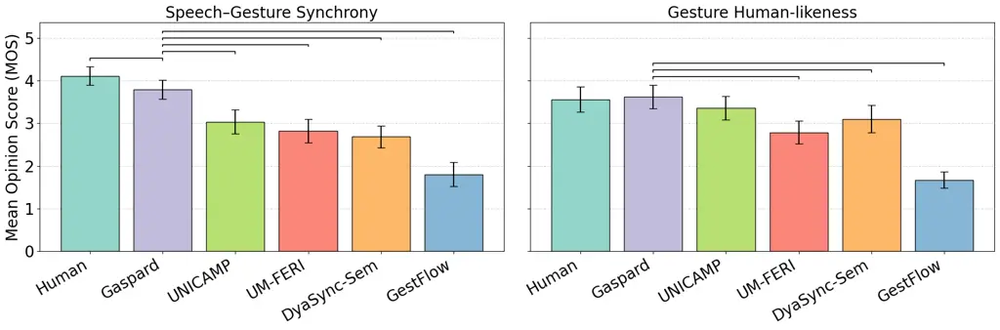

Figure 4: Results of the user study across the six conditions, reported
as MOS with $`95\%`$ confidence intervals. Horizontal brackets indicate
statistically significant differences ($`p<0.05`$). Left: speech–gesture
synchrony. Right: gesture human-likeness. We only indicate significant
differences w.r.t Gaspard for clarity.

#### 5.1.2 Perceptual study results

Gaspard achieved the highest speech–gesture synchrony ratings among the
generative systems, significantly outperforming all competing models
after Holm correction. Gaspard also obtains the highest mean motion
human-likeness score, with no statistically significant difference from
ground-truth motion, and its advantage over the strongest competing
model, UNICAMP, is not statistically significant.

### 5.2 Ablation studies

We conducted our ablation studies on the Seamless-416 evaluation subset.

#### 5.2.1 Decoupled classifier-free guidance

##### Guidance effects on motion and speech.

| Configuration | FGD$`\downarrow`$ | $`\mathrm{FGD}_{k}\downarrow`$ | BC $`\sim`$        | Div. $`\sim`$     | WER$`\downarrow`$ | UTMOS$`\uparrow`$ | SS$`\uparrow`$   | RTF$`\downarrow`$ |
| ------------- | ----------------- | ------------------------------ | ------------------ | ----------------- | ----------------- | ----------------- | ---------------- | ----------------- |
| Human         | –                 | –                              | 0.478              | 24.59             | –                 | $`2.21\pm 0.16`$  | –                | –                 |
| No CFG        | $`8.77\pm 2.06`$  | $`12.32\pm 1.43`$              | $`0.046\pm 0.023`$ | $`11.41\pm 1.77`$ | $`29.51\pm 1.44`$ | $`1.76\pm 0.02`$  | $`0.73\pm 0.09`$ | 0.78              |
| Standard CFG  | $`4.34\pm 1.18`$  | $`0.81\pm 0.43`$               | $`0.761\pm 0.05`$  | $`22.02\pm 0.83`$ | $`21.57\pm 1.02`$ | $`1.91\pm 0.39`$  | $`0.74\pm 0.01`$ | 0.78              |
| Decoupled CFG | $`3.71\pm 1.71`$  | $`0.42\pm 0.33`$               | $`0.657\pm 0.043`$ | $`22.00\pm 1.08`$ | $`8.03\pm 0.75`$  | $`2.62\pm 0.03`$  | $`0.75\pm 0.01`$ | 0.84              |
| Cascaded      | $`3.20\pm 2.60`$  | $`1.16\pm 0.05`$               | $`0.74\pm 0.042`$  | $`22.85\pm 0.73`$ | $`7.73\pm 0.71`$  | $`2.68\pm 0.03`$  | $`0.77\pm 0.01`$ | 1.04              |

Table 3: Comparison on Seamless-416 of no CFG, standard CFG
($`\gamma^{S}=1.3`$, $`\gamma^{G}=0.75`$), decoupled CFG
($`\gamma_{s}^{S}=\gamma_{g}^{S}=1.3`$, $`\gamma_{g}^{G}=0.825`$,
$`\gamma_{s}^{G}=6.5`$), and Cascaded ($`\gamma^{S}=1.3`$,
$`\gamma_{g}^{G}=0.825`$, $`\gamma_{s}^{G}=6.5`$). $`\pm`$: 95% CI.

We compare decoupled CFG with standard CFG and no guidance on the clean
Seamless evaluation set; the results are reported in Table 3. Decoupled
CFG substantially reduces FGD, $`\mathrm{FGD}_{k}`$, and WER, and
improves BC, diversity and UTMOS compared with standard CFG and no CFG,
at the cost of slightly slower inference caused by the additional
backbone forward passes. Figure 5 summarizes the variations in FGD,
$`\mathrm{FGD}_{k}`$, BC, and $`\ell_{1}`$-Diversity for different
combinations of $`\gamma_{g}^{G}`$ and $`\gamma_{s}^{G}`$. Decreasing
the guidance with respect to the gesture history initially improves both
FGD and $`\mathrm{FGD}_{k}`$, confirming that weaker gesture-history
guidance mitigates static motion collapse. However, when
$`\gamma_{g}^{G}`$ becomes too low, motion coherence deteriorates, as
illustrated by the increase in FGD observed at $`\gamma_{g}^{G}=0.75`$.

Figure 5: Left: Gesture-history guidance $`\gamma_{g}^{G}`$
($`\gamma_{s}^{G}=2.5`$). Right: Speech-history guidance
$`\gamma_{s}^{G}`$ ($`\gamma_{g}^{G}=0.825`$). Shaded regions show 95%
confidence intervals.

Figure 6 illustrates the effect of $`\gamma_{s}^{S}`$ on speech
intelligibility and quality. Increasing $`\gamma_{s}^{S}`$ to $`1.3`$
reduces the WER ($`14.37\%\rightarrow 10.05\%`$), while increasing UTMOS
($`2.16\rightarrow 2.52`$). Varying the gesture guidance
$`\gamma_{g}^{S}`$ also improves average WER from $`9.32\%`$ at
$`\gamma^{S}_{g}=1.0`$ to $`8.03\%`$ at $`\gamma^{S}_{g}=1.3`$, and
UTMOS from $`2.54`$ to $`2.63`$ at $`\gamma^{S}_{g}=1.4`$.

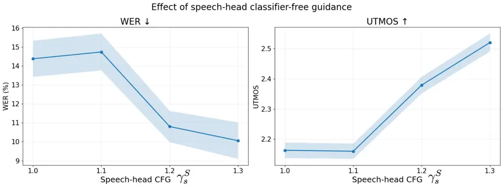

(a) Varying $`\gamma_{s}^{S}`$. $`\gamma^{S}_{g}`$ is fixed to $`1.0`$

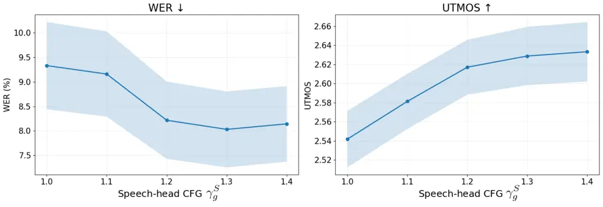

(b) Varying $`\gamma_{g}^{S}`$. $`\gamma^{S}_{s}`$ is fixed to $`1.3`$

Figure 6: Effect of classifier-free guidance on generated speech. Top:
speech-history guidance $`\gamma_{s}^{S}`$. Bottom: gesture-history
guidance $`\gamma_{g}^{S}`$.

##### Decoupled CFG for improved gesture dynamics.

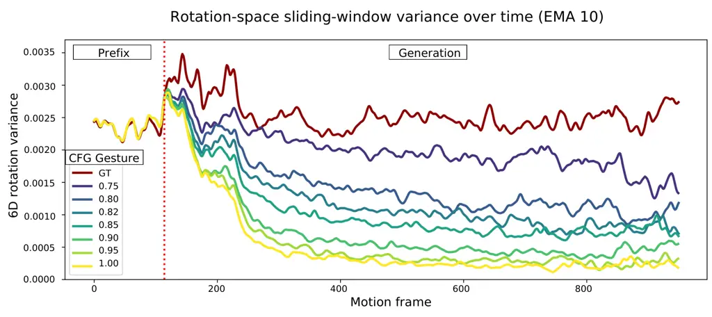

Figure 7: Impact of the gesture-history guidance scale
$`\gamma_{g}^{G}`$ on the dynamics of the generated gestures.

Figure 7 presents the impact of varying the gesture-history guidance
scale $`\gamma_{g}^{G}`$, while keeping the speech guidance scale fixed
at $`\gamma_{s}^{G}=2.5`$, isolating the effects of variations in
$`\gamma_{g}^{G}`$ while maintaining sufficiently strong speech
conditioning. The portion preceding the vertical dotted line corresponds
to teacher-forced predictions conditioned on the ground-truth prefix
(1-step horizon), while the portion following the dotted line
corresponds to free-running generation after the prefix. As shown in the
figure, setting $`\gamma_{g}^{G}=1`$ leads to a collapse of the
generated dynamics, resulting in nearly static motion characterized by
low variance. Progressively decreasing $`\gamma_{g}^{G}`$ mitigates this
collapse and increases both the variability of the generated gestures,
reaching velocity and variance levels comparable to those of the
ground-truth motion, represented by the red curve. Teacher-forced
generated gestures (the prefix at the left of dotted line) exhibit
similar properties to the ground-truth gestures, suggesting that
dynamics collapse is a self-reinforcing phenomenon during sequential
generation. Further decreasing the gesture-history guidance below
$`\gamma_{g}^{G}=0.80`$ degrades motion quality. In particular, values
such as $`\gamma_{g}^{G}=0.75`$ produce less human-like and increasingly
jerky gestures, despite demonstrating variance similar to human
recordings. This suggests that excessively weak conditioning on the
gesture history prevents the next-step predictor from preserving
sufficiently coherent motion trajectories.

Figure 8 presents the impact of varying the speech guidance scale
$`\gamma_{s}^{G}`$, with the gesture-history guidance fixed at
$`\gamma_{g}^{G}=0.825`$. Increasing $`\gamma_{s}^{G}`$ increases the
variability of the generated gestures. This behavior contrasts with that
of $`\gamma_{g}^{G}`$: stronger speech guidance encourages the model to
produce more pronounced motion variations in response to the speech
signal.

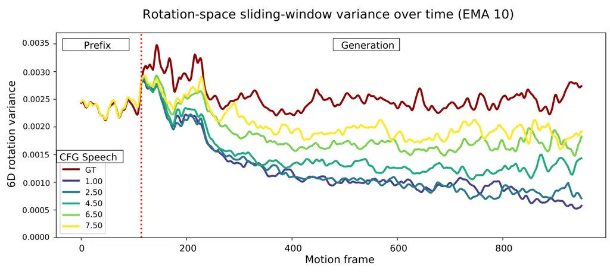

Figure 8: Impact of the speech guidance scale $`\gamma_{s}^{G}`$ on the
dynamics of the generated gestures.

#### 5.2.2 Unified versus cascaded generation

We report the results of the Cascaded ablation in Table 3. Unified and
Cascaded exhibit different strengths across the gesture metrics.
Cascaded achieves a lower FGD and slightly higher diversity, whereas
Unified substantially improves $`\mathrm{FGD}_{k}`$ and produces a BC
score closer to the ground-truth recordings. For speech, Cascaded
obtains a slightly lower WER and higher UTMOS and Speaker Similarity.
Unified generation is more efficient, with an RTF of $`0.84`$ compared
with $`1.04`$ for the cascaded approach.

To further investigate cross-modal coupling, we analyze the influence of
gesture conditioning on generated speech rate. Varying the speed of the
conditioning gestures produces correlated changes in speech rate and
inter-pausal-unit structure, with a median correlation of $`0.70`$ and
$`-0.60`$ respectively across multiple speakers and segments. This
provides evidence that gesture context can influence speech realization
in the unified model, which is impossible for speech-first cascaded
architectures. Additional results and metric definitions are provided in
Appendix 15.3.

#### 5.2.3 Perceptual ablation

##### User study protocol.

We constructed an evaluation set of $`24`$ segments from $`11`$ speakers
and recruited $`120`$ participants across three groups evaluating
gesture human-likeness, voice human-likeness, and synchronization. The
configurations were $`\mathrm{G}_{s=6.5,g=0.825}`$
($`\gamma^{G}_{g}=0.825`$, $`\gamma^{G}_{s}=6.5`$),
$`\mathrm{G}_{s=1,g=0.825}`$ ($`\gamma^{G}_{g}=0.825`$,
$`\gamma^{G}_{s}=1.0`$), $`\mathrm{G}_{s=2.5,g=1}`$
($`\gamma^{G}_{g}=1.0`$, $`\gamma^{G}_{s}=2.5`$), and Cascaded, together
with Human. Seven participants were excluded after failed attention
checks and replaced.

##### Ablation study perceptual results.

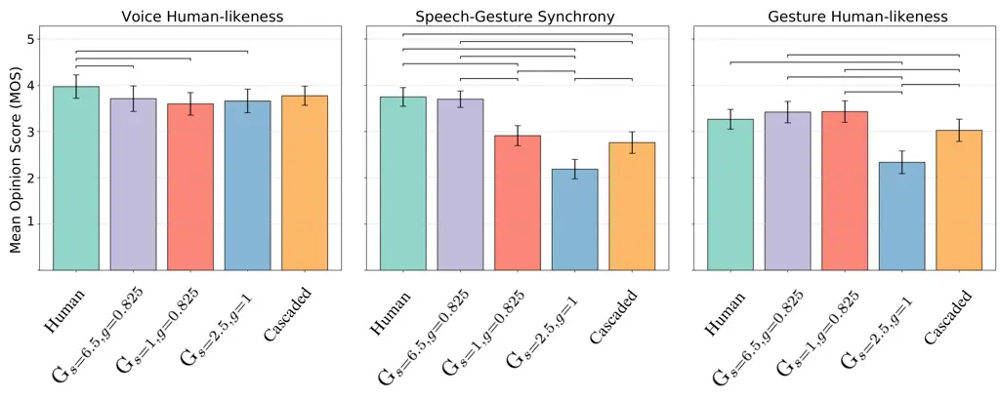

Figure 9: User study results (MOS, 95% CI). Brackets: significant
differences ($`p<0.05`$). Left: voice human-likeness. Middle:
speech–gesture synchrony. Right: gesture human-likeness.

Reducing gesture-history guidance significantly improves perceived
synchronization and gesture human-likeness over
$`\mathrm{G}_{s=2.5,g=1}`$, consistent with reduced motion collapse.
Increasing speech guidance further improves synchronization:
$`\mathrm{G}_{s=6.5,g=0.825}`$ obtains a score comparable to human
recordings ($`3.70`$ versus $`3.75`$). Both
$`\mathrm{G}_{s=6.5,g=0.825}`$ and $`\mathrm{G}_{s=1,g=0.825}`$
significantly outperform Cascaded for gesture human-likeness. In the
voice-only test, Human scores highest ($`3.97`$); Cascaded obtains
$`3.73`$ and the best-guided Gaspard $`3.69`$, with significant
differences between Human and some Gaspard variants. All Gaspard
configurations remain comparable with the cascaded system for voice
human-likeness.

## 6 Discussion

The results show that the proposed method is a strong approach for
expressive behavior synthesis. Gaspard outperforms unimodal
gesture-generation baselines in objective and perceptual evaluations
while generating both speech and gestures. Although Gaspard generates
intelligible speech, it underperforms against PocketTTS. We hypothesize
that the larger number of parameters for PocketTTS (350M) compared to
Gaspard (246M), and the use of Mimi, a strong audio codec, can explain
these differences. Since Gaspard generates slightly lower quality speech
than its cascaded counterpart, it is also possible that generating
gestures jointly with speech may deteriorate speech quality. In
contrast, unified generation produces highly synchronous and human-like
speech and gesture behaviors, as demonstrated by the perceptual results.
Objective and perceptive results also indicate that decoupled CFG
rebalances the impact of each modality during next-step prediction.
Reducing $`\gamma_{g}^{G}`$ weakens the contribution of gesture history,
mitigating dynamics collapse, while increasing $`\gamma_{s}^{G}`$
strengthens speech conditioning.

## 7 Conclusion and Limitations

We presented Gaspard, a speech and gesture generation model, and we a
introduced modality-decoupled CFG strategy that separately controls
speech and gesture conditioning. We show that unified generation
achieves leading perceptual performance, and decoupled guidance makes
continuous autoregressive gesture generation expressive and mitigates
dynamics collapse while improving speech-driven gesture dynamics.
Compared with its cascaded counterpart, Gaspard achieves stronger
gesture dynamics, perceptual gesture quality, synchronization, and lower
inference time, while the cascaded system retains advantages on several
unimodal objective metrics. Limitations include the computational cost
of multiple guidance passes, and evaluations of long-term generation and
out-of-domain generalization remain important future work.

## 8 LLM Usage Statement

Generative AI tools were used to assist with coding, language polishing,
and the summarization of research notes. During research development, we
also used LLMs to generate meaningful and diverse text prompts for
illustrative segments generated with Gaspard. Specifically, we used
ChatGPT 5.6, 6 and Claude Sonnet 5.5. All LLM-generated outputs,
including code, were manually reviewed. We did not use autonomous or
agentic coding tools, such as Codex or Claude Code, during this research
project.

Supplementary Material

## 9 Reproducibility statement

In order to favor reproducibility, all code, timestamps for the
evaluated samples, and trained model weights will be made available upon
acceptance.

## 10 Ethical considerations

This work primarily involved computational experiments and anonymous,
non-invasive perceptual studies with consenting adult participants, for
which formal ethical approval was not required under the applicable
institutional guidelines. User studies were performed on the Prolific
platform. Participants were all older than 18 y.o and fairly
compensated. All datasets were used in accordance with their respective
licenses, and the user studies were conducted with informed consent and
fair participant compensation. Cloning experiments were restricted to
speakers who had provided consent, and public demonstrations include
safeguards intended to mitigate potential misuse.

The models together with their trained parameters will be made publicly
available. While this facilitates reproducibility and enables further
research, it also makes these models accessible for unintended or
potentially harmful applications. In particular, because the proposed
models aim to synthesize realistic human speech and behavior, they could
be misused to generate convincing deepfakes, impersonate individuals, or
create synthetic content without the consent of the people being
represented.

## 11 Dataset composition and preprocessing

### 11.1 Dataset composition

Seamless Interaction contains $`4,065`$ h of paired speech–gesture data
from $`4,284`$ participants, with associated transcriptions.
Participants are recorded during dyadic interactions. The dataset is
divided into two main parts: naturalistic ($`2,745`$ h) and improvised
($`1,319`$ h). In the naturalistic part, one participant is given a
script to anchor the topic of the discussion, while the other is asked
to behave naturally. This split contains spontaneous interactions but
also many low-dynamics segments. In the improvised part, each
participant is given a role-play prompt, leading to more expressive
interactions, although less natural. The naturalistic and improvised
subsets exhibit different levels of expressive motion.

Both parts are divided into training, development, and test splits. The
corresponding statistics are reported in Table 4.

|              |       |         |              |              |
| ------------ | ----- | ------- | ------------ | ------------ |
| Part         | Split | Hours   | Interactions | Participants |
| Naturalistic | Train | 2625.34 | 45,126       | 3,243        |
|              | Dev   | 35.22   | 673          | 83           |
|              | Test  | 44.13   | 786          | 109          |
| Improvised   | Train | 1268.01 | 16,623       | 897          |
|              | Dev   | 20.98   | 323          | 41           |
|              | Test  | 15.31   | 220          | 35           |

Table 4: Statistics of the Seamless Interaction dataset by part and
split.

### 11.2 Speech, gesture, and text preprocessing

Speech is provided as a waveform at $`48`$ kHz. We resample it to
$`24`$ kHz for data compression and to match the sample rate required by
Z-Codec. Gestures are represented as full-body SMPL-H pose sequences at
$`30`$ fps. Motion in Seamless Interaction is obtained through
pseudo-mocap estimation from three simultaneous cameras. As a result,
some sequences contain pose-estimation artifacts caused by occlusions,
limb contacts, or interactions with surrounding objects. These artifacts
can create unrealistic dynamics and discontinuities. Because all
interactions were recorded in the same setting, with participants
standing on a recording pod, we remove leg motion and root translation
and model upper-body gestures only. Motion sequences are then resampled
to $`25`$ fps to match the input rate of the gesture encoder.

The SMPL-H body model represents body poses as a skeleton of relative
joint rotations. We convert these rotations to Rot6D \[47\], a
representation known to be better suited to learning-based modeling.
Gesture segments are therefore represented as sequences
$`G\in\mathbb{R}^{J\times 6\times N}`$, where $`J=43`$ is the number of
body joints considered and $`N`$ is the sequence length.
Following \[1\], we apply a Savitzky–Golay filter using a $`9`$-frame
window and a polynomial order of $`3`$. This filtering reduces motion
jerk without over-smoothing rapid gestures. For text, we use the
provided transcriptions, obtained with WhisperX \[2\], together with the
voice activity annotations. We do not apply the filter to evaluation
segments.

### 11.3 Dataset segmentation

Segments in Seamless Interaction have variable durations, typically
ranging from $`2`$ to $`10`$ min. These durations are substantially
longer than the segments typically used to train TTS models, which are
usually around $`30`$ to $`60`$ s. To stabilize training and improve
efficiency, in particular by reducing padding and enabling
length-bucketed data loading, we resegment each speech–gesture recording
using the voice activity detection annotations.

Each original recording corresponds to a full dyadic interaction, so a
given participant can alternate between speaking and listening. While
recent work \[26\] shows that a model can explicitly represent this
interactive state, we focus on active-speaking segments only.

## 12 Model details: architecture, training and inference hyperparameters

### 12.1 Z-Codec

Z-Codec is trained on the full Seamless Interaction train set
following \[17\]. The complete speech codec architecture follows \[17\],
except for a latent dimension of $`d_{s}=32`$.

### 12.2 Gesture $`\sigma`$-VAE

##### Details about the bottleneck

The variance structure of the latent space is critical for
autoregressive next-step diffusion, since sampling uncertainty
accumulates over generation steps \[37\]. However, standard VAEs are
prone to variance collapse, an optimization phenomenon where the
predicted variance of some channels collapses to 0, making the VAE
practically deterministic in some dimensions. Variance collapse reduces
robustness to exposure bias, which further harms autoregressive
modeling \[37\] and can cause variance drift or collapse that is
amplified by CFG \[12\]. We therefore use a variant of the vanilla VAE,
termed $`\sigma`$-VAE, following \[37\]. In $`\sigma`$-VAEs the
data-dependent predicted variance of VAEs, $`\sigma(x)`$, is replaced by
the absolute value of a variance sampled from a known normal
distribution $`\sigma\sim\mathcal{N}(0,C_{\sigma})`$. The absolute value
of the sampled variance $`|\sigma|`$ is then fixed across channels,
preventing variance collapse. The training objective of the
$`\sigma`$-VAE becomes:

```math
\mathcal{L}_{\sigma\mathrm{VAE}}=||x-\hat{x}||_{2}^{2}+\beta||\mu||_{2}^{2} \tag{8}
```

During training, we use the same reconstruction objective as in \[9\].

##### Training and architecture details

The gesture $`\sigma`$-VAE is trained on the naturalistic split of
Seamless Interaction for $`100`$k steps. We use $`8`$ s motion chunks, a
batch size of $`128`$, and AdamW optimization with a learning rate
decaying from $`2\times 10^{-4}`$ to $`4\times 10^{-5}`$. The
KL-divergence weight is set to $`1\times 10^{-4}`$ and $`C_{\sigma}`$ is
set to $`0.3`$. The reconstruction objective combines geodesic,
velocity, and position losses, with weights
$`\lambda_{\mathrm{geo}}=1.0`$, $`\lambda_{\mathrm{vel}}=1.0`$, and
$`\lambda_{\mathrm{pos}}=1.0`$.

### 12.3 Gaspard

| Modality | Stage               | Module                                                  | Frame rate | Latent dim.               |
| -------- | ------------------- | ------------------------------------------------------- | ---------- | ------------------------- |
| Speech   | Input waveform      | N/A                                                     | 24 kHz     | N/A                       |
|          | Stage 1             | WavVAE                                                  | 100 Hz     | 24                        |
|          | Stage 2             | PatchVAE                                                | 12.5 Hz    | 32                        |
| Gesture  | Input sequence      | Rot6D                                                   | 25 fps     | N/A                       |
|          | Encoding            | $`\sigma`$-VAE                                          | 12.5 Hz    | 64                        |
| Both     | Projection          | $`\phi_{\mathrm{in}}^{s}`$ / $`\phi_{\mathrm{in}}^{g}`$ | 12.5 Hz    | $`32/64\rightarrow 1024`$ |
|          | Backbone            | Gaspard decoder                                         | 12.5 Hz    | 1024                      |
|          | Flow-matching heads | $`h_{\theta}^{s}`$ / $`h_{\theta}^{g}`$                 | 12.5 Hz    | $`1024\rightarrow 32/64`$ |

Table 5: Frame rates and dimensionality reduction across the speech and
gesture pipelines used by Gaspard.

Gaspard is trained for $`200`$k steps on $`2`$ H100 GPUs, corresponding
to approximately $`40`$ h of training. We use AdamW with a learning rate
decaying from $`1\times 10^{-4}`$ to $`1\times 10^{-5}`$ and batches of
$`20`$k embeddings. The speech flow-matching loss weight is set to
$`\lambda_{s}=1.0`$. The gesture loss weight is linearly increased from
$`1\times 10^{-4}`$ to $`\lambda_{g}=1.3`$ over the first $`70`$k steps
after warmup. The gesture loss is ramped because text–speech alignment
emerges first: without this ramp, increasing gesture supervision too
early leads to speech underfitting. The stop-prediction loss is weighted
by $`0.05`$.

During Gaspard training, text, speech, and gesture conditions are
randomly dropped with probabilities $`0.01`$, $`0.05`$, and $`0.05`$,
respectively. The context vector output is independently and randomly
dropped with probability $`0.1`$, in which case the conditioning of the
flow-matching head is a zero-vector. We also apply latent noise
perturbation to speech and gesture inputs. The amount of noise is
sampled from beta distributions with parameters $`(10,1)`$ for speech
and $`(15,1)`$ for gestures.

#### 12.3.1 Detailed discussion about CFG

One can recover the additive formulation of multimodal CFG with
reparameterization, as follows:

```math
\displaystyle v_{\mathrm{cfg}} \displaystyle\leftarrow v, \tag{9}
```

```math
\displaystyle v_{\mathrm{cfg}} \displaystyle\leftarrow v^{\neg G}+\gamma_{g}^{m}\left(v_{\mathrm{cfg}}-v^{\neg G}\right),
```

```math
\displaystyle v_{\mathrm{cfg}} \displaystyle\leftarrow v^{\neg S}+\gamma_{s}^{m}\left(v_{\mathrm{cfg}}-v^{\neg S}\right).
```

For fixed guidance scales, this is equivalent to

```math
v_{\mathrm{cfg}}=v+\gamma_{s}^{m}(\gamma_{g}^{m}-1)(v-v^{\neg G})+(\gamma_{s}^{m}-1)(v-v^{\neg S}). \tag{10}
```

For gesture generation, with $`\gamma_{g}^{G}=0.825`$ and
$`\gamma_{s}^{G}=6.5`$,

```math
v_{\mathrm{cfg}}=v-1.1375(v-v^{\neg G})+5.5(v-v^{\neg S}). \tag{11}
```

We present the intuition behind the different CFG coefficients in
Table 6.

| Head                            | Coefficient        | Interpretation                                                                                 |
| ------------------------------- | ------------------ | ---------------------------------------------------------------------------------------------- |
| Speech head $`h_{\theta}^{S}`$  | $`\gamma_{s}^{S}`$ | Controls the strength of speech conditioning when predicting the next-step speech embedding.   |
|                                 | $`\gamma_{g}^{S}`$ | Controls the strength of gesture conditioning when predicting the next-step speech embedding.  |
| Gesture head $`h_{\theta}^{G}`$ | $`\gamma_{s}^{G}`$ | Controls the strength of speech conditioning when predicting the next-step gesture embedding.  |
|                                 | $`\gamma_{g}^{G}`$ | Controls the strength of gesture conditioning when predicting the next-step gesture embedding. |

Table 6: Interpretation of the modality-specific CFG coefficients.

#### 12.3.2 Inference

Input: Input text $`x`$, number of autoregressive steps $`T`$, number of
flow-matching sampling steps $`S_{\mathrm{ODE}}`$, guidance scales
$`\gamma_{g}^{G}`$, $`\gamma_{s}^{G}`$, $`\gamma_{g}^{S}`$,
$`\gamma_{s}^{S}`$

Output: Generated speech and gesture sequences

Initialize $`z^{s}_{0}`$ and $`z^{g}_{0}`$;

for _$`t=0,\ldots,T-1`$_ do

   // Compute autoregressive contexts

   $`c_{t+1}=B_{\theta}\left(\mathrm{Fuse}(z^{s}_{\leq t},z^{g}_{\leq t}),x\right)`$
; // fully conditioned

   $`c_{t+1}^{G}=B_{\theta}\left(\mathrm{Fuse}(z^{s}_{\leq t},\varnothing),x\right)`$
; // gesture masked

   $`c_{t+1}^{S}=B_{\theta}\left(\mathrm{Fuse}(\varnothing,z^{g}_{\leq t}),x\right)`$
; // speech masked

   // Generate the next continuous speech embedding with decoupled CFG

   $`z^{s}_{t+1}=\mathrm{ODESolve}\left(h_{\theta}^{s},c_{t+1},c_{t+1}^{\neg G},c_{t+1}^{\neg S},\gamma_{g}^{S},\gamma_{s}^{S},S_{\mathrm{ODE}}\right)`$;

   // Generate the next continuous gesture embedding with decoupled CFG

   $`z^{g}_{t+1}=\mathrm{ODESolve}\left(h_{\theta}^{g},c_{t+1},c_{t+1}^{\neg G},c_{t+1}^{\neg S},\gamma_{g}^{G},\gamma_{s}^{G},S_{\mathrm{ODE}}\right)`$;

// Decode the generated latent sequences into their output modalities

Decode $`z^{s}_{0:T}`$ into waveform;

Decode $`z^{g}_{0:T}`$ into motion;

return _generated speech and gesture sequences_;

Algorithm 1 Autoregressive inference with Gaspard. Each autoregressive
step requires three backbone inferences to obtain the full,
gesture-masked, and speech-masked contexts. Speech and gesture next-step
embeddings are generated through modality-specific flow-matching ODE
solves with decoupled classifier-free guidance. Generated gesture
embeddings are reused as autoregressive context.

At inference time, we use $`15`$ flow-matching sampling steps for both
the speech and gesture heads. The sampling temperature is set to $`1.0`$
for the speech head and $`0.975`$ for the gesture head, and trajectories
are integrated using the Euler ODE solver. For classifier-free guidance,
we use $`\gamma_{g}^{G}=0.825`$, $`\gamma_{s}^{G}=6.5`$,
$`\gamma_{g}^{S}=1.3`$, and $`\gamma_{s}^{S}=1.3`$, unless specified
otherwise. These values were empirically set after perceptual inspection
of generated segments on the dev set, and fixed for subsequent
evaluation.

### 12.4 Cascaded baseline

Figure 10 presents a simplified overview of the Cascaded system. The TTS
component of Cascaded corresponds exactly to Gaspard without the gesture
input projections and flow-matching head, it is therefore a
222M parameter model. The gesture generation component is a
246M parameter generation model, mimicking Gaspard.

For inference, we used $`\gamma_{s}^{S}=1.3`$, $`\gamma^{G}_{g}=0.825`$
and $`\gamma^{G}_{s}=6.5`$, as in Gaspard.

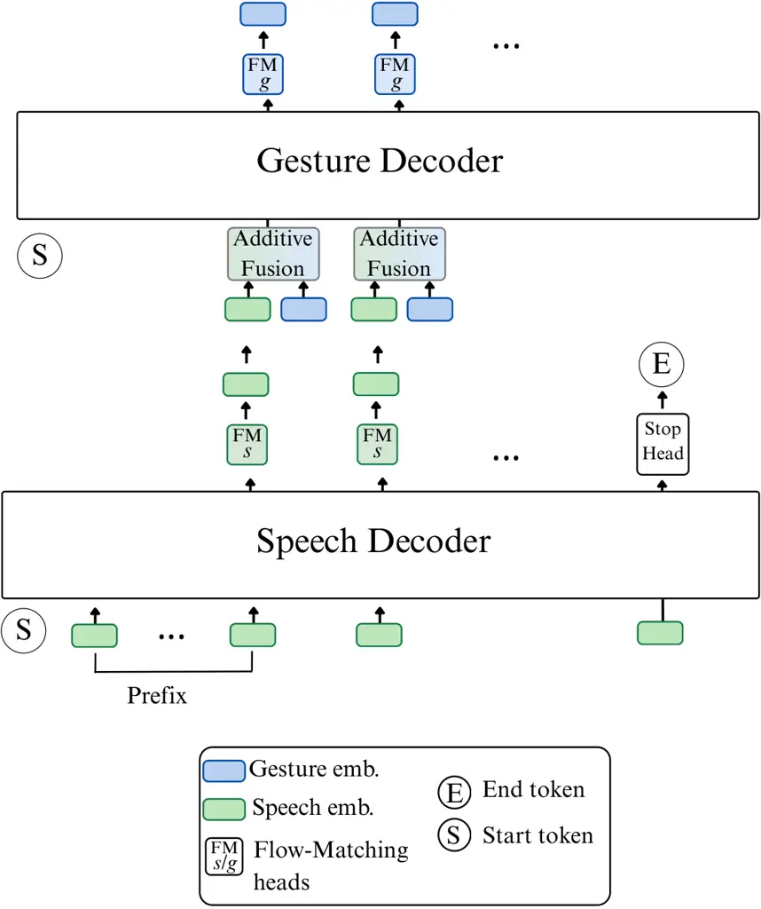

Figure 10: Simplified overview of the cascaded TTS and speech-driven
gesture generation baseline. The TTS module first generates speech
conditioned on text, after which the resulting speech embeddings are
provided as input to the gesture generation module. Speech synthesis is
therefore performed independently of gesture generation, as in most
conventional cascaded systems.

## 13 Evaluation metric implementation and validation

### 13.1 Kinetic FGD

Given a sequence of extracted features

```math
F=\left(f_{1},\ldots,f_{N}\right), \tag{12}
```

we first compute its latent velocity sequence as

```math
\Delta f_{t}=f_{t+1}-f_{t},\qquad t\in\{1,\ldots,N-1\}. \tag{13}
```

Each gesture sequence is then represented by a kinetic descriptor
obtained by concatenating the absolute temporal mean and standard
deviation of its latent velocities:

```math
v(F)=\left[\operatorname{mean}_{t}\left(|\Delta f_{t}|\right),\operatorname{std}_{t}\left(\Delta f_{t}\right)\right]. \tag{14}
```

Let $`\mathcal{V}_{\mathrm{GT}}`$ and $`\mathcal{V}_{\mathrm{pred}}`$
denote the sets of kinetic descriptors extracted from the ground-truth
and generated sequences, respectively. Kinetic FGD is defined as

```math
\mathrm{FGD}_{k}=D_{\mathrm{Fr\acute{e}chet}}\left(\mathcal{V}_{\mathrm{GT}},\mathcal{V}_{\mathrm{pred}}\right). \tag{15}
```

### 13.2 FGD feature extractor

Unlike BEAT2, Seamless Interaction does not provide a pretrained feature
extractor suitable for computing FGD. We therefore train a non-causal
VAE. The feature extractor encodes gesture sequences sampled at
$`30`$ fps into continuous latent embeddings at $`7.5`$ Hz, with a
latent dimensionality of $`40`$. The architecture is not primarily
designed to maximize frame-level reconstruction accuracy. Instead, its
temporal compression and relatively compact latent space encourage the
aggregation of motion information into semantically meaningful
representations, which is more appropriate for distribution-level
evaluation with FGD. The feature extractor is trained on the improvised
training split, and the evaluated segments are not seen during training.

Conventional FGD compares the distribution of extracted latent features
but does not explicitly characterize how these features evolve over
time. Two sets of sequences may therefore exhibit similar feature
distributions while differing substantially in motion amplitude,
smoothness, or temporal variability. This limitation is particularly
relevant for autoregressive models, which may produce realistic
individual poses while suffering from over-smoothed, static, or locally
unstable motion dynamics.

### 13.3 Validation of kinetic FGD

To validate the sensitivity of $`\mathrm{FGD}_{k}`$ to the motion
dynamics, we computed FGD and $`\mathrm{FGD}_{k}`$ on the clean test set
after applying controlled perturbations to the original gesture
sequences:

- •
  We modified the velocity of gesture sequences through temporal
  interpolation or downsampling.
- •
  We smoothed the original gesture sequences using a Savitzky-Golay
  filter, and varied the filter window size to progressively increase
  the smoothness.
- •
  We altered the original gesture sequences by adding a jerk component,
  defined as the difference between the original and smoothed motion and
  scaled by a factor controlling the perturbation magnitude.

As shown in Figure 11, changes in gesture speed, smoothness and jerk
have little effect on FGD, whereas $`{\mathrm{FGD}_{k}}`$ is much more
sensitive to these temporal variations. Notably, FGD remains very low
despite modified gesture velocity.

Figure 11: We validate the $`\mathrm{FGD}_{k}`$ metric by varying
gesturing velocity (Top), smoothness (Middle) and jerk (Bottom). We also
include the BC score corresponding to all three perturbations. FGD shows
little sensitivity to the perturbations, whereas $`\mathrm{FGD}_{k}`$
captures velocity, smoothness and jerk variations.

### 13.4 Beat Consistency calibration

Because the motion dynamics and pose distributions of Seamless
Interaction differ substantially from those of BEAT2, the
hyperparameters of the Beat Consistency metric require dataset-specific
calibration. We adjust the velocity–acceleration threshold used for
gesture-stroke detection and the parameter $`\sigma`$, which controls
the temporal tolerance of the alignment function. These parameters are
empirically set to $`0.25`$ and $`0.3`$, respectively. We select this
configuration by maximizing the difference in BC score between correctly
aligned speech–gesture pairs and artificially misaligned pairs, thereby
ensuring that the metric discriminates between synchronized and
unsynchronized sequences on Seamless Interaction.

A limitation of BC is that temporally unstable or jerky motion may also
produce a high score, as rapid motion variations increase the number of
detected gesture beats and therefore the likelihood of alignment with
speech beats. BC should consequently not be interpreted independently,
but jointly with FGD and $`\mathrm{FGD}_{k}`$, which respectively
evaluate the realism of the gesture representations and their latent
dynamics. We illustrate this effect in Figure 11.

### 13.5 WER

For WER computation, we used WhisperX \[2\] to obtain speech
transcriptions and applied peak normalization to the input audio. Both
the ground-truth recordings and the generated samples were transcribed
using this ASR. Since the speech segments from the Seamless Interaction
dataset originate from spontaneous dyadic interactions, it is important
to note that the reference transcriptions may contain inconsistencies.
In particular, some ground-truth recordings contain speech leakage (i.e.
the interlocutor’s speech) or background noise from the interlocutor,
which may also be transcribed by the ASR system. This difference from
the clean, studio-recorded data commonly used for TTS evaluation partly
explains why the reported WER scores remain relatively high compared
with state-of-the-art TTS systems.

## 14 Evaluation protocol details

### 14.1 Construction of the Seamless-416 evaluation subset

Since the original Seamless Interaction test split is relatively large
(approximately $`60`$ h), we construct a smaller subset for evaluation.
The candidate subset contains recordings ranging from $`15`$ to $`35`$ s
and initially covers $`103`$ speakers from the raw test set of Seamless
Interaction. For each speaker, we additionally select a random shorter
segment with a maximum duration of $`10`$ s, which is used as a speech
and gesture prefix for Gaspard generation. These prefixes do not overlap
with the evaluated segments. A substantial number of candidate segments
present limited motion or insufficient speech quality. To ensure a fair
and meaningful evaluation, we initially sample $`487`$ segments from the
test split, corresponding to approximately four to six segments per
speaker. We then exclude unsuitable segments and prefixes according to
the following criteria:

- •
  We retain only segments with a static gesture ratio below $`50\%`$,
  ensuring that evaluated sequences are non-static and contain
  meaningful gestures.
- •
  We discard segments containing unintelligible speech caused by
  recording issues.
- •
  We discard segments for which the provided transcription does not
  match the recorded speech.

This screening is performed exclusively on ground-truth human recordings
and is not based on the performance of the evaluated models. The
resulting clean test subset contains $`416`$ segments from $`93`$
speakers, corresponding to a total duration of approximately
$`2`$ h $`35`$ min. The complete list of selected files and their
corresponding timestamps will be made publicly available to support
reproducibility.

### 14.2 Seamless-416 user study

We constructed the user study evaluation set by randomly sampling $`13`$
speakers from the Seamless-416 subset. For each of the speakers, we
selected up to four segments of $`15`$–$`35`$ seconds, discarding
segments containing pose glitches or unintelligible speech; this
screening is performed solely based on the recordings from the dataset.
The resulting evaluation set consists of $`24`$ segments from $`11`$
speakers, including $`4`$ males and $`7`$ females.

All evaluated systems used their generated speech and gestures.
Differences in perceived synchrony may therefore originate from
variations in speech and variations in gestures. Isolating either, by
fixing one modality input, is possible but out of the scope of the
present research and is left for future investigations.

### 14.3 Genea-95 evaluation subset

The Genea Challenge 2026 performed a benchmark evaluation on a manually
curated subset of the test set of Seamless Interaction. The evaluation
set provided by the organizers contains $`95`$ segments in the public
subset and $`83`$ in the private subset. Because the human recordings
are not available for the private subset, we only consider the public
one. For each speaker, we manually selected a short segment with a
maximum duration of $`10`$ s from the test set of the Seamless
Interaction dataset. We discarded prefixes containing glitches or
unintelligible speech. The prefixes do not overlap with the evaluated
segments. There is no overlap between the Genea-95 and the Seamless-416
evaluation sets.

##### Fairness of prefix conditioning

Because Gaspard is conditioned by a short speech-gesture prefix, the
synthesis may contain more speaker-specific information than the
baselines. We do acknowledge that it might affect the fairness of the
evaluation. Though, this conditioning can be seen as a sort of
speaker-embedding, a common strategy in gesture generation systems.
Prefix conditioning is also necessary to make the evaluation more
controlled, allowing to clone a target speaker voice allowing fairer
comparisons against speech-driven baselines.

#### 14.3.1 Genea-95 user study

For the perceptual evaluation, we randomly sampled $`10`$ different
speakers ($`7`$ females and $`3`$ males) contained in the Genea-95
subset. For each speaker, we then randomly sampled segments until
reaching a total of $`30`$ segments.

### 14.4 Genea baselines

We performed our evaluation against $`4`$ gesture generation baselines:
UNICAMP \[36\], UM-FERI \[7\], GestFlow \[10\] and DyaSync-Sem \[8\],
which correspond to the submissions at the Genea Challenge 2026 \[28\].
Although the Genea Challenge also evaluated DyaSync, a variant of
DyaSync-Sem, we did not retain that model for cost management reasons,
and only retained DyaSync-Sem as the best performing model between the
two.

We did not run the inferences for all models, we instead used the
segments submitted to the challenge, which were provided by the
organizers. More specifically, we used the matched speech-gesture
monadic segments included in the public set.

## 15 Complementary results

### 15.1 Inference efficiency

We investigate Gaspard’s inference efficiency by varying the number of
flow-matching sampling steps. Figure 12 shows that increasing the number
of sampling steps generally improves both speech and gesture generation
quality, at the cost of increased inference time. Increasing the number
of steps from $`10`$ to $`30`$ raises the RTF from $`0.63`$ to $`1.33`$.
In all experiments, we therefore use $`15`$ sampling steps as a
compromise between generation quality and real-time efficiency,
corresponding to an RTF of $`0.84`$.

Figure 12: Quality–efficiency trade-off with respect to the number of
flow-matching sampling steps. Increasing the number of sampling steps
consistently improves generation performance at the cost of lower
inference speed.

Decoupled CFG, however, requires more computation because multiple
autoregressive streams are needed to access the different conditioning
variants. This directly impacts inference speed, as standard CFG
achieves an average RTF of $`0.78`$, compared with $`0.84`$ for our
decoupled formulation. These results are described in Appendix 15.2.

### 15.2 Comparison to standard CFG

We define standard CFG as follows:

```math
v_{\mathrm{cfg}}^{m}=v_{\varnothing}^{m}+\gamma^{m}(v^{m}-v_{\varnothing}^{m}),~~~m\in\{S,G\}
```

Where $`v_{\varnothing}^{m}=h^{m}_{\theta}(\varnothing,z_{\tau},\tau)`$
corresponds to the predicted unconditional velocity field by the
flow-matching head, and $`v^{m}=h^{m}_{\theta}(c_{t},z_{\tau},\tau)`$ is
the fully conditional prediction.

To complement the comparison between standard and decoupled CFG
presented in Table 3 of the main paper, we report additional results on
the selection of the guidance scales used for the standard CFG baseline.
Table 7 studies the gesture guidance scale $`\gamma^{G}`$, while Table 8
studies the speech guidance scale $`\gamma^{S}`$. The best overall
gesture generation objective results are obtained with
$`\gamma^{G}=0.75`$, although $`\gamma^{G}=0.85`$ leads to better FGD,
it produces less stable and realistic dynamics.

| $`\boldsymbol{\gamma^{G}}`$ | FGD $`\downarrow`$ | $`\mathbf{FGD}_{k}`$ $`\downarrow`$ | BC $`\sim`$        | Div. $`\sim`$      |
| --------------------------- | ------------------ | ----------------------------------- | ------------------ | ------------------ |
| 0.75                        | 4.34 $`\pm`$ 1.18  | 0.81$`\pm`$0.43                     | 0.761$`\pm`$0.05   | 22.02$`\pm`$0.83   |
| 0.85                        | 2.96 $`\pm`$ 0.26  | 3.14 $`\pm`$ 0.25                   | 0.361 $`\pm`$ 0.02 | 15.93 $`\pm`$ 0.86 |
| 1.00                        | 8.63 $`\pm`$ 0.66  | 12.53 $`\pm`$ 0.18                  | 0.050 $`\pm`$ 0.01 | 11.29 $`\pm`$ 0.84 |
| 1.50                        | 11.41 $`\pm`$ 0.18 | 11.72 $`\pm`$ 0.21                  | 0.127 $`\pm`$ 0.02 | 15.11 $`\pm`$ 0.26 |
| 2.50                        | 10.52 $`\pm`$ 0.17 | 11.00 $`\pm`$ 0.54                  | 0.156 $`\pm`$ 0.02 | 12.97 $`\pm`$ 0.58 |

Table 7: Impact of the standard classifier-free guidance scale on
gesture generation performance.

| $`\boldsymbol{\gamma^{S}}`$ | WER $`\downarrow`$ | UTMOS $`\uparrow`$ | SS $`\uparrow`$   |
| --------------------------- | ------------------ | ------------------ | ----------------- |
| 1.0                         | 21.04 $`\pm`$ 0.98 | 1.91 $`\pm`$ 0.39  | 0.74 $`\pm`$ 0.01 |
| 1.1                         | 21.55 $`\pm`$ 1.22 | 1.91 $`\pm`$ 0.02  | 0.74 $`\pm`$ 0.01 |
| 1.2                         | 21.56 $`\pm`$ 1.21 | 1.90 $`\pm`$ 0.02  | 0.74 $`\pm`$ 0.01 |
| 1.3                         | 21.57 $`\pm`$ 1.02 | 1.91 $`\pm`$ 0.02  | 0.74 $`\pm`$ 0.01 |

Table 8: Impact of the standard classifier-free speech guidance scale
$`\gamma^{S}`$ on speech generation performance, with
$`\gamma^{G}=0.75`$ fixed.

### 15.3 Speech adaptation to gesture

One key motivation for generating speech and gesture jointly is to allow
the generation of each modality to be conditioned on the other. To
analyze the influence of gestures on speech generation, we conducted
controlled experiments in which a ground-truth gesture sequence was
imposed on the gesture stream while the model generated the
corresponding speech. We then modified the kinematic properties of this
conditioning gesture input, in particular its speed, while keeping the
input text unchanged. This setting allows us to examine how changes in
gesture kinematics influence the generated speech. We did not constrain
the duration of the generated speech. For each condition, generation
ends once the complete input text has been synthesized. If the input
gesture sequence ends before speech generation is complete, the model
resumes joint autoregressive generation of both speech and gesture until
the full input text is generated.

For this experiment, we selected $`31`$ samples from the test set,
covering $`8`$ different speaker identities. For each sample, we
generated two speech sequences using two different random seeds and the
same input text. Speech generation was conditioned on temporally scaled
versions of the corresponding gesture sequence, using speed multipliers
in $`[0.8,0.9,1,1.1,1.2]`$. As a result, each speed multiplier
corresponds to $`62`$ generated speech sequences, obtained from $`31`$
distinct gesture–text pairs.

We report the evolution of the average speech rate and inter-pausal unit
(IPU) number, together with their corresponding median Spearman
correlation coefficient, in Figure 13. Speech rate is computed as the
number of syllables per second. An IPU corresponds to a stretch of
speech boudned by pauses. An IPU is detected when a speaker remains
silent for at least $`0.2`$ s. Progressively increasing gesturing speed
increases the average speech rate from $`3.27`$ syllables/s to
$`4.03`$ syllables/s while decreasing the average number of IPUs from
around $`10`$ to below $`8`$. Both the variations in speech rate and IPU
number exhibit a fairly strong correlation as indicated by a median
Spearman correlation coefficient of $`\rho=0.7`$ and $`\rho=-0.6`$
respectively.

(a) Impact of gesture speed on speech rate.

(b) Impact of gesture speed on the number of interpausal units (IPUs).

Figure 13: Impact of gesture speed on speech generation. Speech is
generated while conditioning the model on fixed gesture inputs with
varying speeds. Increasing gesture speed results in a higher speech rate
and fewer IPUs.

These median coefficients, however, do not fully account for the
inter-speaker variability. We therefore report per-sample Spearman
correlation in Table 9.

| Sample ID | Speaker | Speech rate       | Number of IPUs    |
| --------- | ------- | ----------------- | ----------------- |
|           |         | Spearman $`\rho`$ | Spearman $`\rho`$ |
| 1         | 0093    | $`1.000`$         | $`-0.800`$        |
| 2         | 0093    | $`0.200`$         | $`-0.718`$        |
| 3         | 0093    | $`0.200`$         | $`-0.975`$        |
| 4         | 0093    | $`-0.100`$        | $`0.700`$         |
| 5         | 0093    | $`0.600`$         | $`-0.600`$        |
| 6         | 0222    | $`0.600`$         | $`-0.300`$        |
| 7         | 0222    | $`0.800`$         | $`-0.308`$        |
| 8         | 0222    | $`1.000`$         | $`0.462`$         |
| 9         | 0222    | $`-0.100`$        | $`-0.667`$        |
| 10        | 0222    | $`0.800`$         | $`-0.400`$        |
| 11        | 0561    | $`0.100`$         | $`-0.900`$        |
| 12        | 0561    | $`0.700`$         | $`-0.671`$        |
| 13        | 0561    | $`1.000`$         | $`-0.975`$        |
| 14        | 0561    | $`0.300`$         | $`-0.500`$        |
| 15        | 0739    | $`0.800`$         | $`-1.000`$        |
| 16        | 0739    | $`0.100`$         | $`-0.205`$        |
| 17        | 0739    | $`0.600`$         | $`-0.872`$        |
| 18        | 0739    | $`0.700`$         | $`-0.667`$        |
| 19        | 0742    | $`0.300`$         | $`-0.200`$        |
| 20        | 0831    | $`0.900`$         | $`-0.900`$        |
| 21        | 0831    | $`0.900`$         | $`-0.600`$        |
| 22        | 0831    | $`0.700`$         | $`-0.800`$        |
| 23        | 0831    | $`0.500`$         | $`-0.205`$        |
| 24        | 1144    | $`0.800`$         | $`-0.462`$        |
| 25        | 1144    | $`0.800`$         | $`-0.308`$        |
| 26        | 1144    | $`0.500`$         | $`-0.211`$        |
| 27        | 1144    | $`0.900`$         | $`-0.564`$        |
| 28        | 5124    | $`0.700`$         | $`-0.300`$        |
| 29        | 5124    | $`0.600`$         | $`-0.400`$        |
| 30        | 5124    | $`0.600`$         | $`-0.700`$        |
| 31        | 5124    | $`0.900`$         | $`-0.707`$        |

Table 9: Spearman correlations between gesture speed multiplier and
generated speech characteristics for each sample.

### 15.4 Qualitative results

We provide a qualitative illustration of the effect of CFG coefficient
variations on the dynamics of the generated gestures in Figure 14. All
three trajectories correspond to stimuli evaluated during the user
study. Reducing the guidance with respect to the gesture history to
$`\gamma_{g}^{G}=0.825`$, while increasing the guidance with respect to
speech conditioning to $`\gamma_{s}^{G}=6.5`$, results in larger and
more variable wrist trajectories.

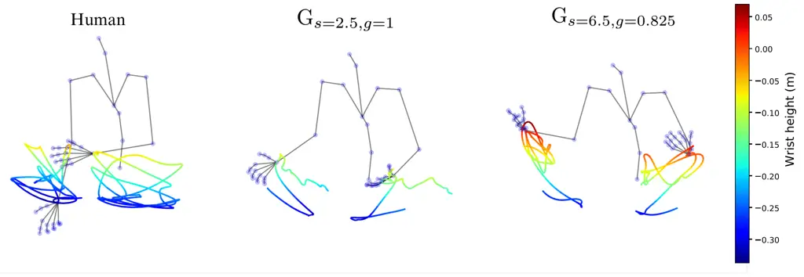

Figure 14: Example wrist trajectories for three stimuli used in the
Seamless-416 user study with different CFG configurations. Left: Human
recording. Middle: Gesture sequence generated by setting
$`\gamma^{G}_{g}=1`$, $`\gamma^{G}_{s}=2.5`$. Right: Gesture sequence
generated by setting $`\gamma^{G}_{g}=0.825`$, $`\gamma^{G}_{s}=6.5`$.
Reducing $`\gamma^{G}_{g}`$ while increasing $`\gamma^{G}_{s}`$
increases the amplitude and variability of the generated gestures.

## References

- \[1\] V. Agrawal et al. (2025) Seamless interaction: dyadic
  audiovisual motion modeling and large-scale dataset. Cited by: §11.2,
  §4.
- \[2\] M. Bain, J. Huh, T. Han, and A. Zisserman (2023) WhisperX:
  time-accurate speech transcription of long-form audio. In 24th Annual
  Conference of the International Speech Communication Association
  (INTERSPEECH 2023), pp. 3994–3998. External Links:
  [Document](https://dx.doi.org/10.21437/Interspeech.2023-188),
  [Link](https://www.isca-archive.org/interspeech_2023/bain23_interspeech.html)
  Cited by: §11.2, §13.5.
- \[3\] Z. Borsos, R. Marinier, D. Vincent, E. Kharitonov, O.
  Pietquin, M. Sharifi, D. Roblek, O. Teboul, D. Grangier, M.
  Tagliasacchi, and N. Zeghidour (2023) AudioLM: a language modeling
  approach to audio generation. IEEE/ACM Trans. Audio, Speech and Lang.
  Proc. 31, pp. 2523–2533. External Links: ISSN 2329-9290,
  [Link](https://doi.org/10.1109/TASLP.2023.3288409),
  [Document](https://dx.doi.org/10.1109/TASLP.2023.3288409) Cited by:
  §2.
- \[4\] R. Chen, M. Shi, S. Huang, P. Tan, T. Komura, and X. Chen (2024)
  Taming diffusion probabilistic models for character control. In
  SIGGRAPH, Cited by: §2.
- \[5\] S. Chen, C. Wang, Z. Chen, Y. Wu, S. Liu, Z. Chen, J. Li, N.
  Kanda, T. Yoshioka, X. Xiao, J. Wu, L. Zhou, S. Ren, Y. Qian, Y.
  Qian, J. Wu, M. Zeng, X. Yu, and F. Wei (2022) WavLM: Large-Scale
  Self-Supervised Pre-Training for Full Stack Speech Processing. IEEE
  Journal of Selected Topics in Signal Processing 16 (6), pp. 1505–1518.
  External Links:
  [Document](https://dx.doi.org/10.1109/JSTSP.2022.3188113) Cited by:
  §4.
- \[6\] S. Chen, C. Wang, Y. Wu, Z. Zhang, L. Zhou, S. Liu, Z. Chen, Y.
  Liu, H. Wang, J. Li, L. He, S. Zhao, and F. Wei (2025) Neural Codec
  Language Models are Zero-Shot Text to Speech Synthesizers. IEEE
  Transactions on Audio, Speech and Language Processing 33 (),
  pp. 705–718. External Links:
  [Document](https://dx.doi.org/10.1109/TASLPRO.2025.3530270) Cited by:
  §2.
- \[7\] K. Crnek (2026) UM-FERI approach to GENEA challenge 2026. Note:
  Non-archival paper, to appear in the Interactive Social Agents
  Workshop at ECCV 2026 Cited by: §14.4, §4.
- \[8\] F. Fang, Y. Lu, Q. Bao, and X. Liu (2026) DyaSync: disentangling
  speech identity and activity for dyadic co-speech gesture generation.
  Note: Non-archival paper, to appear in the Interactive Social Agents
  Workshop at ECCV 2026 Cited by: §14.4, §4.
- \[9\] T. Guichoux, T. Lemerle, S. Mehta, J. Beskow, G. E. Henter, L.
  Soulier, C. Pelachaud, and N. Obin (2026) Gelina: unified speech and
  gesture synthesis via interleaved token prediction. In ICASSP 2026 -
  2026 IEEE International Conference on Acoustics, Speech and Signal
  Processing (ICASSP), Vol. , pp. 16122–16126. External Links:
  [Document](https://dx.doi.org/10.1109/ICASSP55912.2026.11464562) Cited
  by: §12.2, §2, §2, §3.2.
- \[10\] J. Guillen (2026) GestFlow: a small flow-matching system for
  the GENEA challenge 2026. In Proceedings of the European Conference on
  Computer Vision (ECCV) Workshops, Note: To appear Cited by: §14.4, §4.
- \[11\] G. E. Henter, S. Alexanderson, and J. Beskow (2020) MoGlow:
  probabilistic and controllable motion synthesis using normalising
  flows. ACM Trans. Graph. 39 (6). External Links: ISSN 0730-0301,
  [Link](https://doi.org/10.1145/3414685.3417836),
  [Document](https://dx.doi.org/10.1145/3414685.3417836) Cited by: §2.
- \[12\] G. Ke and H. Xue (2026) Hyperspherical latents improve
  continuous-token autoregressive generation. In International
  Conference on Learning Representations (ICLR), Cited by: §12.2, §3.3.
- \[13\] A. Kendon (1980) Gesticulation and speech: two aspects of the
  process of utterance. In Nonverbal Communication and Language, M. R.
  Key (Ed.), pp. 207–227. Cited by: §1.
- \[14\] A. Kendon (1997) Gesture. Annual Review of Anthropology 26
  (Volume 26, 1997), pp. 109–128. External Links:
  [Document](https://dx.doi.org/https%3A//doi.org/10.1146/annurev.anthro.26.1.109),
  [Link](https://www.annualreviews.org/content/journals/10.1146/annurev.anthro.26.1.109),
  ISSN 1545-4290 Cited by: §1.
- \[15\] T. Kucherenko, P. Jonell, S. van Waveren, G. E. Henter, S.
  Alexanderson, I. Leite, and H. Kjellström (2020) Gesticulator: a
  framework for semantically-aware speech-driven gesture generation. In
  Proceedings of the 2020 International Conference on Multimodal
  Interaction, ICMI ’20, New York, NY, USA, pp. 242–250. External Links:
  ISBN 9781450375818, [Link](https://doi.org/10.1145/3382507.3418815),
  [Document](https://dx.doi.org/10.1145/3382507.3418815) Cited by: §2.
- \[16\] T. Kucherenko, R. Nagy, Y. Yoon, J. Woo, T. Nikolov, M. Tsakov,
  and G. E. Henter (2023) The GENEA challenge 2023: a large-scale
  evaluation of gesture generation models in monadic and dyadic
  settings. In Proceedings of the 25th International Conference on
  Multimodal Interaction, pp. 792–801. External Links:
  [Document](https://dx.doi.org/10.1145/3577190.3616120) Cited by: §4.
- \[17\] T. Lemerle, D. Torres, T. Guichoux, N. Obin, and A.
  Roebel (2026) Low-Framerate Speech Tokenization via Two-Stage Latent
  Patch Modeling. In Interspeech 2026, pp. 3971–3976. External Links:
  [Document](https://dx.doi.org/10.21437/Interspeech.2026-2863), ISSN
  2958-1796 Cited by: §12.1, §3.1.
- \[18\] T. Lemerle, D. A. Torres Guarin, T. Guichoux, N. Obin, and A.
  Roebel (2026) Unbounded streaming text-to-speech with prefixed sliding
  window attention. In The Fortieth Annual Conference on Neural
  Information Processing Systems, Note: Accepted at NeurIPS 2026
  External Links: [Link](https://openreview.net/forum?id=sVwnrFCMYb)
  Cited by: §3.3, §3.3.
- \[19\] R. Li, S. Yang, D. A. Ross, and A. Kanazawa (2021) AI
  Choreographer: music conditioned 3D dance generation with AIST++. In
  Proc. ICCV, Cited by: §4.
- \[20\] T. Li, Y. Tian, H. Li, M. Deng, and K. He (2024) Autoregressive
  image generation without vector quantization. In The Thirty-eighth
  Annual Conference on Neural Information Processing Systems, External
  Links: [Link](https://openreview.net/forum?id=VNBIF0gmkb) Cited by:
  §2.
- \[21\] H. Liu, Z. Zhu, G. Becherini, Y. Peng, M. Su, Y. Zhou, X.
  Zhe, N. Iwamoto, B. Zheng, and M. J. Black (2024) EMAGE: towards
  unified holistic co-speech gesture generation via expressive masked
  audio gesture modeling. In Proceedings of the IEEE/CVF Conference on
  Computer Vision and Pattern Recognition (CVPR), pp. 1144–1154. Cited
  by: §2, §4.
- \[22\] N. Liu, S. Li, Y. Du, A. Torralba, and J. B. Tenenbaum (2022)
  Compositional visual generation with composable diffusion models. In
  Computer Vision–ECCV 2022: 17th European Conference, Tel Aviv, Israel,
  October 23–27, 2022, Proceedings, Part XVII, pp. 423–439. Cited by:
  §1.
- \[23\] D. McNeillU. of Chicago Press (Ed.) (1992) Hand and mind: what
  gestures reveal about thought. Cited by: §1.
- \[24\] S. Mehta, R. Tu, S. Alexanderson, J. Beskow, É. Székely,
  and G. E. Henter (2024) Unified speech and gesture synthesis using
  flow matching. In Proc. ICASSP, pp. 8220–8224. External Links:
  [Document](https://dx.doi.org/10.1109/ICASSP48485.2024.10445998) Cited
  by: §2.
- \[25\] S. Mehta, S. Wang, S. Alexanderson, J. Beskow, É. Székely,
  and G. E. Henter (2023) Diff-TTSG: Denoising probabilistic integrated
  speech and gesture synthesis. In Proc. ISCA Speech Synthesis Workshop
  (SSW), pp. 150–156. External Links:
  [Document](https://dx.doi.org/10.21437/SSW.2023-24) Cited by: §2.
- \[26\] M. H. Mughal, R. Dabral, V. Demberg, and C. Theobalt (2026)
  MIBURI: towards expressive interactive gesture synthesis. In Computer
  Vision and Pattern Recognition (CVPR), Cited by: §11.3, §2.
- \[27\] K. Nagano, H. Liu, S. Park, T. Li, A. Mazumdar, C. Jacobsen, S.
  Wang, M. Stengel, R. Roy, K. C. Cheung, S. See, and S. De Mello (2026)
  DyaPlex: full-duplex speech-motion model for dyadic interaction. In
  Advances in Neural Information Processing Systems, Cited by: §2.
- \[28\] R. Nagy, S. Arellano García, H. Voss, M. Tsakov, T.
  Kucherenko, Y. Yoon, and G. E. Henter (2026) The GENEA challenge 2026:
  a large-scale disentangled evaluation of speech-driven gesture
  generation on the seamless interaction dataset. arXiv preprint
  arXiv:2608.10839. External Links: 2608.10839 Cited by: §1, §14.4, §4,
  §4, §5.1.1.
- \[29\] R. Nagy, T. Kucherenko, B. Moell, A. Pereira, H. Kjellström,
  and U. Bernardet (2021) A framework for integrating gesture generation
  models into interactive conversational agents. In Proceedings of the
  20th International Conference on Autonomous Agents and MultiAgent
  Systems, AAMAS ’21, Richland, SC, pp. 1779–1781. External Links: ISBN
  9781450383073 Cited by: §1.
- \[30\] E. Ng, J. Romero, T. Bagautdinov, S. Bai, T. Darrell, A.
  Kanazawa, and A. Richard (2024) From audio to photoreal embodiment:
  synthesizing humans in conversations. In IEEE Conference on Computer
  Vision and Pattern Recognition, Cited by: §4.
- \[31\] S. Nyatsanga, T. Kucherenko, C. Ahuja, G. E. Henter, and M.
  Neff (2023) A comprehensive review of data‐driven co‐speech gesture
  generation. Computer Graphics Forum 42 (2), pp. 569–596. External
  Links: ISSN 1467-8659, [Link](http://dx.doi.org/10.1111/cgf.14776),
  [Document](https://dx.doi.org/10.1111/cgf.14776) Cited by: §2.
- \[32\] Z. Peng, J. Yu, W. Wang, Y. Chang, Y. Sun, L. Dong, Y. Zhu, W.
  Xu, H. Bao, Z. Wang, S. Huang, Y. Xia, and F. Wei (2026) VibeVoice:
  expressive podcast generation with next-token diffusion. In The
  Fourteenth International Conference on Learning Representations,
  External Links: [Link](https://openreview.net/forum?id=FihSkzyxdv)
  Cited by: §2, §3.2.
- \[33\] S. Rouard, Y. Adi, J. Copet, A. Roebel, and A. Défossez (2024)
  Audio Conditioning for Music Generation via Discrete Bottleneck
  Features. In ISMIR 2024, San Francisco California, United States.
  External Links: [Link](https://hal.science/hal-04928259) Cited by: §1,
  §3.3.
- \[34\] S. Rouard, M. Orsini, A. Roebel, N. Zeghidour, and A.
  Défossez (2026) Continuous audio language models. In The Fourteenth
  International Conference on Learning Representations, External Links:
  [Link](https://openreview.net/forum?id=MFrJ3NzA5H) Cited by: §2, §3.3,
  §4.
- \[35\] T. Saeki, D. Xin, W. Nakata, T. Koriyama, S. Takamichi, and H.
  Saruwatari (2022) UTMOS: UTokyo-SaruLab System for VoiceMOS Challenge 2022. In Proc. Interspeech 2022, pp. 4526–4530. External Links:
  [Document](https://dx.doi.org/10.21437/Interspeech.2022-1090),
  [Link](https://www.isca-speech.org/archive/interspeech_2022/saeki22c_interspeech.html)
  Cited by: §4.
- \[36\] J. I. G. Sanchez and P. D. P. Costa (2026) A unified
  flow-matching DiT with direct continuous decoding for co-speech
  gesture generation. In Proceedings of the European Conference on
  Computer Vision (ECCV) Workshops, Note: To appear Cited by: §14.4, §4.
- \[37\] Y. Sun, H. Bao, W. Wang, Z. Peng, L. Dong, S. Huang, Y.
  Chang, J. Wang, and F. Wei (2026) Multimodal latent language modeling
  with next-token diffusion. In Forty-third International Conference on
  Machine Learning, External Links:
  [Link](https://openreview.net/forum?id=PnTXyTR2VG) Cited by: §12.2,
  §2, §2, §3.2, §3.3.
- \[38\] A. Turetzky, A. Dekel, N. Shabtay, S. Shechtman, D. Haws, H.
  Aronowitz, R. Hoory, and Y. Adi (2025) Speech synthesis from
  continuous features using per-token latent diffusion. In 2025 IEEE
  Automatic Speech Recognition and Understanding Workshop (ASRU), Vol. ,
  pp. 1–8. External Links:
  [Document](https://dx.doi.org/10.1109/ASRU65441.2025.11434698) Cited
  by: §2.
- \[39\] A. van den Oord, O. Vinyals, and K. Kavukcuoglu (2017) Neural
  discrete representation learning. In Proceedings of the 31st
  International Conference on Neural Information Processing Systems,
  NIPS’17, Red Hook, NY, USA, pp. 6309–6318. External Links: ISBN
  9781510860964 Cited by: §2.
- \[40\] P. Wagner, Z. Malisz, and S. Kopp (2014) Gesture and speech in
  interaction: an overview. Speech Communication 57, pp. 209–232.
  External Links: ISSN 0167-6393,
  [Document](https://dx.doi.org/10.1016/j.specom.2013.09.008),
  [Link](https://www.sciencedirect.com/science/article/pii/S0167639313001295)
  Cited by: §1.
- \[41\] S. Wang, S. Alexanderson, J. Gustafson, J. Beskow, G. E.
  Henter, and É. Székely (2021) Integrated speech and gesture synthesis.
  In Proceedings of the 2021 International Conference on Multimodal
  Interaction, ICMI ’21, New York, NY, USA, pp. 177–185. External Links:
  ISBN 9781450384810, [Link](https://doi.org/10.1145/3462244.3479914),
  [Document](https://dx.doi.org/10.1145/3462244.3479914) Cited by: §2.
- \[42\] S. Wang, W. Yu, T. Chiba, X. Chen, X. Tian, J. Zhang, L. Lu,
  and C. Zhang (2026) Full-duplex interaction with speech, expressions
  and gestures. External Links: 2610.21452,
  [Link](https://arxiv.org/abs/2610.21452) Cited by: §2.
- \[43\] L. Xiao, S. Lu, H. Pi, K. Fan, L. Pan, Y. Zhou, Z. Feng, X.
  Zhou, S. Peng, and J. Wang (2025) MotionStreamer: streaming motion
  generation via diffusion-based autoregressive model in causal latent
  space. In Proceedings of the IEEE/CVF International Conference on
  Computer Vision (ICCV), pp. 10086–10096. Cited by: §2.
- \[44\] S. Yang, B. Wang, Y. Shen, R. Panda, and Y. Kim (2024) Gated
  linear attention transformers with hardware-efficient training. In
  Proceedings of the 41st International Conference on Machine Learning,
  ICML’24. Cited by: §3.2.
- \[45\] H. Yi, H. Liang, Y. Liu, Q. Cao, Y. Wen, T. Bolkart, D. Tao,
  and M. J. Black (2023) Generating holistic 3d human motion from
  speech. In IEEE Conference on Computer Vision and Pattern Recognition
  (CVPR), pp. 469–480. Cited by: §2.
- \[46\] Y. Yoon, B. Cha, J. Lee, M. Jang, J. Lee, J. Kim, and G.
  Lee (2020) Speech gesture generation from the trimodal context of
  text, audio, and speaker identity. ACM Transactions on Graphics 39
  (6). Cited by: §4.
- \[47\] Y. Zhou, C. Barnes, J. Lu, J. Yang, and H. Li (2019) On the
  continuity of rotation representations in neural networks. In 2019
  IEEE/CVF Conference on Computer Vision and Pattern Recognition (CVPR),
  Vol. , pp. 5738–5746. External Links:
  [Document](https://dx.doi.org/10.1109/CVPR.2019.00589) Cited by:
  §11.2, §4.
