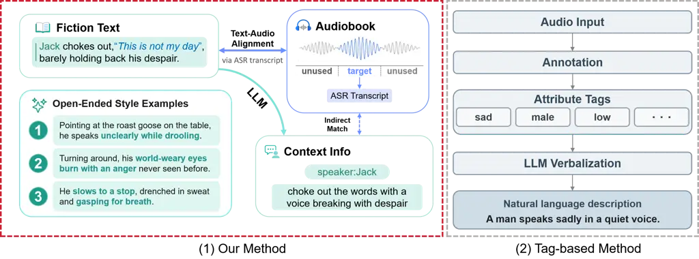
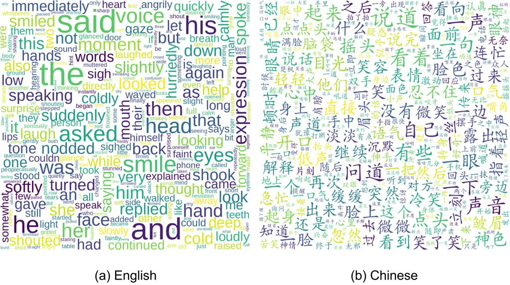
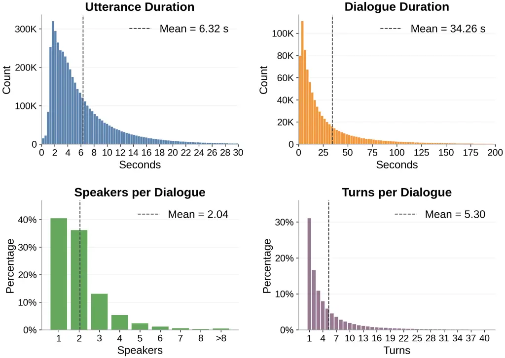
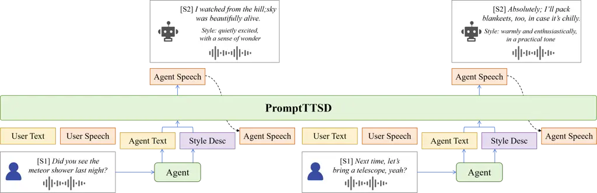

# PromptTTSD: Controllable Text to Spoken Dialogue Synthesis with Open-Ended Text Descriptions

Sulong Yang    Zhi Zeng\corresponding    Xiupeng Wu    Juewen Hu   
Pring Wong    Shuwu Zhang\corresponding    Shuo Chen\corresponding

###### Abstract

Spoken dialogue synthesis aims to generate multi-turn conversational
speech from dialogue scripts while maintaining speaker consistency and
contextual appropriateness. However, existing models largely lack
fine-grained controllability, which is critical for capturing the
dynamic, context-dependent style shifts in natural conversations. While
prompt-based TTS has enabled such control for single-speaker speech,
existing datasets heavily rely on predefined tags, which fundamentally
limits their capacity to capture open-ended styles. To address this gap,
we propose a scalable pipeline for extracting conversational speech from
multi-narrator audiobooks, featuring an improved two-stage alignment
algorithm to preserve dialogue continuity, paired with LLM-based
extraction of style descriptions directly from narrative text. We
release PromptDialog, a large-scale multi-speaker conversational speech
dataset comprising 8,383 hours of Chinese speech and 120 hours of
English speech, with open-ended style descriptions for 79% of
utterances. We further introduce PromptTTSD, a spoken dialogue synthesis
model built via a prompt-aware fine-tuning strategy that integrates
style prompts into text–speech interleaved sequences. PromptTTSD is an
open-source spoken dialogue synthesis model that supports both zero-shot
voice cloning and natural language style control. Experiments
demonstrate that PromptTTSD not only maintains strong fundamental
synthesis capabilities but also achieves competitive open-ended style
control compared with proprietary models, and substantially improves
contextual appropriateness in multi-turn dialogues.

¹Beijing University of Posts and Telecommunications

²National Key Laboratory of General Artificial Intelligence, BIGAI

Demo — attr /Border \[0 0 0\] user /Subtype /Link /A \<\< /S /URI /URI
(https://huggingface.co/spaces/alphappp/PromptDialog-demo)
\>\>https://huggingface.co/spaces/alphappp/PromptDialog-demo

Dataset — attr /Border \[0 0 0\] user /Subtype /Link /A \<\< /S /URI
/URI (https://huggingface.co/datasets/alphappp/PromptDialog-v1)
\>\>https://huggingface.co/datasets/alphappp/PromptDialog-v1

Code — attr /Border \[0 0 0\] user /Subtype /Link /A \<\< /S /URI /URI
(https://github.com/bigai-ai/PromptTTSD)
\>\>https://github.com/bigai-ai/PromptTTSD

## Introduction

Spoken dialogue synthesis aims to generate natural multi-speaker
conversations from written dialogue scripts while maintaining speaker
consistency and contextual appropriateness. Recent systems have made
substantial progress in long-form generation, speech quality and speaker
consistency (Peng et al. 2025; Xie et al. 2025a). However, existing
systems largely lack fine-grained controllability. Such control is
particularly important in dialogue synthesis, where speaking behavior
depends not only on textual content but also on the conversational
context. An inappropriate speaking style can disrupt the emotional
coherence of an interaction. For example, a cheerful delivery in a
conversation about bereavement would be incongruous with the underlying
scenario.

Natural language control offers a promising solution to this limitation.
Existing prompt-based TTS systems have demonstrated that speaking
behavior can be controlled through textual descriptions, but such
control has been explored primarily in single-speaker synthesis (Du et
al. 2024a; Hu et al. 2026; Guo et al. 2023b). Moreover, descriptions in
existing expressive speech datasets are typically constructed from
predefined tags obtained through external tools or human annotation.
These tags are then verbalized into descriptions by large language
models (LLMs), as illustrated in Fig. 1 (2). Consequently, existing
methods remain closed-ended, as their descriptions are restricted to
predefined speaking styles. They therefore fail to capture open-ended
styles arising from facial expressions, physical actions, compound
emotions, and special speaker states, as illustrated by the open-ended
examples in Fig. 1 (1). Such nuanced behaviors are difficult to identify
reliably using external tools.



Figure 1: Comparison of pipelines for constructing speech datasets with
natural-language descriptions. In (1), the open-ended examples are drawn
from our dataset, and the bold text highlights open-ended style elements
that are difficult for external tools to annotate.

To address this bottleneck, we first build a dialogue synthesis dataset
by using multi-narrator audiobooks as a naturally rich yet underutilized
source of conversational speech. Specifically, our key insight is that
voice acting in these audiobooks is highly expressive and closely
matches the open-ended descriptions associated with the corresponding
dialogue in the source books. To leverage this resource, the audiobook
recordings must be aligned with original books, so that each speech
segment can be paired with its transcript and narrative context.
LibriHeavy (Kang et al. 2024) provides a strong foundation for such
audio–-text alignment. However, reliably aligning long-form audiobook
recordings with their original books at utterance level without
disrupting the continuity of multi-turn dialogues remains a severe
challenge. To overcome this, we propose a robust, context-aware
alignment algorithm that effectively recovers incomplete utterance
boundaries and preserves dialogue continuity.

Based on the aligned audio–text pair, we further use an LLM to extract
descriptions and speaker identities from the matched source text, as
illustrated in Fig. 1 (1). Using this pipeline, we construct
PromptDialog, a large-scale multi-speaker conversational speech dataset,
comprising 8,383 hours of Chinese speech and 120 hours of English
speech. Every utterance is paired with a speaker identity, and 79% of
the utterances are annotated with a textual description.

Furthermore, to bridge the gap between open-ended textual descriptions
and expressive dialogue generation, we introduce PromptTTSD. Rather than
relying on simple tag embeddings, we propose a description-aware tuning
framework that effectively integrates natural language descriptions into
interleaved text–speech representations. We further evaluate open-ended
style control and description-conditioned conversational speech
synthesis. Results show that PromptTTSD achieves comparable performance
on standard TTS metrics. For open-ended style control, it is competitive
with proprietary models and outperforms existing open-source systems.
For conversational speech synthesis, conditioning on descriptions leads
to better contextual appropriateness.

Our main contributions are summarized as follows:

- •
  We propose the pipeline for constructing natural-language-annotated
  conversational speech datasets, built on a robust and efficient
  alignment algorithm that produces naturally aligned
  text–speech–description triplets from audiobooks and their source
  fiction texts.
- •
  We release PromptDialog, a large-scale multi-speaker conversational
  speech dataset annotated with natural language descriptions,
  comprising 8,383 hours of Chinese speech and 120 hours of English
  speech.
- •
  We introduce PromptTTSD, an open-source spoken dialogue synthesis
  model that supports natural language control. PromptTTSD performs
  competitively with proprietary models in evaluations of open-ended
  control. Separately, in dialogue synthesis, conditioning on
  descriptions substantially improves contextual appropriateness.

## Related Work

### Expressive Text-to-Speech

Expressive TTS can be broadly categorized into three paradigms: control
via discrete tags, control via reference speech, and control via natural
language instructions. Lee et al. (2017) leverage emotion tags to
control the affective quality of synthesized speech, while Guo et al.
(2023a) further introduce intensity control on top of emotion tags. Li
et al. (2021) achieve emotion cloning through reference audio. However,
both tag-based and reference-based control lack flexibility and
expressiveness. To address this limitation, several studies have
explored natural-language control (Guo et al. 2023b; Leng et al. 2023;
Shimizu et al. 2024; Yang et al. 2024). Du et al. (2024a); Du et al.
(2024b); Du et al. (2025) and Hu et al. (2026) adopt LLM-based
architectures and large-scale speech corpora, substantially advancing
natural language control over speaking styles. However, their datasets
are not publicly released, making their data construction and training
pipelines difficult to reproduce.

### Multi-Speaker Conversational Speech Synthesis

Nguyen et al. (2023) were the first to employ a dual-tower Transformer
for text-free spoken dialogue synthesis. Zhang et al. (2024) achieve
spoken dialogue synthesis with natural overlapping turns. Ju et al.
(2025) were the first to adopt an LLM as the backbone of a spoken
dialogue synthesis model that supports up to four speakers. Peng et al.
(2025) introduce a continuous speech tokenizer, supporting long-form
audio synthesis of up to 90 minutes. Xie et al. (2025a) incorporate
dialect and paralinguistic tags to generate more natural and
personalized podcast speech. Despite this progress, existing
multi-speaker spoken dialogue synthesis systems have largely been
limited to tag-level control, whereas utterance-level control through
natural language descriptions remains underexplored. This limits their
ability to specify diverse, context-dependent speaking styles in
conversational speech.

### Natural Language Stylistic Datasets

| Dataset                         | Dataset Scale   |        |            | Dataset Properties |                    |                 |
| ------------------------------- | --------------- | ------ | ---------- | ------------------ | ------------------ | --------------- |
|                                 | Duration        | Clips  | Speakers   | Speech Type        | Description Source | Open Source     |
| NLSpeech (Yang et al. 2024)     | 44h             | –      | 7          | Monologue          | 2 labels           | $`\times`$      |
| PromptSpeech (Guo et al. 2023b) | –               | 28k    | –          | Monologue          | 5 labels           | $`Partial_{1}`$ |
| PromptTTS 2 (Leng et al. 2023)  | –               | 20k    | –          | Monologue          | 4 labels           | $`\times`$      |
| TextrolSpeech (Ji et al. 2024)  | 330h            | 236k   | 1,324      | Monologue          | 5 labels           | $`\checkmark`$  |
| SpeechCraft (Jin et al. 2024)   | 2,391h          | 2,250k | $`>`$3,200 | Monologue          | 8 labels           | $`\checkmark`$  |
| SpeechCaps (Huang et al. 2025)  | –               | –      | 4          | Dialogue           | 5 labels           | $`Partial_{2}`$ |
| DNASpeech (Cheng et al. 2025)   | 18h             | 22k    | 2,395      | Monologue          | Movie scripts      | $`\checkmark`$  |
| PromptDialog (ours)             | 8,503 (6,859) h | 4,769k | $`>`$1,000 | Dialogue           | Fiction texts      | $`\checkmark`$  |

Table 1: Comparison of stylistic speech datasets. For PromptDialog, the
value in parentheses indicates the duration of utterances with non-empty
descriptions. Partial₁ indicates that approximately 15% of the corpus is
publicly released. Partial₂ indicates that only the text is publicly
released, while the audio is not publicly available.

Guo et al. (2023b); Leng et al. (2023); Shimizu et al. (2024); Guan et
al. (2024); Yang et al. (2024); Ji et al. (2024); Jin et al. (2024)
derive predefined attributes of speech through manual annotation or
automatic recognition. These attributes are then verbalized into prompts
with LLMs. Despite differences in annotation strategy and granularity,
the semantic scope of each description is constrained by a predefined
schema. Such descriptions therefore provide limited coverage of
attributes beyond the selected inventory. Huang et al. (2025) extend
this paradigm to multi-speaker speech by combining synthesized
single-speaker speech into conversations. Leveraging movie scripts,
Cheng et al. (2025) obtained both natural language descriptions and
dialogue context, with the descriptions moving beyond conventional
tag-based annotation schemes. However, the dialogue context is provided
only in textual form, so the dataset cannot serve as a multi-speaker
conversational speech dataset. Comparison between stylistic speech
datasets is shown in Tab. 1.


Figure 2: Examples of partial speech alignment errors produced by the
LibriHeavy alignment pipeline.

## Dataset

### Data Collection

We focus on multi-narrator audiobooks, where different characters in
dialogue can be distinguished by their voices without narration. Unlike
conventional read-aloud audiobooks, these productions resemble
television dramas without the visual component, combining narration with
acted dialogue and rich vocal expression.

We searched YouTube for audiobooks that met these criteria and obtained
the corresponding books from legitimate online sources. In total, we
collected 107 Chinese audiobooks and 20 English audiobooks, yielding
8,383 hours of Chinese dialogue speech and 120 hours of English dialogue
speech. English audiobooks are generally shorter than Chinese
audiobooks, so collecting English data required substantially more
manual effort. We plan to expand the English portion of the dataset in
future work.

### Audio Alignment

LibriHeavy provides an efficient pipeline for aligning audiobooks with
their original books. However, as illustrated in Fig. 2, LibriHeavy
often fails to align utterance prefixes or suffixes affected by deletion
or substitution errors, even when the remaining content can be correctly
matched. Such partial matches can be removed by filtering when
constructing independent speech segments, but removing even a single
utterance can reduce the continuity and semantic coherence of a
multi-turn dialogue. We therefore propose a two-stage alignment method
that incorporates contextual boundary expansion and directly aligns
automatic transcripts with full-length book texts without text
segmentation.

##### Text processing.

For automatic speech recognition (ASR), we use Whisper-large-v3 (Radford
et al. 2023) for English audiobooks and Paraformer-zh (Gao et al. 2023)
for Chinese audiobooks. We normalize the original fiction texts before
subsequent processing. Specifically, for English, we follow the
text-normalization procedure adopted by LibriHeavy. For Chinese, we
first apply the FunASR text normalizer and then convert the normalized
text into tone-stripped Pinyin tokens. The latter representation reduces
mismatches caused by homophonic substitutions in the automatic
transcripts.

##### Stage 1: Anchor-based alignment.

Let $`Q=(q_{1},\ldots,q_{M})`$ denote the full token sequence of the
original book, and let $`T=(t_{1},\ldots,t_{N})`$ denote the full token
sequence of the timestamped ASR transcript for the corresponding
audiobook. Following the close-match strategy of LibriHeavy, we
construct a suffix array over $`T`$ and use quoted-text spans
$`Q_{i:j}=(q_{i},\ldots,q_{j})`$ as queries to retrieve candidate
locations in the target transcript.

A verified alignment is represented by an anchor $`a=(i,j,m,n)`$,
indicating that the quoted-text span $`Q_{i:j}`$ is aligned with the ASR
span $`T_{m:n}=(t_{m},\ldots,t_{n})`$.

The anchors are maintained in monotonic order. For two adjacent anchors,

```math
\displaystyle a_{k} \displaystyle=(i_{k},j_{k},m_{k},n_{k}),
```

```math
\displaystyle a_{k+1} \displaystyle=(i_{k+1},j_{k+1},m_{k+1},n_{k+1}),
```

we require

```math
\displaystyle j_{k} \displaystyle<i_{k+1},
```

```math
\displaystyle n_{k} \displaystyle<m_{k+1}.
```

A query span located between these anchors is searched only within the
corresponding interval of the target transcript,

```math
T_{n_{k}+1:m_{k+1}-1}.
```

At initialization, two anchors are placed at the boundaries of the query
and target sequences:

```math
\begin{gathered}a_{0}=(0,0,0,0),\\
a_{K+1}=(M+1,M+1,N+1,N+1).\end{gathered}
```

where $`K`$ is the number of verified anchors. Consequently, the first
candidate search covers the entire target transcript, whereas subsequent
searches are progressively restricted by newly verified anchors. This
allows the quoted dialogue to be aligned directly with the full-length
automatic transcript without prior segmentation of the transcript.

Candidate query spans are processed in descending order of length.
Longer spans typically yield fewer candidate locations that satisfy the
matching criterion, thereby reducing the number of candidates that need
to be verified.

For each candidate alignment $`\bigl(Q_{i:j},T_{m:n}\bigr)`$, where
$`Q_{i:j}`$ is a quoted-text query span and $`T_{m:n}`$ is a retrieved
candidate span in the ASR transcript, we compute their token-level
Levenshtein distance (Levenshtein and others 1966), denoted by
$`d_{\mathrm{lev}}\bigl(Q_{i:j},T_{m:n}\bigr)`$.

Let

```math
\ell=\max\bigl(|Q_{i:j}|,|T_{m:n}|\bigr)
```

denote the maximum length of the two spans. The candidate alignment is
accepted if

```math
d_{\mathrm{lev}}\bigl(Q_{i:j},T_{m:n}\bigr)\leq\tau(\ell),
```

where

```math
\tau(\ell)=\begin{cases}0,&\ell\leq 9,\\[3.0pt]
\left\lfloor\ell/5\right\rfloor,&\ell>9.\end{cases}
```

An accepted candidate alignment is inserted into the anchor set, thereby
restricting the search intervals for subsequent shorter query spans.
Once the anchors are fixed, the search intervals bounded by different
pairs of adjacent anchors are independent, allowing candidate retrieval
and verification to be parallelized across multiple CPU cores.

##### Stage 2: Context-based alignment.

The first stage identifies reliable matching spans. However, an accepted
span may have incomplete boundaries when the prefix or suffix of the ASR
span contains deletion or substitution errors.

Given a candidate pair $`(C_{Q},C_{T})`$, we compute their longest
common subsequence (LCS), the longest sequence of tokens shared by both
spans in the same order, without requiring contiguity. We denote the
corresponding matched token positions by

```math
\mathcal{M}=\{(r_{1},z_{1}),\ldots,(r_{H},z_{H})\},
```

where $`H`$ is the number of matched token pairs, and $`r_{h}`$ and
$`z_{h}`$ are relative token indices in $`C_{Q}`$ and $`C_{T}`$,
respectively, satisfying

```math
\displaystyle r_{1}<\cdots<r_{H},
```

```math
\displaystyle z_{1}<\cdots<z_{H}.
```

We additionally calculate the length ratio

```math
\rho=\frac{\min(|C_{Q}|,|C_{T}|)}{\max(|C_{Q}|,|C_{T}|)}.
```

If both boundaries of the candidate are supported by corresponding
tokens in the other sequence and $`\rho>0.7`$, the candidate is regarded
as complete.

Otherwise, we estimate the amounts of unmatched content at the
boundaries from the first and last LCS matches:

```math
\delta_{\mathrm{L}}=\max(r_{1}-1,z_{1}-1),
```

```math
\delta_{\mathrm{R}}=\max(|C_{Q}|-r_{H},\;|C_{T}|-z_{H}).
```

We then construct left and right context windows with sizes

```math
\displaystyle w_{\mathrm{L}}=2\delta_{\mathrm{L}},
```

```math
\displaystyle w_{\mathrm{R}}=2\delta_{\mathrm{R}},
```

and search for additional correspondences in the surrounding query and
target contexts. Once reliable contextual matches are found, the
candidate boundaries are extended to the outermost matched context
positions.

The contextual matches serve as boundary evidence rather than requiring
every token within the expanded span to be recognized correctly.
Consequently, content in the quoted dialogue that is omitted or
incorrectly transcribed by ASR can still be retained within the aligned
query span when it lies between reliable contextual matches. This is
particularly useful for preserving paralinguistic vocalizations, such as
laughter and sighs, as well as acoustically similar words that are
incorrectly recognized by ASR.

### Dialogue Grouping and Description Extraction

We group quoted utterances into dialogue groups according to their
positions in the source text. Specifically, two consecutive quoted
utterances are assigned to the same group if they are separated by no
more than two intervening lines.

For each utterance, we define its description as a nearby narrative cue
that directly characterizes or informs how the utterance is spoken. Such
cues may describe emotion, tone, gesture, action, facial expression, or
other contextual information. In the prompts provided to the LLMs, we
instruct them to preserve the wording of the source text whenever
possible and to avoid unnecessary summarization or paraphrasing. If no
valid descriptive cue is available, the description is set to an empty
string.

Each dialogue group is represented as a JSON array, where each object
contains a quoted utterance and a corresponding description field. Based
on the speaker attribution results reported in Table 4, and considering
the inference cost of annotation, we select MiMo-v2.5 (Xiaomi MiMo Team 2026) and prompt it to complete the description field.

We subsequently perform consistency checks on the model output.
Specifically, we verify that the numbers of input and output items are
identical and that each output utterance corresponds exactly to its
input utterance. These checks prevent malformed responses and unintended
modifications to the source dialogue text from entering the dataset.

### Speaker Attribution

We obtain speaker identities directly from the source fiction using an
LLM. Since speaker attribution and description extraction rely on the
same dialogue context, we perform the two tasks jointly in a single
model call. Specifically, for each quoted utterance, the model is
required to complete both the speaker and description fields while
leaving the dialogue text unchanged.

Conventional pipelines (Zhu et al. 2026; Xie et al. 2025a) for
constructing multi-speaker conversational speech datasets typically rely
on voice activity detection (VAD) to segment speech and speaker
diarization to assign speaker labels. However, acoustic speaker
diarization remains challenging when the number and identities of
speakers are not known in advance. A recent benchmark of
state-of-the-art diarization systems reports that even the lowest
overall diarization error rate among the evaluated systems remains
$`11.2\%`$, achieved by PyannoteAI¹¹ 1 https://www.pyannote.ai/, with
missed speech and speaker confusion constituting the primary sources of
error (Lanzendörfer et al. 2025).

We therefore leverage the narrative context available in the original
book and prompt LLMs to infer the speaker of each quoted utterance. As
shown in Table 4, speaker information derived from the book text yields
substantially more accurate speaker labels than the acoustic baseline,
which relies on VAD and acoustic speaker clustering.

We further verify the assigned speaker labels using speaker embeddings
extracted with CAM++ (Wang et al. 2023). Utterances with low similarity
to their assigned speaker are compared with other speakers. When an
alternative speaker meets the similarity threshold, we provide the
similarity scores to Qwen3.8-27B (Qwen Team 2026) to determine whether
the label should be corrected. The verification thresholds and
additional refinement steps are detailed in the “Speaker Refinement”
section of the supplementary material.

## Experiments

### Dataset Evaluation

#### Alignment Quality.

| Method     | Sentence Match (%) $`\uparrow`$ | Word Match (%) $`\uparrow`$ |
| ---------- | ------------------------------- | --------------------------- |
| LibriHeavy | 71.39                           | 89.12                       |
| Ours       | 94.13                           | 94.38                       |

Table 2: Comparison of audio–text alignment methods on a manually
annotated evaluation set.

We evaluate alignment quality on 10 hours of audiobook data. For each
quoted utterance in the reference text, we use both methods to extract
the corresponding audio segment and transcribe it using the same ASR
model. For quoted utterances containing more than five words, an
extracted segment is automatically considered correct if its word error
rate is below 5% and its first and last words match those of the
reference utterance. Short utterances and samples that do not meet these
criteria are manually verified. We report sentence match rate and word
match rate as evaluation metrics.

As shown in Table 2, our method improves the sentence match rate from
71.39% to 94.13%, while also increasing the word match rate from 89.12%
to 94.38%. The larger improvement in sentence match rate indicates that
our method more reliably recovers complete quoted utterances, whereas
LibriHeavy often aligns only part of an utterance despite matching most
of its words.

#### Description Quality.

We randomly sampled 500 utterances for human evaluation. A description
was considered valid if it was non-empty, stylistically informative, and
consistent with the perceived speech. Generic descriptions such as
“said” were treated as invalid. Overall, 62% of the sampled utterances
contained valid descriptions. No substantive description contradicted
the speech; invalid cases were mainly missing or overly generic. We
report this figure as a reference estimate, since open-ended speech
descriptions cannot yet be evaluated reliably at scale.

#### Diversity of Style Descriptions.

To provide a more interpretable comparison of the expressive styles
captured by different datasets, we conduct a semantic analysis of
PromptDialog and SpeechCraft using an open vocabulary of style tags.
Specifically, we use Qwen3.8-27B (Qwen Team 2026) to extract tags from
both datasets following a unified protocol. For PromptDialog, we first
filter narrative contexts to retain information relevant to utterance
delivery, while dialogue text is used only to refine attributes
supported by the context. We then group semantically related tags using
text embeddings and clustering refined by an LLM, excluding groups
containing fewer than three tag entries. The resulting tags are
organized into seven categories for a detailed comparison of expressive
diversity. Further details are provided in the supplementary material.

| Category             | P     | S     | P-only | S-only |
| -------------------- | ----- | ----- | ------ | ------ |
| Facial expressions   | 714   | 123   | 597    | 6      |
| Vocal delivery       | 1,343 | 970   | 774    | 401    |
| Emotion/attitude     | 1,253 | 1,123 | 385    | 255    |
| Cognitive/verbal     | 662   | 315   | 380    | 33     |
| Physiological states | 238   | 108   | 141    | 11     |
| Mixed states         | 131   | 31    | 108    | 8      |
| Scene interactions   | 283   | 18    | 270    | 5      |
| Total                | 4,624 | 2,688 | 2,655  | 719    |

Table 3: Semantic tag diversity on equally sized samples (1,083,438
records per dataset). P and S denote PromptDialog and SpeechCraft.
P-only and S-only count tag types observed exclusively in the
corresponding dataset after semantic consolidation.

To control for corpus size, we compare equally sized samples of
1,083,438 records from each dataset. As shown in Table 3, PromptDialog
covers 4,624 retained tag types, versus 2,688 in SpeechCraft (72.0%
more), with 2,655 and 719 dataset-exclusive types, respectively. The
advantage is evident in vocal delivery (1,343 vs. 970) and
cognitive/verbal activities (662 vs. 315), and is particularly
pronounced for facial expressions (714 vs. 123). These results
demonstrate that PromptDialog descriptions cover a broader range of
expressive and contextual cues.

#### Speaker Attribution Quality.

To evaluate the reliability of LLM-based speaker attribution, we sample
100 dialogue segments from our dataset and compare it with a commercial
speaker diarization system. We use pyannoteAI Precision-2 (pyannoteAI 2025) as the speaker diarization baseline. We evaluate both methods only
on dialogue regions, excluding narration. Both methods are evaluated
using word-level speaker attribution error against the same manually
annotated ground truth. For LLM-based attribution, the predicted speaker
label is assigned to every word in that utterance. For speaker
diarization, the predicted speaker label of each word is obtained from
the diarization output. The error rate is the proportion of words
assigned to an incorrect speaker.

As shown in Table 4, LLM-based speaker attribution substantially
outperforms speaker diarization, suggesting that inferring speakers from
fiction text is more reliable than relying solely on acoustic
information for speaker diarization.

| Method                                   | Error Rate (%) $`\downarrow`$ |
| ---------------------------------------- | ----------------------------- |
| Speaker Diarization                      |                               |
| pyannoteAI Precision-2 (pyannoteAI 2025) | 8.70                          |
| LLM-based Speaker Attribution            |                               |
| GPT-5 (OpenAI 2025)                      | 0.29                          |
| Gemini 2.5 Pro (Google DeepMind 2025)    | 0.62                          |
| DeepSeek-v4-Pro (DeepSeek-AI 2026)       | 0.41                          |
| MiMo-v2.5 (Xiaomi MiMo Team 2026)        | 0.50                          |

Table 4: Comparison of speaker diarization and LLM-based speaker
attribution on target dialogue regions.

### Training Setup

We adopt SoulX-Podcast (Xie et al. 2025a), which does not natively
support natural language control, as the base model for controllable
spoken dialogue synthesis. Since its downstream conditional
flow-matching model and vocoder achieve high-quality speech
reconstruction, we freeze these components during training. We train
only the LLM backbone to learn the relationship between the textual
prompt and the target speech. The remaining training details are
described below.

##### Token Organization.

Following SoulX-Podcast, we retain the text–speech interleaved sequence
representation for sentence-by-sentence dialogue synthesis. In this
formulation, the text tokens of each utterance are followed by the
corresponding speech tokens, and utterances from different speakers are
concatenated in temporal order. Each utterance begins with a speaker
token indicating the speaker identity.

Unlike SoulX-Podcast, which inserts a dialect token after the speaker
token, we replace the dialect token with a sequence of natural language
prompt tokens that describe the intended speaking style. The resulting
dialogue sequence is organized as follows:

```math
\displaystyle\langle\mathrm{SPEAKER1}\rangle\langle\mathrm{Prompt}\rangle\langle\mathrm{Text}\rangle\langle\mathrm{Audio}\rangle
```

```math
\displaystyle\langle\mathrm{SPEAKER2}\rangle\langle\mathrm{Prompt}\rangle\langle\mathrm{Text}\rangle\langle\mathrm{Audio}\rangle
```

```math
\displaystyle\langle\mathrm{SPEAKER3}\rangle\cdots
```

##### Learning Objective.

To encourage the LLM backbone to capture the semantic information
conveyed by the style descriptions, we introduce an auxiliary text
prediction loss in addition to the original speech-token prediction
objective. The overall training objective is defined as

```math
\mathcal{L}_{\mathrm{total}}=\mathcal{L}_{\mathrm{speech}}+\lambda\mathcal{L}_{\mathrm{text}}, \tag{1}
```

where $`\mathcal{L}_{\mathrm{speech}}`$ denotes the speech loss,
$`\mathcal{L}_{\mathrm{text}}`$ denotes the auxiliary text loss, and
$`\lambda`$ is set to $`0.01`$. We examine this weight and the prompt
placement in the Ablation subsection.

##### Training Configuration.

We fine-tune the model for 6 epochs on 15 PPU-ZW810E GPUs using dynamic
batching. The model is optimized with AdamW. The learning rate follows a
warmup followed by cosine decay schedule, with a peak learning rate of
$`5\times 10^{-5}`$ and 2,500 warmup steps. Training is performed for
36k optimization steps in total.

|                                  |                             |                             |                    |                    |                    |
| -------------------------------- | --------------------------- | --------------------------- | ------------------ | ------------------ | ------------------ |
| Model                            | Subjective Metrics          |                             | Objective Metrics  |                    |                    |
|                                  | Style-CMOS $`\uparrow`$     | Q-MOS $`\uparrow`$          | UTMOS $`\uparrow`$ | SIM $`\uparrow`$   | CER $`\downarrow`$ |
| CosyVoice3 (Du et al. 2025)      | $`-0.273\pm 1.326`$         | $`4.173\pm 0.947`$          | $`3.164`$          | $`\mathbf{0.646}`$ | $`4.897`$          |
| MiMo-v2.5-TTS (Xiaomi MiMo 2026) | $`-0.993\pm 1.114`$         | $`3.760\pm 0.939`$          | $`3.179`$          | $`0.588`$          | $`\mathbf{3.973}`$ |
| PromptTTSD (seed-tts voice)      | $`\mathbf{0.000}`$          | $`\mathbf{4.520\pm 0.631}`$ | $`\mathbf{3.436}`$ | $`0.626`$          | $`5.039`$          |
| Eleven-v3 (ElevenLabs 2025)      | $`\mathbf{0.007\pm 1.298}`$ | $`4.600\pm 0.733`$          | $`3.247`$          | $`0.421`$          | $`8.555`$          |
| PromptTTSD (eleven voice)        | $`0.000`$                   | $`\mathbf{4.750\pm 0.591}`$ | $`\mathbf{3.390}`$ | $`\mathbf{0.662}`$ | $`\mathbf{5.515}`$ |

Table 5: Utterance-level open-ended style control results. Subjective
metrics are reported as mean $`\pm`$ standard deviation computed over
all individual ratings.

| Model              | CER $`\downarrow`$ | ACC $`\uparrow`$   | SIM $`\uparrow`$   | CA-MOS $`\uparrow`$       |
| ------------------ | ------------------ | ------------------ | ------------------ | ------------------------- |
| MOSS-TTSD          | $`4.85`$           | $`0.959`$          | $`0.795`$          | $`2.86\pm 0.85`$          |
| SoulX-Podcast      | $`4.29`$           | $`\mathbf{0.973}`$ | $`\mathbf{0.828}`$ | $`2.93\pm 0.87`$          |
| PromptTTSD         | $`\mathbf{3.76}`$  | $`0.969`$          | $`0.805`$          | $`3.06\pm 1.07`$          |
| PromptTTSD (Desc.) | $`4.30`$           | $`0.968`$          | $`0.803`$          | $`\mathbf{3.52\pm 0.95}`$ |

Table 6: Evaluation results on TTSD-ZH. MOSS-TTSD is proposed by  Zhang
et al. (2026). CA-MOS is reported as mean $`\pm`$ standard deviation
computed over all individual ratings.

### Model Evaluation Setup

We evaluate PromptTTSD from two complementary perspectives: style
controllability and dialogue synthesis. The controllability evaluation
compares PromptTTSD with existing prompt-based TTS systems in terms of
their ability to follow natural language descriptions. The dialogue
synthesis evaluation reports standard synthesis metrics and examines
whether explicit style descriptions improve contextual appropriateness.
Since our training corpus primarily consists of Chinese speech, all
evaluations are conducted in Chinese.

##### Style Controllability Evaluation.

We focus on open-ended style control, which evaluates the model’s
ability to follow complex natural-language style descriptions that are
difficult to assess using predefined labels.

Evaluation Data. We manually construct 50 concise style descriptions,
each paired with corresponding speech content. For each test case, we
additionally annotate the expected perceptual characteristics of the
generated speech to provide consistent guidelines for human evaluation.

Evaluation Metrics. We report both subjective and objective metrics.
Five native speakers participate in the subjective listening tests.
Human-perceived speech quality is evaluated using Q-MOS, while relative
adherence to the given style description is assessed using Style-CMOS.
For Style-CMOS, human evaluators compare two anonymized samples
presented in random order. They rate which sample better matches the
target description on a scale from $`-2`$ to $`+2`$. A score of $`+2`$
indicates a strong preference for the first sample, $`-2`$ indicates a
strong preference for the second, and $`0`$ indicates no preference. We
set PromptTTSD to $`0.00`$ and report each baseline relative to it.
Positive scores favor the baseline, while negative scores favor
PromptTTSD. We further report UTMOS (Saeki et al. 2022) as an automatic
estimate of speech quality. Speaker similarity (SIM) and character error
rate (CER) are computed using the official evaluation models released
with Seed-TTS-eval (Anastassiou et al. 2024).

Baselines. We compare PromptTTSD with CosyVoice3, MiMo-v2.5-TTS (Xiaomi
MiMo 2026), and Eleven-v3 (ElevenLabs 2025). CosyVoice3 serves as a
representative open-source baseline that supports both zero-shot voice
cloning and natural-language style control. MiMo-v2.5-TTS and Eleven-v3
are the latest proprietary TTS offerings from Xiaomi and ElevenLabs,
respectively, and provide expressive speech generation controlled
through textual style instructions or audio tags.

For CosyVoice3 and MiMo-v2.5-TTS, all systems use the same reference
speech selected from Seed-TTS-eval. For the comparison with Eleven-v3,
we use voices provided by ElevenLabs and condition PromptTTSD on the
corresponding voices to maintain a consistent speaker condition.

##### Dialogue Synthesis Evaluation.

We evaluate spoken dialogue synthesis on the TTSD-ZH benchmark (Zhang et
al. 2026), following its official evaluation protocol. We report
character error rate (CER) for content accuracy, speaker attribution
accuracy (ACC) for speaker assignment, and speaker similarity (SIM) for
speaker consistency.

Beyond these standard metrics, we investigate whether explicit
utterance-level natural-language style descriptions improve the
contextual appropriateness of synthesized dialogue. TTSD-ZH does not
provide style annotations. Therefore, for each utterance, GPT-5
generates a style description based on the utterance itself and its
surrounding dialogue context. These descriptions are used only as
conditioning inputs for PromptTTSD (Desc.), while the original
PromptTTSD synthesizes speech without descriptions.

Human evaluators are presented with the original dialogue context and
the corresponding synthesized utterance, and rate on a five-point scale
how appropriately the speech matches the conversational scenario. We
report the mean rating as Contextual Appropriateness MOS (CA-MOS). For
example, the synthesized speech should reflect an energetic and engaging
delivery in a game-commentary context, or an appropriately sorrowful
tone in a farewell scene. By comparing PromptTTSD with and without the
generated style descriptions, we assess whether explicit style guidance
improves the contextual appropriateness of dialogue synthesis.

### Results

##### Style Controllability Results.

Table 5 reports the results of open-ended style control. The results
demonstrate that PromptTTSD provides competitive open-ended style
controllability compared with both open-source and proprietary TTS
systems. PromptTTSD consistently achieves the highest Q-MOS and UTMOS
scores under both speaker conditions, indicating superior
human-perceived and automatically estimated speech quality. It also
maintains strong speaker consistency during expressive style generation.

CER is relatively high across all evaluated systems. Our analysis
suggests that this is primarily because the evaluation set contains many
non-verbal vocalizations, such as laughter and sighs. When these
expressions are rendered as vocal sounds, they are often incorrectly
transcribed by the ASR model, resulting in a higher CER (Bai et al.
2026). In contrast, unnatural read-aloud realizations of the
corresponding textual markers are more readily recognized by ASR and may
therefore achieve a lower CER. Eleven-v3 exhibits a higher CER because
it occasionally treats parts of the style description as target text and
synthesizes them as speech.

##### Dialogue Synthesis Results.

Table 6 shows that PromptTTSD without style descriptions achieves the
lowest CER among all evaluated systems and outperforms the baselines in
contextual appropriateness, while maintaining competitive speaker
attribution accuracy and speaker similarity. When conditioned on
utterance-level style descriptions, PromptTTSD (Desc.) retains
competitive CER, ACC, and SIM, but substantially improves CA-MOS from
$`3.06`$ to $`3.52`$. This result indicates that explicit style
descriptions enable PromptTTSD to generate speech that better matches
the intended dialogue context without substantially compromising content
accuracy, speaker attribution, or speaker consistency.

### Ablation

We examine the auxiliary text loss weight and the placement of style
prompts. All ablation models are trained on a 10% subset of the training
data for four epochs.

##### Auxiliary Text Loss Weight.

We vary $`\lambda`$ from $`0`$ to $`1`$ in the training objective. As
shown in Table 7, setting $`\lambda=0.01`$ reduces the text loss from
$`15.2979`$ to $`4.1304`$, while achieving the lowest speech loss and
highest speech token accuracy among the tested settings. Increasing the
weight further reduces the text loss, with the lowest value at
$`\lambda=0.5`$, while speech loss increases and speech token accuracy
remains close to the baseline or decreases. The backbone is initialized
from Qwen3-1.7B, which already provides text representations learned
during pretraining. We therefore use $`\lambda=0.01`$ to introduce
auxiliary text supervision with a small weight while maintaining speech
prediction performance.

| $`\lambda`$ | Speech loss $`\downarrow`$ | Token acc. (%) $`\uparrow`$ | Text loss $`\downarrow`$ |
| ----------- | -------------------------- | --------------------------- | ------------------------ |
| 0           | 2.7665                     | 36.4169                     | 15.2979                  |
| 0.01        | 2.7654                     | 36.4396                     | 4.1304                   |
| 0.05        | 2.7676                     | 36.4211                     | 3.7535                   |
| 0.1         | 2.7683                     | 36.4289                     | 3.6666                   |
| 0.5         | 2.7749                     | 36.3771                     | 3.6166                   |
| 1           | 2.7835                     | 36.2953                     | 3.6181                   |

Table 7: Auxiliary text loss weight ablation after four epochs on 10% of
the training data. Token accuracy refers to speech tokens.

##### Prompt Placement.

Following the practice of placing style prompts before the target text
in single speaker expressive TTS, our dialogue synthesis model uses the
same ordering. We compare this layout with placing the prompt after the
target text:

```math
\displaystyle\langle\mathrm{Speaker}\rangle\langle\mathrm{Prompt}\rangle\langle\mathrm{Text}\rangle\langle\mathrm{Audio}\rangle,
```

```math
\displaystyle\langle\mathrm{Speaker}\rangle\langle\mathrm{Text}\rangle\langle\mathrm{Prompt}\rangle\langle\mathrm{Audio}\rangle.
```

We evaluate both layouts on 1,000 synthesized utterances. As shown in
Table 8, placing the prompt before the text yields a lower CER
($`3.046\%`$ vs. $`3.394\%`$) and a slightly higher speaker similarity
($`0.6744`$ vs. $`0.6731`$). We retain this ordering in the final model.

| Prompt position | CER (%) $`\downarrow`$ | SIM $`\uparrow`$ |
| --------------- | ---------------------- | ---------------- |
| Before          | 3.046                  | 0.6744           |
| After           | 3.394                  | 0.6731           |

Table 8: Prompt placement ablation on 1,000 synthesized utterances.
Before and After indicate the prompt position relative to the target
text.

## Conclusion

We presented PromptDialog, a large-scale dataset for prompt-based
controllable spoken dialogue synthesis constructed from multi-narrator
audiobooks and their original books. Our pipeline enables scalable
extraction of speech–text–description triplets without manual
annotation. Building on this dataset, we introduced a reproducible
post-training framework that equips an existing spoken dialogue
synthesis model with utterance-level natural language control.
Experimental results show that the resulting PromptTTSD maintains strong
synthesis quality and speaker consistency, achieves competitive
open-ended style controllability compared with proprietary systems, and
improves the contextual appropriateness of synthesized multi-turn
dialogue when style descriptions are provided.

Appendix

## Appendix A Additional Evaluation on TTSD-Eval

Table 9 reports additional results on the Chinese and English subsets of
TTSD-eval. Compared with the original SoulX-Podcast model, PromptTTSD
achieves a lower Chinese CER, reducing it from 4.29% to 3.76%. However,
its speaker attribution accuracy and speaker similarity decrease
slightly from 0.9730 to 0.9690 and from 0.8280 to 0.8050, respectively.

One possible explanation is that continued fine-tuning changes the
speaker distribution learned by the base model. Although PromptDialog is
large in duration, the speaker coverage of the data used for fine-tuning
is more limited than that of the original pre-training corpus. Moreover,
PromptDialog consists primarily of audiobook speech, whereas TTSD-eval
contains out-of-domain conversational samples. Fine-tuning on this
relatively homogeneous domain may therefore reduce the generalization of
speaker representations to unseen voices and recording conditions.

In contrast, the improvement in Chinese CER may benefit from the
text–audio alignment strategy used to construct PromptDialog. Unlike
pipelines that directly use ASR transcripts as training targets, our
method aligns speech with the corresponding source fiction text. The
resulting transcripts may contain fewer recognition errors and provide
cleaner supervision for speech-content modeling. This explanation is
consistent with the improved CER, although a controlled comparison
between source-text and ASR-transcript supervision would be required to
verify the effect.

For English, PromptTTSD shows slightly lower ACC and SIM and a higher
WER than SoulX-Podcast. PromptDialog contains only 120 hours of English
speech, substantially less than its Chinese portion. The limited English
fine-tuning data, together with the audiobook-domain mismatch, may be
insufficient to preserve the English generalization ability of the base
model. Nevertheless, PromptTTSD remains competitive with the other
evaluated open-source systems across all three English metrics.

| Model                             | ZH               |                  |                    | EN               |                  |                    |
| --------------------------------- | ---------------- | ---------------- | ------------------ | ---------------- | ---------------- | ------------------ |
|                                   | ACC $`\uparrow`$ | SIM $`\uparrow`$ | CER $`\downarrow`$ | ACC $`\uparrow`$ | SIM $`\uparrow`$ | WER $`\downarrow`$ |
| Higgs Audio V2 (Boson AI 2025)    | –                | –                | –                  | 0.9025           | 0.6860           | 21.31%             |
| FireRedTTS-2 (Xie et al. 2025b)   | 0.9022           | 0.7383           | 7.68%              | –                | –                | –                  |
| VibeVoice 1.5B (Peng et al. 2025) | 0.8798           | 0.7415           | 8.18%              | 0.9353           | 0.6961           | 11.33%             |
| VibeVoice 7B (Peng et al. 2025)   | 0.9222           | 0.7590           | 5.70%              | 0.9554           | 0.7140           | 9.46%              |
| SoulX-Podcast (Xie et al. 2025a)  | 0.9730           | 0.8280           | 4.29%              | 0.9745           | 0.7487           | 7.22%              |
| PromptTTSD (ours)                 | 0.9690           | 0.8050           | 3.76%              | 0.9699           | 0.7276           | 7.55%              |

Table 9: TTSD-eval results. ACC denotes speaker attribution accuracy,
SIM represents speaker similarity, and CER and WER measure content
accuracy for Chinese and English, respectively. The best and second-best
results are shown in bold and underlined, respectively.

## Appendix B Dialogue Context and Style Control

##### Evaluation Setup.

We investigate the benefit of retaining dialogue history over generating
each turn independently, and the effect of explicit style instructions
under both generation settings. We construct 50 dialogues containing 300
utterances with pronounced emotional intent, such as angry arguments,
and annotate each utterance with a target style description. We compare
PromptTTSD, which retains dialogue history, with a variant that
generates each turn independently without dialogue history. Both
variants are evaluated with and without style instructions. We also
evaluate SoulX-Podcast without instructions.

For each synthesized utterance, Gemini Flash 3.8 makes a binary judgment
of whether the speech matches the annotated style description. The judge
receives only the current synthesized utterance and its target
description, without the surrounding dialogue context. We report style
accuracy as the percentage of utterances judged to match their
descriptions. The same target descriptions are used to evaluate speech
generated with and without instructions.

##### Results.

As shown in Table 10, PromptTTSD improves style accuracy over
SoulX-Podcast without instructions and also supports explicit style
control. The comparison with independent turn generation shows that
retaining longer dialogue context improves adaptation to the intended
scenario. Explicit instructions further steer speech toward the
specified style, with PromptTTSD achieving a style accuracy of
$`85.7\%`$.

| Model             | Without instructions $`\uparrow`$ | With instructions $`\uparrow`$ |
| ----------------- | --------------------------------- | ------------------------------ |
| SoulX-Podcast     | 55.7                              | –                              |
| PromptTTSD        | 76.3                              | 85.7                           |
| Independent turns | 68.7                              | 83.3                           |

Table 10: Style accuracy (%) on 50 dialogues containing 300 utterances,
judged by Gemini Flash 3.8. Independent turns denotes the PromptTTSD
variant that generates each turn without dialogue history.

## Appendix C Additional Details of Dataset Construction

### Speaker Refinement

For utterances whose speaker identity cannot be determined from the
text, the LLM assigns the label unknown. We complement these annotations
with acoustic speaker representations extracted using CAM++ (Wang et al.
2023). For each unknown utterance, we compute the cosine similarity
between its embedding and the embeddings of known speakers appearing in
the local context, and assign the utterance to the speaker with the
highest similarity. We empirically set the similarity threshold to
$`0.4`$ based on inspection during data construction. This threshold
provides a practical balance between retaining same-speaker utterances
with substantial expressive variation and rejecting low-confidence
matches. Utterances whose maximum similarity falls below this threshold
are discarded.

We also use CAM++ speaker embeddings to verify utterances with an
assigned speaker label. An utterance is flagged for further inspection
only when its cosine similarity to the assigned speaker is below
$`0.3`$. We then compare its embedding with those of other speakers. If
at least one alternative speaker has a similarity of $`0.5`$ or higher,
we provide the similarity scores for the assigned and candidate speakers
to Qwen3.8-27B (Qwen Team 2026), which determines whether the speaker
label should be corrected. Thus, the similarity thresholds select cases
for review, while the final correction decision is made by the LLM.

Speaker labels extracted from fiction are not always unique character
names. Generic role labels, such as policeman or boy, may refer to
different characters in different local contexts and therefore
correspond to different voices. We therefore perform a second round of
speaker assignment for potentially ambiguous speaker labels. Their
acoustic embeddings and neighboring speaker assignments are jointly
examined to determine whether occurrences sharing the same textual label
should be assigned to different speaker identities.

### Temporal Boundary Refinement

Word-level timestamps produced by ASR systems are not always accurate.
Directly segmenting audio according to these timestamps may therefore
truncate the final word of an utterance. To reduce such boundary errors,
we refine the start and end timestamps using the neighboring ASR words,
while limiting the adjustment on each side to $`\Delta_{\max}=1.0`$
second.

Consider a matched word span from word $`i`$ to word $`j`$. Let
$`s_{k}`$ and $`e_{k}`$ denote the start and end timestamps of word
$`k`$, respectively. If a word exists immediately before the matched
span, the refined start boundary is defined as

```math
\tilde{s}=\max\left(s_{i}-\Delta_{\max},\frac{e_{i-1}+s_{i}}{2}\right). \tag{2}
```

Similarly, if a word exists immediately after the matched span, the
refined end boundary is defined as

```math
\tilde{e}=\min\left(e_{j}+\Delta_{\max},\frac{e_{j}+s_{j+1}}{2}\right). \tag{3}
```

In other words, each boundary is moved toward the midpoint of the
silence or interval between the matched span and its neighboring word,
subject to a maximum adjustment of one second. If the matched span
begins with the first word or ends with the last word of the ASR
sequence, the corresponding boundary is left unchanged.

## Appendix D Additional Dataset Statistics

Figure 3 shows the 300 most frequent words in the English and Chinese
descriptions of PromptDialog. Figure 4 presents the distributions of
utterance duration, dialogue duration, speaker count, and turn count.



Figure 3: Word clouds of the 300 most frequent words in the English and
Chinese descriptions of PromptDialog.



Figure 4: Distributions of utterance duration, dialogue duration,
speaker count, and turn count in PromptDialog.

### Additional Details on Description Diversity

#### Open-Ended Tag Extraction and Consolidation.

We process PromptDialog and SpeechCraft with a common open-ended tag
extraction protocol using Qwen3.8-27B (Qwen Team 2026). For
PromptDialog, the narrative context is first filtered to retain only
spans directly relevant to utterance delivery, including tone, emotion,
facial expression, gesture, and voice-related or physiological states.
Unrelated plot details, temporal expressions, and actions without a
direct relation to speaking are discarded. The filtering stage preserves
source wording rather than paraphrasing or expanding it.

The tag extractor takes the filtered context and the dialogue utterance
as inputs. Candidate tag examples are illustrative rather than
exhaustive: the model may generate tags outside the example vocabulary.
Context-supported descriptions are prioritized and preserved in their
original wording where possible. Composite cues may also be decomposed
into constituent attributes. The utterance itself can only refine states
supported by the context and must not be used to infer new emotions or
speech acts from textual content alone. The extractor emits at most five
tags per utterance, each of at most five Chinese characters, and returns
an empty list when no supported cue is available. Equivalent criteria
are applied to SpeechCraft descriptions.

We first form preliminary semantic groups using text embeddings and
remove outliers. We then use the LLM to inspect whether groups should be
split, followed by semantic reclustering. Finally, groups containing
fewer than three tag entries are excluded. Retained tag types are
organized into seven expressive or context-related categories. Table 11
lists the top-10 semantic groups exclusive to each dataset.

![[Uncaptioned
image]](arxiv-2611-27601v1--f0e6eb05de7e.figures/figure-5.webp)

Table 11: Top-10 semantic groups exclusive to each dataset, shown with
their original Chinese labels.

## Appendix E Potential Applications of PromptDialog

Beyond controllable dialogue synthesis, PromptDialog may support several
related research directions. The applications discussed below are
preliminary and have not yet been systematically evaluated. We present
them as potential extensions enabled by the dataset and its construction
pipeline, rather than as demonstrated capabilities.

### Speech Captioning

PromptDialog may provide additional supervision for speech captioning.
Compared with datasets constructed from a predefined attribute
inventory, its open-ended descriptions cover a broader range of speaking
behaviors, including sarcastic delivery, breathlessness, and states
associated with physical actions. Such annotations may help extend
speech captioning beyond conventional attributes such as emotion, pitch,
speaking rate, and volume.

However, descriptions extracted from fiction do not always correspond to
information that can be uniquely inferred from speech. Some descriptions
concern the surrounding scene, a character’s actions, or events that are
only weakly reflected in the acoustic signal. These descriptions may be
acceptable as conditioning inputs for controllable TTS, where the model
can learn to use acoustically relevant information and ignore unrelated
contextual details. For speech captioning, however, treating all such
descriptions as prediction targets would introduce substantial
ambiguity.

For example, a fearful utterance may be described as being produced in a
frightening environment, as reflecting the speaker’s emotional state, or
as a reaction to a preceding event. These interpretations may be equally
compatible with the same acoustic observation. Consequently, directly
recovering the original narrative description from speech is generally
an ill-posed objective.

A possible direction is therefore to combine speech with additional
information from the source fiction, such as dialogue context, character
identity, and narrative events. Another possibility is to separate
acoustically observable attributes from context-dependent
interpretations, rather than requiring a model to reproduce the original
description verbatim. Such formulations may provide more appropriate
supervision for open-ended speech understanding.

### Voice Design

The proposed pipeline may also facilitate the construction of data for
text-based voice design. DeepDubbing (Dai et al. 2026) has explored the
use of voice descriptions derived from audiobook characters, although
the details of its data acquisition and annotation procedure are not
fully specified.

Because PromptDialog aligns spoken dialogue with the corresponding
fiction text, the surrounding narrative can be used to extract
information about a character’s identity, personality, age, social role,
and temporary physical or emotional state. These attributes may be
organized into natural-language voice descriptions and paired with the
character’s speech. Compared with descriptions obtained only from short
audio segments, descriptions derived from longer narrative contexts may
provide a more complete characterization of the intended voice.

This direction nevertheless requires careful distinction between stable
speaker properties and utterance-specific speaking styles. For example,
age and general personality may characterize a speaker across multiple
utterances, whereas fatigue, anger, or breathlessness may apply only to
a particular scene. Separating these two levels of description would be
important for constructing reliable voice-design training data.

### Paralinguistic and Nonverbal Vocalization Mining

PromptDialog may further support the extraction of paralinguistic and
nonverbal vocalizations. Existing studies, such as NVSpeech (Liao et al.
2025), commonly represent nonverbal sounds using a predefined set of
discrete labels. In Chinese fiction, however, many vocal events are
explicitly represented through onomatopoeic expressions or descriptive
words, including laughter, crying, sighing, coughing, tongue clicking,
and hesitation sounds. The audio–text alignment provided by our pipeline
makes it possible to retrieve speech segments containing these events
directly from their textual occurrences.

Text-based retrieval also allows finer distinctions than a single event
label. For instance, different written forms of laughter may correspond
to different realizations, such as haha, heh, and hehe. Although these
expressions do not provide exact acoustic labels, they offer a simple
way to construct more diverse subsets of nonverbal vocalizations.

As an initial analysis, we use keyword matching to identify several
common types of vocal events in the Chinese subset. Table 12 reports the
number and total duration of the matched utterances. Because one
utterance may contain more than one keyword, the event categories are
not mutually exclusive. These statistics should therefore be interpreted
as approximate corpus-level counts rather than verified event
annotations.

| Event             | Utterances | Duration (h) |
| ----------------- | ---------- | ------------ |
| Sigh              | 114,359    | 254.18       |
| Laughter          | 24,462     | 50.15        |
| Crying            | 615        | 1.02         |
| Cough             | 1,580      | 2.30         |
| Tsk               | 452        | 0.98         |
| Unique utterances | 139,832    | 303.23       |

Table 12: Keyword-based statistics of utterances potentially containing
paralinguistic or nonverbal vocalizations. Event categories may overlap
because an utterance can match multiple keyword rules. The final row
reports the number and total duration of unique matched utterances.

Keyword matching alone does not guarantee that the corresponding sound
is acoustically present. A word may be narrated rather than performed,
and the same expression may be realized differently across contexts.
Conversely, the absence of a matching keyword does not imply that the
utterance contains no nonverbal vocalization. Narrative descriptions
such as speaking through painful sobs or bursting into laughter while
speaking may lead performers to insert crying, laughter, or other vocal
events that are not explicitly represented in the dialogue text.
Therefore, these automatically retrieved samples may contain both false
positives and false negatives and require additional acoustic
verification before being used as fine-grained event annotations.
Nevertheless, the results indicate that PromptDialog contains a
substantial amount of potentially useful paralinguistic speech data.

## Appendix F Potential Applications of PromptTTSD



Figure 5: PromptTTSD for interactive chat with open-ended style control.
Adapted from FireRedTTS-2 (Xie et al. 2025b).

PromptTTSD is primarily designed for multi-speaker spoken dialogue
synthesis. Its direct applications include audiobook production,
character dialogue dubbing, and podcast generation. In addition, its
sentence-by-sentence generation architecture makes it naturally
compatible with interactive spoken systems. These applications have not
been systematically evaluated in this work and are discussed as
potential extensions of the model.

### Interactive Chat

Current interactive chat systems typically rely on monologue TTS models
to synthesize each system response independently. Such models have
limited access to preceding user queries and agent responses, and must
therefore infer the appropriate emotion and prosody mainly from the
current response text. This may result in speaking styles that are
inconsistent with the dialogue context. Explicit control signals, such
as emotion labels, can partially alleviate this problem, but a small
predefined label set is insufficient to represent the diverse and
context-dependent speaking styles required in natural interaction.

As illustrated in Fig. 5, the sentence-by-sentence architecture of
PromptTTSD can be naturally extended to interactive chat. At each turn,
an upstream agent generates both the response text and an open-ended
natural-language description of its intended delivery. PromptTTSD then
conditions on the response text, the style description, and the
preceding text–speech context to synthesize the agent speech. The
generated speech is subsequently appended to the interaction history and
used as context for following turns.

Compared with emotion-label-based control, open-ended descriptions can
specify more detailed and context-dependent speaking behaviors, such as
speaking with quiet excitement and a sense of wonder, or responding
warmly and enthusiastically in a practical tone. This formulation allows
the agent to determine not only _what to say_, but also _how to say it_,
without restricting the intended delivery to a fixed attribute
inventory. Moreover, the decoder architecture inherited from the base
system is compatible with streaming generation, making PromptTTSD
potentially applicable to low-latency and expressive interactive speech
synthesis. We leave a systematic evaluation of real-time interactive
chat to future work.

### Action-Conditioned Speech Generation

Interactive avatar systems typically require multiple models to
coordinate speech, facial expressions, lip movements, and body gestures.
A common approach is to drive facial and lip animation directly from
speech (Fan et al. 2022; Xing et al. 2023), while related work generates
upper-body or holistic co-speech motion from the same acoustic
input (Qian et al. 2021; Zhu et al. 2023; Yi et al. 2023; Chen et al.
2024). This speech-driven formulation provides a practical way to
synchronize visual behaviors with spoken content in general
conversational scenarios.

However, the relationship between speech and action is not strictly
unidirectional. Actions and physical states may also constrain how an
utterance should be delivered. For example, hurried hand-waving may
suggest an anxious or urgent refusal, while speaking during running may
result in breathlessness and disrupted prosody.

Recent text-guided motion generation systems represent intended actions
using natural-language descriptions. PromptTTSD can potentially use the
same action descriptions as conditions for speech generation. For
example, a shared description such as waving his hands in a hurry or
speaking while running and struggling to catch her breath may be
provided to both the motion-generation model and PromptTTSD.

Using a shared natural-language condition may reduce the coordination
gap between independently trained speech and motion models without
requiring direct feature exchange between them. This provides a
potential framework for generating more coherent speech, facial
expressions, and body movements in embodied agents and digital humans.
We leave the systematic evaluation of action-conditioned multimodal
generation to future work.

## Appendix G Human Evaluation Protocol

### Style Adherence Evaluation (Style-CMOS)

Evaluators were presented with a target style description and two
anonymized speech samples, Sample A and Sample B, in random order. They
were asked to determine which sample more closely matched the target
description in terms of emotion, prosody, speaking rate, intensity, and
manner of delivery.

Ratings were given on a five-point comparative scale. A score of $`+2`$
indicates that Sample A matches the target style substantially better
than Sample B, while $`+1`$ indicates a slight preference for Sample A.
A score of $`0`$ indicates no reliable preference. Scores of $`-1`$ and
$`-2`$ indicate slight and substantial preferences for Sample B,
respectively.

### Speech Quality Evaluation (Q-MOS)

Evaluators were presented with one synthesized speech sample and asked
to assess its overall perceptual quality, including naturalness,
intelligibility, pronunciation, fluency, prosodic continuity, and
audible artifacts.

Ratings were given on a five-point scale. A score of 1 indicates very
poor speech that is severely degraded, highly unnatural, or difficult to
understand. A score of 2 indicates poor speech with noticeable
degradation and limited usability. A score of 3 indicates fair speech
that is understandable but contains noticeable quality problems. A score
of 4 indicates good speech with only minor imperfections. A score of 5
indicates highly natural and clear speech with no noticeable artifacts.

### Contextual Appropriateness Evaluation (CA-MOS)

Evaluators were presented with the dialogue context, the target
utterance, and one synthesized speech sample. They were asked to assess
whether the sample’s emotion, prosody, energy, speaking rate, and manner
of delivery were appropriate for the dialogue context and the speaker’s
intended state.

Ratings were given on a five-point scale. A score of 1 indicates that
the delivery strongly conflicts with the dialogue context. A score of 2
indicates major contextual mismatches. A score of 3 indicates a
generally plausible delivery with noticeable mismatches or insufficient
expressiveness. A score of 4 indicates that the delivery fits the
context well, with only minor missing nuances. A score of 5 indicates
that the delivery convincingly expresses the intended emotion and
speaking manner and is fully consistent with the context.

## Appendix H Copyright

We do not redistribute the original audiobook recordings. Instead, we
provide only the corresponding YouTube links and segmentation files. The
copyright of each recording remains with its original rights holder. The
released resources are intended solely for academic research and may not
be used for commercial purposes. Upon receiving a valid request from a
rights holder or other relevant party, we will promptly remove the
corresponding links and segmentation information from subsequent
releases.

## Appendix I Limitations

PromptDialog currently consists predominantly of Chinese speech. The
English subset is relatively limited and is mainly used to verify that
our data-construction pipeline can be applied to English audiobooks. We
have not yet conducted a comprehensive evaluation of open-ended style
control in English. In future work, we plan to increase the proportion
of English data, retrain the model on a more balanced multilingual
corpus, and systematically evaluate its English synthesis and
style-control capabilities.

The evaluation of open-ended style control also remains limited. Unlike
predefined attributes such as emotion or speaking rate, open-ended
styles are difficult to recognize reliably using existing automatic
tools. Moreover, there is currently no established benchmark for
evaluating whether synthesized speech follows complex and unrestricted
natural-language descriptions. We therefore rely primarily on human
listening tests, which restricts the scale of the evaluation because of
their cost and time requirements. Future work will develop a more
comprehensive benchmark and evaluation protocol covering a broader range
of open-ended descriptions, speaking behaviors, and dialogue contexts.

## References

- Anastassiou et al. (2024) P. Anastassiou, J. Chen, J. Chen, Y.
  Chen, Z. Chen, Z. Chen, J. Cong, L. Deng, C. Ding, L. Gao, et al.
  Seed-tts: a family of high-quality versatile speech generation models.
  arXiv preprint arXiv:2406.02430. Cited by: Style Controllability
  Evaluation..
- Bai et al. (2026) B. Bai, Q. Lu, W. Yang, Z. Sun, Y. Hou, P. Jia, S.
  Pu, R. Fu, Y. Gao, Y. Li, et al. SynParaSpeech: automated synthesis of
  paralinguistic datasets for speech generation and understanding. In
  ICASSP 2026-2026 IEEE International Conference on Acoustics, Speech
  and Signal Processing (ICASSP), pp. 15527–15531. Cited by: Style
  Controllability Results..
- Boson AI (2025) Boson AI Higgs Audio V2: Redefining Expressiveness in
  Audio Generation. Note: https://github.com/boson-ai/higgs-audioGitHub
  repository. Release blog available at
  https://www.boson.ai/blog/higgs-audio-v2 Cited by: Table 9.
- Chen et al. (2024) J. Chen, Y. Liu, J. Wang, A. Zeng, Y. Li, and Q.
  Chen DiffSHEG: a diffusion-based approach for real-time speech-driven
  holistic 3d expression and gesture generation. In Proceedings of the
  IEEE/CVF Conference on Computer Vision and Pattern Recognition,
  pp. 7352–7361. Cited by: Appendix F.
- Cheng et al. (2025) C. Cheng, H. Sun, B. Du, S. Shang, X. Hu, and R.
  Yan DNASpeech: a contextualized and situated text-to-speech dataset
  with dialogues, narratives and actions. In Proceedings of the 63rd
  Annual Meeting of the Association for Computational Linguistics
  (Volume 1: Long Papers), pp. 18599–18616. Cited by: Natural Language
  Stylistic Datasets, Table 1.
- Dai et al. (2026) Z. Dai, Y. Chen, J. Xu, L. Xie, Y. Wang, Z. Yang, B.
  Bai, Y. Gao, W. Zhou, W. Zhao, and R. Zhou Deep dubbing: end-to-end
  auto-audiobook system with text-to-timbre and context-aware
  instruct-TTS. In ICASSP 2026 – 2026 IEEE International Conference on
  Acoustics, Speech and Signal Processing (ICASSP), Barcelona, Spain.
  External Links:
  [Document](https://dx.doi.org/10.1109/ICASSP55912.2026.11464066),
  [Link](https://doi.org/10.1109/ICASSP55912.2026.11464066) Cited by:
  Appendix E.
- DeepSeek-AI (2026) DeepSeek-AI DeepSeek-V4: towards highly efficient
  million-token context intelligence. Note:
  https://huggingface.co/deepseek-ai/DeepSeek-V4-ProTechnical report and
  model card. Accessed: 2026-05-07 Cited by: Table 4.
- Du et al. (2024a) Z. Du, Q. Chen, S. Zhang, K. Hu, H. Lu, Y. Yang, H.
  Hu, S. Zheng, Y. Gu, Z. Ma, et al. Cosyvoice: a scalable multilingual
  zero-shot text-to-speech synthesizer based on supervised semantic
  tokens. arXiv preprint arXiv:2407.05407. Cited by: Introduction,
  Expressive Text-to-Speech.
- Du et al. (2025) Z. Du, C. Gao, Y. Wang, F. Yu, T. Zhao, H. Wang, X.
  Lv, H. Wang, C. Ni, X. Shi, et al. Cosyvoice 3: towards in-the-wild
  speech generation via scaling-up and post-training. arXiv preprint
  arXiv:2505.17589. Cited by: Expressive Text-to-Speech, Table 5.
- Du et al. (2024b) Z. Du, Y. Wang, Q. Chen, X. Shi, X. Lv, T. Zhao, Z.
  Gao, Y. Yang, C. Gao, H. Wang, et al. Cosyvoice 2: scalable streaming
  speech synthesis with large language models. arXiv preprint
  arXiv:2412.10117. Cited by: Expressive Text-to-Speech.
- ElevenLabs (2025) ElevenLabs Eleven v3. Note:
  https://elevenlabs.io/v3Accessed: 2026-07-27 Cited by: Style
  Controllability Evaluation., Table 5.
- Fan et al. (2022) Y. Fan, Z. Lin, J. Saito, W. Wang, and T. Komura
  FaceFormer: speech-driven 3d facial animation with transformers. In
  Proceedings of the IEEE/CVF Conference on Computer Vision and Pattern
  Recognition, pp. 18770–18780. Cited by: Appendix F.
- Gao et al. (2023) Z. Gao, Z. Li, J. Wang, H. Luo, X. Shi, M. Chen, Y.
  Li, L. Zuo, Z. Du, and S. Zhang FunASR: a fundamental end-to-end
  speech recognition toolkit. In Interspeech 2023, pp. 1593–1597.
  External Links:
  [Document](https://dx.doi.org/10.21437/Interspeech.2023-1428) Cited
  by: Text processing..
- Google DeepMind (2025) Google DeepMind Gemini 2.5 Pro model card.
  Note:
  https://storage.googleapis.com/deepmind-media/Model-Cards/Gemini-2-5-Pro-Model-Card.pdfAccessed:
  2026-05-07 Cited by: Table 4.
- Guan et al. (2024) W. Guan, Y. Li, T. Li, H. Huang, F. Wang, J.
  Lin, L. Huang, L. Li, and Q. Hong Mm-tts: multi-modal prompt based
  style transfer for expressive text-to-speech synthesis. In Proceedings
  of the AAAI Conference on Artificial Intelligence, Vol. 38,
  pp. 18117–18125. Cited by: Natural Language Stylistic Datasets.
- Guo et al. (2023a) Y. Guo, C. Du, X. Chen, and K. Yu Emodiff:
  intensity controllable emotional text-to-speech with soft-label
  guidance. In ICASSP 2023-2023 IEEE International conference on
  acoustics, speech and signal processing (ICASSP), pp. 1–5. Cited by:
  Expressive Text-to-Speech.
- Guo et al. (2023b) Z. Guo, Y. Leng, Y. Wu, S. Zhao, and X. Tan
  Prompttts: controllable text-to-speech with text descriptions. In
  ICASSP 2023-2023 IEEE International Conference on Acoustics, Speech
  and Signal Processing (ICASSP), pp. 1–5. Cited by: Introduction,
  Expressive Text-to-Speech, Natural Language Stylistic Datasets, Table
  1.
- Hu et al. (2026) H. Hu, X. Zhu, T. He, D. Guo, B. Zhang, X. Wang, Z.
  Guo, Z. Jiang, H. Hao, Z. Guo, et al. Qwen3-tts technical report.
  arXiv preprint arXiv:2601.15621. Cited by: Introduction, Expressive
  Text-to-Speech.
- Huang et al. (2025) C. Huang, M. Shih, K. Lu, C. Hsiao, and H. Lee
  Speechcaps: advancing instruction-based universal speech models with
  multi-talker speaking style captioning. In ICASSP 2025-2025 IEEE
  International Conference on Acoustics, Speech and Signal Processing
  (ICASSP), pp. 1–5. Cited by: Natural Language Stylistic Datasets,
  Table 1.
- Ji et al. (2024) S. Ji, J. Zuo, M. Fang, Z. Jiang, F. Chen, X.
  Duan, B. Huai, and Z. Zhao Textrolspeech: a text style control speech
  corpus with codec language text-to-speech models. In ICASSP 2024-2024
  IEEE International Conference on Acoustics, Speech and Signal
  Processing (ICASSP), pp. 10301–10305. Cited by: Natural Language
  Stylistic Datasets, Table 1.
- Jin et al. (2024) Z. Jin, J. Jia, Q. Wang, K. Li, S. Zhou, S. Zhou, X.
  Qin, and Z. Wu Speechcraft: a fine-grained expressive speech dataset
  with natural language description. In Proceedings of the 32nd ACM
  International Conference on Multimedia, pp. 1255–1264. Cited by:
  Natural Language Stylistic Datasets, Table 1.
- Ju et al. (2025) Z. Ju, D. Yang, J. Yu, K. Shen, Y. Leng, Z. Wang, X.
  Tan, X. Zhou, T. Qin, and X. Li Mooncast: high-quality zero-shot
  podcast generation. arXiv preprint arXiv:2503.14345. Cited by:
  Multi-Speaker Conversational Speech Synthesis.
- Kang et al. (2024) W. Kang, X. Yang, Z. Yao, F. Kuang, Y. Yang, L.
  Guo, L. Lin, and D. Povey Libriheavy: a 50,000 hours asr corpus with
  punctuation casing and context. In ICASSP 2024-2024 IEEE International
  Conference on Acoustics, Speech and Signal Processing (ICASSP),
  pp. 10991–10995. Cited by: Introduction.
- Lanzendörfer et al. (2025) L. A. Lanzendörfer, F. Grötschla, C.
  Blaser, and R. Wattenhofer Benchmarking diarization models. arXiv
  preprint arXiv:2509.26177. Cited by: Speaker Attribution.
- Lee et al. (2017) Y. Lee, A. Rabiee, and S. Lee Emotional end-to-end
  neural speech synthesizer. arXiv preprint arXiv:1711.05447. Cited by:
  Expressive Text-to-Speech.
- Leng et al. (2023) Y. Leng, Z. Guo, K. Shen, X. Tan, Z. Ju, Y. Liu, Y.
  Liu, D. Yang, L. Zhang, K. Song, et al. Prompttts 2: describing and
  generating voices with text prompt. arXiv preprint arXiv:2309.02285.
  Cited by: Expressive Text-to-Speech, Natural Language Stylistic
  Datasets, Table 1.
- Levenshtein et al. (1966) V. I. Levenshtein et al. Binary codes
  capable of correcting deletions, insertions, and reversals. In Soviet
  physics doklady, Vol. 10, pp. 707–710. Cited by: Stage 1: Anchor-based
  alignment..
- Li et al. (2021) T. Li, S. Yang, L. Xue, and L. Xie Controllable
  emotion transfer for end-to-end speech synthesis. In 2021 12th
  International Symposium on Chinese Spoken Language Processing
  (ISCSLP), pp. 1–5. Cited by: Expressive Text-to-Speech.
- Liao et al. (2025) H. Liao, Q. Ni, Y. Wang, Y. Lu, H. Zhan, P. Xie, Q.
  Zhang, and Z. Wu Nvspeech: an integrated and scalable pipeline for
  human-like speech modeling with paralinguistic vocalizations. arXiv
  preprint arXiv:2508.04195. Cited by: Appendix E.
- Nguyen et al. (2023) T. A. Nguyen, E. Kharitonov, J. Copet, Y. Adi, W.
  Hsu, A. Elkahky, P. Tomasello, R. Algayres, B. Sagot, A. Mohamed, et
  al. Generative spoken dialogue language modeling. Transactions of the
  Association for Computational Linguistics 11, pp. 250–266. Cited by:
  Multi-Speaker Conversational Speech Synthesis.
- OpenAI (2025) OpenAI GPT-5 system card. Note:
  https://openai.com/index/gpt-5-system-card/Accessed: 2026-05-07 Cited
  by: Table 4.
- Peng et al. (2025) Z. Peng, J. Yu, W. Wang, Y. Chang, Y. Sun, L.
  Dong, Y. Zhu, W. Xu, H. Bao, Z. Wang, et al. Vibevoice technical
  report. arXiv preprint arXiv:2508.19205. Cited by: Table 9, Table 9,
  Introduction, Multi-Speaker Conversational Speech Synthesis.
- pyannoteAI (2025) pyannoteAI Precision-2: setting a new standard for
  speaker diarization. Note:
  https://www.pyannote.ai/blog/precision-2Accessed: 2026-05-07 Cited by:
  Speaker Attribution Quality., Table 4.
- Qian et al. (2021) S. Qian, Z. Tu, Y. Zhi, W. Liu, and S. Gao Speech
  drives templates: co-speech gesture synthesis with learned templates.
  In Proceedings of the IEEE/CVF International Conference on Computer
  Vision, pp. 11077–11086. Cited by: Appendix F.
- Qwen Team (2026) Qwen Team Qwen3.8-Max: a new bar for coding and
  cowork. Note: https://qwen.ai/blog?id=qwen3.8 Cited by: Appendix C,
  Appendix D, Speaker Attribution, Diversity of Style Descriptions..
- Radford et al. (2023) A. Radford, J. W. Kim, T. Xu, G. Brockman, C.
  McLeavey, and I. Sutskever Robust speech recognition via large-scale
  weak supervision. In Proceedings of the 40th International Conference
  on Machine Learning, Proceedings of Machine Learning Research, Vol.
  202, pp. 28492–28518. Cited by: Text processing..
- Saeki et al. (2022) T. Saeki, D. Xin, W. Nakata, T. Koriyama, S.
  Takamichi, and H. Saruwatari Utmos: utokyo-sarulab system for voicemos
  challenge 2022. arXiv preprint arXiv:2204.02152. Cited by: Style
  Controllability Evaluation..
- Shimizu et al. (2024) R. Shimizu, R. Yamamoto, M. Kawamura, Y.
  Shirahata, H. Doi, T. Komatsu, and K. Tachibana Prompttts++:
  controlling speaker identity in prompt-based text-to-speech using
  natural language descriptions. In ICASSP 2024-2024 IEEE International
  Conference on Acoustics, Speech and Signal Processing (ICASSP),
  pp. 12672–12676. Cited by: Expressive Text-to-Speech, Natural Language
  Stylistic Datasets.
- Wang et al. (2023) H. Wang, S. Zheng, Y. Chen, L. Cheng, and Q. Chen
  Cam++: a fast and efficient network for speaker verification using
  context-aware masking. arXiv preprint arXiv:2303.00332. Cited by:
  Appendix C, Speaker Attribution.
- Xiaomi MiMo Team (2026) Xiaomi MiMo Team MiMo-V2.5. Note:
  https://huggingface.co/XiaomiMiMo/MiMo-V2.5Model card. Accessed:
  2026-05-07 Cited by: Dialogue Grouping and Description Extraction,
  Table 4.
- Xiaomi MiMo (2026) Xiaomi MiMo MiMo-V2.5-TTS Series. Note:
  https://mimo.xiaomi.com/mimo-v2-5-ttsAccessed: 2026-07-22 Cited by:
  Style Controllability Evaluation., Table 5.
- Xie et al. (2025a) H. Xie, H. Lin, W. Cao, D. Guo, W. Tian, J. Wu, H.
  Wen, R. Shang, H. Liu, Z. Jiang, et al. SoulX-podcast: towards
  realistic long-form podcasts with dialectal and paralinguistic
  diversity. arXiv preprint arXiv:2510.23541. Cited by: Table 9,
  Introduction, Multi-Speaker Conversational Speech Synthesis, Speaker
  Attribution, Training Setup.
- Xie et al. (2025b) K. Xie, F. Shen, J. Li, F. Xie, X. Tang, and Y. Hu
  Fireredtts-2: towards long conversational speech generation for
  podcast and chatbot. arXiv preprint arXiv:2509.02020. Cited by: Table
  9, Figure 5.
- Xing et al. (2023) J. Xing, M. Xia, Y. Zhang, X. Cun, J. Wang, and T.
  Wong CodeTalker: speech-driven 3d facial animation with discrete
  motion prior. In Proceedings of the IEEE/CVF Conference on Computer
  Vision and Pattern Recognition, pp. 12780–12790. Cited by: Appendix F.
- Yang et al. (2024) D. Yang, S. Liu, R. Huang, C. Weng, and H. Meng
  Instructtts: modelling expressive tts in discrete latent space with
  natural language style prompt. IEEE/ACM Transactions on Audio, Speech,
  and Language Processing 32, pp. 2913–2925. Cited by: Expressive
  Text-to-Speech, Natural Language Stylistic Datasets, Table 1.
- Yi et al. (2023) H. Yi, H. Liang, Y. Liu, Q. Cao, Y. Wen, T.
  Bolkart, D. Tao, and M. J. Black Generating holistic 3d human motion
  from speech. In Proceedings of the IEEE/CVF Conference on Computer
  Vision and Pattern Recognition, pp. 469–480. Cited by: Appendix F.
- Zhang et al. (2024) L. Zhang, Y. Qian, L. Zhou, S. Liu, D. Wang, X.
  Wang, M. Yousefi, Y. Qian, J. Li, L. He, et al. Covomix: advancing
  zero-shot speech generation for human-like multi-talker conversations.
  Advances in Neural Information Processing Systems 37,
  pp. 100291–100317. Cited by: Multi-Speaker Conversational Speech
  Synthesis.
- Zhang et al. (2026) Y. Zhang, D. Yu, Z. Lin, B. Jiang, M. Chen, Y.
  Jiang, Y. Zhao, Y. Zhang, Y. Yuan, H. Chen, et al. MOSS-ttsd: text to
  spoken dialogue generation. arXiv preprint arXiv:2603.19739. Cited by:
  Dialogue Synthesis Evaluation., Table 6.
- Zhu et al. (2026) H. Zhu, W. Kang, L. Guo, Z. Yao, F. Kuang, W.
  Zhuang, Z. Li, Z. Han, D. Zhang, X. Zhang, et al. Zipvoice-dialog:
  non-autoregressive spoken dialogue generation with flow matching. In
  Findings of the Association for Computational Linguistics: ACL 2026,
  pp. 38717–38729. Cited by: Speaker Attribution.
- Zhu et al. (2023) L. Zhu, X. Liu, X. Liu, R. Qian, Z. Liu, and L. Yu
  Taming diffusion models for audio-driven co-speech gesture generation.
  In Proceedings of the IEEE/CVF Conference on Computer Vision and
  Pattern Recognition, pp. 10544–10553. Cited by: Appendix F.
