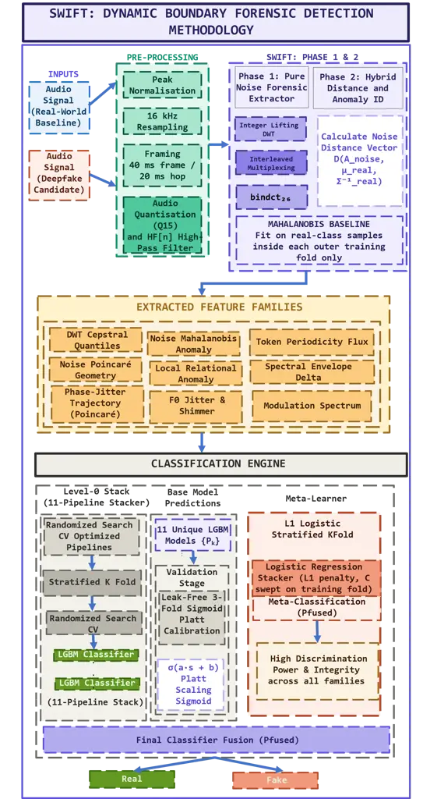
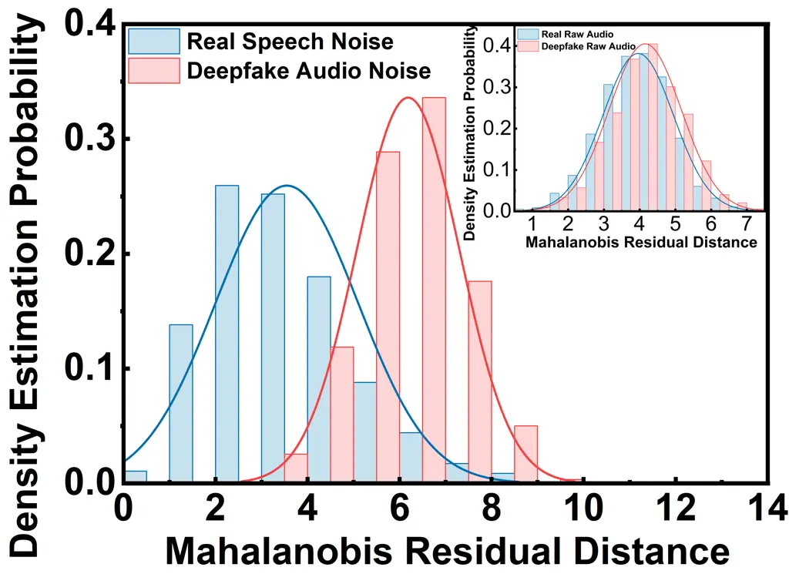

# SWIFT: A Handcrafted, Arithmetic-Minimal FPGA Engine for Real-Time Audio Deepfake Detection

Chirantan Banerjee ^(†)^(†)thanks: Joint first authors.
Affiliation: Department of Information Technology, Indian Institute of
Engineering Science and Technology, Shibpur, Howrah, West Bengal 711103,
India    Soumita Chatterjee¹¹footnotemark: 1 Affiliation: School of VLSI
Technology, Indian Institute of Engineering Science and Technology,
Shibpur, Howrah, West Bengal 711103, India    Bhargab B. Bhattacharya
Affiliation: School of VLSI Technology, Indian Institute of Engineering
Science and Technology, Shibpur, Howrah, West Bengal 711103, India   
Hafizur Rahaman Affiliation: {chirantanbanerjee1208, csoumita45,
bhargab.bhatta}@gmail.com, rahaman_h@yahoo.co.in Affiliation: Department
of Information Technology, Indian Institute of Engineering Science and
Technology, Shibpur, Howrah, West Bengal 711103, India

###### Abstract

Generative voice cloning threatens voice-based authentication, yet
current deepfake detectors rely on power-hungry, high-precision models
unsuited to edge hardware. We present SWIFT (Streaming Whiten-Integer
Forensic Trust-Engine), a handcrafted detector that works in the
high-frequency noise domain where synthesis artifacts concentrate. A
first-order integer high-pass residual drives nine families of
fixed-point descriptors, among them integer lifting-wavelet cepstral
quantiles, Mahalanobis anomaly distances, Poincaré phase-space geometry,
and phase jitter, fused by calibrated gradient-boosted trees and a
sparse $`L_{1}`$-regularised meta-learner. Under leakage-controlled
nested cross-validation, with one shared preprocessing chain for real
and fake audio, this reference model reaches accuracy of up to 99.86%
and an Equal Error Rate (EER) as low as 0.03% across eight benchmarks.
Its integer front-end and a fixed-point linear classifier run on the
programmable logic of a PYNQ-Z2 (Zynq-7020) board, with a 7.85 $`\mu`$s
per-frame datapath latency (127.4k frames/s) at 1.734 W and 11.2% LUT
utilisation. Integer-only audio deepfake feature extraction is thus
feasible at the edge without pretrained neural models or floating-point
units.

Keywords: Audio Deepfake Detection $`\cdot`$ DSP $`\cdot`$ FPGA
$`\cdot`$ Integer Lifting Wavelet Transform

## 1 Introduction

Audio deepfakes are especially dangerous because voice is tied to human
trust, personal identity, and security authorization. A few seconds of
reference audio now suffice to clone a voice, and attackers use such
clones to bypass biometric banking checks, commit corporate fraud, and
spread targeted disinformation. Since listeners can no longer reliably
tell real from synthetic speech, automated detection has become a
necessity for protecting digital communication.

Early audio deepfakes were built on Generative Adversarial Network
(GAN)-based vocoders, benchmarked by WaveFake \[1\] and LibriTTS \[2\],
with GAN-discriminator detectors \[3\] and the ASVspoof 2021
challenge \[4\] serving as the main countermeasures of that era. As
synthesis moved toward diffusion models and codec-language architectures
such as VALL-E, these GAN-tuned detectors generalised poorly, pushing
the field toward newer benchmarks such as MLAAD \[5\], AUDETER \[6\],
and ShiftySpeech \[7\] built to capture these broader distribution
shifts.

Detection methods have since diversified. Sundaram et al. \[8\] paired
handcrafted acoustic features with sequential models, and Doan et
al. \[9\] showed that breathing cues, which Text-to-Speech (TTS)
generators rarely model, are a reliable liveness signal. Deep-learning
detectors include depthwise-convolution transformers \[10\], lightweight
Convolutional Neural Networks (CNNs) on Mel-spectrograms \[11\], dual
self-supervised wavelet transformers \[12\], and HuBERT-ECAPA
embeddings \[13\]. More recent work covers codec-aware labelling \[14\],
WavLM attentive fusion \[15\], multi-stage frameworks \[16\],
codec-language countermeasures \[17, 18\], and multimodal audio-visual
fusion \[19, 20\].

Despite strong benchmark results, most of these methods depend on large
neural encoders that cannot run on the embedded hardware of call
centres, IoT devices, or mobile forensic kits. Hardware acceleration of
deepfake detection has so far targeted quantised CNNs for image and
video deepfakes on data-centre Field-Programmable Gate Array (FPGA)
cards \[21\]; to our knowledge, no handcrafted audio deepfake detector
has been mapped to an embedded FPGA.

Deployed detectors are themselves machine-learning systems and inherit
the threats that target such systems, including adversarial
inputs \[22\], Trojans in the machine-learning software and hardware
stack \[23\], and bit-flip faults in stored weights \[24\].
Surveys \[25\] and runtime defences based on accelerator performance
counters, including for audio inputs \[26, 27\], address these threats,
which makes compact, fully inspectable integer pipelines attractive for
edge deployment.

We propose SWIFT, a neural-network-free detector that fuses nine Digital
Signal Processing (DSP)-derived feature families through a calibrated
stacking ensemble and runs its integer front-end on the programmable
logic of a PYNQ-Z2 FPGA board. Our contributions are threefold. First, a
nine-family, integer-friendly DSP descriptor of the acoustic noise
floor, fused by Platt-calibrated LightGBM members and a sparse $`L_{1}`$
meta-learner, achieving up to 99.86% accuracy and an Equal Error Rate
(EER) as low as 0.03% across eight benchmarks without any neural
network. Second, a bit-exact fixed-point FPGA implementation of the
front-end and a linear classifier on the PYNQ-Z2, with explicit
hardware–software partitioning, a 7.85 $`\mu`$s per-frame datapath
latency (127.4k frames/s), 1.734 W, and 11.22% LUT utilisation—to the
best of our knowledge, the first FPGA implementation of a handcrafted,
neural-network-free audio deepfake detector. Third, a leakage-controlled
evaluation with clip-level splits and nested cross-validation across
TTS/codec, GAN-vocoder, ASVspoof, and mixed benchmarks, including a
transform comparison and a comparison against five standard classifiers
on identical features.

Section 2 describes SWIFT and its hardware–software partitioning,
Section 3 reports the protocol, classifier comparison, cross-domain
results, and the PYNQ-Z2 \[28\] implementation, and Section 4 concludes.

## 2 Methodology

SWIFT operates in the acoustic noise domain, where vocoders, diffusion
synthesisers, GANs, and codec-language models leave faint structured
traces that semantic features cannot expose. A noise residual isolates
this domain, nine complementary DSP feature families capture distinct
artifact classes, and a calibrated stacking ensemble fuses them
(Fig. 1). The full ensemble is the software reference model behind all
accuracy results; its integer front-end and a fixed-point linear
classifier form the FPGA path of Section 2.5.



Figure 1: Block diagram of the proposed SWIFT pipeline.

### 2.1 Preprocessing & Signal Standardisation

Real and deepfake audio are preprocessed identically. Each clip is
converted to mono, peak-normalised to $`[-1,1]`$, and resampled to
$`f_{s}=16`$ kHz through the shared chain of Section 3.1, which keeps
content below 7 kHz. A sliding window of 40 ms with a 20 ms hop (50%
overlap) discretises the stream into frames, each quantised to Q15
fixed-point precision. To suppress semantic speech content, a
first-order high-pass residual is extracted as

```math
hf[n]=x_{Q15}[2n{+}1]-x_{Q15}[2n], \tag{1}
```

since the difference of two Q15 samples spans $`[-2,2)`$. This is a
first-order difference with magnitude response $`2|\sin(\omega/2)|`$
followed by $`2\times`$ decimation (the predict step of the integer Haar
lifting scheme). It attenuates the low-frequency vocal-tract resonances
that carry most phonetic content and exposes the high-frequency noise
floor, where generative artifacts such as upsampling checkerboard
patterns, phase-matching mismatches, and neural-vocoder rendering
footprints accumulate. A first-order difference is chosen because it
costs one integer subtraction per output sample and needs no
multipliers, and Q15 arithmetic throughout makes software and hardware
results bit-exact.

Fig. 2 validates this choice. The Mahalanobis distance \[29\] (Eq. (2))
measures how far a frame lies from the genuine-speech distribution while
accounting for feature correlations. On the noise residual, real and
deepfake speech form two clearly separated peaks that overlap only near
a distance of 4, whereas on raw audio (inset) they overlap heavily, so
the separation comes from isolating the residual rather than from the
metric itself.



Figure 2: Isolated noise-domain Mahalanobis distances reveal distinct
real vs. deepfake speech separation, unlike raw audio (inset).

### 2.2 Integer Lifting Wavelet and Global Anomaly Encoding

As shown in Fig. 1, feature extraction proceeds in two phases. In
Phase 1, the noise residual of each frame is decomposed by an integer
LeGall 5/3 lifting Discrete Wavelet Transform (DWT) \[30, 31\] in pure
integer arithmetic. The first level’s approximation is discarded, and
its detail band $`LH`$ is split again into an approximation $`HL`$ and a
detail $`HH`$. These detail bands are combined by asymmetric interleaved
multiplexing into
$`\mathbf{c}=3\,\mathbf{s}_{1}+(\mathbf{s}_{2}\!\gg\!1)`$, where
$`\mathbf{s}_{1}`$ and $`\mathbf{s}_{2}`$ are the 128-sample,
zero-padded sequences of every fourth coefficient of $`LH`$ and $`HL`$
($`\mathbf{s}_{1}`$) and of $`HH`$ at offsets 0 and 2
($`\mathbf{s}_{2}`$), and $`\gg`$ denotes an arithmetic right shift. The
result is compressed by $`\mathrm{BinDCT}_{26}`$ \[32\] using only
shifts and adds and summarised by four statistics (mean, median absolute
deviation, 5th and 95th percentiles), which together form the
104-dimensional ($`26\times 4`$) DWT cepstral descriptor, in the spirit
of wavelet-based speech features \[33\]. Unlike irregular,
physics-driven acoustic turbulence, block-based vocoder synthesis leaves
periodic, structured spikes in the wavelet detail bands, artifacts that
the integer DWT preserves and exposes. In Phase 2, a real-class baseline
$`(\boldsymbol{\mu}_{\text{real}},\boldsymbol{\Sigma}_{\text{real}})`$
fitted exclusively on authentic samples within each training fold scores
every frame by its Mahalanobis distance,

```math
D_{M}(\mathbf{x}_{t})=\sqrt{(\mathbf{x}_{t}-\boldsymbol{\mu}_{\text{real}})^{\!\top}\boldsymbol{\Sigma}_{\text{real}}^{-1}(\mathbf{x}_{t}-\boldsymbol{\mu}_{\text{real}})}, \tag{2}
```

where $`\mathbf{x}_{t}`$, $`\boldsymbol{\mu}_{\text{real}}`$, and
$`\boldsymbol{\Sigma}_{\text{real}}`$ are the frame feature vector,
real-class mean, and covariance, respectively. Ten summary statistics of
$`\{D_{M}(\mathbf{x}_{t})\}`$ capture the drift from the genuine
microphone noise floor, a drift that current generators fail to avoid.

### 2.3 The Remaining Feature Families

The remaining seven families complete the 192-dimensional descriptor of
Table 1. A local relational anomaly family scores every frame against
the clip’s own centroid, flagging recordings that are uniformly too
smooth or that burst suddenly at a synthesis boundary. The noise
residual is then embedded as a Poincaré plot \[34\] with short- and
long-axis spreads

```math
SD_{1}=\frac{\sigma(y[n+\tau]-y[n])}{\sqrt{2}},\qquad SD_{2}=\frac{\sigma(y[n+\tau]+y[n])}{\sqrt{2}}, \tag{3}
```

where $`y[n]`$ is the noise residual at sample $`n`$, $`\tau`$ is the
embedding lag, and $`\sigma(\cdot)`$ is the standard deviation over
$`n`$. $`SD_{1}`$ captures short-term sample-to-sample irregularity,
while $`SD_{2}`$ tracks long-term attractor spread. Genuine phonation
traces a rich, irregular attractor, whereas deterministic synthesisers
produce attractors that are either too smooth or too erratic. A
companion phase-jitter descriptor tracks frame-to-frame shifts in this
geometry. The final four families address rhythm and voicing. Token
periodicity flux exposes periodicities locked to the codec frame rate;
$`F_{0}`$ jitter $`J`$ and shimmer $`S`$ \[35\] capture the vocal
micro-tremor that synthesisers flatten or exaggerate; the log-spectral
differences $`\Delta S`$ and $`\Delta^{2}S`$ separate over-smooth
transitions from impulsive boundaries; and the modulation-spectrum band
ratio

```math
R_{\mathrm{mod}}=\frac{\sum_{f<4}M(f)}{\sum_{4\leq f<20}M(f)}, \tag{4}
```

where $`M(f)`$ is the modulation-spectrum magnitude at modulation
frequency $`f`$ (in Hz), contrasts slow sub-4 Hz modulation energy with
the 4–20 Hz band that contains the natural 4–8 Hz syllabic rhythm. The
families are designed to be complementary, so that a fingerprint one
family overlooks may be exposed by another.

|       |                            |      |                        |
| ----- | -------------------------- | ---- | ---------------------- |
| \#    | Feature Family             | Dim. | Target                 |
| 1     | DWT cepstral quantiles     | 104  | Wavelet boundary disc. |
| 2     | Noise Mahalanobis anomaly  | 10   | Distribution shift     |
| 3     | Noise Poincaré geometry    | 24   | Phase-space disruption |
| 4     | Noise phase jitter         | 10   | Trajectory micro-var.  |
| 5     | Local relational anomaly   | 10   | Within-clip non-stat.  |
| 6     | Token periodicity flux     | 8    | Frame-rate rhythm      |
| 7     | $`F_{0}`$ jitter & shimmer | 8    | Prosodic micro-var.    |
| 8     | Spectral envelope delta    | 10   | Inter-frame change     |
| 9     | Modulation spectrum        | 8    | Syllabic rhythm        |
| Total |                            | 192  |                        |

Table 1: Description of Feature Families

### 2.4 Stacked Classification Engine

The 192-dimensional fixed-point descriptor feeds the SWIFT stacked
classification engine (Algorithm 1), a two-level ensemble for the binary
forensic decision. At Level-0, eleven parallel member pipelines are
trained: one per feature family, one on the Principal Component Analysis
(PCA)-whitened full concatenation, and one on the full concatenation
without whitening. Each follows an identical four-step cascade of
variance thresholding, standardisation, optional PCA decorrelation, and
a class-balanced LightGBM classifier with extremely randomised splits,
and each member is Platt-scaled via 3-fold cross-validation to yield
calibrated probabilities. At Level-1, the eleven calibrated probability
columns are assembled into a stacking matrix
$`\mathbf{P}\in\mathbb{R}^{N\times 11}`$, where $`N`$ is the number of
samples and each column holds one member pipeline’s posterior
probability, and fused by an $`L_{1}`$-regularised logistic regression,

```math
\min_{\mathbf{w},\,b}\;\mathcal{L}_{\mathrm{CE}}(\mathbf{w},b)+C^{-1}\|\mathbf{w}\|_{1}, \tag{5}
```

where $`\mathbf{w}\in\mathbb{R}^{11}`$ are the fusion weights, $`b`$ is
the bias term, $`\mathcal{L}_{\mathrm{CE}}`$ is the cross-entropy loss,
and $`C^{-1}`$ is the regularisation strength controlling sparsity. The
$`L_{1}`$ penalty automatically suppresses redundant member pipelines,
retaining only the most complementary probability streams for the final
forensic decision. Every component is fitted inside the outer training
folds of the protocol in Section 3.1, and the Level-1 fuser is trained
on out-of-fold Level-0 probabilities.

1: feature matrix $`\mathbf{F}\in\mathbb{R}^{N\times 192}`$, labels
$`y\in\{0,1\}^{N}`$

2: stacking matrix $`\mathbf{P}`$; members $`\mathcal{M}`$; fuser $`g`$

3: Level-0: Train 11 calibrated member pipelines

4: $`\mathcal{B}\leftarrow`$ 9 families
$`\cup\,\{\texttt{all},\texttt{all\_nopca}\}`$

5: for all member $`m\in\mathcal{B}`$ do

6:   prune features with variance $`<10^{-5}`$

7:   standardise:
$`\tilde{x}_{j}=(x_{j}-\hat{\mu}_{j})/(\hat{\sigma}_{j}+\varepsilon)`$

8:   if $`m\neq\texttt{all\_nopca}`$ then

9:    PCA whiten, retain $`99.5\%`$ variance

10:   end if

11:   fit LightGBM\_(m) (extra-trees, path-smooth, class-balanced)

12:
  $`\mathcal{M}[m]\leftarrow\mathrm{PlattScale}(\text{LightGBM}_{m},\,3\text{-fold})`$

13:   $`\mathbf{P}[:,m]\leftarrow`$ out-of-fold probabilities of
$`\mathcal{M}[m]`$ on $`\mathbf{F}`$

14: end for

15: Level-1: Sparse logistic fusion

16: fit $`L_{1}`$ fuser $`g`$ on $`\mathbf{P}`$:
$`\min_{\mathbf{w},b}\mathcal{L}_{\mathrm{CE}}+C^{-1}\|\mathbf{w}\|_{1}`$

17: return $`\mathbf{P},\,\mathcal{M},\,g`$

Algorithm 1 SWIFT 2-Level Stacked Classification Engine.

### 2.5 Hardware–Software Partitioning and FPGA Deployment

SWIFT is realised at two levels, summarised in Table 2. The full
nine-family stacking ensemble of Sections 2.2–2.4 is the _software
reference model_: it is trained offline and evaluated in software, and
the accuracy figures in Tables 3–6 refer to it. The FPGA path,
_SWIFT-HW_, implements the integer front-end and a fixed-point linear
classifier on the programmable logic (PL) of the PYNQ-Z2’s Zynq XC7Z020.
The LightGBM members, Platt calibration and $`L_{1}`$ fusion are _not_
mapped to the PL. A multiply–accumulate (MAC) datapath evaluates dot
products, whereas decision-tree ensembles require comparator-based tree
traversal, so SWIFT-HW instead uses a linear classifier trained offline
on the 26 $`\mathrm{BinDCT}_{26}`$ coefficients, with int16 weights and
an int32 bias. Mapping the tree ensemble to comparator logic is left for
future work.

|                                                                                             |                |                   |
| ------------------------------------------------------------------------------------------- | -------------- | ----------------- |
| Stage                                                                                       | Runs on        | Arithmetic        |
| Noise residual (Eq. (1)), integer lifting DWT, cross-multiplexing, $`\mathrm{BinDCT}_{26}`$ | PL             | Integer add/shift |
| Linear classifier (SWIFT-HW)                                                                | PL             | Fixed-point MAC   |
| Weight loading, DMA, control, score read-back                                               | PS (Cortex-A9) | –                 |
| Families 2–9                                                                                | Software       | Q15 fixed point   |
| LightGBM, Platt, $`L_{1}`$ fusion; all training                                             | Software       | Floating point    |

Table 2: Hardware–Software Partitioning of SWIFT

On the PL, Q15 frames arrive by Direct Memory Access (DMA) and stream
through the residual of Eq. (1) (one subtraction per sample pair), the
two-level integer lifting DWT and cross-multiplexing (adders and
shifters only), the strided $`\mathrm{BinDCT}_{26}`$ (shift–add
butterflies), and the classifier MACs on the DSP slices, with no
floating-point arithmetic. The ARM Cortex-A9 processing system (PS)
loads the weights, issues DMA transfers and control handshakes, and
reads back the score, driven from a Jupyter notebook with live audio.
The IP core’s outputs were compared with a bit-accurate software model
of the datapath.

## 3 Results and Discussion

### 3.1 Experimental Protocol

Each clip yields a single 192-dimensional descriptor, because every
frame-level quantity (DWT coefficients, Mahalanobis distances, Poincaré
spreads, jitter, and so on) is aggregated into clip-level statistics.
All splits are therefore made at the clip level: the overlapping 40 ms
frames of a clip always fall on the same side of a split, so frame
overlap cannot leak information from training to test data. Performance
is estimated with nested cross-validation: an outer stratified 5-fold
split for evaluation and, inside each outer training fold, a randomised
hyper-parameter search with inner stratified cross-validation. Every
fitted component (variance threshold, standardisation, PCA, the
real-class Mahalanobis baseline, the LightGBM members, the 3-fold
sigmoid Platt calibration, and the regularisation strength $`C`$ of the
$`L_{1}`$ fuser) is fitted on the outer training fold only, and the
Level-1 fuser is trained on out-of-fold Level-0 probabilities. Within
each corpus the outer folds are stratified by label, so the same
generators appear in training and test data; the results below therefore
measure seen-generator detection, and generalisation to unseen
generators is discussed as a limitation in Section 4. Because SWIFT
inspects the top of the spectrum, real and fake clips must share one
decoding and resampling chain; otherwise the detector can learn storage
traces instead of synthesis artifacts. The source corpora do differ in
this respect: in MLAAD, whose fakes are 22.05 kHz WAV files, the bona
fide clips (LibriSpeech dev-clean) are 16 kHz FLAC, and in
CodecFake \[36\] the genuine clips are 32-bit float while the fakes are
16-bit PCM at 16–44.1 kHz. Every clip therefore passes through one
chain: float-format audio is first rounded to 16 bits, all audio is
resampled to 16 kHz through a common 14 kHz stage whose filters share
the same pass ($`<6`$ kHz) and stop ($`>7`$ kHz) edges, and leading and
trailing silence is trimmed. The sample counts in Table 5 are clips;
CodecFake combines all 44,242 genuine clips with 50,000 fakes. Reported
values are computed on the pooled out-of-fold predictions.

_Metric definitions._ The fake class is the positive class throughout.
For each corpus, the fuser’s out-of-fold probability of “fake” is pooled
over all outer test folds into a single score vector, from which every
metric is derived: AUC is the rank-based area under the ROC curve of
this vector, EER is the operating point on the same ROC where the
false-acceptance and false-rejection rates are equal, accuracy and
recall (fake class) use the classifier’s decision on the same samples,
and F1 is the macro-average over the two classes (which is close to
accuracy on balanced data). Because the ROC curve passes through
$`(\mathrm{EER},1-\mathrm{EER})`$, every result must satisfy
$`\mathrm{AUC}\geq 1-\mathrm{EER}`$; this check is enforced in the
evaluation code, and all tables were regenerated from the same score
vectors. The per-fold metric records are provided as supplementary
material.

### 3.2 Justification of Integer Lifting DWT on the Noise Domain

|                                     |              |        |         |
| ----------------------------------- | ------------ | ------ | ------- |
| Transform (on Noise Residual)       | Accuracy (%) | AUC    | EER (%) |
| Short-Time Fourier Transform        | 97.50        | 0.9986 | 1.67    |
| Mel-Frequency Cepstral Coefficients | 75.83        | 0.8600 | 23.33   |
| Constant-Q Transform                | 56.67        | 0.6594 | 40.00   |
| Integer Lifting DWT (ours)          | 99.78        | 0.9995 | 0.05    |

Table 3: Noise-Domain Transform Comparison

Table 3 compares four transforms applied identically to the noise
residual under the same SWIFT pipeline. The Constant-Q Transform (CQT)
performs worst (56.67% accuracy, 40.00% EER) because its logarithmically
spaced bins smooth over the fine high-frequency spikes at vocoder
boundaries, and Mel-Frequency Cepstral Coefficients (MFCC, 75.83%)
compress exactly the high-frequency content where artifacts accumulate.
The Short-Time Fourier Transform (STFT) is competitive (97.50%, 1.67%
EER), but its single fixed resolution cannot capture both fine
token-boundary spikes and broader sub-band energy shifts from upsampling
convolutions. The multi-resolution integer lifting DWT captures both,
reaching 99.78% accuracy and 0.05% EER.

### 3.3 Justification of the Classification Engine

Five well-known classifiers, a Support Vector Machine (SVM), a
Multi-Layer Perceptron (MLP), Random Forest, XGBoost, and a single
LightGBM, were trained on the same 192-dimensional features, outer folds
and preprocessing as SWIFT (Table 4); these are the matched baselines of
this paper. None exceeds 93% accuracy or falls below 7% EER: Random
Forest is weakest (82.45%, 17.49% EER) and the MLP strongest (92.96%,
7.18% EER). Stacking the eleven calibrated pipelines lifts SWIFT to
99.78% accuracy, an AUC of 0.9995, and 0.05% EER. The jump from the
single LightGBM (88.62% accuracy) to the stack shows that no single
model captures the complete picture. The contribution of each individual
feature family is not isolated here and is left for future work.

|                   |              |            |              |        |         |
| ----------------- | ------------ | ---------- | ------------ | ------ | ------- |
| Classifier        | Accuracy (%) | Recall (%) | F1-Score (%) | AUC    | EER (%) |
| SVM (RBF)         | 89.71        | 91.06      | 89.71        | 0.9685 | 10.42   |
| MLP (3-layer)     | 92.96        | 93.48      | 92.96        | 0.9761 | 7.18    |
| Random Forest     | 82.45        | 82.78      | 82.45        | 0.9070 | 17.49   |
| XGBoost           | 88.51        | 88.98      | 88.51        | 0.9559 | 11.42   |
| LightGBM (single) | 88.62        | 89.00      | 88.62        | 0.9576 | 11.30   |
| SWIFT (ours)      | 99.78        | 99.66      | 99.95        | 0.9995 | 0.05    |

Table 4: Classifier Comparison on the ShiftySpeech Benchmark (same
features and folds; macro-averaged F1)

### 3.4 Comparative Performance Analysis

Table 5 covers GAN-vocoder corpora (WaveFake \[1\] and LibriTTS \[2\]),
modern TTS and codec benchmarks (Audeter \[6\], MLAAD \[5\],
CodecFake \[36\], ShiftySpeech \[7\]), ASVspoof \[4\], and SONAR \[37\],
which spans nine commercial and open-source TTS providers. On these four
corpora SWIFT reaches 99.29–99.86% accuracy with EERs of 0.05–0.66%.
LibriTTS yields a 0.03% EER, while WaveFake is harder (90.42%, 1.54%
EER) because of its diverse multi-vocoder composition; SONAR and
ASVspoof reach 98.42% and 97.84%.

|              |           |         |              |            |              |        |         |
| ------------ | --------- | ------- | ------------ | ---------- | ------------ | ------ | ------- |
| Dataset      | Type      | Samples | Accuracy (%) | Recall (%) | F1-Score (%) | AUC    | EER (%) |
| Audeter      | TTS/codec | 15,228  | 99.68        | 99.65      | 99.79        | 0.9896 | 0.29    |
| MLAAD        | TTS/codec | 18,000  | 99.86        | 99.91      | 99.84        | 0.9898 | 0.12    |
| CodecFake    | TTS/codec | 94,242  | 99.29        | 99.16      | 99.29        | 0.9889 | 0.66    |
| ShiftySpeech | TTS/codec | 281,945 | 99.78        | 99.66      | 99.95        | 0.9995 | 0.05    |
| WaveFake     | GAN       | 104,800 | 90.42        | 89.56      | 90.40        | 0.9235 | 1.54    |
| LibriTTS     | GAN       | 20,929  | 99.52        | 99.35      | 99.55        | 0.9992 | 0.03    |
| ASVspoof     | TTS/VC    | 121,461 | 97.84        | 97.12      | 97.48        | 0.9816 | 1.81    |
| SONAR        | Mixed     | 113,122 | 98.42        | 97.39      | 98.37        | 0.9741 | 1.27    |

Table 5: SWIFT Performance Across TTS/Codec, GAN-Vocoder, ASVspoof, and
Mixed Benchmarks

Against prior systems (Table 6), whose figures are quoted from the
original papers and are therefore _not_ measured on identical data or
folds, the Self-Supervised Learning (SSL) methods WavLM with a
Multi-Fusion Attentive classifier (WavLM+MFA) \[15\], XLS-R with
contrastive learning (XLS-R+CL) \[16\], and Wav2Vec 2.0 AASIST with
Sharpness-Aware Minimisation (W2V2-AASIST+SAM) \[17\] plateau at 91–93%
accuracy despite large pretrained encoders, and a CNN on MFCCs \[18\]
reaches 89.67%, consistent with mel filterbanks discarding the
high-frequency residual. The SWIFT reference model reaches 99.78%
accuracy with no pretrained encoder (the like-for-like comparison is
Table 4), and its fixed-point path runs on FPGA hardware that cannot
host any of these methods.

|                        |           |                  |              |            |              |        |         |
| ---------------------- | --------- | ---------------- | ------------ | ---------- | ------------ | ------ | ------- |
| Methodology            | Type      | Benchmark        | Accuracy (%) | Recall (%) | F1-Score (%) | AUC    | EER (%) |
| WavLM+MFA \[15\]       | SSL       | ASVspoof 2019 LA | 91.84        | 90.92      | 91.37        | 0.8470 | 0.52    |
| XLS-R+CL \[16\]        | SSL       | ASVspoof 2019 LA | 93.42        | 92.78      | 93.10        | 0.8517 | 0.46    |
| W2V2-AASIST+SAM \[17\] | SSL       | CodecFake        | 92.84        | 91.97      | 92.53        | 0.9416 | 0.62    |
| CNN+MFCC \[18\]        | CNN       | Fake-or-Real     | 89.67        | 88.95      | 89.31        | 0.7597 | 0.31    |
| Proposed               | DSP+Stack | ShiftySpeech     | 99.78        | 99.66      | 99.95        | 0.9995 | 0.05    |

Table 6: Comparison with Representative Prior Systems. Prior-system rows
are quoted from the cited papers on the benchmark listed in the
Benchmark column; the proposed row is the software reference model on
ShiftySpeech

### 3.5 FPGA Implementation Results

|                |               |             |                      |                       |         |
| -------------- | ------------- | ----------- | -------------------- | --------------------- | ------- |
| Slice LUTs     | Registers     | DSPs        | PL latency per frame | Throughput (frames/s) | Power   |
| 5,968 (11.22%) | 8,647 (8.13%) | 42 (19.09%) | 7.85 $`\mu`$s        | 127.4k                | 1.734 W |

Table 7: SWIFT-HW Implementation on the Zynq XC7Z020 at 50 MHz

The IP core occupies 11.22% of the slice Look-Up Tables (LUTs) and
19.09% of the DSP slices of the XC7Z020 (Table 7). At 50 MHz its
datapath latency is 7.85 $`\mu`$s per 40 ms frame, i.e. 127.4k frames/s,
over 2,500$`\times`$ the 50 frames/s that a 20 ms hop requires. This
figure covers the PL datapath only; DMA and PS overhead are not
included. The board draws 1.734 W.

_Detection performance of the deployed classifier._ Table 8 reports the
SWIFT-HW linear classifier on the ShiftySpeech benchmark under the
protocol of Section 3.1 (same outer folds, 26 $`\mathrm{BinDCT}_{26}`$
features of the PL front-end). The floating-point linear model is
trained inside each training fold, and its weights are quantised to
int16 (bias int32) and evaluated with the bit-accurate integer model of
the datapath, which matched the IP-core outputs. The deployed classifier
retains 98.45% accuracy and 0.42% EER, i.e. a loss of 1.33 accuracy
points relative to the software ensemble, of which 0.35 points are due
to quantisation alone. This trade-off is the price of moving from a
192-feature tree ensemble to a 26-feature multiplier-based classifier on
the PL.

|                                            |              |        |         |
| ------------------------------------------ | ------------ | ------ | ------- |
| Classifier                                 | Accuracy (%) | AUC    | EER (%) |
| Linear, 26 BinDCT features, floating point | 98.80        | 0.9921 | 0.35    |
| SWIFT-HW: linear, int16/int32 (deployed)   | 98.45        | 0.9904 | 0.42    |
| Software reference ensemble (192 features) | 99.78        | 0.9995 | 0.05    |

Table 8: Detection Performance of the Deployed Classifier on
ShiftySpeech (same folds)

## 4 Conclusion

This paper presented SWIFT, a handcrafted, neural-network-free audio
deepfake detector that combines an integer lifting DWT cepstral
transform with eight complementary descriptor families in a two-level
calibrated stacking ensemble. The software reference reaches accuracy of
up to 99.86% (MLAAD) and an EER as low as 0.03% (LibriTTS), with figures
that compare favourably with the SSL and CNN results quoted in Table 6
(reported on different benchmarks) without a pretrained encoder, and its
fixed-point front-end and linear classifier run on the PYNQ-Z2 at
7.85 $`\mu`$s per frame and 1.734 W.

Four limitations remain: generators are shared between training and test
folds, so the results measure seen-generator detection; robustness to
compression, telephone channels, and noise (which alter the noise floor
SWIFT relies on), to adversarial attacks, and cross-corpus transfer are
untested; only the front-end and a linear classifier run on the PL, and
the deployed classifier is evaluated on one benchmark only (Table 8)
while the end-to-end (DMA and PS) latency is not reported; and the
contribution of each feature family has not been isolated. Future work
will add a leave-one-family-out ablation, evaluate the deployed
fixed-point classifier on all benchmarks, map the tree ensemble onto
comparator-based FPGA logic, evaluate unseen-generator,
degraded-channel, and cross-lingual scenarios, and explore on-chip
adaptation to emerging TTS architectures \[14\].

## Acknowledgements

This work has been financially sponsored by the Anusandhan National
Research Foundation (ANRF), Govt. of India (Sanction Order No.
ANRF/PMP/2025/000071/ET, dated 20 May 2026), and partially supported by
the Ministry of Electronics and Information Technology, Govt. of India,
under the Chips to Startup (C2S) Programme, vide Grant No.
EE-9/2/2021-R&D-E. We thank the Indian Institute of Engineering Science
and Technology, Shibpur, Howrah, West Bengal, for supporting us with the
necessary tools and systems to carry out the research work.

## References

- \[1\] J. Frank and L. Schönherr (2021) WaveFake: a data set to
  facilitate audio deepfake detection. arXiv preprint arXiv:2111.02813.
  Cited by: §1, §3.4.
- \[2\] H. Zen, V. Dang, R. Clark, Y. Zhang, R. J. Weiss, Y. Jia, Z.
  Chen, and Y. Wu (2019) LibriTTS: a corpus derived from LibriSpeech for
  text-to-speech. arXiv preprint arXiv:1904.02882. Cited by: §1, §3.4.
- \[3\] T. P. Doan, K. Hong, and S. Jung (2023) GAN discriminator based
  audio deepfake detection. In Proc. Workshop on Security Implications
  of Deepfakes and Cheapfakes, pp. 29–32. External Links:
  [Document](https://dx.doi.org/10.1145/3595353.3595883) Cited by: §1.
- \[4\] X. Liu, X. Wang, M. Sahidullah, J. Patino, H. Delgado, T.
  Kinnunen, M. Todisco, J. Yamagishi, N. Evans, A. Nautsch, and K. A.
  Lee (2023) ASVspoof 2021: towards spoofed and deepfake speech
  detection in the wild. IEEE/ACM Transactions on Audio, Speech, and
  Language Processing 31 (), pp. 2507–2522. External Links:
  [Document](https://dx.doi.org/10.1109/TASLP.2023.3285283) Cited by:
  §1, §3.4.
- \[5\] N. M. Müller, P. Kawa, W. H. Choong, E. Casanova, E. Gölge, T.
  Müller, P. Syga, P. Sperl, and K. Böttinger (2024) MLAAD: the
  multi-language audio anti-spoofing dataset. In Proc. IJCNN, Vol. ,
  pp. 1–7. External Links:
  [Document](https://dx.doi.org/10.1109/IJCNN60899.2024.10650962) Cited
  by: §1, §3.4.
- \[6\] Q. Wang, H. Huang, G. Pang, S. Erfani, and C. Leckie (2025)
  AUDETER: a large-scale dataset for deepfake audio detection in open
  worlds. arXiv preprint arXiv:2509.04345. Cited by: §1, §3.4.
- \[7\] A. Garg, Z. Cai, L. Zhang, H. L. Xinyuan, L. P.
  García-Perera, K. Duh, S. Khudanpur, M. Wiesner, and N. Andrews (2025)
  ShiftySpeech: a large-scale synthetic speech dataset with distribution
  shifts. arXiv preprint arXiv:2502.05674. Cited by: §1, §3.4.
- \[8\] V. Sundaram, S. Babitha, and S. Vekkot (2024) Leveraging
  acoustic features and deep neural architectures for audio deepfake
  detection. In Proc. ICACC, Vol. , pp. 1–6. External Links:
  [Document](https://dx.doi.org/10.1109/ICACC63692.2024.10845392) Cited
  by: §1.
- \[9\] T. Doan, L. Nguyen-Vu, S. Jung, and K. Hong (2023) BTS-E: audio
  deepfake detection using breathing-talking-silence encoder. In Proc.
  ICASSP, Vol. , pp. 1–5. External Links:
  [Document](https://dx.doi.org/10.1109/ICASSP49357.2023.10095927) Cited
  by: §1.
- \[10\] V. Pandey, A. Satsangi, B. Saini, S. Kapoor, and P.
  Suman (2025) VeriVoice: enhancing audio deepfake detection with
  depthwise frequency convolutions. In Proc. DECoN, Vol. , pp. 1–6.
  External Links:
  [Document](https://dx.doi.org/10.1109/DECON67170.2025.11447647) Cited
  by: §1.
- \[11\] A. M. Shafi and S. Mouti (2026) Deepfake audio detection using
  convolutional neural networks and mel-spectrogram analysis. In Proc.
  IRASET, pp. 1–5. External Links:
  [Document](https://dx.doi.org/10.1109/IRASET68627.2026.11538779) Cited
  by: §1.
- \[12\] R. Wang, Z. Chen, B. Wang, Z. Ba, and K. Ren (2025)
  AWaveFormer: audio wavelet transformer network for generalized audio
  deepfake detection. IEEE Transactions on Audio, Speech and Language
  Processing 33 (), pp. 4020–4032. External Links:
  [Document](https://dx.doi.org/10.1109/TASLPRO.2025.3611229) Cited by:
  §1.
- \[13\] G. Tahaoglu (2025) HuBERT-derived SSL features and ECAPA-TDNN
  matching for robust audio deepfake detection. In Proc. MLSP, Vol. ,
  pp. 1–6. External Links:
  [Document](https://dx.doi.org/10.1109/MLSP62443.2025.11204297) Cited
  by: §1.
- \[14\] Y. Xiao, F. Lux, A. Pérez-González-de-Martos, and N. T.
  Vu (2026) How to label resynthesized audio: the dual role of neural
  audio codecs in audio deepfake detection. In Proc. ICASSP, pp. 1–5.
  External Links:
  [Document](https://dx.doi.org/10.1109/ICASSP55912.2026.11464643) Cited
  by: §1, §4.
- \[15\] Y. Guo, H. Huang, X. Chen, H. Zhao, and Y. Wang (2024) Audio
  deepfake detection with self-supervised WavLM and multi-fusion
  attentive classifier. In Proc. ICASSP, Vol. , pp. 12702–12706.
  External Links:
  [Document](https://dx.doi.org/10.1109/ICASSP48485.2024.10447923) Cited
  by: §1, §3.4, Table 6.
- \[16\] G. S. Kashyap, Z. H. Siddiqui, M. A. Azeez, R. Ali, S.
  Kumar, N. Kamuni, and J. Gao (2025) Fooling the forgers: a multi-stage
  framework for audio deepfake detection. In Proc. ICASSP, Vol. ,
  pp. 1–5. External Links:
  [Document](https://dx.doi.org/10.1109/ICASSP49660.2025.10888175) Cited
  by: §1, §3.4, Table 6.
- \[17\] Y. Xie, Y. Lu, R. Fu, Z. Wen, Z. Wang, J. Tao, X. Qi, X.
  Wang, Y. Liu, H. Cheng, L. Ye, and Y. Sun (2025) The Codecfake dataset
  and countermeasures for the universally detection of deepfake audio.
  IEEE Transactions on Audio, Speech and Language Processing 33 (),
  pp. 386–400. External Links:
  [Document](https://dx.doi.org/10.1109/TASLPRO.2025.3525966) Cited by:
  §1, §3.4, Table 6.
- \[18\] P. Chiddarwar (2024) Real-time detection of AI-generated
  deepfake audio: a novel approach. In Proc. ICTBIG, Vol. , pp. 1–5.
  External Links:
  [Document](https://dx.doi.org/10.1109/ICTBIG64922.2024.10911062) Cited
  by: §1, §3.4, Table 6.
- \[19\] A. Panja, D. b. Chakravorty, D. Saha, and A. Das (2025)
  Multimodal framework for deep fake detection and content moderation
  using CNN, ViT, and audio-visual analysis. In Proc. CIACON, pp. 1–6.
  External Links:
  [Document](https://dx.doi.org/10.1109/CIACON65473.2025.11189412) Cited
  by: §1.
- \[20\] X. Li, Z. Ma, Z. Zhang, and M. Chen (2025) Multimodal deepfake
  detection via audio-visual feature fusion and temporal attention. In
  Proc. ICBAIE, Vol. , pp. 390–393. External Links:
  [Document](https://dx.doi.org/10.1109/ICBAIE66852.2025.11326621) Cited
  by: §1.
- \[21\] O. Bhilare, R. Singh, V. Paranjape, S. Chittupalli, S.
  Suratkar, and F. Kazi (2022) DEEPFAKE CLI: accelerated deepfake
  detection using FPGAs. arXiv preprint arXiv:2210.14743. Cited by: §1.
- \[22\] A. A. N. Nafi, H. Rahaman, Z. Haider, T. Mahfuz, F. Suya, S.
  Bhunia, and P. Chakraborty (2026) DASH: a meta-attack framework for
  synthesizing effective and stealthy adversarial examples. External
  Links: 2508.13309, [Link](https://arxiv.org/abs/2508.13309) Cited by:
  §1.
- \[23\] H. Rahaman, Q. Xu, Z. Haider, P. Chakraborty, S. Bhunia, and F.
  Suya (2026) (A)ispy: parasitic trojans for machine learning
  infrastructure. External Links: 2607.17550,
  [Link](https://arxiv.org/abs/2607.17550) Cited by: §1.
- \[24\] H. Rahaman, D. Lobo, M. R. Ferdous, and S. Bhunia (2026) SANAI:
  secure ecc distributed keyed parity embedded in weights for protecting
  neural networks against bit-flip attacks. External Links: 2611.02042,
  [Link](https://arxiv.org/abs/2611.02042) Cited by: §1.
- \[25\] H. Rahaman, A. Chatterjee, and S. Bhunia (2026) Fortifying AI
  systems: emerging threats and security countermeasures. SN Computer
  Science 7 (3), pp. 227. External Links: ISSN 2661-8907,
  [Document](https://dx.doi.org/10.1007/s42979-025-04658-y),
  [Link](https://doi.org/10.1007/s42979-025-04658-y) Cited by: §1.
- \[26\] H. Rahaman, A. Chatterjee, and S. Bhunia (2025) Runtime
  detection of adversarial attacks in ai accelerators using performance
  counters. External Links: 2503.07568,
  [Link](https://arxiv.org/abs/2503.07568) Cited by: §1.
- \[27\] H. Rahaman, A. Chatterjee, and S. Bhunia (2026) SAMURAI:
  runtime attack detection in ai accelerators using ai performance
  counters. IEEE Transactions on Circuits and Systems for Artificial
  Intelligence 3 (5), pp. 368–382. External Links:
  [Document](https://dx.doi.org/10.1109/TCASAI.2026.3674059) Cited by:
  §1.
- \[28\] TUL Corporation (2026) PYNQ-Z2 FPGA development board. Note:
  [https://www.tulembedded.com/fpga/ProductsPYNQ-Z2.html](https://www.tulembedded.com/fpga/ProductsPYNQ-Z2.html)Accessed:
  July 2026 Cited by: §1.
- \[29\] J. L. Rivero Perez, B. Ribeiro, and C. M. Perez (2016)
  Mahalanobis distance metric learning algorithm for instance-based data
  stream classification. In Proc. IJCNN, Vol. , pp. 1857–1862. External
  Links: [Document](https://dx.doi.org/10.1109/IJCNN.2016.7727425) Cited
  by: §2.1.
- \[30\] A. R. Calderbank, I. Daubechies, W. Sweldens, and B. Yeo (1998)
  Wavelet transforms that map integers to integers. Applied and
  Computational Harmonic Analysis 5 (3), pp. 332–369. Cited by: §2.2.
- \[31\] Y. Suhail and K.G. Oweiss (2004) A reduced complexity integer
  lifting wavelet-based module for real-time processing in implantable
  neural interface devices. In Proc. IEEE EMBS, Vol. 2, pp. 4552–4555.
  External Links:
  [Document](https://dx.doi.org/10.1109/IEMBS.2004.1404263) Cited by:
  §2.2.
- \[32\] T.D. Tran (2000) The binDCT: fast multiplierless approximation
  of the DCT. IEEE Signal Processing Letters 7 (6), pp. 141–144.
  External Links: [Document](https://dx.doi.org/10.1109/97.844633) Cited
  by: §2.2.
- \[33\] Z. Tüfekci and J. N. Gowdy (2000) Feature extraction using
  discrete wavelet transform for speech recognition. In Proc. IEEE
  SoutheastCon, pp. 116–123. Cited by: §2.2.
- \[34\] J. Huang, X. Chen, H. Jin, and J. Li (2019) Automatic
  classification algorithm for Poincaré plots based on modified
  Hausdorff distance-support vector machine. In Proc. CISP-BMEI, Vol. ,
  pp. 1–5. External Links:
  [Document](https://dx.doi.org/10.1109/CISP-BMEI48845.2019.8965955)
  Cited by: §2.3.
- \[35\] M. Farrús, J. Hernando, and P. Ejarque (2007) Jitter and
  shimmer measurements for speaker recognition. In Proc. Interspeech,
  pp. 778–781. External Links:
  [Document](https://dx.doi.org/10.21437/Interspeech.2007-147) Cited by:
  §2.3.
- \[36\] H. Wu, Y. Tseng, and H. Lee (2024) CodecFake: enhancing
  anti-spoofing models against deepfake audios from codec-based speech
  synthesis systems. In Proc. Interspeech, External Links:
  [Document](https://dx.doi.org/10.21437/Interspeech.2024-2093) Cited
  by: §3.1, §3.4.
- \[37\] X. Li, P. Chen, and W. Wei (2024) SONAR: a synthetic AI-audio
  detection framework and benchmark. arXiv preprint arXiv:2410.04324.
  Cited by: §3.4.
