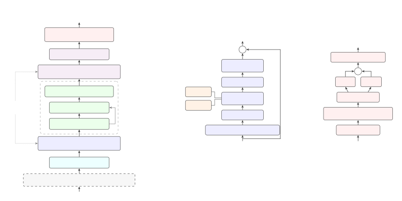

# PAWP-TTS: Phoneme-Aware Weight Programming for Compact Bilingual English–Nepali Speech Synthesis

Firoj Paudel Email: [firojpaudel@gmail.com](mailto:) Affiliation: Code:
[https://github.com/Firojpaudel/PAWP_TTS](https://github.com/Firojpaudel/PAWP_TTS)
   Audio:
[https://huggingface.co/spaces/Firoj112/pawp-tts-demo](https://huggingface.co/spaces/Firoj112/pawp-tts-demo)

Abstract.  This paper presents PAWP-TTS, a compact non-autoregressive
text-to-speech system for English, Nepali, and English–Nepali code-mixed
speech at 24 kHz, with no language model at inference. Deterministic
pronunciation knowledge lives in a rule- and lexicon-based bilingual
frontend that preserves native Nepali contrasts and avoids Hindi
phonology, so the network only models acoustics. Counting every learned
inference tensor, including the waveform decoder, PAWP-1.5M (1,490,390
parameters, 5.98 MB) reaches 1.50% English and 1.75% Nepali character
error rate under a single ASR recognizer, and 5.04% / 4.02% Nepali /
English phoneme error rate (PER) on 600 untouched test utterances.
Decoder-centric 281K-parameter models (1.1 MB) stay intelligible
(5.3–6.6% mean PER over three seeds), and at equal unique parameters a
dense model beats cross-layer basis sharing on every seed. Fixing a
frontend/label version mismatch nearly halved Nepali PER, more than any
architectural or weight-level change. The paper then studies
_weight-space programming_: inspection-guided, zero-training weight
edits. Under strict controls (validation-only selection, one-shot test,
paired bootstrap, matched random and same-parameter gradient baselines),
edits show real selectivity (27:1 on word-boundary pauses with 96
weights; zero cross-lingual collateral inside language-gated residuals)
but no accuracy gain beyond controls. Two apparent targets proved to be
label or phonology artifacts. Code, ONNX graphs and weights are
released.

## 1. Introduction

Recent neural text-to-speech (TTS) systems increasingly rely on
hundred-million to billion-parameter language models and neural audio
codecs to achieve natural prosody and multilingual coverage. While
effective in cloud deployments, these architectures incur high memory
footprints, large time-to-first-audio (TTFA), and poor accessibility for
low-resource languages such as Nepali—especially in edge, CPU-only, or
browser-targeted settings.

Nepali presents specific phonological challenges that are routinely
mishandled by generic Indic or Hindi-biased multilingual models \[7\]:
standard Kathmandu Nepali maintains a four-way stop laryngeal contrast,
dental versus retroflex stops with post-vocalic flapping, alveolar
affricates (/ts, ts^(h), dz, dz^(h)/) rather than Hindi postalveolars,
contrastive consonant gemination, an open-mid back unrounded inherent
vowel rather than the Hindi central schwa, and an alveolar sibilant
merger (/s/) across orthographic sa/śa/ṣa. Moreover, everyday Nepali
speech frequently code-switches mid-sentence with English.

This work investigates two research questions:

1.  1.  Compact Bilingual Capacity: How small can a complete, end-to-end
        24 kHz bilingual English–Nepali TTS system (including its neural
        waveform decoder) be made when deterministic linguistic knowledge is
        cleanly separated into a rule- and lexicon-backed frontend?
2.  2.  Diagnostic Weight-Space Programming (WSP): Following the
        weight-space programming view that trained weights can be read and
        edited like a program \[1\], can inspection-guided, zero-training
        edits (using rank-one tools such as ROME \[10\]) surgically repair
        phonetic or timing defects in a compact TTS model without degrading
        the other language, and do such edits hold up against matched random
        and same-parameter gradient controls?

The contributions are:

- •
  Open Compact Bilingual TTS at 1.5M and 281K Parameters: Complete,
  audited parameter accounting (4-metric standard) across PAWP-1.5M
  (1,490,390 params, 5.98 MB FP32) and PAWP-300K (281,078 unique /
  328,158 materialized params, 1.12 MB FP32) with language-gated
  low-rank residuals that fold statically into zero-overhead monolingual
  ONNX graphs.
- •
  Clean Frontend–Alignment Consistency: Empirical demonstration that
  eliminating a frontend/cache version mismatch (v2 $`\rightarrow`$ v3)
  nearly halves validation Nepali PER (7.06% $`\rightarrow`$ 3.96%) and
  eliminates a 55.1% spurious va $`\rightarrow`$ /w/ artifact.
- •
  A Controlled Audit of Zero-Training WSP in Compact TTS: Experiments
  with validation-only selection, one-shot tests and paired-bootstrap
  95% CIs show real selectivity (27:1 pause selectivity in 96 weights;
  zero cross-lingual collateral inside language residuals) but _no
  accuracy gain beyond matched controls_, and identify three confounders
  that mimic model defects: cache-label drift, native phonology
  mismatch, and global duration bias.

## 2. Related Work

#### Non-Autoregressive TTS and Fourier Vocoding.

The acoustic backbone builds on non-autoregressive variance-adapted
synthesis \[12\] paired with Fourier-domain ConvNeXt1D + iSTFT waveform
synthesis \[13\]. Unlike conventional pipelines that exclude a
multi-million-parameter vocoder from reported parameter counts, PAWP-TTS
counts every learned tensor required for inference from phoneme IDs to
24 kHz PCM waveforms. Articulatory feature conditioning follows prior
low-resource multilingual TTS work \[9\]. Phoneme durations are commonly
obtained by monotonic alignment search \[8\] or jointly learned
aligners \[2\]; on the mixed multi-speaker bilingual data used here a
jointly learned aligner collapsed, so CTC \[4\] forced alignment is used
instead (Section 4).

#### Model Compression and Parameter Sharing.

Prior compression methods include Fisher-weighted SVD \[5\], adaptive
low-rank allocation \[15\], dynamic sparse training \[3\], and
cross-layer basis sharing \[14\]. This work explicitly distinguishes
_unique stored parameters_ from _materialized compute parameters_ when
evaluating cross-layer shared bases against equal-unique-parameter dense
baselines.

#### Mechanistic Localization and Weight Editing.

Rank-one model editing with covariance whitening (ROME) \[10\]
demonstrated targeted, gradient-free edits in language models, and
weight-space programming \[1\] frames such edits as reading and
rewriting a network’s weights like a program, noting that edits can
repair but not create capabilities. This work adapts the
inspect–localize–edit–verify workflow to compact bilingual speech
synthesis, imposing strict evaluation controls: validation-only
hyperparameter selection, one-shot evaluation on untouched test data,
paired-bootstrap confidence intervals, matched-norm random edits, and
same-parameter gradient fine-tuning controls.

## 3. Frontend and Compact Architecture



Figure 1: PAWP-TTS architecture. (a) A deterministic frontend (dashed,
no parameters) maps mixed Devanagari/Latin text to language-tagged
phonemes; every learned inference tensor is counted, including the
waveform decoder (44.6% of parameters). Durations scale token states to
10 ms frames; predicted pitch and energy condition the acoustic network.
(b) Both pointwise layers of every encoder and acoustic block add
rank-16 English and Nepali residuals selected per token by the
frontend’s language mask, enabling code-mixing; for monolingual export
they fold into $`W`$. (c) A Vocos-style head predicts log-magnitude and
phase for a 513-bin spectrum and inverts it with an iSTFT.

### 3.1 Deterministic Bilingual Frontend

Figure 1 gives an overview. Rather than spending neural capacity
memorizing orthographic exceptions, PAWP-TTS uses a deterministic
frontend mapping mixed Devanagari and Latin text to a unified 128-token
IPA inventory with explicit language IDs, lexical stress, and
word-boundary (\<sp\>) markers:

- •
  Nepali Phonology: Implements standard Kathmandu Nepali rules \[7\]
  covering the Nepali inherent vowel, alveolar affricates, sibilant
  merger to /s/ (0.0% Hindi postalveolar /sh/ symbol bleed),
  post-vocalic retroflex flapping, gemination, and a 105,868-word Nepali
  lexicon ($`\approx`$99% rule/paradigm-generated, 100%
  symbol-compliant, 0% \<unk\>) plus 76 context-dependent heteronyms
  (152 readings).
- •
  English G2P: In-process libespeak-ng via ctypes
  ($`<`$0.20 ms/sentence), seamlessly interleaved with Nepali tokens for
  Devanagari–Latin code-mixing.

### 3.2 Language-Gated Superposition and Folding

Each pointwise projection in the encoder and acoustic blocks is
parameterized as:

```math
y_{t}=W_{\text{shared}}x_{t}+m_{\text{en}}(t)\,\Delta W_{\text{en}}x_{t}+m_{\text{ne}}(t)\,\Delta W_{\text{ne}}x_{t}, \tag{1}
```

where $`\Delta W_{\ell}=g_{\ell}U_{\ell}V_{\ell}`$ are compact low-rank
language residuals and $`m_{\ell}(t)\in[0,1]`$ are deterministic
frontend language masks. During code-mixed synthesis, token- and
frame-level masks route smoothly across script boundaries; for
monolingual deployment, $`\Delta W_{\ell}`$ folds statically into
$`W_{\text{shared}}`$ at export time for zero runtime overhead.

### 3.3 Decoder-Centric 1.5M and 281K Tiers

Two primary parameter tiers are evaluated (Table 1):

- •
  PAWP-1.5M: 4 encoder ConvNeXt1D blocks ($`d=128,k=5`$, lookahead 1),
  variance predictors (duration, $`F_{0}`$, voicing, energy), 4 acoustic
  blocks ($`d=128,k=7`$), and a 3-layer iSTFT decoder ($`d=192`$, 513
  STFT bins, 24 kHz, $`\text{hop}=240`$). Total learned parameters:
  1,490,390 (5.98 MB FP32).
- •
  PAWP-300K (Shared vs. Dense): Decoder-centric allocation (52.6% of
  parameters in the 24 kHz iSTFT decoder, $`n_{\text{fft}}=512`$, 28-dim
  articulatory conditioning). The shared-basis variant (EXP-015b) pools
  $`K=2`$ bases across depth (281,078 unique / 328,158 materialized
  params, 20.96 MMAC/s); the equal-budget dense baseline (EXP-015c)
  removes basis sharing (281,442 unique = materialized params).

## 4. Experimental Setup and Results

#### Data and training.

Models train on about 225 h: 77 h of English read speech (a
LibriSpeech \[11\] subset), 108 h of Nepali (internally prepared studio
recordings and read speech, including OpenSLR Nepali), and 34 h of
code-mixed speech. Utterances are 1–12 s, and sentences in validation or
test splits are removed from training. For a single cross-lingual target
voice, a fine-tuned OmniVoice \[6\] teacher synthesized English and
Nepali in one voice (22.7 h EN, 15.7 h NE), kept only when an
independent ASR transcribed it with CER $`\leq`$0.10 (EN) or
$`\leq`$0.12 (NE). Supplementary synthetic Nepali receives half the loss
weight of human recordings. Training is multi-speaker (1,815 speakers);
exported models keep one speaker vector. Training runs in BF16 on one
RTX 4090 with L1 log-mel, multi-resolution STFT, duration,
$`F_{0}`$/voicing and energy losses plus multi-period/multi-resolution
adversarial and feature-matching losses. On half of the steps the
acoustic network is conditioned on its own predicted prosody rather than
ground truth, which closed a large train/inference gap. Durations come
from Viterbi forced alignment with a training-only CTC phoneme
recognizer \[4\].

### 4.1 Clean v3 Data Alignment (EXP-014)

Early training (v2) predated the final Nepali lexicon and va
$`\rightarrow`$ /b/ rule update. Rebuilding the 136,807-utterance
feature cache (v3) with the current frontend, retraining the frozen CTC
phoneme recognizer (ctc_aligner_v3.pt, CTC loss $`\approx`$1.0
$`\rightarrow`$ 0.614), and re-extracting Viterbi forced-alignment
durations reduced single-frame duration collapses by
$`\approx`$3$`\times`$ and dropped spurious va-word /b/ $`\rightarrow`$
/w/ confusion on 300 Nepali test utterances from 55.1% (65/118) to 0.0%
(0/118). Fine-tuning on consistent labels then lowered validation PER
from 7.06% to 3.96% (Nepali) and 5.29% to 4.33% (English; Figure 2).

Figure 2: Label consistency matters more than any edit. Rebuilding the
feature cache and phoneme recognizer with the current frontend
(v2$`\to`$v3) nearly halves Nepali PER (a) and removes the spurious
va-word /b/$`\to`$/w/ errors that earlier looked like a model defect
(b).

### 4.2 Bilingual Synthesis Quality and Equal-Budget 281K Ablation

Table 1 summarizes the 4-metric parameter footprint and held-out
evaluation across PAWP-1.5M v3 (EXP-015a, 10k FT steps on v3 from
EXP-012) and the equal-budget 281K variants (EXP-015b Shared vs.
EXP-015c Dense, trained from scratch for 36k steps on v3, identical
recipe, seed=42). Held-out ASR is measured on $`n=30`$ EN, $`n=30`$ NE,
and $`n=9`$ code-mixed utterances using a single recognizer (reported
alongside the human studio audio floor as an intelligibility proxy, not
a naturalness comparison). Untouched test PER is measured on $`n=300`$
NE + $`n=300`$ EN utterances via ctc_aligner_v3.pt, and minimal-pair
contrast is scored acoustically on an internal 77-pair Nepali/bilingual
set.

| Model (v3)                  | Unique / Total        | FP32    | EN ASR      | NE ASR       | Mix ASR       | Test NE / EN                        | CTC 77-Pair      |
| --------------------------- | --------------------- | ------- | ----------- | ------------ | ------------- | ----------------------------------- | ---------------- |
|                             | Params                | Size    | WER/CER     | WER/CER      | WER/CER       | PER ($`n=600`$)                     | Distinct / Exact |
| Human Floor (ASR)           | —                     | —       | 2.63 / 0.75 | 11.60 / 3.82 | 25.91 / 12.88 | —                                   | —                |
| PAWP-1.5M v3 (EXP-015a)     | 1,490,390 / 1,490,390 | 5.98 MB | 4.02 / 1.50 | 12.35 / 1.75 | 12.32 / 5.32  | 5.04% / 4.02%                       | 83.1% / 58.4%    |
| PAWP-300K Shared (EXP-015b) | 281,078 / 328,158     | 1.12 MB | 6.88 / 2.93 | 19.71 / 5.93 | 12.02 / 5.01  | 6.35$`\pm`$0.11% / 6.57$`\pm`$0.47% | 77.9% / 39.0%    |
| Dense-300K (EXP-015c)       | 281,442 / 281,442     | 1.13 MB | 6.15 / 2.42 | 20.21 / 6.59 | 18.09 / 9.01  | 5.53$`\pm`$0.08% / 5.34$`\pm`$0.28% | 79.2% / 37.7%    |

Table 1: End-to-end parameter footprint (all inference tensors counted)
and evaluation on clean v3 alignment. Held-out ASR uses a single
recognizer ($`n=30/30/9`$, seed=42); untouched test PER uses
ctc_aligner_v3.pt ($`n=300`$ NE + $`300`$ EN), reporting 3-seed mean
$`\pm`$ std (seeds 42, 101, 202) for EXP-015b/c.

Figure 3: Held-out ASR character error rate (one recognizer; $`n=30`$
EN, 30 NE, 9 code-mixed sentences). Gray bars are the same recognizer on
the human recordings of those sentences; lower synthetic CER reflects
clean, canonical read speech and is an intelligibility proxy, not a
quality comparison.

Figure 4: Shared-basis vs. dense at equal unique parameters (281K).
Difference in untouched-test PER (shared $`-`$ dense; $`n=300`$ NE + 300
EN) for three training seeds (gray) and their mean (orange). Dense is
better on every seed in both languages.

#### Multi-Seed Shared vs. Dense Trade-Off.

At seed=42, PAWP-300K Shared achieved lower val_mel (0.8768 vs. 0.8778),
stronger val_energy (1.50 vs. 1.60), and lower Code-Mix ASR WER (12.02%
vs. 18.09%, $`n=9`$). However, on the larger untouched $`300+300`$
test.jsonl PER benchmark, equal-unique-parameter Dense-300K outperformed
Shared on 3 out of 3 independent seeds (42, 101, 202) with zero overlap:
Nepali PER averaged 5.53$`\pm`$0.08% vs. 6.35$`\pm`$0.11% ($`-0.82`$ pp;
seed=42 paired bootstrap 95% CI $`[+0.56,+1.41]`$, $`p<0.001`$) and
English PER averaged 5.34$`\pm`$0.28% vs. 6.57$`\pm`$0.47%
($`-1.23`$ pp; seed=42 95% CI $`[+1.44,+2.35]`$, $`p<0.001`$),
approaching PAWP-1.5M v3 at 5.3$`\times`$ fewer parameters (Figure 4).
This falsifies $`K=2`$ cross-layer basis sharing for monolingual phoneme
fidelity at 281K while validating the decoder-centric 281K architecture
itself.

#### Latency and Zero-Shot Compression.

On a 4-thread x86_64 CPU, folded PAWP-1.5M ONNX decodes a 60 ms audio
chunk in 1.11 ms p50 (1.52 ms p99), about 0.0058 real-time factor, and
the frontend takes 0.16 ms p50 per sentence. These are per-chunk compute
times measured after the utterance is encoded; full end-to-end
time-to-first-audio with stateful streaming is future work. In contrast,
post-hoc one-shot SVD (EXP-010) collapses by 500K parameters without
recovery training, demonstrating that end-to-end compact training is
essential below 1M parameters.

## 5. Diagnostic Weight-Space Programming: Mechanisms and Confounders

Zero-training, activation-guided weight edits were evaluated
systematically on PAWP-1.5M under strict controls: hyperparameter
selection on val.jsonl only, one-shot verification on untouched
$`300+300`$ test.jsonl, paired-bootstrap 95% CIs, matched-norm random
edits, and same-parameter gradient fine-tuning controls. Three
experiments revealed both genuine mechanistic properties and critical
methodological pitfalls; Figure 5 summarizes every edit against its
controls.

Figure 5: Weight edits against matched controls. Change in Nepali PER on
untouched test data ($`n=300`$, paired bootstrap 95% CI). Edits (blue)
are compared with a random edit of the same location and norm (gray) and
gradient fine-tuning of the same parameters (orange). The unconstrained
rank-1 edit regresses; the pause edit is not better than its random
control; a single global duration-bias parameter (green), selected on
validation, gives the only significant improvement.

### 5.1 Unconstrained Shared Edits vs. Language-Residual Isolation

In EXP-013a, an unconstrained Rank-1 edit in shared
acoustic_blocks.3.pw2.weight reduced target confusion but degraded
overall PER (NE $`+1.22\%`$, EN $`+1.75\%`$). Furthermore, grapheme
auditing revealed that 90.3% (65/72) of the targeted /b/ $`\rightarrow`$
/w/ errors were a v2 cache-label artifact on va words. Rebuilding v3
eliminated the artifact entirely, underscoring that mechanistic editing
must never be applied before label consistency is verified.

### 5.2 Word-Boundary Pause Selectivity and Global Duration Bias (EXP-016)

On clean v3 validation data, word-boundary \<sp\> tokens were
under-predicted ($`6.16`$ vs. $`10.38`$ frames) and 90.8% linearly
separable from regular phonemes at the 96-dim input of
duration_predictor.proj.weight (96 params = 0.0064% of model). A
ROME-whitened Rank-1 update achieved 27:1 surgical selectivity on
untouched test data (\<sp\> $`+1.001`$ frames vs. phonemes $`+0.037`$
frames), reduced deletions ($`-19`$ NE, $`-21`$ EN), and beat dev-tuned
96-param gradient FT (NE PER 4.93% vs. 5.55%; Figure 6b).

(a) Predicted / aligned duration by phoneme class.

(b) Duration change from the 96-parameter pause edit and controls.

Figure 6: Duration diagnostics. (a) Every phoneme class is predicted
3.5–13% too short, a global bias consistent with log-domain duration
training. (b) The pause edit lengthens word-boundary pauses 27$`\times`$
more than regular phonemes, but a random edit of equal norm also
lengthens everything slightly, which explains its PER gain.

However, the edit did not beat a matched random-96 control on overall NE
PER (4.93%, $`p=0.177`$ vs. 4.84%, $`p=0.004`$). A per-class duration
audit (169 Nepali validation utterances, 13,450 phonemes) found the
cause: baseline durations are globally biased short by $`-7.3\%`$ across
every phoneme class (pred $`6.105`$f vs. GT $`6.585`$f; ratio $`0.927`$
overall, ranging from $`0.869`$ to $`0.965`$), consistent with Jensen’s
inequality under log-duration training. Selecting a 1-parameter global
duration bias shift (duration_predictor.proj.bias) strictly on val.jsonl
($`n=150`$ NE + $`150`$ EN; selected $`\Delta b=+0.10`$, improving
average validation PER from 4.625% to 4.448%) and evaluating once on
untouched test.jsonl ($`n=300`$ NE + $`300`$ EN) reduced Nepali PER from
4.744% ($`D=401`$) to 4.513% ($`D=373`$; $`\Delta=-0.00271`$, 95% CI
$`[-0.00414,-0.00118]`$, $`p<0.001`$) with zero English regression
(4.044% $`\rightarrow`$ 4.016%, $`p=0.317`$). Global speaking-rate
calibration thus explains the random-96 gain; the proper fix is a
bias-corrected duration loss at training time.

### 5.3 Target Validity Against Native Human Recordings (EXP-017)

After v3 re-alignment, the top remaining Nepali substitution on
validation was retroflex nasal to dental nasal (IPA retroflex nasal
$`\rightarrow`$ dental /n/). Applying a ROME null-space Rank-1 edit
strictly inside the Nepali-only low-rank residual
encoder_blocks.0.pw2.{u_ne, v_ne} (6,144 params = 0.41%) achieved exact
0.000% English collateral by construction and 0.00% Nepali PER
collateral (5.036% $`\rightarrow`$ 5.026%, $`p=0.495`$).

Critically, running ctc_aligner_v3.pt directly on ground-truth human
studio Nepali audio in test.jsonl ($`n=62`$ occurrences across 52
utterances) revealed 90.3% (56/62) dental realization (mean margin
$`+3.246`$), matching phonological descriptions that spoken Kathmandu
Nepali has only three contrastive nasals (/m, n, ng/) and realizes
orthographic na (retroflex) as dental /n/ except before retroflex
stops \[7\]. Thus EXP-017’s target is a frontend phonology choice
(proposed as an unimplemented future v4 frontend rule, as  1,800 lexicon
entries still emit the retroflex symbol), not a neural model defect.

## 6. Limitations and Conclusion

#### Limitations.

\(1\) Held-out ASR evaluations use a small set ($`n=30/30/9`$) and a
single recognizer; formal multi-listener human MOS evaluation remains
future work. (2) The 105,868-word Nepali lexicon is $`\approx`$99%
rule/paradigm-generated and has not yet been audited against an
independent native-annotated gold set; the proposed orthographic
retroflex-nasal $`\rightarrow`$ dental /n/ mapping is documented as a
candidate v4 frontend update and is not yet implemented in the released
v3 weights. (3) Models synthesize a single target speaker identity at
inference time without zero-shot voice cloning. (4) The target-voice
corpus is teacher-generated; perceptual effects of distilling from a
synthetic voice are not yet measured. (5) Latency is reported as
per-chunk compute; end-to-end time-to-first-audio with stateful
streaming is not yet measured.

#### Conclusion.

This work demonstrated that combining a linguistically grounded
English–Nepali frontend with a compact, decoder-centric ConvNeXt1D+iSTFT
backbone yields intelligible 24 kHz bilingual and code-mixed speech at
1.49M parameters (5.98 MB) and 281K parameters (1.12 MB). Equally
important, the controlled WSP audits establish practical methodological
guardrails for weight editing in speech synthesis: verify label
consistency, validate target errors directly on human audio, isolate
edits to language-specific low-rank residuals, and benchmark against
1-parameter global calibration and matched-budget gradient controls.

#### Acknowledgments.

This is independent research by the author. The author thanks WiseYak
for providing GPU compute and for access to (i) internally prepared
Nepali and code-mixed speech recordings used in training, (ii) an
internally fine-tuned text-to-speech model, used only through inference
to synthesize the target-voice corpus, and (iii) an internal
speech-recognition service used for evaluation. All other training data
are public corpora (Section 4). The weight-space programming experiments
(Section 5) were designed and run with the assistance of an AI research
agent (Gemini 4 Neon), and independent AI agents audited the methodology
and results; every reported number was verified against logged runs.

## References

- \[1\] Weight-space programming.
  [https://rikiyat.github.io/blog/weight-space-programming/](https://rikiyat.github.io/blog/weight-space-programming/), 2026.
  Blog post.
- \[2\] Rohan Badlani, Adrian Łańcucki, Kevin J. Shih, Rafael Valle, Wei
  Ping, and Bryan Catanzaro. One TTS alignment to rule them all. In IEEE
  International Conference on Acoustics, Speech and Signal Processing
  (ICASSP), 2022.
- \[3\] Utku Evci, Trevor Gale, Jacob Menick, Pablo Samuel Castro, and
  Erich Elsen. Rigging the lottery: Making all tickets winners. In
  International Conference on Machine Learning (ICML), 2020.
- \[4\] Alex Graves, Santiago Fernández, Faustino Gomez, and Jürgen
  Schmidhuber. Connectionist temporal classification: Labelling
  unsegmented sequence data with recurrent neural networks. In
  International Conference on Machine Learning (ICML), 2006.
- \[5\] Yen-Chang Hsu, Ting Hua, Sungen Chang, Qian Lou, Yilin Shen, and
  Hongxia Jin. Language model compression with weighted low-rank
  factorization. In International Conference on Learning Representations
  (ICLR), 2022.
- \[6\] k2-fsa. OmniVoice: Massively multilingual zero-shot
  text-to-speech.
  [https://github.com/k2-fsa/OmniVoice](https://github.com/k2-fsa/OmniVoice), 2026.
- \[7\] Rajesh Khatiwada. Nepali. Journal of the International Phonetic
  Association, 39(3):373–380, 2009.
- \[8\] Jaehyeon Kim, Sungwon Kim, Jungil Kong, and Sungroh Yoon.
  Glow-TTS: A generative flow for text-to-speech via monotonic alignment
  search. In Advances in Neural Information Processing Systems
  (NeurIPS), 2020.
- \[9\] Florian Lux and Ngoc Thang Vu. Language-agnostic meta-learning
  for low-resource text-to-speech with articulatory features. In Annual
  Meeting of the Association for Computational Linguistics (ACL), 2022.
- \[10\] Kevin Meng, David Bau, Alex Andonian, and Yonatan Belinkov.
  Locating and editing factual associations in GPT. In Advances in
  Neural Information Processing Systems (NeurIPS), 2022.
- \[11\] Vassil Panayotov, Guoguo Chen, Daniel Povey, and Sanjeev
  Khudanpur. Librispeech: An ASR corpus based on public domain audio
  books. In IEEE International Conference on Acoustics, Speech and
  Signal Processing (ICASSP), 2015.
- \[12\] Yi Ren, Chenxu Hu, Xu Tan, Tao Qin, Sheng Zhao, Zhou Zhao, and
  Tie-Yan Liu. FastSpeech 2: Fast and high-quality end-to-end text to
  speech. In International Conference on Learning Representations
  (ICLR), 2021.
- \[13\] Hubert Siuzdak. Vocos: Closing the gap between time-domain and
  fourier-based neural vocoders for high-quality audio synthesis. In
  International Conference on Learning Representations (ICLR), 2024.
- \[14\] Jingcun Wang, Yu-Guang Chen, Ing-Chao Lin, Bing Li, and
  Grace Li Zhang. Basis sharing: Cross-layer parameter sharing for large
  language model compression. In International Conference on Learning
  Representations (ICLR), 2025.
- \[15\] Qingru Zhang, Minshuo Chen, Alexander Bukharin, Pengcheng He,
  Yu Cheng, Weizhu Chen, and Tuo Zhao. Adaptive budget allocation for
  parameter-efficient fine-tuning. In International Conference on
  Learning Representations (ICLR), 2023.
