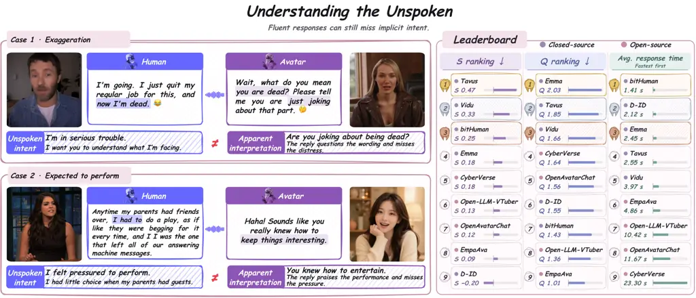
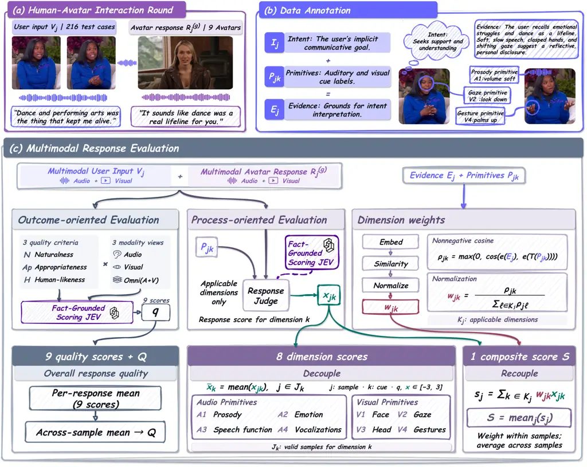
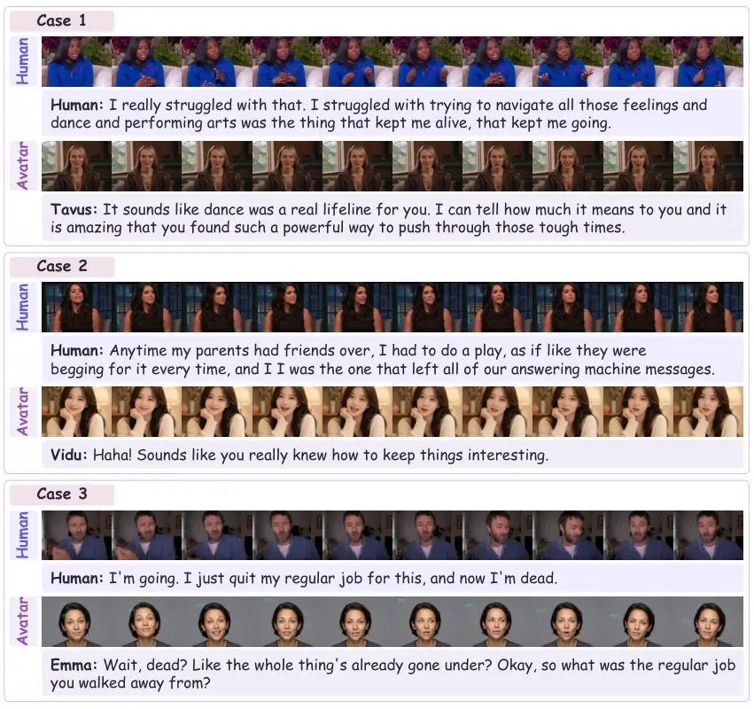

\reportbrand

RESONA \reportnameUUBench \reportsubtitle \reportversionv0.1 Preview
\reportstatusTECHNICAL REPORT — WORK IN PROGRESS
\reportwebsitehttps://resona.ai/ \reportdateNovember 2026
\reportinstitutions\institutionrow\institutionlogoassets/institutions/gbu.pdfhttps://www.gbu.edu.cn/\institutionlogo\[width=0.9height=6.5mm\]assets/institutions/hkustgz.pdfhttps://www.hkust-gz.edu.cn/\institutionlogo\[height=6.5mm\]assets/institutions/epfl.pdfhttps://www.epfl.ch/\institutionlogo\[width=0.86\]assets/institutions/cuhk.pnghttps://www.cuhk.edu.hk/\institutionrow\institutionlogo\[height=9mm\]assets/institutions/cumtb.pnghttps://www.cumtb.edu.cn/\institutionlogo\[trim=20.64bp
16.08bp 60.72bp
13.92bp,clip\]assets/institutions/kaust-full.pnghttps://www.kaust.edu.sa/\institutionlogoassets/institutions/kuleuven.pdfhttps://www.kuleuven.be/\institutionlogoassets/institutions/kit.pdfhttps://www.kit.edu/\institutionrow\institutionlogoassets/institutions/nagoya.pdfhttps://en.nagoya-u.ac.jp/\institutionlogoassets/institutions/polito.pdfhttps://www.polito.it/en\institutionlogo\[trim=46.32bp
40.32bp 43.92bp
46.32bp,clip\]assets/institutions/sjtu.pnghttps://www.sjtu.edu.cn/\institutionlogo\[trim=41bp
216bp 41bp
216bp,clip\]assets/institutions/astar.jpghttps://www.a-star.edu.sg/\institutionrow\institutionlogo\[width=0.9height=6.5mm\]assets/institutions/hkust.pdfhttps://www.hkust.edu.cn/

# UUBench: Understanding the Unspoken toward Full-Duplex Multimodal Interaction v0.1 Preview — Work in Progress

###### Abstract

Effective real-time, full-duplex multimodal interaction requires systems
to understand not only what users say, but also the communicative needs
conveyed through prosody, facial expressions, gestures, and context, and
to generate audiovisual responses that appropriately address those
needs. Existing evaluations offer limited insight into whether systems
translate an understanding of such unspoken needs into effective
responses. We introduce UUBench, a benchmark for assessing how well
multimodal interactive systems Understand the Unspoken intent and
address users’ implicit communicative needs. The inherent subjectivity
of implicit intent inference poses a key challenge for evaluation. To
address this, we introduce Process-Oriented Scoring, which grounds the
assessment of intent fulfillment in observable auditory and visual cues,
such as prosody and gestures. Rather than relying solely on a single
overall score, it evaluates how well a response addresses the
communicative needs conveyed by each applicable primitive dimension. We
aggregate the dimension-level scores according to each dimension’s
relevance to the annotated evidence. Beyond intent fulfillment,
Outcome-Oriented Scoring evaluates the naturalness, appropriateness, and
human-likeness of the reply itself under audio-only, visual-only, and
audiovisual conditions. To make these judgments traceable to observable
evidence, we propose a Fact-Grounded Scoring JEV module, which uses
structured, timestamped audiovisual observations of the user and the
digital human’s reply to assess one dimension or criterion at a time.
UUBench provides a foundation for assessing whether multimodal
interactive systems respond effectively to meaning beyond literal
wording, supporting progress toward context-aware, real-time,
full-duplex interaction.

## 1 Introduction

In everyday interactions, users often convey unstated communicative
needs through language, intonation, facial expressions, and gestures.
Listeners interpret these cues in context to infer an unstated
communicative goal (Clark, 1979; Kelly et al., 1999; Hellbernd and
Sammler, 2016). Thus, we define Implicit Intent as a communicative goal
that is not directly and fully stated in literal verbal content, but can
be inferred from verbal cues, observable nonverbal behavior, and
available context. For interactive digital humans, understanding such
intent must be reflected in generated language, vocal expression, and
visible behavior. Whether a digital human recognizes users’ unstated
needs and addresses them appropriately is therefore an important
criterion for evaluating its interactive quality. In Case I of Figure 1,
Tavus focuses on whether “I’m dead” is a joke and misses the speaker’s
distress about quitting his job. In Case II, Vidu responds playfully to
another speaker’s account of performing for her parents’ guests,
overlooking the sense of obligation in her words “I had to do a play.”
Appendix A (Case D and Case E) shows how five digital human systems
responded to these two user clips.



Figure 1: Two examples of missed intent. In Case I, the reply asks
whether “I’m dead” is literal when the speaker is describing a
predicament. In Case II, Vidu praises the speaker for entertaining her
parents’ guests but overlooks the pressure she describes. The
leaderboard ranks nine systems by evidence-weighted intent fulfillment
$`S`$ and outcome quality $`Q`$ on 216 shared inputs. Times are averaged
per system. For closed-source systems, timing runs from the end of
user-video playback until the avatar begins speaking. For open-source
systems, timing covers offline reply generation and rendering.

Existing research provides evaluation foundations for both intent
understanding and response generation. MIntRec2.0 assesses intent
recognition through multimodal classification (Zhang et al., 2024),
while VAGUE uses images to disambiguate what a speaker is asking someone
to do (Nam et al., 2025). For a subset of its clips, GesBench asks
annotators what the speaker intends, how the listener might respond, and
what led them to those judgments (Li et al., 2026). AvaMERG evaluates
empathy in textual replies and the consistency of content and style
across text, speech, and avatar video (Zhang et al., 2025a).
VidChatBench assesses dialogue coherence and audiovisual generation
quality (Zhang et al., 2025c), while LiveTalk evaluates response
content, nonverbal engagement, and consistency across turns (Chern
et al., 2025). However, these benchmarks do not systematically evaluate
whether generated digital human responses fulfill the implicit
communicative intent conveyed by users’ multimodal cues. A reply can
sound natural and stay on topic while overlooking the speaker’s need for
acknowledgment. Evaluating such intent fulfillment requires explicitly
linking the evidence supporting the inferred intent to the digital
human’s response.

To address this gap, we introduce UUBench, a benchmark for evaluating
how well digital humans respond to users’ implicit communicative
intentions. Implicit intent is not directly observable, and inferring it
from an interaction involves subjective judgment. A single rating of
intent fulfillment can obscure which aspects of the user’s need a reply
addresses. We therefore introduce Process-Oriented Scoring, which
grounds this assessment in observable auditory and visual cues. As shown
in Figure 2, the speaker describes how dance sustained her. The
annotated evidence links her words, soft voice, and lowered gaze to an
inferred need for support and understanding. We score the reply
separately for each applicable primitive dimension based on how well it
addresses the need conveyed by the corresponding cues. We then combine
these scores using weights derived from the relevance of each
primitive’s labels to the annotated evidence. Beyond intent fulfillment,
Outcome-Oriented Scoring assesses the quality of the reply itself by
rating its naturalness, appropriateness, and human-likeness under audio,
visual, and joint audiovisual observation. To ground both types of
scores in observable evidence, our Fact-Grounded Scoring JEV module uses
structured, timestamped audiovisual observations to evaluate one
primitive dimension or quality criterion at a time.

We selected 28,548 candidate user clips from four video sources—
TalkVerse (Wang et al., 2025), TalkCuts (Chen et al., 2025a),
TalkVid (Chen et al., 2025b), and SpeakerVid-5M (Zhang et al., 2025c).
Human reviewers then selected 216 high-quality clips from this pool for
evaluation. For each selected clip, annotators labeled the speaker’s
intent and the auditory and visual primitives, then recorded the words
and observable behaviors that supported their interpretation. We
evaluated five closed-source and four open-source digital human systems
on these same 216 inputs. All nine systems received positive overall
audiovisual quality scores ($`Q=1.01`$–$`2.03`$), yet each had a
negative mean score on every visual primitive dimension (Table 3). These
results suggest a shared difficulty among the evaluated systems in
addressing communicative needs conveyed through facial behavior, gaze,
head movements, and gestures.

Our main contributions are:

1.  1.  A benchmark for implicit intent fulfillment. We introduce UUBench to
        evaluate whether digital human responses address users’ implicit
        communicative intent. From a pool of 28,548 user clips, we selected
        216 for evaluation. For each selected clip, annotators identified
        the speaker’s intent, labeled the auditory and visual primitives,
        and recorded the words and behaviors supporting their
        interpretation.
2.  2.  Scoring response quality and intent fulfillment. We introduce two
        complementary scoring perspectives (Figure 2): Process-Oriented
        Scoring assesses how well the reply addresses the need conveyed by
        each applicable primitive. Outcome-Oriented Scoring measures
        audiovisual response quality ($`Q`$). Our Fact-Grounded Scoring JEV
        module grounds both assessments in structured audio-visual
        observations. We report primitive-level scores and aggregate them
        using evidence-based weights within each reply, then average across
        clips to obtain the system-level intent-fulfillment score ($`S`$).
3.  3.  Comparative evaluation of responses to implicit intent. We evaluated
        five closed-source and four open-source digital human systems with
        UUBench. All nine achieve positive overall audiovisual quality
        scores, yet each receives negative mean intent-fulfillment scores
        across all four visual primitive dimensions: facial behavior, gaze,
        head movements, and gestures (Table 3). These findings show that
        positive overall audiovisual quality scores can coexist with
        systematic shortcomings in addressing visually conveyed intent,
        motivating further research into how digital humans can translate
        multimodal intent understanding into appropriate responses.

## 2 Related Work



Figure 2: Evaluation pipeline of UUBench. (a) A user describes dance as
a lifeline, and an avatar responds. (b) The speaker’s words, soft voice,
lowered gaze, and upturned palms provide evidence that she seeks support
and understanding. (c) Fact-Grounded Scoring JEV assesses audiovisual
response quality ($`Q`$) and how well the response addresses the needs
conveyed by each applicable primitive. The latter scores are reported by
dimension ($`\bar{x}_{k}`$) and combined within each response using
evidence-based weights to obtain the system score $`S`$ after averaging
across clips.

### 2.1 Multimodal Intent Recognition and Pragmatic Understanding

Multimodal intent benchmarks examine how language, nonverbal behavior,
and context inform communicative interpretation. MIntRec provides
utterance-level intent classification (Zhang et al., 2022), while
MIntRec2.0 extends this setting to multi-party conversations and
out-of-scope detection (Zhang et al., 2024). VAGUE pairs an ambiguous
expression with an image and asks what action the speaker is requesting
(Nam et al., 2025). READI tests whether models can use an image to infer
a speaker’s directive intent across three levels of indirectness in the
utterance (Kim et al., 2026). GesBench examines how interpretations
change as an utterance unfolds. For 590 of its 6,208 clips, annotators
describe the speaker’s intent, suggest how a listener might respond, and
explain their judgments (Li et al., 2026). Table 1 summarizes the
references these tasks provide. Predicting what a listener might do and
evaluating how well an actual reply addresses the speaker’s need are
distinct tasks.

### 2.2 Interactive Digital Human Generation

Interactive digital human generation combines conversational behavior
with audiovisual synthesis. INFP uses both participants’ audio to
animate an avatar’s head and face as it speaks and listens (Zhu et al.,
2025), while Avatar Forcing conditions causal generation on user audio
and motion together with avatar speech to support real-time reactions
(Ki et al., 2026). Sustained interaction also requires temporal
consistency and behavioral control. SoulX-LiveAct enables hour-scale,
real-time animation with bounded historical memory and controllable
expressions and actions (Zhen et al., 2026). At the
conversational-system level, LiveTalk connects an audio language model
with streaming video generation for multi-turn interaction (Chern
et al., 2025), while InteractiveAvatar uses transcribed user speech and
the avatar’s current state to plan a spoken reply and accompanying
actions (Song et al., 2026). These developments make coordinated speech
and visible feedback central to digital human interaction. Evaluating
such systems therefore requires assessing both the quality of
audiovisual realization and whether the generated behavior appropriately
responds to the user’s communicative goal.

### 2.3 Evaluation of Digital Human Responses

Existing evaluations address several aspects of this problem. THEval
measures talking-head quality, naturalness, and synchronization (Quignon
et al., 2025). ViCo evaluates responsive listening behavior using paired
speaker–listener recordings (Zhou et al., 2022); MARS, introduced for
REACT 2025, supports multiple acceptable facial reactions and evaluates
appropriateness, diversity, synchrony, and realism (Song et al., 2025).
AvaMERG annotates emotion causes and response goals to support
empathetic reasoning. Its human evaluation rates empathy in textual
replies and assesses the consistency of content and style across text,
speech, and avatar video (Zhang et al., 2025a). VidChatBench evaluates
dialogue coherence alongside visual quality, identity preservation,
audiovisual synchronization, and the alignment of facial expressions in
generated and reference videos (Zhang et al., 2025c). LiveTalk evaluates
the semantic relevance of replies, nonverbal engagement, and visual and
behavioral consistency across turns (Chern et al., 2025).

UUBench links each annotated intent to observable cues in the user’s
clip. For each applicable auditory or visual primitive, it scores how
well the generated reply addresses the need those cues convey. For
example, a user describing a friend’s move abroad as “a great
opportunity for her” may speak at a lower pitch and volume, shift their
gaze downward, turn down the corners of their mouth, and bow their head.
A digital human should interpret these cues in context and recognize
that the user may be seeking acknowledgment of their reluctance to part
and disappointment about the separation.

Figure 3: Primitive applicability across the 216 evaluation clips. Each
clip contributes once to every dimension marked applicable. Counts give
the number of clips for each dimension. Slice sizes and percentages show
each dimension’s share of all 1,219 clip–dimension assignments.

## 3 UUBench

### 3.1 Task Definition and Benchmark Overview

We define _implicit communicative intent_ as a speaker’s communicative
goal that they seek to make recognizable through expression in a
particular interaction, but that is not directly and fully stated in the
literal verbal content and must instead be inferred from relevant
evidence in expression, observable nonverbal behavior, and available
context (Clark, 1979; Sperber and Wilson, 2002; Kelly et al., 1999;
Hellbernd and Sammler, 2016).

A visible cue such as lowered gaze can support an interpretation of the
speaker’s stance. Inferring a communicative goal, such as seeking
reassurance, also requires considering what the speaker says and the
context of the exchange.



Figure 4: Examples of user clips and digital human responses. Each case
presents sampled frames and transcripts from the user and the responding
system. The examples illustrate acknowledgment of a personal experience
(Case 1), a playful reply to a recollection of being expected to perform
(Case 2), and a follow-up question prompted by a figurative expression
(Case 3). Audio delivery and temporal coordination cannot be fully
assessed from static frames and transcripts alone.

For sample $`j`$, let $`V_{j}`$ be the user video with its original
audio, and let product $`g`$ generate

```math
R_{j}^{(g)}=G^{(g)}(V_{j};C^{(g)}), \tag{1}
```

where $`C^{(g)}`$ contains the product’s actual persona and system
configuration. The reference for clip $`j`$ comprises the speaker’s
intent $`I_{j}`$, the primitives $`P_{jk}`$ in each dimension $`k`$, and
the supporting evidence $`E_{j}`$. The source annotation determines the
applicable set $`K_{j}`$ and is withheld from the product.

|                                               |       |                       |                     |                     |                     |
| --------------------------------------------- | ----- | --------------------- | ------------------- | ------------------- | ------------------- |
| Dataset                                       | Input | Evaluation Target     | Annotations         |                     |                     |
|                                               |       |                       | Intent              | Evidence            | Response Ref.       |
| Multimodal intent and pragmatic understanding |       |                       |                     |                     |                     |
| MIntRec (Zhang et al., 2022)                  | T,A,V | Intent interpretation | $`\checkmark`$      | $`\times`$          | $`\times`$          |
| MIntRec2.0 (Zhang et al., 2024)               | T,A,V | Intent interpretation | $`\checkmark`$      | $`\times`$          | $`\times`$          |
| VAGUE (Nam et al., 2025)                      | T,I   | Intent interpretation | $`\checkmark`$      | $`\times`$          | $`\times`$          |
| READI (Kim et al., 2026)                      | T,I   | Intent interpretation | $`\checkmark`$      | $`\times`$          | $`\times`$          |
| GesBench (Li et al., 2026)                    | A,V   | Intent interpretation | $`\checkmark`$^(\*) | $`\checkmark`$^(\*) | $`\checkmark`$^(\*) |
| Interactive response generation               |       |                       |                     |                     |                     |
| ViCo (Zhou et al., 2022)                      | A,V   | Nonverbal reaction    | $`\times`$          | $`\times`$          | $`\checkmark`$      |
| MARS (Song et al., 2025)                      | A,V   | Nonverbal reaction    | $`\times`$          | $`\times`$          | $`\checkmark`$      |
| AvaMERG (Zhang et al., 2025a)                 | T,A,V | Audiovisual response  | $`\triangle`$       | $`\triangle`$       | $`\checkmark`$      |
| VidChatBench (Zhang et al., 2025c)            | A,V   | Audiovisual response  | $`\times`$          | $`\times`$          | $`\checkmark`$      |
| Implicit-intent response evaluation           |       |                       |                     |                     |                     |
| UUBench (Ours)                                | A,V   | Audiovisual response  | $`\checkmark`$      | $`\checkmark`$      | $`\checkmark`$      |

T/A/I/V: text/audio/image/video. A check mark indicates that the
annotation is available. ^(\*)GesBench provides these annotations for a
subset of its clips. Its response references describe possible listener
actions in text. $`\triangle`$: related annotations—response goals and
emotion causes (AvaMERG). $`\times`$: not reported under these
definitions.

Table 1: Datasets for multimodal intent understanding and interactive
responses. We compare datasets by input modality, evaluation target, and
the annotations available for evaluating a response. Intent denotes the
speaker’s goal, and Evidence denotes the cues that support its
interpretation. For UUBench, Response Ref. denotes the auditory and
visual primitives annotated in the user input.

### 3.2 Data Collection and Curation

We sought exchanges in which a digital human could respond to a
speaker’s communicative needs. We screened clips from four video
sources— TalkVerse (Wang et al., 2025), TalkCuts (Chen et al., 2025a),
TalkVid (Chen et al., 2025b), and SpeakerVid-5M (Zhang et al., 2025c).
In the initial text-based screening, Qwen3-VL-32B-Instruct (Bai et al., 2025) rated five aspects of each clip. The model assessed whether the
speaker addressed an interlocutor, conveyed an implicit intent, and
called for a reply. It also assessed how narrowly the utterance
constrained an appropriate reply and whether the context was complete.
Each criterion received 0, 1, or 2 points. A total of 8–10 across the
five criteria qualified a clip for human review, yielding 28,548
candidates.

In a separate review of each candidate clip, human annotators alone
determined whether the speaker conveyed an unstated communicative need.
They prioritized exchanges with a clear addressee and enough context for
a meaningful reply, selecting 216 high-quality clips for the shared
evaluation set.

Figure 3 shows how often each auditory or visual primitive applies in
the evaluation subset. A clip can contribute to more than one dimension.
Figure 4 pairs three user clips with the corresponding digital human
replies, showing sampled frames and transcripts for both sides of each
exchange.

### 3.3 Annotating Intent, Primitives, and Supporting Evidence

For each of the 216 evaluation clips, human annotators identified the
speaker’s communicative intent ($`I`$) and labeled the applicable
auditory and visual primitives ($`P`$). Table 2 groups the cues into
four auditory and four visual dimensions. For example, the prosody
dimension captures pauses and changes in pitch, while the
speaker-emotion dimension describes the affect or stance conveyed by the
voice.

Annotators interpreted the speaker’s words alongside the vocal and
visual cues they identified in the clip. After labeling the intent and
primitives, they documented the supporting evidence ($`E`$). In the
evidence annotation, annotators identified relevant words, vocal cues,
or visible behaviors in the clip and explained how these supported their
interpretation of the speaker’s intent.

For clip $`j`$, the primitive labels determine the set of dimensions
$`K_{j}`$ used to evaluate every system’s reply to that clip. On each
dimension, we assess how well the reply addresses the need conveyed by
the user’s cues. In Figure 2, for example, the speaker’s soft voice and
lowered gaze give context to her account of how dance sustained her. A
digital human can address her implied need for understanding by
acknowledging in words what dance has meant to her.

|                     |                                                          |
| ------------------- | -------------------------------------------------------- |
| ID                  | Dimension and source-side evidence                       |
| Auditory primitives |                                                          |
| A1                  | Prosody: pitch, loudness, rate, stress, rhythm, pauses   |
| A2                  | Speaker emotion: auditory evidence for affect or stance  |
| A3                  | Speech function: question, complaint, sharing, challenge |
| A4                  | Nonverbal vocalizations: laughter, crying, sighs         |
| Visual primitives   |                                                          |
| V1                  | Facial behavior: visible facial actions                  |
| V2                  | Gaze: direction, target, and changes                     |
| V3                  | Head movements: nods, shakes, turns                      |
| V4                  | Arm and hand gestures: pointing, movements, self-touch   |

Table 2: Auditory and visual primitive dimensions and the observable
cues used to annotate the user input.

### 3.4 Perception and Evidence Preparation

The annotated intent $`I_{j}`$ records the annotators’ interpretation of
the speaker’s goal. Our _Fact-Grounded Scoring JEV_ module uses
timestamped observations of the user clip and the avatar’s response to
assign the scores in Figure 2(c). For each outcome-oriented score
$`q_{j,m,c}`$, Jev (TypeSafe AI, 2026) retains the full user context and
rates one quality criterion using the audio, visual, or combined
audiovisual observations of the response. For each process-oriented
score $`x_{jk}`$, Jev uses the full audiovisual observations of both
participants and the user’s labels for primitive $`k`$ to judge how well
the reply addresses the need conveyed by those cues (Figure ). We use
the relevance of those labels to the annotators’ supporting evidence
$`E_{j}`$ to weight the resulting primitive scores (Section 3.6).

Visual descriptions use silent frames sampled at a target rate of 6 FPS,
with native timestamps retained. Qwen3.5-397B-A17B-FP8 (Qwen Team, 2026)
generates visual descriptions for all user clips and for responses from
all nine systems. Transcription and alignment use Qwen3-ASR-1.7B and
Qwen3-ForcedAligner-0.6B (Shi et al., 2026). Qwen3-Omni-30B-A3B-Instruct
(Xu et al., 2025) describes audible delivery and other sounds from the
audio track alone. These descriptions, aligned utterances, and
time-localized visual observations form the records that Jev scores.
This observation stage preserves the original primitive labels and
applicability masks. Appendix B.2 provides the prompts used to describe
the visual and auditory content of the user clips and avatar replies.

Technical measurements supplement these descriptions: SyncNet supplies
lip-synchronization evidence, Q-Align supplies image quality, and
frame-based measures characterize motion smoothness and temporal
stability (Chung and Zisserman, 2016; Wu et al., 2024; Huang et al.,
2024). Each measurement is supplied only to relevant outcome criteria.
Primitive scoring receives audiovisual descriptions without these
measurements, and source weights are withheld from all Jev requests.

|                      |                 |                             |      |      |        |      |       |      |      |       |                                      |                             |       |       |       |                   |       |       |       |                                      |
| -------------------- | --------------- | --------------------------- | ---- | ---- | ------ | ---- | ----- | ---- | ---- | ----- | ------------------------------------ | --------------------------- | ----- | ----- | ----- | ----------------- | ----- | ----- | ----- | ------------------------------------ |
| Avatar Configuration |                 | Outcome-oriented Evaluation |      |      |        |      |       |      |      |       |                                      | Process-oriented Evaluation |       |       |       |                   |       |       |       |                                      |
|                      |                 | Audio                       |      |      | Visual |      |       | Omni |      |       |                                      | Auditory primitives         |       |       |       | Visual primitives |       |       |       |                                      |
| System               | Model           | N                           | Ap   | H    | N      | Ap   | H     | N    | Ap   | H     | $`Q^{{\color[rgb]{0,0,0}\bigstar}}`$ | A1                          | A2    | A3    | A4    | V1                | V2    | V3    | V4    | $`S^{{\color[rgb]{0,0,0}\bigstar}}`$ |
| Closed-source Avatar |                 |                             |      |      |        |      |       |      |      |       |                                      |                             |       |       |       |                   |       |       |       |                                      |
| Emma                 | –               | 2.78                        | 2.21 | 2.04 | 2.84   | 1.16 | 1.94  | 1.73 | 1.85 | 1.76  | 2.03                                 | 0.46                        | -0.04 | 0.79  | 0.23  | -0.08             | -0.15 | -0.13 | -0.15 | 0.18                                 |
| Tavus                | –               | 2.84                        | 2.51 | 1.89 | 2.69   | 1.70 | 1.08  | 0.93 | 2.08 | 0.90  | 1.85                                 | 0.67                        | 0.59  | 1.24  | 0.47  | -0.02             | -0.08 | -0.17 | -0.15 | 0.47                                 |
| Vidu                 | –               | 2.79                        | 2.54 | 2.13 | 2.31   | 1.31 | 0.35  | 1.26 | 1.91 | 0.35  | 1.66                                 | 0.54                        | 0.40  | 0.91  | 0.68  | -0.08             | -0.11 | -0.15 | -0.16 | 0.33                                 |
| D-ID                 | –               | 2.49                        | 2.37 | 1.58 | 2.44   | 2.12 | -0.30 | 0.98 | 1.97 | 0.26  | 1.55                                 | -0.03                       | -0.14 | -0.10 | -0.07 | -0.32             | -0.34 | -0.35 | -0.32 | -0.20                                |
| bitHuman             | –               | 2.49                        | 2.59 | 1.65 | 2.62   | 0.98 | 0.41  | 0.41 | 1.71 | 0.01  | 1.43                                 | 0.59                        | 0.07  | 0.83  | 0.61  | -0.20             | -0.10 | -0.17 | -0.13 | 0.25                                 |
| Open-source Avatar   |                 |                             |      |      |        |      |       |      |      |       |                                      |                             |       |       |       |                   |       |       |       |                                      |
| CyberVerse           | SoulX-LiveAct   | 2.61                        | 2.59 | 1.92 | 2.39   | 2.25 | -0.30 | 0.61 | 2.24 | 0.45  | 1.64                                 | 0.34                        | 0.11  | 0.74  | 0.21  | -0.03             | -0.13 | -0.21 | -0.23 | 0.18                                 |
| OpenAvatarChat       | LiteAvatar      | 2.61                        | 2.59 | 1.92 | 2.43   | 1.73 | -0.58 | 1.37 | 1.97 | 0.00  | 1.56                                 | 0.28                        | 0.01  | 0.72  | 0.17  | -0.20             | -0.17 | -0.26 | -0.23 | 0.12                                 |
| Open-LLM-VTuber      | Live2D          | 2.60                        | 2.60 | 1.92 | 1.91   | 1.43 | -0.71 | 0.80 | 1.87 | -0.15 | 1.36                                 | 0.29                        | 0.01  | 0.69  | 0.22  | -0.19             | -0.13 | -0.25 | -0.20 | 0.13                                 |
| EmpaAva              | GaussianAvatars | 2.57                        | 2.59 | 1.92 | 1.82   | 0.17 | -1.24 | 0.62 | 1.05 | -0.42 | 1.01                                 | 0.25                        | 0.01  | 0.66  | 0.15  | -0.25             | -0.20 | -0.28 | -0.26 | 0.09                                 |

N: naturalness; Ap: appropriateness; H: human-likeness. Model denotes
the avatar backend for open-source systems; a dash indicates that a
specific backend is not reported. Rows are sorted by $`Q`$ within each
group; values are rounded to two decimals. All modality metrics, $`Q`$,
and $`S`$ have $`n=216`$ per system. Valid counts for A1–A4 and V1–V4
are 209, 203, 214, 20, 95, 214, 132, and 132; dimension definitions are
in Table 2.

Table 3: Nine-system performance on UUBench ($`N=216`$ shared inputs;
1,944 responses). The left block reports nine modality scores and their
mean $`Q`$; the right block reports eight primitive means
$`\bar{x}_{k}`$ and the evidence-weighted composite $`S`$. All scores
lie in $`[-3,3]`$; higher is better.   and  , together with boldface,
denote within-group column maxima for closed-source and open-source
systems, respectively; underlining denotes column maxima across all nine
systems. All maxima are determined before rounding. $`\bigstar`$ marks
aggregate scores.

### 3.5 Outcome-Oriented Evaluation: Modality Perspective

For each response, Jev scores three criteria under each of three
observation conditions (Audio, Visual, and Omni), yielding nine scores
$`q_{j,m,c}\in[-3,3]`$. Naturalness concerns fluency, continuity,
timing, and coordination. Appropriateness concerns how the wording,
delivery, or visible expression fits the interaction. Human-likeness
concerns whether the observed vocal or visible behavior is credible as
human communication.

| View   | Criterion                       | Frame timing   | Image and motion | Lip sync       |
| ------ | ------------------------------- | -------------- | ---------------- | -------------- |
| Audio  | All three criteria              | –              | –                | –              |
| Visual | Naturalness                     | $`\checkmark`$ | $`\checkmark`$   | –              |
|        | Appropriateness, human-likeness | $`\checkmark`$ | –                | –              |
| Omni   | Naturalness                     | $`\checkmark`$ | $`\checkmark`$   | $`\checkmark`$ |
|        | Appropriateness                 | $`\checkmark`$ | –                | –              |
|        | Human-likeness                  | $`\checkmark`$ | –                | $`\checkmark`$ |

Table 4: Auxiliary measurements supplied to Jev for each
outcome-oriented rating. Image and motion measurements comprise IQA,
Motion-S, and Temporal-F. Lip sync denotes the SyncNet measurements. A
check mark indicates that the measurement is supplied when available. A
dash indicates that the measurement group is omitted.

The observation condition determines which parts of the avatar reply Jev
can use. Audio ratings use the reply transcript and auditory
observations. Visual ratings use observations from silent frames. Omni
ratings use both sources and the corresponding time-aligned audiovisual
events. Table 4 lists the auxiliary measurements available for each
rating. Appendix B.3.1 gives the scoring criteria and explains how Jev
interprets each measurement alongside observations from the same
interval.

For Visual and Omni Naturalness, IQA provides supporting evidence for
visible blur or distortion. The rubric directs Jev to interpret Motion-S
alongside native frame gaps, repeated frames, and movement in individual
facial regions because a nearly still face can yield a high smoothness
value. Temporal-F provides evidence of flicker only in documented
low-motion intervals with a stable head position, camera, and crop. For
Omni Naturalness and Human-likeness, Sync-C and Sync-D characterize the
best audio–mouth match across candidate offsets. The rubric instructs
Jev to compare the estimated offset and the distance on the original
timeline, $`D(0)`$, with the timing of observed speech and mouth
movements at onsets, pauses, and endings. If a measurement is
unavailable, the rubric directs Jev to use the remaining observations.

For the shared set of $`N=216`$ inputs, each system-level modality score
is

```math
Q_{m,c}=\frac{1}{N}\sum_{j=1}^{N}q_{j,m,c}. \tag{2}
```

Each of the nine metrics is accompanied by its valid denominator. Omni
is judged jointly and is not computed by averaging Audio and Visual. For
the overall outcome score, we first average the nine scores within each
response and then average across responses:

```math
Q_{j}=\frac{1}{9}\sum_{m,c}q_{j,m,c},\qquad Q=\frac{1}{N}\sum_{j=1}^{N}Q_{j}. \tag{3}
```

A response has a valid $`Q_{j}`$ only when all nine component scores are
valid. The full system $`Q`$ requires all $`N`$ responses; otherwise it
is reported as missing together with coverage. A valid-subset diagnostic
mean, if provided, is labeled separately. All nine metrics and $`Q`$ are
complete for every reported system. Auxiliary measurements inform the
relevant judgments without being converted to $`q`$ by a fixed formula.

### 3.6 Process-Oriented Evaluation: Evidence Perspective

For each applicable dimension $`k\in K_{j}`$, Jev uses audiovisual
observations of the user and the reply, together with the user’s labels
for dimension $`k`$, to rate how fully the reply addresses what the cue
conveys in context. The resulting primitive rating is
$`x_{jk}\in[-3,3]`$. The rubric’s negative anchors range from a local
misreading to a reply that reverses the cue’s meaning or entirely misses
an essential response. The zero anchor describes an ordinary
continuation that fits the cue when no special response is needed. The
positive anchors range from addressing part of the cue’s meaning to
addressing it fully and proportionately. Appendix B.3.2 gives the
seven-point rubric and examples for each of the eight primitive
dimensions. Jev judges labels within a dimension jointly. The original
annotation determines applicability, without an additional
evidence-sufficiency check. Inapplicable and unknown dimensions remain
unscored and are excluded from $`K_{j}`$.

Before response scoring, weights $`w_{jk}`$ were computed from each
user’s supporting evidence and primitive labels and normalized over
$`K_{j}`$. All systems share the same weights for a given clip. We use
these weights to combine the primitive ratings into a reply score
$`s_{j}`$, then average the reply scores across clips to obtain the
system score $`S`$.

##### Source-side weights.

Weights are fixed independently of product responses. Let $`e`$ denote
Qwen3-Embedding-8B (Zhang et al., 2025b), using last-token pooling,
$`L_{2}`$ normalization, and no query prompt. The template $`T(P_{jk})`$
contains the primitive dimension key followed by its sorted, unique cue
labels. Here $`E_{j}`$ denotes the original supporting evidence used to
compute the weights. Jev receives the audiovisual observation records
described in Section 3.4. We define

```math
\displaystyle\rho_{jk} \displaystyle=\max\!\left(0,\cos(e(E_{j}),e(T(P_{jk})))\right), \tag{4}
```

```math
\displaystyle w_{jk} \displaystyle=\frac{\rho_{jk}}{\sum_{\ell\in K_{j}}\rho_{j\ell}}. \tag{5}
```

The same frozen source weights are reused across systems, without
recomputation from the current observations or tuning to response
scores. They measure textual relevance under this encoder. The
implementation clips cosine values to $`[-1,1]`$ before applying the
nonnegative constraint. A denominator at or below $`10^{-8}`$ yields
undefined weights, with no equal-weight fallback. All 216 input weight
vectors in the reported run are defined.

##### Decouple: dimension-level diagnosis.

For $`J_{k}`$, the set of samples where dimension $`k`$ is applicable
and validly scored, we compute

```math
\bar{x}_{k}=\frac{1}{|J_{k}|}\sum_{j\in J_{k}}x_{jk}. \tag{6}
```

The eight $`\bar{x}_{k}`$ values are unweighted means. They reveal which
cue-supported requirements are handled adequately, subject to each
dimension’s sample composition. Co-occurring cues mean that these values
cannot isolate a modality’s causal contribution.

##### Recouple: sample-level integration.

We combine applicable dimensions within each sample before averaging
over samples:

```math
s_{j}=\sum_{k\in K_{j}}w_{jk}x_{jk},\qquad S=\frac{1}{N}\sum_{j=1}^{N}s_{j}. \tag{7}
```

A valid $`s_{j}`$ requires a nonempty $`K_{j}`$, defined weights, and
valid scores for every applicable dimension, including those assigned
zero weight. Inapplicable and unknown dimensions have null scores and
zero weights; they contribute no term and never enter primitive means as
zero-valued observations. An invalid active score makes $`s_{j}`$
missing, without renormalizing the remaining weights. Full system $`S`$
requires all $`N`$ valid composites. Completeness is assessed
independently for $`Q`$ and $`S`$.

The framework reports nine modality metrics, their overall mean $`Q`$,
eight primitive means $`\bar{x}_{k}`$, and the evidence-weighted
composite $`S`$, giving 19 reported values per system. All lie in
$`[-3,3]`$. $`S`$ belongs entirely to the evidence perspective and
excludes $`Q`$. Decoupling locates differences and recoupling summarizes
requirement handling under the available evidence, without claiming to
reconstruct the product’s cognitive process.

Figure 5 summarizes how UUBench scores individual responses and
aggregates the results for each system. For five worked examples,
Appendix A shows the primitive weights shared across systems and the
quality and primitive scores assigned to each reply.

## 4 Experiments

### 4.1 Experimental Setup

We evaluated nine digital human systems on the same 216 user clips. The
five closed-source systems were Emma (Nuance Labs, 2026), Tavus (n.d.),
Vidu (n.d.), D-ID (n.d.), and bitHuman (n.d.). The four open-source
systems were CyberVerse (Lynpoint, n.d.) with SoulX-LiveAct (Zhen
et al., 2026), OpenAvatarChat (Cheng et al., 2025) with LiteAvatar
(Zhuang et al., 2022), Open-LLM-VTuber (n.d.) with Live2D (Live2D Inc.,
n.d.), and EmpaAva (Yang et al., 2026) with GaussianAvatars (Qian
et al., 2024) and DEEPTalk (Kim et al., 2025). We used the same
response-generation prompt for all nine systems (Appendix B.1) and
scored all replies using the protocol in Section 3.

 

Input User clips $`H_{i}`$, frozen primitive annotations $`A_{i}`$ and
source weights $`w_{i}`$, systems $`p`$ with their collection settings,
and the Jev rubric.

1  for each user clip $`H_{i}`$ do

2   Obtain full-frame audiovisual observations $`U_{i}`$ and read the
applicable dimensions $`K_{i}`$ from $`A_{i}`$.

3   for each system $`p`$ do

4    Obtain the response of system $`p`$ to $`H_{i}`$ under its recorded
configuration.

5    Select the approved face-cropped reply clip for scoring.

6    Obtain the reply’s visual and auditory observations $`V_{ip}`$ and
auxiliary measurements $`M_{ip}`$.

7    for each modality–criterion pair $`t=(m,c)\in\mathcal{T}`$ do

8     $`q_{ipt}\leftarrow\operatorname{JevScore}(t,\,U_{i},\,A_{i},\,\operatorname{Select}_{t}(V_{ip},M_{ip}))`$.

9    for each applicable primitive dimension $`k\in K_{i}`$ do

10     $`x_{ipk}\leftarrow\operatorname{JevScore}(k,\,U_{i},\,A_{ik},\,V_{ip})`$.

11    Compute response scores
$`Q_{ip}\leftarrow\frac{1}{9}\sum_{t\in\mathcal{T}}q_{ipt}`$ and
$`s_{ip}\leftarrow\sum_{k\in K_{i}}w_{ik}\,x_{ipk}`$.

12  for each system $`p`$ do

13   Average each $`q_{ipt}`$ across inputs to obtain the nine
modality–quality means $`\bar{q}_{pt}`$.

14   For each $`k`$, average $`x_{ipk}`$ over inputs where $`k`$ is
applicable and validly scored to obtain $`\bar{x}_{pk}`$.

15   Average $`Q_{ip}`$ and $`s_{ip}`$ across the same $`N`$ inputs to
obtain $`Q_{p}`$ and $`S_{p}`$, respectively.

16   report $`\{\bar{q}_{pt}\}_{t\in\mathcal{T}},\ Q_{p},\ \{\bar{x}_{pk}\}_{k=1}^{8},\ S_{p}`$.

 

Observation and scoring. Visual descriptions use silent frames sampled
at a target rate of 6 FPS. Given the selected observations, the full
rubric, and the target-specific scoring rule,
$`\operatorname{JevScore}`$ returns the final rating from jev-1.14.0 on
the $`[-3,+3]`$ scale. $`\mathcal{T}`$ contains the nine pairs of a
modality $`m`$ (Audio, Visual, Omni) and a quality criterion $`c`$
(Naturalness, Appropriateness, Human-likeness).
$`\operatorname{Select}_{t}`$ retains the reply fields and measurements
allowed for $`t`$. Each $`x_{ipk}`$ rates how well the reply addresses
the requirement conveyed by dimension $`k`$.

Coverage. $`Q_{ip}`$ requires all nine valid $`q`$ scores. $`s_{ip}`$
requires a nonempty $`K_{i}`$, defined weights, and valid $`x`$ scores
for every $`k\in K_{i}`$. Each system total requires its own $`N=216`$
valid response scores. Report missing totals with coverage.

 

Figure 5: Pseudocode for the UUBench evaluation pipeline.

(a) Closed-source systems. Circle sizes show reported API expenditure on
a nonlinear scale. The diamond marks Emma, for which cost was
unavailable. The dollar, lightning, and star symbols mark the lowest
reported cost, shortest recorded response time, and highest score,
respectively.

(b) Open-source systems. Markers have equal sizes because local
deployment costs were unavailable. The lightning and star symbols mark
the shortest response time and highest score, respectively.

Figure 6: Response time and evaluation scores. Both panels plot $`Q`$
and $`S`$ against mean response time. For closed-source systems (a),
timing runs from the end of user-video playback until the avatar starts
speaking. For open-source systems (b), response time is the sum of reply
generation and avatar rendering or recording time. Dashed lines trace
the time–score frontier within each panel and extend to the longest
observed time.

### 4.2 Overall Results

All nine systems received positive overall audiovisual quality scores
($`Q=1.01`$ to $`2.03`$). For every system, however, the mean scores for
responding to the user’s facial behavior, gaze, head movements, and
gestures were all negative (Table 3). Across systems and dimensions,
these means ranged from $`-0.35`$ to $`-0.02`$. On this evaluation set,
replies could earn positive overall quality ratings while still falling
short on needs conveyed through visible behavior.

The two perspectives also ranked the systems differently (Figure 1).
Emma had the highest $`Q`$ ($`2.03`$), while Tavus had the highest
evidence-weighted intent-fulfillment score $`S`$ ($`0.47`$). Among the
four open-source systems, CyberVerse with SoulX-LiveAct had the highest
$`Q`$ ($`1.64`$) and $`S`$ ($`0.18`$).

### 4.3 Outcome-Oriented Results: Audiovisual Response Quality

Which system led on human-likeness depended on whether Jev assessed the
voice or the visible behavior. Vidu scored highest for audio
human-likeness ($`2.13`$), while Emma scored highest for both visual
($`1.94`$) and audiovisual human-likeness ($`1.76`$). For the four
open-source systems, audio human-likeness rounded to $`1.92`$ in every
case, while visual human-likeness ranged from $`-1.24`$ to $`-0.30`$.
Across all nine systems, speech received higher human-likeness ratings
than visible behavior. All nine scored positively on visual naturalness,
yet five scored negatively on visual human-likeness. This pattern
suggests that an avatar’s movements can look fluid and coordinated while
its visible behavior remains less convincing in conversation.

### 4.4 Process-Oriented Results: Responding to User Cues

The primitive scores evaluate how well the reply addresses the need
conveyed by a cue in the user clip. For example, although Emma received
the highest score for the human-likeness of its own visible behavior,
its mean scores for responding to the user’s facial behavior, gaze, head
movements, and gestures were $`-0.08`$, $`-0.15`$, $`-0.13`$, and
$`-0.15`$, respectively. A spoken acknowledgment can address a need
conveyed by a user’s expression or movement.

The auditory primitives showed a different pattern. Eight of the nine
systems had positive means for speech function (A3), which measures how
well a reply addresses the communicative purpose of the user’s
utterance. Tavus had the highest mean on A3 ($`1.24`$, 214 applicable
clips). Vidu led on nonverbal vocalizations (A4, $`0.68`$). All nine
systems, however, had negative means on each of the four visual
primitives. The contrast with speech function suggests that, on this
subset, most systems responded more successfully to the purpose of an
utterance, such as asking a question or sharing an experience, than to
needs conveyed through the speaker’s expression, gaze, or movements.

### 4.5 API Cost and Response Time

For the five closed-source systems, we measured response time from the
end of user-video playback to the first audible speech from the avatar.
Figure 6(a) plots audiovisual quality ($`Q`$) and intent fulfillment
($`S`$) against mean response time across the 216 clips. Circle size
indicates reported API expenditure, which ranged from \$31.93 for D-ID
to \$43.63 for Vidu. For each open-source system, we computed response
time per clip by adding the time to generate the reply to the time to
render or record the avatar video (Figure 6(b)). EmpaAva had the
shortest mean response time (4.86 s) and the lowest scores on both
measures. CyberVerse with SoulX-LiveAct took the longest (23.30 s) and
scored highest on both.

Higher API expenditure did not consistently correspond to better replies
among the closed-source systems. Vidu had the highest reported API
expenditure among the closed-source systems, yet Tavus cost \$3.66 less
and scored higher on both audiovisual quality and intent fulfillment.
Even Tavus, which ranked first on intent fulfillment across all nine
systems, had negative mean scores for responding to facial behavior,
gaze, head movements, and gestures (Table 3). Thus, responding to needs
expressed through visible behavior remained a weakness even for the
system with the highest aggregate intent-fulfillment score.

For the open-source systems, the relationship between response time and
performance depended on the scoring objective. OpenAvatarChat took
1.25 s longer per clip than Open-LLM-VTuber on average and scored 0.20
points higher on audiovisual quality (1.56 vs. 1.36), with no
corresponding gain in intent fulfillment (0.12 vs. 0.13). In this
comparison, the extra time to produce the complete video coincided with
higher audiovisual quality and little difference in intent fulfillment.

## 5 Conclusion

We introduce UUBench to evaluate how well digital humans respond to what
users leave unsaid. From a collection of 28,548 user clips, we curated
216 evaluation clips and annotated each speaker’s intent, the auditory
and visual primitives present in the clip, and the evidence linking
those cues to the intent. These annotations make it possible to ask
which aspects of an inferred need a reply addresses. Our _Fact-Grounded
Scoring JEV_ module uses structured observations of the user and the
digital human for both assessments. Outcome-oriented scoring evaluates
the audiovisual quality of the reply. Process-oriented scoring evaluates
how well the reply addresses the need conveyed by each applicable
primitive, then combines the scores using weights derived from the
annotated evidence.

Evaluating five closed-source and four open-source systems on the same
clips revealed a consistent gap between audiovisual quality and
responsiveness to visual cues. All nine systems earned positive overall
audiovisual quality scores, yet each had negative mean scores for
responding to needs conveyed by facial behavior, gaze, head movements,
and gestures (Table 3). A digital human may produce a natural facial
expression yet give a reply that overlooks what the user’s own
expression conveys. By scoring how a reply addresses the needs supported
by specific cues, UUBench identifies which aspects of the user’s intent
the reply may have missed. This allows future evaluations to test
whether improvements in how digital humans look and sound are
accompanied by better responses to what users leave unsaid.

## Limitations

The current evaluation set comprises 216 user clips, with limited scale
and coverage of communicative intents, interaction contexts, and
multimodal cues. Some cues are applicable to relatively few clips,
limiting detailed comparisons across contexts and cue combinations. The
reported results therefore characterize the evaluated systems on the
current dataset; larger-scale evaluations are needed to assess whether
these findings generalize to broader interaction settings.

The automated judge Jev and the evidence-weighting mechanism have not
yet been systematically validated against independent human ratings.
Although the framework organizes scoring around concrete audiovisual
cues, agreement with human judgments at the dimension level and in
overall intent fulfillment remains to be quantified. Whether evidence
weighting better reflects human judgments of responses than alternative
aggregation schemes also requires validation.

The current study also lacks systematic ablations that isolate the
contributions of different observation types and the evidence-weighting
mechanism. While we evaluate nine digital human systems, further tests
across different data sources and additional systems are needed to
assess the stability of the scoring framework and establish its scope of
applicability.

## 6 Future Plans

This preview release establishes an initial evaluation framework for
understanding and responding to implicit communicative intent. We plan
to develop UUBench further along five directions.

##### Scaling toward UUBench 1.0.

We plan to expand the evaluation set beyond the current 216 clips,
increasing coverage of communicative intents, interaction contexts, and
auditory and visual cues. We also plan to evaluate additional
open-source and closed-source digital human systems. We used the same
response-generation model, Qwen3-Omni-30B-A3B-Instruct (Xu et al.,
2025), across the four open-source systems to control for differences in
how replies were generated. We plan to compare additional
response-generation models using the same user clips and avatar renderer
to assess how model choice affects responses to implicit intent.

##### Human validation, ablations, and generalization.

We plan to recruit independent raters to assess the audiovisual quality
and intent fulfillment of responses, report inter-rater agreement and
agreement between human and automated ratings, and analyze cases of
disagreement. To validate evidence weighting, we will hold
dimension-level scores fixed and compare evidence-weighted aggregation
with equal weighting over applicable dimensions, assessing how well each
scheme matches independent human judgments of overall intent
fulfillment. We will also conduct ablations that remove different types
of observational information to isolate their contributions to the
corresponding scoring tasks. We will repeat these validations across
different data sources and additional digital human systems to assess
whether agreement with human judgments remains stable. Supplementary
materials will document the validation results, qualitative examples,
and visualizations of system behavior.

##### Training intent-aware digital humans.

Beyond evaluation, we aim to explore how intent annotations, supporting
evidence, and primitive-level feedback can support model training. A
central research question is how digital humans can translate multimodal
intent understanding into responses that appropriately address users’
communicative needs through language, vocal expression, and visible
behavior.

##### Extending to multi-turn interaction.

The current evaluation focuses on individual responses to user clips.
Future benchmarks will extend this setting to multi-turn conversations,
where intent may emerge gradually, change over time, or require
clarification. We aim to examine whether digital humans track these
developments, use conversational history, and repair misunderstandings
across turns. We also plan to investigate how response timing and
turn-taking interact with intent fulfillment in full-duplex settings.

##### Releasing evaluation resources.

We plan to progressively release evaluation protocols, scoring rubrics,
and supporting code to facilitate reproducible comparisons. Subject to
source-data permissions and privacy considerations, we also aim to
provide annotations and data preparation instructions. The release scope
and schedule will be documented as the benchmark develops.

## References

- Bai et al. (2025) Shuai Bai, Yuxuan Cai, Ruizhe Chen, Keqin Chen,
  Xionghui Chen, Zesen Cheng, Lianghao Deng, Wei Ding, Chang Gao,
  Chunjiang Ge, Wenbin Ge, Zhifang Guo, Qidong Huang, Jie Huang, Fei
  Huang, Binyuan Hui, Shutong Jiang, Zhaohai Li, Mingsheng Li, and 45
  others. 2025. [Qwen3-VL technical
  report](https://doi.org/10.48550/arXiv.2511.21631). _arXiv preprint
  arXiv:2511.21631_.
- bitHuman (n.d.) bitHuman. n.d. [bitHuman](https://www.bithuman.ai/).
  Official website. Accessed November 5, 2026.
- Chen et al. (2025a) Jiaben Chen, Zixin Wang, Ailing Zeng, Yang Fu,
  Xueyang Yu, Siyuan Cen, Julian Tanke, Yihang Chen, Koichi Saito, Yuki
  Mitsufuji, and Chuang Gan. 2025a. [TalkCuts: A large-scale dataset for
  multi-shot human speech video
  generation](https://talkcuts.github.io/). In _Advances in Neural
  Information Processing Systems, Datasets and Benchmarks Track_.
- Chen et al. (2025b) Shunian Chen, Hejin Huang, Yexin Liu, Zihan Ye,
  Pengcheng Chen, Chenghao Zhu, Michael Guan, Rongsheng Wang, Junying
  Chen, Guanbin Li, Ser-Nam Lim, Harry Yang, and Benyou Wang. 2025b.
  [TalkVid: A Large-Scale Diversified Dataset for Audio-Driven Talking
  Head Synthesis](https://doi.org/10.48550/arXiv.2508.13618). _arXiv
  preprint arXiv:2508.13618_.
- Cheng et al. (2025) Gang Cheng, Tao Chen, Feng Wang, Binchao Huang,
  Hui Xu, Guanqiao He, Yi Lu, and Shengyin Tan. 2025.
  [OpenAvatarChat](https://github.com/HumanAIGC-Engineering/OpenAvatarChat).
  Software repository, GitHub. Accessed November 5, 2026.
- Chern et al. (2025) Ethan Chern, Zhulin Hu, Bohao Tang, Jiadi Su,
  Steffi Chern, Zhijie Deng, and Pengfei Liu. 2025. [LiveTalk: Real-time
  multimodal interactive video diffusion via improved on-policy
  distillation](https://doi.org/10.48550/arXiv.2512.23576). _arXiv
  preprint arXiv:2512.23576_.
- Chung and Zisserman (2016) Joon Son Chung and Andrew Zisserman. 2016.
  [Out of time: Automated lip sync in the
  wild](https://www.robots.ox.ac.uk/~vgg/publications/2016/Chung16a/).
  In _Workshop on Multi-view Lip-reading, ACCV_.
- Clark (1979) Herbert H. Clark. 1979. [Responding to indirect speech
  acts](<https://doi.org/10.1016/0010-0285(79)90020-3>). _Cognitive
  Psychology_, 11(4):430–477.
- D-ID (n.d.) D-ID. n.d. [D-ID](https://www.d-id.com/). Official
  website. Accessed November 5, 2026.
- Hellbernd and Sammler (2016) Nele Hellbernd and Daniela Sammler. 2016.
  [Prosody conveys speaker’s intentions: Acoustic cues for speech act
  perception](https://doi.org/10.1016/j.jml.2016.01.001). _Journal of
  Memory and Language_, 88:70–86.
- Huang et al. (2024) Ziqi Huang, Yinan He, Jiashuo Yu, Fan Zhang,
  Chenyang Si, Yuming Jiang, Yuanhan Zhang, Tianxing Wu, Qingyang Jin,
  Nattapol Chanpaisit, Yaohui Wang, Xinyuan Chen, Limin Wang, Dahua Lin,
  Yu Qiao, and Ziwei Liu. 2024. [VBench: Comprehensive benchmark suite
  for video generative
  models](https://doi.org/10.1109/CVPR52733.2024.02060). In _Proceedings
  of the IEEE/CVF Conference on Computer Vision and Pattern
  Recognition_, pages 21807–21818.
- Kelly et al. (1999) Spencer D. Kelly, Dale J. Barr, R. Breckinridge
  Church, and Katheryn Lynch. 1999. [Offering a hand to pragmatic
  understanding: The role of speech and gesture in comprehension and
  memory](https://doi.org/10.1006/jmla.1999.2634). _Journal of Memory
  and Language_, 40(4):577–592.
- Ki et al. (2026) Taekyung Ki, Sangwon Jang, Jaehyeong Jo, Jaehong
  Yoon, and Sung Ju Hwang. 2026. [Avatar forcing: Real-time interactive
  head avatar generation for natural
  conversation](https://openaccess.thecvf.com/content/CVPR2026/html/Ki_Avatar_Forcing_Real-Time_Interactive_Head_Avatar_Generation_for_Natural_Conversation_CVPR_2026_paper.html).
  In _Proceedings of the IEEE/CVF Conference on Computer Vision and
  Pattern Recognition_, pages 18074–18084.
- Kim et al. (2026) Jaehee Kim, Ji Hoon Chung, Seoyoon Park, Unsol Kim,
  Kyungwon Park, JiHak Kim, Yi-Jun Chen, and Hansaem Kim. 2026. [Read
  the room, read the image: Understanding indirect speech acts in
  multimodal visual
  contexts](https://doi.org/10.18653/v1/2026.findings-acl.1556). In
  _Findings of the Association for Computational Linguistics: ACL 2026_,
  pages 31109–31124. Association for Computational Linguistics.
- Kim et al. (2025) Jisoo Kim, Jungbin Cho, Joonho Park, Soonmin Hwang,
  Da Eun Kim, Geon Kim, and Youngjae Yu. 2025. [DEEPTalk: Dynamic
  emotion embedding for probabilistic speech-driven 3d face
  animation](https://doi.org/10.1609/aaai.v39i4.32449). In _Proceedings
  of the AAAI Conference on Artificial Intelligence_, volume 39, pages
  4275–4283.
- Li et al. (2026) Zonghuan Li, Hayley Hung, and Chirag Raman. 2026.
  [GesBench: When and Where Do Multimodal Language Models Perceive
  Social Meaning?](https://doi.org/10.48550/arXiv.2610.15129) _arXiv
  preprint arXiv:2610.15129_.
- Live2D Inc. (n.d.) Live2D Inc. n.d. [Cubism Web
  Framework](https://github.com/Live2D/CubismWebFramework). Software
  repository, GitHub. Accessed November 5, 2026.
- Lynpoint (n.d.) Lynpoint. n.d.
  [CyberVerse](https://github.com/Lynpoint/CyberVerse). Software
  repository, GitHub. Accessed November 5, 2026.
- Nam et al. (2025) Heejeong Nam, Jinwoo Ahn, Keummin Ka, Jiwan Chung,
  and Youngjae Yu. 2025. [VAGUE: Visual contexts clarify ambiguous
  expressions](https://openaccess.thecvf.com/content/ICCV2025/html/Nam_VAGUE_Visual_Contexts_Clarify_Ambiguous_Expressions_ICCV_2025_paper.html).
  In _Proceedings of the IEEE/CVF International Conference on Computer
  Vision_, pages 1537–1547.
- Nuance Labs (2026) Nuance Labs. 2026. [Meet Emma, the first Nuplex
  persona](https://home.nuancelabs.ai/research/meet-emma-the-first-nuplex-persona).
  Official website. Published November 9, 2026; accessed November
  12, 2026.
- Open-LLM-VTuber (n.d.) Open-LLM-VTuber. n.d.
  [Open-LLM-VTuber](https://github.com/Open-LLM-VTuber/Open-LLM-VTuber).
  Software repository, GitHub. Accessed November 5, 2026.
- Qian et al. (2024) Shenhan Qian, Tobias Kirschstein, Liam Schoneveld,
  Davide Davoli, Simon Giebenhain, and Matthias Nießner. 2024.
  [GaussianAvatars: Photorealistic head avatars with rigged 3D
  gaussians](https://openaccess.thecvf.com/content/CVPR2024/html/Qian_GaussianAvatars_Photorealistic_Head_Avatars_with_Rigged_3D_Gaussians_CVPR_2024_paper.html).
  In _Proceedings of the IEEE/CVF Conference on Computer Vision and
  Pattern Recognition (CVPR)_, pages 20299–20309.
- Quignon et al. (2025) Nabyl Quignon, Baptiste Chopin, Yaohui Wang, and
  Antitza Dantcheva. 2025. [THEval. Evaluation Framework for Talking
  Head Video Generation](https://doi.org/10.48550/arXiv.2511.04520).
  _arXiv preprint arXiv:2511.04520_.
- Qwen Team (2026) Qwen Team. 2026. [Qwen3.5: Towards native multimodal
  agents](https://qwen.ai/blog?id=qwen3.5).
- Shi et al. (2026) Xian Shi, Xiong Wang, Zhifang Guo, Yongqi Wang, Pei
  Zhang, Xinyu Zhang, Zishan Guo, Hongkun Hao, Yu Xi, Baosong Yang, Jin
  Xu, Jingren Zhou, and Junyang Lin. 2026. [Qwen3-ASR technical
  report](https://doi.org/10.48550/arXiv.2601.21337). _arXiv preprint
  arXiv:2601.21337_.
- Song et al. (2026) Quanyue Song, Yishan He, Yanfei Zhang, Shihao
  Cheng, Zhixiang He, Zhizhi Guo, Chi Zhang, Xuelong Li, and Caigui
  Jiang. 2026. [InteractiveAvatar: Real-time streaming video generation
  for consistent and intent-aware
  avatars](https://doi.org/10.48550/arXiv.2606.22905). _arXiv preprint
  arXiv:2606.22905_.
- Song et al. (2025) Siyang Song, Micol Spitale, Xiangyu Kong, Hengde
  Zhu, Cheng Luo, Cristina Palmero, German Barquero, Sergio Escalera,
  Michel Valstar, Mohamed Daoudi, Tobias Baur, Fabien Ringeval, Andrew
  Howes, Elisabeth Andre, and Hatice Gunes. 2025. [REACT 2025: the Third
  Multiple Appropriate Facial Reaction Generation
  Challenge](https://doi.org/10.48550/arXiv.2505.17223). _arXiv preprint
  arXiv:2505.17223_.
- Sperber and Wilson (2002) Dan Sperber and Deirdre Wilson. 2002.
  [Pragmatics, modularity and
  mind-reading](https://doi.org/10.1111/1468-0017.00186). _Mind &
  Language_, 17(1–2):3–23.
- Tavus (n.d.) Tavus. n.d. [Tavus](https://www.tavus.io/). Official
  website. Accessed November 5, 2026.
- TypeSafe AI (2026) TypeSafe AI. 2026. [Jev: For the builders AND
  dreamers](https://typesafe.ai/blog/jev-1-14). Official release
  announcement for Jev 1.14.0.
- Vidu (n.d.) Vidu. n.d. [Vidu](https://www.vidu.com/). Official
  website. Accessed November 5, 2026.
- Wang et al. (2025) Zhenzhi Wang, Jian Wang, Ke Ma, Dahua Lin, and Bing
  Zhou. 2025. [TalkVerse: Democratizing Minute-Long Audio-Driven Video
  Generation](https://doi.org/10.48550/arXiv.2512.14938). _arXiv
  preprint arXiv:2512.14938_.
- Wu et al. (2024) Haoning Wu, Zicheng Zhang, Weixia Zhang, Chaofeng
  Chen, Liang Liao, Chunyi Li, Yixuan Gao, Annan Wang, Erli Zhang,
  Wenxiu Sun, Qiong Yan, Xiongkuo Min, Guangtao Zhai, and Weisi
  Lin. 2024. [Q-Align: Teaching LMMs for visual scoring via discrete
  text-defined levels](https://proceedings.mlr.press/v235/wu24ah.html).
  In _Proceedings of the 41st International Conference on Machine
  Learning_, volume 235 of _Proceedings of Machine Learning Research_,
  pages 54015–54029. PMLR.
- Xu et al. (2025) Jin Xu, Zhifang Guo, Hangrui Hu, Yunfei Chu, Xiong
  Wang, Jinzheng He, Yuxuan Wang, Xian Shi, Ting He, Xinfa Zhu, Yuanjun
  Lv, Yongqi Wang, Dake Guo, He Wang, Linhan Ma, Pei Zhang, Xinyu Zhang,
  Hongkun Hao, Zishan Guo, and 19 others. 2025. [Qwen3-Omni technical
  report](https://doi.org/10.48550/arXiv.2509.17765). _arXiv preprint
  arXiv:2509.17765_.
- Yang et al. (2026) Jie Yang, Wenhao Xu, Shuhui Lin, and Hao Fei. 2026.
  [EmpaAva: An open-source agentic 3D-avatar empathetic live
  chatbot](https://doi.org/10.48550/arXiv.2608.04709). _arXiv preprint
  arXiv:2608.04709_.
- Zhang et al. (2025a) Han Zhang, Zixiang Meng, Meng Luo, Hong Han, Lizi
  Liao, Erik Cambria, and Hao Fei. 2025a. [Towards Multimodal Empathetic
  Response Generation: A Rich Text-Speech-Vision Avatar-based
  Benchmark](https://doi.org/10.1145/3696410.3714739). In _Proceedings
  of the ACM Web Conference 2025_.
- Zhang et al. (2024) Hanlei Zhang, Xin Wang, Hua Xu, Qianrui Zhou, Kai
  Gao, Jianhua Su, Jinyue Zhao, Wenrui Li, and Yanting Chen. 2024.
  [MIntRec2.0: A large-scale benchmark dataset for multimodal intent
  recognition and out-of-scope detection in
  conversations](https://arxiv.org/abs/2403.10943). In _The Twelfth
  International Conference on Learning Representations_.
- Zhang et al. (2022) Hanlei Zhang, Hua Xu, Xin Wang, Qianrui Zhou,
  Shaojie Zhao, and Jiayan Teng. 2022. [MIntRec: A new dataset for
  multimodal intent
  recognition](https://doi.org/10.1145/3503161.3547906). In _Proceedings
  of the 30th ACM International Conference on Multimedia_.
- Zhang et al. (2025b) Yanzhao Zhang, Mingxin Li, Dingkun Long, Xin
  Zhang, Huan Lin, Baosong Yang, Pengjun Xie, An Yang, Dayiheng Liu,
  Junyang Lin, Fei Huang, and Jingren Zhou. 2025b. [Qwen3 Embedding:
  Advancing Text Embedding and Reranking Through Foundation
  Models](https://doi.org/10.48550/arXiv.2506.05176). _arXiv preprint
  arXiv:2506.05176_.
- Zhang et al. (2025c) Youliang Zhang, Zhaoyang Li, Duomin Wang, Jiahe
  Zhang, Deyu Zhou, Zixin Yin, Xili Dai, Gang Yu, and Xiu Li. 2025c.
  [SpeakerVid-5M: A Large-Scale High-Quality Dataset for Audio-Visual
  Dyadic Interactive Human
  Generation](https://doi.org/10.48550/arXiv.2507.09862). _arXiv
  preprint arXiv:2507.09862_.
- Zhen et al. (2026) Dingcheng Zhen, Xu Zheng, Ruixin Zhang, Zhiqi
  Jiang, Yichao Yan, Ming Tao, and Shunshun Yin. 2026. [SoulX-LiveAct:
  Towards hour-scale real-time human animation with Neighbor Forcing and
  ConvKV Memory](https://doi.org/10.48550/arXiv.2603.11746). _arXiv
  preprint arXiv:2603.11746_.
- Zhou et al. (2022) Mohan Zhou, Yalong Bai, Wei Zhang, Ting Yao, Tiejun
  Zhao, and Tao Mei. 2022. [Responsive listening head generation: A
  benchmark dataset and
  baseline](https://doi.org/10.1007/978-3-031-19839-7_8). In _Computer
  Vision – ECCV 2022_, pages 124–142. Springer.
- Zhu et al. (2025) Yongming Zhu, Longhao Zhang, Zhengkun Rong, Tianshu
  Hu, Shuang Liang, and Zhipeng Ge. 2025. [INFP: Audio-driven
  interactive head generation in dyadic
  conversations](https://openaccess.thecvf.com/content/CVPR2025/html/Zhu_INFP_Audio-Driven_Interactive_Head_Generation_in_Dyadic_Conversations_CVPR_2025_paper.html).
  In _Proceedings of the IEEE/CVF Conference on Computer Vision and
  Pattern Recognition_, pages 10667–10677.
- Zhuang et al. (2022) Wenlin Zhuang, Jinwei Qi, Peng Zhang, Bang Zhang,
  and Ping Tan. 2022. [Text/speech-driven full-body
  animation](https://doi.org/10.24963/ijcai.2022/863). In _Proceedings
  of the Thirty-First International Joint Conference on Artificial
  Intelligence_, pages 5956–5959.

## Appendix A Worked Examples of Response Evaluation

We visualize five UUBench cases. Each shows a user clip and replies from
five digital human systems, with ten timestamped frames and a transcript
per video. For each user clip, we present the annotated intent, the
auditory and visual primitive annotations and their weights, and the
supporting evidence, in that order. Reply tables report nine quality
ratings and their mean $`Q_{j}`$, and primitive ratings with their
evidence-weighted score $`s_{j}`$.

### A.1 Case A

Clip 21 (source video Exl5Vjjv_x8).

\ReportOriginalIncludegraphics\[page=1,width=0.90\]uubench-worked-examples.pdf

Figure 7: Case A: human input for Clip 21, shown in ten timestamped
frames with its transcript.

Intent. The user is expressing concern and seeking validation or a
response regarding their observation about the other person’s behavior,
implying a worry about potential health issues.

Table 5: Case A: primitive annotations and shared weights for Clip 21.

\ReportOriginalIncludegraphics\[page=2,width=0.90\]uubench-worked-examples.pdf

Evidence. The user’s statement ‘Dude, I really think you have CTE, and
I’m worried about you. Right?’ directly expresses concern and seeks
validation. The phrase ‘I was sincerely concerned about this guy’
further emphasizes the user’s worry. The visual cues of a frown and gaze
shifting, along with the auditory cues of increased volume and local
stress, support the user’s anxious and concerned emotional state. The
rhythmic hand beat adds emphasis to the user’s words, indicating the
importance of their message.

\ReportOriginalIncludegraphics\[page=4,width=0.90\]uubench-worked-examples.pdf

Figure 8: Case A: Emma reply to Clip 21, with quality and primitive
ratings.

\ReportOriginalIncludegraphics\[page=5,width=0.90\]uubench-worked-examples.pdf

Figure 9: Case A: Tavus reply to Clip 21, with quality and primitive
ratings.

\ReportOriginalIncludegraphics\[page=6,width=0.90\]uubench-worked-examples.pdf

Figure 10: Case A: Vidu reply to Clip 21, with quality and primitive
ratings.

\ReportOriginalIncludegraphics\[page=7,width=0.90\]uubench-worked-examples.pdf

Figure 11: Case A: CyberVerse reply to Clip 21, with quality and
primitive ratings.

\ReportOriginalIncludegraphics\[page=8,width=0.90\]uubench-worked-examples.pdf

Figure 12: Case A: OpenAvatarChat reply to Clip 21, with quality and
primitive ratings.

### A.2 Case B

Clip 47 (source video jd3WUdOyRDU).

\ReportOriginalIncludegraphics\[page=9,width=0.90\]uubench-worked-examples.pdf

Figure 13: Case B: human input for Clip 47, shown in ten timestamped
frames with its transcript.

Intent. The user is expressing frustration and seeking advice on how to
handle a work situation, specifically whether to resign or address other
unresolved issues.

Table 6: Case B: primitive annotations and shared weights for Clip 47.

\ReportOriginalIncludegraphics\[page=10,width=0.90\]uubench-worked-examples.pdf

Evidence. The user’s tone is frustrated, indicated by the soft volume
and slow speech rate. The statement ‘I’m done with this thing’ and ‘I’m
gonna go out there and send my letter resignation’ show a desire to
quit. The phrase ‘Maybe you ought to sleep on it’ suggests seeking
advice. The visual cues of raised eyebrows and widened eyes, along with
the gaze shifting, support the expression of frustration and the need
for guidance.

\ReportOriginalIncludegraphics\[page=12,width=0.90\]uubench-worked-examples.pdf

Figure 14: Case B: Emma reply to Clip 47, with quality and primitive
ratings.

\ReportOriginalIncludegraphics\[page=13,width=0.90\]uubench-worked-examples.pdf

Figure 15: Case B: Tavus reply to Clip 47, with quality and primitive
ratings.

\ReportOriginalIncludegraphics\[page=14,width=0.90\]uubench-worked-examples.pdf

Figure 16: Case B: Vidu reply to Clip 47, with quality and primitive
ratings.

\ReportOriginalIncludegraphics\[page=15,width=0.90\]uubench-worked-examples.pdf

Figure 17: Case B: CyberVerse reply to Clip 47, with quality and
primitive ratings.

\ReportOriginalIncludegraphics\[page=16,width=0.90\]uubench-worked-examples.pdf

Figure 18: Case B: OpenAvatarChat reply to Clip 47, with quality and
primitive ratings.

### A.3 Case C

Clip 126 (source video EQUDm2KOQ_c).

\ReportOriginalIncludegraphics\[page=17,width=0.90\]uubench-worked-examples.pdf

Figure 19: Case C: human input for Clip 126, shown in ten timestamped
frames with its transcript.

Intent. The user is seeking understanding and validation for their
feelings about social media pressures and the impact of others’
opinions.

Table 7: Case C: primitive annotations and shared weights for Clip 126.

\ReportOriginalIncludegraphics\[page=18,width=0.90\]uubench-worked-examples.pdf

Evidence. The statement ‘I try to show my best sides of me on social
media, and like try not to look too upset’ indicates an effort to
present a positive image while managing negative emotions. The phrase
‘But I do be like caring a lot of what people say’ reveals a
vulnerability to others’ judgments. The soft volume and slow speech rate
suggest a reflective and possibly vulnerable tone. The gaze shifts and
head movements, while not providing strong evidence on their own, occur
as the user speaks, supporting the context of sharing personal feelings.
The absence of strong facial expressions or gestures means the intent is
primarily supported by the content of the speech and its delivery.

\ReportOriginalIncludegraphics\[page=20,width=0.90\]uubench-worked-examples.pdf

Figure 20: Case C: Emma reply to Clip 126, with quality and primitive
ratings.

\ReportOriginalIncludegraphics\[page=21,width=0.90\]uubench-worked-examples.pdf

Figure 21: Case C: Tavus reply to Clip 126, with quality and primitive
ratings.

\ReportOriginalIncludegraphics\[page=22,width=0.90\]uubench-worked-examples.pdf

Figure 22: Case C: Vidu reply to Clip 126, with quality and primitive
ratings.

\ReportOriginalIncludegraphics\[page=23,width=0.90\]uubench-worked-examples.pdf

Figure 23: Case C: CyberVerse reply to Clip 126, with quality and
primitive ratings.

\ReportOriginalIncludegraphics\[page=24,width=0.90\]uubench-worked-examples.pdf

Figure 24: Case C: OpenAvatarChat reply to Clip 126, with quality and
primitive ratings.

### A.4 Case D

Clip 95 (source video TzYevASpls0).

\ReportOriginalIncludegraphics\[page=25,width=0.90\]uubench-worked-examples.pdf

Figure 25: Case D: human input for Clip 95, shown in ten timestamped
frames with its transcript.

Intent. The user is seeking empathy and understanding after making a
significant life change that has led to a difficult situation.

Table 8: Case D: primitive annotations and shared weights for Clip 95.

\ReportOriginalIncludegraphics\[page=26,width=0.90\]uubench-worked-examples.pdf

Evidence. The statement ‘I just quit my regular job for this, and now
I’m dead’ indicates a major life decision that has resulted in hardship.
The frown and squint suggest distress or frustration. The slow speech
rate and decrease in volume convey a sense of weariness or resignation.
The gaze shifting and turning the head left and right may indicate
uncertainty or searching for support. These cues together suggest the
user is expressing their struggle and seeking empathy from the listener.

\ReportOriginalIncludegraphics\[page=28,width=0.90\]uubench-worked-examples.pdf

Figure 26: Case D: Emma reply to Clip 95, with quality and primitive
ratings.

\ReportOriginalIncludegraphics\[page=29,width=0.90\]uubench-worked-examples.pdf

Figure 27: Case D: Tavus reply to Clip 95, with quality and primitive
ratings.

\ReportOriginalIncludegraphics\[page=30,width=0.90\]uubench-worked-examples.pdf

Figure 28: Case D: Vidu reply to Clip 95, with quality and primitive
ratings.

\ReportOriginalIncludegraphics\[page=31,width=0.90\]uubench-worked-examples.pdf

Figure 29: Case D: CyberVerse reply to Clip 95, with quality and
primitive ratings.

\ReportOriginalIncludegraphics\[page=32,width=0.90\]uubench-worked-examples.pdf

Figure 30: Case D: OpenAvatarChat reply to Clip 95, with quality and
primitive ratings.

### A.5 Case E

Clip 180 (source video k1IhgMvM5I4).

\ReportOriginalIncludegraphics\[page=33,width=0.90\]uubench-worked-examples.pdf

Figure 31: Case E: human input for Clip 180, shown in ten timestamped
frames with its transcript.

Intent. The user is sharing a personal anecdote about feeling obligated
to perform for their parents’ friends, indicating a sense of
helplessness in the situation.

Table 9: Case E: primitive annotations and shared weights for Clip 180.

\ReportOriginalIncludegraphics\[page=34,width=0.90\]uubench-worked-examples.pdf

Evidence. The statement ‘Anytime my parents had friends over, I had to
do a play’ suggests a recurring obligation. The phrase ‘as if like they
were begging for it every time’ implies a lack of choice and a sense of
being taken for granted. The mention of leaving ‘all of our answering
machine messages’ further emphasizes the user’s role in maintaining
communication, which supports the feeling of helplessness. The soft
volume and slow rate of speech, along with the lack of salient visual
cues, contribute to the interpretation of the user’s emotional state and
communicative intent.

\ReportOriginalIncludegraphics\[page=36,width=0.90\]uubench-worked-examples.pdf

Figure 32: Case E: Emma reply to Clip 180, with quality and primitive
ratings.

\ReportOriginalIncludegraphics\[page=37,width=0.90\]uubench-worked-examples.pdf

Figure 33: Case E: Tavus reply to Clip 180, with quality and primitive
ratings.

\ReportOriginalIncludegraphics\[page=38,width=0.90\]uubench-worked-examples.pdf

Figure 34: Case E: Vidu reply to Clip 180, with quality and primitive
ratings.

\ReportOriginalIncludegraphics\[page=39,width=0.90\]uubench-worked-examples.pdf

Figure 35: Case E: CyberVerse reply to Clip 180, with quality and
primitive ratings.

\ReportOriginalIncludegraphics\[page=40,width=0.90\]uubench-worked-examples.pdf

Figure 36: Case E: OpenAvatarChat reply to Clip 180, with quality and
primitive ratings.

## Appendix B Evaluation Prompts

### B.1 Digital Human Response Generation

We used the following prompt to generate replies to each user video
across all five closed-source and four open-source systems.


### B.2 Visual and Auditory Fact Description

Visual prompts describe silent frames. Auditory prompts describe the
corresponding audio tracks.

#### B.2.1  User video: visual facts


#### B.2.2  User audio: auditory facts


#### B.2.3  Digital human reply: visual facts


#### B.2.4  Digital human reply: auditory facts


### B.3 Fact-Grounded Scoring JEV

Each Jev request scores one target. The instructions consist of the full
rubric, the override for the requested score ($`q`$ or $`x`$), and a
target-specific instruction, in that order. The override takes
precedence over the rubric’s abstention rule. The criteria field
supplies the seven grade descriptions for the target. The state field
supplies observations of the user and reply and the source primitive
labels selected for that target. Both prompts open with the same
preamble.

#### B.3.1  Outcome-Oriented Scoring ($`q`$)

For each $`q`$ rating, Jev assesses one quality criterion in the Audio,
Visual, or Omni view. Table 4 lists the auxiliary measurements supplied
for each combination of view and criterion.


#### B.3.2  Process-Oriented Scoring ($`x`$)

For each $`x`$ rating, Jev assesses how the reply addresses one
applicable primitive using the audiovisual observations of the user and
reply and the user’s labels for that primitive. These requests include
no auxiliary measurements.


