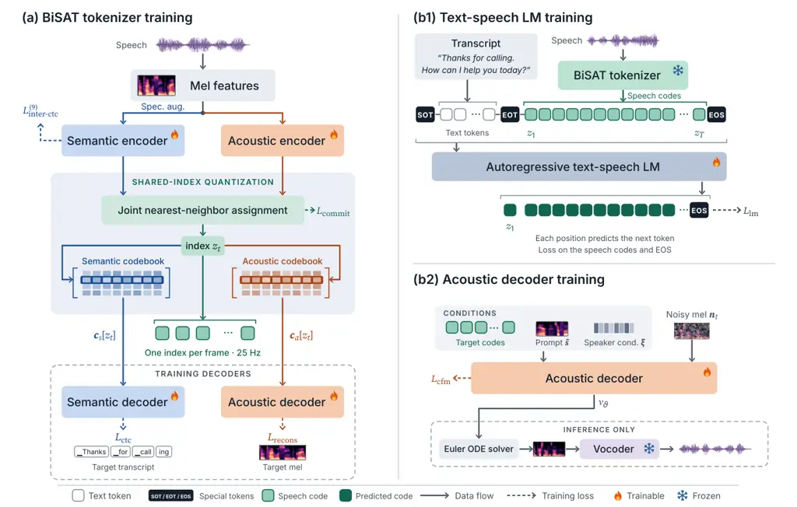
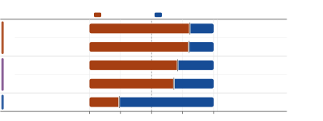

# BiSAT: Bidirectionally Aligned Semantic-Acoustic Tokenization for Speech Language Models

Yixian Lu^(\*)    Lijun Wang^(\*)    and Shogo Okada ^(†)^(†)thanks: The
authors are with the Japan Advanced Institute of Science and Technology,
Nomi, Ishikawa 923-1292, Japan (e-mail: yixian.lu@jaist.ac.jp;
lijun.wang@jaist.ac.jp; okada-s@jaist.ac.jp). This work was partially
supported by JSPS KAKENHI (No. 26K03016), JST CREST (No. JPMJCR2563),
JST CRONOS (No. JPMJCS24K7), and AMED under Grant Number
JP256f0137001.^(†)^(†)thanks: \* Equal contribution; author order was
randomly determined by tossing a coin. \$†\$ Corresponding author.

###### Abstract

Speech language models (LMs) generate speech as sequences of discrete
tokens, requiring tokenizers that preserve both acoustic detail and
linguistic content at a low bitrate. Semantic-enhanced tokenizers may
discard acoustic detail, whereas acoustic-oriented tokenizers retain
acoustic variation that hinders language modeling. Unified tokenizers
combine both, but encoding them within a single feature space can cause
interference, and existing methods typically align acoustic features to
fixed targets from a frozen semantic teacher. We propose Bidirectionally
Aligned Semantic-Acoustic Tokenization (BiSAT), a unified framework with
separate acoustic and semantic branches coupled by a shared-index
mechanism. During training, each branch has its own encoder, codebook,
and decoder, and at every frame a shared index minimizes the combined
quantization error across both branches. BiSAT thus learns acoustic and
semantic representations in separate continuous spaces while producing a
single discrete code stream, jointly optimizing both encoders without
fixed semantic teachers. Built on BiSAT, BiSAT-TTS pairs an
autoregressive text-speech LM with a conditional flow-matching acoustic
decoder for zero-shot text-to-speech. Reconstruction, frozen-code
understanding, and diagnostic analyses show that BiSAT preserves
accessible linguistic and acoustic structure in a low-bitrate single
stream, generalizes strongly to in-the-wild and out-of-domain speech,
and learns complementary paired codebooks. BiSAT-TTS matches or
surpasses state-of-the-art speech LM-based TTS baselines with less
training data, demonstrating that accessible code structure—not
reconstruction quality alone—benefits autoregressive speech modeling.
The audio demos are available at
https://seekmind-lab.github.io/bisat-demo.

###### Index Terms: 

Speech Tokenization, Zero-shot Text-to-Speech Synthesis, Text-Speech
Language Model, Conditional Flow Matching.

^(†)^(†)aftertitle:

## I Introduction

Speech language models (LMs) generate speech as sequences of discrete
tokens, enabling text-to-speech (TTS) systems to adopt large language
model (LLM) architectures and training recipes for scalable sequence
modeling \[1, 2, 3\]. In particular, autoregressive (AR) speech LMs
determine output length flexibly without explicit duration modeling, in
contrast to many non-autoregressive (NAR) methods \[1\]. Before a
token-based LM can model speech, the continuous speech waveform must be
discretized. This can be performed by quantization, such as vector
quantization (VQ) \[4\], residual vector quantization (RVQ) \[5\],
finite scalar quantization (FSQ) \[6\], and binary spherical
quantization (BSQ) \[7\]. VQ, FSQ, and BSQ give one code per frame,
whereas RVQ quantizes the residual of each stage with a further codebook
and produces several code streams. Following common usage in speech
tokenization \[8\], we use “_semantic_” to refer to the linguistic
content of speech, including phonetic and lexical information. The
training objective influences what information the codes retain \[4\].
Speech reconstruction encourages the codes to retain acoustic
information such as prosody, pitch, timbre, and speaker identity \[5, 9,
10, 11\], whereas speech LMs also require codes that preserve semantic
content. Retaining both types of information within a compact
single-stream bottleneck is a central trade-off in designing a tokenizer
for a speech LM. The information retained determines what the LM must
model and what the acoustic decoder can recover to resynthesize the
waveform.

In general, LM-based TTS uses three types of speech tokenizers that
differ in how they make this trade-off. _Semantic-enhanced_ tokenizers
(SETs) insert a quantizer into a pretrained speech understanding model
\[12, 2, 13, 14, 15\]. _Acoustic-oriented_ tokenizers (AOTs) learn codes
primarily through waveform or mel-spectrogram reconstruction \[5, 9, 16,
17\]. _Unified_ tokenizers (UTs) combine acoustic reconstruction with
semantic supervision \[18, 19, 20, 21, 22, 3\]. Semantic supervision
captures linguistic content but may discard fine acoustic details needed
for reconstruction. Conversely, codes learned through reconstruction
preserve acoustic detail well, yet they also retain variation in timbre,
prosody, and recording conditions that can weaken alignment with text
and cause AR LMs to repeat or skip words \[18, 23, 24\]. Recent UTs
combine acoustic and semantic supervision in one tokenizer, either by
guiding the first RVQ layer with semantic features \[18, 19, 22\] or by
fusing the two representations before quantization \[20, 21, 3\].
However, encoding acoustic detail and linguistic content within a single
shared or fused representation space can cause interference between the
two objectives. Furthermore, these methods derive semantic supervision
from pretrained or frozen encoders, so the semantic targets remain fixed
during tokenizer training. Finally, most AOTs and UTs reconstruct
waveforms with adversarial training (AT), since regression losses alone
yield over-smoothed speech at low bitrates \[5, 9\]. Because an
adversarial discriminator evaluates naturalness rather than code
faithfulness, a co-trained waveform decoder can synthesize details
absent from the codes, decoupling reconstruction quality from structured
semantic patterns \[9, 17, 18, 3\], as discussed in Section II-A.

These limitations motivate us to design a low-bitrate single-stream
tokenizer at a low frame rate that learns acoustic and semantic
representations in separate continuous spaces while jointly optimizing
both branches without fixed semantic teachers. TokenFlow \[25\] showed
in image tokenization that separate semantic and pixel-level codebooks
linked by shared indices can support both understanding and generation.
Motivated by this shared-index principle, we propose Bidirectionally
Aligned Semantic-Acoustic Tokenization (BiSAT). During training, BiSAT
uses separate acoustic and semantic branches, each with its own encoder,
codebook, and decoder. The acoustic branch reconstructs mel spectrograms
without adversarial training, and the semantic branch is trained with
connectionist temporal classification (CTC). Waveform synthesis is
deferred to a separate acoustic decoder and vocoder during TTS, so the
tokenizer codes are shaped solely by mel reconstruction and CTC
supervision. At each frame, a shared-index vector quantizer selects a
single index by minimizing the weighted sum of squared Euclidean
distances across both branches. This design offers two key advantages.
First, under a finite discrete bottleneck \[26, 27\], keeping the
encoders, codebooks, and training decoders in separate continuous spaces
is intended to reduce potential interference between acoustic
reconstruction and semantic recognition, while allowing each branch to
learn task-specific representations. Second, unlike approaches that
align acoustic features to fixed semantic teacher targets, BiSAT jointly
optimizes both encoders. Since the shared index depends on both
branches, updates to either encoder influence the quantization
assignments of both branches. We refer to this coupled optimization
mechanism as bidirectional alignment. We evaluate whether the resulting
single code stream retains information useful for both linguistic and
acoustic downstream tasks.

We evaluate BiSAT on speech reconstruction from codes and on SUPERB and
ML-SUPERB understanding probes \[28, 29\] across linguistic, speaker,
and paralinguistic tasks to verify its effectiveness in preserving
accessible semantic content and acoustic detail for speech LMs. We also
analyze the paired codebooks and evaluate zero-shot TTS with BiSAT-TTS,
combining an AR text-speech LM, a reference-conditioned flow-matching
acoustic decoder, and a pretrained vocoder.

Our main contributions are summarized as follows:

1.  1.  We propose BiSAT, a unified speech tokenization framework that
        learns separate continuous acoustic and semantic representations
        while coupling index assignment across paired codebooks to produce a
        single low-bitrate code stream.
2.  2.  We develop BiSAT-TTS, a zero-shot TTS system that combines an AR
        text-speech LM with a conditional flow-matching acoustic decoder
        using BiSAT tokens.
3.  3.  We provide a comprehensive evaluation of BiSAT across speech
        reconstruction, downstream understanding, diagnostic analysis, and
        zero-shot TTS, showing competitive or superior performance across
        multiple benchmarks and validating the effectiveness of the overall
        framework.

The rest of the manuscript is organized as follows. Section II reviews
related work. Section III describes BiSAT and BiSAT-TTS. Section IV
details experiments. Section V concludes this work and Section VI
discusses limitations and future work.

## II Related Work

### II-A Speech Tokenization for Speech Language Modeling

#### II-A1 Semantic-Enhanced Tokenizers

SETs insert quantization modules into pretrained speech understanding
models. The CosyVoice series \[12, 2, 13\] quantizes intermediate
representations of an understanding model, progressing from VQ with
automatic speech recognition (ASR) supervision to FSQ and, in CosyVoice
3, multi-task supervision with ASR, language identification, emotion
recognition, audio event detection, and speaker analysis. Spark-TTS
\[14\] combines frame-level semantic tokens with fixed-length global
tokens for utterance-level properties, and Qwen3-TTS \[15\] uses a 25 Hz
single-codebook tokenizer that emphasizes semantic content. The
CosyVoice tokenizers are trained only with understanding tasks, so their
tokens carry little of the acoustic detail needed for reconstruction.
Flow-based \[2, 13\] or generative adversarial network (GAN) decoders
\[14\] are thus employed to recover this detail from additional
conditioning, which may demand more data and larger decoder capacity.

#### II-A2 Acoustic-Oriented Tokenizers

AOTs learn codes through reconstruction. RVQ codecs such as EnCodec
\[9\] add residual quantization layers to recover finer acoustic detail,
but serializing multiple code streams into one sequence significantly
increases the sequence length for AR modeling. The VALL-E series \[1,
23\] therefore predicts the first stream with an AR LM and the residual
streams with a parallel NAR model. VoiceCraft and VoiceStar \[30, 31\]
predict all streams in one AR LM through a delayed codebook pattern, and
CLaM-TTS \[32\] models probabilistic RVQ latents. WavTokenizer \[17\]
and FocalCodec \[16\] reduce the sequence burden for language modeling
by producing a single code stream at a low bitrate. We also adopt a
single low-bitrate code stream at a low frame rate for efficient AR
language modeling without predicting additional residual streams.

These AOTs receive no explicit semantic supervision, so the LM must
infer linguistic structure from acoustically grounded tokens, which can
cause repetitions, skipped words, and non-terminating sequences \[23,
24, 33\]. Another problem comes from coupling tokenization with waveform
reconstruction. Most of these codecs reconstruct waveforms with AT,
since regression losses alone produce over-smoothed speech at low
bitrates \[5, 9\]. The discriminator judges whether the output sounds
natural, not whether it matches the input. The decoder can thus
synthesize details that the codes do not contain, and the adversarial
objective puts no direct pressure on the codes to form structured
semantic patterns. This makes language modeling harder and demands more
data, model capacity, and computation. These observations motivate us to
decouple tokenization from waveform reconstruction and to supervise the
tokenizer with semantic content directly.

#### II-A3 Unified Tokenizers

UTs combine semantic supervision with acoustic reconstruction.
SpeechTokenizer \[18\] and Mimi \[19\] guide the first RVQ layer with
self-supervised learning (SSL) features from HuBERT or WavLM, while
later layers encode the residual acoustic information. LM-SPT \[22\]
reconstructs speech from its semantic tokens and matches features of the
original and reconstructed speech extracted by a frozen speech encoder.
In these RVQ designs, the first layer must represent linguistic content
while providing the acoustic approximation refined by later layers,
which makes the two objectives hard to balance \[18, 19, 22, 34\].
XY-Tokenizer \[20\] and the X-Codec series \[21, 3\] instead fuse the
outputs of acoustic and semantic encoders before quantization. X-Codec2
quantizes the fused features with a single FSQ codebook, which allows
LLaSA \[3\] to use one AR LM. In fusion designs, encoding acoustic
detail and linguistic content within a single fused representation can
cause interference between the two objectives during training \[20\].
These methods also derive semantic supervision from pretrained or frozen
speech encoders, namely teacher features \[18, 19, 21, 3\] or a frozen
encoder \[20, 22\], so the semantic targets remain fixed during
tokenizer training. Finally, UTs couple tokenization with adversarial
waveform reconstruction as in AOTs, allowing reconstruction to rely on
co-trained decoders without ensuring generalizable semantic code
patterns.

In image tokenization, TokenFlow \[25\] uses separate semantic and
pixel-level codebooks linked by shared indices for understanding and
generation. Inspired by this design, BiSAT jointly updates acoustic and
semantic encoders with separate codebooks and determines their shared
discrete indices from both representations.

### II-B Zero-shot TTS Systems

Zero-shot TTS systems include NAR, AR, continuous AR, and discrete
diffusion models. NAR systems generate all frames in parallel, including
flow- and VAE-based models with monotonic alignment search or explicit
duration modeling \[35, 36, 37\], latent diffusion models \[38, 10\],
and flow-matching models that learn alignment without supervision \[39,
40\]. Continuous AR models predict continuous acoustic features
directly, which avoids quantization error but can suffer from
oversmoothing and unstable sequential generation \[41, 42\]. Discrete
diffusion models instead generate token sequences through iterative
denoising \[43\]. Discrete AR text-speech LMs generate speech tokens
sequentially without explicit duration control. While RVQ-based systems
require a multi-stage or parallel prediction scheme \[1, 23, 32\],
single-stream VQ or FSQ tokenizers allow a LM \[12, 2, 14, 3\].
BiSAT-TTS follows this single-stream AR approach.

### II-C Acoustic-Semantic Representation Alignment

In speech, representation-level alignment between acoustic signals and
linguistic content has been studied through self-supervised pretraining
\[44, 45, 46\], joint speech-text pretraining \[47, 48\], and semantic
regularization of generative latent spaces \[49\]. These methods align
acoustic and linguistic information within a single continuous space.
BiSAT instead initializes dual encoders from a shared self-supervised
speech backbone \[50\], specializes them under separate acoustic and
semantic supervision, and couples the two continuous spaces through
shared-index quantization into a single code stream.



Fig. 1: Training of the BiSAT tokenizer and BiSAT-TTS. (a) The acoustic
and semantic branches are jointly trained with mel-spectrogram
reconstruction and CTC, respectively. A shared-index vector quantizer
selects one entry per frame from each codebook to create a single code
stream. A commitment loss is used to keep both encoder outputs close to
these entries. (b1) The text-speech LM predicts each speech code and the
final EOS from the text tokens and the preceding codes. (b2) The
acoustic decoder predicts the flow-matching velocity from the noisy
interpolant, conditioned on the codes, a prompt mel spectrogram, and a
speaker condition. At inference, an Euler ODE solver generates the mel
spectrogram, and the frozen vocoder converts it into a waveform.

## III Methodology

Overview. Figure 1 shows the BiSAT tokenizer and the BiSAT-TTS pipeline.
The tokenizer (see Section III-B1) discretizes a speech waveform into a
single code sequence by aligning acoustic and semantic representations
bidirectionally through shared-index quantization. For TTS, the
text-speech LM (see Section III-B2) generates codes conditioned on text
and reference speech. The flow-matching acoustic decoder (see
Section III-B3) converts these codes to a mel spectrogram. A pretrained
vocoder then synthesizes the waveform.

### III-A Problem Formulation

We generate speech through an autoregressive text-speech LM \[1, 2\].
Let $`(x,\boldsymbol{y})`$ denote a speech-text pair, where $`x`$ is the
waveform and $`\boldsymbol{y}:=(y_{1},\dots,y_{U})`$ is its tokenized
transcript. CTC supervision and text-speech LM training use separate
text tokenizers, with $`\boldsymbol{y}`$ and $`U`$ denoting the token
sequence and its length in each setting. Let
$`\boldsymbol{m}\in\mathbb{R}^{F\times T_{\text{tok}}}`$ denote the
$`F`$-bin log-mel spectrogram encoded and reconstructed by the
tokenizer, and let
$`\boldsymbol{s}\in\mathbb{R}^{F\times T_{\text{mel}}}`$ denote the mel
spectrogram generated by the TTS acoustic decoder. The two spectrograms
are computed at different sampling and frame rates, as detailed in
Section IV-A2. The BiSAT tokenizer maps $`x`$ to a single code sequence
$`\boldsymbol{z}_{1:T}=(z_{1},\dots,z_{T})`$, where each code
$`z_{t}\in\{1,\dots,K\}`$ corresponds to a shared index that selects one
entry from each of two paired codebooks
$`\boldsymbol{c}_{a},\boldsymbol{c}_{s}\in\mathbb{R}^{K\times D_{\text{codebook}}}`$.
Throughout the manuscript, subscripts $`a`$ and $`s`$ denote the
acoustic and semantic branches, and $`[\,\cdot\,;\,\cdot\,]^{(\cdot)}`$
denotes concatenation along the indicated axis.

#### III-A1 BiSAT Tokenization

The tokenizer in Fig. 1 learns acoustic and semantic representations
aligned by shared discrete codes. Two encoders $`\mathcal{E}_{a}`$ and
$`\mathcal{E}_{s}`$, parameterized by $`\psi_{a}`$ and $`\psi_{s}`$,
encode $`\boldsymbol{m}`$ to time-aligned acoustic and semantic latents
$`\boldsymbol{e}_{a;1:T}`$ and $`\boldsymbol{e}_{s;1:T}`$. Both encoders
use the same feature dimension $`D_{a}=D_{s}=D_{\text{codebook}}`$. A
shared-index quantizer converts these representations to paired
quantized sequences $`\hat{\boldsymbol{z}}_{a;1:T}`$ and
$`\hat{\boldsymbol{z}}_{s;1:T}`$. The mel reconstruction decoder
$`\mathcal{D}_{a}`$, parameterized by $`\gamma_{a}`$, reconstructs the
mel spectrogram
$`\hat{\boldsymbol{m}}\in\mathbb{R}^{F\times T_{\text{tok}}}`$ from
$`\hat{\boldsymbol{z}}_{a;1:T}`$. The semantic decoder
$`\mathcal{D}_{s}`$, parameterized by $`\gamma_{s}`$, predicts semantic
labels from $`\hat{\boldsymbol{z}}_{s;1:T}`$ and is trained with CTC
supervision \[51\].

The mel spectrogram $`\boldsymbol{m}`$ and text sequence
$`\boldsymbol{y}`$ provide acoustic and semantic supervision for the
shared codes $`\boldsymbol{z}_{1:T}`$. Following the VQ-VAE formulation
\[4\], we define the audio-conditioned approximate posterior
$`q_{\psi}(\boldsymbol{z}_{1:T}\mid\boldsymbol{m})`$ with
$`\psi=\{\psi_{a},\psi_{s}\}`$ as a deterministic nearest-neighbor
assignment. Under a uniform prior over the $`K`$ codebook indices at
each frame, the Kullback-Leibler (KL) term in the evidence lower bound
(ELBO) on $`\log p(\boldsymbol{m},\boldsymbol{y})`$ equals the constant
$`T\log K`$ and does not depend on the model parameters
$`\Theta=\{\psi_{a},\psi_{s},\gamma_{a},\gamma_{s},\boldsymbol{c}_{a},\boldsymbol{c}_{s}\}`$.
Assuming that $`\boldsymbol{m}`$ and $`\boldsymbol{y}`$ are
conditionally independent given $`\boldsymbol{z}_{1:T}`$, maximizing the
ELBO reduces to:

```math
\displaystyle\argmax_{\Theta}\mathrm{ELBO}_{\text{tok}} \displaystyle=\argmax_{\Theta}\mathbb{E}_{q_{\psi}(\boldsymbol{z}_{1:T}\mid\boldsymbol{m})}\!\big[\log p_{\gamma_{a}}(\boldsymbol{m}\mid\boldsymbol{z}_{1:T}) \tag{1}
```

```math
\displaystyle+\log p_{\gamma_{s}}(\boldsymbol{y}\mid\boldsymbol{z}_{1:T})\big].
```

The former term can be simplified to an $`\ell_{1}`$ mel-spectrogram
reconstruction loss for acoustic supervision, under a fixed-scale
factorized Laplace likelihood. For the latter, CTC is employed to sum
over frame-level label paths $`\pi`$ that collapse to $`\boldsymbol{y}`$
for semantic supervision. Specifically, the reconstruction and CTC
losses $`\mathcal{L}_{\text{recons}}`$ and $`\mathcal{L}_{\text{ctc}}`$
are defined as:

```math
\displaystyle\mathcal{L}_{\text{recons}}=\frac{1}{T_{\text{tok}}F}\,\lVert\boldsymbol{m}-\hat{\boldsymbol{m}}\rVert_{1}, \tag{2}
```

```math
\displaystyle\mathcal{L}_{\text{ctc}}=-\frac{1}{U}\,\log\sum_{\pi\in\mathcal{B}^{-1}(\boldsymbol{y})}\prod_{t=1}^{T}p_{\gamma_{s}}(\pi_{t}\mid\hat{\boldsymbol{z}}_{s;1:T}),
```

where $`\mathcal{B}^{-1}(\boldsymbol{y})`$ is the set of all possible
paths that collapse to $`\boldsymbol{y}`$, and
$`p_{\gamma_{s}}(\pi_{t}\mid\hat{\boldsymbol{z}}_{s;1:T})`$ is the
predicted probability of label $`\pi_{t}`$ at frame $`t`$. Since CTC
marginalizes over monotonic alignments between code frames and text, no
forced alignment is required.

Intermediate CTC Supervision. Following OWSM-CTC \[52\], we apply an
auxiliary CTC head to the output $`\boldsymbol{h}_{s}^{(9)}`$ of the
ninth semantic encoder layer. The loss is formulated as:

```math
\mathcal{L}_{\text{inter-ctc}}=-\frac{1}{U}\log\sum_{\pi\in\mathcal{B}^{-1}(\boldsymbol{y})}\prod_{t=1}^{T}p_{\gamma_{\text{int}}}\big(\pi_{t}\mid\boldsymbol{h}_{s}^{(9)}\big), \tag{3}
```

where $`p_{\gamma_{\text{int}}}`$ is the label distribution of the
auxiliary CTC head parameterized by $`\gamma_{\text{int}}`$.

Shared-index Quantization. Both encoder outputs are
$`\ell_{2}`$-normalized frame by frame, i.e.,
$`\bar{\boldsymbol{e}}_{b,t}=\boldsymbol{e}_{b,t}/\max(\lVert\boldsymbol{e}_{b,t}\rVert_{2},\delta)`$
for $`b\in\{a,s\}`$, with a small constant $`\delta>0`$ for numerical
stability. The codebook entries
$`\{\boldsymbol{c}_{k,a},\boldsymbol{c}_{k,s}\}_{k=1}^{K}`$ are also
unit-normalized. The entries $`\boldsymbol{c}_{k,a}`$ and
$`\boldsymbol{c}_{k,s}`$ form a pair at each index $`k`$. For each
frame, the quantizer assigns a single index by minimizing the joint
distance:

```math
z_{t}=\underset{k}{\arg\min}\left[\lVert\bar{\boldsymbol{e}}_{a,t}-\boldsymbol{c}_{k,a}\rVert_{2}^{2}+\omega\lVert\bar{\boldsymbol{e}}_{s,t}-\boldsymbol{c}_{k,s}\rVert_{2}^{2}\right]. \tag{4}
```

Both branches retrieve the corresponding row as
$`\hat{\boldsymbol{z}}_{a,t}=\boldsymbol{c}_{z_{t},a}`$ and
$`\hat{\boldsymbol{z}}_{s,t}=\boldsymbol{c}_{z_{t},s}`$. For
unit-normalized codebook entries, Eq. (4) is equivalent to maximizing
$`\langle\bar{\boldsymbol{e}}_{a,t},\boldsymbol{c}_{k,a}\rangle+\omega\langle\bar{\boldsymbol{e}}_{s,t},\boldsymbol{c}_{k,s}\rangle`$,
so setting $`\omega=1`$ weights the two branches equally. Each frame is
represented by one index into $`K`$ code pairs. For example, a 25 Hz
code stream with $`K=32768`$ has a nominal bitrate of
$`25\log_{2}32768=375`$ bps, regardless of $`D_{\text{codebook}}`$.

We use the rotation trick \[53\] to backpropagate the decoder gradients
through quantization. For branch $`b`$ and frame $`t`$, let
$`\mathbf{R}_{b,t}`$ be the rotation matrix that rotates the encoder
output $`\bar{\boldsymbol{e}}_{b,t}`$ toward the selected codebook
entry. The decoder input is parameterized as:

```math
\boldsymbol{q}_{b,t}=\mathbf{sg}\!\left(\frac{\lVert\hat{\boldsymbol{z}}_{b,t}\rVert_{2}}{\lVert\bar{\boldsymbol{e}}_{b,t}\rVert_{2}}\mathbf{R}_{b,t}\right)\bar{\boldsymbol{e}}_{b,t}, \tag{5}
```

where $`\mathbf{sg}(\cdot)`$ denotes the stop-gradient operator, so that
$`\boldsymbol{q}_{b,t}=\hat{\boldsymbol{z}}_{b,t}`$ in the forward pass.
Because both the encoder outputs and codebook entries are
unit-normalized, the norm ratio equals one and the decoder gradient is
multiplied by $`\mathbf{R}_{b,t}^{\top}`$ during backpropagation to the
encoder.

We keep encoder outputs close to their assigned codebook entries by
employing the commitment loss:

```math
\mathcal{L}_{\text{commit}}=\frac{1}{T}\!\sum_{t=1}^{T}\!\big[\lVert\bar{\boldsymbol{e}}_{a,t}-\mathbf{sg}(\hat{\boldsymbol{z}}_{a,t})\rVert_{2}^{2}+\lVert\bar{\boldsymbol{e}}_{s,t}-\mathbf{sg}(\hat{\boldsymbol{z}}_{s,t})\rVert_{2}^{2}\big]. \tag{6}
```

The codebooks are updated using exponential moving averages (EMAs) of
the features assigned to each row (see Section III-B1). The overall
tokenizer objective is given by:

```math
\mathcal{L}_{\text{tok}}=\lambda_{a}\mathcal{L}_{\text{recons}}+\lambda_{s}\mathcal{L}_{\text{ctc}}+\lambda_{\text{int}}\mathcal{L}_{\text{inter-ctc}}+\beta\mathcal{L}_{\text{commit}}, \tag{7}
```

where $`\lambda_{a}`$, $`\lambda_{s}`$, $`\lambda_{\text{int}}`$, and
$`\beta`$ are loss weighting coefficients.

#### III-A2 BiSAT-TTS Generation

BiSAT-TTS Text-Speech LM. The text-speech LM autoregressively generates
the codes. The text tokens and the speech codes are concatenated into a
single sequence as input to the LM as follows:

```math
\boldsymbol{x}_{\text{lm}}=\big[\langle\mathrm{SOT}\rangle;\,y_{1:U};\,\langle\mathrm{EOT}\rangle;\,z_{1:T};\,\langle\mathrm{EOS}\rangle\big]^{(\text{time})}, \tag{8}
```

where $`\langle\mathrm{SOT}\rangle`$ and $`\langle\mathrm{EOT}\rangle`$
mark the start and end of the text, and $`\langle\mathrm{EOS}\rangle`$
marks the end of speech. Let $`z_{T+1}`$ denote
$`\langle\mathrm{EOS}\rangle`$.

The text-speech LM, parameterized by $`\theta`$, predicts a distribution
over the $`K`$ codes and EOS at each step. We can factorize the
conditional likelihood of the code sequence $`\boldsymbol{z}_{1:T+1}`$
given the text prompt $`\boldsymbol{y}`$ as:

```math
p_{\theta}(\boldsymbol{z}_{1:T+1}\mid\boldsymbol{y})=\prod_{t=1}^{T+1}p_{\theta}\big(z_{t}\mid\boldsymbol{z}_{<t},\boldsymbol{y}\big). \tag{9}
```

The parameters $`\theta`$ can be optimized by minimizing the negative
log-likelihood of the code sequence $`\boldsymbol{z}_{1:T+1}`$:

```math
\mathcal{L}_{\text{lm}}(\theta)=-\sum_{t=1}^{T+1}\log p_{\theta}\big(z_{t}\mid\boldsymbol{z}_{<t},\boldsymbol{y}\big). \tag{10}
```

At inference, the prefix $`\boldsymbol{x}_{\text{pre}}`$ consists of the
prompt transcript $`\tilde{\boldsymbol{y}}`$, the target text
$`\boldsymbol{y}`$, and the prompt codes
$`\tilde{\boldsymbol{z}}_{1:T^{\prime}}`$. The text-speech LM generates
the target codes autoregressively from this prefix and stops at
$`\langle\mathrm{EOS}\rangle`$:

```math
\displaystyle\boldsymbol{x}_{\text{pre}} \displaystyle=\big[\langle\mathrm{SOT}\rangle;\,\tilde{\boldsymbol{y}};\,\boldsymbol{y};\,\langle\mathrm{EOT}\rangle;\,\tilde{\boldsymbol{z}}_{1:T^{\prime}}\big]^{(\text{time})}, \tag{11}
```

```math
\displaystyle z_{t} \displaystyle\sim q_{t},\qquad t=1,2,\dots,
```

where $`q_{t}`$ is obtained from the LM distribution using the sampling
procedure detailed in Section III-B2.

BiSAT-TTS Acoustic Decoder. The acoustic decoder models the conditional
distribution of mel spectrograms given the speech codes using
conditional flow matching (CFM) \[54\]. We use linear interpolation
paths between Gaussian noise
$`\boldsymbol{\epsilon}\sim\mathcal{N}(0,\mathbf{I})`$ and the target
mel spectrogram $`\boldsymbol{s}`$ \[55\],

```math
\boldsymbol{n}_{t}=t\boldsymbol{s}+(1-t)\boldsymbol{\epsilon},\qquad t\in[0,1]. \tag{12}
```

Following \[12\], we sample training time steps as
$`t\sim\mathcal{U}(0,1)`$. Taking the derivative of the interpolant with
respect to $`t`$, the conditional velocity field $`v(t)`$ is obtained
as:

```math
v(t)=\frac{d\boldsymbol{n}_{t}}{dt}=\boldsymbol{s}-\boldsymbol{\epsilon}. \tag{13}
```

A neural network parameterized by $`\vartheta`$ estimates the
conditional mean velocity conditioned on $`t`$, $`\boldsymbol{n}_{t}`$,
the speech codes $`\boldsymbol{z}_{1:T}`$, a prompt mel spectrogram
$`\tilde{\boldsymbol{s}}\in\mathbb{R}^{F\times T_{\text{prompt}}}`$
extracted from reference speech, and a speaker condition
$`\boldsymbol{\xi}\in\mathbb{R}^{192}`$ extracted by a frozen speaker
encoder, such as CAM++ \[56\]. We optimize the CFM by minimizing the
expected squared error between the predicted and true velocities over
the training distribution $`\mathcal{D}`$:

```math
\mathcal{L}_{\text{cfm}}(\vartheta)=\underset{\mathcal{D},\,t,\,\boldsymbol{\epsilon}}{\mathbb{E}}\;\Big\lVert v_{\vartheta}\big(t,\boldsymbol{n}_{t}\mid\boldsymbol{z}_{1:T},\tilde{\boldsymbol{s}},\boldsymbol{\xi}\big)-v(t)\Big\rVert_{2}^{2}, \tag{14}
```

where
$`(\boldsymbol{s},\boldsymbol{z}_{1:T},\tilde{\boldsymbol{s}},\boldsymbol{\xi})\sim\mathcal{D}`$.

At inference, we generate a mel spectrogram by solving the following
ordinary differential equation (ODE) with a first-order Euler solver:

```math
\frac{d\boldsymbol{s}_{t}}{dt}=v_{\vartheta}(t,\boldsymbol{s}_{t}\mid\boldsymbol{z}_{1:T},\tilde{\boldsymbol{s}},\boldsymbol{\xi}),\qquad\boldsymbol{s}_{0}=\kappa\boldsymbol{\epsilon}, \tag{15}
```

from $`t=0`$ to $`t=1`$. $`\kappa`$ is a temperature that scales the
noise. To solve Eq. (15), we discretize the time interval $`[0,1]`$ at
time points $`t_{i}`$ obtained by applying a schedule to the uniform
grid $`u_{i}=i/J`$ for $`i=0,\ldots,J`$. $`J`$ is the number of
integration steps. We consider the cosine schedule
$`t_{i}=1-\cos(\pi u_{i}/2)`$ \[2, 13\] and the PolyShift schedule
$`t_{i}=u_{i}^{\zeta}/\bigl(u_{i}^{\zeta}+\sigma(1-u_{i}^{\zeta})\bigr)`$
\[57\], where larger $`\zeta`$ and $`\sigma`$ place more steps toward
$`t=0`$.

### III-B Architecture

#### III-B1 BiSAT Tokenizer

Dual Encoders. The acoustic encoder $`\mathcal{E}_{a}`$ and semantic
encoder $`\mathcal{E}_{s}`$ each stack 17 Conformer blocks (dim. 512, 8
attention heads) \[58\]. Conformer combines convolution for local
acoustic structure with attention mechanisms for longer-range context.
During training, we mask frequency bands and time patches in the
semantic input using NeMo’s spectral augmentation \[50, 59\] to enhance
contextualization. The acoustic encoder receives unaugmented
mel-spectrogram features. Let $`\mathcal{A}`$ denote the masking
operation. The encoder outputs are given by:

```math
\displaystyle\boldsymbol{e}_{a} \displaystyle=f_{\mathcal{E}_{\psi_{a}}}\bigl(\boldsymbol{m}\bigr), \tag{16}
```

```math
\displaystyle\boldsymbol{e}_{s} \displaystyle=f_{\mathcal{E}_{\psi_{s}}}\bigl(\mathcal{A}(\boldsymbol{m})\bigr),
```

with $`\boldsymbol{e}_{a}\in\mathbb{R}^{D_{a}\times T}`$ and
$`\boldsymbol{e}_{s}\in\mathbb{R}^{D_{s}\times T}`$. The encoder outputs
are then $`\ell_{2}`$-normalized and quantized.

Shared-index Vector Quantizer (SVQ). Motivated by the shared-index
principle of TokenFlow \[25\], we design a shared-index quantization
scheme using two codebooks of size $`K\times D_{\text{codebook}}`$, one
for each branch, with $`D_{\text{codebook}}=512`$. By Eq. (4), the
quantizer selects one shared index $`z_{t}\in\{1,\dots,K\}`$ per frame,
so the frame-level discrete bottleneck remains $`\log_{2}K`$ bits. This
design has two key properties.

(i) Separate continuous representation spaces. During training, each
shared index retrieves paired acoustic and semantic entries
$`\boldsymbol{c}_{z_{t},a}`$ and $`\boldsymbol{c}_{z_{t},s}`$, which are
passed to their respective decoders. Learning the two continuous spaces
and codebooks separately allows each branch to develop task-specific
representations without requiring acoustic detail and linguistic units
to be encoded in the same continuous feature vector. At the same time,
the joint distance in Eq. (4) allows frames that are similar in one
branch but different in the other to be assigned to different codebook
indices, partitioning the $`K`$ paired entries according to both
acoustic and semantic structure. Together with spherical k-means
initialization, EMA updates, and dead-code replacement, this yields
training codebook utilization of 100% for BiSAT-32k and 99.8% for
BiSAT-64k, as shown in Table II.

(ii) Bidirectional alignment. The shared index $`z_{t}`$ in Eq. (4)
depends on both $`\bar{\boldsymbol{e}}_{a,t}`$ and
$`\bar{\boldsymbol{e}}_{s,t}`$, grouping frames under the joint acoustic
and semantic distance. Mel-spectrogram reconstruction updates the
acoustic encoder and CTC updates the semantic encoder, while EMA updates
in Eq. (17) adapt both codebooks from the same assigned frames. Through
shared-index assignment, updates in either encoder affect the
quantization assignments of both branches, coupling their optimization
without relying on fixed semantic teacher features \[18, 19, 22, 21,
3\]. Downstream models such as the text-speech LM, acoustic decoder, and
understanding probes receive only the discrete code sequence
$`\boldsymbol{z}_{1:T}`$ from the tokenizer and learn their own
embedding tables without accessing $`\boldsymbol{c}_{a}`$ or
$`\boldsymbol{c}_{s}`$, yet they benefit directly from the acoustic and
linguistic structure captured by the code stream, as evaluated in
Section IV.

Codebook Initialization and Updates. We sample stage-1 encoder features
(see Section IV-A) from each training language and initialize the
codebooks with spherical k-means under the joint distance in Eq. (4). We
update them using EMAs \[60\] of the assigned features. Since both
branches select the same index at each frame, they share an EMA count
$`C_{k}`$ of frames assigned to index $`k`$. Each branch maintains its
own EMA feature sum $`\boldsymbol{S}_{k,b}`$. For each index $`k`$ and
branch $`b\in\{a,s\}`$, the codebook updates are given by:

```math
\displaystyle C_{k} \displaystyle\leftarrow\eta C_{k}+(1-\eta)\,n_{k}, \tag{17}
```

```math
\displaystyle\boldsymbol{S}_{k,b} \displaystyle\leftarrow\eta\boldsymbol{S}_{k,b}+(1-\eta)\sum_{t:\,z_{t}=k}\bar{\boldsymbol{e}}_{b,t},
```

```math
\displaystyle\boldsymbol{c}_{k,b} \displaystyle\leftarrow(\boldsymbol{S}_{k,b}/C_{k})\,/\,\lVert\boldsymbol{S}_{k,b}/C_{k}\rVert_{2},\quad(n_{k}>0),
```

where $`n_{k}`$ is the number of frames assigned to $`k`$ in the current
batch and $`\eta`$ is the EMA decay factor. We also track each index’s
usage with an EMA of $`n_{k}/\sum_{k^{\prime}}n_{k^{\prime}}`$, i.e.,
the proportion of frames in the current batch assigned to index $`k`$.
Every $`\Delta_{\text{dead}}`$ steps, a code pair whose EMA frequency is
below $`\nu_{\text{dead}}/K`$ is treated as a dead code pair. We then
replace it with paired encoder features drawn from a reservoir of recent
frames and reset its embeddings and EMA statistics together.

Dual Decoders. The tokenizer decoders are used only during training,
supervising the two branches with mel-spectrogram regression and CTC
rather than adversarial waveform synthesis, while waveform generation is
handled separately in TTS. At each frame, the shared index $`z_{t}`$
selects the acoustic and semantic entries
$`\hat{\boldsymbol{z}}_{a,t}=\boldsymbol{c}_{z_{t},a}`$ and
$`\hat{\boldsymbol{z}}_{s,t}=\boldsymbol{c}_{z_{t},s}`$. Let
$`\boldsymbol{q}_{b}`$ denote the output of the rotation-trick
parameterization in Eq. (5) for $`b\in\{a,s\}`$. The acoustic decoder
$`\mathcal{D}_{a}`$ stacks 9 ConvNeXt V2 blocks \[61\] with $`2\times`$
convolutional temporal upsampling after blocks 4 and 7 to increase the
frame rate from 25 Hz to 100 Hz, following \[62, 32\]. The semantic
decoder $`\mathcal{D}_{s}`$ stacks 9 Conformer blocks ($`512`$-d, $`8`$
heads, $`2048`$-d feed-forward network (FFN)) followed by a CTC head.
The two decoders produce:

```math
\displaystyle\hat{\boldsymbol{m}} \displaystyle=f_{\mathcal{D}_{\gamma_{a}}}\big(\sqrt{D_{a}}\,\boldsymbol{q}_{a}\big), \tag{18}
```

```math
\displaystyle p_{\gamma_{s}}(\pi_{t}\mid\hat{\boldsymbol{z}}_{s;1:T}) \displaystyle=\left[\operatorname{softmax}\!\left(f_{\mathcal{D}_{\gamma_{s}}}(\sqrt{D_{s}}\,\boldsymbol{q}_{s})\right)\right]_{t,\pi_{t}}.
```

Code Extraction. Spectrogram augmentation is disabled when extracting
codes. The frozen tokenizer uses both encoders and the same joint
nearest-neighbor lookup to produce $`\boldsymbol{z}_{1:T}`$. These
tokens serve as LM targets and acoustic-decoder inputs.

#### III-B2 BiSAT-TTS Text-Speech LM

We initialize the text embedding layer and Transformer backbone of the
text-speech LM from MiniCPM4-0.5B \[63\] and continue training on BiSAT
codes using Eq. (10). As in MiniCPM4-0.5B, the backbone uses
grouped-query attention, SwiGLU activations, and RMSNorm with LongRoPE
positional encoding. The token $`\langle\mathrm{SOT}\rangle`$ reuses
MiniCPM4’s pretrained text beginning-of-sequence token. We randomly
initialize an audio embedding table of $`K+2`$ entries for the $`K`$
speech codes, $`\langle\mathrm{EOT}\rangle`$, and
$`\langle\mathrm{EOS}\rangle`$, together with a bias-free output head
over $`K+1`$ classes for the $`K`$ speech codes and
$`\langle\mathrm{EOS}\rangle`$.

Sampling During Decoding. We use top-$`k`$ and top-$`p`$ sampling with a
repetition penalty \[15\]. Let
$`\mathcal{H}_{t}=\{z_{1},\ldots,z_{t-1}\}`$ be the set of codes already
generated for the target utterance, excluding reference codes. Let
$`o_{t}(v)`$ denote the logit for candidate code $`v`$ at step $`t`$.
For $`v\in\mathcal{H}_{t}`$, the repetition penalty is applied as
follows:

```math
\tilde{o}_{t}(v)=\begin{cases}o_{t}(v)/\rho,&o_{t}(v)\geq 0,\\
\rho o_{t}(v),&o_{t}(v)<0,\end{cases} \tag{19}
```

where $`\rho\geq 1`$ is the repetition penalty. Other logits remain
unchanged. We sample from the distribution over the top-$`k`$ and
top-$`p`$ logits by scaling with a temperature $`\tau`$ and applying the
softmax function. For $`U`$ target text tokens and $`T^{\prime}`$
reference speech codes (see Eq. (11)), let $`L_{\max}`$ and $`L_{\min}`$
denote maximum and minimum generation lengths, respectively. Inspired by
\[12\], we set
$`L_{\max}=\min(L_{\text{cap}},\lfloor r_{\max}^{(\ell)}U\rfloor,C_{\text{audio}}-T^{\prime})`$
and
$`L_{\min}=\min(L_{\max},\max(0,\lfloor r_{\min}^{(\ell)}U\rfloor))`$,
where $`C_{\text{audio}}>T^{\prime}`$ limits the total length of the
reference and generated codes, $`L_{\text{cap}}`$ is generation cap
length, and $`r_{\min}^{(\ell)},r_{\max}^{(\ell)}`$ are code-to-text
ratios for language $`\ell`$. We mask EOS below $`L_{\min}`$ and stop at
EOS or $`L_{\max}`$. Inference settings are given in Section IV-A4.

#### III-B3 BiSAT-TTS Acoustic Decoder

The TTS acoustic decoder maps discrete codes to mel spectrograms. The
vocoder and mel feature settings are specified in Section IV-A2.

Decoder Architecture. The acoustic decoder consists of a learned code
embedding layer ($`512`$-d) and a diffusion Transformer (DiT) velocity
decoder \[64\]. The DiT follows the backbone configuration of
CosyVoice 3’s acoustic decoder ($`1024`$-d, 16 attention heads, and
$`2048`$-d FFN) \[13\]. The code embeddings pass through a pre-lookahead
block used in \[13\] and are upsampled from 25 Hz to the 50 Hz mel frame
rate. The velocity decoder stacks 22 DiT blocks with rotary positional
embeddings \[65\]. By Eq. (20), the dimension of the concatenated input
is $`D_{\text{feat}}=D_{\text{code}}+2F+192=864`$.

Forward Pass. Each code is mapped to a $`D_{\text{code}}`$-dimensional
vector by a learned embedding table $`\operatorname{Emb}_{\vartheta}`$
with $`K`$ entries. The pre-lookahead block $`\mathcal{P}_{\vartheta}`$
and the upsampler $`\operatorname{Up}(\cdot)`$ then give the code
condition $`\boldsymbol{h}`$ at $`T_{\text{mel}}`$ frames. With
$`\tilde{\boldsymbol{s}}_{\text{pad}}`$ the prompt mel spectrogram
zero-padded to $`T_{\text{mel}}`$ frames and $`\boldsymbol{\xi}`$
broadcast over frames, the input to the velocity decoder is given by:

```math
\displaystyle\boldsymbol{u} \displaystyle=\operatorname{Emb}_{\vartheta}(\boldsymbol{z}_{1:T})\in\mathbb{R}^{D_{\text{code}}\times T}, \tag{20}
```

```math
\displaystyle\boldsymbol{h} \displaystyle=\operatorname{Up}\big(f_{\mathcal{P}_{\vartheta}}(\boldsymbol{u})\big)\in\mathbb{R}^{D_{\text{code}}\times T_{\text{mel}}},
```

```math
\displaystyle\boldsymbol{x}_{t} \displaystyle=[\boldsymbol{n}_{t};\,\boldsymbol{h};\,\boldsymbol{\xi}\mathbf{1}^{\top};\,\tilde{\boldsymbol{s}}_{\text{pad}}]^{(\text{feat})}.
```

At inference, the concatenated prompt and generated codes
$`[\tilde{\boldsymbol{z}}_{1:T^{\prime}};\,\boldsymbol{z}_{1:T}]^{(\text{time})}`$
replace $`\boldsymbol{z}_{1:T}`$, and the initial prompt frames are
removed from the generated mel spectrogram before vocoding. The DiT
$`\mathcal{V}_{\vartheta}`$ predicts the velocity as follows:

```math
v_{\vartheta}(t,\boldsymbol{n}_{t}\mid\boldsymbol{z}_{1:T},\tilde{\boldsymbol{s}},\boldsymbol{\xi})=f_{\mathcal{V}_{\vartheta}}(t,\boldsymbol{x}_{t}). \tag{21}
```

Time Conditioning. A sinusoidal embedding of the time step $`t`$ is
passed through a two-layer multilayer perceptron (MLP) with Swish
activation and injected into every DiT block through AdaLN-Zero \[64\].

Mel-Spectrogram Prompt and Speaker Conditioning. We condition the
decoder on the mel prompt $`\tilde{\boldsymbol{s}}`$ for reference
prosody, timbre, and style, together with the CAM++ speaker embedding
$`\boldsymbol{\xi}`$ \[56\]. During training, we crop a random prefix of
the target utterance as $`\tilde{\boldsymbol{s}}`$, with its length
drawn uniformly from $`0`$ to $`30\%`$ of the utterance, and drop this
prompt with probability $`p_{\text{prompt}}=0.5`$ for regularization.
Note that the CFM loss is computed over the full sequence including the
prefix. At inference, both conditions are extracted from the reference
speech.

Classifier-Free Guidance. During training, we jointly drop
$`\boldsymbol{h}`$, $`\boldsymbol{\xi}`$, and $`\tilde{\boldsymbol{s}}`$
with probability $`p_{\text{cfg}}=0.2`$, sampled independently of prompt
dropout, to learn unconditional velocity prediction \[66\]. At
inference, classifier-free guidance (CFG) combines the conditional and
unconditional velocity predictions $`v_{\text{cond}}`$ and
$`v_{\text{uncond}}`$ with guidance scale $`g`$:

```math
v_{\text{cfg}}=v_{\text{cond}}+g\bigl(v_{\text{cond}}-v_{\text{uncond}}\bigr). \tag{22}
```

Streaming Support. Following \[2, 13\], each training batch uses full
bidirectional attention with probability $`p_{\text{offline}}=0.5`$ and
chunk-causal attention with chunk size $`M=50`$ mel frames otherwise. A
single checkpoint can therefore run either offline or in streaming mode,
decoding each chunk of $`M/2`$ codes with a 3-code lookahead and passing
the resulting mel frames to the causal vocoder.

## IV Experiments

### IV-A Experimental Setup

#### IV-A1 Training Data and Preprocessing

We train the BiSAT tokenizer and BiSAT-TTS on approximately 122 k hours
of speech across 11 languages. Table I lists all training datasets and
their durations grouped by utterance language. For codebook
initialization, we use the first-stage encoders to extract features from
training utterances sampled by language and duration (6144 utterances
per language, duration bins at 2, 5, 10, and 20 s). The initialization
pool contains approximately 1.3 M frames. Spherical k-means under the
joint distance of Eq. (4) then runs on this pool for 12 rounds in chunks
of 1024 frames, and empty clusters are reseeded from the frames with the
largest quantization error.

#### IV-A2 Acoustic Features and Vocoder

The tokenizer processes 16 kHz speech, using an 80-bin log-mel
spectrogram at 100 Hz with per-utterance, per-bin normalization as both
input and reconstruction target. The encoders subsample this
representation by a factor of four to produce 25 Hz codes. For TTS, we
use the pretrained causal HiFT vocoder of CosyVoice 3 \[13\], whose mel
configuration uses 24 kHz speech, 80 mel bins, and a hop size of 480
samples, corresponding to a 50 Hz frame rate.

|            |           |                                                                |
| ---------- | --------- | -------------------------------------------------------------- |
| Language   | Hours (k) | Sources                                                        |
| English    | 51.7      | Emilia \[67\], LibriTTS-R \[68\], GLOBE V2 \[69\], VCTK \[70\] |
| Chinese    | 42.6      | Emilia, AISHELL-3 \[71\]                                       |
| German     | 8.4       | Emilia, Emilia-YODAS \[72\], CML-TTS \[73\], HUI \[74\]        |
| French     | 8.1       | Emilia, Emilia-YODAS, CML-TTS                                  |
| Korean     | 7.1       | Emilia, Emilia-YODAS                                           |
| Japanese   | 2.5       | Emilia, Emilia-YODAS, JVS \[75\]                               |
| Dutch      | 0.756     | CML-TTS                                                        |
| Spanish    | 0.436     | CML-TTS                                                        |
| Italian    | 0.129     | CML-TTS                                                        |
| Portuguese | 0.077     | CML-TTS                                                        |
| Polish     | 0.044     | CML-TTS                                                        |
| Total      | 122       | –                                                              |

TABLE I: Multilingual training data.

|          |                                      |                |               |                |           |          |                   |                 |                   |                                    |       |       |       |       |       |
| -------- | ------------------------------------ | -------------- | ------------- | -------------- | --------- | -------- | ----------------- | --------------- | ----------------- | ---------------------------------- | ----- | ----- | ----- | ----- | ----- |
| Category | Tokenizer                            | Specifications |               |                |           |          | LibriSpeech-PC    |                 |                   | Common Voice WER/CER$`\downarrow`$ |       |       |       |       |       |
|          |                                      | Rate (Hz)      | Bitrate (bps) | Codebook size  | Util. (%) | Data (h) | WER$`\downarrow`$ | SIM$`\uparrow`$ | UTMOS$`\uparrow`$ | EN                                 | FR    | DE    | ZH    | JA    | KO    |
| –        | Ground truth                         | –              | –             | –              | –         | –        | 1.89              | 1.000           | 3.21              | 11.01                              | 13.27 | 6.35  | 9.93  | 15.06 | 6.51  |
| Acoustic | FocalCodec \[16\]                    | 25             | 325           | $`8192`$       | 99.8      | 585      | 2.94              | 0.960           | 2.94              | 25.52                              | –     | –     | –     | –     | –     |
|          | WavTokenizer \[17\]                  | 40             | 480           | $`4096`$       | 100       | 80k      | 9.22              | 0.933           | 3.00              | 47.04                              | –     | –     | –     | –     | –     |
| Semantic | CosyVoice 2 \[2\]                    | 25             | 317           | $`6561`$       | 100       | 200k     | 3.21              | 0.968           | 3.51              | 24.96                              | 31.57 | 20.61 | 15.02 | 25.09 | 15.34 |
|          | CosyVoice 3 \[13\]                   | 25             | 317           | $`6561`$       | 100       | 530k     | 2.26              | 0.969           | 3.25              | 17.49                              | 20.36 | 12.30 | 13.19 | 19.33 | 11.89 |
| Unified  | SpeechTokenizer ($`N_{q}=1`$) \[18\] | 50             | 500           | $`1024`$       | 95.9      | 960      | 4.59              | 0.828           | 1.78              | 54.51                              | –     | –     | –     | –     | –     |
|          | SpeechTokenizer ($`N_{q}=2`$)        | 50             | 1000          | $`1024`$       | 95.9      | 960      | 3.65              | 0.905           | 1.54              | 46.40                              | –     | –     | –     | –     | –     |
|          | LM-SPT ($`N_{q}=2`$) \[22\]          | 12.5           | 325           | $`16384/4096`$ | 86/98     | 100k     | 2.55              | 0.935           | 2.67              | 23.63                              | 27.31 | 18.79 | 16.33 | 25.22 | 16.47 |
|          | X-Codec2 \[78\]                      | 50             | 800           | $`65536`$      | 99.0      | 150k     | 2.27              | 0.981           | 3.23              | 19.13                              | 20.74 | 13.10 | 13.72 | 21.09 | 11.86 |
| Ours     | BiSAT-32k (cosine)                   | 25             | 375           | $`32768`$      | 100       | 122k     | 2.18              | 0.976           | 3.26              | 16.49                              | 19.35 | 11.81 | 13.14 | 21.10 | 10.40 |
|          | BiSAT-32k (PolyShift)                | 25             | 375           | $`32768`$      | 100       | 122k     | 2.15              | 0.976           | 3.26              | 16.33                              | 18.92 | 11.90 | 12.93 | 21.25 | 10.34 |
|          | BiSAT-64k (cosine)                   | 25             | 400           | $`65536`$      | 99.8      | 122k     | 2.16              | 0.977           | 3.28              | 16.17                              | 18.79 | 11.76 | 12.80 | 21.47 | 10.15 |
|          | BiSAT-64k (PolyShift)                | 25             | 400           | $`65536`$      | 99.8      | 122k     | 2.18              | 0.976           | 3.28              | 16.22                              | 18.62 | 11.91 | 12.80 | 21.42 | 10.25 |

TABLE II: Speech tokenizer specifications and reconstruction on
LibriSpeech-PC test-clean \[76, 40\] and Common Voice 27 \[77\], with
WER for EN, FR, and DE and CER for ZH, JA, and KO. BiSAT-32k/64k use
$`K=32768/65536`$. Util. is over the training corpus for BiSAT and from
original reports for baselines. $`N_{q}`$ denotes RVQ layers, and
cosine/PolyShift denote acoustic-decoder ODE schedules. Bold and
underline denote best and second best.

|          |                     |                   |       |       |       |       |        |       |       |       |       |                  |                   |                 |                |                 |
| -------- | ------------------- | ----------------- | ----- | ----- | ----- | ----- | ------ | ----- | ----- | ----- | ----- | ---------------- | ----------------- | --------------- | -------------- | --------------- |
| Category | Tokenizer           | ASR$`\downarrow`$ |       |       |       |       |        |       |       |       |       | PR$`\downarrow`$ | ASV$`\downarrow`$ | SID$`\uparrow`$ | ER$`\uparrow`$ | LID$`\uparrow`$ |
|          |                     | Common Voice      |       |       |       |       | FLEURS |       |       |       |       |                  |                   |                 |                |                 |
|          |                     | EN                | FR    | DE    | ZH    | JA    | EN     | FR    | DE    | ZH    | JA    |                  |                   |                 |                |                 |
| Acoustic | FocalCodec \[16\]   | 86.71             | –     | –     | –     | –     | 85.96  | –     | –     | –     | –     | 8.33             | 18.0              | 31.3            | 47.5           | –               |
|          | WavTokenizer \[17\] | 110.48            | –     | –     | –     | –     | 99.63  | –     | –     | –     | –     | 30.62            | 28.2              | 10.1            | 46.9           | –               |
| Semantic | CosyVoice 2 \[2\]   | 81.71             | 67.07 | 63.27 | 39.23 | 46.17 | 55.74  | 66.43 | 64.59 | 32.04 | 29.66 | 7.71             | 19.4              | 24.8            | 48.6           | 82.0            |
|          | CosyVoice 3 \[13\]  | 74.17             | 57.80 | 54.34 | 34.18 | 41.37 | 47.17  | 56.04 | 52.33 | 28.16 | 26.34 | 5.68             | 18.6              | 24.7            | 54.7           | 90.6            |
| Unified  | X-Codec2 \[78\]     | 89.67             | 75.01 | 80.76 | 51.43 | 54.72 | 87.66  | 71.20 | 75.77 | 46.45 | 49.08 | 8.82             | 23.2              | 5.6             | 44.5           | 23.6            |
| Ours     | BiSAT-32k           | 37.71             | 52.55 | 43.95 | 32.55 | 42.29 | 24.42  | 49.21 | 39.54 | 26.68 | 27.99 | 1.92             | 14.3              | 40.4            | 48.8           | 95.5            |

TABLE III: Understanding evaluation on discrete codes. ASR is reported
as WER for EN, FR, and DE and as CER for ZH and JA. ASR probes are
evaluated zero-shot on Common Voice and FLEURS. PR is PER on LibriSpeech
test-clean, ASV is EER on the VoxCeleb1 test set, SID is accuracy on
VoxCeleb1, and LID is accuracy on the FLEURS test and VoxLingua107
development sets. ER is weighted accuracy averaged over five folds on
IEMOCAP.

#### IV-A3 Training Details

We use eight NVIDIA RTX 6000 Ada GPUs for each component, including both
tokenizer training stages, the text-speech LM, and the CFM acoustic
decoder. After tokenizer training, we freeze the tokenizer and extract
code sequences to train the LM and acoustic decoder.

BiSAT tokenizer. Both encoders are initialized from the
English-pretrained 17-layer NeMo SSL model ssl*en_conformer_large
\[50\].¹¹ 1
https://catalog.ngc.nvidia.com/orgs/nvidia/nemo/models/ssl_en_conformer_large
The CTC heads use a 16 k multilingual byte-pair vocabulary. Our default
uses $`K=32768`$ (BiSAT-32k, 375 bps), and we also train $`K=65536`$
(BiSAT-64k, 400 bps) with the same training settings (Section IV-B4).
Training proceeds in two stages. First, the acoustic and semantic
branches are trained separately without VQ for 100 k steps each under
their respective reconstruction or CTC losses. Second, we insert the SVQ
initialized from stage-1 encoder features and train both branches
jointly using Eq. (7) for 200 k steps. We set $`\lambda*{a}=1`$,
$`\beta=0.5`$, $`\omega=1`$ in Eq. (4), and $`\lambda*{s}=0.7`$ and
$`\lambda*{\text{int}}=0.3`$ following OWSM-CTC \[52\]. The EMA decay
factor is $`\eta=0.99`$, and dead-code replacement is applied every
$`\Delta*{\text{dead}}=100`$ steps with threshold
$`\nu*{\text{dead}}=0.01`$. Both stages use AdamW with 5 k warmup steps,
BF16 mixed precision, and a batch budget of 312.5 s of speech per rank.
After warmup, the learning rate is held constant at $`10^{-4}`$ in stage
1, whereas in stage 2 it is held at $`7.5\times 10^{-5}`$ until 100 k
steps and then linearly decayed to $`7.5\times 10^{-6}`$ over the
remaining 100 k steps. Spectrogram augmentation on the semantic branch
applies two frequency masks of up to 27 bins and ten time masks of up to
5% of the sequence length.

Text-speech LM. Starting from MiniCPM4-0.5B, we fine-tune all parameters
in BF16 mixed precision for 400 k steps with a batch budget of 24 k text
and speech tokens per rank, using AdamW with a peak learning rate of
$`10^{-4}`$, 10 k linear warmup steps, and cosine decay to
$`5\times 10^{-6}`$. We extend its text tokenizer with 2,916
single-character Chinese, Japanese, and Korean tokens. We retain
MiniCPM4’s input, residual-branch, and output scaling factors of $`12`$,
$`1.4/\sqrt{24}`$, and $`256/1024`$.

Acoustic decoder. We train for 1 M steps in BF16 mixed precision with a
batch budget of 375 s of target speech per rank, using AdamW \[79\] with
a peak learning rate of $`10^{-4}`$, 20 k linear warmup steps, and
linear decay to $`10^{-6}`$.

#### IV-A4 Inference Details

For the acoustic decoder, we use the Euler solver with $`J=10`$,
$`\kappa=1`$, and CFG scale $`g=0.7`$ under either the cosine schedule
or the PolyShift schedule with $`\zeta=2`$ and $`\sigma=1`$. All
reconstruction and zero-shot TTS benchmarks use offline decoding for a
direct comparison with offline baselines. Based on inference
hyperparameter sweeps for text-speech LM sampling, we set top-$`p=1.0`$,
$`k=25`$, repetition penalty $`\rho=1.05`$, and temperature $`\tau=0.8`$
for BiSAT-TTS-32k, and top-$`p=0.9`$, $`k=25`$, $`\rho=1.1`$, and
$`\tau=0.9`$ for BiSAT-TTS-64k. For length counting, we exclude
$`\langle\mathrm{SOT}\rangle`$ and $`\langle\mathrm{EOT}\rangle`$. We
set $`r_{\min}^{(\ell)}=1`$ for English and Mandarin,
$`r_{\max}^{(\ell)}=30`$ for English and $`25`$ for Mandarin,
$`C_{\text{audio}}=2048`$, and $`L_{\text{cap}}=1536`$. Across all runs,
no BiSAT-TTS output is empty, and one BiSAT-TTS-32k utterance reaches
$`L_{\max}`$.

Tokenizer Baselines. We compare BiSAT with publicly available tokenizers
from each category in Section II-A on LibriSpeech-PC test-clean \[76\]
and Common Voice 27 \[77\], using their official checkpoints without
retraining. These baselines include the AOTs FocalCodec \[16\] and
WavTokenizer \[17\], the SETs of CosyVoice 2 \[2\] and CosyVoice 3
\[13\], and the UTs SpeechTokenizer \[18\], LM-SPT \[22\], and X-Codec2
\[78\]. Since SpeechTokenizer and LM-SPT rely on multiple RVQ streams
for full reconstruction, we include them in the reconstruction
comparison and restrict our single-stream understanding probes to
single-codebook tokenizers. Following \[9\], let $`N_{q}`$ denote the
number of RVQ layers used. For SpeechTokenizer, we evaluate
$`N_{q}\in\{1,2\}`$ as in X-Codec2 \[78\], and for LM-SPT we use
$`N_{q}=2`$ so that its bitrate is comparable to BiSAT’s. Notably, the
CosyVoice tokenizers are the most comparable baselines to BiSAT, as they
also produce a single 25 Hz code stream at a similar bitrate and
reconstruct speech through a CFM acoustic decoder. In particular, BiSAT
uses the same DiT backbone configuration as CosyVoice 3 for its CFM
acoustic decoder, while using $`512`$-d code and $`192`$-d speaker
conditions rather than $`80`$-d projections.

TTS Baselines. We compare BiSAT-TTS with zero-shot TTS systems that
generate discrete speech tokens with an AR LM, using their official
checkpoints and default inference settings. The baselines include
CosyVoice 1, 2, and 3 \[12, 2, 13\], Spark-TTS \[14\], VoiceStar \[31\],
and LLaSA-1B and LLaSA-3B \[3\] built on X-Codec2. For VoiceStar, the
required target duration is estimated from the speaking rate of the
prompt as in \[31\]. Note that the acoustic decoders of the CosyVoice
series and BiSAT-TTS condition on a reference mel prompt and speaker
embedding, whereas Spark-TTS, VoiceStar, and LLaSA synthesize waveforms
from the code sequence alone.

#### IV-A5 Evaluation Metrics

Tokenizer Evaluation. Reconstruction and understanding assess the
acoustic and semantic information retained in the codes.

Reconstruction. _Perceived naturalness_ is measured by the neural mean
opinion score (MOS) predictor UTMOSv2 \[80\]. _Speaker similarity_ (SIM)
is the cosine similarity between speaker embeddings of the resynthesized
and original speech, extracted with the WavLM-Base+ speaker verification
model \[46\]. On LibriSpeech-PC, we measure _intelligibility_ by the
word error rate (WER) of Whisper-large-v3 \[81\]. CosyVoice 2, CosyVoice
3, and BiSAT reconstruct speech without a mel prompt, using codes and a
speaker condition extracted from the target utterance. The other
tokenizers decode from the codes alone. All systems reconstruct the same
input utterance without a separate reference utterance. For a harder
in-the-wild setting, we also evaluate on the crowdsourced Common Voice
27 \[77\] test sets of English, French, German, Mandarin, Japanese, and
Korean, using the same reconstruction protocol. The English set excludes
the clips and speakers used in Seed-TTS test-en. For Mandarin, we
compute the character error rate (CER) with Paraformer-zh. For the other
languages, we use Whisper-large-v3 with Whisper normalizers and report
CER for Japanese and Korean and WER for English, French, and German.

Understanding. We adapt the SUPERB \[28\] and ML-SUPERB \[29\] protocols
to discrete codes in place of continuous SSL features. For each
tokenizer, we train a probe on the frozen codes at the tokenizer’s own
frame rate. The probe consists of a learned code embedding table and an
8-layer, 512-dimensional Transformer encoder, followed by a CTC head for
recognition tasks or attentive pooling with a classification head for
the other tasks. All tokenizers use the same probe and training recipe
for each task.

The English tasks follow SUPERB. ASR in the other languages and language
identification (LID) follow ML-SUPERB. For English ASR, the probe is
trained on LibriSpeech train-clean-100 \[82\]. For the other languages,
we follow the monolingual ASR setting of ML-SUPERB and train a separate
probe for each language on 100 hours of a single corpus. These are
100-hour subsets of MLS \[83\] for French and German, subset S of
WenetSpeech \[84\] for Mandarin, and the small subset of ReazonSpeech
\[85\] for Japanese. We evaluate ASR only in the zero-shot out-of-domain
setting, using the Common Voice \[77\] and FLEURS \[86\] test sets for
each language. These corpora are not used to train the ASR probes. We
train the phoneme recognition (PR) probe on LibriSpeech train-clean-100
and test it on test-clean. For automatic speaker verification (ASV) and
speaker identification (SID), we use VoxCeleb1 \[87\]. For emotion
recognition (ER), a shared seven-class head is trained on IEMOCAP
\[88\], CREMA-D \[89\], RAVDESS \[90\], and the English portion of ESD
\[91\]. It is evaluated on IEMOCAP with SUPERB’s five-fold
leave-one-session-out protocol. Following the multilingual LID setting
of ML-SUPERB, a single LID probe covers 12 languages (Mandarin,
Cantonese, English, Japanese, Korean, French, German, Dutch, Italian,
Polish, Portuguese, and Spanish). It is trained on FLEURS and
VoxLingua107 \[92\] and tested on the pooled FLEURS test and
VoxLingua107 development sets. ASR is reported as WER, or as CER for
Mandarin and Japanese, PR as phone error rate (PER), ASV as equal error
rate (EER), SID and LID as accuracy, and ER as weighted accuracy over
the five folds.

TTS Evaluation. We evaluate cross-sentence zero-shot TTS on
LibriSpeech-PC test-clean \[76\], following the VALL-E protocol \[1\]
and the evaluation settings of \[40\]. The prompt is a different
utterance from the same speaker, and the text-speech LM takes the
annotated prompt transcript followed by the target text. We also
evaluate the cross-sentence setting on Seed-TTS test-zh and test-en
\[93\]. On LibriSpeech-PC, we report the WER of Whisper-large-v3 with
its text normalizer, speaker similarity against the original prompt
(SIM-o) computed with the WavLM-Base+ speaker verification model \[46\],
UTMOSv2 for perceived naturalness, and NISQA \[94\] for overall speech
quality. On Seed-TTS, we report SIM-o using the official WavLM-Large
ECAPA-TDNN model, with the WER of Whisper-large-v3 on test-en, the CER
of Paraformer-zh \[95\] on test-zh, and UTMOSv2 and NISQA on both sets.
We average utterance-level scores over three seeds. For WER and CER, we
assign empty clips an error rate of 100% and leave error rates for
nonempty clips uncapped. For similarity and quality metrics, we average
scores over scorable clips. The failure rate (_Fail_) is the percentage
of clips across all evaluated sets that are empty or have a WER or CER
of at least 100%. For test-en, we use the Whisper normalizer instead of
that of the Seed-TTS toolkit for more accurate results, since it
excludes differences that exist only in the written form but are
pronounced identically, such as number formats.

### IV-B Experimental Results

#### IV-B1 Tokenizer Evaluation

Reconstruction. Table II shows that BiSAT preserves both intelligibility
and speaker fidelity at a low bitrate without adversarial waveform
training. Among tokenizers at comparable bitrates, BiSAT achieves the
strongest intelligibility and speaker similarity on LibriSpeech-PC while
trailing only CosyVoice 2 in UTMOSv2. Despite the joint contribution of
the discrete codes and the target speaker condition to SIM for BiSAT and
the CosyVoice tokenizers, BiSAT-32k also leads on SID and ASV in
Table III, which isolate the effect of the speaker condition and show
that the codes themselves retain strong speaker information. Moreover,
BiSAT’s margin over CosyVoice 3 rises from 0.11% on clean LibriSpeech-PC
to 0.4-1.7% across English, French, German, and Korean on the
in-the-wild Common Voice 27 sets despite using less than a quarter of
CosyVoice 3’s training data, with Japanese as the only exception. These
results indicate that BiSAT’s bidirectional alignment produces codes
that generalize better across varied accents, microphones, and
background noise than purely semantic or feature-fusion tokenization.

Among the codecs that resynthesize the waveform from the codes alone
using adversarial training, WavTokenizer has a UTMOSv2 close to the
ground truth but about three times the WER of FocalCodec.
Natural-sounding output thus does not ensure that the content is
preserved, as discussed in Section II-A2. X-Codec2 achieves
reconstruction WER close to BiSAT, yet the probes trained on its codes
perform substantially worse on speech and phoneme recognition in
Table III, showing that low reconstruction error alone does not mean
linguistic information is readily accessible from the codes.

Understanding. The frozen-code probes in Table III evaluate linguistic
content through ASR, PR, and LID, speaker information through SID and
ASV, and paralinguistic information through ER. The CosyVoice tokenizers
rank second and third on most content tasks but obtain lower SID
accuracy than BiSAT and FocalCodec (24.8% and 24.7% vs. 40.4% and 31.3%)
and higher ASV error. Speaker recognition relies on both spectral and
prosodic cues \[96\], so these results suggest that SETs trained only on
understanding tasks retain less speaker-related acoustic detail in their
codes than BiSAT. FocalCodec shows the opposite pattern, with higher SID
accuracy than the SETs but more recognition errors.

 a) = $`\Delta`$(a  s)Null
(1, 1) 0.160.240.320.400.160.240.320.40$`\Delta`$(a  s)$`\Delta`$(s  a)(b)
Information imbalance50 k100 k150 k200 k50 k100 k150 k200 km = 1m = 5

Fig. 2: Joint SVQ trajectories: (a) excess distortion $`r_{b}`$ averaged
over Seed-TTS test-en and test-zh; (b) directional information
imbalance.

As shown by the reconstruction and probe results, the adversarially
trained codecs have high recognition error rates on both test datasets,
even for X-Codec2 with its semantic supervision, indicating that
adversarial waveform reconstruction does not ensure code patterns that
generalize across corpora. BiSAT outperforms X-Codec2 across all three
task groups at less than half its bitrate. Unlike X-Codec2, which fuses
acoustic and semantic features into one representation before
quantization (see Section II-A3), BiSAT learns continuous
representations in separate branches during training while selecting a
shared codebook index at each frame to form a single code stream.
Although the two systems also differ in encoder architecture and
training supervision, so that this factor cannot be isolated from a
cross-system comparison alone (see Section IV-B2), these results still
show that BiSAT’s code stream achieves strong representation quality
within a compact single-stream framework. BiSAT also leads on all
linguistic and speaker-related tasks except Japanese ASR, where
CosyVoice 3 leads on both corpora, likely due to its much larger
Japanese training data \[13\]. Together with the reconstruction results,
these findings demonstrate that BiSAT preserves information useful for
both linguistic understanding and acoustic reconstruction.

The exception is ER, where CosyVoice 3 leads by a clear margin and BiSAT
is on par with CosyVoice 2 and the AOTs. A likely reason is that the
CosyVoice 3 tokenizer is trained with multi-task supervision including
ER, whereas BiSAT receives no paralinguistic labels. Adding such
supervision to the semantic branch is left for future work.

As an additional implication, the strong ASR, PR, SID, and ASV probe
results indicate that BiSAT codes could also support token-level reward
modeling for reinforcement learning (RL) post-training (e.g., Token2Text
content and multi-task rewards \[13\]).

#### IV-B2 Diagnostic Analysis

To analyze how BiSAT organizes its paired codebooks, we examine
assignment alignment via excess distortion, codebook geometry via
directional information imbalance, and branch specialization via
TreeSHAP attribution.

Branch-wise Excess Quantization Distortion. By Eq. (4), both branches
share index $`z_{t}`$ at each frame, so $`z_{t}`$ is not necessarily the
nearest neighbor in each branch’s own codebook. For branch
$`b\in\{a,s\}`$ and frame $`t`$, let
$`d_{b,t}(k)=\lVert\bar{\boldsymbol{e}}_{b,t}-\boldsymbol{c}_{k,b}\rVert_{2}^{2}`$
denote the squared Euclidean distance after $`\ell_{2}`$ normalization.
Since nearest-neighbor lookup minimizes distortion for a fixed codebook
\[97\], we measure the excess distortion from index sharing as
$`r_{b,t}=d_{b,t}(z_{t})-\min_{k}d_{b,t}(k)\geq 0`$, which vanishes only
when $`z_{t}`$ is branch $`b`$’s own nearest entry. We evaluate
$`r_{b,t}`$ ($`\omega=1`$) at 50 k, 100 k, 150 k, and 200 k stage-2
steps over Seed-TTS test-en ($`1{,}088`$) and test-zh ($`2{,}020`$),
reporting the frame-weighted mean and 95th percentile ($`P_{95}`$)
averaged across both sets. In Fig. 2(a), both the mean and $`P_{95}`$ of
$`r_{a}`$ and $`r_{s}`$ decrease steadily during training: the acoustic
branch starts higher but drops faster, and both converge to nearly the
same levels by 200 k steps, indicating that joint training progressively
aligns their quantization assignments.



Fig. 3: Task-wise TreeSHAP attribution shares between the paired
codebooks $`\boldsymbol{c}_{a}`$ and $`\boldsymbol{c}_{s}`$ alongside
held-out XGBoost probe performance.

Directional Information Imbalance. Excess distortion reflects the
frame-level cost of sharing $`z_{t}`$, rather than the relative geometry
of $`\boldsymbol{c}_{a}`$ and $`\boldsymbol{c}_{s}`$. To measure whether
neighboring indices in one codebook remain neighbors in the other, we
compute directional information imbalance \[98\]. Let
$`\mathcal{I}\subset\{1,\dots,K\}`$ be a fixed subset of
$`V=|\mathcal{I}|`$ active codebook indices, with squared Euclidean
distances computed after $`\ell_{2}`$ normalization in each codebook.
For each query index $`i\in\mathcal{I}`$, let
$`\mathcal{N}_{m}^{(a)}(i)\subset\mathcal{I}\setminus\{i\}`$ denote its
$`m`$ nearest neighbor indices in $`\boldsymbol{c}_{a}`$, and let
$`R_{s}(i,j)\in\{1,\dots,V-1\}`$ be the distance rank of index $`j`$
from $`i`$ in $`\boldsymbol{c}_{s}`$. We define the information
imbalance from $`\boldsymbol{c}_{a}`$ to $`\boldsymbol{c}_{s}`$ as:

```math
\Delta(a\to s)=\frac{2}{V}\cdot\frac{1}{Vm}\sum_{i\in\mathcal{I}}\sum_{j\in\mathcal{N}_{m}^{(a)}(i)}R_{s}(i,j), \tag{23}
```

and $`\Delta(s\to a)`$ is defined symmetrically by swapping $`a`$ and
$`s`$. Under random index pairing, the expected rank is $`V/2`$, so
$`2/V`$ normalizes the random baseline to $`\mathbb{E}[\Delta]=1`$,
whereas smaller values mean $`m`$-nearest neighbors in the source
codebook remain close in the target codebook. At the same four
checkpoints, we evaluate $`m\in\{1,5\}`$ on the $`V=28{,}173`$ most
frequent indices ($`95\%`$ of pooled training EMA usage) against $`199`$
random permutations. In Fig. 2(b), all checkpoints lie well below
$`(1,1)`$ ($`p=0.005`$). For $`m=1`$, $`\Delta(s\to a)`$ drops from
$`0.20`$ to $`0.17`$ while $`\Delta(a\to s)`$ rises from $`0.28`$ to
$`0.36`$, with smaller shifts after 150 k steps (similarly for $`m=5`$).
Neighbors in $`\boldsymbol{c}_{s}`$ thus map to closer ranks in
$`\boldsymbol{c}_{a}`$, whereas the reverse weakens, plausibly because
similar acoustic frames occur in different phonetic contexts. Thus, the
two codebook spaces maintain non-random neighborhood correspondence
while evolving asymmetrically. Because directional imbalance captures
geometric correspondence rather than causal information transfer or
gradient influence, these trajectories are consistent with coupled
representation learning.

|                           |            |               |                   |                   |                   |                   |                    |                   |                   |                   |                    |                   |                   |                   |                        |
| ------------------------- | ---------- | ------------- | ----------------- | ----------------- | ----------------- | ----------------- | ------------------ | ----------------- | ----------------- | ----------------- | ------------------ | ----------------- | ----------------- | ----------------- | ---------------------- |
| System                    | Params (M) | Data (hours)  | LibriSpeech-PC    |                   |                   |                   | Seed-TTS (test-en) |                   |                   |                   | Seed-TTS (test-zh) |                   |                   |                   | Fail$`\downarrow`$ (%) |
|                           |            |               | WER$`\downarrow`$ | SIM-o$`\uparrow`$ | UTMOS$`\uparrow`$ | NISQA$`\uparrow`$ | WER$`\downarrow`$  | SIM-o$`\uparrow`$ | UTMOS$`\uparrow`$ | NISQA$`\uparrow`$ | CER$`\downarrow`$  | SIM-o$`\uparrow`$ | UTMOS$`\uparrow`$ | NISQA$`\uparrow`$ |                        |
| Ground truth              | –          | –             | 1.89              | 0.944             | 3.21              | 4.07              | 1.47               | 0.734             | 2.75              | 3.63              | 1.43               | 0.755             | 2.94              | 4.08              | –                      |
| CosyVoice 1 \[12\]        | 300        | 172k In-house | 2.87              | 0.906             | 3.25              | 4.26              | 3.85               | 0.512             | 3.10              | 4.13              | 3.59               | 0.643             | 3.00              | 4.35              | 0.157                  |
| CosyVoice 2 \[2\]         | 500        | 167k In-house | 1.78              | 0.947             | 3.58              | 4.40              | 2.12               | 0.659             | 3.26              | 4.28              | 1.61               | 0.752             | 3.10              | 4.34              | 0.039                  |
| CosyVoice 3 \[13\]        | 500        | 1M In-house   | 1.72              | 0.951             | 3.43              | 4.28              | 1.55               | 0.698             | 3.07              | 4.15              | 1.43               | 0.779             | 2.89              | 4.22              | 0.063                  |
| Spark-TTS \[14\]          | 500        | 100k VoxBox   | 2.69              | 0.938             | 3.57              | 4.07              | 2.61               | 0.571             | 3.16              | 4.07              | 2.70               | 0.658             | 3.05              | 4.09              | 0.756                  |
| VoiceStar \[31\]          | 840        | 65k Multi.    | 1.94              | 0.944             | 3.26              | 4.34              | 2.28               | 0.606             | 2.92              | 4.28              | –                  | –                 | –                 | –                 | 0.166                  |
| LLaSA-1B \[3\]            | 1000       | 250k Multi.   | 2.00              | 0.930             | 3.44              | 4.23              | 1.91               | 0.588             | 3.14              | 4.10              | 2.27               | 0.675             | 2.99              | 4.13              | 0.409                  |
| LLaSA-3B                  | 3000       | 250k Multi.   | 2.17              | 0.931             | 3.43              | 4.22              | 2.38               | 0.594             | 3.11              | 4.12              | 1.69               | 0.682             | 2.96              | 4.12              | 0.512                  |
| BiSAT-TTS-32k (cosine)    | 500        | 122k Multi.   | 1.56              | 0.950             | 3.43              | 4.37              | 1.30               | 0.669             | 3.03              | 4.27              | 1.39               | 0.734             | 2.89              | 4.28              | 0.031                  |
| BiSAT-TTS-32k (PolyShift) | 500        | 122k Multi.   | 1.50              | 0.950             | 3.42              | 4.38              | 1.31               | 0.669             | 3.04              | 4.29              | 1.39               | 0.735             | 2.90              | 4.29              | 0.024                  |
| BiSAT-TTS-64k (cosine)    | 500        | 122k Multi.   | 1.52              | 0.949             | 3.43              | 4.39              | 1.23               | 0.667             | 3.05              | 4.29              | 1.29               | 0.733             | 2.93              | 4.30              | 0.016                  |
| BiSAT-TTS-64k (PolyShift) | 500        | 122k Multi.   | 1.51              | 0.949             | 3.43              | 4.39              | 1.21               | 0.667             | 3.06              | 4.30              | 1.27               | 0.734             | 2.92              | 4.30              | 0.016                  |

TABLE IV: Cross-sentence zero-shot TTS results on LibriSpeech-PC and
Seed-TTS over three seeds. UTMOS is UTMOSv2, NISQA is overall quality,
Fail is the share of empty or $`\geq 100\%`$ WER/CER clips, Multi. is
multiple datasets, and -32k/-64k denote $`K=32768/65536`$.

Task-wise Codebook Attribution. To measure each codebook’s contribution
across speech properties, we train XGBoost probes \[99\] on the frozen
continuous codebook vectors and compute branch-level TreeSHAP
attributions \[100\] (distinct from Table III’s sequence probes on
discrete IDs). Frame-level probes take
$`[\boldsymbol{c}_{z_{t},a};\,\boldsymbol{c}_{z_{t},s}]\in\mathbb{R}^{1024}`$
directly, while utterance-level probes mean-pool each $`512`$-d branch
before concatenation. Per test sample, we sum the $`512`$ TreeSHAP
values per branch, take absolute values, and normalize dataset averages
into branch shares. Pitch ($`F_{0}`$), energy, and phoneme probes are
trained on LibriSpeech train-clean-100 and evaluated on test-clean,
using voiced $`F_{0}`$ from WORLD²² 2 https://github.com/mmorise/World
and phoneme alignments from the Montreal Forced Aligner.³³ 3
https://montreal-forced-aligner.readthedocs.io We use VoxCeleb1 for SID
and five-fold cross-validation on IEMOCAP for four-class ER. Since both
branches share $`z_{t}`$, these shares reflect probe reliance on
$`\boldsymbol{c}_{a}`$ and $`\boldsymbol{c}_{s}`$ rather than prediction
accuracy. In Fig. 3, probes rely mainly on $`\boldsymbol{c}_{a}`$ (about
$`80\%`$) for both $`F_{0}`$ and energy despite different $`R^{2}`$
scores ($`0.359`$ vs. $`0.694`$) and on $`\boldsymbol{c}_{s}`$
($`76\%`$) for phonemes, whereas speaker and emotion probes draw on both
codebooks.

#### IV-B3 Zero-shot TTS

Intelligibility. As shown in Table IV, BiSAT-TTS achieves lower WER,
CER, and Fail rates than all baselines, far below Spark-TTS and LLaSA.
Against CosyVoice 3, under the same 0.5B LM scale, 25 Hz frame rate, and
DiT backbone, BiSAT-TTS achieves much lower error rates on every set
with roughly one-eighth of its 1 M-hour training set \[13\], widening
the LibriSpeech-PC WER margin from 0.11 points in reconstruction to 0.23
points in TTS. Comparing Tables II, III, and IV clarifies how code
structure affects AR modeling, notably on X-Codec2. Although X-Codec2
nears BiSAT in LibriSpeech-PC reconstruction WER (2.27% vs. 2.15%) at
over twice the bitrate, its weak ASR, PR, and SID probes (Table III)
show that AT-based reconstruction can achieve low error without cleanly
structured codes. Consequently, both LLaSA-1B and LLaSA-3B still have
much higher error and Fail rates than BiSAT-TTS on every set despite up
to 6$`\times`$ the LM scale and twice the training data. Strong
reconstruction can thus mask weakly structured codes that hinder AR
generation, whereas BiSAT’s lower error and Fail rates alongside
Table III’s results indicate that preserving accessible semantic and
acoustic structure yields code representations better suited for AR
speech modeling.

Speaker Similarity. BiSAT-TTS closely approaches CosyVoice 3’s SIM-o on
LibriSpeech-PC and trails only CosyVoice 3 on Seed-TTS test-en. The
larger gap to CosyVoice 2 and 3 on test-zh may reflect their larger
Mandarin training sets rather than a tokenizer bottleneck, consistent
with BiSAT’s leading SID and ASV scores in Table III.

Perceived Naturalness and Speech Quality. Relative to CosyVoice 3,
BiSAT-TTS achieves comparable UTMOSv2 scores on all three sets, whereas
CosyVoice 2 and Spark-TTS score highest. Unlike LLaSA and Spark-TTS,
which use AT waveform decoders \[3, 14\], BiSAT-TTS and CosyVoice
condition flow-matching decoders on reference mel prompts. Because
prompt-conditioned flow matching tends to preserve prompt acoustics and
background noise \[101\], reference-free UTMOSv2 scores can be lower on
in-the-wild Seed-TTS prompts than for AT decoders. On NISQA, which
evaluates overall quality across noisiness, coloration, discontinuity,
and loudness \[94\], both BiSAT-TTS variants still outperform CosyVoice
3, Spark-TTS, and both LLaSA models on all three sets. CosyVoice 2’s
strong scores on both metrics may also reflect its convolutional
Transformer U-Net decoder rather than the DiT in CosyVoice 3 and BiSAT
\[2, 13\]. Overall, BiSAT balances intelligibility, speaker similarity,
naturalness, and speech quality well in practice.

#### IV-B4 Codebook Size Ablation

Larger codebooks increase capacity but risk VQ collapse and expand the
AR output vocabulary, making next-token prediction harder and typically
demanding larger models and more training data. Comparing BiSAT-32k
($`K=32768`$, 375 bps) and BiSAT-64k ($`K=65536`$, 400 bps) across
Tables II and IV, maintaining $`99.8\%`$ training utilization at
$`64`$ k for $`6.7\%`$ higher bitrate shows that shared-index assignment
across separate continuous spaces, together with spherical k-means
initialization, EMA updates, and dead-code replacement, prevents
collapse even in a large paired vocabulary. In Table II, BiSAT-64k
slightly improves LibriSpeech-PC UTMOSv2 scores at comparable WER and
SIM while modestly lowering WER and CER on most Common Voice 27 sets
except Japanese, indicating that $`32`$ k suffices for clean speech
whereas $`64`$ k improves robustness on noisier in-the-wild speech.
PolyShift edges out cosine on most BiSAT-32k reconstruction sets, while
both schedules perform comparably at $`64`$ k and in TTS. In Table IV,
BiSAT-TTS-64k lowers Seed-TTS WER/CER, raises Seed-TTS UTMOSv2, and
improves NISQA across all three sets, with comparable LibriSpeech-PC WER
and nearly unchanged SIM-o. Since LM output-head size and sampling
settings also differ, this reflects an end-to-end trade-off while
showing that BiSAT scales effectively to a $`64`$ k codebook without
degrading AR modeling under the same LM scale and data.

## V Conclusion

We proposed BiSAT, a unified speech tokenizer that jointly optimizes
separate acoustic and semantic branches into a single code stream via
shared-index assignment without fixed semantic teachers. Built on BiSAT,
BiSAT-TTS pairs an AR text-speech LM with a conditional flow-matching
acoustic decoder for zero-shot TTS. Experiments across reconstruction,
understanding, and diagnostic analyses show that BiSAT preserves
linguistic and acoustic structure, generalizes to in-the-wild and
out-of-domain speech, and learns complementary paired codebooks. In
zero-shot TTS, BiSAT-TTS matches or surpasses state-of-the-art AR
baselines with less training data. Finally, these results show that
reconstruction metrics alone do not capture accessible structure for AR
language modeling, making frozen-code understanding probes essential
complementary indicators of token quality.

## VI Limitations and Future Work

Due to our limited training budget, we could not validate BiSAT at a
larger scale, especially for the tokenizer, where both encoders are
initialized from the English-pretrained NeMo SSL Conformer rather than a
larger multilingual encoder. Combined with much less Mandarin and
Japanese training data \[13\], this may limit performance on those
languages compared with CosyVoice 3, and scaling the text-speech LM also
remains to be studied. Unlike end-to-end waveform codecs such as
X-Codec2 that reconstruct waveforms directly from codes alone, BiSAT
relies on a separate speaker-conditioned flow-matching decoder and
vocoder. Despite our diagnostic analysis and codebook-size ablation,
this study evaluates BiSAT as a whole without controlled full-scale
ablations of its individual architectural components. In future work, we
plan to isolate these component contributions, explore direct end-to-end
waveform reconstruction, and extend BiSAT to code-based RL post-training
and speech-to-speech LMs.

## References

- \[1\] S. Chen, C. Wang, Y. Wu, Z. Zhang, L. Zhou, S. Liu, Z. Chen, Y.
  Liu, H. Wang, J. Li, L. He, S. Zhao, and F. Wei (2025) Neural codec
  language models are zero-shot text to speech synthesizers. IEEE Trans.
  Audio, Speech, Lang. Process. 33, pp. 705–718. External Links:
  [Document](https://dx.doi.org/10.1109/TASLPRO.2025.3530270) Cited by:
  §I, §II-A2, §II-B, §III-A, §IV-A5.
- \[2\] Z. Du, Y. Wang, Q. Chen, X. Shi, X. Lv, T. Zhao, Z. Gao, Y.
  Yang, C. Gao, H. Wang, F. Yu, H. Liu, Z. Sheng, Y. Gu, C. Deng, W.
  Wang, S. Zhang, Z. Yan, and J. Zhou (2024) CosyVoice 2: scalable
  streaming speech synthesis with large language models. arXiv preprint
  arXiv:2412.10117. Cited by: §I, §I, §II-A1, §II-B, §III-A2, §III-A,
  §III-B3, §IV-A4, §IV-A4, §IV-B3, TABLE II, TABLE III, TABLE IV.
- \[3\] Z. Ye, X. Zhu, C. Chan, X. Wang, X. Tan, J. Lei, Y. Peng, H.
  Liu, Y. Jin, Z. Dai, H. Lin, J. Chen, X. Du, L. Xue, Y. Chen, Z.
  Li, L. Xie, Q. Kong, Y. Guo, and W. Xue (2025) Llasa: scaling
  train-time and inference-time compute for llama-based speech
  synthesis. arXiv preprint arXiv:2502.04128. External Links: 2502.04128
  Cited by: §I, §I, §II-A3, §II-B, §III-B1, §IV-A4, §IV-B3, TABLE IV.
- \[4\] A. van den Oord, O. Vinyals, and K. Kavukcuoglu (2017) Neural
  discrete representation learning. In Proc. NeurIPS, Vol. 30. External
  Links: 1711.00937 Cited by: §I, §III-A1.
- \[5\] N. Zeghidour, A. Luebs, A. Omran, J. Skoglund, and M.
  Tagliasacchi (2022) SoundStream: an end-to-end neural audio codec.
  IEEE/ACM Trans. Audio, Speech, Lang. Process. 30, pp. 495–507.
  External Links:
  [Document](https://dx.doi.org/10.1109/TASLP.2021.3129994) Cited by:
  §I, §I, §II-A2.
- \[6\] F. Mentzer, D. Minnen, E. Agustsson, and M. Tschannen (2024)
  Finite scalar quantization: VQ-VAE made simple. In Proc. ICLR,
  External Links: [Link](https://arxiv.org/abs/2309.15505), 2309.15505
  Cited by: §I.
- \[7\] Y. Zhao, Y. Xiong, and P. Krähenbühl (2025) Image and video
  tokenization with binary spherical quantization. In Proc. ICLR,
  pp. 90844–90868. External Links: 2406.07548,
  [Link](https://arxiv.org/abs/2406.07548) Cited by: §I.
- \[8\] Z. Borsos, R. Marinier, D. Vincent, E. Kharitonov, O.
  Pietquin, M. Sharifi, D. Roblek, O. Teboul, D. Grangier, M.
  Tagliasacchi, and N. Zeghidour (2023) AudioLM: a language modeling
  approach to audio generation. IEEE/ACM Trans. Audio, Speech, Lang.
  Process. 31, pp. 2523–2533. External Links:
  [Document](https://dx.doi.org/10.1109/TASLP.2023.3288409) Cited by:
  §I.
- \[9\] A. Défossez, J. Copet, G. Synnaeve, and Y. Adi (2023) High
  fidelity neural audio compression. Trans. Mach. Learn. Res.. External
  Links: 2210.13438, [Link](https://openreview.net/forum?id=ivCd8z8zR2)
  Cited by: §I, §I, §II-A2, §II-A2, §IV-A4.
- \[10\] Z. Ju, Y. Wang, K. Shen, X. Tan, D. Xin, D. Yang, Y. Liu, Y.
  Leng, K. Song, S. Tang, Z. Wu, T. Qin, X. Li, W. Ye, S. Zhang, J.
  Bian, L. He, J. Li, and S. Zhao (2024) NaturalSpeech 3: zero-shot
  speech synthesis with factorized codec and diffusion models. In Proc.
  ICML, Vol. 235, pp. 22605–22623. External Links: 2403.03100,
  [Link](https://proceedings.mlr.press/v235/ju24b.html) Cited by: §I,
  §II-B.
- \[11\] H. Wu, H. Chung, Y. Lin, Y. Wu, X. Chen, Y. Pai, H. Wang, K.
  Chang, A. H. Liu, and H. Lee (2024) Codec-SUPERB: an in-depth analysis
  of sound codec models. In Findings of ACL, Cited by: §I.
- \[12\] Z. Du, Q. Chen, S. Zhang, K. Hu, H. Lu, Y. Yang, H. Hu, S.
  Zheng, Y. Gu, Z. Ma, Z. Gao, and Z. Yan (2024) CosyVoice: a scalable
  multilingual zero-shot text-to-speech synthesizer based on supervised
  semantic tokens. arXiv preprint arXiv:2407.05407. External Links:
  2407.05407 Cited by: §I, §II-A1, §II-B, §III-A2, §III-B2, §IV-A4,
  TABLE IV.
- \[13\] Z. Du, C. Gao, Y. Wang, F. Yu, T. Zhao, H. Wang, X. Lv, H.
  Wang, C. Ni, X. Shi, K. An, G. Yang, Y. Li, Y. Chen, Z. Gao, Q.
  Chen, Y. Gu, M. Chen, Y. Chen, S. Zhang, W. Wang, and J. Ye (2025)
  CosyVoice 3: towards in-the-wild speech generation via scaling-up and
  post-training. arXiv preprint arXiv:2505.17589. External Links:
  2505.17589 Cited by: §I, §II-A1, §III-A2, §III-B3, §III-B3, §IV-A2,
  §IV-A4, §IV-A4, §IV-B1, §IV-B1, §IV-B3, §IV-B3, TABLE II, TABLE III,
  TABLE IV, §VI.
- \[14\] X. Wang, M. Jiang, Z. Ma, Z. Zhang, S. Liu, L. Li, Z. Liang, Q.
  Zheng, R. Wang, X. Feng, W. Bian, Z. Ye, S. Cheng, R. Yuan, Z.
  Zhao, X. Zhu, J. Pan, L. Xue, P. Zhu, Y. Chen, Z. Li, X. Chen, L.
  Xie, Y. Guo, and W. Xue (2025) Spark-TTS: an efficient LLM-based
  text-to-speech model with single-stream decoupled speech tokens. arXiv
  preprint arXiv:2503.01710. External Links: 2503.01710 Cited by: §I,
  §II-A1, §II-B, §IV-A4, §IV-B3, TABLE IV.
- \[15\] H. Hu, X. Zhu, T. He, D. Guo, B. Zhang, X. Wang, Z. Guo, Z.
  Jiang, H. Hao, Z. Guo, X. Zhang, P. Zhang, B. Yang, J. Xu, J. Zhou,
  and J. Lin (2026) Qwen3-tts technical report. arXiv preprint
  arXiv:2601.15621. Cited by: §I, §II-A1, §III-B2.
- \[16\] L. Della Libera, F. Paissan, C. Subakan, and M.
  Ravanelli (2025) FocalCodec: low-bitrate speech coding via focal
  modulation networks. In Proc. NeurIPS, pp. 26926–26951. External
  Links: [Document](https://dx.doi.org/10.52202/085713-0801) Cited by:
  §I, §II-A2, §IV-A4, TABLE II, TABLE III.
- \[17\] S. Ji, Z. Jiang, W. Wang, Y. Chen, M. Fang, J. Zuo, Q. Yang, X.
  Cheng, Z. Wang, R. Li, Z. Zhang, X. Yang, R. Huang, Y. Jiang, Q.
  Chen, S. Zheng, and Z. Zhao (2025) WavTokenizer: an efficient acoustic
  discrete codec tokenizer for audio language modeling. In Proc. ICLR,
  pp. 93809–93826. External Links: 2408.16532,
  [Link](https://openreview.net/forum?id=V8xX2n0F97) Cited by: §I,
  §II-A2, §IV-A4, TABLE II, TABLE III.
- \[18\] X. Zhang, D. Zhang, S. Li, Y. Zhou, and X. Qiu (2024)
  SpeechTokenizer: unified speech tokenizer for speech language models.
  In Proc. ICLR, pp. 31798–31818. External Links: 2308.16692,
  [Link](https://openreview.net/forum?id=AF9Q8Vip84) Cited by: §I,
  §II-A3, §III-B1, §IV-A4, TABLE II.
- \[19\] A. Défossez, L. Mazaré, M. Orsini, A. Royer, P. Pérez, H.
  Jégou, E. Grave, and N. Zeghidour (2024) Moshi: a speech-text
  foundation model for real-time dialogue. arXiv preprint
  arXiv:2410.00037. External Links: 2410.00037 Cited by: §I, §II-A3,
  §III-B1.
- \[20\] Y. Gong, L. Jin, K. Chen, D. Zhang, R. Deng, X. Yang, X.
  Zhang, Z. Fei, Q. Cheng, S. Li, and X. Qiu (2026) XY-tokenizer:
  mitigating the semantic-acoustic conflict in low-bitrate speech
  codecs. In Proc. ACL, pp. 9350–9369. External Links:
  [Document](https://dx.doi.org/10.18653/v1/2026.acl-long.423) Cited by:
  §I, §II-A3.
- \[21\] Z. Ye, P. Sun, J. Lei, H. Lin, X. Tan, Z. Dai, Q. Kong, J.
  Chen, J. Pan, Q. Liu, Y. Guo, and W. Xue (2025) Codec does matter:
  exploring the semantic shortcoming of codec for audio language model.
  In Proc. AAAI, Cited by: §I, §II-A3, §III-B1.
- \[22\] D. Jo, J. Yun, B. Roh, and S. Kim (2026) LM-SPT: LM-aligned
  semantic distillation for speech tokenization. IEEE Trans. Audio,
  Speech, Lang. Process. 34, pp. 3714–3727. External Links:
  [Document](https://dx.doi.org/10.1109/TASLPRO.2026.3705689) Cited by:
  §I, §II-A3, §III-B1, §IV-A4, TABLE II.
- \[23\] S. Chen, S. Liu, L. Zhou, Y. Liu, X. Tan, J. Li, S. Zhao, Y.
  Qian, and F. Wei (2024) VALL-E 2: neural codec language models are
  human parity zero-shot text to speech synthesizers. arXiv preprint
  arXiv:2406.05370. External Links: 2406.05370 Cited by: §I, §II-A2,
  §II-A2, §II-B.
- \[24\] Y. Song, Z. Chen, X. Wang, Z. Ma, and X. Chen (2025) ELLA-V:
  stable neural codec language modeling with alignment-guided sequence
  reordering. In Proc. AAAI, Vol. 39, pp. 25174–25182. External Links:
  [Document](https://dx.doi.org/10.1609/aaai.v39i24.34703) Cited by: §I,
  §II-A2.
- \[25\] L. Qu, H. Zhang, Y. Liu, X. Wang, Y. Jiang, Y. Gao, H.
  Ye, D. K. Du, Z. Yuan, and X. Wu (2025) TokenFlow: unified image
  tokenizer for multimodal understanding and generation. In Proc. CVPR,
  pp. 2545–2555. External Links:
  [Document](https://dx.doi.org/10.1109/CVPR52734.2025.00243) Cited by:
  §I, §II-A3, §III-B1.
- \[26\] N. Tishby, F. C. Pereira, and W. Bialek (1999) The information
  bottleneck method. In Proc. Allerton Conf. Commun., Control, Comput.,
  pp. 368–377. External Links: physics/0004057 Cited by: §I.
- \[27\] A. A. Alemi, I. Fischer, J. V. Dillon, and K. Murphy (2017)
  Deep variational information bottleneck. In Proc. ICLR, External
  Links: 1612.00410, [Link](https://openreview.net/forum?id=HyxQzBceg)
  Cited by: §I.
- \[28\] S. Yang, P. Chi, Y. Chuang, C. J. Lai, K. Lakhotia, Y. Y.
  Lin, A. T. Liu, J. Shi, X. Chang, G. Lin, et al. (2021) SUPERB: speech
  processing universal PERformance benchmark. In Proc. Interspeech,
  Cited by: §I, §IV-A5.
- \[29\] J. Shi, D. Berrebbi, W. Chen, H. Chung, E. Hu, W. P. Huang, X.
  Chang, S. Li, A. Mohamed, H. Lee, and S. Watanabe (2023) ML-SUPERB:
  multilingual speech universal PERformance benchmark. In Proc.
  Interspeech, Cited by: §I, §IV-A5.
- \[30\] P. Peng, P. Huang, S. Li, A. Mohamed, and D. Harwath (2024)
  VoiceCraft: zero-shot speech editing and text-to-speech in the wild.
  In Proc. ACL, pp. 12442–12462. External Links:
  [Link](https://aclanthology.org/2024.acl-long.673/) Cited by: §II-A2.
- \[31\] P. Peng, Z. Zheng, S. Li, A. Mohamed, and D. Harwath (2026)
  VoiceStar: robust zero-shot autoregressive TTS with duration control
  and extrapolation. In Findings of ACL, pp. 11737–11754. External
  Links:
  [Document](https://dx.doi.org/10.18653/v1/2026.findings-acl.570) Cited
  by: §II-A2, §IV-A4, TABLE IV.
- \[32\] J. Kim, K. Lee, S. Chung, and J. Cho (2024) CLaM-TTS: improving
  neural codec language model for zero-shot text-to-speech. In Proc.
  ICLR, pp. 50278–50301. External Links: 2404.02781,
  [Link](https://openreview.net/forum?id=ofzeypWosV) Cited by: §II-A2,
  §II-B, §III-B1.
- \[33\] Y. Song, Z. Chen, X. Wang, Z. Ma, G. Yang, and X. Chen (2024)
  TacoLM: GaTed attention equipped codec language model are efficient
  zero-shot text to speech synthesizers. In Proc. Interspeech,
  pp. 4433–4437. External Links:
  [Document](https://dx.doi.org/10.21437/Interspeech.2024-1531) Cited
  by: §II-A2.
- \[34\] A. Hussein, S. Khurana, G. Wichern, F. G. Germain, and J. Le
  Roux (2025) HASRD: hierarchical acoustic and semantic representation
  disentanglement. In Proc. Interspeech, Cited by: §II-A3.
- \[35\] S. Mehta, R. Tu, J. Beskow, É. Székely, and G. E. Henter (2024)
  Matcha-TTS: a fast TTS architecture with conditional flow matching. In
  Proc. ICASSP, pp. 11341–11345. Cited by: §II-B.
- \[36\] S. Lee, H. Choi, S. Kim, and S. Lee (2025) HierSpeech++:
  bridging the gap between semantic and acoustic representation of
  speech by hierarchical variational inference for zero-shot speech
  synthesis. IEEE Trans. Neural Netw. Learn. Syst.. Cited by: §II-B.
- \[37\] D. Yang, R. Huang, Y. Wang, H. Guo, D. Chong, S. Liu, X. Wu,
  and H. Meng (2025) SimpleSpeech 2: towards simple and efficient
  text-to-speech with flow-based scalar latent transformer diffusion
  models. IEEE Trans. Audio, Speech, Lang. Process.. Cited by: §II-B.
- \[38\] K. Shen, Z. Ju, X. Tan, Y. Liu, Y. Leng, L. He, T. Qin, S.
  Zhao, and J. Bian (2024) NaturalSpeech 2: latent diffusion models are
  natural and zero-shot speech and singing synthesizers. In Proc. ICLR,
  pp. 698–722. External Links: 2304.09116,
  [Link](https://openreview.net/forum?id=Rc7dAwVL3v) Cited by: §II-B.
- \[39\] S. E. Eskimez, X. Wang, M. Thakker, C. Li, C. Tsai, Z. Xiao, H.
  Yang, Z. Zhu, M. Tang, X. Tan, Y. Liu, S. Zhao, and N. Kanda (2024) E2
  TTS: embarrassingly easy fully non-autoregressive zero-shot TTS. In
  Proc. SLT, pp. 682–689. Cited by: §II-B.
- \[40\] Y. Chen, Z. Niu, Z. Ma, K. Deng, C. Wang, J. Zhao, K. Yu,
  and X. Chen (2025) F5-TTS: a fairytaler that fakes fluent and faithful
  speech with flow matching. In Proc. ACL, pp. 6255–. Cited by: §II-B,
  §IV-A5, TABLE II.
- \[41\] L. Meng, L. Zhou, S. Liu, S. Chen, B. Han, S. Hu, Y. Liu, J.
  Li, S. Zhao, X. Wu, H. M. Meng, and F. Wei (2025) Autoregressive
  speech synthesis without vector quantization. In Proc. ACL,
  pp. 1287–1300. External Links:
  [Link](https://aclanthology.org/2025.acl-long.65/),
  [Document](https://dx.doi.org/10.18653/v1/2025.acl-long.65) Cited by:
  §II-B.
- \[42\] Y. Zhou, G. Zeng, X. Liu, X. Li, R. Yu, Z. Wang, R. Ye, W.
  Sun, J. Gui, K. Li, Z. Wu, and Z. Liu (2025) VoxCPM: tokenizer-free
  TTS for context-aware speech generation and true-to-life voice
  cloning. arXiv preprint arXiv:2509.24650. External Links: 2509.24650
  Cited by: §II-B.
- \[43\] J. Moon, Y. Lee, S. Kim, H. Ahn, S. Park, H. Kim, and K.
  Shim (2026) DELTA-TTS: adapting autoregressive model into diffusion
  language model for text-to-speech. arXiv preprint arXiv:2607.04140.
  External Links: [Link](https://arxiv.org/abs/2607.04140), 2607.04140
  Cited by: §II-B.
- \[44\] A. Baevski, Y. Zhou, A. Mohamed, and M. Auli (2020) Wav2vec
  2.0: a framework for self-supervised learning of speech
  representations. In Proc. NeurIPS, Vol. 33, pp. 12449–12460. External
  Links: 2006.11477 Cited by: §II-C.
- \[45\] W. Hsu, B. Bolte, Y. H. Tsai, K. Lakhotia, R. Salakhutdinov,
  and A. Mohamed (2021) HuBERT: self-supervised speech representation
  learning by masked prediction of hidden units. IEEE/ACM Trans. Audio,
  Speech, Lang. Process. 29, pp. 3451–3460. Cited by: §II-C.
- \[46\] S. Chen, C. Wang, Z. Chen, Y. Wu, S. Liu, Z. Chen, J. Li, N.
  Kanda, T. Yoshioka, X. Xiao, J. Wu, L. Zhou, S. Ren, Y. Qian, Y.
  Qian, J. Wu, M. Zeng, X. Yu, and F. Wei (2022) WavLM: large-scale
  self-supervised pre-training for full stack speech processing. IEEE J.
  Sel. Topics Signal Process. 16 (6), pp. 1505–1518. External Links:
  [Document](https://dx.doi.org/10.1109/JSTSP.2022.3188113) Cited by:
  §II-C, §IV-A5, §IV-A5.
- \[47\] J. Ao, R. Wang, L. Zhou, C. Wang, S. Ren, Y. Wu, S. Liu, T.
  Ko, Q. Li, Y. Zhang, Z. Wei, Y. Qian, J. Li, and F. Wei (2022)
  SpeechT5: unified-modal encoder-decoder pre-training for spoken
  language processing. In Proc. ACL, pp. 5723–5738. External Links:
  [Document](https://dx.doi.org/10.18653/v1/2022.acl-long.393) Cited by:
  §II-C.
- \[48\] Y. Tang, H. Gong, N. Dong, C. Wang, W. Hsu, J. Gu, A.
  Baevski, X. Li, A. Mohamed, M. Auli, and J. Pino (2022) Unified
  speech-text pre-training for speech translation and recognition. In
  Proc. ACL, pp. 1488–1499. External Links:
  [Document](https://dx.doi.org/10.18653/v1/2022.acl-long.105) Cited by:
  §II-C.
- \[49\] Z. Niu et al. (2026) Semantic-VAE: semantic-alignment latent
  representation for better speech synthesis. In Proc. Interspeech,
  Cited by: §II-C.
- \[50\] O. Kuchaiev, J. Li, H. Nguyen, O. Hrinchuk, R. Leary, B.
  Ginsburg, S. Kriman, S. Beliaev, V. Lavrukhin, J. Cook, et al. (2019)
  NeMo: a toolkit for building AI applications using neural modules.
  arXiv preprint arXiv:1909.09577. External Links:
  [Link](https://arxiv.org/abs/1909.09577), 1909.09577 Cited by: §II-C,
  §III-B1, §IV-A3.
- \[51\] A. Graves, S. Fernández, F. Gomez, and J. Schmidhuber (2006)
  Connectionist temporal classification: labelling unsegmented sequence
  data with recurrent neural networks. In Proc. ICML, Cited by: §III-A1.
- \[52\] Y. Peng, Y. Sudo, M. Shakeel, and S. Watanabe (2024) OWSM-CTC:
  an open encoder-only speech foundation model for speech recognition,
  translation, and language identification. In Proc. ACL,
  pp. 10192–10209. External Links:
  [Document](https://dx.doi.org/10.18653/v1/2024.acl-long.549),
  [Link](https://aclanthology.org/2024.acl-long.549/) Cited by: §III-A1,
  §IV-A3.
- \[53\] C. Fifty, R. G. Junkins, D. Duan, A. Iyengar, J. W. Liu, E.
  Amid, S. Thrun, and C. Ré (2025) Restructuring vector quantization
  with the rotation trick. In Proc. ICLR, pp. 19153–19188. External
  Links: 2410.06424, [Link](https://openreview.net/forum?id=nS2DBNydCC)
  Cited by: §III-A1.
- \[54\] Y. Lipman, R. T. Q. Chen, H. Ben-Hamu, M. Nickel, and M.
  Le (2023) Flow matching for generative modeling. In Proc. ICLR,
  External Links: 2210.02747,
  [Link](https://openreview.net/forum?id=PqvMRDCJT9t) Cited by: §III-A2.
- \[55\] X. Liu, C. Gong, and Q. Liu (2023) Flow straight and fast:
  learning to generate and transfer data with rectified flow. In Proc.
  ICLR, External Links: 2209.03003,
  [Link](https://openreview.net/forum?id=XVjTT1nw5z) Cited by: §III-A2.
- \[56\] H. Wang, S. Zheng, Y. Chen, L. Cheng, and Q. Chen (2023) CAM++:
  a fast and efficient network for speaker verification using
  context-aware masking. In Proc. Interspeech, pp. 5301–5305. External
  Links: [Document](https://dx.doi.org/10.21437/Interspeech.2023-1513)
  Cited by: §III-A2, §III-B3.
- \[57\] W. Chen, D. Jia, Y. Chen, Z. Niu, Y. Liang, X. Li, R. Yan, Z.
  Ma, G. Yang, S. Chen, Y. Wang, Z. Chen, K. Yu, and X. Chen (2026)
  WavTTS: towards high-quality zero-shot TTS via direct raw waveform
  modeling. arXiv preprint arXiv:2606.03455. External Links:
  [Link](https://arxiv.org/abs/2606.03455), 2606.03455 Cited by:
  §III-A2.
- \[58\] A. Gulati, J. Qin, C. Chiu, N. Parmar, Y. Zhang, J. Yu, W.
  Han, S. Wang, Z. Zhang, Y. Wu, and R. Pang (2020) Conformer:
  convolution-augmented transformer for speech recognition. In Proc.
  Interspeech, Cited by: §III-B1.
- \[59\] D. S. Park, W. Chan, Y. Zhang, C. Chiu, B. Zoph, E. D. Cubuk,
  and Q. V. Le (2019) SpecAugment: a simple data augmentation method for
  automatic speech recognition. In Proc. Interspeech, pp. 2613–2617.
  External Links:
  [Document](https://dx.doi.org/10.21437/Interspeech.2019-2680) Cited
  by: §III-B1.
- \[60\] A. Razavi, A. van den Oord, and O. Vinyals (2019) Generating
  diverse high-fidelity images with VQ-VAE-2. In Proc. NeurIPS, Vol. 32.
  External Links: 1906.00446 Cited by: §III-B1.
- \[61\] S. Woo, S. Debnath, R. Hu, X. Chen, Z. Liu, I. S. Kweon, and S.
  Xie (2023) ConvNeXt v2: co-designing and scaling convnets with masked
  autoencoders. In Proc. CVPR, pp. 16133–16142. Cited by: §III-B1.
- \[62\] H. Siuzdak (2024) Vocos: closing the gap between time-domain
  and fourier-based neural vocoders for high-quality audio synthesis. In
  Proc. ICLR, pp. 25719–25733. External Links: 2306.00814,
  [Link](https://openreview.net/forum?id=vY9nzQmQBw) Cited by: §III-B1.
- \[63\] MiniCPM Team (2025) MiniCPM4: ultra-efficient LLMs on end
  devices. Note: https://huggingface.co/openbmb/MiniCPM4-0.5BTechnical
  report: arXiv:2506.07900 External Links: 2506.07900,
  [Link](https://arxiv.org/abs/2506.07900) Cited by: §III-B2.
- \[64\] W. Peebles and S. Xie (2023) Scalable diffusion models with
  transformers. In Proc. ICCV, Cited by: §III-B3, §III-B3.
- \[65\] J. Su, M. Ahmed, Y. Lu, S. Pan, W. Bo, and Y. Liu (2024)
  RoFormer: enhanced transformer with rotary position embedding.
  Neurocomputing 568, pp. 127063. External Links:
  [Document](https://dx.doi.org/10.1016/j.neucom.2023.127063) Cited by:
  §III-B3.
- \[66\] J. Ho and T. Salimans (2021) Classifier-free diffusion
  guidance. In Proc. NeurIPS Workshop Deep Generative Models, External
  Links: 2207.12598, [Link](https://openreview.net/forum?id=qw8AKxfYbI)
  Cited by: §III-B3.
- \[67\] H. He, Z. Shang, C. Wang, X. Li, Y. Gu, H. Hua, L. Liu, C.
  Yang, J. Li, P. Shi, Y. Wang, K. Chen, P. Zhang, and Z. Wu (2024)
  Emilia: an extensive, multilingual, and diverse speech dataset for
  large-scale speech generation. In Proc. SLT, pp. 885–890. Cited by:
  TABLE I.
- \[68\] Y. Koizumi, H. Zen, S. Karita, Y. Ding, K. Yatabe, N.
  Morioka, M. Bacchiani, Y. Zhang, W. Han, and A. Bapna (2023)
  LibriTTS-R: a restored multi-speaker text-to-speech corpus. In Proc.
  Interspeech, pp. 5491–5495. Cited by: TABLE I.
- \[69\] W. Wang, Y. Song, and S. Jha (2024) GLOBE: a high-quality
  english corpus with global accents for zero-shot speaker adaptive
  text-to-speech. In Proc. Interspeech, pp. 1365–1369. External Links:
  [Document](https://dx.doi.org/10.21437/Interspeech.2024-70) Cited by:
  TABLE I.
- \[70\] J. Yamagishi, C. Veaux, and K. MacDonald (2019) CSTR VCTK
  corpus: english multi-speaker corpus for CSTR voice cloning toolkit
  (version 0.92). Note: University of Edinburgh, Centre for Speech
  Technology Research External Links:
  [Document](https://dx.doi.org/10.7488/ds/2645) Cited by: TABLE I.
- \[71\] Y. Shi, H. Bu, X. Xu, S. Zhang, and M. Li (2021) AISHELL-3: a
  multi-speaker mandarin TTS corpus. In Proc. Interspeech,
  pp. 2756–2760. Cited by: TABLE I.
- \[72\] X. Li, S. Takamichi, T. Saeki, W. Chen, S. Shiota, and S.
  Watanabe (2023) YODAS: Youtube-oriented dataset for audio and speech.
  In Proc. ASRU, pp. 1–8. External Links:
  [Document](https://dx.doi.org/10.1109/ASRU57964.2023.10389689) Cited
  by: TABLE I.
- \[73\] F. S. Oliveira, E. Casanova, A. Cândido Júnior, A. S. Soares,
  and A. R. Galvão Filho (2023) CML-TTS: a multilingual dataset for
  speech synthesis in low-resource languages. In Proc. TSD, pp. 188–199.
  External Links:
  [Document](https://dx.doi.org/10.1007/978-3-031-40498-6%5F17) Cited
  by: TABLE I.
- \[74\] P. Puchtler, J. Wirth, and R. Peinl (2021)
  HUI-Audio-Corpus-German: a high quality TTS dataset. In Proc. KI,
  pp. 204–216. External Links:
  [Document](https://dx.doi.org/10.1007/978-3-030-87626-5%5F15) Cited
  by: TABLE I.
- \[75\] S. Takamichi, K. Mitsui, Y. Saito, T. Koriyama, N. Tanji,
  and H. Saruwatari (2019) JVS corpus: free japanese multi-speaker voice
  corpus. arXiv preprint arXiv:1908.06248. External Links:
  [Link](https://arxiv.org/abs/1908.06248), 1908.06248 Cited by: TABLE
  I.
- \[76\] A. Meister, M. Novikov, N. Karpov, E. Bakhturina, V. Lavrukhin,
  and B. Ginsburg (2023) LibriSpeech-PC: benchmark for evaluation of
  punctuation and capitalization capabilities of end-to-end ASR models.
  In Proc. ASRU, Cited by: §IV-A4, §IV-A5, TABLE II.
- \[77\] R. Ardila, M. Branson, K. Davis, M. Kohler, J. Meyer, M.
  Henretty, R. Morais, L. Saunders, F. Tyers, and G. Weber (2020) Common
  voice: a massively-multilingual speech corpus. In Proc. LREC,
  pp. 4218–4222. External Links:
  [Link](https://aclanthology.org/2020.lrec-1.520/), 1912.06670 Cited
  by: §IV-A4, §IV-A5, §IV-A5, TABLE II.
- \[78\] Z. Ye et al. (2025) X-Codec-2.0. Note:
  https://github.com/zhenye234/X-Codec-2.0Model checkpoint:
  https://huggingface.co/HKUSTAudio/xcodec2 Cited by: §IV-A4, TABLE II,
  TABLE III.
- \[79\] I. Loshchilov and F. Hutter (2019) Decoupled weight decay
  regularization. In Proc. ICLR, External Links: 1711.05101,
  [Link](https://openreview.net/forum?id=Bkg6RiCqY7) Cited by: §IV-A3.
- \[80\] K. Baba, W. Nakata, Y. Saito, and H. Saruwatari (2024) The T05
  system for the VoiceMOS challenge 2024: transfer learning from deep
  image classifier to naturalness MOS prediction of high-quality
  synthetic speech. In Proc. SLT, Cited by: §IV-A5.
- \[81\] A. Radford, J. W. Kim, T. Xu, G. Brockman, C. McLeavey, and I.
  Sutskever (2023) Robust speech recognition via large-scale weak
  supervision. In Proc. ICML, pp. 28492–28518. External Links:
  [Link](https://proceedings.mlr.press/v202/radford23a.html), 2212.04356
  Cited by: §IV-A5.
- \[82\] V. Panayotov, G. Chen, D. Povey, and S. Khudanpur (2015)
  Librispeech: an ASR corpus based on public domain audio books. In
  Proc. ICASSP, Cited by: §IV-A5.
- \[83\] V. Pratap, Q. Xu, A. Sriram, G. Synnaeve, and R.
  Collobert (2020) MLS: a large-scale multilingual dataset for speech
  research. In Proc. Interspeech, Cited by: §IV-A5.
- \[84\] B. Zhang, H. Lv, P. Guo, Q. Shao, C. Yang, L. Xie, X. Xu, H.
  Bu, X. Chen, C. Zeng, D. Wu, and Z. Peng (2022) WenetSpeech: a 10000+
  hours multi-domain mandarin corpus for speech recognition. In Proc.
  ICASSP, Cited by: §IV-A5.
- \[85\] Y. Yin, D. Mori, and S. Fujimoto (2023) ReazonSpeech: a free
  and massive corpus for Japanese ASR. In Proc. Annu. Meeting Assoc.
  Natural Lang. Process., External Links:
  [Link](https://anlp.jp/proceedings/annual_meeting/2023/pdf_dir/A5-3.pdf)
  Cited by: §IV-A5.
- \[86\] A. Conneau, M. Ma, S. Khanuja, Y. Zhang, V. Axelrod, S.
  Dalmia, J. Riesa, C. Rivera, and A. Bapna (2023) FLEURS: few-shot
  learning evaluation of universal representations of speech. In Proc.
  SLT, Cited by: §IV-A5.
- \[87\] A. Nagrani, J. S. Chung, and A. Zisserman (2017) VoxCeleb: a
  large-scale speaker identification dataset. In Proc. Interspeech,
  Cited by: §IV-A5.
- \[88\] C. Busso, M. Bulut, C. Lee, A. Kazemzadeh, E. Mower, S.
  Kim, J. N. Chang, S. Lee, and S. S. Narayanan (2008) IEMOCAP:
  interactive emotional dyadic motion capture database. Lang. Resour.
  Eval. 42, pp. 335–359. Cited by: §IV-A5.
- \[89\] H. Cao, D. G. Cooper, M. K. Keutmann, R. C. Gur, A. Nenkova,
  and R. Verma (2014) CREMA-D: crowd-sourced emotional multimodal actors
  dataset. IEEE Trans. Affect. Comput. 5 (4), pp. 377–390. Cited by:
  §IV-A5.
- \[90\] S. R. Livingstone and F. A. Russo (2018) The Ryerson
  audio-visual database of emotional speech and song (RAVDESS). PLoS ONE
  13 (5), pp. e0196391. Cited by: §IV-A5.
- \[91\] K. Zhou, B. Sisman, R. Liu, and H. Li (2021) Seen and unseen
  emotional style transfer for voice conversion with a new emotional
  speech dataset. In Proc. ICASSP, Cited by: §IV-A5.
- \[92\] J. Valk and T. Alumäe (2021) VoxLingua107: a dataset for spoken
  language recognition. In Proc. SLT, pp. 652–658. Cited by: §IV-A5.
- \[93\] P. Anastassiou, J. Chen, J. Chen, Y. Chen, Z. Chen, Z. Chen, J.
  Cong, L. Deng, C. Ding, L. Gao, et al. (2024) Seed-TTS: a family of
  high-quality versatile speech generation models. arXiv preprint
  arXiv:2406.02430. External Links:
  [Link](https://arxiv.org/abs/2406.02430), 2406.02430 Cited by: §IV-A5.
- \[94\] G. Mittag, B. Naderi, A. Chehadi, and S. Möller (2021) NISQA: a
  deep CNN-self-attention model for multidimensional speech quality
  prediction with crowdsourced datasets. In Proc. Interspeech,
  pp. 2127–2131. External Links:
  [Document](https://dx.doi.org/10.21437/Interspeech.2021-299) Cited by:
  §IV-A5, §IV-B3.
- \[95\] Z. Gao, S. Zhang, I. McLoughlin, and Z. Yan (2022) Paraformer:
  fast and accurate parallel transformer for non-autoregressive
  end-to-end speech recognition. In Proc. Interspeech, pp. 2063–2067.
  External Links:
  [Document](https://dx.doi.org/10.21437/Interspeech.2022-9996) Cited
  by: §IV-A5.
- \[96\] S. Kajarekar, L. Ferrer, A. Venkataraman, K. Sonmez, E.
  Shriberg, A. Stolcke, H. Bratt, and R. R. Gadde (2003) Speaker
  recognition using prosodic and lexical features. In Proc. ASRU,
  pp. 19–24. External Links:
  [Document](https://dx.doi.org/10.1109/ASRU.2003.1318397) Cited by:
  §IV-B1.
- \[97\] A. Gersho and R. M. Gray (1992) Vector quantization and signal
  compression. Kluwer Academic Publishers, Boston, MA, USA. External
  Links: [Document](https://dx.doi.org/10.1007/978-1-4615-3626-0) Cited
  by: §IV-B2.
- \[98\] A. Glielmo, C. Zeni, B. Cheng, G. Csányi, and A. Laio (2022)
  Ranking the information content of distance measures. PNAS Nexus 1
  (2), pp. pgac039. External Links:
  [Document](https://dx.doi.org/10.1093/pnasnexus/pgac039) Cited by:
  §IV-B2.
- \[99\] T. Chen and C. Guestrin (2016) XGBoost: a scalable tree
  boosting system. In Proc. ACM SIGKDD, pp. 785–794. External Links:
  [Document](https://dx.doi.org/10.1145/2939672.2939785) Cited by:
  §IV-B2.
- \[100\] S. M. Lundberg, G. Erion, H. Chen, A. DeGrave, J. M.
  Prutkin, B. Nair, R. Katz, J. Himmelfarb, N. Bansal, and S. Lee (2020)
  From local explanations to global understanding with explainable AI
  for trees. Nature Mach. Intell. 2 (1), pp. 56–67. External Links:
  [Document](https://dx.doi.org/10.1038/s42256-019-0138-9) Cited by:
  §IV-B2.
- \[101\] X. Wang, S. E. Eskimez, M. Thakker, H. Yang, Z. Zhu, M.
  Tang, Y. Xia, J. Li, S. Zhao, J. Li, and N. Kanda (2024) An
  investigation of noise robustness for flow-matching-based zero-shot
  TTS. In Proc. Interspeech, pp. 687–691. External Links:
  [Document](https://dx.doi.org/10.21437/Interspeech.2024-1336) Cited
  by: §IV-B3.
