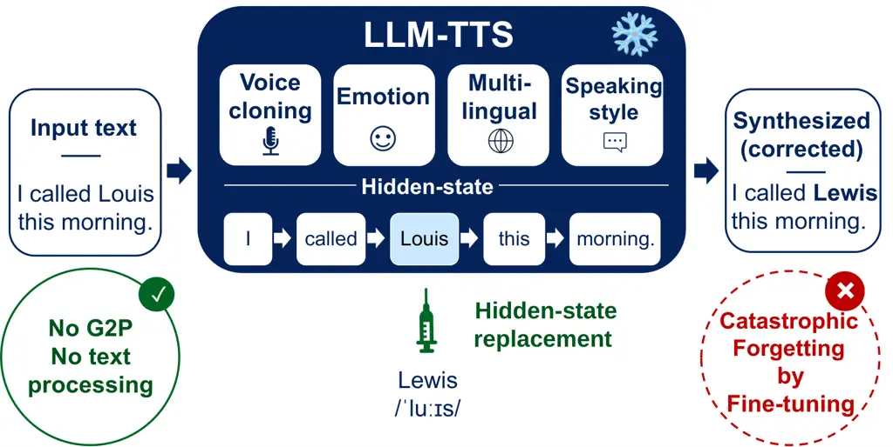
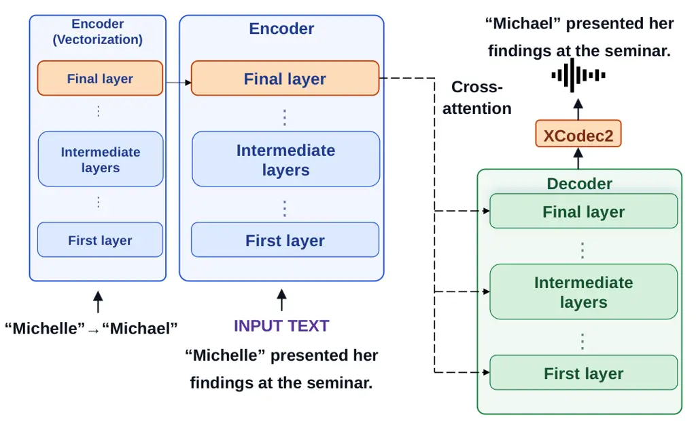

# SpeechSplice: Pronunciation Control in Encoder–Decoder LLM-based TTS by Replacing Encoder Hidden States

Kiyoshi Kurihara Affiliation: Matsuo Institute, Inc., Japan
Affiliation: The University of Tokyo, Japan
Email: [kiyoshi.kurihara@matsuo-institute.com](mailto:)    Jumpei Ukita
Affiliation: Matsuo Institute, Inc., Japan Affiliation: The University
of Tokyo, Japan    Yusuke Iwasawa Affiliation: Matsuo Institute, Inc.,
Japan Affiliation: The University of Tokyo, Japan    Yutaka Matsuo
Affiliation: Matsuo Institute, Inc., Japan Affiliation: The University
of Tokyo, Japan

###### Abstract

Most large language model (LLM)-based text-to-speech (TTS) methods offer
no explicit function for correcting pronunciation. Consequently, these
systems frequently mispronounce many everyday words, such as proper
nouns, heteronyms, numerals, and domain-specific terms. While
weight-editing or fine-tuning can mitigate this, these solutions risk
quality degradation and must operate offline. We propose SpeechSplice, a
training-free encoder-output replacement approach for pronunciation
control in encoder–decoder LLM-based TTS. SpeechSplice replaces the
encoder-output hidden states of a word with those of its intended
reading. Cross-architecture and cross-lingual experiments cover ten
public TTS systems in 17 model–language conditions. At the hidden state
we replace, the intervention moves pronunciation toward the target
reading more often when the generator reads the text through
cross-attention than when text and speech share one self-attention
sequence. In human evaluations, native-language listeners identified
speech generated with SpeechSplice as realizing the target reading in
98.6–100.0% of judgments, while a separate study found no significant
naturalness difference from unmodified synthesis. By clarifying the
conditions under which pronunciation correction succeeds, this study
offers an empirical basis for investigating pronunciation control in
LLM-based TTS architectures.

## 1 Introduction

Recent large language model (LLM)-based text-to-speech (TTS)
methods—including VALL-E (Chen et al., 2025), CosyVoice 2 (Du et al.,
2024), Llasa (Ye et al., 2025), Qwen3-TTS (Hu et al., 2026), and
T5Gemma-TTS (Arata and Kurihara, 2026)—integrate traditional language
front ends into a single sequence model that maps text directly to
speech. That design improves naturalness, multilingual coverage, and
zero-shot voice cloning, but in most such systems it removes the
editable pronunciation interface at inference time: in conventional
pipelines (Shen et al., 2018), pronunciation ambiguity—heteronyms,
polyphones, homographs—is handled by grapheme-to-phoneme (G2P) modules
that can be updated entry by entry (Taylor, 2009; Sproat, 1996; Zhang,
2023). A few LLM-based systems offer pronunciation control at the
phoneme or pinyin level (Cui et al., 2025; Gong et al., 2026; Deng
et al., 2025). Fine-tuning can restore such control (Kato, 2025), but in
LLM-based TTS it is reported to degrade quality, with catastrophic
forgetting inducing speech collapse (Fujita et al., 2024; Kwon et al.,
2025; Hsiao et al., 2025).



Figure 1: Overview of SpeechSplice, which controls pronunciation without
a grapheme-to-phoneme (G2P) front end. We evaluate preservation only for
speaker similarity, naturalness, pitch, and duration.

We propose SpeechSplice¹¹ 1 Code, benchmark items, and listening-test
materials:
[https://github.com/Kuri-san-jp/speechsplice](https://github.com/Kuri-san-jp/speechsplice),
a training-free encoder-output replacement approach for G2P-free word
injection in encoder–decoder LLM-based TTS. By replacing entity-position
hidden states at the final output of the frozen text encoder with
vectors encoding the target reading (Figure 1), it keeps pronunciation
entirely within the model and gives local control without touching any
weight.

Our contributions are:

1.  1.  We introduce SpeechSplice, to our knowledge the first method to
        demonstrate G2P-free word injection at the text-encoder output in
        encoder–decoder LLM-based TTS; all model weights stay frozen.
2.  2.  We identify which systems the intervention reaches, over ten public
        TTS systems in 17 model–language conditions. One requirement
        separates the conditions in which it works from those in which it
        does not: at the tensor we replace, the generator must read the
        encoded text through cross-attention. A second condition is
        presupposed rather than tested: the tokenizer must give the source
        and target words different token identifiers, and Section 4.1
        describes the case in which it does not. This finding offers an
        empirical basis for investigating pronunciation control in LLM-based
        TTS architectures.
3.  3.  We evaluate SpeechSplice with native listeners in English, Japanese,
        and Chinese, using paired comparison tests with a neither option for
        target-word injection and a mean opinion score (MOS) study for
        naturalness. Listeners pick the SpeechSplice output as realizing the
        target reading in 98.6–100.0% of judgments, and MOS shows no
        significant difference from unmodified synthesis.

## 2 Related Work

#### Controllable speech synthesis.

Recent work on controllable TTS organizes the field by both the target
of control—such as emotion, zero-shot voice cloning, style, or
pronunciation—and the underlying generation paradigm, including
autoregressive codec language models, diffusion models, and hybrid
systems (Xie et al., 2025). Representative methods control style with
Global Style Tokens (Wang et al., 2018), control voice and speaking
style with text prompts (Leng et al., 2024), and support zero-shot voice
cloning (Chen et al., 2025; Le et al., 2023; Du et al., 2024).
SpeechSplice adds pronunciation control without retraining the model.

A parallel line of work improves the front end rather than removing it,
through neural grapheme-to-phoneme conversion (Gorman et al., 2020;
Cheng et al., 2024) and polyphone disambiguation (Zhang et al., 2022).
These settle a reading before synthesis and need a front end to receive
it. Dictionary-free methods correct at synthesis time instead, with
non-target-speaker reference speech (Fong et al., 2022), voice-prompted
speech editing (Kashyap et al., 2025), or acoustically informed
spellings (Fong et al., 2023). FlowEdit optimizes and stores a
text-embedding perturbation for each correction (Singh et al., 2026b).
SpeechSplice needs no recording of the target word and no optimization,
and it intervenes at the final encoder output.



Figure 2: Overview of SpeechSplice on T5Gemma-TTS. The source sentence
and its target-reading version are encoded by the same frozen encoder.
At the final encoder output, SpeechSplice replaces the source entity
states with the corresponding target-reading states, and the decoder
reads the modified sequence through cross-attention.

#### Layer-wise probing of speech representations.

Layer-wise analyses of speech self-supervised learning (SSL) models such
as wav2vec 2.0 (Baevski et al., 2020) and WavLM (Chen et al., 2022) show
that acoustic and linguistic attributes emerge at different depths
rather than uniformly (Pasad et al., 2021), that phonetic information
survives across many layers (Choi et al., 2024), and that intermediate
layers capture word-level structure (Pasad et al., 2024). Applied to
question answering, logical reasoning, speech recognition, and machine
translation models, letting the decoder cross-attend to intermediate
encoder layers instead of the final encoder output shows that low and
intermediate layers already solve simpler subtasks (Langedijk et al.,
2024). While prior TTS work uses SSL layers to drive the transformation
from text to phonetic information (Aihara et al., 2026; Wang et al.,
2023; Sivaguru et al., 2023; Lee et al., 2022), SpeechSplice takes a
different approach. We apply the same layer-wise view to the text
encoder of a TTS model. We then replace its final-layer states at target
entity positions before the decoder reads them.

#### Activation patching and representation engineering.

Activation patching steers model behavior at inference time by modifying
internal activations rather than model weights (Vig et al., 2020; Geiger
et al., 2021; Zou et al., 2023; Li et al., 2023). In text language
models, Li et al. (2023) add learned directions to hidden states. A
language model can also explain hidden states in natural language
(Ghandeharioun et al., 2024), and hidden states moved from one forward
pass into another can change a translated concept but not the output
language (Dumas et al., 2025). Related ideas have appeared in TTS
through counterfactual activation editing (Lee et al., 2025),
codec-token editing (Peng et al., 2024; Wang et al., 2025), score-based
speech editing (Tae et al., 2022), spectrogram-level speech editing (Lv
et al., 2026; Jiang et al., 2023), and accent editing via activation
steering (Yang and Hansen, 2026; in speech recognition, Sun et al.,
2026). Recent TTS studies also trace an emotion circuit with activation
patching (Du et al., 2026), steer speaking rate (Verdini et al., 2026),
and control speech attributes through sparse-autoencoder features
(Koriagin et al., 2026). SpeechSplice changes a word’s reading by
replacing its final encoder states with target-reading states. Our
cross-attention ablation (Section 5.6) blocks attention edges, an
intervention that Geva et al. (2023) use to locate where information
propagates to the prediction.

#### Fine-tuning-based pronunciation control.

A separate line controls pronunciation by updating parameters, through
low-rank adaptation (Hu et al., 2022), as in UtterTune (Kato, 2025), and
SonoEdit (Singh et al., 2026a) edits weights in decoder-only LLM-based
TTS. As noted in Section 1, fine-tuning LLM-based TTS is reported to
degrade quality (Fujita et al., 2024; Kwon et al., 2025; Hsiao et al.,
2025). SpeechSplice leaves all parameters frozen instead.

## 3 Method

### 3.1 Task Definition

Our goal is to modify only the pronunciation of a target entity at
inference time while keeping both the model weights and the rest of the
utterance unchanged. Given a frozen encoder–decoder TTS model, an input
sentence $`x`$ that contains an ambiguous entity $`e`$, and a desired
reading $`r_{e}`$ supplied at inference time, we generate speech
$`\tilde{a}`$ in which $`e`$ is spoken as $`r_{e}`$ while speaker
characteristics and overall speech quality stay unchanged.

Let $`x^{\prime}`$ be the target sentence, that is, $`x`$ with $`e`$
replaced by a written form that carries the reading $`r_{e}`$. Let
$`\mathcal{I}_{\mathrm{src}}(e)=(s_{1},\ldots,s_{m})`$ and
$`\mathcal{I}_{\mathrm{tgt}}(e)=(u_{1},\ldots,u_{n})`$ be the entity
token spans in $`x`$ and in $`x^{\prime}`$. To find
$`\mathcal{I}_{\mathrm{src}}(e)`$, we tokenize the whole sentence with
character offsets and take every token whose offset range overlaps the
entity. We encode $`x`$ and $`x^{\prime}`$ with the same frozen TTS
encoder to obtain $`\mathbf{H}^{\mathrm{src}}`$ and
$`\mathbf{H}^{\mathrm{tgt}}`$. We train no parameters, so SpeechSplice
is training-free. It splices the target entity states between the source
prefix and suffix (Figure 2):

```math
\tilde{\mathbf{H}}=\big(\mathbf{h}^{\mathrm{src}}_{1:s_{1}-1},\ \mathbf{h}^{\mathrm{tgt}}_{u_{1}:u_{n}},\ \mathbf{h}^{\mathrm{src}}_{s_{m}+1:T}\big), \tag{1}
```

where $`\mathbf{h}_{a:b}`$ is the block of states from index $`a`$ to
$`b`$ and $`T`$ is the encoder sequence length of $`x`$. The splice
changes the encoder length from $`T`$ to $`T-m+n`$, and we rebuild the
attention mask and the position indices to match. For $`m=n`$ it is a
replacement in place. When the length has to stay fixed we pool instead,
using $`A^{e}\in\mathbb{R}^{m\times n}`$ with $`A^{e}_{jk}\geq 0`$ and
$`\sum_{k=1}^{n}A^{e}_{jk}=1`$:

```math
\bar{\mathbf{h}}_{s_{j}}^{\mathrm{tgt}}=\sum_{k=1}^{n}A^{e}_{jk}\mathbf{h}_{u_{k}}^{\mathrm{tgt}}, \tag{2}
```

and we write $`\bar{\mathbf{h}}^{\mathrm{tgt}}_{t}`$ at each
$`t\in\mathcal{I}_{\mathrm{src}}(e)`$. The ablation of Section 5.6 takes
this form with $`A^{e}_{jk}=1/n`$.

### 3.2 The Decoder-Facing Encoder Output

In encoder–decoder TTS, the encoder maps the input text to
$`\mathbf{H}=[\mathbf{h}_{1},\ldots,\mathbf{h}_{T}]\in\mathbb{R}^{T\times d}`$,
where $`T`$ is the encoder sequence length and $`d`$ is the hidden-state
dimensionality. The decoder generates acoustic or codec tokens while
reading this sequence through cross-attention. The final encoder output
is therefore the text-side interface—and the bottleneck—between text
encoding and speech generation. Retrieval and injection both take place
at the final encoder output. SpeechSplice reads the target entity states
there and splices them into the source sequence at the entity-token
positions, as in Eq. (1). Appendix I specifies the text-side tensor that
we replace in each of the other nine systems compared in Section 5.3.

## 4 Experimental Setup

### 4.1 Datasets and Models

#### TTS models.

We evaluated ten public TTS systems as frozen checkpoints (links in
Appendix I). In five, the decoder reads the text encoder output through
cross-attention (encoder–decoder): T5Gemma-TTS, SpeechT5 (Ao et al.,
2022), LongCat-AudioDiT (Xin et al., 2026), Irodori-TTS (Arata, 2026),
and Kiseki-TTS (telecomadm1145, 2026). In the other five, the text
shares one self-attention sequence with the speech tokens
(decoder-only): Qwen3-TTS, XTTS-v2 (Casanova et al., 2024), Llasa-3B (Ye
et al., 2025), CSM-1B, and Bark. T5Gemma-TTS and Qwen3-TTS run in
English (EN), Japanese (JA), and Chinese (ZH), and each of the others in
one or two of these languages, giving 17 model–language conditions.
SpeechT5 is evaluated in EN only: its English-only tokenizer gives the
source and target words of every JA and ZH pair the same token
identifiers, so replacement cannot change the encoder output, and we
exclude those two conditions rather than count them as failures. The
method therefore presupposes a tokenizer that gives the source and
target words different token identifiers.

#### Benchmarks.

The cross-lingual benchmark has 300 pairs per language, built from 50
hand-written entity pairs and six sentence templates. The
cross-architecture benchmark, which the acoustic cross-attention
ablation and Appendix E also use, has another 300 pairs per language,
built from 30 hand-written entity pairs and ten templates, with a
Japanese surname as the target and an English given name (EN) or a
Chinese surname (JA, ZH) as the source. Source and target sentences
differ in exactly one entity span.

#### Conventional system comparison.

The other-system comparison used the English split of the cross-lingual
benchmark. We compared SpeechSplice against VoiceCraft zero-shot TTS
(Peng et al., 2024) and EdiTTS content replacement (Tae et al., 2022).
SpeechSplice and VoiceCraft used the same 3.25-s LibriTTS (Zen et al., 2019) test-clean voice prompt; EdiTTS could not clone an arbitrary
prompt speaker and instead edited speech synthesized by its Grad-TTS
(Popov et al., 2021) backbone, trained on LJSpeech²² 2 [LJ Speech
dataset](https://keithito.com/LJ-Speech-Dataset/).

#### Human-listening stimuli.

We built stimuli for two studies. Baseline (BL) and injected (INJ) clips
were generated with T5Gemma-TTS voice cloning from one native reference
speaker per language, taken from LibriTTS (EN), JSUT (Sonobe et al., 2017) (JA), and the Databaker Chinese Standard Mandarin Speech Corpus³³
3 [Databaker Chinese Standard Mandarin Speech
Corpus](https://www.data-baker.com/open_source.html) (ZH), using the
variable-length splice implementation. The paired comparison test drew
50 name items per language from the cross-lingual benchmark, except one
JA item that was replaced before data collection, and additionally used
a Japanese same-surface set: 50 sentences in which the frozen
T5Gemma-TTS baseline misreads the target word while the written sentence
stays unchanged. These items cover heteronyms, numerals, okurigana,
place names, and rare surnames; Appendix D gives their sources and
composition. The naturalness study used another 50 baseline–injection
name-replacement pairs in each of EN, JA, and ZH, built and synthesized
separately from the 300 pairs and the paired-comparison items. BL and
INJ used the same text, voice prompt, and decoding configuration, and
the random seed was reset to the same value before every synthesis call,
so the two conditions differ only in the encoder-output splice
intervention.

### 4.2 Evaluation Metrics

#### Automatic metrics.

To measure whether injected speech carries the target reading and
whether the rest of the speech is preserved, we use the following
metrics. Whisper-INJ is the percentage of injected samples whose
normalized automatic speech recognition (ASR) transcript contains the
target reading. Transcripts come from Whisper large-v3 (Radford et al.,
2023); on the cross-lingual benchmark and in the two-entity test, JA
uses Furigana Whisper instead and ZH is matched after pinyin
normalization. Appendix F reports the full-sentence character error rate
(CER). UTMOS (Saeki et al., 2022) measures speech quality. Speaker
similarity is the cosine similarity of speaker-verification embeddings
from WavLM-SV (Chen et al., 2022) between each baseline clip and its
injected or edited counterpart, and between each injected clip and the
voice prompt. The $`|\Delta F_{0}|`$ ratio is the mean absolute change
in fundamental frequency $`F_{0}`$ from the baseline divided by the mean
change between two baseline utterances of different sentences, and
$`|\Delta\,\mathrm{duration}|`$ is the mean absolute change in utterance
duration from the baseline.

#### Paired comparison test.

To verify that the injected target word was correctly realized in the
generated speech, we ran a paired comparison test following the
pronunciation-evaluation protocols of Speech Audio Corrector (Fong
et al., 2022) and Spell4TTS (Fong et al., 2023): native listeners heard
a BL–INJ pair in randomized order and judged which clip realized a
displayed target word, with a third option of choosing neither clip.
Whereas Fong et al. present the intended pronunciation as reference
audio or an alternative spelling, we display the target word itself,
since for proper names neither clip is self-evidently correct without a
reference; EN and ZH displayed the orthographic form, and JA the kana
reading alone. Each language used 50 items in two 25-item blocks; twenty
listeners per language (ten per block) each judged their 25 items plus
three catch trials, for ten independent judgments per item and 500 per
language. The Japanese same-surface set followed the same protocol
(Appendix D). The interface disabled answering until both clips had
played to the end, and catch trials displayed a word spoken in neither
clip. We report the unconditional INJ-selection rate, counting a choice
of neither clip as failure, with item-level bootstrap confidence
intervals. The name-set clips are drawn from the cross-lingual
benchmark, so for each item we also compare the majority of its ten
judgments with the Whisper judgment of the same pair; one replaced
Japanese item lacks an automatic judgment. No listener met a
pre-specified exclusion criterion: failing more than one catch trial,
straight-line responding, or completing fewer than 90% of the trials.

#### Naturalness MOS.

A separate study measured whether injection degrades naturalness. Twenty
native listeners per language rated the 50 BL and 50 INJ clips on a
five-point scale, providing ten ratings per clip on average, and the
instructions explicitly excluded pronunciation correctness from the
rating criteria. BL–INJ differences were tested with two-sided paired
Wilcoxon signed-rank tests over item means. Appendix G documents
recruitment, payment, consent, the instructions, and the interface of
both studies.

#### Cross-architecture metrics.

To compare systems on how far injection moves the speech and how often
it moves the entity pronunciation toward the target reading, we report
whole-utterance BL–INJ mel-cepstral distortion (MCD) (Kubichek, 1993)
and Phoneme Injection-Better (PIB) with Wilson 95% confidence intervals
(CIs). PIB is the fraction of the $`N{=}300`$ pairs for which injection
lowers the entity phoneme error rate (PER) measured against the target
reading,

```math
\mathrm{PIB}=\frac{1}{N}\sum_{p=1}^{N}\mathbf{1}[\,\mathrm{PER}^{\mathrm{INJ}}_{p}<\mathrm{PER}^{\mathrm{BL}}_{p}\,]. \tag{3}
```

We write $`L`$ for the number of layers the text passes through in a
system and $`l^{*}`$ for the number of those layers that precede the
replacement, so our replacement sits at $`l^{*}{=}L`$ in the
encoder–decoder systems and at $`l^{*}{=}L{-}1`$ in the decoder-only
ones; Section 5.4 sweeps $`l^{*}`$ with everything else fixed.

#### Two-entity test.

To examine whether two entities in one sentence can be corrected
together, we used a further 300 sentences per language that carry two
entity slots each, built from 50 pairs of same-kind proper nouns and six
templates of their own. We corrected one entity, then both, and scored
Whisper-INJ per slot, pooling 600 slot judgments from 300 sentences; the
two slots of a sentence are not independent, so we compare the columns
by resampling sentences (Appendix J). The BL column scores the baseline
speech for the words it was asked to read.

#### Cross-attention ablation.

To examine whether entity-position cross-attention carries the replaced
states to the generated speech, we also synthesized BL and INJ with
entity-position cross-attention blocked (BL*(mask), INJ*(mask)) and
compared each injected condition with its matched baseline over the
entity span, by MEL Similarity and by a variance-normalized MCD whose
values are comparable only within Table A1 (Appendix A).

|       |                               |                                  |                  |                  |          |                               |                  |                  |                     |                         |          |
| ----- | ----------------------------- | -------------------------------- | ---------------- | ---------------- | -------- | ----------------------------- | ---------------- | ---------------- | ------------------- | ----------------------- | -------- | ------------- | ------------------------ |
|       | Paired comparison test        |                                  | Naturalness MOS  |                  |          |                               | UTMOS            |                  | Speaker similarity  |                         |          |
| Lang. | INJ selected (%) $`\uparrow`$ | $`z`$ ($`p`$)                    | BL               | INJ $`\uparrow`$ | $`p`$    | Whisper-INJ (%) $`\uparrow`$  | BL               | INJ $`\uparrow`$ | BL–INJ $`\uparrow`$ | INJ–prompt $`\uparrow`$ | $`       | \Delta F\_{0} | `$  ratio $`\downarrow`$ |
| EN    | $`99.4~(+0.6/{-}0.8)`$        | $`9.07`$ ($`<10^{-16}`$)         | $`3.56\pm 0.09`$ | $`3.52\pm 0.08`$ | $`0.45`$ | $`96.33`$ $`(+1.61/{-}2.78)`$ | $`3.86\pm 0.05`$ | $`3.82\pm 0.05`$ | $`0.83\pm 0.01`$    | $`0.84\pm 0.01`$        | $`0.98`$ |
| JA    | $`98.6~(+1.4/{-}2.8)`$        | $`4.24`$ ($`2.3\times 10^{-5}`$) | $`3.68\pm 0.09`$ | $`3.64\pm 0.09`$ | $`0.74`$ | $`92.33`$ $`(+2.50/{-}3.57)`$ | $`3.39\pm 0.04`$ | $`3.41\pm 0.05`$ | $`0.94\pm 0.00`$    | $`0.85\pm 0.01`$        | $`0.71`$ |
| ZH    | $`100.0~(+0.0/{-}0.0)`$       | – ($`1.8\times 10^{-15}`$)       | $`3.67\pm 0.10`$ | $`3.71\pm 0.10`$ | $`0.96`$ | $`96.00`$ $`(+1.70/{-}2.86)`$ | $`3.33\pm 0.07`$ | $`3.35\pm 0.07`$ | $`0.91\pm 0.01`$    | $`0.89\pm 0.01`$        | $`0.88`$ |

Table 1: Listeners chose the injected clip in almost every judgment, and
MOS showed no significant BL–INJ difference. We did not test for
equivalence. BL: T5Gemma-TTS baseline synthesis; INJ: SpeechSplice
injection. $`z`$ ($`p`$): binomial generalized estimating equation (GEE)
test against chance (Liang and Zeger, 1986), or an exact binomial test
for ZH (Appendix G.1). MOS $`p`$: two-sided paired Wilcoxon signed-rank
test over item means. Speaker similarity: WavLM-SV cosine similarity
between the two clips named (prompt: voice prompt). 95% intervals:
item-level bootstrap for INJ selected and Wilson for Whisper-INJ, as
$`(+\mathrm{upper}/{-}\mathrm{lower})`$; $`\pm 1.96\times`$ standard
error for means. Metrics: Section 4.2.

|                        |                              |                  |                               |          |                     |                         |          |                  |
| ---------------------- | ---------------------------- | ---------------- | ----------------------------- | -------- | ------------------- | ----------------------- | -------- | ---------------- | ------------------------ | --- | ------------------------- | ---------------------- |
|                        |                              | UTMOS            |                               |          | Speaker similarity  |                         |          |                  |
| System                 | Whisper-INJ (%) $`\uparrow`$ | BL               | Injected/ edited $`\uparrow`$ | $`p`$    | BL–INJ $`\uparrow`$ | INJ–prompt $`\uparrow`$ | $`       | \Delta F\_{0}    | `$  ratio $`\downarrow`$ | $`  | \Delta\,\mathrm{duration} | `$  (s) $`\downarrow`$ |
| SpeechSplice (ours)    | $`96.33~(+1.61/{-}2.78)`$    | $`3.86\pm 0.05`$ | $`3.82\pm 0.05`$              | $`0.07`$ | $`0.83\pm 0.01`$    | $`0.84\pm 0.01`$        | $`0.98`$ | $`0.00\pm 0.00`$ |
| VoiceCraft (zero-shot) | $`90.00~(+2.91/{-}3.92)`$    | $`3.62\pm 0.04`$ | $`3.63\pm 0.04`$              | $`0.54`$ | $`0.87\pm 0.01`$    | $`0.87\pm 0.01`$        | $`0.98`$ | $`0.20\pm 0.02`$ |
| EdiTTS^(†)             | $`86.00~(+3.47/{-}4.38)`$    | $`4.29\pm 0.02`$ | $`4.28\pm 0.02`$              | $`0.09`$ | $`0.97\pm 0.00`$    | –                       | $`0.74`$ | $`0.13\pm 0.01`$ |

Table 2: Comparison with conventional methods on the English split of
the cross-lingual benchmark. SpeechSplice recovers the target reading
most often and keeps the BL duration by construction. The SpeechSplice
row is the EN run of Table 1, whose caption gives the intervals;
Section 4.2 defines the columns. UTMOS $`p`$: two-sided paired Wilcoxon
signed-rank test over per-clip scores. VoiceCraft (zero-shot): zero-shot
voice cloning. BL: synthesis of the source sentence (Grad-TTS for
EdiTTS); Injected/edited (INJ): SpeechSplice, VoiceCraft target-sentence
synthesis, or the EdiTTS edit. ^(†)EdiTTS is not LLM-based and cannot
clone a voice, so INJ–prompt is unavailable.

## 5 Results

### 5.1 Cross-Lingual Injection and Speech Quality

Listeners confirmed the injected reading directly (Table 1): in the name
sets no listener chose the baseline, consistent with the Whisper-INJ
scores. Full-sentence CER shows the same shift: the injected transcripts
lie close to the target sentence and far from the source sentence in all
three languages (Appendix F). The Japanese same-surface set, which
corrects naturally occurring misreadings rather than replacing words,
gave the same result: only a few of its judgments went to the baseline
or to neither clip (Table A4). The selection rates significantly exceed
chance in every set, under the generalized estimating equation (GEE)
test or, for ZH, an exact binomial test. Automatic scoring of a 160-item
Japanese reading benchmark agrees: injection corrected all 45 strict
baseline misreadings (Appendix C). We detected no cost elsewhere. MOS
showed no significant BL–INJ difference in any language and UTMOS no
consistent change; speaker similarity to the voice prompt did not move
in any language in paired Wilcoxon tests over the WavLM-SV cosine
similarities of the 300 automatic-evaluation pairs, while BL–INJ
similarity stayed high; and every $`|\Delta F_{0}|`$ ratio falls below
1, so injection shifts $`F_{0}`$ less than ordinary sentence-to-sentence
variation does. Listener majorities matched the Whisper judgments on all
but eight name items, and the ASR was the stricter judge in seven of the
eight disagreements (Appendix H), so the automatic scores are
conservative relative to human perception.

### 5.2 Comparison with Conventional Methods

We compared SpeechSplice with VoiceCraft zero-shot TTS and EdiTTS on the
English split of the cross-lingual benchmark (Table 2), to assess
whether hidden-state injection recovers the target reading more often
than existing generation and editing approaches.

SpeechSplice recovered the target reading more often than VoiceCraft,
which resynthesizes the whole utterance, and than EdiTTS, which replaces
content by diffusion. The three systems synthesize in different acoustic
domains, so we read UTMOS within each system rather than across them;
none showed a significant change from its own baseline, so we detected
no quality cost for any of the three. For speaker identity we tested the
change against the voice prompt directly: the cosine similarity moves by
$`-0.001`$ for SpeechSplice, with a 95% CI of $`\pm 0.009`$ and
$`p=0.98`$ in a paired Wilcoxon test over 300 pairs, and by $`-0.009`$
for VoiceCraft, with a 95% CI of $`\pm 0.008`$ and $`p=0.026`$, the only
drift that reaches significance, while EdiTTS cannot clone a prompt
speaker, so this test does not apply to it. All three keep the pitch
change small, and EdiTTS shifts pitch least. The interfaces differ most
in duration: SpeechSplice reuses the BL generation length by
construction (Appendix I), while VoiceCraft and EdiTTS change it.
SpeechSplice thus gained accuracy at the BL length, and we detected no
cost elsewhere.

|                                     |       |       |                          |                                     |               |                 |                          |                        |                         |
| ----------------------------------- | ----- | ----- | ------------------------ | ----------------------------------- | ------------- | --------------- | ------------------------ | ---------------------- | ----------------------- |
|                                     |       |       | At our replacement point |                                     | Layer sweep   |                 | Two-entity sentences (%) |                        |                         |
| Model                               | Lang. | $`L`$ | MCD (dB)                 | PIB (%) $`\uparrow`$                | $`l^{*}`$     | PIB (%) min–max | BL                       | INJ (one) $`\uparrow`$ | INJ (both) $`\uparrow`$ |
| _Encoder–decoder (cross-attention)_ |       |       |                          |                                     |               |                 |                          |                        |                         |
| T5Gemma-TTS                         | EN    | 26    | $`9.95\pm 0.20`$         | $`57.00~(+5.48/{-}5.66)`$           | 1/8/15/22/26  | 56.67–60.00     | 97.17                    | 97.17                  | 96.67                   |
|                                     | JA    | 26    | $`8.24\pm 0.21`$         | $`52.00~(+5.59/{-}5.64)`$           | 1/8/15/22/26  | 48.00–52.00     | 88.00                    | 88.83                  | 89.17                   |
|                                     | ZH    | 26    | $`8.96\pm 0.25`$         | $`55.00~(+5.53/{-}5.66)`$           | 1/8/15/22/26  | 52.33–55.67     | 78.83                    | 81.83                  | 81.00                   |
| SpeechT5                            | EN    | 12    | $`3.53\pm 0.06`$         | $`64.00~(+5.22/{-}5.58)`$           | 1/3/6/9/12    | 54.00–64.00     | 95.67                    | 89.33                  | 90.67                   |
| LongCat-AudioDiT                    | EN    | 12    | $`10.00\pm 0.24`$        | $`65.33~(+5.16/{-}5.55)`$           | 1/3/6/9/12    | 59.33–65.33     | 94.67                    | 96.33                  | 95.17                   |
|                                     | ZH    | 12    | $`8.65\pm 0.25`$         | $`62.67~(+5.28/{-}5.60)`$           | 1/3/6/9/12    | 58.33–64.67     | 99.83                    | 99.33                  | 99.17                   |
| Irodori-TTS                         | JA    | 25    | $`7.20\pm 0.24`$         | $`49.33~(+5.63/{-}5.61)`$           | 1/7/13/19/25  | 49.33–59.33     | 96.33                    | 94.33                  | 94.67                   |
| Kiseki-TTS                          | JA    | 12    | $`5.28\pm 0.17`$         | $`41.67~(+5.65/{-}5.44)`$           | 1/3/6/9/12    | 41.67–44.67     | 02.67                    | 07.83                  | 07.00                   |
| _Decoder-only (self-attention)_     |       |       |                          |                                     |               |                 |                          |                        |                         |
| Qwen3-TTS                           | EN    | 28    | $`2.30\pm 0.28`$         | $`13.67~(+4.35/{-}3.43)`$           | 1/10/14/21/27 | 12.33–15.00     | 97.83                    | 00.00                  | 00.00                   |
|                                     | JA    | 28    | $`1.42\pm 0.27`$         | $`12.00~(+4.17/{-}3.20)`$           | 1/10/14/21/27 | 10.00–13.67     | 91.83                    | 00.00                  | 00.00                   |
|                                     | ZH    | 28    | $`0.86\pm 0.15`$         | $`12.33~(+4.20/{-}3.25)`$           | 1/10/14/21/27 | 09.00–12.67     | 99.83                    | 00.00                  | 00.00                   |
| XTTS-v2                             | EN    | 30    | $`0.34\pm 0.08`$         | $`\phantom{0}2.67~(+2.51/{-}1.31)`$ | 1/9/16/24/29  | 02.67–54.67     | 96.33                    | 00.00                  | 00.00                   |
| Llasa-3B                            | EN    | 28    | $`1.91\pm 0.30`$         | $`13.33~(+4.31/{-}3.39)`$           | 1/8/15/22/27  | 13.33–51.33     | 96.00                    | 00.00                  | 00.00                   |
|                                     | ZH    | 28    | $`2.21\pm 0.28`$         | $`20.33~(+4.92/{-}4.17)`$           | 1/8/15/22/27  | 20.33–49.00     | 97.17                    | 00.00                  | 00.00                   |
| CSM-1B                              | EN    | 16    | $`4.74\pm 0.15`$         | $`27.00~(+5.29/{-}4.71)`$           | 1/4/8/11/15   | 27.00–51.67     | 96.67                    | 00.00                  | 00.00                   |
| Bark                                | EN    | 24    | $`0.58\pm 0.18`$         | $`\phantom{0}4.00~(+2.86/{-}1.70)`$ | 1/6/12/17/23  | 04.00–49.67     | 97.00                    | 00.00                  | 00.00                   |
|                                     | JA    | 24    | $`0.97\pm 0.26`$         | $`\phantom{0}7.67~(+3.57/{-}2.50)`$ | 1/6/12/17/23  | 07.67–41.67     | 57.33                    | 00.00                  | 00.00                   |

Table 3: PIB at our replacement point ($`l^{*}{=}L`$; $`L{-}1`$ if
decoder-only) separates encoder–decoder from decoder-only conditions;
most decoder-only ones rise at shallower $`l^{*}`$, and a second entity
costs no detectable accuracy. INJ replaces an entity’s hidden states at
$`l^{*}`$ ($`L`$: layers the text passes through) with the swapped
sentence’s; BL does not. MCD: BL–INJ mel-cepstral distortion. PIB: % of
pairs where INJ lowers the entity phoneme error rate against the swapped
sentence. 95% CIs: $`\pm`$ for MCD; Wilson, as
$`(+\mathrm{upper}/{-}\mathrm{lower})`$, for PIB. Two-entity sentences:
% of 600 slots read as intended (BL: original; INJ: one or both swapped
in).

### 5.3 Cross-Architecture Results

This section examines how far the intervention carries beyond
T5Gemma-TTS and what separates the systems on which it works from those
on which it does not. Table 3 reports this comparison for all 17
model–language conditions, together with the layer sweep of Section 5.4
and the two-entity test of Section 5.5. Across them the split follows
the path by which the generator reads the encoded text. At the tensor we
replace, the PIB values of the two groups do not overlap: the lowest
encoder–decoder value, Kiseki-TTS JA, lies above the highest
decoder-only value, CSM-1B EN. The other three encoder–decoder systems
bring two decoder families that T5Gemma-TTS and SpeechT5 do not use—a
diffusion transformer (Peebles and Xie, 2023) in LongCat-AudioDiT and in
Irodori-TTS, and a Mamba-2 decoder (Dao and Gu, 2024) in Kiseki-TTS—so
the pattern is not specific to the autoregressive decoder those two
share. MCD is above zero in every condition, including the decoder-only
ones, where even the smallest value, that of XTTS-v2 EN, has an interval
that excludes zero; there the replacement changes the speech but, by
PIB, moves it toward the target reading less often than in any
encoder–decoder condition.

Bark EN has the second-lowest PIB in the table: in the large majority of
its pairs the injected semantic tokens came out identical to the
baseline, so the PER cannot change and the pair counts as a failure by
definition.

### 5.4 Effect of Replacement Depth

Depth has little effect in the encoder–decoder systems: in Table 3, the
PIB of T5Gemma-TTS EN varies across the whole encoder by less than the
width of the confidence interval of any single point, and SpeechT5,
LongCat-AudioDiT, Irodori-TTS, and Kiseki-TTS behave the same way,
consistent with the decoder reading one tensor that an earlier
replacement still reaches through the remaining layers. Depth has a
large effect in the decoder-only systems: CSM-1B EN, Llasa-3B EN and ZH,
Bark EN and JA, and XTTS-v2 EN all reach a much higher PIB at
$`l^{*}{=}1`$ than at our replacement point. There the speech tokens
attend to the text rows through the same stack, so a replacement at
depth $`l^{*}`$ rewrites the keys and values of every layer above it.
Qwen3-TTS shows this is not universal: its PIB stays low at every swept
depth.

### 5.5 Correcting Two Entities at Once

Correcting both entities has no detectable cost relative to correcting
one: across the eight encoder–decoder conditions in Table 3, the two
columns differ in both directions, and the 95% interval of their paired
per-sentence difference includes zero in every condition (Appendix J).
The decoder-only conditions read the corrected word in no slot at all,
although their baseline speech reads the original words in the vast
majority of slots, and in over half of them for Bark JA, which suggests
that the failure lies in the transmission rather than in reading the
stimuli. Replacing both entities also leaves UTMOS close to the baseline
in every condition (Appendix J).

### 5.6 Cross-Attention Ablation

Section 5.3 suggests that decoder-to-encoder cross-attention mediates
how entity-position encoder states affect speech generation. We ran the
four-condition T5Gemma-TTS ablation of Section 4.2 with
length-preserving injection: we mean-pooled target entity states across
the source span so that the encoder length stayed fixed, and we masked
only cross-attention to source entity columns.

Table A1 (Appendix A) reports the results: with cross-attention intact,
injection causes large acoustic differences in all three languages; when
entity-position cross-attention is blocked, the outputs become nearly
identical. A token-count-matched JA subset gives the same result
(Appendix A). These metrics measure BL–INJ acoustic divergence rather
than target-direction accuracy. Appendix B repeats the blocking at the
phoneme level on same-surface pairs.

## 6 Discussion

#### Human evaluation.

The two listening studies answer separate questions: listeners hear the
intended reading at near-ceiling rates in all three languages and on the
same-surface set, and the MOS study finds no significant naturalness
difference. Where listener majorities and the ASR judgments disagreed,
the ASR usually rejected a reading that listeners accepted, so the
automatic scores understate rather than overstate the effect.

#### Cross-architecture comparison.

In the systems we tested, the split between the encoder–decoder and
decoder-only groups (Table 3) is consistent with one account, built on
one requirement on the generator: that it read the text side through the
replaced state. The replacement changes the pronunciation when this
holds, and much less often when most of that reading bypasses the
replaced state. The encoder–decoder systems meet the requirement at the
tensor we replace, which is the text-side interface their decoders read
through cross-attention (Section 3.2; Appendix I). The five decoder-only
systems show what happens when most of that reading bypasses the
replaced state: at our replacement point they change the speech—their
BL–INJ MCD is nonzero in every condition—yet bring the entity closer to
the target reading less often than any encoder–decoder condition, so in
these systems, at that depth, a replaced text state reached the
generated speech less reliably through one self-attention sequence than
through a cross-attention path. The account also presupposes a tokenizer
that keeps the two written forms apart: they must receive different
token identifiers before any hidden state can distinguish them, which is
why SpeechT5 enters in English only (Section 4.1).

#### Replacement depth.

The layer sweep qualifies this contrast: in every decoder-only system
except Qwen3-TTS, it suggests that the low values at our replacement
point reflect the depth at which the replacement enters rather than the
absence of any path by which the replaced state can be read. In the
encoder–decoder systems an earlier replacement still reaches the tensor
the decoder reads (Section 5.4); in the decoder-only systems the audio
tokens read the text rows in every layer, so with the replacement at
$`l^{*}{=}L{-}1`$, only the last layer reads the replaced state and
every earlier layer still reads the original word. At the best depth we
found (Limitations), XTTS-v2, Llasa-3B, CSM-1B, and Bark reach PIB
within the range of the encoder–decoder conditions at our replacement
point, as Table 3 shows. One result falls outside this account:
Qwen3-TTS, which no swept depth lifts into that range.

#### Correcting two entities.

The two-entity test is consistent with the same account. The
decoder-only conditions read the corrected word in no slot, in either
the INJ (one) or the INJ (both) column of Table 3, at our replacement
point (Appendix I), which reproduces the split with another metric and
another sentence set and suggests that it is not specific to PIB or to
the single-entity pairs. In the encoder–decoder conditions, correcting a
second entity does not detectably lower per-slot Whisper-INJ
(Section 5.5), consistent with each replaced span being read through
cross-attention to its own positions, which the ablation of Section 5.6
supports for T5Gemma-TTS. Their INJ (one) and INJ (both) columns also
stay close to the BL column, which runs from Kiseki-TTS JA, whose
baseline speech rarely reads the words it was asked to read, to
LongCat-AudioDiT ZH, whose baseline speech almost always does. This
suggests that where the generator reads the text side through the
replaced state, the corrected rate tracks how reliably each system reads
words of this kind, whether one entity is replaced or two.

#### Transmission and comparison with conventional methods.

The ablation identifies entity-position cross-attention as the main
acoustic transmission path: blocking it removes the BL–INJ difference in
EN, JA, and ZH. On the controlled English benchmark SpeechSplice also
recovers the target reading more often than VoiceCraft and EdiTTS. That
comparison spans distinct interfaces—full continuation synthesis,
diffusion-based content replacement, and encoder-state splicing—yet
intervening directly at the decoder-facing encoder tensor gives the
highest pronunciation accuracy while keeping the BL duration and showing
no detectable change in naturalness.

## 7 Conclusion

We introduced SpeechSplice, a training-free intervention that restores
pronunciation correction in encoder–decoder LLM-based TTS. Native
listeners picked the injected clip in almost every judgment in EN, JA,
and ZH and on a Japanese set where the baseline misreads a word that
stays written the same (Tables 1 and A4), and a separate study found no
significant naturalness difference from unmodified synthesis.
SpeechSplice also recovered the target reading more often than the
public synthesis and editing systems we evaluated.

At the tensor we replace, the replacement succeeds when the generator
reads the encoded text through cross-attention: over 17 model–language
conditions the five encoder–decoder systems reach a higher PIB than the
five decoder-only systems, with no overlap between the two groups
(Table 3). A training-free intervention can deliver the intended reading
in encoder–decoder LLM-based TTS.

#### Future work.

Models, including decoder-only Transformers, could be trained from
scratch to support injection by meeting the requirement we identify, and
phoneme-level conditioning could remove the need to respell the target
word.

## Limitations

- •
  The mechanism is compared across ten public TTS systems, but decoder
  architecture, training data, language coverage, tokenizer choice, and
  model scale still vary together, so the comparison identifies which
  systems the intervention reaches rather than which single factor
  decides it.
- •
  Which depth to replace at is settled empirically. In Bark, Llasa-3B,
  and Qwen3-TTS EN the best depth we found is the first layer rather
  than the one we report in Table 3; in XTTS-v2, CSM-1B, and Qwen3-TTS
  JA and ZH it is an intermediate one ($`l^{*}{=}9`$, $`4`$, and $`21`$,
  respectively). We have no criterion that selects the depth in advance.
- •
  The method requires the target reading to be specified correctly at
  inference time.
- •
  Variable-length splicing preserves all target entity states when
  source and target token counts differ, but requires consistent
  reconstruction of the attention mask and position indices; portability
  to other positional schemes remains to be tested.
- •
  The MOS study uses one cloned reference speaker per language.
- •
  Outside the listening tests, we judge pronunciation automatically with
  ASR and a phoneme recognizer, and ASR can miss reading errors that
  listeners hear (Luo and Wan, 2026). We did not evaluate pitch accent.
- •
  Kiseki-TTS has the lowest PIB of the encoder–decoder systems, and even
  its baseline speech is rarely recognized in the two-entity test
  (Table 3).
- •
  The two-entity test scores pronunciation. We estimated the speech
  quality of its outputs only with UTMOS (Appendix J) and did not
  evaluate their naturalness, intelligibility, or artifacts with
  listeners. Long-form text, more diverse speakers, low-resource
  languages, closely spaced entities, and three or more entities per
  sentence also remain untested.

## Ethics Statement

This work edits the internal representations of a pretrained TTS model
to correct the pronunciation of proper nouns. The same mechanism can
also create risks, so we note the main ethical points below.

#### Potential for misuse.

The method could be used to deliberately mispronounce names. Two factors
limit this risk. The user must specify the target reading explicitly,
and the intervention stays local to the chosen entity span.

#### Speaker and demographic considerations.

More diverse evaluation is needed before deployment across different
name origins and languages.

#### Human evaluation.

Native-language listeners for the paired comparison test and the
naturalness MOS study were recruited through Prolific for English and
Chinese and through Lancers for Japanese, and were paid above Prolific’s
minimum rate or, on Lancers, more than twice the Tokyo minimum wage
(Appendix G.2). Conditions were blinded, presentation order was
randomized, and complete playback was required. The paired comparison
test included catch trials, and no listener met the pre-specified
exclusion criteria. We analyzed responses using participant identifiers
solely for assignment, deduplication, and quality control, and collected
no personally identifying information.

#### Artifact use and licensing.

Apart from the weight-editing baselines of Appendix E, all third-party
models, datasets, and evaluation tools used in this work are used
without modification and remain subject to the licenses and terms of use
of their original distribution sources. Apart from open-source code
included under its own license, only the sample page described below and
the ja-tts-g2p-bench items of Appendix C redistribute third-party
material, as the respective terms permit: one JSUT recording, the
Japanese voice prompt, and Japanese sentences from ja-tts-g2p-bench and
Wikipedia. Our released artifacts are intended for research and
reproducibility purposes and do not supersede the original access
conditions of any third-party resources. The released repository
([https://github.com/Kuri-san-jp/speechsplice](https://github.com/Kuri-san-jp/speechsplice))
contains the generation, scoring, and analysis code, the container
definitions and the requirements specification, the benchmark item
lists, and the pre-computed evaluation outputs, together with the
listening-test stimulus manifests, the item-level aggregates, the
verbatim listener instructions in English, Japanese, and Chinese, and
the interface screenshots. It also hosts a page of speech samples
selected from the listening-test stimuli
([https://kuri-san-jp.github.io/speechsplice/](https://kuri-san-jp.github.io/speechsplice/)),
released under the terms of LibriTTS, JSUT, and the Databaker corpus,
from which the voice-cloning prompts derive, and of ja-tts-g2p-bench and
Wikipedia, from which the Japanese same-surface items derive.

#### Data screening and documentation.

We wrote the benchmark entity lists by hand from widely known public
proper nouns, and we use them for research and evaluation purposes.
Because proper nouns may include names of public individuals, we treated
them as potentially identifying information and inspected the collected
entity list to remove entries containing private personal information
beyond public names, offensive expressions, or clearly inappropriate
content. Human-evaluation records were kept separate from the benchmark
entities and used only for the analysis of the paired comparison test
and the MOS study and for quality control.

The automatic benchmark consists of three language splits—English,
Japanese, and Chinese—with two sets of 300 entity-replacement pairs and
one set of 300 two-entity sentences per language (Section 4). The
other-system evaluation uses the English 300-pair split of Table 1, the
paired comparison test uses 50 name items per language plus 50 Japanese
same-surface items, and the MOS study uses 50 pairs each in English,
Chinese, and Japanese. The artifacts created in this work are intended
for research and reproducibility purposes.

#### AI assistant disclosure.

The authors consulted AI assistants for language polishing and checklist
preparation. All AI-assisted text was reviewed and edited by the
authors, who take full responsibility for the paper content. AI
assistants did not generate experimental results or substitute for
scientific analysis.

## References

- Aihara et al. (2026) Ryo Aihara, Yoshiki Masuyama, François G.
  Germain, Gordon Wichern, and Jonathan Le Roux. 2026. [Exploring
  disentangled neural speech codecs from self-supervised
  representations](https://doi.org/10.1109/ICASSP55912.2026.11462776).
  In _2026 IEEE International Conference on Acoustics, Speech and Signal
  Processing (ICASSP)_, pages 21992–21996.
- Ao et al. (2022) Junyi Ao, Rui Wang, Long Zhou, Chengyi Wang, Shuo
  Ren, Yu Wu, Shujie Liu, Tom Ko, Qing Li, Yu Zhang, Zhihua Wei, Yao
  Qian, Jinyu Li, and Furu Wei. 2022. [SpeechT5: Unified-modal
  encoder-decoder pre-training for spoken language
  processing](https://doi.org/10.18653/v1/2022.acl-long.393). In
  _Proceedings of the 60th Annual Meeting of the Association for
  Computational Linguistics (Volume 1: Long Papers)_, pages 5723–5738,
  Dublin, Ireland. Association for Computational Linguistics.
- Arata (2026) Chihiro Arata. 2026. Irodori-TTS: A flow matching-based
  text-to-speech model with emoji-driven style control. Hugging Face
  repository,
  [https://huggingface.co/Aratako/Irodori-TTS-v4.1-Small](https://huggingface.co/Aratako/Irodori-TTS-v4.1-Small).
- Arata and Kurihara (2026) Chihiro Arata and Kiyoshi Kurihara. 2026.
  [T5Gemma-TTS technical
  report](https://doi.org/10.48550/arXiv.2604.01760). _arXiv preprint_,
  arXiv:2604.01760.
- Baevski et al. (2020) Alexei Baevski, Yuhao Zhou, Abdelrahman Mohamed,
  and Michael Auli. 2020. [wav2vec 2.0: A framework for self-supervised
  learning of speech
  representations](https://proceedings.neurips.cc/paper/2020/hash/92d1e1eb1cd6f9fba3227870bb6d7f07-Abstract.html).
  In _Advances in Neural Information Processing Systems_, volume 33,
  pages 12449–12460. Curran Associates, Inc.
- Casanova et al. (2024) Edresson Casanova, Kelly Davis, Eren Gölge,
  Görkem Göknar, Iulian Gulea, Logan Hart, Aya Aljafari, Joshua Meyer,
  Reuben Morais, Samuel Olayemi, and Julian Weber. 2024. [XTTS: A
  massively multilingual zero-shot text-to-speech
  model](https://doi.org/10.21437/Interspeech.2024-2016). In
  _Interspeech 2024_, pages 4978–4982.
- Chen et al. (2022) Sanyuan Chen, Chengyi Wang, Zhengyang Chen, Yu Wu,
  Shujie Liu, Zhuo Chen, Jinyu Li, Naoyuki Kanda, Takuya Yoshioka, Xiong
  Xiao, Jian Wu, Long Zhou, Shuo Ren, Yanmin Qian, Yao Qian, Jian Wu,
  Michael Zeng, Xiangzhan Yu, and Furu Wei. 2022. [WavLM: Large-scale
  self-supervised pre-training for full stack speech
  processing](https://doi.org/10.1109/JSTSP.2022.3188113). _IEEE Journal
  of Selected Topics in Signal Processing_, 16(6):1505–1518.
- Chen et al. (2025) Sanyuan Chen, Chengyi Wang, Yu Wu, Ziqiang Zhang,
  Long Zhou, Shujie Liu, Zhuo Chen, Yanqing Liu, Huaming Wang, Jinyu Li,
  Lei He, Sheng Zhao, and Furu Wei. 2025. [Neural codec language models
  are zero-shot text to speech
  synthesizers](https://doi.org/10.1109/TASLPRO.2025.3530270). _IEEE
  Transactions on Audio, Speech and Language Processing_, 33:705–718.
- Cheng et al. (2024) Shiyang Cheng, Pengcheng Zhu, Jueting Liu, and
  Zehua Wang. 2024. [A survey of grapheme-to-phoneme conversion
  methods](https://doi.org/10.3390/app142411790). _Applied Sciences_,
  14(24):11790.
- Choi et al. (2024) Kwanghee Choi, Ankita Pasad, Tomohiko Nakamura,
  Satoru Fukayama, Karen Livescu, and Shinji Watanabe. 2024.
  [Self-supervised speech representations are more phonetic than
  semantic](https://doi.org/10.21437/Interspeech.2024-1157). In
  _Interspeech 2024_, pages 4578–4582.
- Cui et al. (2025) Jiayan Cui, Zhihan Yang, Naihan Li, Jiankun Tian,
  Xingyu Ma, Yi Zhang, Guangyu Chen, Runxuan Yang, Yuqing Cheng, Yizhi
  Zhou, Guochen Yu, Xiaotao Gu, and Jie Tang. 2025. [GLM-TTS technical
  report](https://doi.org/10.48550/arXiv.2512.14291). _arXiv preprint_,
  arXiv:2512.14291.
- Dao and Gu (2024) Tri Dao and Albert Gu. 2024. [Transformers are SSMs:
  Generalized models and efficient algorithms through structured state
  space duality](https://proceedings.mlr.press/v235/dao24a.html). In
  _Proceedings of the 41st International Conference on Machine
  Learning_, volume 235 of _Proceedings of Machine Learning Research_,
  pages 10041–10071. PMLR.
- Davis and Mermelstein (1980) Steven B. Davis and Paul
  Mermelstein. 1980. [Comparison of parametric representations for
  monosyllabic word recognition in continuously spoken
  sentences](https://doi.org/10.1109/TASSP.1980.1163420). _IEEE
  Transactions on Acoustics, Speech, and Signal Processing_,
  28(4):357–366.
- Deng et al. (2025) Wei Deng, Siyi Zhou, Jingchen Shu, Jinchao Wang,
  and Lu Wang. 2025. [IndexTTS: An industrial-level controllable and
  efficient zero-shot text-to-speech
  system](https://doi.org/10.48550/arXiv.2502.05512). _arXiv preprint_,
  arXiv:2502.05512.
- Du et al. (2026) Hongfei Du, Jiacheng Shi, Yanfu Zhang, and Ashley
  Gao. 2026. [Tracing a sparse emotion-control circuit in LLM-based
  text-to-speech](https://doi.org/10.18653/2026.emnlp-main.378). In
  _Proceedings of the 2026 Conference on Empirical Methods in Natural
  Language Processing_, pages 8645–8658, Budapest, Hungary. Association
  for Computational Linguistics.
- Du et al. (2024) Zhihao Du, Yuxuan Wang, Qian Chen, Xian Shi, Xiang
  Lv, Tianyu Zhao, Zhifu Gao, Yexin Yang, Changfeng Gao, Hui Wang, Fan
  Yu, Huadai Liu, Zhengyan Sheng, Yue Gu, Chong Deng, Wen Wang, Shiliang
  Zhang, Zhijie Yan, and Jingren Zhou. 2024. [CosyVoice 2: Scalable
  streaming speech synthesis with large language
  models](https://doi.org/10.48550/arXiv.2412.10117). _arXiv preprint_,
  arXiv:2412.10117.
- Dumas et al. (2025) Clément Dumas, Chris Wendler, Veniamin Veselovsky,
  Giovanni Monea, and Robert West. 2025. [Separating tongue from
  thought: Activation patching reveals language-agnostic concept
  representations in
  transformers](https://doi.org/10.18653/v1/2025.acl-long.1536). In
  _Proceedings of the 63rd Annual Meeting of the Association for
  Computational Linguistics (Volume 1: Long Papers)_, pages 31822–31841,
  Vienna, Austria. Association for Computational Linguistics.
- Fong et al. (2022) Jason Fong, Daniel Lyth, Gustav Eje Henter, Hao
  Tang, and Simon King. 2022. [Speech Audio Corrector: Using speech from
  non-target speakers for one-off correction of mispronunciations in
  grapheme-input
  text-to-speech](https://doi.org/10.21437/Interspeech.2022-10138). In
  _Interspeech 2022_, pages 1213–1217.
- Fong et al. (2023) Jason Fong, Hao Tang, and Simon King. 2023.
  [Spell4TTS: Acoustically-informed spellings for improving
  text-to-speech pronunciations](https://doi.org/10.21437/SSW.2023-2).
  In _12th ISCA Speech Synthesis Workshop (SSW2023)_, pages 8–13.
- Fujita et al. (2024) Kenichi Fujita, Hiroshi Sato, Takanori Ashihara,
  Hiroki Kanagawa, Marc Delcroix, Takafumi Moriya, and Yusuke
  Ijima. 2024. [Noise-robust zero-shot text-to-speech synthesis
  conditioned on self-supervised speech-representation model with
  adapters](https://doi.org/10.1109/ICASSP48485.2024.10447809). In _2024
  IEEE International Conference on Acoustics, Speech and Signal
  Processing (ICASSP)_, pages 11471–11475.
- Geiger et al. (2021) Atticus Geiger, Hanson Lu, Thomas Icard, and
  Christopher Potts. 2021. [Causal abstractions of neural
  networks](https://proceedings.neurips.cc/paper/2021/hash/4f5c422f4d49a5a807eda27434231040-Abstract.html).
  In _Advances in Neural Information Processing Systems_, volume 34,
  pages 9574–9586. Curran Associates, Inc.
- Geva et al. (2023) Mor Geva, Jasmijn Bastings, Katja Filippova, and
  Amir Globerson. 2023. [Dissecting recall of factual associations in
  auto-regressive language
  models](https://doi.org/10.18653/v1/2023.emnlp-main.751). In
  _Proceedings of the 2023 Conference on Empirical Methods in Natural
  Language Processing_, pages 12216–12235, Singapore. Association for
  Computational Linguistics.
- Ghandeharioun et al. (2024) Asma Ghandeharioun, Avi Caciularu, Adam
  Pearce, Lucas Dixon, and Mor Geva. 2024. [Patchscopes: A unifying
  framework for inspecting hidden representations of language
  models](https://proceedings.mlr.press/v235/ghandeharioun24a.html). In
  _Proceedings of the 41st International Conference on Machine
  Learning_, volume 235 of _Proceedings of Machine Learning Research_,
  pages 15466–15490. PMLR.
- Gong et al. (2026) Yitian Gong, Botian Jiang, Yiwei Zhao, Yucheng
  Yuan, Kuangwei Chen, Yaozhou Jiang, Cheng Chang, Dong Hong, Mingshu
  Chen, Ruixiao Li, Yiyang Zhang, Yang Gao, Hanfu Chen, Ke Chen, Songlin
  Wang, Xiaogui Yang, Yuqian Zhang, Kexin Huang, ZhengYuan Lin, and 7
  others. 2026. [MOSS-TTS technical
  report](https://doi.org/10.48550/arXiv.2603.18090). _arXiv preprint_,
  arXiv:2603.18090.
- Gorman et al. (2020) Kyle Gorman, Lucas F. E. Ashby, Aaron Goyzueta,
  Arya McCarthy, Shijie Wu, and Daniel You. 2020. [The SIGMORPHON 2020
  shared task on multilingual grapheme-to-phoneme
  conversion](https://doi.org/10.18653/v1/2020.sigmorphon-1.2). In
  _Proceedings of the 17th SIGMORPHON Workshop on Computational Research
  in Phonetics, Phonology, and Morphology_, pages 40–50, Online.
  Association for Computational Linguistics.
- Hsiao et al. (2025) Chi-Yuan Hsiao, Ke-Han Lu, Kai-Wei Chang, Chih-Kai
  Yang, Wei-Chih Chen, and Hung-yi Lee. 2025. [Analyzing mitigation
  strategies for catastrophic forgetting in end-to-end training of
  spoken language
  models](https://doi.org/10.21437/Interspeech.2025-409). In
  _Interspeech 2025_, pages 3234–3238.
- Hu et al. (2022) Edward J. Hu, Yelong Shen, Phillip Wallis, Zeyuan
  Allen-Zhu, Yuanzhi Li, Shean Wang, Lu Wang, and Weizhu Chen. 2022.
  [LoRA: Low-rank adaptation of large language
  models](https://openreview.net/forum?id=nZeVKeeFYf9). In
  _International Conference on Learning Representations_.
- Hu et al. (2026) Hangrui Hu, Xinfa Zhu, Ting He, Dake Guo, Bin Zhang,
  Xiong Wang, Zhifang Guo, Ziyue Jiang, Hongkun Hao, Zishan Guo, Xinyu
  Zhang, Pei Zhang, Baosong Yang, Jin Xu, Jingren Zhou, and Junyang
  Lin. 2026. [Qwen3-TTS technical
  report](https://doi.org/10.48550/arXiv.2601.15621). _arXiv preprint_,
  arXiv:2601.15621.
- Jiang et al. (2023) Ziyue Jiang, Qian Yang, Jialong Zuo, Zhenhui Ye,
  Rongjie Huang, Yi Ren, and Zhou Zhao. 2023. [FluentSpeech:
  Stutter-oriented automatic speech editing with context-aware diffusion
  models](https://doi.org/10.18653/v1/2023.findings-acl.741). In
  _Findings of the Association for Computational Linguistics: ACL 2023_,
  pages 11655–11671, Toronto, Canada. Association for Computational
  Linguistics.
- Kashyap et al. (2025) Ayan Kashyap, Neil Shah, and Vineet
  Gandhi. 2025. [Prompt-to-Correct: Automated test-time pronunciation
  correction with voice
  prompts](https://doi.org/10.1109/ICASSP49660.2025.10889824). In _2025
  IEEE International Conference on Acoustics, Speech and Signal
  Processing (ICASSP)_, pages 1–5.
- Kato (2025) Shuhei Kato. 2025. [UtterTune: LoRA-based target-language
  pronunciation edit and control in multilingual
  text-to-speech](https://doi.org/10.48550/arXiv.2508.09767). _arXiv
  preprint_, arXiv:2508.09767.
- Koriagin et al. (2026) Nikita Koriagin, Georgii Aparin, Nikita
  Balagansky, and Daniil Gavrilov. 2026. [Interpreting and steering a
  text-to-speech language model with sparse
  autoencoders](https://doi.org/10.48550/arXiv.2606.10029). _arXiv
  preprint_, arXiv:2606.10029.
- Kubichek (1993) Robert Kubichek. 1993. [Mel-cepstral distance measure
  for objective speech quality
  assessment](https://doi.org/10.1109/PACRIM.1993.407206). In
  _Proceedings of IEEE Pacific Rim Conference on Communications
  Computers and Signal Processing_, volume 1, pages 125–128.
- Kwon et al. (2025) Ki-Joong Kwon, Jun-Ho So, and Sang-Hoon Lee. 2025.
  [Parameter-efficient fine-tuning for low-resource text-to-speech via
  cross-lingual continual
  learning](https://doi.org/10.21437/Interspeech.2025-1344). In
  _Interspeech 2025_, pages 1613–1617.
- Langedijk et al. (2024) Anna Langedijk, Hosein Mohebbi, Gabriele
  Sarti, Willem Zuidema, and Jaap Jumelet. 2024. [DecoderLens: Layerwise
  interpretation of encoder-decoder
  transformers](https://doi.org/10.18653/v1/2024.findings-naacl.296). In
  _Findings of the Association for Computational Linguistics: NAACL
  2024_, pages 4764–4780, Mexico City, Mexico. Association for
  Computational Linguistics.
- Le et al. (2023) Matthew Le, Apoorv Vyas, Bowen Shi, Brian Karrer,
  Leda Sari, Rashel Moritz, Mary Williamson, Vimal Manohar, Yossi Adi,
  Jay Mahadeokar, and Wei-Ning Hsu. 2023. [Voicebox: Text-guided
  multilingual universal speech generation at
  scale](https://doi.org/10.52202/075280-0618). In _Advances in Neural
  Information Processing Systems_, volume 36, pages 14005–14034. Curran
  Associates, Inc.
- Lee et al. (2025) Kyowoon Lee, Artyom Stitsyuk, Gunu Jho, Inchul
  Hwang, and Jaesik Choi. 2025. [Counterfactual activation editing for
  post-hoc prosody and mispronunciation correction in TTS
  models](https://doi.org/10.21437/Interspeech.2025-723). In
  _Interspeech 2025_, pages 434–438.
- Lee et al. (2022) Sang-Hoon Lee, Seung-Bin Kim, Ji-Hyun Lee, Eunwoo
  Song, Min-Jae Hwang, and Seong-Whan Lee. 2022. [HierSpeech: Bridging
  the gap between text and speech by hierarchical variational inference
  using self-supervised representations for speech
  synthesis](https://doi.org/10.52202/068431-1209). In _Advances in
  Neural Information Processing Systems_, volume 35, pages 16624–16636.
  Curran Associates, Inc.
- Leng et al. (2024) Yichong Leng, Zhifang Guo, Kai Shen, Zeqian Ju,
  Xu Tan, Eric Liu, Yufei Liu, Dongchao Yang, Leying Zhang, Kaitao Song,
  Lei He, Xiangyang Li, Sheng Zhao, Tao Qin, and Jiang Bian. 2024.
  [PromptTTS 2: Describing and generating voices with text
  prompt](https://openreview.net/forum?id=NsCXDyv2Bn). In _International
  Conference on Learning Representations_.
- Li et al. (2023) Kenneth Li, Oam Patel, Fernanda Viégas, Hanspeter
  Pfister, and Martin Wattenberg. 2023. [Inference-time intervention:
  Eliciting truthful answers from a language
  model](https://doi.org/10.52202/075280-1797). In _Advances in Neural
  Information Processing Systems_, volume 36, pages 41451–41530. Curran
  Associates, Inc.
- Liang and Zeger (1986) Kung-Yee Liang and Scott L. Zeger. 1986.
  [Longitudinal data analysis using generalized linear
  models](https://doi.org/10.1093/biomet/73.1.13). _Biometrika_,
  73(1):13–22.
- Luo and Wan (2026) Shijun Luo and Lizhi Wan. 2026. [ASR-roundtrip
  evaluation can mask context- and convention-dependent reading errors
  in Chinese news TTS](https://doi.org/10.48550/arXiv.2608.10606).
  _arXiv preprint_, arXiv:2608.10606.
- Lv et al. (2026) Sihan Lv, Yechen Jin, Zhen Li, Jintao Chen, Jinshan
  Zhang, Ying Li, Jianwei Yin, and Meng Xi. 2026. [AST: Adaptive,
  seamless, and training-free precise speech
  editing](https://doi.org/10.48550/arXiv.2604.16056). _arXiv preprint_,
  arXiv:2604.16056.
- Meng et al. (2022) Kevin Meng, David Bau, Alex Andonian, and Yonatan
  Belinkov. 2022. [Locating and editing factual associations in
  GPT](https://doi.org/10.52202/068431-1262). In _Advances in Neural
  Information Processing Systems_, volume 35, pages 17359–17372. Curran
  Associates, Inc.
- Meng et al. (2023) Kevin Meng, Arnab Sen Sharma, Alex Andonian,
  Yonatan Belinkov, and David Bau. 2023. [Mass-editing memory in a
  transformer](https://openreview.net/forum?id=MkbcAHIYgyS). In
  _International Conference on Learning Representations_.
- Morise (2017) Masanori Morise. 2017. [Harvest: A high-performance
  fundamental frequency estimator from speech
  signals](https://doi.org/10.21437/Interspeech.2017-68). In
  _Interspeech 2017_, pages 2321–2325.
- Pasad et al. (2024) Ankita Pasad, Chung-Ming Chien, Shane Settle, and
  Karen Livescu. 2024. [What do self-supervised speech models know about
  words?](https://doi.org/10.1162/tacl_a_00656) _Transactions of the
  Association for Computational Linguistics_, 12:372–391.
- Pasad et al. (2021) Ankita Pasad, Ju-Chieh Chou, and Karen
  Livescu. 2021. [Layer-wise analysis of a self-supervised speech
  representation model](https://doi.org/10.1109/ASRU51503.2021.9688093).
  In _2021 IEEE Automatic Speech Recognition and Understanding Workshop
  (ASRU)_, pages 914–921.
- Peebles and Xie (2023) William Peebles and Saining Xie. 2023.
  [Scalable diffusion models with
  transformers](https://doi.org/10.1109/ICCV51070.2023.00387). In _2023
  IEEE/CVF International Conference on Computer Vision (ICCV)_, pages
  4172–4182.
- Peng et al. (2024) Puyuan Peng, Po-Yao Huang, Shang-Wen Li,
  Abdelrahman Mohamed, and David Harwath. 2024. [VoiceCraft: Zero-shot
  speech editing and text-to-speech in the
  wild](https://doi.org/10.18653/v1/2024.acl-long.673). In _Proceedings
  of the 62nd Annual Meeting of the Association for Computational
  Linguistics (Volume 1: Long Papers)_, pages 12442–12462, Bangkok,
  Thailand. Association for Computational Linguistics.
- Popov et al. (2021) Vadim Popov, Ivan Vovk, Vladimir Gogoryan, Tasnima
  Sadekova, and Mikhail Kudinov. 2021. [Grad-TTS: A diffusion
  probabilistic model for
  text-to-speech](https://proceedings.mlr.press/v139/popov21a.html). In
  _Proceedings of the 38th International Conference on Machine
  Learning_, volume 139 of _Proceedings of Machine Learning Research_,
  pages 8599–8608. PMLR.
- Radford et al. (2023) Alec Radford, Jong Wook Kim, Tao Xu, Greg
  Brockman, Christine McLeavey, and Ilya Sutskever. 2023. [Robust speech
  recognition via large-scale weak
  supervision](https://proceedings.mlr.press/v202/radford23a.html). In
  _Proceedings of the 40th International Conference on Machine
  Learning_, volume 202 of _Proceedings of Machine Learning Research_,
  pages 28492–28518. PMLR.
- Saeki et al. (2022) Takaaki Saeki, Detai Xin, Wataru Nakata, Tomoki
  Koriyama, Shinnosuke Takamichi, and Hiroshi Saruwatari. 2022. [UTMOS:
  UTokyo-SaruLab system for VoiceMOS Challenge
  2022](https://doi.org/10.21437/Interspeech.2022-439). In _Interspeech
  2022_, pages 4521–4525.
- Sakoe and Chiba (1978) Hiroaki Sakoe and Seibi Chiba. 1978. [Dynamic
  programming algorithm optimization for spoken word
  recognition](https://doi.org/10.1109/TASSP.1978.1163055). _IEEE
  Transactions on Acoustics, Speech, and Signal Processing_,
  26(1):43–49.
- Shen et al. (2018) Jonathan Shen, Ruoming Pang, Ron J. Weiss, Mike
  Schuster, Navdeep Jaitly, Zongheng Yang, Zhifeng Chen, Yu Zhang,
  Yuxuan Wang, R. J. Skerry-Ryan, Rif A. Saurous, Yannis
  Agiomyrgiannakis, and Yonghui Wu. 2018. [Natural TTS synthesis by
  conditioning WaveNet on mel spectrogram
  predictions](https://doi.org/10.1109/ICASSP.2018.8461368). In _2018
  IEEE International Conference on Acoustics, Speech and Signal
  Processing (ICASSP)_, pages 4779–4783.
- Singh et al. (2026a) Ayush Pratap Singh, Harshit Singh, Nityanand
  Mathur, Akshat Mandloi, and Sudarshan Kamath. 2026a. [SonoEdit:
  Null-space constrained knowledge editing for pronunciation correction
  in LLM-based TTS](https://proceedings.mlr.press/v328/singh26a.html).
  In _Conference on Parsimony and Learning_, volume 328 of _Proceedings
  of Machine Learning Research_, pages 1090–1100. PMLR.
- Singh et al. (2026b) Harshit Singh, Ayush Pratap Singh, and Nityanand
  Mathur. 2026b. [FlowEdit: Associative memory for lifelong
  pronunciation adaptation in flow-matching
  TTS](https://doi.org/10.21437/Interspeech.2026-2764). In _Interspeech
  2026_, pages 5050–5054.
- Sivaguru et al. (2023) Ramanan Sivaguru, Vasista Sai Lodagala, and
  S. Umesh. 2023. [SALTTS: Leveraging self-supervised speech
  representations for improved text-to-speech
  synthesis](https://doi.org/10.21437/Interspeech.2023-2574). In
  _Interspeech 2023_, pages 3033–3037.
- Sonobe et al. (2017) Ryosuke Sonobe, Shinnosuke Takamichi, and Hiroshi
  Saruwatari. 2017. [JSUT corpus: Free large-scale Japanese speech
  corpus for end-to-end speech
  synthesis](https://doi.org/10.48550/arXiv.1711.00354). _arXiv
  preprint_, arXiv:1711.00354.
- Sproat (1996) Richard Sproat. 1996. [Multilingual text analysis for
  text-to-speech synthesis](https://doi.org/10.1017/S1351324997001654).
  _Natural Language Engineering_, 2(4):369–380.
- Sun et al. (2026) Jinuo Sun, Yang Xiao, Sung Kyun Chung, Qiuchi Hu,
  Gongping Huang, Eun-Jung Holden, and Ting Dang. 2026. [Activation
  steering for accent adaptation in large audio language
  models](https://doi.org/10.21437/Interspeech.2026-2166). In
  _Interspeech 2026_, pages 4634–4638.
- Tae et al. (2022) Jaesung Tae, Hyeongju Kim, and Taesu Kim. 2022.
  [EdiTTS: Score-based editing for controllable
  text-to-speech](https://doi.org/10.21437/Interspeech.2022-6). In
  _Interspeech 2022_, pages 421–425.
- Taylor (2009) Paul Taylor. 2009. [_Text-to-Speech
  Synthesis_](https://doi.org/10.1017/CBO9780511816338). Cambridge
  University Press.
- telecomadm1145 (2026) telecomadm1145. 2026. Kiseki-TTS: A fast
  Japanese TTS model with a Mamba2 decoder. Hugging Face repository,
  [https://huggingface.co/telecomadm1145/Kiseki-TTS](https://huggingface.co/telecomadm1145/Kiseki-TTS).
- Verdini et al. (2026) Francesco Verdini, Antonis Asonitis, Aref
  Farhadipour, Marzieh Razavi, Pierre-Edouard Honnet, Vijeta Avijeet,
  and Juan Pablo Zuluaga Gomez. 2026. [Controlling speaking rate in
  autoregressive TTS via activation
  steering](https://doi.org/10.48550/arXiv.2609.33810). _arXiv
  preprint_, arXiv:2609.33810.
- Vig et al. (2020) Jesse Vig, Sebastian Gehrmann, Yonatan Belinkov,
  Sharon Qian, Daniel Nevo, Yaron Singer, and Stuart Shieber. 2020.
  [Investigating gender bias in language models using causal mediation
  analysis](https://proceedings.neurips.cc/paper/2020/hash/92650b2e92217715fe312e6fa7b90d82-Abstract.html).
  In _Advances in Neural Information Processing Systems_, volume 33,
  pages 12388–12401. Curran Associates, Inc.
- Wang et al. (2025) Helin Wang, Meng Yu, Jiarui Hai, Chen Chen, Yuchen
  Hu, Rilin Chen, Najim Dehak, and Dong Yu. 2025. [SSR-Speech: Towards
  stable, safe and robust zero-shot text-based speech editing and
  synthesis](https://doi.org/10.1109/ICASSP49660.2025.10889119). In
  _2025 IEEE International Conference on Acoustics, Speech and Signal
  Processing (ICASSP)_, pages 1–5.
- Wang et al. (2023) Siyang Wang, Gustav Eje Henter, Joakim Gustafson,
  and Éva Székely. 2023. [A comparative study of self-supervised speech
  representations in read and spontaneous
  TTS](https://doi.org/10.1109/ICASSPW59220.2023.10193157). In _2023
  IEEE International Conference on Acoustics, Speech, and Signal
  Processing Workshops (ICASSPW)_, pages 1–5.
- Wang et al. (2018) Yuxuan Wang, Daisy Stanton, Yu Zhang, R. J.
  Skerry-Ryan, Eric Battenberg, Joel Shor, Ying Xiao, Fei Ren, Ye Jia,
  and Rif A. Saurous. 2018. [Style tokens: Unsupervised style modeling,
  control and transfer in end-to-end speech
  synthesis](https://proceedings.mlr.press/v80/wang18h.html). In
  _Proceedings of the 35th International Conference on Machine
  Learning_, volume 80 of _Proceedings of Machine Learning Research_,
  pages 5180–5189. PMLR.
- Xie et al. (2025) Tianxin Xie, Yan Rong, Pengfei Zhang, Wenwu Wang,
  and Li Liu. 2025. [Towards controllable speech synthesis in the era of
  large language models: A systematic
  survey](https://doi.org/10.18653/v1/2025.emnlp-main.40). In
  _Proceedings of the 2025 Conference on Empirical Methods in Natural
  Language Processing_, pages 764–791, Suzhou, China. Association for
  Computational Linguistics.
- Xin et al. (2026) Detai Xin, Shujie Hu, Chengzuo Yang, Chen Huang,
  Guoqiao Yu, Guanglu Wan, and Xunliang Cai. 2026. [LongCat-AudioDiT:
  High-fidelity diffusion text-to-speech in the waveform latent
  space](https://doi.org/10.48550/arXiv.2603.29339). _arXiv preprint_,
  arXiv:2603.29339.
- Xu et al. (2022) Qiantong Xu, Alexei Baevski, and Michael Auli. 2022.
  [Simple and effective zero-shot cross-lingual phoneme
  recognition](https://doi.org/10.21437/Interspeech.2022-60). In
  _Interspeech 2022_, pages 2113–2117.
- Yang and Hansen (2026) Mu Yang and John H. L. Hansen. 2026.
  [Activation steering for accent-neutralized zero-shot
  text-to-speech](https://doi.org/10.48550/arXiv.2603.05977). _arXiv
  preprint_, arXiv:2603.05977.
- Ye et al. (2025) Zhen Ye, Xinfa Zhu, Chi-Min Chan, Xinsheng Wang,
  Xu Tan, Jiahe Lei, Yi Peng, Haohe Liu, Yizhu Jin, Zheqi Dai, Hongzhan
  Lin, Jianyi Chen, Xingjian Du, Liumeng Xue, Yunlin Chen, Zhifei Li,
  Lei Xie, Qiuqiang Kong, Yike Guo, and Wei Xue. 2025. [Llasa: Scaling
  train-time and inference-time compute for Llama-based speech
  synthesis](https://doi.org/10.48550/arXiv.2502.04128). _arXiv
  preprint_, arXiv:2502.04128.
- Zen et al. (2019) Heiga Zen, Viet Dang, Rob Clark, Yu Zhang, Ron J.
  Weiss, Ye Jia, Zhifeng Chen, and Yonghui Wu. 2019. [LibriTTS: A corpus
  derived from LibriSpeech for
  text-to-speech](https://doi.org/10.21437/Interspeech.2019-2441). In
  _Interspeech 2019_, pages 1526–1530.
- Zhang et al. (2022) Song Zhang, Ken Zheng, Xiaoxu Zhu, and Baoxiang
  Li. 2022. [A polyphone BERT for polyphone disambiguation in Mandarin
  Chinese](https://doi.org/10.21437/Interspeech.2022-229). In
  _Interspeech 2022_, pages 436–440.
- Zhang (2023) Wen Zhang. 2023. [Pronunciation ambiguities in Japanese
  kanji](https://doi.org/10.18653/v1/2023.cawl-1.7). In _Proceedings of
  the Workshop on Computation and Written Language (CAWL 2023)_, pages
  50–60, Toronto, Canada. Association for Computational Linguistics.
- Zou et al. (2023) Andy Zou, Long Phan, Sarah Chen, James Campbell,
  Phillip Guo, Richard Ren, Alexander Pan, Xuwang Yin, Mantas Mazeika,
  Ann-Kathrin Dombrowski, Shashwat Goel, Nathaniel Li, Michael J. Byun,
  Zifan Wang, Alex Mallen, Steven Basart, Sanmi Koyejo, Dawn Song, Matt
  Fredrikson, and 2 others. 2023. [Representation engineering: A
  top-down approach to AI
  transparency](https://doi.org/10.48550/arXiv.2310.01405). _arXiv
  preprint_, arXiv:2310.01405.

## Appendix A Acoustic Cross-Attention Mask Ablation

Table A1 gives the full four-condition ablation summarized in
Section 5.6. Entity spans come from Whisper word-level timestamps
(Radford et al., 2023), subdivided to characters for languages without
spaces. MEL Similarity is the log-mel cosine similarity after
time-averaging over the entity span. MCD is variance-normalized and
computed via dynamic time warping (DTW) (Sakoe and Chiba, 1978) over
mel-frequency cepstral coefficient (MFCC) frames (Davis and Mermelstein, 1980) with $`c_{0}`$ dropped; the normalization raises the scale.
Restricting JA to pairs with matched token counts
($`\Delta_{\mathrm{tok}}{=}0`$) gives the same result: BL*(mask) and
INJ*(mask) again yield MCD $`=0`$ with nearly identical MEL Similarity.

|       |                               |                            |                   |
| ----- | ----------------------------- | -------------------------- | ----------------- |
|       |                               | Cross-attention            |                   |
| Lang. | Metric                        | Intact                     | Blocked at entity |
| EN    | MCD (dB) $`\uparrow`$         | $`\mathbf{35.31\pm 0.27}`$ | $`0.00\pm 0.00`$  |
|       | MEL Similarity $`\downarrow`$ | $`\mathbf{0.88\pm 0.01}`$  | $`1.00\pm 0.00`$  |
| JA    | MCD (dB) $`\uparrow`$         | $`\mathbf{31.73\pm 0.77}`$ | $`0.00\pm 0.00`$  |
|       | MEL Similarity $`\downarrow`$ | $`\mathbf{0.94\pm 0.01}`$  | $`1.00\pm 0.00`$  |
| ZH    | MCD (dB) $`\uparrow`$         | $`\mathbf{35.37\pm 0.39}`$ | $`0.00\pm 0.00`$  |
|       | MEL Similarity $`\downarrow`$ | $`\mathbf{0.86\pm 0.02}`$  | $`1.00\pm 0.00`$  |

Table A1: Acoustic cross-attention mask ablation on T5Gemma-TTS with
length-preserving, mean-pooled injection (Section 5.6). The Intact
condition compares BL–INJ, and the Blocked condition compares
BL*(mask)–INJ*(mask), the same pair synthesized with cross-attention to
the entity positions blocked, on EN, JA, and ZH entity spans from
Whisper word timestamps. Blocking cross-attention to the entity
positions removes the BL–INJ difference in all three languages. Values
are means with 95% normal-approximation CI half-widths. These metrics
capture acoustic difference, not target-direction accuracy.

## Appendix B Phoneme-Level Verification of the Cross-Attention Mask Ablation (JA)

The acoustic ablation of Section 5.6 reports MCD and MEL Similarity for
the four cross-attention mask conditions in Table A1 (Appendix A). In
the blocked-cross-attention condition, EN, JA, and ZH yield MCD $`=0`$
with nearly identical MEL Similarity, indicating that the acoustic
effect of injection is removed when entity-position cross-attention is
blocked. We complement this acoustic evidence with a phoneme-level
verification using 300 JA same-surface pairs, in which the written
sentence is unchanged and only the intended reading differs; as a
cross-check, we also use 300 EN same-surface pairs.

#### Procedure.

For each pair, we generate five speech signals: $`\mathrm{BL}`$,
$`\mathrm{INJ}`$, $`\mathrm{BL}_{\mathrm{mask}}`$,
$`\mathrm{INJ}_{\mathrm{mask}}`$, and a target-reading reference
$`\mathrm{TGT}`$, obtained by directly synthesizing the target-reading
sentence for the analysis in Table A2.

|                                                             |                               |                                                 |                         |                         |
| ----------------------------------------------------------- | ----------------------------- | ----------------------------------------------- | ----------------------- | ----------------------- |
|                                                             | Intact                        |                                                 | Blocked at entity       |                         |
| Lang.                                                       | BL                            | INJ                                             | BL\_(mask)              | INJ\_(mask)             |
| Target-match rate (entity PER $`<`$ 0.3), % $`\uparrow`$    |                               |                                                 |                         |                         |
| JA                                                          | $`20.00`$ $`(+4.89/{-}4.13)`$ | $`\mathbf{38.00}`$ $`\mathbf{(+5.61/{-}5.31)}`$ | $`0.00`$ $`{+}1.26`$    | $`0.00`$ $`{+}1.26`$    |
| EN                                                          | $`1.00`$ $`(+1.90/{-}0.66)`$  | $`2.00`$ $`(+2.29/{-}1.08)`$                    | $`0.00`$ $`{+}1.26`$    | $`0.00`$ $`{+}1.26`$    |
| Mean entity PER vs. target-reading reference $`\downarrow`$ |                               |                                                 |                         |                         |
| JA                                                          | $`0.569`$ $`\pm 0.297`$       | $`\mathbf{0.416}`$ $`\mathbf{\pm 0.273}`$       | $`0.885`$ $`\pm 0.097`$ | $`0.885`$ $`\pm 0.103`$ |
| EN                                                          | $`0.898`$ $`\pm 0.380`$       | $`0.917`$ $`\pm 0.416`$                         | $`1.222`$ $`\pm 0.480`$ | $`1.222`$ $`\pm 0.480`$ |

Table A2: Phoneme-level cross-attention mask ablation on T5Gemma-TTS.
Unlike Table A1, injection uses the splice of Eq. (1), which is a
replacement in place for all EN pairs and for the 73 JA pairs whose
source and target spans have the same number of tokens. In JA, INJ moves
the entity pronunciation toward the target reading with cross-attention
intact but not with it blocked. Target-match rate denotes entity
PER$`<0.3`$ against the target-reading reference. Values are percentages
with Wilson 95% CIs as $`(+\mathrm{upper}/{-}\mathrm{lower})`$ (top) and
means $`\pm`$ standard deviations (bottom). For zero proportions, only
the nonnegative upper bound of the Wilson interval is shown.

#### Results.

Table A2 follows a matched-baseline comparison logic: each intervention
is evaluated against its matched baseline. In JA, intact cross-attention
yields a modest target-directed improvement at the phoneme level, with
INJ improving over BL in both target-match rate and PER relative to the
target reference. When entity-position cross-attention is blocked,
BL*(mask) and INJ*(mask) yield the same target-match rate and nearly the
same PER, indicating that the injected encoder states no longer affect
the entity pronunciation. In EN, INJ does not detectably improve over
BL, and the two blocked conditions are identical.

#### Interpretation.

Together with the acoustic MCD and MEL Similarity results in Table A1,
Table A2 supports the transmission-path interpretation. The JA intact
condition shows that the transmitted signal can move the output toward
the target at the phoneme level, whereas blocking entity-position
cross-attention removes both acoustic and phoneme-level differences.
Thus, Table A2 should be interpreted as evidence for the cross-attention
pathway rather than as a standalone pronunciation-control benchmark.

## Appendix C Japanese 160-Item Reading Benchmark

#### Data and synthesis.

Table A3 summarizes the Japanese reading benchmark, which contains 160
adversarial contextual items in eight categories. Each item provides a
kanji surface, the contextually intended reading, a competing reading,
and full-sentence expected/alternative reading stimuli. We synthesized
BL, a correct-reading reference, and a wrong-reading reference with
frozen T5Gemma-TTS, JSUT voice cloning, seed 42, and the standard
sampling configuration of top-$`k`$ sampling with $`k{=}30`$, top-$`p`$
sampling with $`p{=}0.9`$, and temperature $`0.8`$. For injection, the
intended katakana form was encoded and its complete entity span was
spliced into the source encoder output.

#### Reading decision.

Parakeet-Inc/furigana_whisper_small_jsut⁴⁴ 4
[Parakeet-Inc/furigana_whisper_small_jsut](https://huggingface.co/Parakeet-Inc/furigana_whisper_small_jsut)
directly transcribed speech to kana. After hiragana normalization, a
transcript containing only the intended or only the competing reading
was labeled accordingly. Remaining cases were assigned by lower
full-sentence kana CER; differences below $`0.02`$ were labeled
ambiguous. Five ambiguous BL items were excluded from the correction
denominator.

|                         |       |            |          |                   |
| ----------------------- | ----- | ---------- | -------- | ----------------- |
| Category                | Items | BL correct | BL wrong | Corrected / wrong |
| Heteronym               | 43    | 30         | 12       | 12/12             |
| Contextual numeral      | 34    | 25         | 8        | 8/8               |
| Drama-specific reading  | 24    | 17         | 7        | 7/7               |
| Okurigana               | 35    | 23         | 12       | 12/12             |
| Jukujikun               | 6     | 4          | 1        | 1/1               |
| Verb conjugation        | 6     | 4          | 1        | 1/1               |
| Mixed on/kun compounds  | 6     | 5          | 1        | 1/1               |
| Domain-dependent on/kun | 6     | 2          | 3        | 3/3               |
| Total                   | 160   | 110        | 45       | 45/45             |

Table A3: Japanese contextual-reading benchmark. BL correct and BL wrong
count the items that baseline synthesis read with the intended and the
competing reading, respectively, leaving out ambiguous readings;
Corrected / wrong counts the BL-wrong items that splice injection read
with the intended reading. Every strict BL misreading was corrected by
splice injection, and every corrected output passed the direct
containment criterion rather than the CER fallback.

The benchmark is intentionally enriched for low-frequency readings; BL
wrong $`=45/160`$ should not be interpreted as a natural-text error
rate. To validate the decision pipeline, we also scored 320 references
with known polarity (160 intended-reading and 160 competing-reading
syntheses). It returned the expected label for 317/320 (99.06%), made no
polarity reversal, and marked the remaining three cases ambiguous.

## Appendix D Human Evaluation of the Same-Surface Correction Set

The same-surface set of the paired comparison test contains 50 Japanese
items in which the baseline misreads the target word while the written
sentence stays unchanged. Thirty-eight items come from
ja-tts-g2p-bench⁵⁵ 5
[kawajiri-tellernovel/ja-tts-g2p-bench](https://huggingface.co/datasets/kawajiri-tellernovel/ja-tts-g2p-bench),
a Japanese kanji-reading benchmark for TTS released under CC BY-SA 4.0,
which also supplies the 160 items of Appendix C. The items were curated
before data collection: starting from the strict BL errors of that
benchmark, we replaced items whose question was not uniquely answerable,
whose audio was degenerate, or whose word duplicated another item, and
filled the set to 50 with difficult place names and surnames taken from
Wikipedia⁶⁶ 6 [Wikipedia](https://www.wikipedia.org/) articles on
hard-to-read Japanese place names and surnames, whose misreading and
correction were verified automatically. Stimuli were synthesized with
frozen T5Gemma-TTS and a JSUT⁷⁷ 7 [JSUT
corpus](https://sites.google.com/site/shinnosuketakamichi/publication/jsut)
voice-cloning prompt, following Appendix C. The final composition is 9
heteronyms, 8 contextual numerals, 9 okurigana items, 6 drama-specific
readings, 7 place names, 5 rare surnames, and 6 items from smaller
categories.

The protocol was identical to the name sets in Section 4.2: 20 native
listeners, two 25-item blocks, three catch trials each, and ten
judgments per item. Table A4 reports the outcome. Listeners chose the
injected clip in almost every judgment, the item-level majority reached
the target for all 50 items, and no listener met an exclusion criterion.

|                                     |                       |
| ----------------------------------- | --------------------- |
| Measure                             | Value                 |
| Listeners                           | 20                    |
| Items                               | 50                    |
| Judgments                           | 500                   |
| INJ selected                        | 493 (98.6%)           |
| BL selected                         | 3 (0.6%)              |
| _Neither_ selected                  | 4 (0.8%)              |
| INJ-selection rate (95% CI)         | 98.6 (97.4–99.6)      |
| GEE $`z`$ ($`p`$)                   | 10.37 ($`<10^{-16}`$) |
| Item-level majority reaching target | 50/50                 |
| Catch-trial pass rate               | 100%                  |
| Listeners excluded                  | 0                     |

Table A4: Human evaluation of the Japanese same-surface correction set.
Listeners chose the injected clip in almost every judgment. The
INJ-selection rate is the unconditional rate with item-level bootstrap
confidence intervals, tested against chance with the same binomial GEE
as Table 1.

## Appendix E Conventional Pronunciation-Control Baselines

Table A5 compares SpeechSplice with interventions applied to text or
model weights on the 300 Japanese pairs of the cross-architecture
benchmark, using common entity spans, speaker references, and an ASR
pipeline across conditions. Baseline synthesized the original sentence;
G2P Baseline replaced the entity with an automatically predicted
reading; Text Hint retained the entity and appended the target surname,
written in kanji, in parentheses; and ROME/MEMIT edited encoder weights
with Rank-One Model Editing (ROME) (Meng et al., 2022) and Mass-Editing
Memory in a Transformer (MEMIT) (Meng et al., 2023). SpeechSplice
injected target entity states in every sample. All five conditions are
synthesized with voice cloning and scored on ASR transcripts, so Target
Reading Match (TRM, defined below) is not comparable with the PIB of
Table 3, which compares entity phoneme error rates of speech synthesized
without a voice prompt.

TRM marks a sample correct when the normalized target reading appears in
at least one path of a multi-path pronunciation extractor applied to the
ASR transcript. G2P-CER Match also accepts a sample when some window of
the pykakasi reading of the ASR transcript, as long as the target
reading, lies within a CER of $`0.30`$ of it:

```math
\displaystyle\mathrm{TRM} \displaystyle=\frac{1}{N}\sum_{n=1}^{N}\mathbf{1}[\,\mathrm{norm}(r_{n}^{*})\in P(\hat{y}_{n})\,] \tag{4}
```

```math
\displaystyle\mathrm{G2P\text{-}CER} \displaystyle=\frac{1}{N}\sum_{n=1}^{N}\mathbf{1}[\,t_{n}\lor{}
```

```math
\displaystyle\quad\min_{w}\mathrm{CER}(g_{n,w},\,\rho_{n})\leq 0.30\,] \tag{5}
```

Here $`\hat{y}_{n}`$ in Eqs. (4) and (5) is the ASR transcript of sample
$`n`$, $`r_{n}^{*}`$ is its target reading, $`N`$ is the number of
samples, $`t_{n}`$ is the indicator inside Eq. (4), $`P(\hat{y})`$ is a
multi-path pronunciation extractor that combines pykakasi readings and
the raw transcript, $`\rho_{n}=\mathrm{norm}(r_{n}^{*})`$, and
$`g_{n,w}`$ is a window of $`\mathrm{norm}(\mathrm{G2P}(\hat{y}_{n}))`$
as long as $`\rho_{n}`$, where $`\mathrm{G2P}`$ is the pykakasi reading.
Values are percentages with Wilson 95% intervals, shown as
$`(+\mathrm{upper}/{-}\mathrm{lower})`$.

|              |                                                 |                                                 |
| ------------ | ----------------------------------------------- | ----------------------------------------------- |
| Condition    | TRM (%)$`\uparrow`$                             | G2P-CER Match (%)$`\uparrow`$                   |
| Baseline     | $`0.00~{+}1.26`$                                | $`0.00~{+}1.26`$                                |
| G2P Baseline | $`0.00~{+}1.26`$                                | $`0.00~{+}1.26`$                                |
| Text Hint    | $`51.67`$ $`(+5.60/{-}5.64)`$                   | $`52.33`$ $`(+5.59/{-}5.65)`$                   |
| ROME/MEMIT   | $`0.00~{+}1.26`$                                | $`0.00~{+}1.26`$                                |
| SpeechSplice | $`\mathbf{98.67}`$ $`\mathbf{(+0.81/{-}2.04)}`$ | $`\mathbf{99.00}`$ $`\mathbf{(+0.66/{-}1.90)}`$ |

Table A5: Comparison with text- and weight-level pronunciation-control
baselines on the Japanese pairs of the cross-architecture benchmark.
Direct encoder-output intervention recovers the target reading more
often than text rewriting, text hints, or encoder weight editing on this
split. For zero proportions, only the nonnegative upper bound of the
Wilson interval is shown.

The null G2P result is specific to this construction: source and target
are different entities, so an ordinary front end that preserves input
content cannot produce the target entity. Text Hint partially exposes
the target reading, whereas upstream weight editing does not recover the
target reading in any sample.

## Appendix F Full-Sentence CER

Whisper-INJ checks whether the target reading appears in the transcript,
so it reduces each sample to a binary outcome. As a continuous check we
compute the CER of the ASR transcripts against the source and target
sentences; for EN these are the Whisper medium.en transcripts of
Appendix I. Table A6 reports the four combinations for the 300-pair
benchmarks.

The baseline transcript sits close to the source sentence and far from
the target one, and injection reverses both distances in all three
languages. This holds under a measure that reads the whole sentence
rather than a single substring, so it does not inherit the blind spots
of containment matching. Injection also leaves the rest of the sentence
intact: the injected CER against the target is close to the baseline CER
against the source in JA and ZH. For English the same comparison shows a
larger gap.

Each language uses its own recognizer and normalization, so the CER
values are not comparable across languages. English lowercases and keeps
alphanumerics, Japanese keeps katakana after converting the reference
with pykakasi, and Chinese keeps Han characters. Confidence intervals
are $`1.96\times`$ the standard error over the 300 pairs.

|                               |           |           |           |
| ----------------------------- | --------- | --------- | --------- |
| Transcript vs. reference      | EN        | JA        | ZH        |
| BL vs. source $`\downarrow`$  | $`0.008`$ | $`0.047`$ | $`0.041`$ |
| BL vs. target $`\uparrow`$    | $`0.250`$ | $`0.209`$ | $`0.245`$ |
| INJ vs. target $`\downarrow`$ | $`0.016`$ | $`0.050`$ | $`0.045`$ |
| INJ vs. source $`\uparrow`$   | $`0.255`$ | $`0.215`$ | $`0.246`$ |

Table A6: Full-sentence CER on the name-replacement pairs of Table 1
(95% CI half-widths are $`0.005`$ to $`0.018`$). The baseline transcript
is close to the source sentence and the injected transcript to the
target sentence in every language. Lower is better when the transcript
should match the reference, and higher is better for the two control
rows. Recognizers and normalization differ by language, so values are
not comparable across columns.

## Appendix G Human Evaluation Details

This appendix documents the two listening studies of Section 4.2:
recruitment and payment, consent and data handling, the full
instructions shown to participants, and the interface and quality
controls.

### G.1 Statistical test of the paired comparison test

INJ-selection rates were tested against chance (50%) using a binomial
generalized estimating equation (GEE) (Liang and Zeger, 1986), with
items treated as clusters, an exchangeable working correlation, and
cluster-robust standard errors (two-sided, Bonferroni-corrected
$`\alpha=0.0125`$). For ZH every judgment selected INJ, so the GEE is
completely separated and its Wald $`z`$ is not defined; we report the
pre-specified fallback, an exact binomial test on the 50 item-level
majorities.

### G.2 Recruitment and payment

English and Chinese listeners were recruited on Prolific⁸⁸ 8
[Prolific](https://www.prolific.com/) and Japanese listeners on
Lancers⁹⁹ 9 [Lancers](https://www.lancers.jp/), a Japanese crowdsourcing
platform. The Prolific filters required English (paired comparison test
and MOS study in EN) or Mandarin (ZH) as the first language and an
approval rate of 95–100%; the English studies were limited to residents
of the United Kingdom and the United States, and the Chinese studies had
no residence restriction. The Japanese recruitment text required native
Japanese listeners. The recruitment text disclosed the task content, the
expected duration, and the payment before enrollment, and asked
participants to use headphones. Platform identifiers and per-study
exclusion lists prevented duplicate participation within a study.

All realized hourly rates were above Prolific’s 8.00 USD-per-hour
minimum, and the Lancers rates were more than twice the Tokyo minimum
wage (1,226 JPY per hour). Every analyzed submission was approved and
paid. Ten English paired-comparison-test submissions received the wrong
stimulus block through a study-configuration error on our side; they
were paid in full and excluded from analysis.

### G.3 Consent and data handling

Participation followed the standard consent model of both platforms: the
recruitment text disclosed the task, its duration, the payment, and the
research purpose, and only workers who accepted these terms took part.
Participation was voluntary and could be abandoned at any time. We did
not use a separate consent form. At login we collected the platform
participant identifier, an age band, a gender category, and the
listening device. On Prolific the identifier was filled in automatically
from the study URL and no name field was shown, following the platform’s
prohibition on collecting real names. The Lancers form carried one
further field labelled as a name. Requesters on Lancers see only an
anonymized worker identifier, so participants entered that identifier in
both fields, and both served solely for completion-code and payment
matching. We stored no real names. We collected no contact information,
no audio of participants, and no free-text responses. Responses are
stored on a research server accessible only to the researchers, are
reported only in aggregate, and participant-level raw responses are not
released. The identifiers served solely for assignment, deduplication,
quality control, and payment matching.

### G.4 Ethics review

The authors’ organization does not have an institutional review board,
and no formal approval or exemption determination was obtained. The
studies are minimal-risk online listening tasks: all stimuli are
synthetic speech generated by the authors, the tasks involve no
deception and no sensitive content, both platforms admit adults only,
participation was voluntary with the task disclosed upfront, no
personally identifying information was collected, and payment exceeded
Prolific’s minimum rate or, on Lancers, the Tokyo minimum wage.

### G.5 Instructions shown to participants

The English instructions below are verbatim. The Japanese and Chinese
instructions of both studies are reproduced verbatim, with English
glosses, in human_eval/instructions_verbatim.md of the released
repository
([https://github.com/Kuri-san-jp/speechsplice](https://github.com/Kuri-san-jp/speechsplice)).
The English and Chinese instructions of the paired comparison test and
the Japanese and Chinese MOS instructions are the authors’ translations
and were not independently validated by professional translators.

#### Paired comparison test (name sets).

The English version, titled “Pronunciation Matching Test”:

1.  1.  You will hear two audio clips in sequence.
2.  2.  The first voice $`\rightarrow`$ 2 seconds of silence $`\rightarrow`$
        the second voice plays automatically.
3.  3.  A name is shown at the top of the screen. Choose which clip says
        that name.
4.  4.  Judge by how the name is pronounced. Do not consider the naturalness
        or audio quality of the voice.
5.  5.  If neither clip says the displayed name, choose “Neither says the
        displayed name”.
6.  6.  You will start with 2 practice questions. Practice answers are not
        included in the results.

Each trial asked “Which one says the displayed name?” with the choices
_First voice_ / _Neither says the displayed name_ / _Second voice_. The
practice screens added “This is practice. Your answers are not included
in the results.”

The Japanese and Chinese versions (both titled “Name Listening Test” in
our gloss) present the same six items, question, choices, and practice
note, except that Japanese item 4 reads “Judge only by the sequence of
kana (the reading). Do not consider pitch accent or the naturalness or
audio quality of the voice.”

#### Paired comparison test (Japanese same-surface set).

The same-surface study used the Japanese instructions above with four
changes (glossed): the title was “Word Reading Listening Test”, item 3
read “For a word in the sentence, choose the clip that pronounces it
with the reading shown on the screen”, item 5 pointed to the center
button, and each trial asked “Which one pronounces it with the displayed
reading?”

#### Naturalness MOS.

The English instructions: “You will evaluate the naturalness and
acoustic quality of speech samples. First, please complete this short
practice session.” followed by the steps “Click the ‘Play’ button to
listen to the audio. / Listen to the full audio clip. / Rate the
naturalness and acoustic quality on a 5-point scale. / Click ‘Next’ to
proceed to the next sample.” A highlighted warning read: “Note: Do NOT
judge pronunciation correctness. Please do not evaluate whether proper
nouns are pronounced correctly. Rate only the voice quality, fluency,
and naturalness of the speech.” The scale was defined as 5 = Completely
natural, high-quality speech; 4 = Slightly unnatural, but high quality;
3 = Somewhat unnatural, but understandable; 2 = Noticeably unnatural,
difficult to listen to; 1 = Very unnatural, low quality, with the button
labels 1 Bad / 2 Poor / 3 Fair / 4 Good / 5 Excellent. Each trial
repeated the warning and required listening to the full clip before
proceeding.

The Japanese and Chinese MOS instructions are the authors’ translations
of the same text, including the warning and the five scale definitions.

### G.6 Interface and quality control

Both studies ran in a browser application with the flow: login with the
four fields of Appendix G.3, instruction screen, two practice trials,
main trials, and a completion-code screen. In the paired comparison test
the two clips played automatically in sequence with two seconds of
silence between them, and the answer buttons stayed disabled until both
clips had played to the end; in the MOS study the next button stayed
disabled until the clip had played to the end. Item order was shuffled
server-side for every session, and the BL/INJ position in each
paired-comparison-test trial was assigned by a server-side uniform draw
and logged with the response. The interface showed no condition labels;
the audio file names carried the condition but were visible only by
inspecting the page.

Catch trials reused genuine stimulus speech and displayed a third word
that neither clip speaks; the correct answer is the _neither_ button.
Pass rates were 100% (EN), 98.33% (JA names), 100% (ZH), and 100% (JA
same-surface), and no listener failed more than one of the three catch
trials. The MOS study contained no catch trials. In the MOS study the
100 clips per language were split into two 50-clip blocks of 25 pairs
each, and ten listeners rated each block in JA and ZH, and nine and
eleven in EN, which yields 1,000 ratings per language.

## Appendix H Failure Cases Exposed by the Listening Study

Listener majorities and the Whisper judgments disagreed on eight name
items. Seven are recognition errors: the listeners heard the target
reading and the transcript did not contain it, because the recognizer
wrote a similar-sounding word instead. These items count as failures in
the automatic scores while the speech itself is correct, which is why we
treat the automatic scores as conservative.

The eighth item is the reverse case and the more informative one. The
injected clip realized the target reading but carried an extra mora, and
most listeners chose _neither_ rather than accept it, while substring
matching found the target reading inside the longer form and scored the
item as a success. This is the failure mode that automatic scoring
misses, and it is why the paired comparison test offers the _neither_
option.

## Appendix I Compute and Model Details

#### Models and parameter counts.

All TTS and auxiliary models are used as publicly released frozen
checkpoints, except that the ROME/MEMIT baselines of Appendix E edit
encoder weights; no fine-tuning is performed. Table A7 lists them.
T5Gemma-TTS uses XCodec2 (Ye et al., 2025) as its audio tokenizer and
vocoder. We compute all PER and PIB values from the International
Phonetic Alphabet (IPA) transcripts of wav2vec2-xlsr-53-espeak-cv-ft¹⁰¹⁰
10
[facebook/wav2vec2-xlsr-53-espeak-cv-ft](https://huggingface.co/facebook/wav2vec2-xlsr-53-espeak-cv-ft)
(Xu et al., 2022).

#### Checkpoints and tools.

The TTS checkpoints are T5Gemma-TTS¹¹¹¹ 11
[Aratako/T5Gemma-TTS-2b-2b](https://huggingface.co/Aratako/T5Gemma-TTS-2b-2b),
SpeechT5¹²¹² 12
[microsoft/speecht5_tts](https://huggingface.co/microsoft/speecht5_tts),
LongCat-AudioDiT¹³¹³ 13
[meituan-longcat/LongCat-AudioDiT-1B](https://huggingface.co/meituan-longcat/LongCat-AudioDiT-1B),
Irodori-TTS¹⁴¹⁴ 14
[Aratako/Irodori-TTS-v4.1-Small](https://huggingface.co/Aratako/Irodori-TTS-v4.1-Small),
Kiseki-TTS¹⁵¹⁵ 15
[telecomadm1145/Kiseki-TTS](https://huggingface.co/telecomadm1145/Kiseki-TTS),
Qwen3-TTS¹⁶¹⁶ 16
[Qwen/Qwen3-TTS-12Hz-1.7B-Base](https://huggingface.co/Qwen/Qwen3-TTS-12Hz-1.7B-Base),
XTTS-v2¹⁷¹⁷ 17 [coqui/XTTS-v2](https://huggingface.co/coqui/XTTS-v2),
Llasa-3B¹⁸¹⁸ 18
[HKUSTAudio/Llasa-3B](https://huggingface.co/HKUSTAudio/Llasa-3B),
CSM-1B¹⁹¹⁹ 19 [sesame/csm-1b](https://huggingface.co/sesame/csm-1b), and
Bark²⁰²⁰ 20 [suno/bark](https://huggingface.co/suno/bark). Speaker
similarity uses WavLM-SV²¹²¹ 21
[microsoft/wavlm-base-plus-sv](https://huggingface.co/microsoft/wavlm-base-plus-sv).
Whisper large-v3 runs with greedy language-forced decoding. When no
transcript of a voice prompt is given, T5Gemma-TTS voice cloning
transcribes the prompt with Whisper large-v3-turbo²²²² 22
[openai/whisper-large-v3-turbo](https://huggingface.co/openai/whisper-large-v3-turbo).
The JA Whisper-INJ results in Table 1 and in the two-entity columns of
Table 3 use Furigana Whisper²³²³ 23
[Parakeet-Inc/furigana_whisper_small_jsut](https://huggingface.co/Parakeet-Inc/furigana_whisper_small_jsut),
and the English CER of Appendix F uses a separate set of transcripts
from Whisper medium.en²⁴²⁴ 24
[openai/whisper-medium.en](https://huggingface.co/openai/whisper-medium.en).
We extract $`F_{0}`$ with pyworld²⁵²⁵ 25 [pyworld
package](https://github.com/JeremyCCHsu/Python-Wrapper-for-World-Vocoder)
Harvest (Morise, 2017) over voiced frames. For language-specific text
processing, we applied task-appropriate phonemization and normalization
tools, including g2p_en²⁶²⁶ 26 [g2p_en package
(Kyubyong/g2p)](https://github.com/Kyubyong/g2p), pykakasi²⁷²⁷ 27
[pykakasi package
(miurahr/pykakasi)](https://codeberg.org/miurahr/pykakasi), and
pypinyin²⁸²⁸ 28 [pypinyin package
(mozillazg/python-pinyin)](https://github.com/mozillazg/python-pinyin).

|                                                 |                                  |          |
| ----------------------------------------------- | -------------------------------- | -------- |
| Model                                           | Role                             | \#Params |
| T5Gemma-TTS-2b-2b                               | Primary TTS (encoder–decoder)    | 5.31B    |
| SpeechT5 (TTS)                                  | Comparison TTS (encoder–decoder) | 144M     |
| LongCat-AudioDiT-1B                             | Comparison TTS (encoder–decoder) | 1.26B    |
| Irodori-TTS-v4.1-Small                          | Comparison TTS (encoder–decoder) | 766M     |
| Kiseki-TTS                                      | Comparison TTS (encoder–decoder) | 411M     |
| Qwen3-TTS-12Hz-1.7B                             | Comparison TTS (decoder-only)    | 1.93B    |
| XTTS-v2                                         | Comparison TTS (decoder-only)    | 441M     |
| Llasa-3B (Ye et al., 2025)                      | Comparison TTS (decoder-only)    | 3.41B    |
| CSM-1B                                          | Comparison TTS (decoder-only)    | 1.55B    |
| Bark                                            | Comparison TTS (decoder-only)    | 1.09B    |
| XCodec2 (Ye et al., 2025)                       | Audio tokenizer / vocoder        | 830M     |
| VoiceCraft                                      | Zero-shot TTS                    | 840M     |
| EdiTTS                                          | Score-based content replacement  | 14.8M    |
| Whisper large-v3                                | Multilingual ASR evaluation      | 1.54B    |
| Whisper large-v3-turbo                          | Voice-prompt transcription       | 809M     |
| Whisper medium.en                               | English CER transcripts          | 762M     |
| wav2vec2-xlsr-53-espeak-cv-ft (Xu et al., 2022) | IPA phoneme transcription        | 316M     |
| UTMOS22                                         | MOS predictor                    | 103M     |

Table A7: Models used in this work, their role, and their parameter
count, computed from the released weights. For a TTS system the count
excludes the audio codec, autoencoder, or vocoder that produces the
waveform.

#### Replaced tensor per system.

Table 3 replaces one tensor per system, chosen as the text-side state
the generator reads. In the five encoder–decoder systems this is the
encoder output that reaches cross-attention: the encoder
last_hidden_state in T5Gemma-TTS and in SpeechT5; in LongCat-AudioDiT
the cross-attention input, which adds the layer-normalized embedding
back to the layer-normalized final encoder state; in Irodori-TTS the
text state after the $`768{\rightarrow}512`$ projection and its
normalization; and in Kiseki-TTS the encoder output after the final
normalization, which is distributed to the cross-attention keys and
values of the decoder. The last three are therefore not layer outputs
themselves. In Irodori-TTS, replacing the last layer’s output, as the
layer sweep does, gives the same audio, since the normalizations and the
projection act on each token separately. In the five decoder-only
systems the replaced tensor is a hidden state on the self-attention
sequence during prefill, taken at the entity-word rows: the output of
GPT block 29 of 30 in XTTS-v2, of decoder layer 27 of 28 in Llasa-3B, of
backbone layer 15 of 16 in CSM-1B, of semantic transformer layer 23 of
24 in Bark, and of talker layer 27 of 28 in Qwen3-TTS, counted as in
Section 4.2. Section 5.4 varies this choice.

#### Generation length.

T5Gemma-TTS synthesizes a clip of a length fixed before decoding: its
duration estimator sets the length in seconds from the input text and
the voice prompt. For INJ we pass the length estimated from the source
sentence, which is the length BL uses, so the two clips have the same
duration without BL being synthesized first. The T5Gemma-TTS runs of
Tables 1 and 2 were generated this way.

#### Compute.

All experiments are inference only and ran on a single NVIDIA A100 40GB
GPU (the single-entity Irodori-TTS runs on an H100 80GB). Synthesis took
about 275 GPU-hours and scoring about 40 GPU-hours.

## Appendix J Paired Differences and Speech Quality in the Two-Entity Test

|                                     |       |                    |           |            |                       |
| ----------------------------------- | ----- | ------------------ | --------- | ---------- | --------------------- |
|                                     |       | UTMOS $`\uparrow`$ |           |            |                       |
| Model                               | Lang. | BL                 | INJ (one) | INJ (both) | INJ (both) $`-`$ BL   |
| _Encoder–decoder (cross-attention)_ |       |                    |           |            |                       |
| T5Gemma-TTS                         | EN    | 3.92               | 3.93      | 3.90       | $`-0.0145\pm 0.0572`$ |
|                                     | JA    | 3.35               | 3.32      | 3.31       | $`-0.0408\pm 0.0475`$ |
|                                     | ZH    | 3.05               | 3.07      | 3.08       | $`+0.0319\pm 0.0960`$ |
| SpeechT5                            | EN    | 4.20               | 4.19      | 4.15       | $`-0.0574\pm 0.0269`$ |
| LongCat- AudioDiT                   | EN    | 3.45               | 3.46      | 3.47       | $`+0.0147\pm 0.0545`$ |
|                                     | ZH    | 2.55               | 2.53      | 2.52       | $`-0.0337\pm 0.0459`$ |
| Irodori-TTS                         | JA    | 3.77               | 3.76      | 3.77       | $`-0.0037\pm 0.0324`$ |
| Kiseki-TTS                          | JA    | 2.42               | 2.42      | 2.42       | $`+0.0021\pm 0.0496`$ |
| _Decoder-only (self-attention)_     |       |                    |           |            |                       |
| Qwen3-TTS                           | EN    | 4.52               | 4.51      | 4.51       | $`-0.0030\pm 0.0026`$ |
|                                     | JA    | 4.36               | 4.36      | 4.36       | $`-0.0003\pm 0.0107`$ |
|                                     | ZH    | 3.73               | 3.72      | 3.72       | $`-0.0101\pm 0.0218`$ |
| XTTS-v2                             | EN    | 4.23               | 4.23      | 4.23       | $`-0.0007\pm 0.0088`$ |
| Llasa-3B                            | EN    | 3.59               | 3.59      | 3.61       | $`+0.0222\pm 0.0364`$ |
|                                     | ZH    | 2.80               | 2.83      | 2.84       | $`+0.0403\pm 0.0415`$ |
| CSM-1B                              | EN    | 4.21               | 4.21      | 4.20       | $`-0.0054\pm 0.0253`$ |
| Bark                                | EN    | 3.67               | 3.67      | 3.67       | $`+0.0019\pm 0.0092`$ |
|                                     | JA    | 2.47               | 2.47      | 2.47       | $`+0.0012\pm 0.0123`$ |

Table A8: UTMOS of the two-entity sentences of Table 3 for the baseline
(BL) and for one or both entities replaced (INJ), on each model and
language. The last column is the paired difference between INJ (both)
and BL; $`\pm`$: 95% CI. Replacing both entities leaves UTMOS close to
the baseline in every condition, and the decreases in SpeechT5 EN and
Qwen3-TTS EN are small.

#### Paired accuracy difference.

To compare INJ (one) and INJ (both) in Table 3 without treating the two
slots of a sentence as independent, we average the two per-slot verdicts
of each sentence and take the difference INJ (both) $`-`$ INJ (one) per
sentence. The mean difference, in percentage points with a 95%
percentile bootstrap interval over the 300 sentences (10,000 resamples),
is $`-0.50`$ $`[-2.17,+1.17]`$, $`+0.33`$ $`[-2.33,+3.00]`$, and
$`-0.83`$ $`[-4.67,+3.00]`$ for T5Gemma-TTS EN, JA, and ZH; $`+1.33`$
$`[-0.83,+3.50]`$ for SpeechT5 EN; $`-1.17`$ $`[-2.67,+0.33]`$ and
$`-0.17`$ $`[-0.83,+0.50]`$ for LongCat-AudioDiT EN and ZH; $`+0.33`$
$`[-1.33,+1.83]`$ for Irodori-TTS JA; and $`-0.83`$ $`[-2.17,+0.50]`$
for Kiseki-TTS JA. Every interval includes zero; we did not test for
equivalence. In the decoder-only conditions both columns are zero for
every sentence.

#### Speech quality.

The two-entity columns of Table 3 score pronunciation only. To check
whether replacing two entities in one sentence lowers speech quality, we
scored every clip of the two-entity test with the UTMOS predictor used
for Table 1. INJ (one) averages the two clips of each sentence in which
one entity is replaced. The last column is the mean paired difference
between INJ (both) and BL over the 300 sentences of each condition.
Table A8 shows that this difference stays small in every condition; its
interval excludes zero only for SpeechT5 EN and Qwen3-TTS EN, where
UTMOS drops slightly. UTMOS is an automatic estimate, and we ran no
listening test on these clips.
