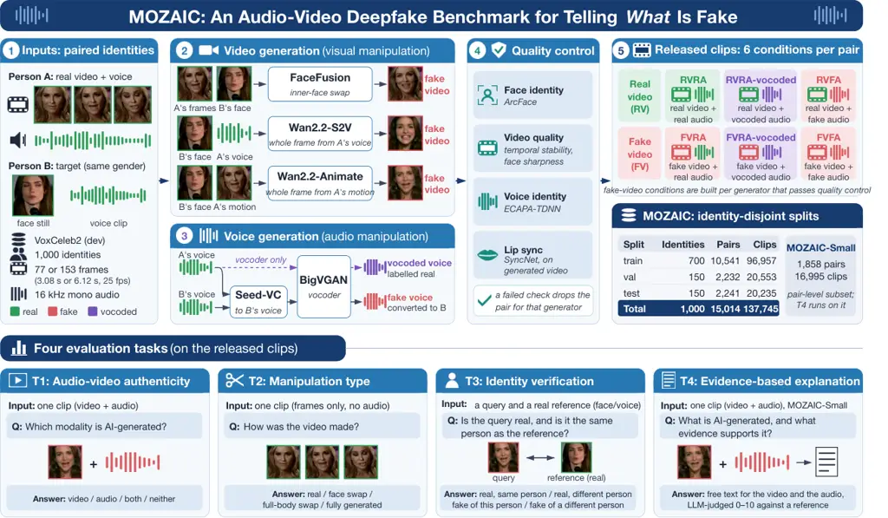
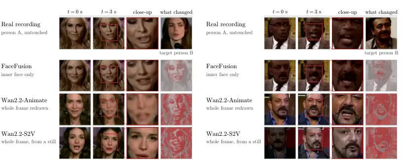
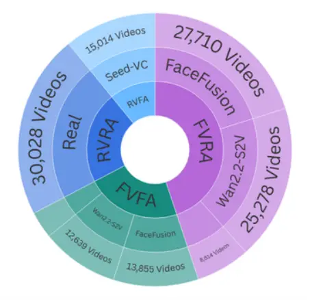
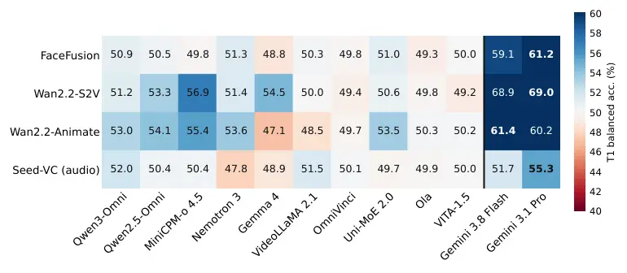
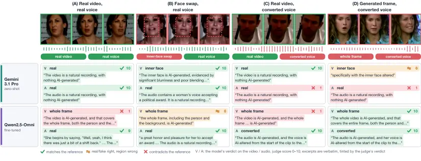
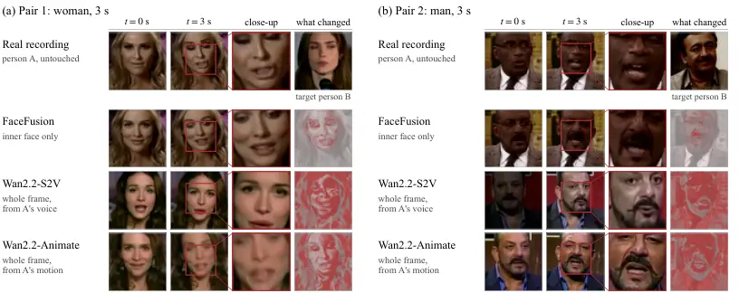
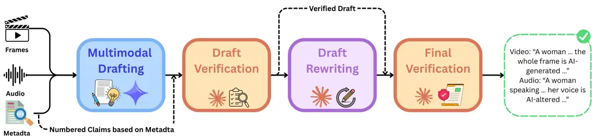
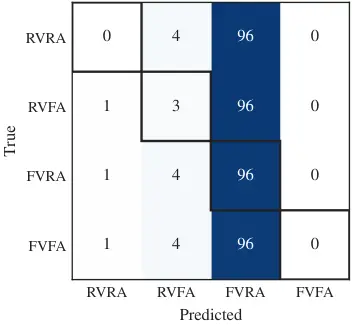
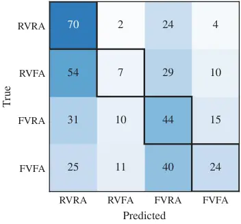
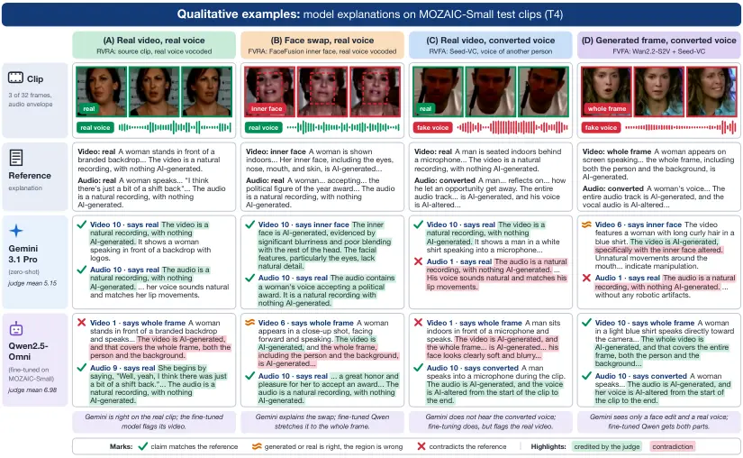

# ![[Uncaptioned image]](arxiv-2611-31301v1--cf293e7ad2ac.figures/figure-1.webp) Mozaic: An Audio-Video Deepfake Benchmark for Telling _What_ Is Fake

Corresponding author:
[shaina.raza@vectorinstitute.ai](mailto:shaina.raza@vectorinstitute.ai)

Shaina Raza ^(†)^(†)thanks: Corresponding author:
[shaina.raza@vectorinstitute.ai](mailto:shaina.raza@vectorinstitute.ai)
Email: <shaina.raza@vectorinstitute.ai>    Mohamed Hafez
Email: <mohamed.hafez@vectorinstitute.ai>    Ahmed Y. Radwan
Email: <ahmed.radwan@vectorinstitute.ai>    Khalid Elgazzar
Affiliation: Vector Institute, Canada   Ontario Tech University, Canada
Email: <kathryn.hume@vectorinstitute.ai>    Kathryn Hume
Email: <khalid.elgazzar@ontariotechu.ca>

###### Abstract

Audio-video (AV) deepfakes can fake the face, the voice, or both. Most
benchmarks only ask whether a clip is real or fake, so they cannot show
whether a detector relies on the picture, the voice, or encoding traces.
We present Mozaic, a paired benchmark with a 4-way label in which every
source clip is released in all four combinations of real or fake video
and real or fake audio so each modality contribution can be measured
directly. Fakes cover inner-face swapping, whole-frame video diffusion
and voice conversion. Mozaic has 137,745 clips from 15,014 source pairs
and four tasks: T1 AV authenticity, T2 manipulation type, T3 identity
verification and T4 explanation. We evaluate 12 AV multimodal LLMs
(MLLMs), train four detectors and fine-tune MLLMs with LoRA. Overall,
the best MLLM reaches only 35.6% on the four-way T1 and catches far more
video-only fakes than voice-only fakes (43.6% vs 7.5%). Trained
detectors reach 98.4% on T1, and LoRA fine-tuning raises explanation
scores (OmniVinci 4.17 to 7.40, Qwen2.5-Omni 4.42 to 6.98), but the best
T1 detector falls to 78.3% when the face-swap generator is held out of
training, so generalization and explanation remain open. We release the
dataset, the compact Mozaic-Small split, the code and the prompts.

| Shaina Raza¹    Mohamed Hafez¹    Ahmed Y. Radwan¹    Khalid Elgazzar²    Kathryn Hume¹ |
| --------------------------------------------------------------------------------------- |
| ¹Vector Institute, Canada   ²Ontario Tech University, Canada                            |
| {shaina.raza, mohamed.hafez, ahmed.radwan, kathryn.hume}@vectorinstitute.ai             |
| khalid.elgazzar@ontariotechu.ca                                                         |

[ Dataset](https://huggingface.co/datasets/vector-institute/Mozaic)  [ Code](https://github.com/VectorInstitute/mozaic)  [![[Uncaptioned
image]](arxiv-2611-31301v1--cf293e7ad2ac.figures/figure-1.webp) Project
page](https://vectorinstitute.github.io/mozaic/)

Figure 1: MLLMs are near chance at telling what is fake; LoRA helps but
leaves a gap. Gemini 3.1 Pro and Qwen2.5-Omni inference, and
Qwen2.5-Omni after LoRA on Mozaic-Small (in distribution; Tabs. 2
and 3).

## 1 Introduction

Figure 2: Mozaic. Top: a real clip of person A is paired with a
same-gender person B; three video generators (FaceFusion, Wan2.2-S2V,
Wan2.2-Animate) and one voice converter (Seed-VC) create the fakes,
pairs that fail quality control are dropped, and each pair is released
in six conditions (real or fake video with real, vocoded or fake audio).
Bottom: the four tasks: which modality is fake (T1), how the video was
made (T2), whether a query clip is real and shows the reference person
(T3), and a written explanation (T4).

Early deepfakes manipulated the face, but recent generators go further:
Wan2.2 \[44\] synthesizes entire frames, subject and background, and
voice converters such as Seed-VC \[32\] change who is speaking while
keeping what is said and when. An AV deepfake can therefore have a fake
video track, a fake audio track, or both \[36\].

Detecting such clips calls for more than a real-or-fake decision: a
detector should state which modality was manipulated, check whether two
clips show the same person, and point to its evidence. MLLMs, which take
audio and video together, could do all three, yet no existing benchmark
tests the three together (Sec. 2, Tab. 1), and real-versus-fake scores
cannot tell whether a model relies on the video, the voice or encoding
traces.

We introduce Mozaic (Modality-paired benchmark for analyZing Audio-video
Integrity and Content), an AV deepfake benchmark built from 1,000
VoxCeleb2 \[8\] identities (Fig. 2). Each of its 15,014 source pairs (a
real clip of person A and a same-gender target B) appears in all four
combinations of real or fake video and audio (a 4-way label), which
isolates the effect of each modality; a vocoded real-voice control
separates vocoder traces from speaker identity. Mozaic has 137,745 clips
and four tasks: AV authenticity (T1), manipulation type (T2), identity
verification (T3) and evidence-based explanation (T4, on the compact
Mozaic-Small split).

We evaluate 12 MLLMs, and train four detectors and LoRA-tune MLLMs under
one protocol (Fig. 1). MLLMs stay close to chance at telling which
modality is fake and miss most fake voices. Trained detectors nearly
solve T1 and T2 in distribution but lose accuracy on an unseen face-swap
generator, and explanations stay far from the ceiling after fine-tuning.
Telling _what_ is fake, not only _whether_, is still open.

Our contributions are: (1) Mozaic and Mozaic-Small, paired AV deepfake
datasets with identity-disjoint splits, released for detection research
only (Secs. 3.1 and 3.1); (2) four tasks, from close-ended detection to
open-ended explanation (Sec. 3.2); (3) a comprehensive from evaluation
of state-of-the-art MLLMs to training four detectors and LoRA-tuning
MLLMs (Sec. 5); and (4) the full evaluation suite for reproduction.

## 2 Related Work

Audio-video deepfake datasets. FakeAVCeleb \[23\] introduced labels
RVRA, RVFA, FVRA and FVFA (real/fake video $`\times`$ real/fake audio),
while LAV-DF \[4\], AV-Deepfake1M \[2\] and AV-Deepfake1M++ \[3\] (about
two million clips) target localized, content-driven edits. In
FakeAVCeleb, LAV-DF and AV-Deepfake1M, fake audio is text-to-speech,
changing speech timing and lip movements; Mozaic converts voices while
preserving words, timing and frames, with a vocoded real-voice control.
DeepSpeak \[1\] adds webcam face swaps, lip-sync, avatars and voice
cloning; PolyGlotFake \[22\], MAVOS-DD \[12\] and BabelFake \[37\]
broaden language coverage; DeepfakeBench-MM \[50\] standardizes
evaluation. AVFakeBench \[46\] tests MLLMs from binary judgment to
explanation, while AVID \[6\] probes AV inconsistencies. However, none
jointly provides all four real/fake combinations per clip and
reference-based identity checks, a gap addressed by Mozaic.

Video-only deepfake datasets. ViF-Bench \[29\] evaluates detection and
visual artifact reasoning; DF26 \[39\] tests detector robustness across
recent video generators (Wan \[44\], HunyuanVideo \[25\], Kling \[24\],
Veo \[20\]). Both test visual authenticity only, not which modality is
fake or whether two clips show the same person. Mozaic provide both AV
deepfake clips for detection and reasoning tasks.

Detectors and MLLMs for forensics. We train four baselines that span AV
speech and perception encoders (AV-HuBERT \[38\], PE-AV \[43\]), an AV
deepfake detector (HAVIC \[35\]) and a visual deepfake detector
(DFD-HR \[40\]). Identity-aware detectors such as ID-Reveal \[11\] and
POI-Forensics \[10\] compare a clip with real footage of the same
person, which our T3 (discussed in Sec. 3.2) turns into a benchmark
task. MLLMs also serve as explaining detectors for generated video
(BusterX \[45\]), for images, audio, video and talking heads
(Omni-Fake \[27\]) and for AV deepfakes \[5\]; MADBench \[28\] tests
fake audio over real video. Together, these works motivate our
benchmark, but none jointly evaluates audio-video authenticity,
manipulation type, cross-clip identity, and explanation quality under
controlled generation conditions, as summarized in Tab. 1.

|             |                       |                |                |                |                |                |                |
| ----------- | --------------------- | -------------- | -------------- | -------------- | -------------- | -------------- | -------------- |
|             | Benchmark             | Fake V         | Fake A         | Full           | Open           | Ref.           | Evid.          |
| Video       | ViF-Bench \[29\]      | $`\checkmark`$ | $`\times`$     | $`\checkmark`$ | ◗              | $`\times`$     | ◗              |
|             | DF26 \[39\]           | $`\checkmark`$ | $`\times`$     | $`\checkmark`$ | $`\times`$     | $`\times`$     | $`\times`$     |
| Audio-video | FakeAVCeleb \[23\]    | $`\checkmark`$ | $`\checkmark`$ | $`\times`$     | $`\times`$     | $`\times`$     | $`\times`$     |
|             | LAV-DF \[4\]          | $`\checkmark`$ | $`\checkmark`$ | $`\times`$     | $`\times`$     | $`\times`$     | $`\times`$     |
|             | AV-Deepfake1M++ \[3\] | $`\checkmark`$ | $`\checkmark`$ | $`\times`$     | $`\times`$     | $`\times`$     | $`\times`$     |
|             | DeepSpeak \[1\]       | $`\checkmark`$ | $`\checkmark`$ | ◗              | $`\times`$     | $`\times`$     | $`\times`$     |
|             | MAVOS-DD \[12\]       | $`\checkmark`$ | $`\checkmark`$ | $`\checkmark`$ | $`\times`$     | $`\times`$     | $`\times`$     |
|             | BabelFake \[37\]      | $`\checkmark`$ | $`\checkmark`$ | ◗              | $`\times`$     | $`\times`$     | $`\times`$     |
|             | AVFakeBench \[46\]    | $`\checkmark`$ | $`\checkmark`$ | $`\checkmark`$ | $`\checkmark`$ | $`\times`$     | $`\checkmark`$ |
|             | AVID \[6\]            | $`\times`$     | $`\checkmark`$ | $`\times`$     | $`\checkmark`$ | $`\times`$     | ◗              |
|             | Omni-Fake \[27\]      | $`\checkmark`$ | $`\checkmark`$ | $`\checkmark`$ | $`\checkmark`$ | $`\times`$     | $`\checkmark`$ |
|             | MADBench \[28\]       | $`\times`$     | $`\checkmark`$ | $`\times`$     | $`\times`$     | $`\times`$     | $`\times`$     |
|             | Mozaic (ours)         | $`\checkmark`$ | $`\checkmark`$ | $`\checkmark`$ | $`\checkmark`$ | $`\checkmark`$ | $`\checkmark`$ |

Table 1: Comparison with related benchmarks.
$`\checkmark`$/$`\times`$/◗: supported/not shown/partial. Fake V/A: fake
video/audio; Full: synthesis beyond the face; Open: free text; Ref.:
identity check against a reference clip; Evid.: evidence evaluation.

## 3 The Mozaic Benchmark

The Mozaic benchmark is shown in Figure 2 and discussed in this section.

### 3.1 Dataset Construction

##### Source data.

We draw real talking-head clips from 1,000 identities in the VoxCeleb2
development set \[8\] and take gender from its speaker metadata. Each
clip is cut from the start of a source recording at 25 fps and
224$`\times`$224, VoxCeleb2 native resolution, with 16 kHz mono audio.
We use two clip lengths, 77 frames (3.08 s) and 153 frames (6.12 s).

##### Pair design.

To construct the four-way labels (RVRA, RVFA, FVRA, FVFA), each pair
combines a real clip of identity A with a same-gender target identity B,
as shown in Fig. 2 and Supp. . Real-video clips are shared across
generators, while fake-video clips are generated once per retained
generator. As a control, A’s voice is processed through BigVGAN \[26\],
preserving speaker identity while introducing the vocoder artifacts
present in converted speech. T1, T3 and T4 use these vocoded voices as
real audio (T2 is video-only), preventing models from identifying fakes
through vocoder artifacts alone. Unvocoded clips are also released.

##### Generators.

We use three video generators and one voice converter. FaceFusion \[17\]
swaps the inner face, preserving the rest of the frame.
Wan2.2-S2V \[44\] animates an image of B using A’s audio, generating the
full frame. Wan2.2-Animate \[44\] transfers A’s motion to an image of B.
Seed-VC \[32\] converts A’s speech into B’s voice, preserving words and
timing. FaceFusion and Wan2.2-S2V support both clip lengths;
Wan2.2-Animate is limited to 77 frames because longer renders caused
identity drift across segments or single-pass blurring, creating
potential detector shortcuts. Fig. 3 shows one pair per generator.

Figure 3: What each generator changes. One 3 s test pair per generator
(rows), from the same real frames of A. FaceFusion replaces only the
inner face; Wan2.2-Animate and Wan2.2-S2V redraw the whole frame, driven
by A’s motion and voice, respectively. Last column: target B (top) and
changed pixels (red). Full version: Supp. Fig. S2.

##### Encoding and quality control.

All clips share a final encoding (H.264, CRF 18; uncompressed audio),
normalized brightness, color and loudness, and identical leading silence
and audio fade-in. Linear probes on file, frame and audio statistics
remain near chance on held-out identities (AUC $`\leq`$ 0.57; Supp. ),
suggesting limited low-level shortcuts. ArcFace \[14\] and
ECAPA-TDNN \[16\] assess face and voice identity transfer to B
(Fig. 4(b)); generated videos are further screened for temporal
stability, sharpness and SyncNet \[9\] lip-sync. Pairs failing any
check, including failed or refused generations, are removed per
generator to preserve matched conditions. This excludes 13.4%
(FaceFusion), 21.0% (Wan2.2-S2V) and 44.9% (Wan2.2-Animate) of 8,000
candidate pairs per applicable generator and clip length (Supp.  and ).

(a) Clips by label and generator.

(b) Identity transfer.

Figure 4: Mozaic statistics. (a) Clips by label (inner ring) and
generator (outer ring). (b) Median similarity of each fake to the source
A and the target B, face for video generators and voice for Seed-VC:
every generator moves the identity to B. Question counts per task and
split are in Supp. Tab. S4.

##### Splits and statistics.

We construct identity-disjoint training, validation and test splits with
700, 150 and 150 identities, respectively, assigning both identities in
each pair to the same split. The dataset contains 15,014 source pairs
and 137,745 clips, distributed as 10,541 / 2,232 / 2,241 pairs and
96,957 / 20,553 / 20,235 clips across the three splits (Fig. 4; Supp. ).
We also provide Mozaic-Small, a 16,995-clip subset sampled at the pair
level, covering all identities while preserving each split’s
clip-length, generator and gender distributions within 0.3 percentage
points of the full dataset.

##### Ethics and release.

VoxCeleb2’s license permits research use. Since every fake depicts a
real person, we release Mozaic for deepfake detection research only,
with authenticity labels included in each clip’s metadata and filename
(Supp. ).

### 3.2 Tasks and Annotation

Mozaic defines four tasks (Supp. Tab. S4): T1–T3 are multiple-choice
questions (MCQs) with shuffled options, and T4 is open-ended reasoning
task. T1–T3 labels follow from how each clip was generated (condition,
generator and pair identities); only T4 needs annotated references. The
release schema is provided in Supp. Appendix G.

T1: Audio-video authenticity. Given an AV clip, the model indicates
which modality, if any, was manipulated: video only (FVRA), audio only
(RVFA), both (FVFA), or neither (RVRA). Audio counts as real when the
speaker identity is preserved, so vocoded controls are real.

T2: Manipulation type. Given video frames without audio, the model
classifies the clip as _real_, _face swap_ (FaceFusion), _full-body
swap_ (Wan2.2-Animate, whole-frame), or _fully generated_ (Wan2.2-S2V);
the last two separate motion-guided from audio-driven full-frame
generation. Each category is defined in the prompt. Real samples come
from RVRA and manipulated samples from FVRA.

T3: Identity verification. Given a query clip and a real reference clip,
the model decides whether the queried face or voice is real and whether
it belongs to the reference person, with face and voice asked in
separate questions. The four answers are _real, same person_, _real,
different person_, _fake of this person_, and _fake of a different
person_. T3 thus tests whether a model can tell a real clip of a person
from a convincing fake of them.

|                      |         |        |      |      |      |      |      |       |              |      |      |      |      |      |       |       |         |
| -------------------- | ------- | ------ | ---- | ---- | ---- | ---- | ---- | ----- | ------------ | ---- | ---- | ---- | ---- | ---- | ----- | ----- | ------- |
|                      |         | Mozaic |      |      |      |      |      |       | Mozaic-Small |      |      |      |      |      |       |       |         |
|                      |         | T1     |      | T2   |      | T3   |      |       | T1           |      | T2   |      | T3   |      |       | T4    |         |
| Model                | Size    | Acc    | F1   | Acc  | F1   | Auth | ID   | Joint | Acc          | F1   | Acc  | F1   | Auth | ID   | Joint | Judge | ROUGE-L |
| Open models          |         |        |      |      |      |      |      |       |              |      |      |      |      |      |       |       |         |
| Qwen3-Omni           | 30B-A3B | 18.5   | 13.8 | 34.1 | 20.5 | 40.9 | 64.5 | 28.2  | 18.9         | 14.4 | 33.8 | 20.2 | 41.2 | 64.1 | 28.3  | 4.22  | 25.3    |
| Qwen2.5-Omni         | 7B      | 19.6   | 13.3 | 33.6 | 17.2 | 57.2 | 56.8 | 32.2  | 19.5         | 12.9 | 32.3 | 16.3 | 56.8 | 57.0 | 32.1  | 4.42  | 25.1    |
| MiniCPM-o 4.5        | 9B      | 24.0   | 18.0 | 33.5 | 15.3 | 58.3 | 56.2 | 32.3  | 23.7         | 18.0 | 33.0 | 14.9 | 58.8 | 57.0 | 32.8  | 4.39  | 22.5    |
| Nemotron 3 Nano Omni | 30B-A3B | 18.7   | 16.3 | 33.9 | 15.2 | 57.2 | 55.5 | 32.9  | 20.2         | 17.8 | 33.6 | 14.8 | 57.0 | 55.2 | 32.6  | 4.50  | 26.4    |
| Gemma 4              | 12B     | 18.2   | 11.2 | 33.3 | 12.7 | 46.2 | 60.0 | 29.6  | 18.3         | 11.4 | 33.3 | 12.9 | 46.1 | 59.9 | 30.1  | 4.12  | 24.9    |
| VideoLLaMA2.1-AV     | 7B      | 30.9   | 18.3 | 29.6 | 11.8 | 57.5 | 51.0 | 29.2  | 31.6         | 19.2 | 29.8 | 11.8 | 57.2 | 51.8 | 29.2  | 4.41  | 25.8    |
| OmniVinci            | 9B      | 16.6   | 8.7  | 30.0 | 11.8 | 60.1 | 50.5 | 30.0  | 16.6         | 8.6  | 30.0 | 11.9 | 60.0 | 50.8 | 30.0  | 4.17  | 23.5    |
| Uni-MoE-2.0-Omni     | 33B     | 29.8   | 22.1 | 31.2 | 18.5 | 48.4 | 53.5 | 26.1  | 29.4         | 21.3 | 30.5 | 17.6 | 48.2 | 54.8 | 26.4  | 4.33  | 23.5    |
| Ola                  | 7B      | 32.5   | 13.7 | 32.7 | 18.7 | 39.9 | 53.5 | 22.4  | 32.7         | 13.9 | 32.3 | 18.3 | 39.9 | 53.1 | 22.2  | 4.02  | 23.2    |
| VITA-1.5             | 7B      | 17.3   | 9.4  | 32.0 | 19.6 | 40.5 | 53.8 | 22.5  | 17.4         | 9.6  | 32.2 | 19.7 | 40.6 | 52.8 | 22.3  | 4.52  | 24.4    |
| Proprietary models   |         |        |      |      |      |      |      |       |              |      |      |      |      |      |       |       |         |
| Gemini 3.8 Flash     | –       | 31.6   | 24.5 | 41.0 | 25.3 | 50.1 | 70.2 | 40.9  | 32.0         | 24.8 | 41.4 | 25.7 | 50.1 | 69.7 | 40.5  | 5.09  | 24.2    |
| Gemini 3.1 Pro       | –       | 35.6   | 31.6 | 36.7 | 21.6 | 62.7 | 71.3 | 47.5  | 35.8         | 31.7 | 37.0 | 21.6 | 62.7 | 71.3 | 47.1  | 5.15  | 27.8    |

Table 2: Overall results on the Mozaic and Mozaic-Small test sets, in %
except the T4 judge score. Acc: accuracy; F1: macro-F1. T3 Auth
(authenticity) : is the clip real or fake; ID: do the two clips show the
same person; Joint: both answers right (4-way). T4 (Mozaic-Small only):
Judge is the 0–10 judge score, averaged over the video and audio parts;
ROUGE-L is word overlap with the reference. Chance is 25% on T1, T2 and
T3 Joint and 50% on Auth and ID; a fixed always-real answer scores 4.76
on Judge. Bold: best per column (in all tables); underlined: second
best. VideoLLaMA2.1-AV: T1 and T3 from its nopad run, T2 and T4 from the
standard run.

T4: Evidence-based explanation. Given an AV clip from Mozaic-Small, the
model explains video and audio separately, identifying whether each is
manipulated and its scope (_inner face_ or _whole frame_ for video;
_voice_ for audio). Reference explanations are grounded in clip
metadata. Gemini 3.6 Flash drafts each explanation using eight frames
and the audio, while Claude Sonnet 5.5 verifies it against the metadata
and standardizes the wording (Supp. ). Three authors reviewed a
stratified sample of 400 references, accepting 99.2% (Gwet’s AC1 \[21\]:
0.985 for video and 0.983 for audio).

An LLM judge (GPT-5.4 mini) scores explanations against their references
on a 0–10 rubric (Supp.  and ). Claude and the judge belong to model
families excluded from evaluation. A manual review of 400 judged
explanations across several models found scores consistent with the
rubric.

## 4 Experimental Setup

Mozaic experimental design is given in this section.

### 4.1 Models and Data

T1–T3 are evaluated on the test splits of both Mozaic and Mozaic-Small,
while T4 uses only Mozaic-Small. We evaluate 12 MLLMs zero-shot: ten
open-source models (Qwen3-Omni \[48\], Qwen2.5-Omni \[47\], MiniCPM-o
4.5 \[13\], Nemotron 3 Nano Omni \[15\], Gemma 4 \[19\],
VideoLLaMA2.1-AV \[7\], OmniVinci \[49\], Uni-MoE-2.0-Omni \[30\],
Ola \[33\] and VITA-1.5 \[18\]) and two proprietary models (Gemini 3.8
Flash and Gemini 3.1 Pro \[41\]). Ablations use five models selected for
cost and coverage: Gemini 3.8 Flash, Qwen3-Omni, Nemotron 3 Nano Omni,
MiniCPM-o 4.5 and Ola.

Trained baselines use the Mozaic-Small training split and are evaluated
on both datasets. AV-HuBERT \[38\], PE-AV \[43\] and HAVIC \[35\] use
classification heads with full encoder fine-tuning (Full FT) or
LayerNorm-only adaptation (LN). T1 uses audio and video; T2 is
video-only and additionally includes DFD-HR \[40\], trained with
adapters. For T3, a shared encoder embeds the test and reference clips,
and a classification head predicts one of four answers from their
concatenated embeddings. Qwen2.5-Omni is LoRA-tuned on all four tasks.
For T4, six open MLLMs (Qwen3-Omni, MiniCPM-o 4.5, Nemotron 3 Nano Omni,
Gemma 4, OmniVinci and Ola) are LoRA-tuned on the Mozaic-Small training
split using the same settings.

Hyperparameters are provided in Supp.  and , with learning-rate and
epoch sweeps in Supp. . To assess generalization, we retrain each
baseline while excluding one video generator and evaluate on its fake
clips alongside all real clips (Fig. 7).

### 4.2 Input Protocol

Models run through their native multimodal interfaces and official
preprocessing. Every model receives 32 frames per clip: models with
native video input sample them with their own preprocessing, and the
others receive 32 uniformly sampled frames; audio is provided for AV
tasks and omitted for T2. T3 receives both clips, as frames for face
questions and audio for voice questions (Supp. Appendix C). Per-model
input settings and actual frame counts are reported in Supp. Appendix D.

### 4.3 Decoding

Generative models use task-specific prompts (Supp. Appendix C) with
temperature 0. For T1–T3, models return a JSON reply naming one option,
with decoding restricted to the valid answers for MiniCPM-o 4.5,
Uni-MoE-2.0-Omni, Ola and VITA-1.5, whose unconstrained replies often
did not follow the JSON format; for T4, models generate explanations.
Unparseable responses are counted as incorrect, and T4 parse rates are
reported in Supp. Tab. S10. Trained classification models output class
predictions.

### 4.4 Metrics

T1 and T2 are evaluated using accuracy and macro-F1. T3 reports
authenticity accuracy, identity accuracy, and joint accuracy on the
4-way answer. Trained models report accuracy and macro-F1 on T1–T2,
joint accuracy on T3, and the judge score on T4 (Sec. 3.2). We also
report real/fake accuracy and ROUGE-L \[31\], BLEU-4 \[34\] and
CIDEr-D \[42\] (Supp. Tab. S10).

(a) T1: Authenticity

(b) T2: Manipulation type

(c) T3: Identity

Figure 5: Seed stability of the trained models. Mean accuracy over 5
seeds ($`\pm`$1 std), trained on Mozaic-Small and tested on Mozaic.
Solid: parameter-efficient tuning (LN for AV-HuBERT, PE-AV and HAVIC;
adapters for DFD-HR); hatched: full fine-tuning. Exact values, including
F1 and T4, are in Supp. Tab. S14.

## 5 Results

We organize the results around four research questions: (RQ1) can
off-the-shelf MLLMs tell what is fake; (RQ2) does training solve the
tasks and generalize to unseen generators; (RQ3) what evidence do the
models rely on across generators, modalities, clip lengths, and frame
budgets; and (RQ4) can models explain and localize a manipulation.

### 5.1 Evaluation of MLLMs

Table 2 reports the performance of all twelve MLLMs. On T1, Gemini 3.1
Pro attains the highest accuracy (35.6%) and macro-F1 (31.6%). It
identifies 43.6% of video-only fakes but only 7.5% of voice-only fakes,
and several open models fall below the 25% chance level because they
answer “real” for nearly every clip (Supp. Tab. S9). Among the open
models, Ola reaches the highest accuracy (32.5%) but only 13.7%
macro-F1, because it predicts FVRA for 96% of clips (Supp. Fig. S5). On
T2, Gemini 3.8 Flash performs best (41.0%), whereas every open model
remains below 35%. On T3, Gemini 3.1 Pro achieves 62.7% authenticity
accuracy and 71.3% identity accuracy, but only 47.5% joint accuracy.
Results on Mozaic-Small follow the same trends. On T4, Gemini 3.1 Pro
again obtains the highest explanation score (5.15/10) and ROUGE-L
(27.8). Takeaway (RQ1): Although the Gemini models perform best on every
task, no model reaches 50% on the four-way T1 and T2 answers or on T3’s
joint answer, or exceeds 5.2 out of 10 on T4.

| Model                | Zero-shot | LoRA SFT | $`\Delta`$ |
| -------------------- | --------- | -------- | ---------- |
| Qwen3-Omni           | 4.22      | 6.23     | +2.01      |
| Qwen2.5-Omni         | 4.42      | 6.98     | +2.56      |
| MiniCPM-o 4.5        | 4.39      | 6.03     | +1.64      |
| Nemotron 3 Nano Omni | 4.50      | 5.18     | +0.68      |
| Gemma 4              | 4.12      | 5.23     | +1.11      |
| OmniVinci            | 4.17      | 7.40     | +3.23      |
| Ola                  | 4.02      | 5.40     | +1.38      |

Table 3: Supervised fine-tuning on Mozaic-Small. T4 judge scores (0–10)
before and after LoRA SFT; $`\Delta`$: improvement. Trained T1–T3
results appear in Supp. Tab. S14.

### 5.2 Supervised Baseline Evaluation

Fig. 5 and Supp. Tab. S14 report the trained models on T1–T3 (means over
five seeds), Tab. 3 reports T4, and Fig. 6 shows their sensitivity to
learning rate and epoch budget. In distribution. LoRA SFT raises the T4
score of every tuned MLLM (Tab. 3): OmniVinci gains the most (4.17 to
7.40), and Nemotron 3 Nano Omni, the strongest of these MLLMs
off-the-shelf, the least (+0.68). Qwen2.5-Omni improves from 4.42 to
6.98, alongside gains from 19.6% to 83.4% on T1, 33.6% to 73.6% on T2
and 32.2% to 75.8% on T3 (joint). T3 stays the hardest task after
training: LN-tuned PE-AV reaches 64.8% joint accuracy and AV-HuBERT
about 51% (Supp. Tab. S14).

Across five seeds, full fine-tuning shows greater T1 variability,
especially for PE-AV and AV-HuBERT (Fig. 5). With LN tuning, PE-AV
reaches 98.4% on T1 and 96.8% on T2 with little seed variation,
suggesting effective feature transfer. AV-HuBERT remains less effective,
possibly due to its speech-focused pretraining. HAVIC reaches 86.9% on
T1 with LN tuning, while DFD-HR reaches 99.9% on T2 with adapters. Even
after LoRA tuning, Qwen2.5-Omni trails these specialist detectors (83.4%
vs. 98.4% on T1, 73.6% vs. 99.9% on T2). Full fine-tuning is unstable at
the protocol learning rate: lowering it to $`10^{-5}`$ lifts PE-AV from
56.4% (5-seed mean, Supp. Tab. S14) to 99.8% on T1 (sweeps in Fig. 6 and
Supp. Tab. S15).

Unseen generators. This in-distribution accuracy does not carry over to
an unseen face-swap generator (Fig. 7; Supp. Tab. S16). When FaceFusion
is held out of training, T1 macro-F1 on its clips falls from 98.6 to
76.9 for PE-AV, from 79.5 to 40.1 for HAVIC, and from 78.9 to 48.3 for
Qwen2.5-Omni, whereas holding out either whole-frame generator costs
PE-AV less than one point. Takeaway (RQ2): In-distribution accuracy
overstates robustness: the detectors lose 22–39 F1 points on an unseen
inner-face swap, which suggests that they rely on generator-specific
cues.

(a) Learning rate.

(b) Epoch budget.

Figure 6: Sensitivity to learning rate and training length, T1 test
accuracy. (a) Learning rate (log scale); (b) number of epochs relative
to the protocol, with all other settings fixed. AV-HuBERT, PE-AV and
HAVIC use LN tuning; Qwen2.5-Omni uses LoRA. Shaded: protocol value.
Full results for all tasks (T1–T4) and settings, including Full FT, are
in Supp. Tab. S15.

Figure 7: Generalization to unseen generators. Macro-F1 (4-class) of
each detector when a generator is seen in training (blue) and when it is
held out from training (pink); each group holds out one generator and
evaluates on its clips. The line length shows the drop. Detailed results
for all metrics and configurations are in Supp. Tab. S16.

|                      | Video accuracy |      |      | Audio accuracy |      |      |
| -------------------- | -------------- | ---- | ---- | -------------- | ---- | ---- |
| Model                | A+V            | V    | A    | A+V            | V    | A    |
| Gemini 3.8 Flash     | 64.0           | 59.4 | 50.2 | 52.1           | 50.1 | 51.8 |
| Nemotron 3 Nano Omni | 51.8           | 53.1 | 49.8 | 48.9           | 50.0 | 49.0 |
| Ola                  | 49.9           | 50.0 | 50.5 | 49.9           | 50.0 | 51.3 |
| MiniCPM-o 4.5        | 52.8           | 52.2 | 49.7 | 50.4           | 50.0 | 45.9 |
| Qwen3-Omni           | 51.5           | 52.5 | 50.0 | 51.8           | 50.0 | 58.6 |

Table 4: Modality ablation. T1 balanced real/fake accuracy (%; chance 50) on each modality, Mozaic-Small test set, with both inputs (A+V),
frames only (V) and sound only (A). Bold: best per column, where above
chance. Full results: Supp. Tab. S8.

### 5.3 Modality Use

To measure how much each modality contributes, we repeat T1 on
Mozaic-Small with video-only and audio-only inputs for the five-model
subset, stating the missing modality in the prompt (Tab. 4;
Supp. Tab. S8). Removing the audio changes four-class accuracy by at
most 3.5 percentage points and even improves it for three of the five
models. Qwen3-Omni benefits most from audio-only input: its balanced
audio accuracy rises from 51.8% to 58.6%, whereas every other
audio-accuracy cell remains near chance (45.9–52.1%). In contrast,
Gemini 3.8 Flash achieves 64.0% balanced video accuracy with both
modalities and 59.4% with video alone, but drops to 50.2% once the video
is removed. Takeaway (RQ3): Of the five models, only Gemini 3.8 Flash
makes clear use of visual evidence, and none reliably detects audio
manipulation when video is present.

Figure 8: T1 balanced accuracy (%) per generator for every off-the-shelf
model on the Mozaic test set. Each cell averages the fake-part recall
for that generator with the real-part recall of the same modality
(video; audio for Seed-VC), so a constant answer scores 50% (chance).
Red is below chance, blue above, saturating at $`\pm`$10 points; bold
marks the best model per generator. Nemotron 3, VideoLLaMA 2.1 and
Uni-MoE 2.0 abbreviate Nemotron 3 Nano Omni, VideoLLaMA2.1-AV (nopad
run, as in Tab. 2) and Uni-MoE-2.0-Omni.

Figure 9: T4 on four Mozaic-Small test clips: real, face swap with real
voice, real video with converted voice, and fully generated. Borders,
envelopes and pills: green real, red generated; dashed box: swapped
face. Each chip gives what the model says about the video (V) or audio
(A), a mark (check: matches the reference; wave: right verdict, wrong
region; cross: contradicts it) and the judge’s 0–10 score, followed by a
verbatim excerpt. Full explanations: Supp. Fig. S6; whole-test-set
rates: Supp. Fig. S4.

### 5.4 Per-Generator Performance

Fig. 8 reports balanced accuracy, the mean of the true-positive and
true-negative rates, for each generator. The Gemini models discriminate
best, reaching about 69% on Wan2.2-S2V and 59–61% on FaceFusion and
Wan2.2-Animate, while Seed-VC remains the most difficult generator (55%
for Gemini 3.1 Pro). For the open models, 36 of 40 model–generator
combinations lie within four percentage points of chance. The one open
exception is MiniCPM-o 4.5 on the whole-frame generators (56.9% on
Wan2.2-S2V, 55.4% on Wan2.2-Animate). The converted voice is the blind
spot for all models: no open model exceeds 52% on Seed-VC, and
Gemini 3.8 Flash reaches only 51.7%. Takeaway (RQ3): The four-class
accuracy of the open models reflects prediction bias rather than genuine
forgery discrimination.

Figure 10: T1 accuracy (%) on the Mozaic-Small against frames per clip
(log scale). Shaded: the 32-frame protocol.

### 5.5 Effect of Frame Budget

Varying the number of frames per clip from 8 to 64 for T1 on
Mozaic-Small across five models (Fig. 10), three models change by less
than two percentage points, while MiniCPM-o 4.5 drops from 27.2% to
22.2% and Gemini 3.8 Flash from 34.6% to 31.9%. Takeaway (RQ3):
Increasing the frame budget does not improve performance, suggesting
that limited frame sampling is not the main cause of poor zero-shot
results.

### 5.6 Effect of Clip Length

We next examine clip duration by comparing the 3 s and 6 s clips of the
Mozaic test set for all models (Supp. Tab. S6). Longer clips appear to
improve T2 by 5–8 percentage points for every model, including
Gemini 3.8 Flash (37.4% to 45.5%). However, the 6 s clips contain no
Wan2.2-Animate, one of the four T2 classes, and every model scores at
most 0.3% on Wan2.2-Animate clips (Supp. Tab. S12), so dropping that
class raises the average by construction. Once Wan2.2-Animate is also
excluded from the 3 s clips, the T2 change shrinks to between $`-1.2`$
and $`+2.0`$ points (mean $`+0.1`$; Supp. Tab. S7); on T1 and T4, where
no class is removed, 6 s clips move accuracy by at most 4.3 points and
the judge score by at most 0.6. Takeaway (RQ3): The apparent gains stem
from generator composition rather than clip duration.

### 5.7 Explanation Quality

Fig. 9 shows the verdicts of Gemini 3.1 Pro and the fine-tuned
Qwen2.5-Omni on four test clips, with an excerpt of each explanation,
and Supp. Fig. S4 summarizes the region that each model claims across
the whole test set. The open MLLMs label nearly every clip as real. On
the judge, every model (at most 4.52) scores below a fixed always-real
answer (4.76), and the Gemini models fall below it on audio. Gemini 3.1
Pro names a swapped inner face in about half of all clips, including
real ones, and never a generated whole frame. Qwen2.5-Omni fine-tuned on
Mozaic-Small separates real from converted voices but labels most videos
as whole-frame generated, regardless of their true type. After
fine-tuning, real/fake accuracy reaches 86.8% on audio but only 65.0% on
video. Per-part scores and text metrics for all models are given in
Supp. Tab. S10. Takeaway (RQ4): No model, whether untuned or fine-tuned,
reliably localizes the manipulation.

## 6 Conclusion

We present Mozaic, an AV deepfake benchmark of 137,745 clips from 15,014
source pairs, covering all four video/audio real/fake combinations and a
vocoded control. It supports four tasks: AV authenticity (T1),
manipulation type (T2), identity verification (T3) and explanation (T4).
State-of-the-art MLLMs struggle: the best achieves only 35.6% on T1,
fake voices are frequently missed, and open models’ explanations score
below an always-real baseline. Trained detectors reach 98.4% in
distribution but lose up to 20 percentage points on an unseen face-swap
generator. These findings highlight the need for modality-specific and
cross-generator evaluation beyond aggregate accuracy.

Limitations. Mozaic relies on VoxCeleb2 (224$`\times`$224, 3–6 s clips),
one voice converter and three video generators. Some compression and
voice-conversion artifacts persist despite normalization. T4 references
are LLM-generated (400 human-checked), while judge validation lacks a
formal agreement study.

Future Directions. We release Mozaic and its evaluation suite to support
reproducible comparisons. Future work should expand source diversity,
generators and clip lengths, improve artifact control, and develop
detectors that generalize across generators, identify altered modalities
and provide verifiable explanations.

## LLM Usage Statement

During the preparation of this work, the authors used Claude Sonnet and
ChatGPT to improve grammar and wording. All final text was reviewed and
approved by the authors, who maintain full responsibility for the
content of the manuscript.

## References

- \[1\] S. Barrington, M. Bohacek, and H. Farid (2026) The DeepSpeak
  dataset. In Proceedings of the IEEE/CVF Conference on Computer Vision
  and Pattern Recognition, pp. 1893–1902. Cited by: Table 1, §2.
- \[2\] Z. Cai, S. Ghosh, A. P. Adatia, M. Hayat, A. Dhall, T. Gedeon,
  and K. Stefanov (2024) AV-Deepfake1M: a large-scale llm-driven
  audio-visual deepfake dataset. In Proceedings of the 32nd ACM
  international conference on multimedia, pp. 7414–7423. Cited by: §2.
- \[3\] Z. Cai, K. Kuckreja, S. Ghosh, A. Chuchra, M. H. Khan, U.
  Tariq, T. Gedeon, and A. Dhall (2025) AV-Deepfake1M++: a large-scale
  audio-visual deepfake benchmark with real-world perturbations. In
  Proceedings of the 33rd ACM International Conference on Multimedia,
  pp. 13686–13691. Cited by: Table 1, §2.
- \[4\] Z. Cai, K. Stefanov, A. Dhall, and M. Hayat (2022) Do you really
  mean that? content driven audio-visual deepfake dataset and multimodal
  method for temporal forgery localization. In 2022 International
  Conference on Digital Image Computing: Techniques and Applications
  (DICTA), pp. 1–10. Cited by: Table 1, §2.
- \[5\] S. Cao, Y. Li, Y. Luo, J. Yin, and L. Ma (2026) Leveraging large
  multimodal models for audio-video deepfake detection: a pilot study.
  In IEEE International Conference on Acoustics, Speech and Signal
  Processing (ICASSP), pp. 13442–13446. Cited by: §2.
- \[6\] Z. Chen, D. Wang, H. Lin, L. Luo, K. Xu, Y. Guo, H. Zhu, T. Sun,
  and X. Jiang (2026) AVID: benchmarking audio-visual inconsistency
  understanding for omni-modal language models. In Proceedings of the
  2026 Conference on Empirical Methods in Natural Language Processing
  (EMNLP), Cited by: Table 1, §2.
- \[7\] Z. Cheng, S. Leng, H. Zhang, Y. Xin, X. Li, G. Chen, Y. Zhu, W.
  Zhang, Z. Luo, D. Zhao, and L. Bing (2024) VideoLLaMA 2: advancing
  spatial-temporal modeling and audio understanding in video-LLMs. arXiv
  preprint arXiv:2406.07476. Cited by: §4.1.
- \[8\] J. S. Chung, A. Nagrani, and A. Zisserman (2018) VoxCeleb2: deep
  speaker recognition. In INTERSPEECH, Cited by: §1, §3.1.
- \[9\] J. S. Chung and A. Zisserman (2016) Out of time: automated lip
  sync in the wild. In Asian conference on computer vision, pp. 251–263.
  Cited by: §3.1.
- \[10\] D. Cozzolino, A. Pianese, M. Nießner, and L. Verdoliva (2023)
  Audio-visual person-of-interest deepfake detection. In 2023 IEEE/CVF
  Conference on Computer Vision and Pattern Recognition Workshops
  (CVPRW), pp. 943–952. Cited by: §2.
- \[11\] D. Cozzolino, A. Rössler, J. Thies, M. Nießner, and L.
  Verdoliva (2021) ID-Reveal: identity-aware deepfake video detection.
  In 2021 IEEE/CVF International Conference on Computer Vision (ICCV),
  pp. 15088–15097. Cited by: §2.
- \[12\] F. Croitoru, V. Hondru, M. Popescu, R. T. Ionescu, F. S. Khan,
  and M. Shah (2025) MAVOS-DD: multilingual audio-video open-set
  deepfake detection benchmark. arXiv preprint arXiv:2505.11109. Cited
  by: Table 1, §2.
- \[13\] J. Cui, B. Xu, C. Wang, T. Yu, W. Sun, Y. Xu, T. Wang, Z.
  He, W. Ma, T. Cai, et al. (2026) MiniCPM-o 4.5: towards real-time
  full-duplex omni-modal interaction. arXiv preprint arXiv:2604.27393.
  Cited by: §4.1.
- \[14\] J. Deng, J. Guo, N. Xue, and S. Zafeiriou (2019) ArcFace:
  additive angular margin loss for deep face recognition. In Proceedings
  of the IEEE/CVF conference on computer vision and pattern recognition,
  pp. 4690–4699. Cited by: §3.1.
- \[15\] A. S. Deshmukh, K. Chumachenko, T. Rintamaki, M. Le, T.
  Poon, D. M. Taheri, I. Karmanov, G. Liu, J. Seppanen, A. Goel, et
  al. (2026) Nemotron 3 Nano Omni: efficient and open multimodal
  intelligence. arXiv preprint arXiv:2604.24954. Cited by: §4.1.
- \[16\] B. Desplanques, J. Thienpondt, and K. Demuynck (2020)
  ECAPA-TDNN: Emphasized Channel Attention, Propagation and Aggregation
  in TDNN Based Speaker Verification. In Interspeech 2020,
  pp. 3830–3834. External Links:
  [Document](https://dx.doi.org/10.21437/Interspeech.2020-2650), ISSN
  2958-1796 Cited by: Figure S1, Figure S1, §3.1.
- \[17\] FaceFusion (2026) FaceFusion: next generation face swapping and
  enhancement. Note:
  [https://github.com/facefusion/facefusion](https://github.com/facefusion/facefusion)GitHub
  repository, accessed October 28, 2026 Cited by: §3.1.
- \[18\] C. Fu, H. Lin, X. Wang, Y. Shen, X. Liu, H. Cao, Z. Long, H.
  Gao, K. Li, L. MA, et al. (2026) VITA-1.5: towards GPT-4o level
  real-time vision and speech interaction. Vol. 38, pp. 75300–75320.
  Cited by: §4.1.
- \[19\] Gemma Team (2026) Gemma 4 technical report. arXiv preprint
  arXiv:2607.02770. Cited by: §4.1.
- \[20\] Google DeepMind (2026) Veo: ai video generation. Note:
  [https://deepmind.google/models/veo/](https://deepmind.google/models/veo/)Accessed:
  2026-11-11 Cited by: §2.
- \[21\] K. L. Gwet (2008) Computing inter-rater reliability and its
  variance in the presence of high agreement. British Journal of
  Mathematical and Statistical Psychology 61 (1), pp. 29–48. Cited by:
  §B.1, §3.2.
- \[22\] Y. Hou, H. Fu, C. Chen, Z. Li, H. Zhang, and J. Zhao (2024)
  PolyglotFake: a novel multilingual and multimodal deepfake dataset. In
  International conference on pattern recognition, pp. 180–193. Cited
  by: §2.
- \[23\] H. Khalid, S. Tariq, M. Kim, and S. S. Woo (2021) FakeAVCeleb:
  a novel audio-video multimodal deepfake dataset. arXiv preprint
  arXiv:2108.05080. Cited by: Table 1, §2.
- \[24\] Kling AI (2026) Kling ai: ai video and image generation
  platform. Note: [https://kling.ai](https://kling.ai)Accessed:
  2026-11-11 Cited by: §2.
- \[25\] W. Kong, Q. Tian, Z. Zhang, R. Min, Z. Dai, J. Zhou, J.
  Xiong, X. Li, B. Wu, J. Zhang, et al. (2024) Hunyuanvideo: a
  systematic framework for large video generative models. arXiv preprint
  arXiv:2412.03603. Cited by: §2.
- \[26\] S. Lee, W. Ping, B. Ginsburg, B. Catanzaro, and S. Yoon (2022)
  BigVGAN: a universal neural vocoder with large-scale training. arXiv
  preprint arXiv:2206.04658. Cited by: §3.1.
- \[27\] T. Li, Z. Huang, H. Wen, Y. He, X. Li, B. Zhu, W. Duan, C.
  Chen, Z. Fu, Y. Dong, et al. (2026) Omni-Fake: benchmarking unified
  multimodal social media deepfake detection. In Proceedings of the
  IEEE/CVF Conference on Computer Vision and Pattern Recognition,
  pp. 30299–30311. Cited by: Table 1, §2.
- \[28\] Y. Li, Y. Xiao, J. Bai, B. Chen, H. Jia, and T. Dang (2026)
  MADBench: a benchmark for modality-aware audio deepfake detection.
  arXiv preprint arXiv:2608.09593. Cited by: Table 1, §2.
- \[29\] Y. Li, W. Zheng, Y. Zhang, R. Sun, Y. Zheng, L. Chen, J. Zhou,
  and J. Lu (2026) Skyra: AI-generated video detection via grounded
  artifact reasoning. In Proceedings of the IEEE/CVF Conference on
  Computer Vision and Pattern Recognition, pp. 4482–4493. Cited by:
  Table 1, §2.
- \[30\] Y. Li, X. Chen, S. Jiang, H. Shi, Z. Liu, X. Zhang, N. Deng, Z.
  Xu, Y. Ma, M. Zhang, et al. (2025) Uni-MoE-2.0-Omni: scaling
  language-centric omnimodal large model with advanced MoE, training and
  data. arXiv preprint arXiv:2511.12609. Cited by: §4.1.
- \[31\] C. Lin (2004) ROUGE: a package for automatic evaluation of
  summaries. In Text Summarization Branches Out, pp. 74–81. Cited by:
  §4.4.
- \[32\] S. Liu (2024) Zero-shot voice conversion with diffusion
  transformers. arXiv preprint arXiv:2411.09943. Cited by: §1, §3.1.
- \[33\] Z. Liu, Y. Dong, J. Wang, Z. Liu, W. Hu, J. Lu, and Y.
  Rao (2025) Ola: pushing the frontiers of omni-modal language model.
  arXiv preprint arXiv:2502.04328. Cited by: §4.1.
- \[34\] K. Papineni, S. Roukos, T. Ward, and W. Zhu (2002) BLEU: a
  method for automatic evaluation of machine translation. In Proceedings
  of the 40th annual meeting of the Association for Computational
  Linguistics, pp. 311–318. Cited by: §4.4.
- \[35\] J. Peng, Y. Wang, Y. Li, L. Kong, and X. Hong (2026) Leave no
  stone unturned: uncovering holistic audio-visual intrinsic coherence
  for deepfake detection. arXiv preprint arXiv:2603.23960. Cited by:
  Table S17, §2, §4.1.
- \[36\] S. Raza, J. Ho, A. Y. Radwan, and M. Hafez (2026) Deepfakes in
  the foundation-model era: a survey of forensics, generation and
  distribution across social media lifecycle. Preprints. External Links:
  [Document](https://dx.doi.org/10.20944/preprints202608.1870.v1),
  [Link](https://doi.org/10.20944/preprints202608.1870.v1) Cited by: §1.
- \[37\] C. Segna, J. Tschesche, and A. Rohrbach (2026) BabelFake: a
  multilingual audio-visual deepfake benchmark. arXiv preprint
  arXiv:2610.06339. Cited by: Table 1, §2.
- \[38\] B. Shi, W. Hsu, K. Lakhotia, and A. Mohamed (2022) Learning
  audio-visual speech representation by masked multimodal cluster
  prediction. In International Conference on Learning Representations,
  External Links: [Link](https://openreview.net/forum?id=Z1Qlm11uOM)
  Cited by: Table S17, §2, §4.1.
- \[39\] S. Shykula, A. Yermakov, I. Samarskyi, D. Mishkin, J. Cech,
  and A. Mishchuk (2026) DF26: we cannot tell fake from real anymore.
  arXiv preprint arXiv:2609.07369. Cited by: Table 1, §2.
- \[40\] J. Sun, Z. Yan, K. Zhang, T. Yao, and S. Ding (2026) DFD-HR:
  generalizable deepfake detection via hierarchical routing learning. In
  Proceedings of the IEEE/CVF Conference on Computer Vision and Pattern
  Recognition, Cited by: Table S17, §2, §4.1.
- \[41\] G. Team, R. Anil, S. Borgeaud, J. Alayrac, J. Yu, R.
  Soricut, J. Schalkwyk, A. M. Dai, A. Hauth, K. Millican, et al. (2023)
  Gemini: a family of highly capable multimodal models. arXiv preprint
  arXiv:2312.11805. Cited by: §4.1.
- \[42\] R. Vedantam, C. Lawrence Zitnick, and D. Parikh (2015) CIDEr:
  consensus-based image description evaluation. In Proceedings of the
  IEEE conference on computer vision and pattern recognition,
  pp. 4566–4575. Cited by: §4.4.
- \[43\] A. Vyas, H. Chang, C. Yang, P. Huang, L. Gao, J. Richter, S.
  Chen, M. Le, P. Dollár, C. Feichtenhofer, et al. (2026) Pushing the
  frontier of audiovisual perception with large-scale multimodal
  correspondence learning. In Proceedings of the IEEE/CVF Conference on
  Computer Vision and Pattern Recognition, pp. 30172–30182. Cited by:
  Table S17, §2, §4.1.
- \[44\] T. Wan, A. Wang, B. Ai, B. Wen, C. Mao, C. Xie, D. Chen, F.
  Yu, H. Zhao, J. Yang, et al. (2025) Wan: open and advanced large-scale
  video generative models. arXiv preprint arXiv:2503.20314. Cited by:
  §1, §2, §3.1.
- \[45\] H. Wen, Y. He, Z. Huang, T. Li, Z. Yu, X. Huang, L. Qi, B.
  Wu, X. Li, and G. Cheng (2025) BusterX: MLLM-powered AI-generated
  video forgery detection and explanation. arXiv preprint
  arXiv:2505.12620. Cited by: §2.
- \[46\] S. Xia, P. Li, X. Liu, D. Zhang, X. Guo, and Z. Li (2026)
  AVFakeBench: a comprehensive audio-video forgery detection benchmark
  for AV-LMMs. In Proceedings of the IEEE/CVF Conference on Computer
  Vision and Pattern Recognition, pp. 35416–35426. Cited by: Table 1,
  §2.
- \[47\] J. Xu et al. (2025) Qwen2.5-Omni technical report. arXiv
  preprint arXiv:2503.20215. Cited by: Table S17, §4.1.
- \[48\] J. Xu et al. (2025) Qwen3-Omni technical report. arXiv preprint
  arXiv:2509.17765. Cited by: §4.1.
- \[49\] H. Ye C. H. Yang et al. (2026) OmniVinci: enhancing
  architecture and data for omni-modal understanding LLM. In
  International Conference on Learning Representations, Note:
  arXiv:2510.15870 Cited by: §4.1.
- \[50\] K. Zhao, Y. Chen, X. Zhang, Y. Chen, W. Guan, B. Chen, C.
  Sun, S. K. Datta, Q. Liu, S. Lyu, et al. (2025) DeepfakeBench-MM: a
  comprehensive benchmark for multimodal deepfake detection. arXiv
  preprint arXiv:2510.22622. Cited by: §2.

Supplementary Material

|                | Original voice (A) | Vocoded voice (A) | Converted voice (B) |
| -------------- | ------------------ | ----------------- | ------------------- |
| Real video (A) | RVRA               | RVRA-vocoded      | RVFA                |
| Fake video (B) | FVRA               | FVRA-vocoded      | FVFA                |

Table S1: Audio-video conditions for each source pair and retained video
generator.

## Appendix A Generation and quality-check details

##### Clip format.

At 25 fps and 16 kHz, one video frame spans exactly 640 audio samples,
so audio and video durations match. Both clip lengths (77 and 153
frames) contain all four authenticity classes.

##### Encoding and shortcut audit.

Every clip is re-encoded once with H.264 at CRF 18, with a common pixel
format, pixel aspect ratio and container, and uncompressed audio with
consistent framing. Brightness, color and loudness are normalized to
common targets, and each audio track begins with 50 ms of silence
followed by a 10 ms fade-in. We audit the result with linear probes on
file, picture and sound statistics, tested on unseen identities. After
normalization, the start-of-sound cue falls from AUC 0.74 to 0.57,
brightness and color cues fall to 0.50, and the vocoder cue falls from
0.83 in our pilot to 0.50 on the vocoded view.

|                                                                                                                    |                |        |        |        |        |        |         |
| ------------------------------------------------------------------------------------------------------------------ | -------------- | ------ | ------ | ------ | ------ | ------ | ------- |
| Length                                                                                                             | Video method   | Pairs  | RVRA   | RVFA   | FVRA   | FVFA   | Clips   |
| 77f (3.08 s)                                                                                                       | Real video     | 7,590  | 15,180 | 7,590  | –      | –      | 22,770  |
|                                                                                                                    | FaceFusion     | 7,020  | –      | –      | 14,040 | 7,020  | 21,060  |
|                                                                                                                    | Wan2.2-S2V     | 6,360  | –      | –      | 12,720 | 6,360  | 19,080  |
|                                                                                                                    | Wan2.2-Animate | 4,407  | –      | –      | 8,814  | 4,407  | 13,221  |
| 153f (6.12 s)                                                                                                      | Real video     | 7,424  | 14,848 | 7,424  | –      | –      | 22,272  |
|                                                                                                                    | FaceFusion     | 6,835  | –      | –      | 13,670 | 6,835  | 20,505  |
|                                                                                                                    | Wan2.2-S2V     | 6,279  | –      | –      | 12,558 | 6,279  | 18,837  |
| Total                                                                                                              |                | 15,014 | 30,028 | 15,014 | 61,802 | 30,901 | 137,745 |
| _Splits (IDs / pairs / clips):_ train 700 / 10,541 / 96,957   val 150 / 2,232 / 20,553   test 150 / 2,241 / 20,235 |                |        |        |        |        |        |         |
| Mozaic-Small (pairs / clips): train 1,087 / 9,996   val 217 / 1,998   test 554 / 5,001   total 1,858 / 16,995      |                |        |        |        |        |        |         |

Table S2: Mozaic composition by clip length and video generator. RVRA
and FVRA counts include original and vocoded variants. Real-video
conditions are shared across generators; the total pair count represents
unique source pairs. “–” denotes not applicable; real-video conditions
are counted separately from generator-specific fake-video conditions.

(a)

(b)

(c)

(d)

Figure S1: Quality-check scores of the clips per generator.
(a,b) ArcFace similarity of the fake face to the target B and the source
A; (c) converted voice vs target and source (ECAPA-TDNN \[16\]);
(d) face sharpness relative to the real clip. Dashed lines: thresholds;
in (c), dotted lines: the voice limit for 3 s and 6 s clips.

Figure S2: What each generator changes, two test pairs. Within a pair,
the four rows start from the same real frames of person A and differ
only by the generator. FaceFusion replaces the inner face and keeps A’s
hair, body and background; Wan2.2-Animate and Wan2.2-S2V redraw the
whole frame, so the scene becomes B’s rather than A’s. The red box and
call-out give a $`2\times`$ close-up of the face at $`t=3`$ s. Last
column: the real frame in grey with every pixel the generator changed in
red; in the real row it shows the target person B instead.

FaceFusion uses inswapper_128_fp16. Wan2.2-S2V-14B runs at 480p with 40
steps and CFG 4.5, renders at 16 fps and is retimed to 25 fps.
Wan2.2-Animate-14B runs in replace mode at 480p. Seed-VC uses 5 steps
and CFG 0.3, with one reference recording of the target, and BigVGAN v2
(22 kHz) renders the converted and vocoded voices. Pairs were drawn with
seed 42 and rendered on A100 and A40 GPUs in 40 batches of 200 pairs per
length. Two checks are switched off for one generator each: the limit on
remaining source-face similarity for FaceFusion, which keeps the
source’s hair and head by design, and the melting check for Wan2.2-S2V,
which invents its own head movement. Table S3 gives the removal reasons.

| Generator      | Length | Incomplete | Refused | Face | Voice | Lip sync | Picture | Any  | Released |
| -------------- | ------ | ---------- | ------- | ---- | ----- | -------- | ------- | ---- | -------- |
| FaceFusion     | 3 s    | 6.2        | 5.1     | 0.8  | 3.3   | 1.6      | 0.8     | 12.5 | 12.3     |
| FaceFusion     | 6 s    | 7.7        | 6.7     | 0.7  | 4.0   | 1.9      | 0.9     | 14.9 | 14.6     |
| Wan2.2-S2V     | 3 s    | 1.0        | 0.0     | 2.8  | 3.5   | 1.4      | 12.9    | 20.3 | 20.5     |
| Wan2.2-S2V     | 6 s    | 1.4        | 0.0     | 3.7  | 4.4   | 1.7      | 11.6    | 21.5 | 21.5     |
| Wan2.2-Animate | 3 s    | 2.1        | 0.0     | 12.0 | 3.5   | 3.6      | 30.9    | 44.9 | 44.9     |

Table S3: Pairs failing each check (% of 8,000 candidates). A pair can
fail several checks. Incomplete: a required clip is missing, including
after a refusal. Any: failed at least one check in the final selection
reports. Released: removed from the release; it differs from Any by at
most 0.3 points.

Figure S3: AI-assisted construction of T4 reference explanations. Gemini
drafts explanations from video frames, audio, and metadata-derived
claims. Claude verifies the draft against these claims, rewrites the
checked sentences,and verifies the rewritten text against the verified
draft. Both verification stages include automated checks and text-only
model review. Dashed arrows indicate reference inputs.

## Appendix B AI-Assisted Annotation Process

### B.1 Model-assisted Drafting

We expand Mozaic-Small with T4, open-ended explanations that describe
the video and audio separately, identifying whether each modality is
real or AI-generated and, when manipulated, what was changed. Reference
construction follows four stages: multimodal drafting, draft
verification, rewriting, and final verification. Ground-truth
authenticity labels and manipulation regions are derived from the
dataset metadata, while the models express these facts in natural
language and describe the clip’s content.

##### Multimodal drafting.

We use Gemini 3.6 Flash to produce initial drafts from eight uniformly
sampled video frames and the clip’s audio. The model also receives the
person’s gender from metadata and a set of numbered claims specifying
each modality’s authenticity, the manipulated region, and any supported
visual signs identified through quality assessment. For example,
FaceFusion clips are associated with inner-face manipulation, whereas
Wan2.2-Animate and Wan2.2-S2V clips are associated with whole-frame
generation; converted audio is associated with voice alteration. Gemini
describes the scene and speech content while grounding its manipulation
descriptions in the supplied claims, with each draft sentence citing the
claims it uses. Real and manipulated modalities follow the same
annotation stages with separate instructions: real modalities are
described in terms of their content and explicitly identified as natural
recordings. The annotator prompts are provided in Sec. B.2.1.

##### Draft verification.

Automated checks first validate the response structure, sentence counts,
claim citations, and coverage of the required facts. Claude Sonnet 5.5
then reviews the draft sentences against their cited claims using text
only, checking for unsupported manipulation descriptions, quality
claims, and added judgments (Sec. B.2.2). This review assesses
consistency with the supplied claims; it does not independently inspect
the clip. Drafts that fail either check are returned to Gemini with
feedback for revision.

##### Rewriting.

Once a draft passes verification, Claude Sonnet 5.5 rewrites the checked
sentences into one coherent paragraph per modality (Sec. B.2.3). The
rewriter receives only the checked text and is instructed to preserve
the scene description, authenticity verdict, manipulation region, and
stated signs while improving flow and removing repetition. It must not
introduce new scene details or manipulation claims.

##### Final verification.

The rewritten paragraphs undergo a second set of automated checks and a
further text-based review by Claude Sonnet 5.5 (Sec. B.2.4). This pass
compares the rewrite with the previously checked sentences, checking for
newly introduced details and changes to the meaning or strength of the
stated evidence. Rewrites that fail are revised and checked again. Only
explanations that satisfy both verification stages are retained.

##### Revision statistics.

The pipeline records real and manipulated parts separately for each
clip; a clip containing one real and one manipulated modality therefore
contributes two annotation records. Across the 16,995 retained records,
12,354 (72.7%) passed draft verification in the first round and 4,641
(27.3%) passed in the second round after feedback. At the rewriting
stage, 344 records (2.0%) were successfully corrected through retries.
All 16,995 records passed the final quality checks, with no unresolved
failures in the saved results. These statistics summarize the retained
annotation records rather than all attempts made during annotation.

##### Human validation.

Three of the authors independently assessed a stratified set of 400
clips (150 FVFA, 150 FVRA, 50 RVFA, and 50 RVRA), rating the video and
audio references separately. Majority judgments classify 99.2% of
references as acceptable, with high inter-rater agreement (Gwet’s
AC1 \[21\]: 0.985 for video and 0.983 for audio); we use AC1 because
positive judgments dominate. The reviewers rated the references before
the final rewording pass, which kept their facts. The raters worked on
model-written text only, so no participants were recruited and no ethics
review was required.

### B.2 AI-Generation Prompts

The following templates are used to draft, verify, and rewrite the T4
reference explanations. Placeholders are populated with clip-specific
claims or intermediate text. Separate annotator and draft-verifier
prompts are used for real and manipulated modalities.

#### B.2.1 Annotator

Gemini 3.6 Flash receives the clip’s eight sampled frames and audio
before the prompt. Here, {person} supplies the metadata-derived person
description, {blocks} contains the numbered claims and requested
sentence counts for the relevant modalities, and {reply} specifies a
JSON response containing an array of sentences per modality, each with
text and claims fields.

##### Manipulated parts.

##### Real parts.

##### Revision feedback.

When a draft fails the checks, the following feedback is appended to the
corresponding annotator prompt:

#### B.2.2 Draft Verifier

Claude Sonnet 5.5 receives the numbered claims and the draft sentences
with their claim citations. It does not receive the clip. The response
contains one verification decision per sentence.

##### Manipulated parts.

##### Real parts.

#### B.2.3 Rewriter

Claude Sonnet 5.5 receives the checked sentences as text and rewrites
each modality as one paragraph. Both real and manipulated parts use the
same system prompt. The user prompt for real parts includes an
additional instruction to prevent unsupported details about posture or
actions. Only the modalities included in the current call appear in the
message and response.

##### System prompt.

##### User prompt for manipulated parts.

##### User prompt for real parts.

#### B.2.4 Final Verifier

Claude Sonnet 5.5 receives the checked sentences as its reference and
the rewritten sentences as the text to assess. The same template is used
for real and manipulated modalities. This pass checks whether rewriting
introduces unsupported details or changes the meaning or strength of the
stated evidence.

## Appendix C Task-Specific Prompts

| Task            | Input / Output  | Mozaic                    | Mozaic-Small           |
| --------------- | --------------- | ------------------------- | ---------------------- |
| T1 Authenticity | V+A / 4-way     | 64,638 / 13,702 / 13,490  | 6,664 / 1,332 / 3,334  |
| T2 Manipulation | V / 4-way       | 32,319 / 6,851 / 6,745    | 3,332 / 666 / 1,667    |
| T3 Identity     | 2 clips / 4-way | 106,802 / 22,586 / 22,454 | 11,012 / 2,200 / 5,550 |
| T4 Explanation  | V+A / free text | –                         | 6,664 / 1,332 / 3,334  |

Table S4: Evaluation tasks and question counts across training,
validation, and test splits. T2 uses video only, while T4 is evaluated
on Mozaic-Small.

One template per task is used for every model, at temperature 0. The
question, options and descriptions below are filled in as shown, with
{n} the number of frames; options and descriptions follow each
question’s shuffled order. In the modality ablation only the first line
of the T1 prompt changes.

### C.1 T1: Audio-video authenticity prompt

First line without sound: _The images are {n} frames sampled evenly from
one video clip, in time order. The clip’s soundtrack is not provided._

First line without frames: _The audio is one video clip’s soundtrack.
The clip’s frames are not provided._

### C.2 T2: Manipulation type prompt

### C.3 T3: Identity verification, face questions prompt

The two clips are sent first, labeled _Clip 1:_ and _Clip 2:_.

### C.4 T3: Identity verification, voice questions prompt

### C.5 T4: Evidence-based explanation prompt

### C.6 T4: Judge prompt

The judge (gpt-5.4-mini) sees text only, never the clip.

## Appendix D Per-model settings

Table S5 lists each model’s input path. Every model receives 32 frames
per clip, sampled by its own preprocessing when it takes video natively
and evenly spaced otherwise, and 16 kHz sound. OmniVinci averages every
8 neighboring frames inside the model, so it uses 4 pictures per clip.

|                      |                                                    |                     |          |             |            |      |
| -------------------- | -------------------------------------------------- | ------------------- | -------- | ----------- | ---------- | ---- |
| Model                | Weights / API name                                 | Engine              | Sound    | Frames used | Frame size | GPU  |
| Qwen3-Omni           | Qwen/Qwen3-Omni-30B-A3B-Instruct                   | vLLM 0.17.1         | in video | 32          | 224        | A40  |
| Qwen2.5-Omni         | Qwen/Qwen2.5-Omni-7B                               | vLLM 0.17.1         | in video | 32          | 224        | A40  |
| MiniCPM-o 4.5        | openbmb/MiniCPM-o-4_5                              | vLLM 0.28.0         | separate | 32          | own        | A100 |
| Nemotron 3 Nano Omni | nvidia/Nemotron-3-Nano-Omni-30B-A3B-Reasoning-BF16 | vLLM 0.28.0         | in video | 32          | 224        | A40  |
| Gemma 4              | google/gemma-4-12B-it                              | vLLM 0.28.0         | separate | 32          | 384        | A40  |
| VideoLLaMA2.1-AV     | DAMO-NLP-SG/VideoLLaMA2.1-7B-AV                    | Transformers 4.42.3 | in video | 32          | 384        | A40  |
| OmniVinci            | nvidia/omnivinci                                   | Transformers 4.46.0 | in video | 4 (from 32) | 448        | A40  |
| Uni-MoE-2.0-Omni     | HIT-TMG/Uni-MoE-2.0-Omni                           | Transformers 4.51.3 | separate | 32          | 384        | A100 |
| Ola                  | THUdyh/Ola-7b                                      | Transformers 4.43.4 | separate | 32          | 256        | A100 |
| VITA-1.5             | VITA-MLLM/VITA-1.5                                 | Transformers 4.44.2 | separate | 32          | 448        | A40  |
| Gemini 3.8 Flash     | gemini-3.8-flash                                   | API                 | in video | 32          | low        | –    |
| Gemini 3.1 Pro       | gemini-3.1-pro-preview                             | API                 | in video | 32          | low        | –    |

Table S5: Model settings. Sound: inside the video, or sent as a separate
part. Frame size: pixels the model’s picture encoder receives; _own_
means the model’s own preprocessing sets it, and Gemini runs at its low
video resolution (64 tokens per frame). GPU refers to the T1 run on the
Mozaic test set. VideoLLaMA2.1-AV is its nopad run for T1, T3 and T4.

## Appendix E Full results

Tabs. S11, S12 and S13 gives accuracy per generator and clip length with
95% Wilson intervals.

Tab. S10 breaks the T4 results of Tab. 2 down per part, with the text
metrics. In the sweeps (Tab. S15), lowering the learning rate from
$`10^{-4}`$ to $`10^{-5}`$ raises fully fine-tuned PE-AV’s T1 accuracy
from $`56.4\pm 13.0`$% to 99.8%; for LN-tuned PE-AV and HAVIC and
LoRA-tuned Qwen2.5-Omni, T1 accuracy improves up to the protocol
learning rate and varies by at most two points with 1.5–2$`\times`$ the
epoch budget, while halving the budget costs Qwen2.5-Omni 15 points.

Tab. S6 gives the results of Tab. 2 split by clip length (3 s vs. 6 s).
Table S7 repeats the T2 comparison with Wan2.2-Animate removed from the
3 s clips.

|                      |         |        |      |      |      |      |      |              |      |      |      |      |      |      |      |
| -------------------- | ------- | ------ | ---- | ---- | ---- | ---- | ---- | ------------ | ---- | ---- | ---- | ---- | ---- | ---- | ---- |
|                      |         | Mozaic |      |      |      |      |      | Mozaic-Small |      |      |      |      |      |      |      |
|                      |         | T1     |      | T2   |      | T3   |      | T1           |      | T2   |      | T3   |      | T4   |      |
| Model                | Size    | 3s     | 6s   | 3s   | 6s   | 3s   | 6s   | 3s           | 6s   | 3s   | 6s   | 3s   | 6s   | 3s   | 6s   |
| Open models          |         |        |      |      |      |      |      |              |      |      |      |      |      |      |      |
| Qwen3-Omni           | 30B-A3B | 17.3   | 20.0 | 31.2 | 37.7 | 26.8 | 29.9 | 17.3         | 20.9 | 30.7 | 37.6 | 26.7 | 30.1 | 4.11 | 4.36 |
| Qwen2.5-Omni         | 7B      | 19.2   | 20.1 | 31.2 | 36.6 | 32.9 | 31.4 | 19.3         | 19.8 | 29.9 | 35.2 | 33.2 | 30.9 | 4.29 | 4.59 |
| MiniCPM-o 4.5        | 9B      | 23.9   | 24.1 | 30.4 | 37.3 | 33.5 | 30.9 | 23.8         | 23.5 | 30.4 | 36.2 | 33.8 | 31.6 | 4.26 | 4.54 |
| Nemotron 3 Nano Omni | 30B-A3B | 18.1   | 19.4 | 31.1 | 37.5 | 32.6 | 33.3 | 19.2         | 21.4 | 31.0 | 36.8 | 32.8 | 32.4 | 4.38 | 4.64 |
| Gemma 4              | 12B     | 16.3   | 20.6 | 30.5 | 36.8 | 27.4 | 32.3 | 16.1         | 20.9 | 30.3 | 37.0 | 27.2 | 33.3 | 4.07 | 4.18 |
| VideoLLaMA2.1-AV     | 7B      | 32.0   | 29.4 | 27.1 | 32.8 | 29.7 | 28.6 | 32.3         | 30.6 | 27.1 | 33.1 | 29.8 | 28.4 | 4.36 | 4.46 |
| OmniVinci            | 9B      | 15.4   | 18.1 | 27.5 | 33.2 | 31.1 | 28.8 | 15.3         | 18.2 | 27.6 | 33.1 | 31.5 | 28.3 | 4.05 | 4.31 |
| Uni-MoE-2.0-Omni     | 33B     | 31.2   | 28.1 | 28.8 | 34.2 | 25.4 | 26.9 | 30.4         | 28.2 | 29.1 | 32.1 | 25.6 | 27.3 | 4.23 | 4.47 |
| Ola                  | 7B      | 34.1   | 30.5 | 30.4 | 35.5 | 21.3 | 23.8 | 34.3         | 30.7 | 30.6 | 34.4 | 20.0 | 24.8 | 3.77 | 4.34 |
| VITA-1.5             | 7B      | 16.0   | 19.0 | 28.5 | 36.3 | 21.6 | 23.6 | 15.9         | 19.2 | 29.5 | 35.6 | 20.9 | 23.9 | 4.40 | 4.67 |
| Proprietary models   |         |        |      |      |      |      |      |              |      |      |      |      |      |      |      |
| Gemini 3.8 Flash     | –       | 30.3   | 33.1 | 37.4 | 45.5 | 38.6 | 43.6 | 30.8         | 33.6 | 39.3 | 44.1 | 38.3 | 43.1 | 5.06 | 5.13 |
| Gemini 3.1 Pro       | –       | 34.5   | 37.0 | 33.4 | 40.8 | 46.9 | 48.3 | 35.0         | 36.8 | 34.1 | 40.6 | 46.5 | 47.8 | 4.97 | 5.37 |

Table S6: Overall results by clip length, 3 s (77 frames) vs. 6 s (153
frames), on the Mozaic and Mozaic-Small test sets. T1–T3: accuracy (%);
T3 is the 4-way Joint answer. T4 (on Mozaic-Small only): judge score
(0–10). Best model per column in bold, second underlined.

|                      |      |                 |      |            |
| -------------------- | ---- | --------------- | ---- | ---------- |
| Model                | 3 s  | 3 s w/o Animate | 6 s  | $`\Delta`$ |
| Qwen3-Omni           | 31.2 | 37.7            | 37.7 | $`+0.1`$   |
| Qwen2.5-Omni         | 31.2 | 37.6            | 36.6 | $`-1.1`$   |
| MiniCPM-o 4.5        | 30.4 | 36.7            | 37.3 | $`+0.6`$   |
| Nemotron 3 Nano Omni | 31.1 | 37.5            | 37.5 | $`0.0`$    |
| Gemma 4              | 30.5 | 36.7            | 36.8 | $`0.0`$    |
| VideoLLaMA2.1-AV     | 27.1 | 32.6            | 32.8 | $`+0.2`$   |
| OmniVinci            | 27.5 | 33.2            | 33.2 | $`+0.1`$   |
| Uni-MoE-2.0-Omni     | 28.8 | 34.7            | 34.2 | $`-0.5`$   |
| Ola                  | 30.4 | 36.7            | 35.5 | $`-1.2`$   |
| VITA-1.5             | 28.5 | 34.4            | 36.3 | $`+2.0`$   |
| Gemini 3.8 Flash     | 37.4 | 45.0            | 45.5 | $`+0.5`$   |
| Gemini 3.1 Pro       | 33.4 | 40.2            | 40.8 | $`+0.6`$   |

Table S7: Clip length under matched generator composition. T2 accuracy
(%) on the Mozaic test set for 3 s clips, 3 s clips without
Wan2.2-Animate (which has no 6 s clips), and 6 s clips. $`\Delta`$: 6 s
minus 3 s without Animate, computed before rounding. The naive 3 s to
6 s gain (Tab. S6) is 5–8 points for every model.

Table S8 gives the modality ablation discussed in the main paper, and
Fig. S5 the two confusion matrices it discusses.

| Model                | Input  | Acc  | F1   | Video | Audio |
| -------------------- | ------ | ---- | ---- | ----- | ----- |
| Gemini 3.8 Flash     | A+V    | 32.0 | 24.8 | 64.0  | 52.1  |
|                      | V only | 31.1 | 22.0 | 59.4  | 50.1  |
|                      | A only | 33.2 | 17.4 | 50.2  | 51.8  |
| Nemotron 3 Nano Omni | A+V    | 20.2 | 17.8 | 51.8  | 48.9  |
|                      | V only | 23.7 | 16.0 | 53.1  | 50.0  |
|                      | A only | 16.2 | 9.4  | 49.8  | 49.0  |
| Ola                  | A+V    | 32.7 | 13.9 | 49.9  | 49.9  |
|                      | V only | 33.4 | 12.5 | 50.0  | 50.0  |
|                      | A only | 20.3 | 13.1 | 50.5  | 51.3  |
| MiniCPM-o 4.5        | A+V    | 23.7 | 18.0 | 52.8  | 50.4  |
|                      | V only | 20.4 | 13.3 | 52.2  | 50.0  |
|                      | A only | 21.9 | 18.3 | 49.7  | 45.9  |
| Qwen3-Omni           | A+V    | 18.9 | 14.4 | 51.5  | 51.8  |
|                      | V only | 22.4 | 15.2 | 52.5  | 50.0  |
|                      | A only | 19.1 | 14.0 | 50.0  | 58.6  |

Table S8: Modality ablation: T1 on the Mozaic-Small test set, 32 frames.
Acc and F1: 4-way accuracy and macro-F1 (%). Video, Audio: balanced
real/fake accuracy of that modality (%; chance 50). V only: frames
without sound; A only: sound without frames.

Tab. S9 gives the T1 confusion matrix of every untuned MLLM, of which
Fig. S5 shows two. Most open models give the same answer for most clips,
whatever the label: RVRA (Qwen3-Omni, Qwen2.5-Omni, Gemma 4, OmniVinci,
VITA-1.5) or FVRA (Ola, VideoLLaMA2.1-AV, Uni-MoE-2.0-Omni). The latter
three therefore have the highest T1 accuracy of the open models: FVRA is
a third of the clips.

|                      |      | Predicted |      |      |      |
| -------------------- | ---- | --------- | ---- | ---- | ---- |
| Model                | True | RVRA      | RVFA | FVRA | FVFA |
| Qwen3-Omni           | RVRA | 85.4      | 11.3 | 3.3  | 0.0  |
|                      | RVFA | 81.5      | 14.7 | 3.7  | 0.0  |
|                      | FVRA | 82.4      | 11.9 | 5.7  | 0.0  |
|                      | FVFA | 77.1      | 16.3 | 6.6  | 0.0  |
| Qwen2.5-Omni         | RVRA | 89.5      | 2.0  | 8.5  | 0.0  |
|                      | RVFA | 90.8      | 2.8  | 6.4  | 0.0  |
|                      | FVRA | 84.7      | 2.5  | 12.9 | 0.0  |
|                      | FVFA | 86.1      | 3.2  | 10.7 | 0.0  |
| MiniCPM-o 4.5        | RVRA | 64.2      | 4.4  | 31.4 | 0.0  |
|                      | RVFA | 64.9      | 4.9  | 30.3 | 0.0  |
|                      | FVRA | 59.0      | 3.5  | 37.5 | 0.0  |
|                      | FVFA | 57.4      | 4.4  | 38.1 | 0.0  |
| Nemotron 3 Nano Omni | RVRA | 56.8      | 34.4 | 8.8  | 0.0  |
|                      | RVFA | 59.5      | 30.1 | 10.4 | 0.0  |
|                      | FVRA | 49.3      | 38.0 | 12.7 | 0.0  |
|                      | FVFA | 53.3      | 33.6 | 13.1 | 0.0  |
| Gemma 4              | RVRA | 89.5      | 0.8  | 0.4  | 9.3  |
|                      | RVFA | 91.1      | 0.8  | 0.5  | 7.6  |
|                      | FVRA | 87.3      | 1.0  | 0.8  | 10.9 |
|                      | FVFA | 89.6      | 0.7  | 0.9  | 8.7  |
| VideoLLaMA2.1-AV     | RVRA | 5.8       | 12.7 | 81.3 | 0.2  |
|                      | RVFA | 4.1       | 14.9 | 80.9 | 0.1  |
|                      | FVRA | 5.5       | 12.3 | 82.1 | 0.1  |
|                      | FVFA | 4.2       | 15.8 | 79.9 | 0.1  |

|                  |      | Predicted |      |      |      |
| ---------------- | ---- | --------- | ---- | ---- | ---- |
| Model            | True | RVRA      | RVFA | FVRA | FVFA |
| OmniVinci        | RVRA | 95.0      | 3.1  | 1.9  | 0.0  |
|                  | RVFA | 95.4      | 2.6  | 2.0  | 0.0  |
|                  | FVRA | 96.9      | 1.9  | 1.2  | 0.0  |
|                  | FVFA | 96.4      | 2.4  | 1.2  | 0.0  |
| Uni-MoE-2.0-Omni | RVRA | 9.5       | 16.1 | 66.4 | 8.1  |
|                  | RVFA | 9.0       | 14.2 | 67.9 | 8.9  |
|                  | FVRA | 8.9       | 13.4 | 67.0 | 10.7 |
|                  | FVFA | 8.3       | 13.3 | 67.9 | 10.6 |
| Ola              | RVRA | 0.2       | 3.6  | 96.2 | 0.0  |
|                  | RVFA | 0.6       | 3.0  | 96.3 | 0.0  |
|                  | FVRA | 0.7       | 3.6  | 95.7 | 0.0  |
|                  | FVFA | 0.8       | 3.6  | 95.6 | 0.0  |
| VITA-1.5         | RVRA | 93.1      | 0.0  | 6.9  | 0.0  |
|                  | RVFA | 94.0      | 0.0  | 6.0  | 0.0  |
|                  | FVRA | 94.3      | 0.0  | 5.6  | 0.0  |
|                  | FVFA | 94.0      | 0.0  | 6.0  | 0.0  |
| Gemini 3.8 Flash | RVRA | 64.7      | 6.3  | 28.7 | 0.2  |
|                  | RVFA | 59.5      | 9.5  | 30.2 | 0.9  |
|                  | FVRA | 34.6      | 8.2  | 56.1 | 1.0  |
|                  | FVFA | 32.4      | 10.9 | 55.2 | 1.5  |
| Gemini 3.1 Pro   | RVRA | 70.3      | 2.1  | 23.7 | 4.0  |
|                  | RVFA | 54.2      | 7.5  | 28.6 | 9.7  |
|                  | FVRA | 31.1      | 10.1 | 43.6 | 15.2 |
|                  | FVFA | 24.5      | 11.4 | 39.8 | 24.3 |

Table S9: T1 confusion matrices of every untuned MLLM on the Mozaic test
set (%). Each row is a true label and sums to 100 (up to rounding); the
correct answer (diagonal) is in bold. Figure S5 shows two of them.
VideoLLaMA2.1-AV is its nopad run, as in Tab. 2.

|                           |         |              |       |                    |       |         |        |         |       |
| ------------------------- | ------- | ------------ | ----- | ------------------ | ----- | ------- | ------ | ------- | ----- |
|                           |         | Judge (0–10) |       | Real/fake acc. (%) |       |         |        |         |       |
| Model                     | Size    | Video        | Audio | Video              | Audio | ROUGE-L | BLEU-4 | CIDEr-D | Parse |
| Always real               | –       | 4.02         | 5.50  | 33.2               | 50.0  | 20.0    | 0.7    | 0.0     | –     |
| Qwen3-Omni                | 30B-A3B | 3.62         | 4.83  | 32.7               | 49.1  | 25.3    | 11.2   | 16.4    | 98.7  |
| Qwen2.5-Omni              | 7B      | 3.72         | 5.13  | 33.3               | 49.9  | 25.1    | 13.5   | 10.1    | 99.9  |
| MiniCPM-o 4.5             | 9B      | 3.53         | 5.24  | 27.7               | 49.1  | 22.5    | 7.2    | 4.2     | 100.0 |
| Nemotron 3 Nano Omni      | 30B-A3B | 3.95         | 5.05  | 37.4               | 49.7  | 26.5    | 9.9    | 11.3    | 99.9  |
| Gemma 4                   | 12B     | 3.60         | 4.64  | 33.8               | 49.0  | 24.9    | 14.4   | 12.1    | 99.9  |
| VideoLLaMA2.1-AV          | 7B      | 3.84         | 4.98  | 38.7               | 47.6  | 25.8    | 7.7    | 0.8     | 99.9  |
| OmniVinci                 | 9B      | 3.65         | 4.68  | 33.1               | 42.5  | 23.5    | 8.9    | 4.1     | 99.3  |
| Uni-MoE-2.0-Omni          | 33B     | 3.63         | 5.04  | 33.5               | 49.1  | 23.5    | 9.2    | 4.3     | 99.3  |
| Ola                       | 7B      | 4.03         | 4.01  | 38.2               | 36.9  | 23.2    | 9.0    | 5.0     | 100.0 |
| VITA-1.5                  | 7B      | 4.03         | 5.01  | 38.2               | 46.6  | 24.4    | 8.3    | 3.1     | 99.5  |
| Gemini 3.8 Flash          | –       | 4.97         | 5.21  | 57.8               | 50.5  | 24.2    | 10.5   | 4.0     | 100.0 |
| Gemini 3.1 Pro            | –       | 4.91         | 5.39  | 56.4               | 51.9  | 27.8    | 13.3   | 9.7     | 100.0 |
| Qwen2.5-Omni (LoRA on T4) | 7B      | 5.59         | 8.37  | 65.0               | 86.8  | 45.7    | 29.8   | 53.4    | 100.0 |

Table S10: T4 explanation results on the Mozaic-Small test set. Judge:
mean score from 0 to 10 per part. Real/fake acc.: share of parts called
correctly as real or fake (judge score $`\geq 5`$). Text metrics are
computed over both parts together. Real/fake acc., text metrics and
Parse (replies whose two parts could be read) in %. “Always real”
answers both parts with the fixed real-recording sentence.

Figure S4: What the T4 explanations claim, over the 3,334 Mozaic-Small
test clips. Each bar splits a model’s answers by the region they assert,
for clips grouped by what the video really is (real, inner face swapped,
whole frame generated) and what the voice really is (real, converted).
The outlined segment is the claim that matches the truth. Open MLLMs say
“real” for nearly every clip. Gemini 3.1 Pro says “inner face” for about
half of all clips, real ones included, and never “whole frame”. The
fine-tuned model separates real from converted voices, but says “whole
frame” for most videos whatever their truth. Claims are parsed from the
explanation text.

Ola  

Gemini 3.1 Pro  

Figure S5: T1 confusion matrices on the Mozaic test set: the best open
model by T1 accuracy (Ola) and the best overall (Gemini 3.1 Pro). Each
row is a true label and sums to 100; cells give the % of its clips
answered with each label, and the diagonal (outlined) is correct. Ola
answers FVRA for 96% of clips whatever the label, so its 32.5% accuracy
comes almost entirely from the FVRA clips. Gemini spreads its answers,
but most often calls fake audio real (RVFA $`\to`$ RVRA, FVFA $`\to`$
FVRA).

Figure S6 gives the full explanation texts for the four example clips of
the main paper’s T4 figure.

Figure S6: T4 explanations in full for the four example clips of the
main paper: real, face swap with real voice, real video with converted
voice, and fully generated. Borders and audio envelope: green real, red
generated; dashed box: swapped face. Each chip gives the judge’s 0–10
score and the claimed region, marked as matching the reference (check),
right verdict but wrong region (half check) or contradicting it (cross).
Text is a verbatim excerpt, green where credited and red where it
contradicts the reference.

|                      |                  |                  |                  |                  |                  |                  |                  |
| -------------------- | ---------------- | ---------------- | ---------------- | ---------------- | ---------------- | ---------------- | ---------------- |
| Model                | FaceFusion       | Wan2.2-S2V       | Wan2.2-Animate   | Real video       | 3 s              | 6 s              | All              |
| Qwen3-Omni           | 2.4 (2.0–2.9)    | 2.7 (2.2–3.3)    | 4.5 (3.5–5.8)    | 50.0 (48.6–51.5) | 17.3 (16.5–18.2) | 20.0 (19.0–21.1) | 18.5 (17.9–19.2) |
| Qwen2.5-Omni         | 4.5 (3.9–5.2)    | 7.3 (6.5–8.2)    | 10.0 (8.5–11.8)  | 46.1 (44.7–47.6) | 19.2 (18.4–20.1) | 20.1 (19.1–21.1) | 19.6 (19.0–20.3) |
| MiniCPM-o 4.5        | 14.9 (13.9–16.1) | 22.2 (20.9–23.6) | 20.9 (18.8–23.2) | 34.5 (33.2–35.9) | 23.9 (23.0–24.9) | 24.1 (23.0–25.2) | 24.0 (23.3–24.7) |
| Nemotron 3 Nano Omni | 6.3 (5.6–7.1)    | 5.8 (5.1–6.6)    | 8.2 (6.8–9.8)    | 43.5 (42.0–44.9) | 18.1 (17.2–19.0) | 19.4 (18.4–20.5) | 18.7 (18.1–19.4) |
| Gemma 4              | 2.7 (2.3–3.3)    | 8.1 (7.2–9.0)    | 1.6 (1.1–2.5)    | 45.1 (43.7–46.6) | 16.3 (15.4–17.1) | 20.6 (19.6–21.6) | 18.2 (17.5–18.8) |
| VideoLLaMA2.1-AV     | 41.3 (39.8–42.8) | 41.3 (39.7–42.9) | 40.0 (37.3–42.7) | 10.4 (9.5–11.3)  | 32.0 (31.0–33.1) | 29.4 (28.3–30.6) | 30.9 (30.1–31.7) |
| OmniVinci            | 0.7 (0.5–1.0)    | 0.5 (0.3–0.7)    | 0.8 (0.4–1.4)    | 48.8 (47.4–50.3) | 15.4 (14.6–16.2) | 18.1 (17.2–19.1) | 16.6 (16.0–17.3) |
| Uni-MoE-2.0-Omni     | 38.3 (36.9–39.8) | 38.0 (36.4–39.5) | 42.5 (39.8–45.2) | 11.8 (10.9–12.8) | 31.2 (30.1–32.2) | 28.1 (27.0–29.3) | 29.8 (29.0–30.6) |
| Ola                  | 47.6 (46.0–49.1) | 48.0 (46.4–49.6) | 48.3 (45.6–51.0) | 1.6 (1.3–2.0)    | 34.1 (33.0–35.2) | 30.5 (29.4–31.7) | 32.5 (31.7–33.3) |
| VITA-1.5             | 3.1 (2.6–3.7)    | 2.4 (1.9–2.9)    | 3.1 (2.3–4.2)    | 46.5 (45.1–48.0) | 16.0 (15.2–16.8) | 19.0 (18.1–20.1) | 17.3 (16.7–18.0) |
| Gemini 3.8 Flash     | 24.1 (22.8–25.4) | 34.9 (33.4–36.5) | 26.0 (23.6–28.4) | 37.1 (35.7–38.5) | 30.3 (29.2–31.3) | 33.1 (32.0–34.4) | 31.6 (30.8–32.4) |
| Gemini 3.1 Pro       | 30.6 (29.2–32.0) | 38.7 (37.1–40.3) | 30.8 (28.4–33.4) | 38.9 (37.5–40.3) | 34.5 (33.4–35.6) | 37.0 (35.8–38.2) | 35.6 (34.8–36.4) |

Table S11: T1 accuracy (%) on the Mozaic test set by video generator and
clip length, with 95% Wilson intervals. Generator columns hold that
generator’s fake-video clips; Real video holds the real-video clips.

|                      |                  |               |                |                  |                  |                  |                  |
| -------------------- | ---------------- | ------------- | -------------- | ---------------- | ---------------- | ---------------- | ---------------- |
| Model                | FaceFusion       | Wan2.2-S2V    | Wan2.2-Animate | Real video       | 3 s              | 6 s              | All              |
| Qwen3-Omni           | 40.3 (38.2–42.4) | 0.1 (0.0–0.3) | 0.0 (0.0–0.6)  | 66.3 (64.3–68.2) | 31.2 (29.8–32.8) | 37.7 (36.0–39.5) | 34.1 (33.0–35.3) |
| Qwen2.5-Omni         | 13.1 (11.7–14.6) | 0.7 (0.4–1.1) | 0.0 (0.0–0.6)  | 88.8 (87.4–90.0) | 31.2 (29.8–32.7) | 36.6 (34.9–38.3) | 33.6 (32.5–34.7) |
| MiniCPM-o 4.5        | 7.1 (6.0–8.3)    | 0.0 (0.0–0.2) | 0.0 (0.0–0.6)  | 94.4 (93.3–95.3) | 30.4 (29.0–31.9) | 37.3 (35.6–39.0) | 33.5 (32.4–34.6) |
| Nemotron 3 Nano Omni | 6.1 (5.2–7.3)    | 0.0 (0.0–0.2) | 0.0 (0.0–0.6)  | 96.6 (95.8–97.3) | 31.1 (29.6–32.6) | 37.5 (35.8–39.2) | 33.9 (32.8–35.1) |
| Gemma 4              | 0.4 (0.2–0.8)    | 0.1 (0.0–0.4) | 0.0 (0.0–0.6)  | 99.7 (99.4–99.9) | 30.5 (29.0–32.0) | 36.8 (35.1–38.5) | 33.3 (32.1–34.4) |
| VideoLLaMA2.1-AV     | 98.2 (97.5–98.7) | 0.4 (0.2–0.9) | 0.3 (0.1–1.1)  | 0.0 (0.0–0.2)    | 27.1 (25.7–28.5) | 32.8 (31.1–34.5) | 29.6 (28.5–30.7) |
| OmniVinci            | 99.7 (99.3–99.8) | 0.0 (0.0–0.2) | 0.0 (0.0–0.6)  | 0.5 (0.3–0.9)    | 27.5 (26.1–29.0) | 33.2 (31.6–34.9) | 30.0 (29.0–31.2) |
| Uni-MoE-2.0-Omni     | 76.7 (74.8–78.5) | 1.2 (0.8–1.9) | 0.0 (0.0–0.6)  | 23.6 (21.9–25.4) | 28.8 (27.4–30.3) | 34.2 (32.5–35.9) | 31.2 (30.1–32.3) |
| Ola                  | 26.9 (25.0–28.9) | 0.0 (0.0–0.2) | 0.0 (0.0–0.6)  | 74.2 (72.3–75.9) | 30.4 (29.0–31.9) | 35.5 (33.8–37.3) | 32.7 (31.6–33.8) |
| VITA-1.5             | 59.1 (57.0–61.2) | 0.0 (0.0–0.2) | 0.0 (0.0–0.6)  | 42.9 (40.9–45.0) | 28.5 (27.1–30.0) | 36.3 (34.6–38.1) | 32.0 (30.9–33.1) |
| Gemini 3.8 Flash     | 65.5 (63.4–67.5) | 0.0 (0.0–0.2) | 0.3 (0.1–1.1)  | 64.1 (62.1–66.1) | 37.4 (35.8–38.9) | 45.5 (43.7–47.3) | 41.0 (39.8–42.2) |
| Gemini 3.1 Pro       | 89.7 (88.3–90.9) | 0.1 (0.0–0.3) | 0.0 (0.0–0.6)  | 29.4 (27.6–31.3) | 33.4 (31.9–34.9) | 40.8 (39.1–42.6) | 36.7 (35.5–37.8) |

Table S12: T2 accuracy (%) on the Mozaic test set by video generator and
clip length, with 95% Wilson intervals. VideoLLaMA2.1-AV uses its
standard run, as T2 has no sound.

|                      |                  |                  |                  |
| -------------------- | ---------------- | ---------------- | ---------------- |
| Model                | 3 s              | 6 s              | All              |
| Qwen3-Omni           | 26.8 (26.0–27.6) | 29.9 (29.0–30.8) | 28.2 (27.6–28.8) |
| Qwen2.5-Omni         | 32.9 (32.0–33.7) | 31.4 (30.6–32.3) | 32.2 (31.6–32.8) |
| MiniCPM-o 4.5        | 33.5 (32.6–34.3) | 30.9 (30.0–31.8) | 32.3 (31.6–32.9) |
| Nemotron 3 Nano Omni | 32.6 (31.8–33.4) | 33.3 (32.4–34.2) | 32.9 (32.3–33.5) |
| Gemma 4              | 27.4 (26.6–28.2) | 32.3 (31.4–33.2) | 29.6 (29.0–30.2) |
| VideoLLaMA2.1-AV     | 29.7 (28.9–30.6) | 28.6 (27.7–29.4) | 29.2 (28.6–29.8) |
| OmniVinci            | 31.1 (30.3–31.9) | 28.8 (28.0–29.7) | 30.0 (29.4–30.6) |
| Uni-MoE-2.0-Omni     | 25.4 (24.6–26.2) | 26.9 (26.1–27.8) | 26.1 (25.5–26.7) |
| Ola                  | 21.3 (20.6–22.0) | 23.8 (23.0–24.6) | 22.4 (21.9–23.0) |
| VITA-1.5             | 21.6 (20.8–22.3) | 23.6 (22.8–24.4) | 22.5 (22.0–23.1) |
| Gemini 3.8 Flash     | 38.6 (37.8–39.5) | 43.6 (42.6–44.5) | 40.9 (40.3–41.6) |
| Gemini 3.1 Pro       | 46.9 (46.0–47.8) | 48.3 (47.3–49.2) | 47.5 (46.9–48.2) |

Table S13: T3 joint accuracy (%) on the Mozaic test set by clip length,
with 95% Wilson intervals.

## Appendix F Training and compute

Classifier heads (AV-HuBERT, PE-AV, HAVIC, DFD-HR) are MLPs with dropout
0.1, trained for 10 epochs with learning rate $`10^{-4}`$, weight decay
0.01, batch size 32, bf16 mixed precision, balanced class weights,
single-seed for single runs (five seeds for Tab. S14), and checkpoints
selected on macro-F1. All use 32 frames, with sound at 16 kHz except
PE-AV (pe-av-large, 48 kHz). DFD-HR keeps CLIP frozen and trains its
adapters. Qwen2.5-Omni is fine-tuned with LoRA (rank 16, $`\alpha=32`$,
dropout 0.05) on every linear layer of the language model, with the
vision and audio towers frozen, for 3 epochs with learning rate
$`10^{-4}`$, weight decay 0.01 and batch size 32, using a cutoff length
of 2,048 tokens on T1 and T2 and 4,096 on T3 and T4. The six other MLLMs
tuned for T4 use the same LoRA settings.

##### Hardware and cost.

Generation, inference and training ran on a shared cluster of NVIDIA
A100 and A40 GPUs, one GPU per inference job (two for Qwen3-Omni and
Nemotron 3 Nano Omni) and four per classifier training run; the GPU and
inference engine used for each model are listed in Tab. S5. The final
runs total about 8,800 GPU-hours in the cluster accounting (4,300 on
A40, 4,500 on A100), a lower bound since generically named and
interactive runs are excluded. Proprietary inference cost about 1,000
USD for the Gemini runs, about 250 USD for the T4 judge, and about 200
USD for the Claude annotation passes.

|                                   |          |               |               |               |               |
| --------------------------------- | -------- | ------------- | ------------- | ------------- | ------------- |
|                                   |          | Mozaic        |               | Mozaic-Small  |               |
| Model                             | Setting  | Acc           | F1            | Acc           | F1            |
| T1: Audio-Video Authenticity      |          |               |               |               |               |
| AV-HuBERT                         | Full FT  | 58.8\_(±7.7)  | 43.6\_(±5.9)  | 59.3\_(±7.4)  | 43.8\_(±6.0)  |
|                                   | LN       | 58.2\_(±2.2)  | 50.0\_(±1.0)  | 58.2\_(±2.1)  | 50.0\_(±0.9)  |
| PE-AV                             | Full FT  | 56.4\_(±13.0) | 38.0\_(±14.5) | 56.6\_(±13.1) | 38.0\_(±14.5) |
|                                   | LN       | 98.4\_(±0.1)  | 98.4\_(±0.1)  | 98.8\_(±0.3)  | 98.7\_(±0.2)  |
| HAVIC                             | Full FT  | 66.2\_(±0.1)  | 39.7\_(±0.1)  | 66.0\_(±0.2)  | 39.6\_(±0.1)  |
|                                   | LN       | 86.9\_(±0.8)  | 85.2\_(±0.8)  | 86.3\_(±0.9)  | 84.7\_(±1.0)  |
| Qwen2.5-Omni                      | LoRA     | 83.4\_(±1.2)  | 81.7\_(±1.3)  | 83.1\_(±1.3)  | 81.2\_(±1.5)  |
| T2: Manipulation Type             |          |               |               |               |               |
| AV-HuBERT                         | Full FT  | 59.5\_(±3.8)  | 58.1\_(±4.0)  | 60.8\_(±3.4)  | 59.8\_(±3.4)  |
|                                   | LN       | 44.6\_(±2.7)  | 43.7\_(±2.1)  | 44.1\_(±2.6)  | 43.4\_(±2.2)  |
| PE-AV                             | Full FT  | 31.9\_(±1.3)  | 17.3\_(±3.6)  | 32.2\_(±1.0)  | 17.6\_(±3.5)  |
|                                   | LN       | 96.8\_(±0.3)  | 95.8\_(±0.4)  | 96.7\_(±0.3)  | 95.9\_(±0.4)  |
| DFD-HR                            | Adapters | 99.9\_(±0.0)  | 99.8\_(±0.0)  | 99.9\_(±0.0)  | 99.8\_(±0.1)  |
| Qwen2.5-Omni                      | LoRA     | 73.6\_(±4.7)  | 69.5\_(±3.8)  | 73.4\_(±4.7)  | 69.4\_(±3.6)  |
| T3: Identity Verification (joint) |          |               |               |               |               |
| AV-HuBERT                         | Full FT  | 52.4\_(±1.0)  | 52.8\_(±1.1)  | 52.8\_(±1.1)  | 53.2\_(±1.1)  |
|                                   | LN       | 50.7\_(±0.4)  | 51.4\_(±0.5)  | 51.0\_(±0.3)  | 51.6\_(±0.5)  |
| PE-AV                             | Full FT  | 41.3\_(±1.9)  | 37.5\_(±3.6)  | 41.3\_(±1.8)  | 37.5\_(±3.5)  |
|                                   | LN       | 64.8\_(±0.2)  | 66.0\_(±0.1)  | 65.5\_(±0.3)  | 66.7\_(±0.4)  |
| Qwen2.5-Omni                      | LoRA     | 75.8\_(±1.4)  | 76.4\_(±1.3)  | 75.9\_(±1.7)  | 76.4\_(±1.6)  |
| T4: Explanation (Mozaic-Small)    |          | Judge         | Video         | Audio         | ROUGE-L       |
| Qwen2.5-Omni                      | LoRA     | 7.05\_(±0.22) | 5.63\_(±0.07) | 8.47\_(±0.39) | 46.0\_(±0.8)  |

Table S14: Seed stability of the trained models. Mean and standard
deviation (subscript) over 5 training seeds at the protocol settings,
trained on Mozaic-Small. Acc and F1: accuracy and macro-F1 (%); T3 on
the 4-way joint answer. T4: judge score (0–10; overall, video and audio
part) and ROUGE-L (%). Each task lists the models trained on it; on T2,
which is video-only, AV-HuBERT and PE-AV use only their visual branch.
LN: LayerNorm tuning; Full FT: full fine-tuning.

|                                                   |          |               |                      |             |                      |                   |                      |                 |                      |                 |               |
| ------------------------------------------------- | -------- | ------------- | -------------------- | ----------- | -------------------- | ----------------- | -------------------- | --------------- | -------------------- | --------------- | ------------- |
|                                                   |          | Learning rate |                      |             |                      |                   |                      | Epoch budget    |                      |                 |               |
| Model                                             | Setting  | $`10^{-6}`$   | $`3{\times}10^{-6}`$ | $`10^{-5}`$ | $`3{\times}10^{-5}`$ | $`10^{-4\,\ast}`$ | $`3{\times}10^{-4}`$ | $`0.5{\times}`$ | $`1{\times}^{\ast}`$ | $`1.5{\times}`$ | $`2{\times}`$ |
| T1: Audio-Video Authenticity (accuracy %)         |          |               |                      |             |                      |                   |                      |                 |                      |                 |               |
| AV-HuBERT + head                                  | Full FT  | 64.8          | 66.0                 | 61.3        | 56.3                 | 65.4              | 64.1                 | 50.1            | 65.4                 | 48.0            | 70.1          |
|                                                   | LN       | 51.9          | 56.0                 | 56.7        | 54.2                 | 62.1              | 52.3                 | 45.0            | 62.1                 | 57.2            | 57.2          |
| PE-AV + head                                      | Full FT  | 99.8          | 99.8                 | 99.8        | 61.8                 | 65.2              | 33.4                 | 33.4            | 65.2                 | 66.5            | 66.4          |
|                                                   | LN       | 46.2          | 65.8                 | 83.4        | 93.7                 | 98.5              | 99.0                 | 96.6            | 98.5                 | 98.7            | 98.8          |
| HAVIC + head                                      | Full FT  | 89.8          | 94.8                 | 95.5        | 84.1                 | 66.2              | 66.1                 | 66.0            | 66.2                 | 66.2            | 64.9          |
|                                                   | LN       | 52.2          | 63.7                 | 67.8        | 76.8                 | 85.7              | 86.4                 | 84.0            | 85.7                 | 86.2            | 86.2          |
| Qwen2.5-Omni                                      | LoRA SFT | 32.2          | 44.3                 | 61.6        | 72.8                 | 83.8              | 82.7                 | 69.1            | 83.8                 | 84.5            | 85.7          |
| T2: Manipulation Type (accuracy %)                |          |               |                      |             |                      |                   |                      |                 |                      |                 |               |
| AV-HuBERT (visual) + head                         | Full FT  | 36.9          | 41.5                 | 50.5        | 56.2                 | 62.0              | 45.4                 | 55.0            | 62.0                 | 65.2            | 65.3          |
|                                                   | LN       | 25.6          | 27.1                 | 31.4        | 40.6                 | 44.5              | 46.9                 | 36.2            | 44.5                 | 49.1            | 49.4          |
| PE-AV (visual) + head                             | Full FT  | 99.4          | 99.8                 | 100.0       | 46.2                 | 30.2              | 33.2                 | 33.2            | 30.2                 | 32.4            | 36.0          |
|                                                   | LN       | 60.6          | 75.2                 | 88.0        | 93.1                 | 96.9              | 97.9                 | 95.7            | 96.9                 | 97.2            | 97.9          |
| DFD-HR                                            | Adapters | 87.1          | 97.7                 | 99.7        | 99.2                 | 99.9              | 100.0                | 99.8            | 99.9                 | 100.0           | 99.9          |
| Qwen2.5-Omni                                      | LoRA SFT | 34.9          | 40.3                 | 57.0        | 72.7                 | 78.3              | 78.3                 | 61.5            | 78.3                 | 78.9            | 82.7          |
| T3: Identity Verification (joint accuracy %)      |          |               |                      |             |                      |                   |                      |                 |                      |                 |               |
| AV-HuBERT + head                                  | Full FT  | 48.5          | 52.2                 | 53.5        | 54.1                 | 52.1              | 30.0                 | 51.9            | 52.1                 | 52.8            | 53.4          |
|                                                   | LN       | 45.4          | 47.5                 | 49.3        | 49.9                 | 51.2              | 52.0                 | 50.6            | 51.2                 | 51.0            | 51.3          |
| PE-AV + head                                      | Full FT  | 61.6          | 75.9                 | 71.8        | 41.4                 | 39.9              | 39.9                 | 39.8            | 39.9                 | 40.0            | 40.0          |
|                                                   | LN       | 42.7          | 52.1                 | 59.9        | 60.6                 | 64.6              | 69.0                 | 63.0            | 64.6                 | 66.8            | 66.8          |
| Qwen2.5-Omni                                      | LoRA SFT | 37.5          | 46.9                 | 66.2        | 74.4                 | 75.6              | 76.9                 | 67.2            | 75.6                 | 77.0            | 77.0          |
| T4: Explanation (judge score, 0–10; Mozaic-Small) |          |               |                      |             |                      |                   |                      |                 |                      |                 |               |
| Qwen2.5-Omni                                      | LoRA SFT | 4.17          | 4.68                 | 5.33        | 6.24                 | 6.98              | 7.54                 | 5.20            | 6.98                 | 7.40            | 7.43          |

Table S15: Learning-rate and epoch sweeps of the trained models, on the
Mozaic test set (T4: Mozaic-Small). Each run changes one setting from
the protocol (learning rate $`10^{-4}`$; 10 epochs for the classifiers,
3 for Qwen2.5-Omni; columns marked ^(∗)) and keeps the others. Epoch
budgets are relative to the protocol; for Qwen2.5-Omni they are rounded
to the nearest whole epoch (1, 3, 5, 6 epochs). T2 is video-only, so
AV-HuBERT and PE-AV use only their visual branch. Full FT: full
fine-tuning; LN: LayerNorm tuning. Bold: best per row within each sweep.

|                  |          |                     |        |      |        |                     |        |      |        |                         |        |      |        |
| ---------------- | -------- | ------------------- | ------ | ---- | ------ | ------------------- | ------ | ---- | ------ | ----------------------- | ------ | ---- | ------ |
|                  |          | FaceFusion held out |        |      |        | Wan2.2-S2V held out |        |      |        | Wan2.2-Animate held out |        |      |        |
|                  |          | Acc                 |        | F1   |        | Acc                 |        | F1   |        | Acc                     |        | F1   |        |
| Model            | Setting  | Seen                | Unseen | Seen | Unseen | Seen                | Unseen | Seen | Unseen | Seen                    | Unseen | Seen | Unseen |
| AV-HuBERT + head | Full FT  | 46.6                | 51.2   | 31.7 | 45.4   | 44.3                | 48.3   | 30.6 | 47.2   | 21.7                    | 23.3   | 17.9 | 20.6   |
|                  | LN       | 47.7                | 48.8   | 42.1 | 48.8   | 46.3                | 49.5   | 41.4 | 49.3   | 34.5                    | 40.1   | 33.8 | 36.9   |
| PE-AV + head     | Full FT  | 46.4                | 50.2   | 32.0 | 45.8   | 44.2                | 51.1   | 31.0 | 46.2   | 21.8                    | 29.6   | 18.2 | 27.5   |
|                  | LN       | 98.6                | 78.3   | 98.6 | 76.9   | 98.6                | 97.8   | 98.6 | 97.8   | 98.5                    | 98.4   | 98.3 | 98.2   |
| HAVIC + head     | Full FT  | 47.0                | 50.1   | 31.9 | 44.6   | 44.7                | 44.7   | 30.8 | 38.5   | 22.0                    | 35.9   | 18.0 | 30.7   |
|                  | LN       | 79.5                | 51.9   | 79.5 | 40.1   | 87.5                | 66.0   | 87.5 | 63.7   | 81.4                    | 77.5   | 77.7 | 72.4   |
| Qwen2.5-Omni     | LoRA SFT | 78.9                | 56.4   | 78.9 | 48.3   | 84.9                | 75.3   | 84.9 | 74.2   | 81.2                    | 81.0   | 77.7 | 76.5   |

Table S16: Generalization to unseen generators, T1 on the Mozaic test
set. Seen: trained on all three video generators; Unseen: the column’s
generator is held out from training. Each column group is evaluated on
that generator’s fake-video clips together with all real-video clips.
Acc and F1: 4-way accuracy and macro-F1 (%). Full FT: full fine-tuning;
LN: LayerNorm tuning. Bold: best; underline: second-best, per column.

| Setting                         | Classifiers: AV-HuBERT \[38\], PE-AV \[43\], HAVIC \[35\], DFD-HR \[40\]                        | Qwen2.5-Omni-7B \[47\] (LoRA)                                                                                                                |
| ------------------------------- | ----------------------------------------------------------------------------------------------- | -------------------------------------------------------------------------------------------------------------------------------------------- |
| Tasks                           | T1: AV-HuBERT, PE-AV, HAVIC; T2: AV-HuBERT and PE-AV (visual branch), DFD-HR                    | T1–T4                                                                                                                                        |
| Initial weights                 | AV-HuBERT Large, PE-AV Large, HAVIC (self-supervised), CLIP ViT-L/14 (DFD-HR)                   | Qwen2.5-Omni-7B                                                                                                                              |
| Trained parameters              | MLP head (dropout 0.1) with the LayerNorm layers (LN) or all layers (Full FT); DFD-HR: adapters | LoRA (rank 16, $`\alpha{=}32`$, dropout 0.05) on all linear layers of the language model; vision encoder, audio encoder and projector frozen |
| Optimizer                       | AdamW, constant learning rate                                                                   | AdamW, constant learning rate, no warm-up                                                                                                    |
| Learning rate / weight decay    | $`10^{-4}`$ / 0.01                                                                              | $`10^{-4}`$ / 0.01                                                                                                                           |
| Epochs / batch size (effective) | 10 / 32                                                                                         | 3 / 32                                                                                                                                       |
| Loss                            | Cross-entropy, balanced class weights                                                           | Next-token cross-entropy                                                                                                                     |
| Precision / seed                | bf16 / 0                                                                                        | bf16 / 0                                                                                                                                     |
| Input                           | 32 frames; 16 kHz audio (PE-AV: 48 kHz)                                                         | 32 frames at 224$`\times`$224; 16 kHz audio                                                                                                  |
| Max sequence length             | n/a                                                                                             | 2,048 tokens (T1, T2); 4,096 (T3, T4)                                                                                                        |
| Checkpoint selection            | Validation macro-F1                                                                             | Validation macro-F1 (T1–T3); ROUGE-L (T4)                                                                                                    |
| Framework                       | PyTorch                                                                                         | LLaMA-Factory                                                                                                                                |

Table S17: Training settings. All trained models use the Mozaic-Small
training split, with checkpoints selected on its validation split, and
start from the official released checkpoints; exact model identifiers
are listed in the released code. LN: LayerNorm tuning; Full FT: full
fine-tuning. HAVIC’s LN setting also trains the token-reduction and
pooling layers it adds; DFD-HR keeps CLIP frozen and trains its
adapters.

## Appendix G Release Format

The release stores each clip at
videos/_label_/_generator_/_length_/_arm_/, where the generator is real
for RVRA and seed_vc for RVFA. metadata.jsonl holds one row per clip
(Tab. S18), with the same rows as a typed Parquet table. pairs.jsonl
holds one row per pair, with the generators that kept it and its
quality-check scores. splits.json maps each identity to its split,
summary.json records the settings, quality-check limits and all counts,
and SHA256SUMS covers every file. Questions are JSON Lines files, one
per task and split (Tab. S19). Mozaic-Small ships the same files for its
subset.

| Field                      | Type            | Meaning                                                                    |
| -------------------------- | --------------- | -------------------------------------------------------------------------- |
| file_name                  | string          | path of the clip inside the dataset folder                                 |
| label                      | string          | RVRA, RVFA, FVRA or FVFA                                                   |
| video_generator            | string          | real, facefusion, s2v or animate                                           |
| audio_generator            | string          | none, seed_vc or bigvgan                                                   |
| length                     | string          | 77f (3.08 s) or 153f (6.12 s)                                              |
| arm                        | string          | main or vocoded                                                            |
| split                      | string          | train, val or test                                                         |
| face_id, voice_id          | string          | VoxCeleb2 identity of the face shown and of the voice heard                |
| gender                     | string          | m or f                                                                     |
| face_real, voice_real      | bool            | whether the face and the voice are real                                    |
| pair_id                    | string          | the pair the clip belongs to                                               |
| source_id, target_id       | string          | source identity A and target identity B                                    |
| source_clip                | string          | VoxCeleb2 clip the video was made from                                     |
| target_face_clip           | string          | target clip the face picture came from                                     |
| target_voice_clip          | string          | target recording used as the voice reference                               |
| kept_by                    | list of strings | generators that kept the pair                                              |
| voice_target, voice_source | float           | converted voice against the target’s reference and the source’s real voice |
| voice_vocoded              | float           | vocoded real voice against the real voice                                  |
| face_target, face_source   | float or empty  | fake face against the target’s face picture and the source’s real face     |
| face_baseline              | float or empty  | source’s real face against the target’s face picture                       |
| flicker                    | float or empty  | brightness change between frames                                           |
| melt, sharp                | float or empty  | face wobble and face sharpness, relative to the real clip                  |
| sha256                     | string          | checksum of the clip file                                                  |

Table S18: Fields of the clip metadata (metadata.jsonl), one row per
clip. Similarities are cosines, from ECAPA-TDNN for voice and ArcFace
for face. Face and picture scores are empty for real video.

| Field          | Tasks  | Meaning                                                                                                                                |
| -------------- | ------ | -------------------------------------------------------------------------------------------------------------------------------------- |
| id             | all    | unique question id                                                                                                                     |
| task           | all    | task name                                                                                                                              |
| split          | all    | train, val or test                                                                                                                     |
| clips          | all    | clip paths; T3 lists the query clip, then the real reference clip                                                                      |
| question       | all    | question text                                                                                                                          |
| options        | all    | answer options, shuffled for T1–T3; for T4, the region names                                                                           |
| part           | T3     | face or voice                                                                                                                          |
| gt_answer      | all    | correct option; for T4, the reference explanation                                                                                      |
| gt_label       | all    | four-way label of the clip (for T3, of the query clip)                                                                                 |
| gt_target      | all    | structured label: fake-video and fake-audio flags (T1), class index (T2), fake and same-person flags (T3), fake parts and regions (T4) |
| gt_target_name | T2, T3 | class name of the answer                                                                                                               |
| meta           | all    | generators, frame count, arm, source and target identities, pair id                                                                    |

Table S19: Fields of the question files, one JSON Lines file per task
and split.

## Appendix H Datasheet

##### Motivation.

Mozaic supports training and testing audio-visual deepfake detectors in
a controlled way: the same real clip appears in all four classes, and
every clip receives the same final encoding.

##### Composition.

137,745 clips with sound from 1,000 VoxCeleb2 development-set
identities. VoxCeleb2 lists one person under two ids (id04048 and
id05211, both in training), so these are 999 different people. Metadata
covers each clip’s label, generators, length, arm, split, face and voice
identity, and gender, and each pair’s source and target clips, retained,
and generators. Gender comes from VoxCeleb2’s metadata; the dataset
holds no names.

##### Collection and processing.

See Sec. 3.1 and Appendix A. Files carry SHA256 checksums, and encoder
version text was removed by rewriting the container, without
re-encoding.

##### Limitations.

Clips are short, low-resolution talking-head recordings from YouTube
interviews, of mixed quality; a few very dark, greyscale, or
peak-limited sources could not reach the normalization targets exactly.
Generated video compresses differently from camera video, generated
faces have less fine detail, and the voice converter leaves a trace in
the sound. The datasheet shipped with the dataset reports these
measurements. Three quality-check limits are judgment calls (face at
least 0.30, melting at most 2.0, sharpness at least 0.5), and the first
batch both informed the limits and is released.

##### Uses and ethics.

Intended for detection research. Not intended for recognizing people, or
commercial use. The people in VoxCeleb2 are public figures in public
videos who did not consent to this use; access is gated, research-only,
and subject to a removal process. The release includes this datasheet
for every clip and data file, and versioned question files. The data
could also be used to tune fakes until detectors miss them; the
generators we use are already public, and we expect the benefit to
detection research to outweigh that risk.

##### Maintenance and access.

The dataset is maintained by the authors. The code is released under the
Apache License 2.0 at
[ GitHub](https://github.com/VectorInstitute/mozaic), and the dataset
under CC BY-NC 4.0 on [ Hugging
Face](https://huggingface.co/datasets/vector-institute/Mozaic). Users
must credit VoxCeleb2 and the generators, and may not use the data to
identify people. Anyone shown in a clip can ask for it to be removed,
and removals are applied to the released benchmark.
