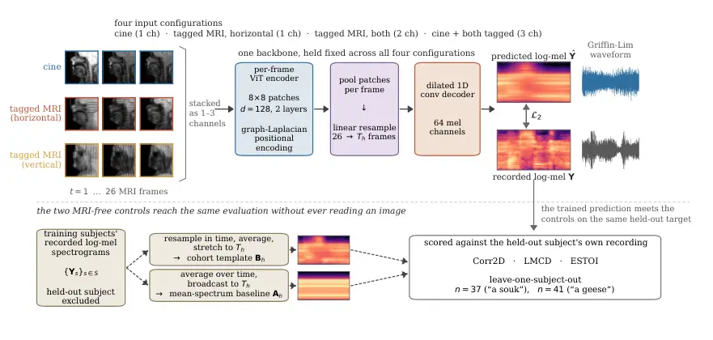
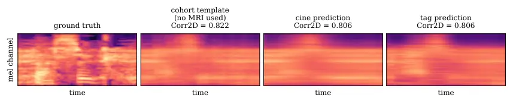

a\]Dept. of Radiology, Mass General Brigham and Harvard Medical School,
Boston, MA, USA b\]Data Science, Harvard John A. Paulson School of
Engineering and Applied Sciences, Harvard University, Cambridge, MA, USA
c\]Dept. of Radiology, University of Maryland School of Medicine,
Baltimore, MD, USA d\]Dept. of Neural and Pain Sciences, University of
Maryland School of Dentistry, Baltimore, MD, USA e\]Dept. of Electrical
and Computer Engineering, Johns Hopkins University, Baltimore, MD, USA

# Evaluating Cine and Tagged MRI-to-Speech Synthesis with Complementary Metrics and MRI-Free Controls

Karlo Vrancic    Fangxu Xing    Jiachen Zhuo    Maureen Stone    Jerry
L. Prince    Jonghye Woo Affiliation: \[ Affiliation: \[ Affiliation: \[
Affiliation: \[ Affiliation: \[

###### Abstract

Relating tongue motion measured with dynamic MRI to the speech it
produces could inform rehabilitation after glossectomy. Prior studies
have translated cine or tagged MRI into log-mel spectrograms and used
the two-dimensional Pearson correlation between predicted and recorded
spectrograms (Corr2D) to quantify the acoustic information captured by
each imaging modality. However, Corr2D has not been calibrated against
MRI-free predictors that preserve basic acoustic structure. Our
contribution is an evaluation framework for speech synthesis from cine
MRI, tagged MRI and their combination; the synthesis network is held
fixed. On identical leave-one-subject-out folds, we compare four trained
input configurations with two MRI-free controls: a static mean-spectrum
baseline and a time-aligned cohort template. Across 44 subjects (18
after glossectomy) producing two utterances, the cohort template, which
never sees an MRI, reached a Corr2D of 0.745 and 0.664. The static
baseline, which contains no timing, reached 87 to 89% of that score. No
trained configuration outperformed the template on Corr2D, a cepstral
distance or ESTOI; seven of the eight fell significantly short on
Corr2D. For cine MRI this held across three positional encodings, an
encoder temporal-attention module and a training objective matched to
the metric. Cine and tagged MRI differed consistently within subjects,
although the direction depended on the metric. Absolute Corr2D alone
therefore does not show that a model recovers acoustics from the MRI.
The two controls are a reusable method: any study can compute them from
its own training recordings, so a model’s margin over them measures what
its images contribute.

###### keywords

Tagged MRI, Cine MRI, Speech synthesis, Spectrogram, Evaluation,
Glossectomy

## 1 INTRODUCTION

Speech is produced by the coordinated deformation of the tongue and the
surrounding oropharyngeal muscles. Surgical treatment of oral cancer
alters that deformation directly. Patients who undergo glossectomy, the
surgical removal of part of the tongue, keep the intent to speak but
lose part of the articulator that realizes it. The resulting loss of
intelligibility varies widely between patients: consonant
intelligibility correlates only moderately with residual tongue
motility, so how much speech a given resection will cost cannot be
predicted from the extent of the resection alone.\[1\] Relating internal
tongue motion, as measured by MRI, to the acoustic features that
determine intelligibility would give surgical planning and
rehabilitation the quantitative basis they currently lack.

Dynamic MRI is the measurement that makes this tractable in vivo. Cine
MRI resolves tongue and oropharyngeal anatomy over time. Tagged MRI
encodes internal tissue deformation and supports dense motion
estimation.\[2\] Both have been used to build statistical descriptions
of speech motion in controls and patients.\[3, 4\] To relate that motion
to acoustics, a line of work translates these sequences into
two-dimensional (2D) log-mel spectrograms as a proxy for the audio
waveform,\[5, 6, 7, 8, 9\] following the representation used for speech
reconstruction from silent video.\[10\] The accuracy of the recovered
spectrogram is then read as a measure of how much of the acoustic signal
internal motion determines.

This reading has relied largely on the 2D Pearson correlation between
predicted and recorded log-mel spectrograms, referred to as Corr2D.
Reported values range from 0.665 to 0.820, across tagged-MRI
translators, a 3D CNN with a temporal module and its application to
patients.\[6, 7, 11\] These absolute values have not been calibrated
against predictions made without MRI. Without such a reference, a score
cannot be split into the part the imaging contributes and the part any
predictor would obtain. That split is what the clinical question
requires.



Figure 1: The image-to-spectrogram network and the two MRI-free
controls. _Top:_ one backbone is held fixed across all four input
configurations, which differ only in how many image channels are
stacked. Per-frame patch tokens carry a graph-Laplacian positional
encoding. They are pooled to one vector per frame and resampled along
time to the target length; a decoder then emits 64 mel channels.
_Bottom:_ the controls reach the same evaluation from the training
subjects’ recorded spectrograms alone, without MRI. Both controls and
the trained models receive the held-out subject’s duration. MRI frames,
spectrograms and waveforms are real, from the held-out subject of
Fig. 4.

A random or chance-level predictor is not a sufficient reference here,
for two reasons. First, the cohorts in this line of work are built
around one or two short scripted utterances spoken to a metronome. An
MRI-free acoustic template can therefore score high by reproducing the
shared structure of the utterance alone. Second, Corr2D is a single
Pearson correlation over a flattened log-mel spectrogram. It ignores any
positive scaling and offset of the prediction, while log-mel speech
carries a strong static spectral tilt common to every subject and every
frame. Part of a reported score is therefore a property of the
representation rather than of the model or the imaging. A useful
reference has to measure the utterance term and the representation term
separately.

We therefore construct two MRI-free predictors and evaluate them on the
same leave-one-subject-out folds as four trained input configurations:
cine MRI, single-orientation tagged MRI, two-orientation tagged MRI and
the fusion of cine with both tagged orientations. The first control, a
static mean-spectrum baseline, is the average spectrum of the training
recordings, repeated over time: it captures the overall spectral balance
of the utterance but nothing about the order or timing of its sounds.
The second, a cohort template, is the average of the training speakers’
spectrograms of the same utterance, aligned in time: it captures how a
typical speaker produces the utterance. The only thing it knows about
the person being predicted is the length of the recording, which the
trained models also receive. Neither uses an image. Our central finding
is that the cohort template, which never sees an MRI, matches or exceeds
every model in this paper (Fig. 2). The contribution is the evaluation,
not the network: we hold one backbone fixed so that the inputs and the
controls are the only things that vary. Our contributions are: (i) the
two controls, with this finding on three metrics (Corr2D, a log-mel
cepstral distance and ESTOI) and the measurement that the mean-spectrum
baseline, which contains no timing, reaches 87–89% of the template’s
Corr2D; (ii) evidence that this result holds across three positional
encodings, an encoder temporal-attention module and a training objective
matched to the metric’s invariance; (iii) evidence that the template’s
own score depends on how the target is rendered, so it cannot be
compared across studies; (iv) paired within-subject modality comparisons
and a patient-versus-healthy analysis, each read in light of the
controls.

Figure 2: Every primary-protocol Corr2D in this paper, one axis per
utterance. Grey diamond: the static mean-spectrum baseline (no images,
no timing). Black diamond and dashed line: the cohort template (no
images; the average speaker). Blue dots: the twelve trained runs of
Sec. 3.3, spanning 0.692–0.740 on “a souk” and 0.566–0.645 on “a geese”.
All lie below the template in the mean; the two nearest (open circles),
“a souk” cine under either objective, are statistically level with it
($`p=0.36`$). Grey bar: the template’s Corr2D on the same recordings
under other target renderings (Sec. 3.4); these values are not
comparable with the dots.

## 2 METHODS

### 2.1 Data

Paired cine MRI, tagged MRI in two orientations and audio were acquired
on a Siemens 3.0T TIM Trio or PRISMA with a segmented gradient echo
sequence.\[12\] Participants spoke “a souk” or “a geese” to a metronome:
44 subjects (26 healthy speakers and 18 patients after glossectomy), 36
of whom performed both tasks. Because most subjects performed both
tasks, the two utterances are not independent replications, so we report
them separately rather than pooling them. Images are used at their
native $`128\times 128`$ resolution, nominally with 26 frames per
utterance. Audio is converted to a 64-channel log-mel spectrogram at
22.05 kHz (1024-point FFT, 256-sample hop), giving 55–123 frames
(0.6–1.4 s).

One recording per utterance is excluded from evaluation (Sub 1 for “a
souk” and Sub 2 for “a geese”), because the only available audio was an
untrimmed scan-session recording of 17.2 s and 8.1 s rather than the
$`\sim`$1 s utterance used for every other subject. This leaves $`n=37`$
and $`n=41`$. Both recordings remain in the training data of every other
fold, for the controls and the trained models alike. The exclusion
changes no template-versus-configuration conclusion: the template moves
by about 0.003 Corr2D, while none of the 24
template-versus-configuration tests changes significance. The one
exploratory contrast it affects is reported in Sec. 3.8.

### 2.2 Network and training protocol

One image-to-spectrogram network is used in all conditions (Fig. 1). A
per-frame vision transformer (two layers, four heads) encodes
$`8\times 8`$ patches to 128-dimensional tokens with a positional
encoding built from the eight smallest non-trivial eigenvectors of the
pixel-grid graph Laplacian through a sign-invariant network. Patch
tokens are pooled to one vector per frame and the frame sequence is
linearly resampled to the target mel length. A dilated 1D convolutional
decoder then emits 64 mel channels. Training minimizes the mean-squared
error on the log-mel spectrogram. The four conditions differ only in the
number of input channels: cine MRI (1), single-orientation tagged MRI
(1), two-orientation tagged MRI (2) and cine MRI plus both tagged MRI
orientations (3). Fusion is early: the cine and tagged MRI frames of a
subject are spatially and temporally aligned, so they are stacked as
channels and mixed by the first patch-embedding layer. A late-fusion
variant, with one encoder per input and their features averaged per
frame, also falls significantly short of the template on both utterances
(Corr2D 0.720 and 0.604, $`p\leq 0.002`$). Every fold trains a fresh
model with the same random seed for 40 epochs, so the input
configuration is the intended variable.

The backbone has no temporal mixing in the encoder, so it is simpler
than the Longformer temporal module of prior work;\[7\] Sec. 3.3 adds
encoder temporal attention at the same protocol. In five subject-tasks
fewer than 26 MRI frames are available in some configurations, because
loading multiple tagged orientations keeps only the DICOM instance
numbers they share and a few acquisitions are short. Restricting the
analysis to the subjects with 26 frames in every configuration leaves
the cine-over-two-orientation result unchanged and significant on both
utterances ($`p<0.001`$).

### 2.3 MRI-free controls

Let $`\{\mathbf{Y}_{s}\}_{s\in S}`$ be the training spectrograms for a
fold and $`T_{h}`$ the held-out length. The cohort template resamples
each training spectrogram along time to a common length, averages them
and resamples the average to $`T_{h}`$. The static mean-spectrum
baseline averages each training spectrogram over time first,
broadcasting one 64-dimensional spectrum across all $`T_{h}`$ frames:

```math
\mathbf{B}_{h}=\mathcal{R}_{T_{h}}\!\Big(\tfrac{1}{|S|}\textstyle\sum_{s}\mathcal{R}_{\bar{T}}(\mathbf{Y}_{s})\Big),\qquad\mathbf{A}_{h}=\Big(\tfrac{1}{|S|}\textstyle\sum_{s}\tfrac{1}{T_{s}}\textstyle\sum_{t}\mathbf{Y}_{s}[:,t]\Big)\mathbf{1}_{T_{h}}^{\!\top}, \tag{1}
```

with $`\mathcal{R}`$ linear interpolation along time and
$`\bar{T}=\operatorname{median}_{s}T_{s}`$. Neither control uses MRI;
$`\mathbf{A}_{h}`$ also contains no timing. The controls and the models
receive the same target duration.

### 2.4 Metrics

We report Corr2D; a log-mel cepstral distance (LMCD), which applies the
mel-cepstral distortion formula\[13\] to coefficients 1–13 of a discrete
cosine transform of our 64-channel log-mel spectrogram; and ESTOI,\[14\]
an intelligibility measure. Because LMCD is computed from the log-mel
spectrogram rather than from a full mel-cepstral analysis, its values
are an order of magnitude above those familiar from mel-cepstral
distortion. We use it only to rank models evaluated on identical data.
ESTOI and STOI\[15\] differ on our waveforms by a per-subject offset
that cancels in a within-subject difference. Supporting analyses use
sharpness (variance of the Laplacian) and SSIM.\[16\]

ESTOI is computed from Griffin–Lim\[17\] reconstructions of both the
predicted and the ground-truth mel spectrograms, which holds the vocoder
constant. Griffin–Lim applied to the ground-truth mel spectrogram scores
STOI above 0.87 against the original recording, so the vocoder is
unlikely to limit the comparison. Unseeded phase initialization moves a
single ESTOI value by about 0.02, so cohort means are precise to about
0.003 and the paired tests are valid, while individual subject values
are not. Corr2D and LMCD are computed directly in mel space and are
unaffected by phase initialization.

### 2.5 Statistics

Within-subject comparisons use the Wilcoxon signed-rank test;
patient-versus-healthy comparisons use the Mann–Whitney $`U`$ test. The
eight template-versus-configuration Corr2D tests form the confirmatory
family. Every significant result in it survives Holm correction; the
single non-significant one is “a souk” cine MRI. Tests outside this
family are exploratory. Exact $`p`$-values against the template are in
Table 1.

Figure 3: (a,b) The four trained configurations against the two MRI-free
controls, solid fill for “a souk” and hatched for “a geese”. No
configuration beats the template on either metric. On “a geese” only
cine MRI is significantly better than the static mean-spectrum baseline.
(c) Each prediction is compared with a matched reference
$`\alpha\mathbf{Y}+(1-\alpha)\mathbf{B}`$ whose fidelity to the target
equals the prediction’s own (grey curve; shaded region is above it). All
28 predictions fall below their matched reference. Points are 7
subject-tasks from a separate inference run (Sec. 3.5).

## 3 RESULTS

### 3.1 The MRI-free controls

Most of the template’s score is available before any timing is modeled.
The static mean-spectrum baseline, one average spectrum repeated over
time, reaches 87–89% of the template’s Corr2D on both utterances
(Table 1). Adding the time structure of the utterance supplies the rest,
0.081 on “a souk” and 0.089 on “a geese”. Under our rendering, a Corr2D
of 0.57–0.66 is therefore available before any modeling (Fig. 2). We do
not compare this value with published scores, because the controls
themselves depend on the rendering (Sec. 3.4) and must be measured
within each study.

|                                 |                     |                     |                    |     |                      |                     |                    |
| ------------------------------- | ------------------- | ------------------- | ------------------ | --- | -------------------- | ------------------- | ------------------ |
|                                 | “a souk” ($`n=37`$) |                     |                    |     | “a geese” ($`n=41`$) |                     |                    |
| Input                           | Corr2D $`\uparrow`$ | LMCD $`\downarrow`$ | ESTOI $`\uparrow`$ |     | Corr2D $`\uparrow`$  | LMCD $`\downarrow`$ | ESTOI $`\uparrow`$ |
| cine (1 ch)                     | 0.7393 (0.36)       | 79.96 (0.50)        | 0.1172 (0.008)     |     | 0.6262 ($`<`$.001)   | 88.19 ($`<`$.001)   | 0.0678 ($`<`$.001) |
| tagged, 1 orientation (1 ch)    | 0.7275 (0.011)      | 83.45 (0.005)       | 0.1289 (0.21)      |     | 0.6014 ($`<`$.001)   | 91.64 ($`<`$.001)   | 0.1102 (0.002)     |
| tagged, 2 orientations (2 ch)   | 0.7053 ($`<`$.001)  | 86.30 ($`<`$.001)   | 0.1117 (0.017)     |     | 0.5856 ($`<`$.001)   | 92.51 ($`<`$.001)   | 0.1037 ($`<`$.001) |
| cine + tagged fusion (3 ch)     | 0.7099 ($`<`$.001)  | 85.69 ($`<`$.001)   | 0.1093 (0.068)     |     | 0.5927 ($`<`$.001)   | 91.91 ($`<`$.001)   | 0.0822 ($`<`$.001) |
| _cohort template_               | 0.7445              | 79.38               | 0.1466             |     | 0.6638               | 84.12               | 0.1632             |
| _static mean-spectrum baseline_ | 0.6631              | –                   | –                  |     | 0.5743               | –                   | –                  |

Table 1: Full leave-one-subject-out results with identical folds and
training protocol, against the two MRI-free controls. Parenthesized
values are paired Wilcoxon $`p`$ against the template. Best per column
in bold. LMCD is comparable across these rows only; LMCD and ESTOI were
not computed for the static baseline. The cohort template is best in
every column; no configuration exceeds it.

### 3.2 Trained configurations against the controls

No trained configuration outperforms the cohort template (Table 1,
Fig. 3a,b). On “a geese” every configuration falls significantly short
of it on all three metrics. On “a souk” three of the four fall short on
Corr2D. The fourth, cine MRI, ties the template on Corr2D and LMCD but
is worse on ESTOI. The tie does not hold up: the same configuration
retrained on different hardware falls significantly short of the
template ($`p=0.021`$), while its “a geese” comparison replicates. We
therefore read cine MRI on “a souk” as at best level with the template.

Against the static baseline, which contains no timing at all, the
configurations separate by utterance. On “a souk” all four outperform it
significantly ($`p\leq 0.004`$). On “a geese” all four exceed it in the
mean, but only cine MRI does so significantly ($`p=0.0001`$). The two
tagged MRI configurations and fusion do not differ significantly from a
predictor with no temporal information.

### 3.3 Robustness to the backbone

Adding temporal attention to the encoder helps on the harder utterance
but does not close the gap to the template. One explanation for the
template’s advantage is that the backbone, which has no temporal mixing
in its encoder, is underpowered in time. We therefore added two
transformer layers attending over frames in the encoder and retrained
the cine MRI configuration with the full leave-one-subject-out protocol.
The module improves the model significantly on “a geese” ($`p=0.033`$)
but not on “a souk”. On both utterances it still falls significantly
short of the template ($`p\leq 0.021`$).

The choice of positional encoding does not change the result either.
Because the graph-Laplacian encoding is an uncommon choice, we retrained
the cine MRI configuration with a learned per-patch embedding and with
no spatial positional information. All three encodings fall
significantly short of the template on both utterances
($`p\leq 0.021`$). The learned embedding is the weakest, significantly
worse than no encoding at all ($`p\leq 0.014`$), as expected from its
32,768 free parameters estimated from about 40 subjects; on “a geese” it
even drops slightly below the mean-spectrum baseline. The
graph-Laplacian encoding improves significantly on no encoding for “a
geese” and matches it for “a souk”. Both the temporal module and the
positional encoding therefore help on the harder utterance, while
neither clears the template.

Across all twelve primary-protocol runs, Corr2D separates the
configurations from one another but places none of them above a
predictor that reads no images. The twelve runs are the four input
configurations under the mean-squared error and under the $`z`$-scored
objective of Sec. 3.7, the two alternative positional encodings, the
graph-Laplacian rerun and encoder temporal attention. Every one scores
below the template in the mean on both utterances (Fig. 2). Only “a
souk” cine MRI, under either objective, is level with it; every other
run falls significantly short. On “a souk” the whole spread of the
trained runs is narrower than the 0.081 that separates the template from
the mean-spectrum baseline.

### 3.4 Dependence on target parameterization

The template’s own score depends more on how the audio is rendered than
published scores differ from one another. We rendered the same
recordings to a fixed $`64\times 64`$ log-mel spectrogram in two ways:
by time-warping the full spectrogram to 64 frames, or by taking a fixed
21,000-sample window, the length used for sliding-window augmentation in
prior work on this cohort.\[7\] We also restricted the spectrogram to
the 40–1000 Hz band used in the same work. Warping raises the template
slightly, the fixed window lowers it and the restricted band lowers it
most. An MRI-free predictor therefore spans 0.34–0.75 on identical
recordings depending only on the rendering, a range more than 2.5 times
wider than the 0.665–0.820 spread of all published MRI-to-speech scores.
Because some of our clips are shorter than the window and are
zero-padded, whereas the recordings in that work were reported as longer
than the window,\[7\] our cropped condition is not an emulation of any
published pipeline. What it shows is general: Corr2D values from
different studies cannot be ranked against each other, or read against a
fixed threshold, without a control computed under each study’s own
rendering.



Figure 4: One held-out healthy subject, “a souk”. The recorded
spectrogram carries temporal events that none of the predictions
recover. The cohort template, the cine MRI prediction and the tagged MRI
prediction are visually the same object; the template scores the highest
Corr2D of the three. This subject, among the better-scoring folds, is
shown for legibility. It comes from the same separate inference run as
Fig. 3c.

### 3.5 Relation of the predictions to the template

The predictions stay close to the template and add noise rather than
subject-specific detail. For seven subject-tasks whose predictions were
kept from a separate inference run, a prediction correlates more with
the cohort template than with its own target (Corr2D 0.94 against 0.67
on average; Fig. 3c). That contrast alone is weak evidence, because any
estimator shrunk toward the cohort mean satisfies
$`\mathrm{Corr2D}(\hat{\mathbf{Y}},\mathbf{B})>\mathrm{Corr2D}(\hat{\mathbf{Y}},\mathbf{Y})`$,
even one that carries subject-specific information. We therefore built,
for each prediction, a matched reference
$`\alpha\mathbf{Y}+(1-\alpha)\mathbf{B}`$ whose fidelity to the target
equals the prediction’s. For 21 of the 28 predictions the matched
$`\alpha`$ is negative: they are less faithful to their target than the
template itself. For the other seven it is at most 0.04, a mixture of 4%
target and 96% template. All 28 predictions also depart from the
template more than their matched references do (Fig. 3c). The
predictions were thus not simply shifted toward the cohort mean: they
stay close to the template and depart from it in directions that do not
improve fidelity. The seven subject-tasks were chosen for listening
rather than at random. Their values differ from the Table 1 run by up to
0.15 Corr2D, so we treat this analysis as illustrative.

### 3.6 Paired modality comparisons

Within subjects, cine MRI outperforms two-orientation tagged MRI on
Corr2D for both utterances, but the ranking reverses on ESTOI for “a
geese”. Paired comparisons rank configurations on identical targets.
Cine MRI beats two-orientation tagged MRI on Corr2D in 26 of 37 and 31
of 41 subjects ($`p\leq 0.0007`$); both contrasts survive Holm
correction together with the confirmatory family. Cine MRI does not
differ significantly from single-orientation tagged MRI, while on “a
souk” one tagged orientation significantly outperforms two
($`p=0.021`$). Fusion does not outperform cine MRI: it lands next to
two-orientation tagged MRI, the input it mostly consists of. With about
40 training subjects, each added channel gives the network more input to
fit without more subjects to fit it from. Because every configuration
stays close to the template, the extra input mostly adds variation
around it rather than information. On ESTOI the ordering reverses on “a
geese”: both tagged MRI configurations significantly outperform cine
MRI, the same pair that cine leads on Corr2D.

These contrasts do not isolate MRI-derived information, because the
configurations differ in how closely they follow the template. In the
seven-subject-task run of Sec. 3.5, cine MRI predictions correlate with
the template at an average of 0.97, while single-orientation tagged MRI
predictions correlate at 0.91. A Corr2D advantage can therefore reflect
stronger shrinkage toward the template; the reversed ESTOI ordering fits
this reading. The controls change how the modality comparison reads: the
configurations differ in how they depart from an MRI-free predictor,
with a direction that depends on the metric.

### 3.7 A training objective matched to the metric

Corr2D misses a large change in what the predictions look like. It
ignores positive scaling and offset, so we also trained the four
configurations on the per-utterance $`z`$-scored log-mel spectrogram,
with level supervised separately. For cine MRI this makes predictions
1.6 to 1.9 times sharper in every subject and improves SSIM
significantly, while Corr2D changes by at most 0.004. The sharpness has
a cost: LMCD, PSNR and log-mel L2 all degrade significantly (all
$`p<2\times 10^{-5}`$). Corr2D is thus nearly blind both to a large
sharpness gain and to a simultaneous loss of level fidelity. This is the
perception-distortion tradeoff\[18\] in a setting where the distortion
measure is itself insensitive to the shared prior.

### 3.8 Patients and healthy speakers

Patients and healthy speakers were similarly predictable, contrary to
the expected clinical pattern. Because glossectomy alters both tongue
motion and speech acoustics, a model that had learned the
articulatory-acoustic relationship should find patients harder to
predict. Performance was instead similar for every configuration on both
tasks: none of the eight Corr2D contrasts reaches significance
($`p\geq 0.25`$), with 23 healthy speakers against 14 and 18 patients.
This is not model robustness. The MRI-free template itself scores
patients and healthy speakers equally ($`p\geq 0.52`$), so under Corr2D
patients are not harder targets. A null contrast for the trained models
therefore carries no information about clinical generalizability. ESTOI
showed a less consistent pattern: on “a souk” single-orientation tagged
MRI scored lower in patients than in healthy speakers, short of
significance ($`p=0.058`$, exploratory). This is the only contrast whose
significance depends on the exclusion described in Sec. 2.1: if the
excluded patient recording is retained, the result reaches significance
($`p=0.039`$).

## 4 DISCUSSION AND CONCLUSION

The two controls split a Corr2D score into its parts. The mean spectrum
measures what the log-mel representation supplies. The template adds
what the shared utterance supplies. Only a model’s margin over the
template can come from the individual speaker. The first part alone is
87–89% of the template’s score, so the largest share is a property of
log-mel speech rather than of the corpus. The shrinkage analysis of
Sec. 3.5 finds at most a marginal individual part: none of the 28
listening-subset predictions is more faithful to its target than a
mixture of 4% target and 96% template.

For the clinical question, this changes what existing scores support. A
high Corr2D invites the reading that internal tongue motion largely
determines the acoustics it produces. On our cohort and rendering, a
predictor with no access to motion reaches 0.745. An absolute Corr2D is
therefore evidence about the imaging only through its margin over the
strongest MRI-free predictor evaluated on the same data; in our data, no
trained model has a positive margin. The missing piece is evidence of
subject-specific acoustic recovery: no current score demonstrates it
with the sensitivity a surgical-planning or rehabilitation tool would
need. The patient-versus-healthy result points the same way: neither the
models nor the metric and target, as currently defined, separate an
impaired speaker from an unimpaired one.

The claim is about evidence, not about any published model. This work
uses the same cohort and scanner protocol as prior MRI-to-speech studies
from our group. However, we have not run the control experiments under
their target representation and training setup. Our backbone is also
simpler. A stronger model may well clear the template; only a measured
margin over it can show that it does. The margin is narrow at one point:
“a souk” cine MRI ties the template under either objective and becomes a
significant shortfall on retraining. Every other run at the primary
protocol falls significantly short of the template, including runs with
a temporal module and a positional encoding that each improve
significantly on the backbone without them on “a geese”.

These results suggest a short reporting checklist for studies that
synthesize speech, or another time-varying signal, from imaging in a
cohort performing a shared scripted task:

Reporting checklist for image-to-signal synthesis 1. Report a static
baseline: the training targets averaged over time (for spectrograms, the
mean spectrum). It requires no training and shows how much of a score
the representation alone supplies. 2. Report a cohort template on the
same folds, durations and rendering. Quote each model’s margin over it
with a paired test. 3. State the target rendering (for spectrograms:
sampling rate, window, frequency band, length normalization): an
MRI-free predictor spans 0.34 to 0.75 on our recordings depending on it. 4. Compare input modalities within subject and on at least two metrics
of different kinds (for speech, one spectral and one intelligibility
measure). Report how closely each model follows the template, since a
paired difference can reflect shrinkage as well as information.

This study has limitations. Two scripted utterances from one site form
the setting in which a template is strongest; the mean-spectrum result
suggests that a corpus with varied content\[19\] would remove the
smaller, utterance-dependent part of the score rather than the larger
one. Each input is a single 2D slice per frame, so lateral deformation
and rotation of the tongue are not observed; the controls use no images
and apply unchanged to 3D or motion-field inputs, which must clear the
same template. The two tasks share 36 of 44 subjects and are not
independent. The audio clips were cut by hand from the in-scanner
recording and are not synchronized to the scanner trigger. Against
expert articulatory landmarks, the proportional frame-to-spectrogram
mapping used by the models is off by a median of 83 ms on “a souk” and
120 ms on “a geese”, two to three MRI frames. Because each clip begins
and ends at the utterance, the template inherits the utterance
boundaries, whereas the models must map misaligned frames, so the
template comparison favors the control; the static-baseline result,
which uses no timing, is unaffected. We use Griffin–Lim rather than a
neural vocoder.\[20\] Our ESTOI values are unseeded single draws. The
number of training epochs was selected on held-out Corr2D, which can
only favor the trained models over the controls. Finally, our
architecture is one point in a large design space. The controls apply
equally to a model that outperforms the template: they are what would
make that margin measurable.

###### Acknowledgements.

This work is supported by NIH R01DC014717, R01DC018511 and R01CA133015.

## References

- \[1\] Bressmann, T., Sader, R., Whitehill, T. L., and Samman, N.,
  “Consonant intelligibility and tongue motility in patients with
  partial glossectomy,” Journal of Oral and Maxillofacial Surgery 62(3),
  298–303 (2004).
- \[2\] Xing, F., Woo, J., Gomez, A. D., Pham, D. L., Bayly, P. V.,
  Stone, M., and Prince, J. L., “Phase vector incompressible
  registration algorithm for motion estimation from tagged magnetic
  resonance images,” IEEE Transactions on Medical Imaging 36(10),
  2116–2128 (2017).
- \[3\] Woo, J., Xing, F., Stone, M., Green, J., Reese, T. G., Brady,
  T. J., Wedeen, V. J., Prince, J. L., and El Fakhri, G., “Speech map: a
  statistical multimodal atlas of 4D tongue motion during speech from
  tagged and cine MR images,” Computer Methods in Biomechanics and
  Biomedical Engineering: Imaging & Visualization 7(4), 361–373 (2019).
- \[4\] Woo, J., Xing, F., Prince, J. L., Stone, M., Gomez, A. D.,
  Reese, T. G., Wedeen, V. J., and El Fakhri, G., “A deep joint sparse
  non-negative matrix factorization framework for identifying the common
  and subject-specific functional units of tongue motion during speech,”
  Medical Image Analysis 72, 102131 (2021).
- \[5\] Liu, X., Xing, F., Stone, M., Prince, J. L., Kim, J., El Fakhri,
  G., and Woo, J., “CMRI2Spec: Cine MRI sequence to spectrogram
  synthesis via a pairwise heterogeneous translator,” in \[ICASSP \],
  1481–1485, IEEE (2022).
- \[6\] Liu, X., Xing, F., Prince, J. L., Zhuo, J., Stone, M.,
  El Fakhri, G., and Woo, J., “Tagged-MRI sequence to audio synthesis
  via self residual attention guided heterogeneous translator,” in
  \[MICCAI \], 13436, 376–386, Springer (2022).
- \[7\] Liu, X., Xing, F., Prince, J. L., Stone, M., El Fakhri, G., and
  Woo, J., “Synthesizing audio from tongue motion during speech using
  tagged MRI via transformer,” in \[Medical Imaging 2023: Image
  Processing \], 12464, 203–207, SPIE (2023).
- \[8\] Liu, X., Xing, F., Stone, M., Zhuo, J., Fels, S., Prince, J. L.,
  El Fakhri, G., and Woo, J., “Speech audio synthesis from tagged MRI
  and non-negative matrix factorization via plastic transformer,” in
  \[MICCAI \], 14226, 435–445, Springer (2023).
- \[9\] Li, Y., Jiang, H., Ma, Y., Qin, S., Woo, J., and Xing, F.,
  “Speech audio generation from dynamic MRI via a knowledge enhanced
  conditional variational autoencoder.” arXiv:2503.06588 (2025).
- \[10\] Akbari, H., Arora, H., Cao, L., and Mesgarani, N.,
  “Lip2AudSpec: Speech reconstruction from silent lip movements video,”
  in \[ICASSP \], 2516–2520, IEEE (2018).
- \[11\] Liu, X., Xing, F., Zhuo, J., Stone, M., Prince, J. L.,
  El Fakhri, G., and Woo, J., “Speech motion anomaly detection via
  cross-modal translation of 4D motion fields from tagged MRI,” in
  \[Medical Imaging 2024: Image Processing \], 12926, 129262W, SPIE
  (2024).
- \[12\] Lee, J., Woo, J., Xing, F., Murano, E. Z., Stone, M., and
  Prince, J. L., “Semi-automatic segmentation of the tongue for 3D
  motion analysis with dynamic MRI,” in \[ISBI \], 1465–1468, IEEE
  (2013).
- \[13\] Kubichek, R., “Mel-cepstral distance measure for objective
  speech quality assessment,” in \[Proceedings of IEEE Pacific Rim
  Conference on Communications Computers and Signal Processing \], 1,
  125–128, IEEE (1993).
- \[14\] Jensen, J. and Taal, C. H., “An algorithm for predicting the
  intelligibility of speech masked by modulated noise maskers,” IEEE/ACM
  Transactions on Audio, Speech, and Language Processing 24(11),
  2009–2022 (2016).
- \[15\] Taal, C. H., Hendriks, R. C., Heusdens, R., and Jensen, J., “An
  algorithm for intelligibility prediction of time–frequency weighted
  noisy speech,” IEEE Transactions on Audio, Speech, and Language
  Processing 19(7), 2125–2136 (2011).
- \[16\] Wang, Z., Bovik, A. C., Sheikh, H. R., and Simoncelli, E. P.,
  “Image quality assessment: from error visibility to structural
  similarity,” IEEE Transactions on Image Processing 13(4), 600–612
  (2004).
- \[17\] Griffin, D. and Lim, J., “Signal estimation from modified
  short-time Fourier transform,” IEEE Transactions on Acoustics, Speech,
  and Signal Processing 32(2), 236–243 (1984).
- \[18\] Blau, Y. and Michaeli, T., “The perception-distortion
  tradeoff,” in \[CVPR \], 6228–6237 (2018).
- \[19\] Lim, Y., Toutios, A., Bliesener, Y., Tian, Y., Lingala, S. G.,
  Vaz, C., Sorensen, T., Oh, M., Harper, S., Chen, W., et al., “A
  multispeaker dataset of raw and reconstructed speech production
  real-time MRI video and 3D volumetric images,” Scientific Data 8(1),
  187 (2021).
- \[20\] Kong, J., Kim, J., and Bae, J., “HiFi-GAN: Generative
  adversarial networks for efficient and high fidelity speech
  synthesis,” in \[NeurIPS \], 33, 17022–17033 (2020).
