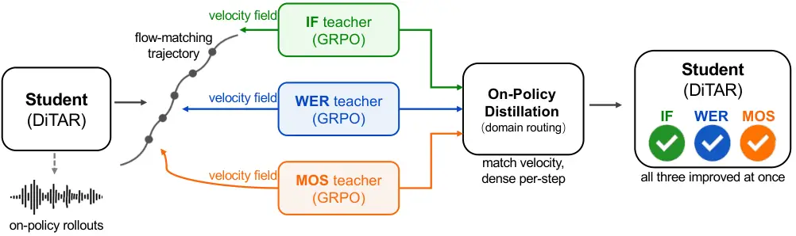

# InstructTTS-OPD: On-Policy Distillation for Multi-Objective Instruction-Following TTS

Haitao Li Affiliation: Zhejiang University Affiliation: Shanghai
Innovation Institute    Tian Tan Affiliation: Shanghai Jiao Tong
University    Yuguang Yang Affiliation: Tencent Hunyuan    Guanrou Yang
Affiliation: Shanghai Innovation Institute Affiliation: Shanghai Jiao
Tong University    Wenhao Guan Affiliation: Shanghai Innovation
Institute Affiliation: Xiamen University    Chenglin Li
Affiliation: Zhejiang University Affiliation: Shanghai Innovation
Institute    Shan Yang Affiliation: Tencent Hunyuan    Xie Chen
Affiliation: Shanghai Innovation Institute Affiliation: Shanghai Jiao
Tong University

###### Abstract

Instruction-following text-to-speech (Instruct-TTS) renders a target
transcript in the manner described by a free-form natural-language
instruction, and a good rendition must succeed on three fronts at once:
following the instruction, pronouncing the transcript correctly, and
sounding natural. Reinforcement learning has become the standard way to
post-train such generative models toward human preferences, and TTS
systems increasingly adopt it. When the three objectives are optimized
together under a single scalar reward, typically with group relative
policy optimization (GRPO), training tends to be unstable: the
objectives compete, and the shared update drifts toward whichever one is
easiest to improve, producing a seesaw among them. We instead adapt
on-policy distillation (OPD), which fuses several single-objective
teachers by matching their velocity fields on the student’s own
rollouts. Realizing this for Instruct-TTS first calls for a sound reward
on each axis, which we analyze carefully: a distilled Qwen-Omni proxy
for the costly Gemini judge, dialect-free data for the WER reward, and
DNSMOS in place of the language-biased UTMOS. We then train three
single-objective teachers with GRPO and fuse them with OPD, routing each
rollout to the instruction-following or WER teacher by its data domain
and letting every rollout additionally follow the MOS teacher for
quality. This lets instruction following and intelligibility improve
together without a trade-off, but the quality target conflicts with
instruction following, so following it additively reintroduces the
seesaw. We therefore propose conflict-aware velocity fusion, which
projects the quality target off the direction that opposes the primary
objective before fusing, and show that it markedly reduces the
instruction-following/quality trade-off. The fused model improves over
scalar-reward GRPO on all three objectives at once. Demo is available at
[https://cucl-2.github.io/InstructTTS-OPD](https://cucl-2.github.io/InstructTTS-OPD).

|     |
| --- |
|     |

## 1 Introduction

Text-to-speech (TTS) has advanced to the point where the synthesized
voice is often hard to tell from a real recording (Anastassiou et al.,
2024; Du et al., 2025; Hu et al., 2026a; Xu et al., 2026b; Liu et al.,
2026c), and attention is shifting from merely reading a transcript to
controlling _how_ it is read (Li et al., 2026a; Yang et al., 2024).
Instruction-following TTS (Instruct-TTS) captures this goal: given a
target transcript together with a free-form natural-language
instruction, such as “_read this in a trembling, sobbing voice_” or
“_speak the following line in Cantonese, sounding impatient_,” the model
must render the transcript in the manner described (Guo et al., 2023;
Yang et al., 2024). A good rendition has to succeed on three fronts at
once: it must follow the instruction (instruction following, IF),
pronounce the transcript correctly (intelligibility, measured by word or
character error rate, WER/CER), and sound natural (quality, measured by
mean opinion score, MOS). Among the three, instruction following is
primary, as it distinguishes Instruct-TTS from ordinary TTS.

TTS models are increasingly post-trained with reinforcement learning
(RL) to align their outputs with human preference (Ma et al., 2026b;
Zhang et al., 2024; Wang et al., 2026b; Yang et al., 2026), and the
dominant recipe is group relative policy optimization (GRPO) (Shao et
al., 2024; Liu et al., 2026b) with a scalar reward. When several
objectives must be optimized together, they are collapsed into a single
number, and this scalarization discards directional information: when
two objectives disagree on how the output should change, their
contributions partially cancel, and a single scalar cannot express which
trade-off to make. Optimization then drifts toward whichever objective
is easiest to improve, so a softer objective comes to dominate the
shared update while the competing ones regress. The result is the
familiar seesaw among the three objectives, and reweighting the scalar
only shifts the balance point rather than removing the tension.

A promising alternative comes from image generation, where on-policy
distillation (OPD) fuses several single-objective expert teachers by
matching their velocity fields on the student’s own rollouts (Fang et
al., 2026), giving a dense, per-step supervision signal in place of a
single scalar. Bringing this idea to Instruct-TTS is not immediate,
because the task carries characteristics that the image setting does
not, and it first calls for a careful choice of reward along each of the
three axes. For instruction following, the reliable judge is
Gemini (Comanici et al., 2025), but querying it during training is
prohibitively expensive; we therefore distill a Qwen-Omni (Xu et al., 2025) reward model that closely tracks the Gemini judgment and serves as
a low-cost replacement. For intelligibility, we find that the WER
teacher must be trained on dialect-free data: otherwise the model learns
to lower WER by not speaking the requested dialect, which in turn drags
down IF. For quality, we show that UTMOS (Saeki et al., 2022) is a poor
choice because it carries a strong bias between Chinese and English,
which pushes the model toward a foreign-accented reading of Chinese, and
we adopt DNSMOS (Reddy et al., 2022) instead.

With these rewards in place, we train three single-objective teachers
with GRPO and fuse them through OPD. We route each rollout to the IF or
WER teacher by its data domain, and let every rollout additionally
follow the MOS teacher for quality. Routing the two primary objectives
to disjoint utterances lets instruction following and intelligibility
improve together without a trade-off. Quality, however, is applied to
every rollout and, as we show, conflicts with instruction following, so
following it additively reintroduces the seesaw. We therefore propose
conflict-aware velocity fusion, which projects the quality target off
the direction that opposes the primary objective before fusing, a
per-frame geometric operation on the distillation signal that a scalar
reward cannot express. This markedly reduces the
instruction-following/quality trade-off, and the fused model improves
over scalar-reward GRPO on all three axes at once.

The main contributions of this work are summarized as follows:

- •
  Reward analysis for Instruct-TTS. We identify a sound reward along
  each axis: a distilled Qwen-Omni proxy for the costly Gemini judge, a
  dialect-free WER reward, and DNSMOS in place of the language-biased
  UTMOS.
- •
  On-policy distillation for multi-objective Instruct-TTS. We fuse three
  single-objective GRPO teachers with OPD, routing each rollout to one
  teacher by its data domain, and surpass scalar-reward GRPO on all
  three axes.
- •
  Conflict-aware velocity fusion. Because the quality target conflicts
  with instruction following, we project it off the opposing direction
  before fusing, a per-frame geometric operation that scalar-reward RL
  cannot express and that yields the best overall system.

## 2 Related Work

#### Instruction-following TTS.

Instruct-TTS asks a model to speak a target transcript in the manner
described by a free-form natural-language instruction, such as a desired
emotion, timbre, speaking rate, or dialect, and a good rendition must
follow the instruction, stay intelligible, and sound natural at once.
Early systems encode the style description with a dedicated prompt
encoder and learn a mapping from the described attributes to acoustic
style, as in PromptTTS (Guo et al., 2023) and InstructTTS (Yang et al.,
2024). As large language models improved the understanding of free-form
instructions, more recent systems such as FlexiVoice (Chen et al.,
2026a), Mimo-Audio (Xiaomi, 2025), MOSS-VoiceGenerator (Huang et al.,
2026), and Qwen3-TTS (Hu et al., 2026a) pair an LLM backbone with a
speech decoder and follow much richer, open-vocabulary instructions.

#### Reinforcement learning for TTS.

Reinforcement learning is increasingly used to post-train TTS models
toward objectives that are not directly differentiable. Early efforts
focus on autoregressive, LLM-based TTS in which speech is represented as
discrete tokens, so the RL machinery closely follows that of text LLMs.
Seed-TTS (Anastassiou et al., 2024) optimizes WER and speaker-similarity
rewards with PPO, REINFORCE, and DPO; SpeechAlign (Zhang et al., 2024)
aligns the synthetic distribution with a gold reference via DPO;
DiffRO (Gao et al., 2025) adopts a token-level differentiable ASR
reward; RRPO (Wang et al., 2026a) designs a more robust reward that
alleviates reward hacking; and GRPO-TTS (Liu et al., 2026a) combines
GRPO with a composite CER and NLL reward. A second line performs RL on
flow-matching TTS: F5R-TTS (Sun et al., 2025) reformulates the
deterministic flow into a probabilistic one to make policy gradients
available, at the cost of retraining, whereas FlowTTS-GRPO (Wang et al.,
2026b) turns the sampling ODE into an SDE and fine-tunes an open-source
flow model directly with GRPO. Built on a DiTAR-style architecture, our
work follows this second line and carries out RL and distillation in the
continuous flow-matching space rather than over discrete tokens.

#### On-policy distillation.

On-policy distillation (OPD) was first introduced for LLMs, where a
student learns to match its teachers on the rollouts it generates
itself, and has proven effective at combining several teachers into one
student while easing the trade-off among them (Agarwal et al., 2024; Gu
et al., 2023; Ma et al., 2026a; Xu et al., 2026a). The idea was later
carried to image generation by Flow-OPD (Fang et al., 2026) and
DiffusionOPD (Li et al., 2026c), which recast distillation on a
flow-matching or diffusion model as matching the teacher velocity fields
along the student’s own rollouts; Flow-OPD, for instance, jointly
optimizes GenEval, OCR, and aesthetic quality, and Qwen-Image-2.0-RL (Xu
et al., 2026c) applies OPD to merge a generation and an editing model
into one. We bring OPD to Instruct-TTS, optimizing instruction
following, intelligibility, and quality together; the characteristics of
speech introduce challenges the image setting does not face.

## 3 Method



Figure 1: Overview of InstructTTS-OPD. Three single-objective teachers
(IF, WER, MOS), each trained with GRPO, are evaluated on the student’s
own on-policy flow-matching rollouts and supply dense per-step
velocity-field targets. Domain routing and conflict-aware fusion combine
these targets so the student improves all three objectives at once,
avoiding the scalar-reward seesaw.

### 3.1 Preliminaries: DiTAR backbone and flow matching

We build on a DiTAR-style architecture (Jia et al., 2025), which couples
an autoregressive language model with a local flow-matching decoder. At
each step the language model reads the text together with a summary of
the audio generated so far and emits a condition vector $`c`$; a
flow-matching decoder, a DiT block we refer to as the local decoder,
turns Gaussian noise into the audio latents of the current frame under
that condition; an aggregation encoder compresses the new frame back
into a single vector that is fed to the language model as the next
input, closing the autoregressive loop. A frozen vocoder finally maps
the latents to a waveform. The language model is a $`0.5`$B Qwen (Yang
et al., 2025); together with the local decoder ($`193`$M) and the
aggregation encoder ($`48`$M) the DiTAR model totals about $`0.7`$B
parameters (the vocoder is frozen). This design keeps generation
autoregressive at the frame level while making each frame the output of
a continuous flow-matching process, which is exactly where we apply
reinforcement learning and distillation.

Flow matching (Lipman et al., 2022; Liu et al., 2022) learns a velocity
field $`v_{\theta}(x_{t},t)`$ that transports a Gaussian prior at
$`t{=}0`$ to the data distribution at $`t{=}1`$. Given noise $`x_{0}`$
and a target latent $`x_{1}`$, one defines the straight-line path
$`x_{t}=(1-t)\,x_{0}+t\,x_{1}`$ with corresponding velocity
$`u_{t}=x_{1}-x_{0}`$, and trains $`v_{\theta}`$ to regress $`u_{t}`$.
At inference, generation starts from noise and integrates the ordinary
differential equation (ODE)
$`\mathrm{d}x=v_{\theta}(x_{t},t)\,\mathrm{d}t`$ from $`t{=}0`$ to
$`t{=}1`$. Throughout, we write $`\mu_{\theta}`$ for the mean that the
velocity field induces on one sampling step; it is the quantity our RL
and distillation objectives act on.

### 3.2 From ODE to SDE: enabling on-policy rollouts

Deterministic ODE sampling maps a fixed noise sample to a single output
and therefore offers no exploration, which reinforcement learning
requires. We follow the practice of converting part of the sampling
trajectory into a stochastic differential equation (SDE) (Wang et al.,
2026b; Liu et al., 2026b): for a subset of the integration steps we add
Gaussian noise around the deterministic mean, so that one step produces
a sampled next state $`x^{\prime}`$, a deterministic mean
$`\mu_{\theta}(x_{t},t)`$, and the log-probability of the transition,

```math
x^{\prime}=\mu_{\theta}(x_{t},t)+\sigma_{t}\,\epsilon,\qquad\epsilon\sim\mathcal{N}(0,I),\qquad\log\pi_{\theta}(x^{\prime}\mid x_{t})=-\frac{\lVert x^{\prime}-\mu_{\theta}(x_{t},t)\rVert^{2}}{2\sigma_{t}^{2}}+\text{const}. \tag{1}
```

Sampling the same prompt several times now yields distinct rollouts, and
each rollout records, at every SDE step, the state, condition, sampled
output, and transition log-probability. The mean $`\mu_{\theta}`$
carries gradients and is the shared optimization target of both routes
described below: the group-relative policy gradient and the distillation
loss.

### 3.3 Single-objective teachers via GRPO

We first train one expert per objective (IF, WER, and MOS) with group
relative policy optimization (Shao et al., 2024). The three rewards are
deliberately simple. The IF reward is a binary consistency verdict from
a judge that decides whether an utterance matches its instruction,
$`r_{\mathrm{IF}}\in\{0,1\}`$ (a $`3`$-vote majority); the WER reward is
$`r_{\mathrm{WER}}=1-\min(\mathrm{CER},1)`$ from an ASR model; and the
MOS reward is a no-reference quality score $`r_{\mathrm{MOS}}\in[1,5]`$.
For each prompt we draw a group of $`G`$ on-policy rollouts, score each
with the corresponding reward $`r`$, and standardize the scores within
the group to obtain the advantage

```math
A_{i}=\frac{r_{i}-\mathrm{mean}(\{r_{j}\}_{j=1}^{G})}{\mathrm{std}(\{r_{j}\}_{j=1}^{G})}, \tag{2}
```

so that only the relative quality within a group drives the update. The
policy is then trained with the group-relative policy-gradient objective
together with a KL regularizer to a frozen reference that prevents the
base speech quality from drifting,

```math
\mathcal{L}_{\mathrm{GRPO}}=-\,\mathbb{E}\big[A\,\log\pi_{\theta}\big]+\beta\,\mathrm{KL}\!\left(\pi_{\theta}\,\|\,\pi_{\mathrm{ref}}\right). \tag{3}
```

This yields three single-objective experts, each strong on its own axis
but weak on the others. Fusing them under a single scalar reward,
however, requires collapsing the per-objective advantages into one
number; the direction along which the objectives disagree is then lost,
and optimization drifts toward the objective that is easiest to improve.
This is the seesaw effect that motivates the distillation-based fusion
below.

### 3.4 Multi-objective fusion via on-policy distillation

Rather than fusing the objectives through a scalar reward, we fuse the
three experts directly in the velocity-field space with on-policy
distillation (Fang et al., 2026; Li et al., 2026c), as illustrated in
Figure 1. The student generates its own on-policy rollouts, and each
teacher is evaluated at the same trajectory points that the student
visits, so the supervision is delivered exactly where the student’s own
sampling takes it.

Because the student and every teacher share the same flow-matching
transition kernel, the two single-step transition distributions are
Gaussians with the same covariance, and their per-step Kullback–Leibler
(KL) divergence collapses in closed form to a squared distance between
their means,

```math
\mathrm{KL}\!\left(\pi_{\mathrm{student}}\,\|\,\pi_{\mathrm{teacher}}\right)=\frac{\lVert\mu_{\mathrm{student}}-\mu_{\mathrm{teacher}}\rVert^{2}}{2\,\sigma_{t}^{2}\,\Delta t}. \tag{4}
```

The distillation signal is therefore a fully differentiable,
zero-variance regression on the velocity-field mean, and it needs
neither advantages nor a policy-gradient estimator.

The key question is how to combine several teachers. We route each
rollout to a single main teacher by the domain of its training data:
rollouts drawn from the instruction-following data are distilled against
the IF teacher, and rollouts from the WER data against the WER teacher,
with the overall mixing set by the data ratio. The reason to route the
primary objectives to _disjoint_ rollouts rather than have every rollout
follow both teachers at once is the same conflict identified for the WER
reward in Section 4.2: the WER data cannot contain dialect instructions,
because a WER teacher scored by a Mandarin ASR would then push the model
to abandon the requested dialect to lower its error rate, directly
fighting instruction following. Keeping the IF and WER signals on
separate rollouts prevents this tug-of-war on any single utterance.
Quality, by contrast, has no domain of its own; it is a property every
utterance should have. We therefore keep the MOS teacher out of the
routing and add it as a light auxiliary term applied to all rollouts.
The student minimizes

```math
\mathcal{L}_{\mathrm{OPD}}=\big\lVert\mu_{\mathrm{student}}-\mathrm{sg}(\mu_{d(i)})\big\rVert^{2}\;+\;\lambda_{\mathrm{MOS}}\,\big\lVert\mu_{\mathrm{student}}-\mathrm{sg}(\mu_{\mathrm{MOS}})\big\rVert^{2}, \tag{5}
```

where $`d(i)\in\{\mathrm{IF},\mathrm{WER}\}`$ is the main teacher
selected by the data domain of rollout $`i`$, $`\mathrm{sg}(\cdot)`$ is
the stop-gradient operator that freezes the teachers as fixed targets,
and $`\lambda_{\mathrm{MOS}}`$ is a small weight that makes quality a
guardrail rather than a competing objective.

### 3.5 Conflict-aware velocity fusion

Adding the two targets in Eq. 5 treats the primary target and the
quality target as two independent regressions whose gradients are simply
summed, which is benign only when the two point in compatible
directions. But quality and instruction following often disagree on a
single utterance: naturalness pushes toward a smooth, evenly-paced
delivery, whereas following an expressive instruction pushes toward
crying, trembling, or dialectal speech that a quality predictor reads as
degradation. On the frames where the two disagree, the summed gradient
partially cancels, and raising $`\lambda_{\mathrm{MOS}}`$ to buy quality
drags the primary objective down, exactly the seesaw we set out to
avoid. We quantify how often this happens in Section 5.1.

We therefore fuse the two targets geometrically rather than additively.
Writing the primary and quality update directions at a frame as

```math
d_{P}=\mu_{d(i)}-\mu_{\mathrm{student}},\qquad d_{U}=\mu_{\mathrm{MOS}}-\mu_{\mathrm{student}}, \tag{6}
```

we remove from $`d_{U}`$ only the component that directly opposes
$`d_{P}`$, keeping the aligned and orthogonal part,

```math
d_{U}^{\mathrm{keep}}=d_{U}-\frac{\min\!\left(\langle d_{U},d_{P}\rangle,\,0\right)}{\lVert d_{P}\rVert^{2}}\,d_{P},\qquad\mathcal{L}_{\mathrm{OPD}}^{\mathrm{conflict}}=\big\lVert\mu_{\mathrm{student}}-\mathrm{sg}\!\left(\mu_{\mathrm{student}}+d_{P}+\lambda_{\mathrm{MOS}}\,d_{U}^{\mathrm{keep}}\right)\big\rVert^{2}. \tag{7}
```

When the two directions form an obtuse angle
($`\langle d_{U},d_{P}\rangle<0`$) the opposing component is projected
out, so $`d_{U}^{\mathrm{keep}}\perp d_{P}`$ and quality can no longer
erode the primary objective; when they are aligned
($`\langle d_{U},d_{P}\rangle\geq 0`$) the quality push is kept in full.
Quality is thus only ever allowed to make orthogonal adjustments: it may
refine the timbre or smoothness of a frame, but it can never flatten out
an already-expressed sob or dialect. This borrows the idea of gradient
surgery (Yu et al., 2020), but applies it to the per-frame
velocity-field distillation targets of the flow model rather than to
parameter gradients. It is an asymmetric, output-space geometric
operation that a scalar-reward policy gradient cannot express, and that
becomes available precisely because the distillation signal is a
differentiable regression on $`\mu`$. Because the target is
stop-gradient, the loss reduces to a single mean-squared error and
$`\lambda_{\mathrm{MOS}}`$ scales the surviving quality push linearly;
InstructTTS-OPD uses this conflict-aware form as its fusion loss.

## 4 Experiments

### 4.1 Setup

Data and base model. All models start from a single supervised DiTAR
checkpoint (the base) and are post-trained with RL and OPD on
$`30{,}000`$ instruction-following and $`30{,}000`$ intelligibility
(WER) utterances, a $`1{:}1`$ ratio. Every instruction is in the ZH-DSD
style, matching the base model, which has only seen ZH-DSD-style
instruction data. We therefore evaluate primarily on the DSD subset of
InstructTTSEval (Huang et al., 2025) (zh_DSD, $`1000`$ utterances), and
also report the full six InstructTTSEval subsets to probe
generalization.

Metrics. Each axis is optimized against a single chosen reward, but we
report every axis with _both_ its reward-side metric and a held-out
metric that never shapes training, so that reward hacking would surface
as a divergence between the two. Instruction following (IF), the primary
axis, is the consistency rate of a judge that decides whether an
utterance matches its instruction: a distilled Qwen2.5-Omni proxy
(IF*(qwen)) for analysis and checkpoint selection, and Gemini as the
held-out judge. Intelligibility is the character error rate (CER,
$`\downarrow`$) from Paraformer-zh under the seed-tts-eval protocol,
held out against Qwen3-ASR (CER*(q3)) and reported de-dialect. Quality
is DNSMOS P.835 OVRL ($`\uparrow`$), held out against UTMOS.

Training. Teachers are trained with GRPO and fused with OPD on $`4`$
nodes $`\times\,8`$ GPUs for $`350`$ steps. GRPO draws $`G{=}32`$
rollouts per prompt with a KL coefficient $`\beta{=}0.01`$; OPD uses
$`16`$ rollouts, needs no reward server, and sets the quality guardrail
weight to $`\lambda_{\mathrm{MOS}}{=}0.3`$. Both use a learning rate of
$`2\!\times\!10^{-6}`$. Full hyperparameters are in Appendix A.

### 4.2 Reward analysis

OPD fuses three single-objective teachers, so the quality of the fusion
rests on having a strong teacher for each axis, which in turn depends on
a sound reward. We therefore carefully analyze the reward choice along
each of the three axes before training the teachers.

Figure 2: Distilled Qwen-Omni IF proxy vs. the Gemini judge, one point
per (model, step) checkpoint scored on zh*DSD. $`x`$ = proxy IF*(qwen),
$`y`$ = Gemini IF.

Figure 3: WER teacher’s performance on the dialect (Cantonese) test
subset across training, with vs. without dialect data. Solid lines are
IF judged by Gemini on the left axis; dashed lines are WER on the right
axis.

| Speech | Paraformer-zh | Qwen3-ASR |
| ------ | ------------- | --------- |
| Base   | 3.51          | 3.17      |
| GT     | 9.84          | 8.12      |

Table 1: ASR back-end for the WER reward: Corpus CER (%) on the full
zh_DSD set (with dialect). Base = our supervised model; GT = human
recordings.

| MOS predictor | zh    | en    | $`    | `$gap$` | `$ / range |
| ------------- | ----- | ----- | ----- | ------- | ---------- |
| UTMOS         | 2.774 | 3.491 | 17.9% |
| DNSMOS OVRL   | 3.183 | 3.071 | 2.8%  |
| DNSMOS SIG    | 3.587 | 3.455 | 3.3%  |
| DNSMOS BAK    | 3.854 | 3.820 | 0.8%  |

Table 2: Language bias of MOS predictors on matched clean human
recordings (seed-tts-eval).

Instruction following: a distilled proxy for the Gemini judge. The
standard way to score IF for Instruct-TTS is Gemini-as-a-judge (Yang et
al., 2024; Chen et al., 2026b; Li et al., 2026b), which is reliable but
far too expensive to query for the millions of rollouts an RL run
consumes. We therefore distill a Qwen2.5-Omni-7B (Xu et al., 2025)
reward model on Gemini judgments and ask whether it can serve as the IF
reward in its place. Figure 3 scores $`42`$ checkpoints spanning a wide
IF range with both judges and plots one against the other: the points
fall close to a straight line, and the two judgments are strongly
correlated (Pearson $`r{=}0.95`$, Spearman $`\rho{=}0.91`$). The
distilled model thus ranks systems and checkpoints consistently with
Gemini, so we use it as a low-cost reward model in place of Gemini
throughout training and development.

Intelligibility: the WER teacher’s training data must exclude dialect. A
WER reward scored by a Mandarin ASR conflicts with instruction following
whenever the instruction asks for a dialect, and Figure 3 makes this
concrete. Trained _with_ dialect data, the WER teacher drives its
Mandarin-ASR WER down sharply, yet its IF stays near $`10\%`$: the model
has simply stopped speaking the requested dialect and reads plain
Mandarin that the ASR transcribes happily, so the WER gain is spurious,
bought by disobeying the instruction. Trained _without_ dialect data, it
keeps the dialect and its IF is three to seven times higher, even though
the Mandarin ASR reports a much higher WER on those correct utterances.
We therefore remove dialect from the WER teacher’s training data and
report CER de-dialect throughout. We also tried a stronger ASR back-end
for expressive and dialectal speech, but Table 2 shows
Paraformer-zh (Gao et al., 2022) and Qwen3-ASR (Shi et al., 2026) nearly
indistinguishable ($`0.1`$–$`1`$ pp CER) on both generated and human
speech, so we keep Paraformer-zh.

Quality: UTMOS is language-biased, DNSMOS is not. A quality reward is
only safe if it scores speech, not language. Table 2 scores matched
clean human recordings in Chinese and English, whose true quality is
comparable, and reads off the gap each predictor introduces between the
two. UTMOS (Saeki et al., 2022) rates English $`0.72`$ points higher
than Chinese, $`18\%`$ of its range; this bias reflects its
almost-entirely-English training data rather than the audio, and as a
reward it would push the model toward a foreign-accented reading of
Chinese. DNSMOS P.835 (Reddy et al., 2022) shows almost no such gap
($`\leq 3\%`$ across all sub-scores), so we adopt DNSMOS OVRL as both
the quality reward and the reported metric.

### 4.3 Main Results

|                              |                 |                    |                          |                     |                    |                  |
| ---------------------------- | --------------- | ------------------ | ------------------------ | ------------------- | ------------------ | ---------------- |
| System                       | IF $`\uparrow`$ | CER $`\downarrow`$ | CER\_(q3) $`\downarrow`$ | DNSMOS $`\uparrow`$ | UTMOS $`\uparrow`$ | Avg $`\uparrow`$ |
| Ground-truth (human)         | 78.5            | 8.70               | 7.69                     | 3.00                | 1.73               | 0.36             |
| Base (supervised)            | 72.2            | 3.18               | 3.08                     | 2.81                | 1.95               | 0.48             |
| Teacher: IF                  | 82.1            | 2.53               | 2.40                     | 2.98                | 1.99               | 0.70             |
| Teacher: WER                 | 71.0            | 1.94               | 2.00                     | 3.25                | 2.65               | 0.70             |
| Teacher: MOS (quality)       | 55.0            | 2.60               | 2.51                     | 3.70                | 3.62               | 0.63             |
| GRPO multi-reward            | 77.0            | 2.34               | 2.27                     | 3.25                | 2.48               | 0.75             |
| InstructTTS-OPD              | 81.1            | 2.25               | 2.21                     | 3.28                | 2.57               | 0.82             |
|    w/o conflict-aware fusion | 79.4            | 2.29               | 2.23                     | 3.31                | 2.65               | 0.80             |

Table 3: Main comparison on the zh_DSD subset of InstructTTSEval. Avg is
the mean of IF, CER, and DNSMOS after min–max normalizing each to
$`[0,1]`$ with CER inverted. Per column, best in bold, second
underlined.

With the three rewards fixed, we train one GRPO teacher per objective
and then fuse them. As Table 3 shows, each teacher is strong on its own
axis and visibly weak on the others: the IF teacher reaches $`82.1`$ IF
but only middling CER and quality, the WER teacher drives CER down to
$`1.94`$ at the cost of IF, and the MOS teacher tops DNSMOS while its IF
collapses to $`55`$.

We compare three fusion strategies under matched teachers and data. The
scalar-reward baseline (_GRPO multi-reward_) still seesaws even with
group-decoupled normalization (Liu et al., 2026d), improving the easier
axes of quality and intelligibility while leaving the primary objective,
IF, the lowest among all fused systems. On-policy distillation fares
much better: our full method attains the highest IF of any fused system,
close to the IF teacher’s, together with the best CER while keeping
DNSMOS strong. Removing conflict-aware fusion (_w/o conflict-aware
fusion_) drops IF, since the quality target then conflicts with
instruction following. Here Avg is the mean of the three optimized
objectives after min–max normalizing each to $`[0,1]`$ with CER
inverted, and the held-out checks CER\_(q3) and UTMOS are excluded from
it.

To confirm these gains are genuine rather than reward overfitting,
Table 3 also reports two metrics that never shape training: CER from a
different ASR back-end (CER\_(q3)) and UTMOS. Both preserve the same
ordering across systems as their reward-side counterparts, confirming
that the gains are real. UTMOS values are uniformly low because it is
biased against Chinese, so we read it only for the ranking it induces,
which is exactly why DNSMOS is our quality reward and headline metric.

### 4.4 Results on InstructTTSEval

Although our model has only ever seen instructions in the ZH-DSD style,
we want to know whether its instruction-following ability generalizes to
unseen instruction forms. We therefore evaluate on all six subsets of
InstructTTSEval, {ZH, EN} $`\times`$ {APS, DSD, RP}, scoring every
system with the standard Gemini judge for a fair comparison; the three
ZH subsets use the original instructions and the three EN subsets use
their Chinese translations. Table 4 reports the results against both
open and closed baselines. Post-training improves over the base on every
subset, with the largest gains on the in-distribution DSD style and
smaller but consistent gains on the harder APS and RP styles and on the
out-of-distribution English side; among open systems our model is
strongest or second on the Chinese subsets and competitive on English,
while a gap to the closed Gemini systems remains on the RP style and on
English. The improvements thus hold across languages and instruction
styles well beyond the training distribution, showing that the fused
model generalizes rather than overfitting the ZH-DSD form it was trained
on.

|                                          |                    |                    |                   |                    |                    |                   |
| ---------------------------------------- | ------------------ | ------------------ | ----------------- | ------------------ | ------------------ | ----------------- |
| Model                                    | InstructTTSEval-ZH |                    |                   | InstructTTSEval-EN |                    |                   |
|                                          | APS ($`\uparrow`$) | DSD ($`\uparrow`$) | RP ($`\uparrow`$) | APS ($`\uparrow`$) | DSD ($`\uparrow`$) | RP ($`\uparrow`$) |
| Gemini-flash (Comanici et al., 2025)     | 88.2               | 90.9               | 77.3              | 92.3               | 93.8               | 80.1              |
| Gemini-pro (Comanici et al., 2025)       | 89.0               | 90.1               | 75.5              | 87.6               | 86.0               | 67.2              |
| GPT-4o-mini-tts (Hurst et al., 2024)     | 54.9               | 52.3               | 46.0              | 76.4               | 74.3               | 54.8              |
| VoxInstruct (Zhou et al., 2024)          | 47.5               | 52.3               | 42.6              | 54.9               | 57.0               | 39.3              |
| VoiceSculptor (Hu et al., 2026b)         | 75.7               | 64.7               | 61.5              | –                  | –                  | –                 |
| Mimo-Audio-7B-Instruct (Xiaomi, 2025)    | 75.7               | 74.3               | 61.5              | 80.6               | 77.6               | 59.5              |
| Qwen3TTS-25Hz-1.7B-CV (Hu et al., 2026a) | 83.1               | 75.0               | 63.0              | 79.0               | 82.8               | 69.3              |
| Qwen3TTS-12Hz-1.7B-CV (Hu et al., 2026a) | 83.0               | 77.8               | 61.2              | 77.3               | 77.1               | 63.7              |
| Qwen3TTS-12Hz-1.7B-VD (Hu et al., 2026a) | 85.2               | 81.1               | 65.1              | 82.9               | 82.4               | 68.4              |
| Base (Ours, before RL)                   | 86.0               | 76.9               | 54.4              | 79.2               | 69.5               | 46.4              |
| IF teacher (Ours)                        | 90.9               | 83.9               | 58.7              | 81.3               | 75.6               | 48.8              |
| InstructTTS-OPD (Ours)                   | 90.6               | 82.1               | 56.2              | 80.8               | 73.4               | 47.2              |

Table 4: Instruction following on InstructTTSEval (Gemini judge, %,
$`\uparrow`$), across all six subsets: {ZH, EN} $`\times`$ {APS, DSD,
RP}. CV = CustomVoice, VD = VoiceDesign. Best among open systems in
bold, second underlined.

## 5 Analysis

### 5.1 Per-frame conflict geometry

Conflict-aware fusion projects out the component of the quality push
$`d_{U}`$ that opposes the primary push $`d_{P}`$, so whether it matters
depends on how often the two directions actually conflict. We measure
this directly. Figure 4 tracks the per-frame angle $`\theta`$ between
$`d_{U}`$ and $`d_{P}`$ over training: within about fifteen steps the
median cosine similarity turns negative, aligned frames collapse to
essentially zero, and conflicting frames climb to nearly all of them,
with strongly-opposed frames still growing thereafter. Once the student
becomes expressive, quality opposes the primary objective on almost
every frame. This near-total conflict is exactly why the fusion rule
matters: adding the quality push without projection would carry the
opposing component almost everywhere and pull instruction following
down, whereas the projection removes it frame by frame and keeps
instruction following near the teacher’s ceiling.

Figure 4: Per-frame geometry between the quality direction $`d_{U}`$ and
the primary direction $`d_{P}`$ over training. (a) the cosine-similarity
distribution, shown as the median with a 10 to 90% band; (b) the
fractions of aligned ($`\theta<45^{\circ}`$), conflicting
($`\theta>90^{\circ}`$), and strongly-opposed ($`\theta>135^{\circ}`$)
frames.

### 5.2 Trade-offs Analysis

The conflict above is about gradients; we now ask whether it surfaces in
the end metrics, and find that the answer depends sharply on which pair
of objectives we look at. We sweep two knobs and read off the frontiers
in Figure 5, with full numbers in Appendix B. Sweeping the
instruction:WER data ratio traces out an essentially flat IF–WER
frontier: adding WER data drives CER toward its floor without costing
instruction following, so the two improve together with no meaningful
trade-off, as expected when they are routed to disjoint rollouts. A
further ablation in Appendix C suggests that this routing, rather than
the dense velocity supervision alone, is the main factor preserving
instruction following. Sweeping the quality weight
$`\lambda_{\mathrm{MOS}}`$ tells the opposite story. Without
conflict-aware fusion, instruction following falls steadily as the
quality pressure rises, the metric-level shadow of the near-total
per-frame conflict; conflict-aware velocity fusion flattens this
trade-off, keeping instruction following far higher at matched weights
because the projection stops the quality push from eroding it frame by
frame.

Figure 5: Trade-offs under OPD. Left: IF against WER while sweeping the
instruction:WER data ratio; large dots mark the best-IF checkpoint per
ratio, faint dots all checkpoints. Right: IF against DNSMOS while
sweeping the quality weight $`\lambda_{\mathrm{MOS}}`$, with (filled)
and without (hollow) conflict-aware velocity fusion; same color shares a
$`\lambda_{\mathrm{MOS}}`$, stars mark the teachers and base.

## 6 Conclusion

We studied how to post-train an instruction-following TTS model on its
three competing objectives without the seesaw a single scalar reward
induces, and two lessons emerged. First, the reward for each axis
matters as much as the fusion algorithm: a distilled Qwen-Omni proxy
tracks the costly Gemini judge, the WER reward must be dialect-free, and
DNSMOS replaces the language-biased UTMOS. Second, fusing
single-objective teachers through on-policy distillation improves all
three axes together where a scalar reward cannot: domain routing lets
instruction following and intelligibility rise together, while quality,
which conflicts with instruction following, is fused geometrically
rather than additively. This per-frame geometric fusion is available
only because distillation in continuous flow-matching space is a
differentiable regression on the velocity field, and we hope it offers a
practical recipe for multi-objective alignment of expressive speech
generators.

### AI use statement

We used generative AI tools to polish the writing of this paper,
improving its grammar and readability.

## References

- Agarwal et al. (2024) R. Agarwal, N. Vieillard, Y. Zhou, P.
  Stanczyk, S. Ramos Garea, M. Geist, and O. Bachem On-policy
  distillation of language models: learning from self-generated
  mistakes. In International Conference on Learning Representations,
  Vol. 2024, pp. 21246–21263. Cited by: §2.
- Anastassiou et al. (2024) P. Anastassiou, J. Chen, J. Chen, Y.
  Chen, Z. Chen, Z. Chen, J. Cong, L. Deng, C. Ding, L. Gao, et al.
  Seed-tts: a family of high-quality versatile speech generation models.
  arXiv preprint arXiv:2406.02430. Cited by: §1, §2.
- Chen et al. (2026a) D. Chen, X. Zhang, Y. Wang, K. Dai, L. Ma, and Z.
  Wu Flexivoice: enabling flexible style control in zero-shot tts with
  natural language instructions. arXiv preprint arXiv:2601.04656. Cited
  by: §2.
- Chen et al. (2026b) H. Chen, J. Hu, L. Xue, Q. Zhan, W. Li, G. Ma, H.
  Xie, D. Guo, L. Ma, Y. Jiang, et al. MINT-bench: a comprehensive
  multilingual benchmark for instruction-following text-to-speech. arXiv
  preprint arXiv:2604.17958. Cited by: §4.2.
- Comanici et al. (2025) G. Comanici, E. Bieber, M. Schaekermann, I.
  Pasupat, N. Sachdeva, I. Dhillon, M. Blistein, O. Ram, D. Zhang, E.
  Rosen, et al. Gemini 2.5: pushing the frontier with advanced
  reasoning, multimodality, long context, and next generation agentic
  capabilities. arXiv preprint arXiv:2507.06261. Cited by: §1, Table 4,
  Table 4.
- Du et al. (2025) Z. Du, C. Gao, Y. Wang, F. Yu, T. Zhao, H. Wang, X.
  Lv, H. Wang, C. Ni, X. Shi, et al. Cosyvoice 3: towards in-the-wild
  speech generation via scaling-up and post-training. arXiv preprint
  arXiv:2505.17589. Cited by: §1.
- Fang et al. (2026) Z. Fang, W. Huang, Y. Zeng, Y. Zhao, S. Chen, K.
  Feng, Y. Lin, L. Chen, Z. Chen, S. Cao, et al. Flow-opd: on-policy
  distillation for flow matching models. arXiv preprint
  arXiv:2605.08063. Cited by: §1, §2, §3.4.
- Gao et al. (2025) C. Gao, Z. Du, and S. Zhang Differentiable reward
  optimization for llm based tts system. arXiv preprint
  arXiv:2507.05911. Cited by: §2.
- Gao et al. (2022) Z. Gao, S. Zhang, I. McLoughlin, and Z. Yan
  Paraformer: fast and accurate parallel transformer for
  non-autoregressive end-to-end speech recognition. arXiv preprint
  arXiv:2206.08317. Cited by: §4.2.
- Gu et al. (2023) Y. Gu, L. Dong, F. Wei, and M. Huang Minillm:
  on-policy distillation of large language models. arXiv preprint
  arXiv:2306.08543. Cited by: §2.
- Guo et al. (2023) Z. Guo, Y. Leng, Y. Wu, S. Zhao, and X. Tan
  Prompttts: controllable text-to-speech with text descriptions. In
  ICASSP 2023-2023 IEEE International Conference on Acoustics, Speech
  and Signal Processing (ICASSP), pp. 1–5. Cited by: §1, §2.
- Hu et al. (2026a) H. Hu, X. Zhu, T. He, D. Guo, B. Zhang, X. Wang, Z.
  Guo, Z. Jiang, H. Hao, Z. Guo, et al. Qwen3-tts technical report.
  arXiv preprint arXiv:2601.15621. Cited by: §1, §2, Table 4, Table 4,
  Table 4.
- Hu et al. (2026b) J. Hu, H. Chen, L. Ma, D. Guo, Q. Zhan, W. Li, H.
  Zhang, K. Xia, Z. Zhang, W. Tian, et al. Voicesculptor: your voice,
  designed by you. arXiv preprint arXiv:2601.10629. Cited by: Table 4.
- Huang et al. (2026) K. Huang, L. Fan, B. Jiang, Y. Jiang, Q. Tu, J.
  Zhu, Y. Zhang, Y. Zhao, C. Yang, Z. Fei, et al. MOSS-voicegenerator:
  create realistic voices with natural language descriptions. arXiv
  preprint arXiv:2603.28086. Cited by: §2.
- Huang et al. (2025) K. Huang, Q. Tu, L. Fan, C. Yang, D. Zhang, S.
  Li, Z. Fei, Q. Cheng, and X. Qiu Instructttseval: benchmarking complex
  natural-language instruction following in text-to-speech systems.
  arXiv preprint arXiv:2506.16381. Cited by: §4.1.
- Hurst et al. (2024) A. Hurst, A. Lerer, A. P. Goucher, A. Perelman, A.
  Ramesh, A. Clark, A. Ostrow, A. Welihinda, A. Hayes, A. Radford, et
  al. Gpt-4o system card. arXiv preprint arXiv:2410.21276. Cited by:
  Table 4.
- Jia et al. (2025) D. Jia, Z. Chen, J. Chen, C. Du, J. Wu, J. Cong, X.
  Zhuang, C. Li, Z. Wei, Y. Wang, et al. DiTAR: diffusion transformer
  autoregressive modeling for speech generation. arXiv preprint
  arXiv:2502.03930. Cited by: §3.1.
- Li et al. (2026a) H. Li, C. Jin, C. Li, W. Guan, Z. Huang, and X. Chen
  Restyle-tts: relative and continuous style control for zero-shot
  speech synthesis. In Findings of the Association for Computational
  Linguistics: ACL 2026, pp. 9257–9269. Cited by: §1.
- Li et al. (2026b) H. Li, T. Tan, Y. Yang, S. Yang, and X. Chen
  AnyAudio-judge: a dynamic rubric-based benchmark and evaluator for
  audio instruction following. arXiv preprint arXiv:2606.03116. Cited
  by: §4.2.
- Li et al. (2026c) Q. Li, J. Yu, K. Jiang, Y. Wei, Z. Xing, P. Li, R.
  Chu, S. Zhang, Y. Liu, and Z. Wu DiffusionOPD: a unified perspective
  of on-policy distillation in diffusion models. arXiv preprint
  arXiv:2605.15055. Cited by: §2, §3.4.
- Lipman et al. (2022) Y. Lipman, R. T. Chen, H. Ben-Hamu, M. Nickel,
  and M. Le Flow matching for generative modeling. arXiv preprint
  arXiv:2210.02747. Cited by: §3.1.
- Liu et al. (2026a) C. Liu, Y. Hu, Y. Gao, S. Zhang, and Z. Ling Group
  relative policy optimization for text-to-speech with large language
  models. In ICASSP 2026-2026 IEEE International Conference on
  Acoustics, Speech and Signal Processing (ICASSP), pp. 16132–16136.
  Cited by: §2.
- Liu et al. (2026b) J. Liu, G. Liu, J. Liang, Y. Li, J. Liu, X.
  Wang, P. Wan, D. Zhang, and W. Ouyang Flow-grpo: training flow
  matching models via online rl. Advances in neural information
  processing systems 38, pp. 40783–40818. Cited by: §1, §3.2.
- Liu et al. (2026c) Q. Liu, R. Xu, Y. Chen, Z. Niu, H. Li, P. Zhu, B.
  Zhang, J. Zhao, Y. Yang, Q. Cheng, et al. Cross-lingual f5-tts 2: a
  simplified framework for language-agnostic voice cloning. arXiv
  preprint arXiv:2609.15184. Cited by: §1.
- Liu et al. (2026d) S. Liu, X. Dong, X. Lu, S. Diao, P. Belcak, M.
  Liu, M. Chen, H. Yin, Y. F. Wang, K. Cheng, et al. Gdpo: group
  reward-decoupled normalization policy optimization for multi-reward rl
  optimization. arXiv preprint arXiv:2601.05242. Cited by: §4.3.
- Liu et al. (2022) X. Liu, C. Gong, and Q. Liu Flow straight and fast:
  learning to generate and transfer data with rectified flow. arXiv
  preprint arXiv:2209.03003. Cited by: §3.1.
- Ma et al. (2026a) W. Ma, J. Wei, L. Zhao, H. Zhang, B. Xiao, L. Li, Q.
  Yang, B. Gao, Y. Wang, R. Li, et al. Mopd: multi-teacher on-policy
  distillation for capability integration in llm post-training. arXiv
  preprint arXiv:2606.30406. Cited by: §2.
- Ma et al. (2026b) Z. Ma, Z. Niu, W. Tu, T. Wang, R. Yan, J. Liu, Y.
  Huo, N. Huang, Y. Liu, Q. Xie, et al. AuK technical report: an
  open-source foundational model for speech generation and editing.
  arXiv preprint arXiv:2609.08936. Cited by: §1.
- Reddy et al. (2022) C. K. Reddy, V. Gopal, and R. Cutler DNSMOS p.
  835: a non-intrusive perceptual objective speech quality metric to
  evaluate noise suppressors. In ICASSP 2022-2022 IEEE international
  conference on acoustics, speech and signal processing (ICASSP),
  pp. 886–890. Cited by: §1, §4.2.
- Saeki et al. (2022) T. Saeki, D. Xin, W. Nakata, T. Koriyama, S.
  Takamichi, and H. Saruwatari Utmos: utokyo-sarulab system for voicemos
  challenge 2022. arXiv preprint arXiv:2204.02152. Cited by: §1, §4.2.
- Shao et al. (2024) Z. Shao, P. Wang, Q. Zhu, R. Xu, J. Song, X. Bi, H.
  Zhang, M. Zhang, Y. Li, Y. Wu, et al. Deepseekmath: pushing the limits
  of mathematical reasoning in open language models. arXiv preprint
  arXiv:2402.03300. Cited by: §1, §3.3.
- Shi et al. (2026) X. Shi, X. Wang, Z. Guo, Y. Wang, P. Zhang, X.
  Zhang, Z. Guo, H. Hao, Y. Xi, B. Yang, et al. Qwen3-asr technical
  report. arXiv preprint arXiv:2601.21337. Cited by: §4.2.
- Sun et al. (2025) X. Sun, R. Xiao, J. Mo, B. Wu, Q. Yu, and B. Wang
  F5r-tts: improving flow-matching based text-to-speech with group
  relative policy optimization. arXiv preprint arXiv:2504.02407. Cited
  by: §2.
- Wang et al. (2026a) C. Wang, C. Gao, Y. Xiang, Z. Du, K. An, H.
  Zhao, Q. Chen, X. Li, Y. Gao, and Y. Li Rrpo: robust reward policy
  optimization for llm-based emotional tts. In ICASSP 2026-2026 IEEE
  International Conference on Acoustics, Speech and Signal Processing
  (ICASSP), pp. 16497–16501. Cited by: §2.
- Wang et al. (2026b) H. Wang, B. Tian, W. Li, X. Lv, H. Zhao, and X. Li
  FlowTTS-grpo: online reinforcement learning with multi-objective
  reward optimization for flow-matching based text-to-speech. arXiv
  preprint arXiv:2606.23190. Cited by: §1, §2, §3.2.
- Xiaomi (2025) L. Xiaomi Mimo-audio: audio language models are few-shot
  learners. CoRR, abs/2512.23808. Cited by: §2, Table 4.
- Xu et al. (2026a) A. Xu, B. Lin, B. Xue, B. Wang, B. Xu, B. Wu, B.
  Zhang, C. Lin, C. Dong, C. Ling, et al. Deepseek-v4: towards highly
  efficient million-token context intelligence. arXiv preprint
  arXiv:2606.19348. Cited by: §2.
- Xu et al. (2025) J. Xu, Z. Guo, J. He, H. Hu, T. He, S. Bai, K.
  Chen, J. Wang, Y. Fan, K. Dang, B. Zhang, X. Wang, Y. Chu, and J. Lin
  Qwen2.5-omni technical report. arXiv preprint arXiv:2503.20215. Cited
  by: §1, §4.2.
- Xu et al. (2026b) R. Xu, Q. Liu, H. Li, Y. Chen, Z. Niu, Y. Yang, J.
  Zhao, K. Li, B. Sisman, Q. Cheng, et al. X-voice: enabling everyone to
  speak 30 languages via zero-shot cross-lingual voice cloning. arXiv
  preprint arXiv:2605.05611. Cited by: §1.
- Xu et al. (2026c) Y. Xu, K. Gao, Y. Chen, Y. Chen, Z. Tang, Z. Liu, Z.
  Zhou, D. Li, H. Meng, K. Cao, et al. Qwen-image-2.0-rl technical
  report. arXiv preprint arXiv:2606.27608. Cited by: §2.
- Yang et al. (2025) A. Yang, A. Li, B. Yang, B. Zhang, B. Hui, B.
  Zheng, B. Yu, C. Gao, C. Huang, C. Lv, et al. Qwen3 technical report.
  arXiv preprint arXiv:2505.09388. Cited by: §3.1.
- Yang et al. (2024) D. Yang, S. Liu, R. Huang, C. Weng, and H. Meng
  Instructtts: modelling expressive tts in discrete latent space with
  natural language style prompt. IEEE/ACM Transactions on Audio, Speech,
  and Language Processing 32, pp. 2913–2925. Cited by: §1, §2, §4.2.
- Yang et al. (2026) G. Yang, T. Tan, Q. Chen, Z. Ma, Y. Song, Z.
  Niu, Q. Chen, W. Tu, H. Li, S. Yang, et al. GROW: group-relative
  advantage-weighted on-policy reinforcement learning of
  autoregressive-diffusion text-to-speech model. arXiv preprint
  arXiv:2608.03215. Cited by: §1.
- Yu et al. (2020) T. Yu, S. Kumar, A. Gupta, S. Levine, K. Hausman,
  and C. Finn Gradient surgery for multi-task learning. Advances in
  neural information processing systems 33, pp. 5824–5836. Cited by:
  §3.5.
- Zhang et al. (2024) D. Zhang, Z. Li, S. Li, X. Zhang, P. Wang, Y.
  Zhou, and X. Qiu Speechalign: aligning speech generation to human
  preferences. Advances in Neural Information Processing Systems 37,
  pp. 50343–50360. Cited by: §1, §2.
- Zhou et al. (2024) Y. Zhou, X. Qin, Z. Jin, S. Zhou, S. Lei, S.
  Zhou, Z. Wu, and J. Jia Voxinstruct: expressive human
  instruction-to-speech generation with unified multilingual codec
  language modelling. In Proceedings of the 32nd ACM International
  Conference on Multimedia, pp. 554–563. Cited by: Table 4.

## Appendix A Hyperparameters

Table 5 lists the training hyperparameters for the GRPO teachers and for
OPD fusion. All runs start from the same supervised base checkpoint and
train on $`4`$ nodes $`\times\,8`$ GPUs. The flow-matching decoder uses
a patch size of $`5`$ latents per frame with a $`10`$-step ODE, of which
a contiguous $`3`$-step window is converted to an SDE for on-policy
rollouts, under classifier-free guidance $`\alpha{=}2.0`$.

|                                          |                     |                     |
| ---------------------------------------- | ------------------- | ------------------- |
|                                          | GRPO (per teacher)  | OPD fusion          |
| Rollouts per prompt $`G`$                | 32                  | 16                  |
| KL coefficient $`\beta`$                 | 0.01                | 0                   |
| Learning rate                            | $`2\times 10^{-6}`$ | $`2\times 10^{-6}`$ |
| Optimizer                                | Adam ($`0.9,0.95`$) | Adam ($`0.9,0.95`$) |
| Micro-batch / grad-accum                 | 4 / 4               | 4 / 4               |
| Checkpoint interval (steps)              | 50                  | 50                  |
| Reward server required                   | yes                 | no                  |
| Fusion mode                              | —                   | domain routing      |
| MOS guardrail $`\lambda_{\mathrm{MOS}}`$ | —                   | 0.3                 |
| _Shared flow-matching / SDE settings_    |                     |                     |
| Latents per frame (patch size)           | 5                   |                     |
| ODE steps / SDE window                   | 10 / 3              |                     |
| CFG strength $`\alpha`$                  | 2.0                 |                     |

Table 5: Training hyperparameters. GRPO trains one single-objective
teacher each (IF, WER, MOS); OPD fuses them.

## Appendix B Trade-off sweeps: full numbers

This appendix gives the full numbers behind the two trade-off plots of
Figure 5, with the single-objective teachers as the two extremes of each
sweep. Table 6 lists the instruction:WER data-ratio sweep, reporting the
best-IF checkpoint per ratio. Table 7 lists the quality-weight
$`\lambda_{\mathrm{MOS}}`$ sweep, reporting both fusion rules, without
and with conflict-aware velocity fusion, at a matched checkpoint
(step 200) so that only the fusion rule differs between the two halves.
All runs use the final three teachers and are evaluated on zh_DSD
($`n{=}1000`$), with IF from the Qwen2.5-Omni RM (%, $`\uparrow`$), CER
from Paraformer-zh (de-dialect, %, $`\downarrow`$), and DNSMOS P.835
OVRL ($`\uparrow`$).

| IF:WER      | IF $`\uparrow`$ | CER $`\downarrow`$ | DNSMOS $`\uparrow`$ |
| ----------- | --------------- | ------------------ | ------------------- |
| IF teacher  | 82.1            | 2.53               | 2.98                |
| 1:0.5       | 81.0            | 2.45               | 3.17                |
| 1:1         | 79.6            | 2.31               | 3.18                |
| 1:2         | 81.2            | 2.35               | 3.19                |
| 1:4         | 79.8            | 2.09               | 3.23                |
| 1:6         | 79.8            | 2.18               | 3.21                |
| WER teacher | 71.0            | 1.94               | 3.25                |

Table 6: Instruction:WER data-ratio sweep
($`\lambda_{\mathrm{MOS}}{=}0.1`$ fixed), best-IF checkpoint per ratio.

|                            | w/o conflict-aware |                    |                     |     | w/ conflict-aware |                    |                     |
| -------------------------- | ------------------ | ------------------ | ------------------- | --- | ----------------- | ------------------ | ------------------- |
| $`\lambda_{\mathrm{MOS}}`$ | IF $`\uparrow`$    | CER $`\downarrow`$ | DNSMOS $`\uparrow`$ |     | IF $`\uparrow`$   | CER $`\downarrow`$ | DNSMOS $`\uparrow`$ |
| IF teacher                 | 82.1               | 2.53               | 2.98                |     | 82.1              | 2.53               | 2.98                |
| 0.1                        | 79.0               | 2.40               | 3.17                |     | 78.7              | 2.24               | 3.15                |
| 0.3                        | 75.8               | 2.33               | 3.31                |     | 78.3              | 2.23               | 3.28                |
| 0.5                        | 75.5               | 2.28               | 3.43                |     | 77.9              | 2.29               | 3.31                |
| 1.0                        | 70.0               | 2.32               | 3.52                |     | 74.3              | 2.22               | 3.40                |
| 2.0                        | 62.0               | 2.40               | 3.61                |     | 72.6              | 2.29               | 3.46                |
| MOS teacher                | 55.0               | 2.60               | 3.70                |     | 55.0              | 2.60               | 3.70                |

Table 7: Quality-weight $`\lambda_{\mathrm{MOS}}`$ sweep
(IF:WER$`{=}1{:}1`$ fixed), without vs. with conflict-aware velocity
fusion at a matched checkpoint (step 200). Everything but the fusion
rule is held fixed, and teachers are the two extremes of the sweep.

## Appendix C Ablation: is domain routing necessary?

The fusion in Section 3.4 routes each rollout to a single main teacher
by its data domain. A natural alternative is to distill every rollout
against all teachers at once with a weighted-sum loss, the
velocity-field analog of scalar-reward fusion. We compare the two under
identical teachers, data, and budget (Figure 6). Routing keeps IF high
throughout training, climbing toward the IF teacher, whereas weighted
co-distillation stays several points lower and drifts downward from the
first checkpoints, so the two IF trajectories never overlap. Both keep
CER and DNSMOS within target, so the gap is concentrated on IF, the
primary objective. The mechanism is the same intra-sample conflict as in
the scalar case: when a single utterance is pulled toward instruction
following, intelligibility, and quality at once, the competing
velocities average into a bland compromise that caps IF. Routing
sidesteps this by sending the competing primary objectives to disjoint
rollouts, which suggests that it is the routing, not merely the dense
velocity supervision, that makes the fusion work.

Figure 6: Domain routing vs. weighted co-distillation: IF (Qwen-Omni RM)
at every checkpoint through convergence, under identical teachers and
1:1 data.

## Appendix D Human preference evaluation

To check that the automatic-metric gains translate into perceived
quality, we run a blind A/B listening test comparing the final fused
model after RL against the supervised base checkpoint before RL. Raters
hear the two utterances for each prompt in randomized order and choose
which one better follows the instruction while sounding natural, or mark
a tie. Aggregating over all trials, the after-RL model wins $`35.0\%`$
of comparisons, loses $`28.3\%`$, and ties $`36.7\%`$ (Figure 7), so it
is preferred over the base in $`6.7`$ points more comparisons than it
loses, confirming that the objective-metric improvements carry over to
human judgement.

Figure 7: Blind A/B human preference, after RL vs. before RL. Bars show
the share of comparisons the after-RL model loses, ties, and wins.
